# Page: Overview

# Overview

<details>
<summary>Relevant source files</summary>

The following files were used as context for generating this wiki page:

- [README.md](README.md)
- [rl4lms/envs/text_generation/training_utils.py](rl4lms/envs/text_generation/training_utils.py)
- [scripts/training/task_configs/synthetic_generate_increasing_numbers/gpt2_nlpo.yml](scripts/training/task_configs/synthetic_generate_increasing_numbers/gpt2_nlpo.yml)
- [scripts/training/train_text_generation.py](scripts/training/train_text_generation.py)
- [setup.py](setup.py)

</details>


RL4LMs is a modular reinforcement learning library designed to fine-tune language models to human preferences. This document provides an introduction to the RL4LMs framework, explaining its purpose, key components, and high-level architecture. For specific implementation details of individual components, please refer to their respective wiki pages.

## Purpose and Scope

The RL4LMs framework enables fine-tuning language models using reinforcement learning to optimize for arbitrary reward functions. It provides easily customizable building blocks including:

- On-policy reinforcement learning algorithms
- Reward functions based on various NLG metrics
- Evaluation metrics
- Datasets for different text generation tasks
- Language model based actor-critic policies

This framework has been tested and benchmarked with over 2,000 experiments on 7 different NLP tasks, including summarization, text continuation, machine translation, and dialog generation.

Sources: [README.md:5-34]()

## High-Level Architecture

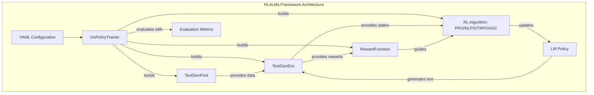

The RL4LMs framework follows a modular architecture where the `OnPolicyTrainer` acts as the central orchestrator. It builds and connects all components according to a YAML configuration file. The reinforcement learning loop involves the agent interacting with the environment through the policy, generating text, receiving rewards, and updating the policy accordingly.

Sources: [rl4lms/envs/text_generation/training_utils.py:126-224](), [scripts/training/train_text_generation.py:46-54]()

## Component Registry System

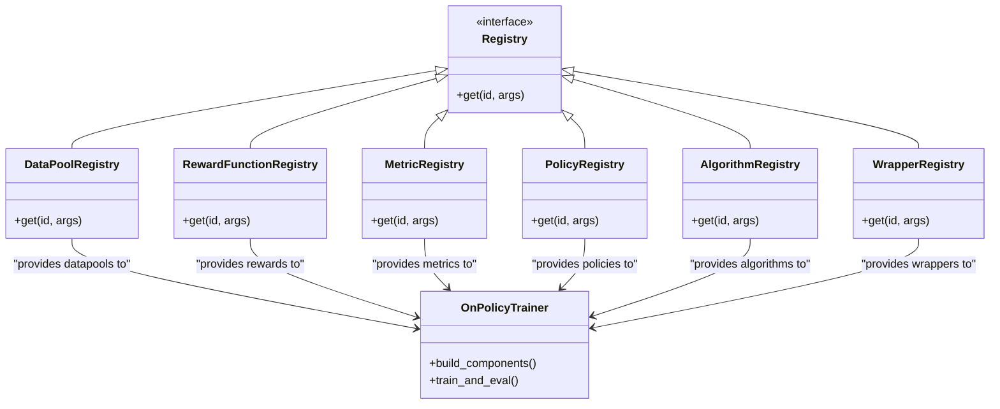

The registry system is a core architectural component that enables the modular and extensible design of RL4LMs. Each type of component is managed by a dedicated registry, which allows components to be registered and retrieved by ID. This makes it easy to swap different implementations of components without changing the rest of the system.

Sources: [rl4lms/envs/text_generation/training_utils.py:10-15](), [rl4lms/envs/text_generation/training_utils.py:46-123]()

## Policy Architecture

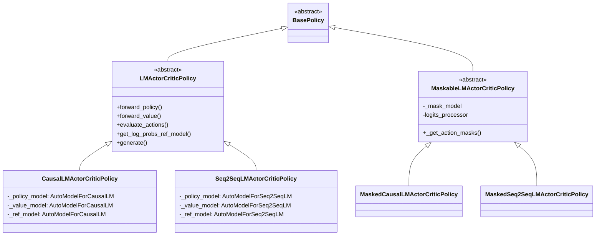

The policy system supports different types of language models through a class hierarchy. The two main branches are for causal language models (like GPT-2) and sequence-to-sequence models (like T5 or BART). Each has a standard version and a maskable version that supports action masking for improved exploration during training (particularly used with NLPO algorithm).

Sources: [README.md:130-156]()

## Reinforcement Learning Algorithms

RL4LMs provides implementations of four on-policy reinforcement learning algorithms:

1. **PPO (Proximal Policy Optimization)**: A widely used RL algorithm known for its stability and sample efficiency
2. **NLPO (Natural Language Policy Optimization)**: A novel algorithm designed specifically for text generation tasks
3. **TRPO (Trust Region Policy Optimization)**: An algorithm that ensures policy updates stay within a trust region
4. **A2C (Advantage Actor-Critic)**: A synchronous version of the Asynchronous Advantage Actor-Critic algorithm

These algorithms are adapted from the Stable Baselines3 library and tailored to work with language model policies for text generation tasks.

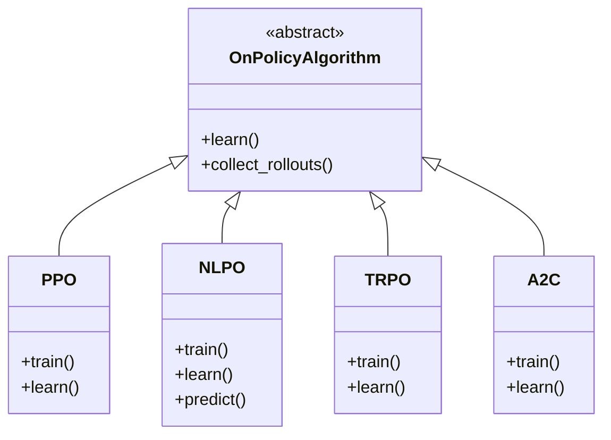

Sources: [README.md:31](), [README.md:127-131]()

## Training Pipeline

The training pipeline in RL4LMs follows a standard reinforcement learning workflow:

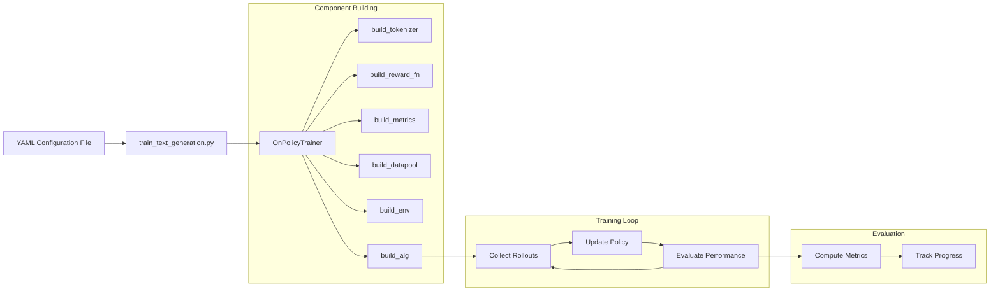

The training process begins with loading a YAML configuration file that specifies all aspects of the training. The `OnPolicyTrainer` builds all components according to the configuration and executes the training loop. During training, the agent collects rollouts by interacting with the environment, updates the policy based on the observed rewards, and periodically evaluates the performance on validation data.

Sources: [scripts/training/train_text_generation.py:13-55](), [rl4lms/envs/text_generation/training_utils.py:194-223]()

## Configuration System

RL4LMs uses YAML configuration files to define all aspects of the training process. This includes:

1. **Dataset/Task Configuration**:
   ```yaml
   datapool:
     id: cnn_daily_mail
     args:
       prompt_prefix: "Summarize: "
   ```

2. **Tokenizer Configuration**:
   ```yaml
   tokenizer:
     model_name: t5-base
     padding_side: left
     truncation_side: left
     pad_token_as_eos_token: False
   ```

3. **Reward Function Configuration**:
   ```yaml
   reward_fn:
     id: rouge
     args:
       rouge_type: "rouge1"
   ```

4. **Environment Configuration**:
   ```yaml
   env:
     n_envs: 10
     args:
       max_prompt_length: 512
       max_episode_length: 100
       terminate_on_eos: True
   ```

5. **Algorithm and Policy Configuration**:
   ```yaml
   alg:
     id: ppo
     args: 
       n_steps: 512
       batch_size: 64
       learning_rate: 0.000002
     policy:
       id: seq2seq_lm_actor_critic_policy
       args:
         model_name: t5-base
   ```

6. **Training and Evaluation Configuration**:
   ```yaml
   train_evaluation:
     eval_batch_size: 100
     n_iters: 100
     eval_every: 10
     metrics:
       - id: rouge
       - id: bleu
   ```

This configuration-based approach makes it easy to experiment with different components and hyperparameters without changing code.

Sources: [README.md:79-187](), [scripts/training/task_configs/synthetic_generate_increasing_numbers/gpt2_nlpo.yml:1-61]()

## Use Cases and Supported Tasks

RL4LMs supports a wide range of text generation tasks:

| Task Type | Description | Example Applications |
|-----------|-------------|---------------------|
| Summarization | Generate concise summaries of longer texts | News article summarization, document summarization |
| Text Continuation | Continue text based on a prompt | Story generation, content creation |
| Dialog Generation | Generate conversational responses | Chatbots, dialog systems |
| Machine Translation | Translate text from one language to another | Language translation services |
| Table-to-Text Generation | Generate textual descriptions of tabular data | Data reporting, automated analysis |
| Question Answering | Generate answers to questions | QA systems, information retrieval |
| Commonsense Reasoning | Generate text that demonstrates reasoning about common situations | Reasoning systems, content creation |

The framework has been thoroughly tested across these tasks using various language models and reinforcement learning algorithms.

Sources: [README.md:17-25]()

## Extending the Framework

RL4LMs is designed to be highly extensible, allowing users to add custom components:

1. **Custom Datasets**: Create by subclassing `TextGenPool` and implementing the `prepare()` method
2. **Custom Reward Functions**: Create by subclassing `RewardFunction` and implementing the `__call__()` method
3. **Custom Metrics**: Create by subclassing `BaseMetric` and implementing the `compute()` method
4. **Custom Algorithms**: Create by subclassing `OnPolicyAlgorithm` and implementing required methods
5. **Custom Policies**: Create by subclassing the appropriate policy base class

Each custom component can be registered in the corresponding registry, making it available for use through the configuration system.

Sources: [README.md:190-293]()

## Getting Started

To get started with RL4LMs, you can:

1. **Install the library**:
   ```bash
   git clone https://github.com/allenai/RL4LMs.git
   cd RL4LMs
   pip install -e .
   ```

2. **Train a model** using an existing configuration:
   ```bash
   python scripts/training/train_text_generation.py --config_path scripts/training/task_configs/summarization/t5_ppo.yml
   ```

3. **Create your own configuration** by modifying an existing one to suit your needs

For more detailed information about specific components, please refer to the corresponding pages in this wiki.

Sources: [README.md:47-53](), [README.md:67-73]()

---

# Page: System Architecture

# System Architecture

<details>
<summary>Relevant source files</summary>

The following files were used as context for generating this wiki page:

- [README.md](README.md)
- [rl4lms/envs/text_generation/alg_wrappers.py](rl4lms/envs/text_generation/alg_wrappers.py)
- [rl4lms/envs/text_generation/registry.py](rl4lms/envs/text_generation/registry.py)
- [rl4lms/envs/text_generation/reward.py](rl4lms/envs/text_generation/reward.py)
- [rl4lms/envs/text_generation/training_utils.py](rl4lms/envs/text_generation/training_utils.py)
- [setup.py](setup.py)

</details>


## Overview and Purpose

This document provides a comprehensive explanation of the RL4LMs system architecture, detailing how components interact to enable reinforcement learning for language models. RL4LMs is designed with modularity and extensibility as its core principles, allowing users to customize every aspect of the training pipeline while maintaining a consistent interface.

The architecture follows a registry-based component system that facilitates easy swapping of implementations for datasets, reward functions, metrics, policies, and algorithms. This document focuses on the structural organization of these components and their interactions. For specific information about reward functions, see [Reward Functions](#3), and for details about reinforcement learning algorithms, see [Reinforcement Learning Algorithms](#4).

## Core Architecture Overview

RL4LMs is structured around a central training orchestrator (`OnPolicyTrainer`) that coordinates the interaction between various components defined through registries. The system uses a YAML-based configuration to instantiate and connect these components.

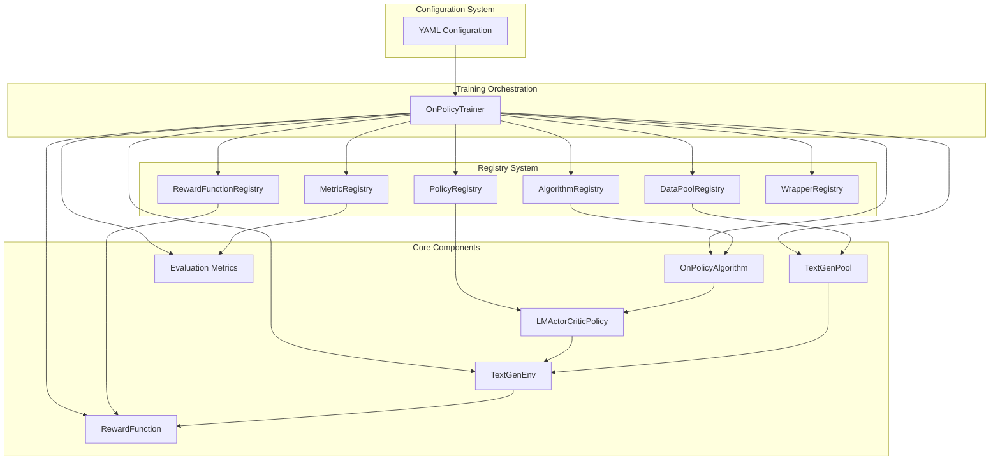

Sources: [README.md:126-132](), [rl4lms/envs/text_generation/training_utils.py:126-169](), [rl4lms/envs/text_generation/registry.py:1-246]()

## Registry System Architecture

The RL4LMs framework implements a registry pattern to manage different types of components. This approach allows for a modular and extensible design where components can be added, removed, or swapped without modifying core code.

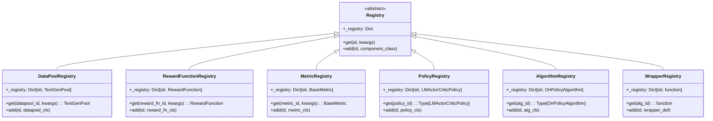

Each registry maintains a mapping between string identifiers and component implementations. When a component is requested by ID through configuration, the appropriate registry retrieves the implementation and instantiates it with the provided arguments.

Example registry usage:
```python
# Creating a data pool instance from a config
datapool = DataPoolRegistry.get(datapool_config["id"], 
                               datapool_config.get("args", {}))

# Creating a reward function instance from a config
reward_fn = RewardFunctionRegistry.get(reward_config["id"],
                                      reward_config.get("args", {}))
```

The registry system is extensible - custom components can be added to the registries and then used through configuration without modifying the core code.

Sources: [rl4lms/envs/text_generation/registry.py:87-264](), [rl4lms/envs/text_generation/training_utils.py:45-49](), [rl4lms/envs/text_generation/training_utils.py:57-65]()

## Training Pipeline

The training pipeline in RL4LMs is orchestrated by the `OnPolicyTrainer` class, which is responsible for:
1. Building all components based on configuration
2. Managing the training loop
3. Handling evaluation and checkpointing
4. Coordinating the interaction between components

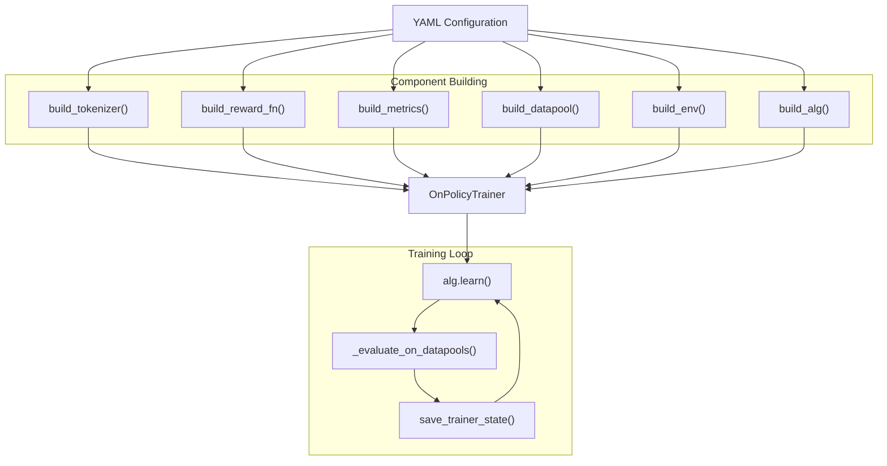

The `OnPolicyTrainer` acts as the central coordinator for the training process. It initializes all components based on the provided configuration and manages the training loop. The training loop consists of learning iterations followed by periodic evaluation and checkpoint saving.

Key methods in the training pipeline:
- `_setup()`: Initializes all components based on the configuration
- `train_and_eval()`: Manages the training loop, alternating between learning and evaluation
- `_evaluate_on_datapools()`: Evaluates the model on validation and test datasets

Sources: [rl4lms/envs/text_generation/training_utils.py:126-224](), [README.md:77-187]()

## Environment Architecture

The environment in RL4LMs follows the OpenAI Gym interface and is implemented as `TextGenEnv`. It simulates a Markov Decision Process (MDP) for text generation, where:
- States are represented by the current text context
- Actions are token selections
- Rewards are computed based on the generated text quality

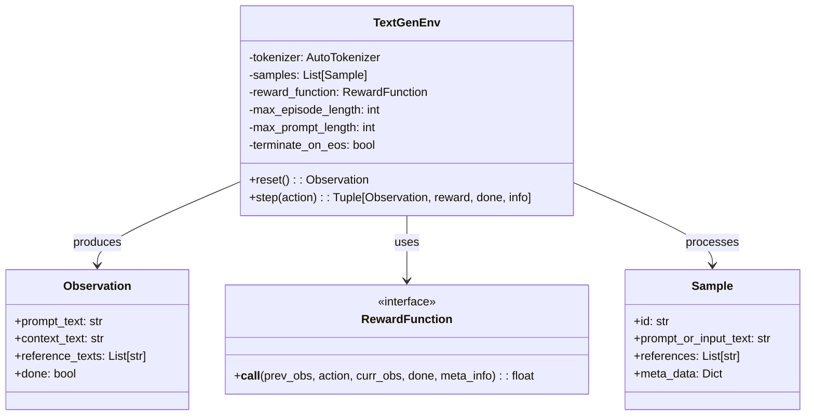

The environment maintains the state of the text generation process and computes rewards based on the configured reward function. The environment is typically vectorized using `SubprocVecEnv` to process multiple episodes in parallel for more efficient training.

The `step()` method advances the environment by taking a token action and returns:
1. The new observation
2. The reward for the action
3. A boolean indicating if the episode is done
4. Additional information (metadata)

Sources: [rl4lms/envs/text_generation/training_utils.py:79-95](), [README.md:107-125]()

## Policy Architecture

RL4LMs implements a comprehensive policy hierarchy that supports different types of language models. Policies are responsible for both generating text and evaluating the value of states.

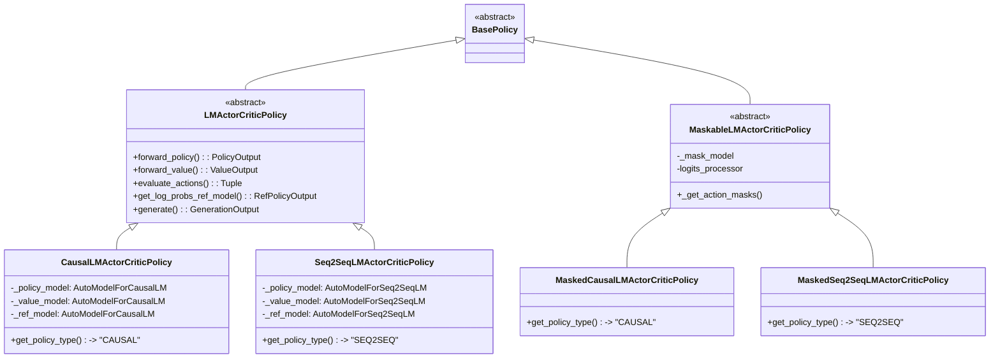

The policy system supports two main types of language models:
1. **Causal Language Models** (like GPT-2): Models that generate text by predicting the next token based on previous tokens
2. **Sequence-to-Sequence Models** (like T5 or BART): Models that transform an input sequence into an output sequence

Each type has a standard version and a maskable version that supports action masking for improved exploration during training. The maskable variants are particularly important for the NLPO algorithm.

Key components of the policy:
- **Actor**: The language model used for generating text (policy_model)
- **Critic**: The model used for estimating state values (value_model)
- **Reference Model**: The original unmodified model used for KL-divergence calculation (ref_model)

Sources: [rl4lms/envs/text_generation/registry.py:48-56](), [rl4lms/envs/text_generation/registry.py:185-200](), [README.md:126-157]()

## Algorithm Implementation

RL4LMs implements several on-policy reinforcement learning algorithms adapted for language model training. These algorithms are built on top of the stable-baselines3 framework but enhanced with specific features for text generation.

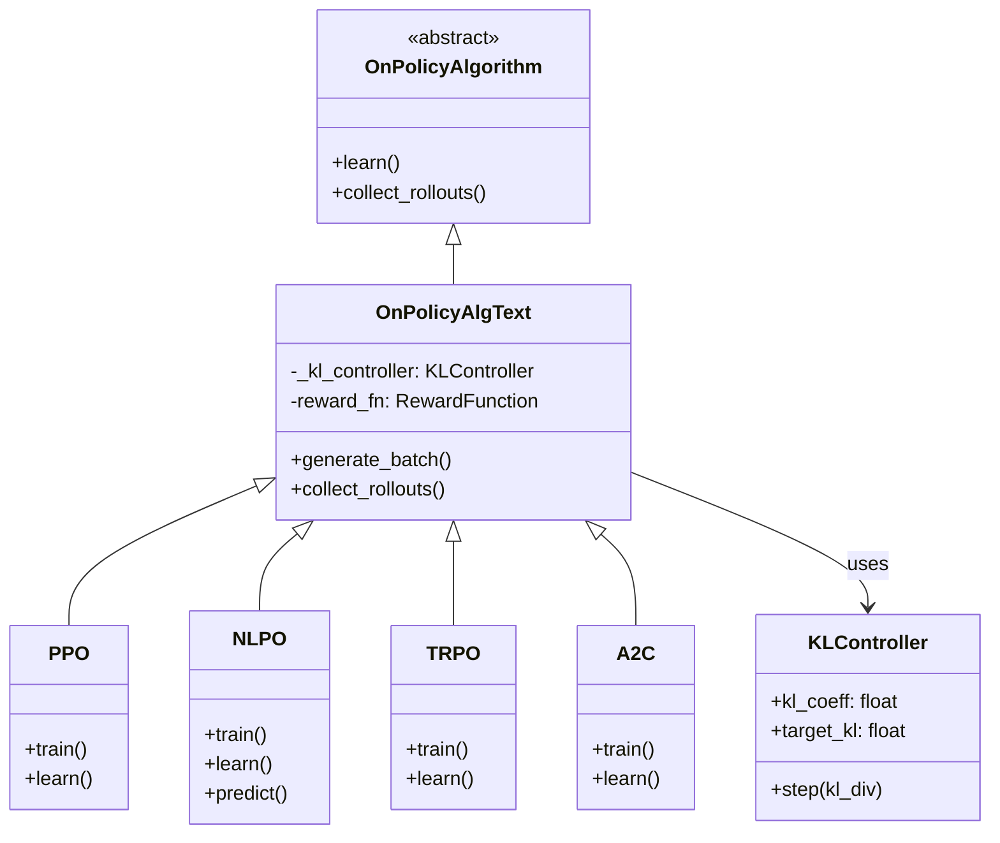

The algorithms are wrapped by a common wrapper (`wrap_onpolicy_alg`) that extends them with text generation specific functionality. This wrapper adds:

1. **KL Divergence Control**: Manages the KL divergence between the trained policy and the reference model
2. **Batched Reward Computation**: Enables efficient reward calculation for multiple episodes
3. **Vectorized Environment Handling**: Manages parallel environments for improved efficiency

The most notable algorithms implemented are:
- **PPO** (Proximal Policy Optimization): A widely used RL algorithm that uses clipped surrogate objectives
- **NLPO** (Natural Language Policy Optimization): A novel algorithm specialized for text generation
- **TRPO** (Trust Region Policy Optimization): An algorithm that ensures policy updates stay within a trust region
- **A2C** (Advantage Actor-Critic): An on-policy algorithm that uses value functions to reduce variance

Sources: [rl4lms/envs/text_generation/alg_wrappers.py:90-408](), [rl4lms/envs/text_generation/registry.py:203-225](), [README.md:127-157]()

## Component Interaction Flow

The following diagram illustrates how the components interact during the training process, showing the flow of data and control:

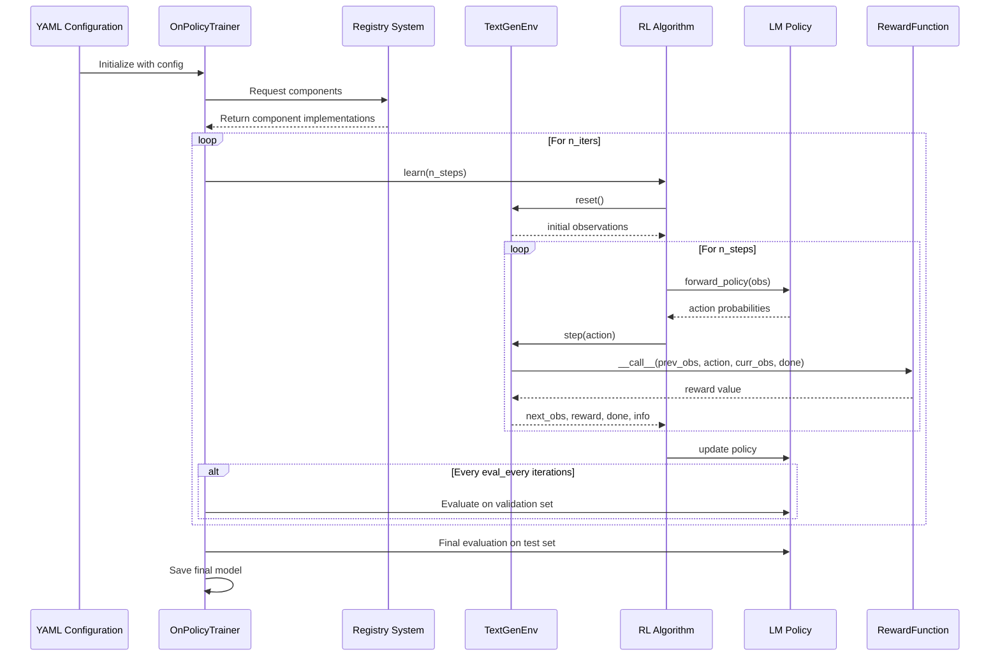

The training process begins with the initialization of the `OnPolicyTrainer` with a configuration. The trainer then requests components from the registry system. The main training loop consists of:

1. The agent collecting rollouts by interacting with the environment
2. The environment computing rewards using the reward function
3. The agent updating the policy based on the collected rollouts
4. Periodic evaluation of the policy on validation data

This cycle repeats for the specified number of iterations, after which a final evaluation is performed on the test set.

Sources: [rl4lms/envs/text_generation/training_utils.py:194-223](), [rl4lms/envs/text_generation/alg_wrappers.py:352-404]()

## Configuration Schema

RL4LMs uses a YAML-based configuration system to define all aspects of the training process. The configuration specifies the components to use and their parameters.

| Component | Configuration Section | Description |
|-----------|----------------------|-------------|
| Dataset | `datapool` | Specifies the dataset to use for training and evaluation |
| Tokenizer | `tokenizer` | Configures the tokenizer for processing text |
| Reward Function | `reward_fn` | Defines the reward function for guiding the RL algorithm |
| Environment | `env` | Configures the text generation environment |
| Algorithm | `alg` | Specifies the RL algorithm and its parameters |
| Policy | `alg.policy` | Configures the language model policy |
| Training & Evaluation | `train_evaluation` | Defines training parameters and evaluation metrics |

Example configuration structure:
```yaml
datapool:
  id: "cnn_daily_mail"
  args:
    prompt_prefix: "Summarize: "

tokenizer:
  model_name: "t5-base"
  padding_side: "left"
  
reward_fn:
  id: "rouge"
  args:
    rouge_type: "rouge1"
    
env:
  n_envs: 10
  args:
    max_prompt_length: 512
    max_episode_length: 100
    
alg:
  id: "ppo"
  args:
    n_steps: 512
    batch_size: 64
  policy:
    id: "seq2seq_lm_actor_critic_policy"
    args:
      model_name: "t5-base"
      
train_evaluation:
  eval_batch_size: 100
  n_iters: 100
  eval_every: 10
```

Sources: [README.md:77-187]()

## Extensibility Architecture

RL4LMs is designed for extensibility, allowing users to add custom components without modifying the core codebase. This is achieved through the registry system and well-defined interfaces.

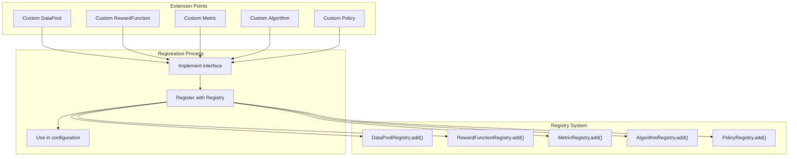

To extend RL4LMs with custom components:

1. Implement the appropriate interface (e.g., `RewardFunction`, `TextGenPool`, `BaseMetric`)
2. Register the implementation with the corresponding registry
3. Use the custom component in your configuration by its registered ID

This extensibility architecture allows users to experiment with new ideas without changing the core framework, making RL4LMs highly adaptable to different research needs.

Sources: [README.md:190-293]()

## Summary

The RL4LMs system architecture is built around a modular, registry-based design that enables the composition of various components to create customized reinforcement learning pipelines for language models. The architecture ensures:

1. **Modularity**: Components can be replaced or extended without modifying core code
2. **Configurability**: All aspects of the system can be controlled through configuration
3. **Extensibility**: New components can be easily added through the registry system
4. **Reusability**: Common components like policies and algorithms can be reused across different tasks

This architecture makes RL4LMs a powerful framework for experimenting with reinforcement learning approaches to language model fine-tuning.

Sources: [README.md:11-34](), [setup.py:6-15]()

---

# Page: Registry System

# Registry System

<details>
<summary>Relevant source files</summary>

The following files were used as context for generating this wiki page:

- [README.md](README.md)
- [rl4lms/envs/text_generation/registry.py](rl4lms/envs/text_generation/registry.py)
- [rl4lms/envs/text_generation/reward.py](rl4lms/envs/text_generation/reward.py)
- [rl4lms/envs/text_generation/training_utils.py](rl4lms/envs/text_generation/training_utils.py)
- [setup.py](setup.py)

</details>


## Purpose and Scope

The Registry System is a core architectural pattern in the RL4LMs framework that facilitates modular component management and extensibility. This document explains how the various registries function, their implementation, and how they integrate with the rest of the framework. For information about specific components being registered, see their respective wiki pages: [Policies](#2.3), [Reward Functions](#3), and [RL Algorithms](#4).

## Overview

The Registry System provides a central mechanism for managing various components used in reinforcement learning for language models. It follows a simple but powerful design pattern that organizes different types of components into their own dedicated registries, mapping string identifiers to their corresponding implementation classes.

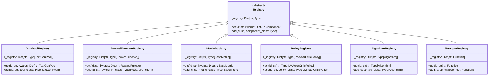

Sources: [rl4lms/envs/text_generation/registry.py:87-264]()

## Registry Types

The RL4LMs framework implements several specific registry types, each managing a different category of components:

| Registry Type | Purpose | Key Classes/Functions Managed |
|---------------|---------|-------------------------------|
| `DataPoolRegistry` | Manages datasets for text generation tasks | `IMDB`, `CommonGen`, `CNNDailyMail`, etc. |
| `RewardFunctionRegistry` | Manages reward functions for RL training | `MeteorRewardFunction`, `RougeRewardFunction`, etc. |
| `MetricRegistry` | Manages evaluation metrics | `BLEUMetric`, `RougeMetric`, `BERTScoreMetric`, etc. |
| `PolicyRegistry` | Manages policy implementations | `CausalLMActorCriticPolicy`, `Seq2SeqLMActorCriticPolicy`, etc. |
| `AlgorithmRegistry` | Manages RL algorithms | `PPO`, `NLPO`, `TRPO`, `A2C` |
| `WrapperRegistry` | Manages algorithm wrappers | `wrap_onpolicy_alg` |
| `PostProcessorRegistry` | Manages text post-processors | `three_sentence_summary` |

Sources: [rl4lms/envs/text_generation/registry.py:87-264]()

## Registry Implementation

Each registry follows a consistent implementation pattern with three key elements:

1. A class-level `_registry` dictionary that maps string identifiers to component implementations
2. A `get()` class method to retrieve and instantiate components 
3. An `add()` class method to register new component implementations

Here's an example of how these registries are implemented:

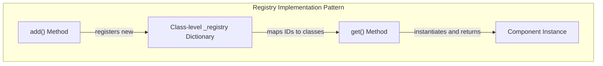

Sources: [rl4lms/envs/text_generation/registry.py:87-264]()

## Integration with Training Pipeline

The Registry System is a core part of the RL4LMs training pipeline, enabling configuration-driven component creation. The `OnPolicyTrainer` class uses these registries to build the necessary components based on configuration files.

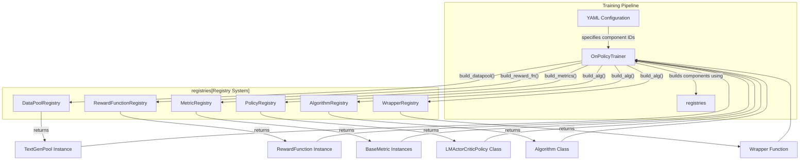

Sources: [rl4lms/envs/text_generation/training_utils.py:34-124]()

## Component Retrieval Process

When components are requested from a registry, they are retrieved by their string ID and instantiated with the provided arguments. The process for retrieving components follows this general pattern:

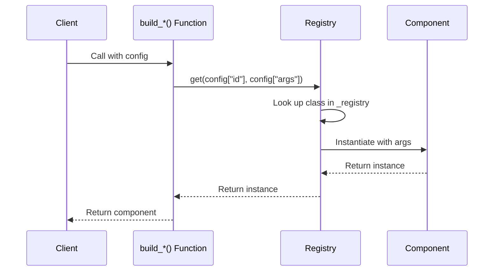

For example, here's how reward functions are built:

```mermaid
graph TD
    subgraph "Building a Reward Function"
        config["reward_config = {'id': 'rouge', 'args': {'rouge_type': 'rouge1'}}"]
        build["build_reward_fn(reward_config)"]
        registry["RewardFunctionRegistry.get('rouge', {'rouge_type': 'rouge1'})"]
        class["RougeRewardFunction class"]
        instance["RougeRewardFunction(rouge_type='rouge1')"]
        
        config -->|"passed to"| build
        build -->|"calls"| registry
        registry -->|"looks up"| class
        class -->|"instantiates"| instance
        instance -->|"returned to"| build
        build -->|"returns"| result["Reward Function Instance"]
    end
```

Sources: [rl4lms/envs/text_generation/training_utils.py:46-49](), [rl4lms/envs/text_generation/registry.py:139-142]()

## Component Registration Process

New components can be added to the system by registering them with the appropriate registry. This is done by calling the `add()` method with a string ID and the component class:

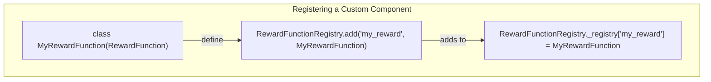

Sources: [rl4lms/envs/text_generation/registry.py:144-146]()

## Registry Usage in Configuration

The Registry System enables configuration-driven application development through YAML files. Component types and their parameters are specified in these files, which are then used to build the components using the registries.

```
datapool:
  id: cnn_daily_mail
  args:
    prompt_prefix: "Summarize: "

reward_fn:
  id: rouge
  args:
    rouge_type: "rouge1"

alg:
  id: ppo
  args: 
    n_steps: 512
    batch_size: 64
    learning_rate: 0.000002
```

Each component specification includes an `id` field that identifies which implementation to use, and an optional `args` field that provides parameters for initialization.

Sources: [rl4lms/envs/text_generation/training_utils.py:126-168]()

## Common Registry Operations

The Registry System is used throughout the RL4LMs codebase for building components. Here are some common registry operations:

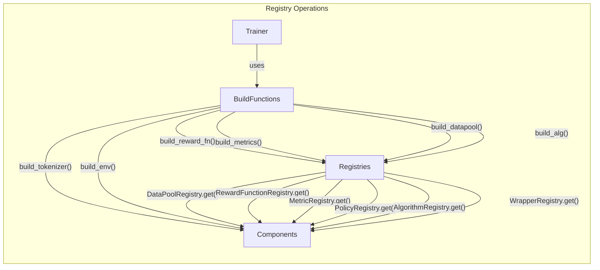

Sources: [rl4lms/envs/text_generation/training_utils.py:34-124]()

## Benefits of the Registry System

The Registry System offers several key advantages:

1. **Modularity**: Components are decoupled, allowing them to be developed and tested independently.
2. **Extensibility**: New implementations can be added without modifying existing code.
3. **Configuration-driven**: Components can be selected and configured via YAML files.
4. **Discoverability**: All available components are clearly listed in the registries.
5. **Standardization**: Components follow consistent interfaces determined by their base classes.

Sources: [README.md:10-34]()

## Extending with Custom Components

Extending the RL4LMs framework with custom components is straightforward using the Registry System. Here's the general pattern:

1. Create a new class that inherits from the appropriate base class
2. Implement the required methods
3. Register the class with the appropriate registry

For example, to create and register a custom reward function:

```mermaid
graph TD
    subgraph "Creating & Registering a Custom Component"
        A["Create class MyRewardFunction<br>inheriting from RewardFunction"]
        B["Implement __call__ method"]
        C["Register with RewardFunctionRegistry.add()"]
        D["Use in config with id: 'my_reward'"]
        
        A --> B --> C --> D
    end
```

Sources: [README.md:245-293]()

## Summary

The Registry System is a fundamental architectural component of RL4LMs that enables modular, extensible, and configuration-driven development. It organizes different types of components into dedicated registries, providing a clean interface for component retrieval and registration. Understanding the Registry System is essential for effectively using and extending the RL4LMs framework.

---

# Page: Environment

# Environment

<details>
<summary>Relevant source files</summary>

The following files were used as context for generating this wiki page:

- [rl4lms/envs/text_generation/env.py](rl4lms/envs/text_generation/env.py)
- [rl4lms/envs/text_generation/observation.py](rl4lms/envs/text_generation/observation.py)
- [scripts/training/task_configs/synthetic_generate_increasing_numbers/bart_ppo.yml](scripts/training/task_configs/synthetic_generate_increasing_numbers/bart_ppo.yml)
- [scripts/training/task_configs/synthetic_generate_increasing_numbers/blendorbot_ppo.yml](scripts/training/task_configs/synthetic_generate_increasing_numbers/blendorbot_ppo.yml)

</details>


## Purpose and Overview

The Environment component in RL4LMs provides a reinforcement learning (RL) interface for text generation tasks. It implements the standard OpenAI Gym interface for RL environments, adapting it specifically for language model tasks such as text generation, summarization, and translation.

This document details the environment's architecture, its components, and how it interacts with other parts of the RL4LMs framework. For information about the policies that act within this environment, see [Policies](#2.3).

## Key Components

The RL4LMs environment system consists of two main classes:
1. `TextGenEnv`: The main environment class implementing the Gym interface
2. `Observation`: A dataclass representing the state of the environment

```mermaid
classDiagram
    class TextGenEnv {
        +tokenizer: AutoTokenizer
        +reward_function: RewardFunction
        +max_steps: int
        +observation_space: DictSpace
        +action_space: Discrete
        +step(action): Tuple
        +reset(sample): Dict
        +render()
        +close()
        +add_sample(sample, weight)
    }
    
    class Observation {
        +prompt_or_input_encoded_pt: torch.tensor
        +prompt_or_input_attention_mask_pt: torch.tensor
        +prompt_or_input_text: str
        +context_encoded_pt: torch.tensor
        +context_attention_mask_pt: torch.tensor
        +context_text: str
        +target_or_reference_texts: List[str]
        +action_history: List[str]
        +to_dict(): Dict
        +update(action, tokenizer): Observation
        +init_from_sample(): Observation
    }
    
    class RewardFunction {
        +__call__(prev_obs, action, current_obs, done, meta_info): float
    }
    
    class Sample {
        +id: str
        +prompt_or_input_text: str
        +references: List[str]
        +meta_data: Dict
    }
    
    TextGenEnv --> "1" Observation: "contains current observation"
    TextGenEnv --> "1" RewardFunction: "uses for reward calculation"
    TextGenEnv --> "*" Sample: "processes training examples"
    Observation --> "1" Sample: "initialized from"
```

Sources: [rl4lms/envs/text_generation/env.py:15-40](), [rl4lms/envs/text_generation/observation.py:10-36]()

## TextGenEnv Class

The `TextGenEnv` class is the core of the environment system, implementing the standard OpenAI Gym interface (`Env`) for reinforcement learning. It converts text generation tasks into a format suitable for RL algorithms.

### Initialization

```python
def __init__(
    self,
    tokenizer: AutoTokenizer,
    reward_function: RewardFunction,
    samples: Tuple[List[Sample], float],
    max_episode_length: int = 512,
    priority_scale: float = 0.0,
    max_prompt_length: Optional[int] = None,
    terminate_on_eos: bool = False,
    context_start_token: Optional[int] = None,
    prompt_truncation_side: str = "left",
):
```

Key parameters:
- `tokenizer`: Hugging Face tokenizer for encoding/decoding text
- `reward_function`: Function to compute rewards for generated tokens
- `samples`: List of training examples with associated weights
- `max_episode_length`: Maximum number of tokens to generate
- `terminate_on_eos`: Whether to end generation when EOS token is produced
- `context_start_token`: Special token ID to start generation (for encoder-decoder models)

Sources: [rl4lms/envs/text_generation/env.py:16-51]()

### Observation and Action Spaces

The environment defines two key spaces:

1. **Observation Space**: A dictionary space containing tensors for:
   - Encoded prompt/input
   - Prompt attention mask
   - Generated context (tokens produced so far)
   - Context attention mask
   - Combined input and context

2. **Action Space**: A discrete space with size equal to the tokenizer's vocabulary size

Sources: [rl4lms/envs/text_generation/env.py:53-88]()

## Environment Flow and RL Loop

The environment implements the standard RL loop through its main methods:

```mermaid
sequenceDiagram
    participant "RL Algorithm" as Agent
    participant TextGenEnv
    participant Observation
    participant RewardFunction
    
    Agent->>TextGenEnv: reset()
    TextGenEnv->>Observation: init_from_sample()
    Note over Observation: Create initial state with empty context
    Observation-->>TextGenEnv: Return initial observation
    TextGenEnv-->>Agent: Return observation dict
    
    loop Until episode_done
        Agent->>TextGenEnv: step(token_id)
        TextGenEnv->>Observation: update(token_id, tokenizer)
        Note over Observation: Add token to context
        Observation-->>TextGenEnv: Return updated observation
        TextGenEnv->>RewardFunction: Calculate reward
        RewardFunction-->>TextGenEnv: Return reward value
        TextGenEnv-->>Agent: Return (observation, reward, done, info)
    end
```

Sources: [rl4lms/envs/text_generation/env.py:104-144](), [rl4lms/envs/text_generation/env.py:146-170]()

### Step Method

The `step` method is the core of the environment's functionality:

```python
def step(self, action: int) -> Tuple[Dict[str, torch.tensor], int, bool, dict]:
```

1. Takes a token ID as input (the action)
2. Updates the current observation by adding the token to the context
3. Checks if the episode is done (EOS token or max length reached)
4. Computes the reward using the reward function
5. Returns the updated observation, reward, done flag, and additional info

Sources: [rl4lms/envs/text_generation/env.py:104-144]()

### Reset Method

The `reset` method prepares the environment for a new episode:

```python
def reset(self, sample: Sample = None) -> Dict[str, torch.tensor]:
```

1. Selects a new sample if one isn't provided
2. Initializes a new observation from the sample
3. Resets the time step counter
4. Returns the initial observation

Sources: [rl4lms/envs/text_generation/env.py:146-170]()

## Observation Class

The `Observation` class represents the state of the environment at each step. It contains:

1. **Encoded Representations**:
   - `prompt_or_input_encoded_pt`: Tokenized prompt
   - `context_encoded_pt`: Tokens generated so far
   - `input_encoded_pt`: Combined prompt and context

2. **Text Representations**:
   - `prompt_or_input_text`: Original prompt text
   - `context_text`: Text generated so far
   - `target_or_reference_texts`: Reference texts for evaluation

3. **Methods**:
   - `to_dict()`: Converts observation to dictionary format for RL algorithms
   - `update(action, tokenizer)`: Creates a new observation with the action added to context
   - `init_from_sample()`: Initializes observation from a sample

Sources: [rl4lms/envs/text_generation/observation.py:10-36](), [rl4lms/envs/text_generation/observation.py:37-50](), [rl4lms/envs/text_generation/observation.py:72-118](), [rl4lms/envs/text_generation/observation.py:120-177]()

## Environment in the RL4LMs Framework

The environment fits into the larger RL4LMs framework as follows:

```mermaid
graph TD
    subgraph "RL4LMs Framework"
        config["YAML Configuration"]
        trainer["OnPolicyTrainer"]
        alg["RL Algorithm (PPO/NLPO)"]
        policy["Language Model Policy"]
        metrics["Evaluation Metrics"]
    end
    
    subgraph "Environment System"
        env["TextGenEnv"]
        reward["RewardFunction"]
        obs["Observation"]
    end
    
    subgraph "External Components"
        tokenizer["Hugging Face Tokenizer"]
        datapool["Text Generation DataPool"]
    end
    
    config -->|"configures"| trainer
    trainer -->|"creates"| env
    trainer -->|"creates"| alg
    trainer -->|"creates"| reward
    trainer -->|"loads from"| datapool
    
    env -->|"contains"| obs
    env -->|"uses"| reward
    env -->|"uses"| tokenizer
    
    datapool -->|"provides samples to"| env
    
    alg -->|"interacts with"| env
    alg -->|"updates"| policy
    policy -->|"generates actions for"| env
    
    env -->|"provides feedback to"| metrics
```

Sources: [rl4lms/envs/text_generation/env.py:15-179]()

## Environment Configuration

The environment is configured through YAML files. Here's an example configuration:

```yaml
env:
  n_envs: 10
  args:
    max_prompt_length: 5
    max_episode_length: 20
    terminate_on_eos: True
    context_start_token: 2  # decoder start token for seq2seq models
```

Key configuration parameters:

| Parameter | Description | Example |
|-----------|-------------|---------|
| `n_envs` | Number of parallel environments | 10 |
| `max_prompt_length` | Maximum length of input prompt | 5 |
| `max_episode_length` | Maximum tokens to generate | 20 |
| `terminate_on_eos` | Whether to stop on EOS token | True |
| `context_start_token` | Token ID to start generation (encoder-decoder models) | 2 |
| `prompt_truncation_side` | Which side to truncate prompts ("left" or "right") | "left" |

Sources: [scripts/training/task_configs/synthetic_generate_increasing_numbers/bart_ppo.yml:17-23](), [scripts/training/task_configs/synthetic_generate_increasing_numbers/blendorbot_ppo.yml:17-23]()

## Special Handling for Different Model Types

The environment handles different types of language models:

1. **Causal Language Models** (e.g., GPT-2)
   - Generation starts with an empty context
   - Each token is appended to the context sequentially

2. **Sequence-to-Sequence Models** (e.g., BART, T5)
   - Generation starts with a special `context_start_token`
   - For T5, the environment automatically adjusts the action space size

Sources: [rl4lms/envs/text_generation/env.py:83-88](), [rl4lms/envs/text_generation/observation.py:141-157]()

## Integration with Reward Functions

The environment integrates with reward functions to provide feedback signals for learning:

1. Standard reward functions compute rewards for each step
2. Batched reward functions handle multiple environments at once
3. Rewards are calculated based on previous observation, action, and current observation

The environment also collects information in the `info` dictionary returned by `step()`, which contains:
- Generated text so far
- Action history
- Reference texts
- Prompt text
- Additional metadata

Sources: [rl4lms/envs/text_generation/env.py:118-132](), [rl4lms/envs/text_generation/env.py:134-142]()

---

# Page: Policies

# Policies

<details>
<summary>Relevant source files</summary>

The following files were used as context for generating this wiki page:

- [rl4lms/algorithms/common/maskable/logits_processor.py](rl4lms/algorithms/common/maskable/logits_processor.py)
- [rl4lms/algorithms/trpo/trpo.py](rl4lms/algorithms/trpo/trpo.py)
- [rl4lms/envs/text_generation/policy.py](rl4lms/envs/text_generation/policy.py)
- [rl4lms/envs/text_generation/policy/base_policy.py](rl4lms/envs/text_generation/policy/base_policy.py)
- [rl4lms/envs/text_generation/policy/causal_policy.py](rl4lms/envs/text_generation/policy/causal_policy.py)
- [rl4lms/envs/text_generation/policy/seq2seq_policy.py](rl4lms/envs/text_generation/policy/seq2seq_policy.py)
- [scripts/training/task_configs/synthetic_generate_increasing_numbers/t5_nlpo.yml](scripts/training/task_configs/synthetic_generate_increasing_numbers/t5_nlpo.yml)
- [scripts/training/task_configs/synthetic_generate_increasing_numbers/t5_ppo.yml](scripts/training/task_configs/synthetic_generate_increasing_numbers/t5_ppo.yml)

</details>


## Purpose and Scope

This document details the policy implementations in the RL4LMs framework. In reinforcement learning for language models, a policy is a function that maps an observation (text context) to a distribution over possible actions (next tokens). The RL4LMs framework implements various policy architectures optimized for different language model types, enabling reinforcement learning algorithms to efficiently train language models for text generation tasks.

For information about how policies interact with the RL environment, see [Environment](#2.2). For details on the reinforcement learning algorithms that use these policies, see [Reinforcement Learning Algorithms](#4).

## Policy Architecture Overview

```mermaid
classDiagram
    class BasePolicy {
        <<abstract>>
        +forward()
        +predict()
    }
    
    class PolicyType {
        <<enum>>
        CAUSAL
        SEQ2SEQ
    }
    
    class LMActorCriticPolicy {
        <<abstract>>
        -_policy_model
        -_value_model
        -_ref_model
        -_value_head
        -_action_dist
        +forward_policy()
        +forward_value()
        +evaluate_actions()
        +get_log_probs_ref_model()
        +generate()
        +get_policy_type()
    }
    
    class CausalLMActorCriticPolicy {
        +get_policy_type() -> CAUSAL
    }
    
    class Seq2SeqLMActorCriticPolicy {
        +get_policy_type() -> SEQ2SEQ
    }
    
    class MaskableLMActorCriticPolicy {
        <<abstract>>
        -_mask_model
        -logits_processor
        +_get_action_masks()
    }
    
    class MaskedCausalLMActorCriticPolicy {
        +get_policy_type() -> CAUSAL
    }
    
    class MaskedSeq2SeqLMActorCriticPolicy {
        +get_policy_type() -> SEQ2SEQ
    }
    
    BasePolicy <|-- LMActorCriticPolicy
    LMActorCriticPolicy <|-- CausalLMActorCriticPolicy
    LMActorCriticPolicy <|-- Seq2SeqLMActorCriticPolicy
    
    BasePolicy <|-- MaskableLMActorCriticPolicy
    MaskableLMActorCriticPolicy <|-- MaskedCausalLMActorCriticPolicy
    MaskableLMActorCriticPolicy <|-- MaskedSeq2SeqLMActorCriticPolicy
```

The policy system extends the `BasePolicy` from Stable Baselines 3, tailoring it to work with language models. There are two main policy types, corresponding to the two main types of language models:

1. **Causal Language Models** (e.g., GPT-2): Generate text by predicting the next token based on all previous tokens.
2. **Sequence-to-Sequence Models** (e.g., T5, BART): Generate text by encoding the input and then decoding the output.

Each policy type has both standard and "maskable" variants, with the latter supporting action masking for improved exploration during reinforcement learning.

Sources: [rl4lms/envs/text_generation/policy/base_policy.py:17-40](). [rl4lms/envs/text_generation/policy/causal_policy.py:37-279](). [rl4lms/envs/text_generation/policy/seq2seq_policy.py:35-64]().

## Actor-Critic Design Pattern

```mermaid
graph TB
    subgraph "Policy Architecture"
        obs["Observation (Text)"]
        
        subgraph "Actor Component"
            policy_model["Policy Model<br>(Language Model)"]
            action_dist["Action Distribution"]
        end
        
        subgraph "Critic Component"
            value_model["Value Model<br>(Same Architecture)"]
            value_head["Value Head<br>(Linear Layer)"]
        end
        
        subgraph "Reference Model"
            ref_model["Reference Model<br>(Frozen Copy)"]
        end
        
        obs --> policy_model
        obs --> value_model
        policy_model --> action_dist
        value_model --> value_head
        
        action_dist --> action["Action (Token ID)"]
        value_head --> value["Value (Scalar)"]
        
        obs --> ref_model
        ref_model --> ref_log_prob["Reference Log Probability"]
    end
```

RL4LMs policies follow the Actor-Critic architecture pattern, with:

1. **Actor** (`_policy_model`): Produces action probabilities (token distributions).
2. **Critic** (`_value_model`): Estimates value function (how good the current state is).
3. **Reference Model** (`_ref_model`): Frozen copy of the policy model used for computing KL divergence penalties.

Core methods include:
- `forward_policy()`: Computes action logits and probabilities from the policy model.
- `forward_value()`: Computes state values from the value model.
- `evaluate_actions()`: Evaluates actions by computing log probabilities, values, and entropy.
- `get_log_probs_ref_model()`: Gets log probabilities from the reference model for KL penalties.
- `generate()`: Generates complete text sequences during inference.

Sources: [rl4lms/envs/text_generation/policy/base_policy.py:102-167](). [rl4lms/envs/text_generation/policy/causal_policy.py:116-206](). [rl4lms/envs/text_generation/policy/seq2seq_policy.py:94-236]().

## Policy Implementation Details

### Base Policy Class

The `LMActorCriticPolicy` base class defines the common interface and shared functionality:

```python
class LMActorCriticPolicy(BasePolicy):
    def __init__(self, observation_space, action_space, lr_schedule, model_name, ...):
        # Initialize policy, value model, and reference model
        
    @abstractmethod
    def _build_model_heads(self, model_name):
        # Implemented by subclasses to initialize the specific model architecture
        
    @abstractmethod
    def forward_policy(self, obs, actions, past_model_kwargs=None):
        # Forward pass for the policy (actor)
        
    @abstractmethod
    def forward_value(self, obs, past_model_kwargs=None):
        # Forward pass for the value function (critic)
        
    @abstractmethod
    def evaluate_actions(self, obs, actions):
        # Evaluate actions (for training updates)
        
    @abstractmethod
    def get_log_probs_ref_model(self, obs, action, past_model_kwargs=None):
        # Get log probs from reference model (for KL divergence)
        
    @abstractmethod
    def get_policy_type(self):
        # Return policy type (CAUSAL or SEQ2SEQ)
```

The base class handles core functionality like optimizer setup, observation processing, and generation logic, while delegating model-specific operations to subclasses.

Sources: [rl4lms/envs/text_generation/policy/base_policy.py:102-368](). 

### Model-Specific Policy Classes

The framework provides implementations for different model architectures:

#### Causal Language Model Policies

For models like GPT-2 that generate text auto-regressively:

```python
class CausalLMActorCriticPolicy(LMActorCriticPolicy):
    def _build_model_heads(self, model_name):
        self._policy_model = AutoModelForCausalLM.from_pretrained(model_name)
        self._value_model = AutoModelForCausalLM.from_pretrained(model_name)
        self._ref_model = deepcopy(self._policy_model).eval()
        self._value_head = nn.Linear(self._value_model.config.hidden_size, 1, bias=False)
        # Apply model parallelism if available
```

The key feature is that these policies work with a single input context that gets extended with each generated token.

Sources: [rl4lms/envs/text_generation/policy/causal_policy.py:37-313](). 

#### Sequence-to-Sequence Model Policies

For encoder-decoder models like T5 and BART:

```python
class Seq2SeqLMActorCriticPolicy(LMActorCriticPolicy):
    def _build_model_heads(self, model_name):
        self._policy_model = AutoModelForSeq2SeqLM.from_pretrained(model_name)
        self._value_model = AutoModelForSeq2SeqLM.from_pretrained(model_name)
        self._ref_model = deepcopy(self._policy_model).eval()
        self._value_head = nn.Linear(self._value_model.config.hidden_size, 1, bias=False)
        # Apply model parallelism if available
```

These policies handle separate encoder inputs (prompts) and decoder inputs (the generated text so far).

Sources: [rl4lms/envs/text_generation/policy/seq2seq_policy.py:35-334](). 

## Action Masking

```mermaid
graph TD
    subgraph "Action Masking Process"
        input["Input Tokens"] --> policy["Policy Model"]
        policy --> logits["Token Logits"]
        
        logits --> mask_strategy["Mask Strategy"]
        
        subgraph "Mask Strategies"
            topk["Top-K: Select top K tokens"]
            topp["Top-P: Tokens with cumulative probability < P"]
            learned["Learned: Use reference/mask model"]
        end
        
        mask_strategy --> |applies| action_masks["Action Masks (Boolean Tensor)"]
        
        logits --> |filtered by| action_masks
        action_masks --> masked_logits["Masked Logits"]
        masked_logits --> distribution["Action Distribution"]
        distribution --> sample["Sample Next Token"]
    end
```

The maskable policy variants (`MaskedCausalLMActorCriticPolicy` and `MaskedSeq2SeqLMActorCriticPolicy`) implement action masking, which restricts the set of possible actions (tokens) to consider at each step. 

Key features of action masking:

1. **Mask Types**:
   - `learned_top_k`: Use a separate mask model to select top-k tokens
   - `learned_top_p`: Select tokens with cumulative probability below threshold p
   - `topk`: Select top-k tokens directly from scores

2. **Mask Model**:
   - Can be either the frozen reference model (`_ref_model`) or 
   - A separate model that gets periodically updated (`_mask_model`)

3. **Logits Processor**:
   - The masking is implemented via HuggingFace's `LogitsProcessor` interface
   - `MaskLogitsProcessorCasualLM` and `MaskLogitsProcessorSeq2SeqLM` handle the two model types

Action masking significantly improves exploration efficiency by restricting the action space to likely tokens, which is crucial given the massive vocabulary sizes of language models (typically 30k-50k tokens).

Sources: [rl4lms/envs/text_generation/policy/causal_policy.py:314-606](). [rl4lms/envs/text_generation/policy/seq2seq_policy.py:345-649](). [rl4lms/algorithms/common/maskable/logits_processor.py:13-302]().

## Reinforcement Learning Interface

The policies implement several key methods required by reinforcement learning algorithms:

```mermaid
sequenceDiagram
    participant Env as Environment
    participant Policy as Policy
    participant Algo as RL Algorithm
    
    Note over Env,Algo: During Collection Phase
    Env->>Policy: observation
    Policy->>Policy: forward_policy()
    Policy->>Env: action (token id)
    Env->>Env: step(action)
    Env->>Policy: reward, next_observation
    
    Note over Env,Algo: During Update Phase
    Algo->>Policy: evaluate_actions()
    Policy->>Policy: Compute log_probs, values, entropy
    Policy->>Algo: EvaluateActionsOutput
    Algo->>Policy: Compute policy gradient & update
```

Key interfaces for RL algorithms:

1. **Action Evaluation**:
   ```python
   def evaluate_actions(self, obs, actions):
       # Return values, log_probs, and entropy for the RL algorithm
       # to compute advantages and policy gradients
   ```

2. **KL Divergence Computation**:
   ```python
   def get_log_probs_ref_model(self, obs, action):
       # Return log probabilities from the reference model
       # Used to compute KL penalties during training
   ```

3. **Value Prediction**:
   ```python
   def predict_values(self, obs):
       # Return value estimates for given observations
       # Used to compute advantages
   ```

These methods are crucial for algorithms like PPO, TRPO, and NLPO to compute policy gradients and update the policy while maintaining stable learning.

Sources: [rl4lms/envs/text_generation/policy/base_policy.py:264-368](). [rl4lms/algorithms/trpo/trpo.py:171-231]().

## Model Parallelism Support

```mermaid
graph TD
    subgraph "Model Parallelism Flow"
        policy["Policy Model"] --> |if parallelizable| parallelize["model.parallelize()"]
        parallelize --> distributed["Model Distributed Across GPUs"]
        
        input["Inputs"] --> |device handling| first_device["Move to first_device"]
        first_device --> model_inputs["Prepared Model Inputs"]
        model_inputs --> distributed
        
        distributed --> output["Model Output"]
        output --> |device handling| results["Results on Appropriate Device"]
    end
```

The policy implementations support model parallelism for large language models that don't fit on a single GPU:

1. The `_apply_model_parallel` flag controls whether to use model parallelism
2. If the model is parallelizable (determined by `model.is_parallelizable`), the policy calls `model.parallelize()`
3. Input tensors are moved to the appropriate device using `get_policy_first_device()`
4. Special handling ensures outputs are on the expected device for subsequent processing

This allows RL4LMs to work with larger models like GPT-2 XL, T5-large, or BART-large that exceed the memory capacity of a single GPU.

Sources: [rl4lms/envs/text_generation/policy/causal_policy.py:81-94](). [rl4lms/envs/text_generation/policy/seq2seq_policy.py:80-92](). [rl4lms/envs/text_generation/policy/causal_policy.py:256-263]().

## Usage in Configuration

Policies are configured in YAML files. Example configuration for a T5 model with NLPO:

```yaml
alg:
  id: nlpo
  args:
    n_steps: 128
    batch_size: 64
    learning_rate: 0.000002
  policy:
    id: maskable_seq2seq_lm_actor_critic_policy
    args:
      model_name: t5-base
      apply_model_parallel: True
      mask_type: "learned_top_p"
      top_mask: 0.9
      target_update_iterations: 20
      generation_kwargs:
        do_sample: True
        min_length: 20
        top_k: 200
        max_new_tokens: 20
```

The policies are registered in the framework's registry system, allowing them to be instantiated by ID in configurations. The policy ID maps to the corresponding policy class:

- `causal_lm_actor_critic_policy` → `CausalLMActorCriticPolicy`
- `seq2seq_lm_actor_critic_policy` → `Seq2SeqLMActorCriticPolicy`
- `maskable_causal_lm_actor_critic_policy` → `MaskedCausalLMActorCriticPolicy`
- `maskable_seq2seq_lm_actor_critic_policy` → `MaskedSeq2SeqLMActorCriticPolicy`

Sources: [scripts/training/task_configs/synthetic_generate_increasing_numbers/t5_nlpo.yml:38-50](). [scripts/training/task_configs/synthetic_generate_increasing_numbers/t5_ppo.yml:37-46]().

## Conclusion

The policy system in RL4LMs provides a flexible and powerful framework for applying reinforcement learning to various language model architectures. By supporting both causal and sequence-to-sequence models, along with action masking capabilities, it enables efficient exploration and stable training for text generation tasks.

The actor-critic architecture, combined with reference model tracking for KL divergence computation, implements the core components needed for modern RL algorithms like PPO, TRPO, and NLPO, while the model parallelism support ensures the framework can scale to larger language models.

---

# Page: Reward Functions

# Reward Functions

<details>
<summary>Relevant source files</summary>

The following files were used as context for generating this wiki page:

- [rl4lms/envs/text_generation/preference_reward.py](rl4lms/envs/text_generation/preference_reward.py)
- [rl4lms/envs/text_generation/registry.py](rl4lms/envs/text_generation/registry.py)
- [rl4lms/envs/text_generation/reward.py](rl4lms/envs/text_generation/reward.py)
- [scripts/training/task_configs/common_gen/t5_ppo_on_supervised.yml](scripts/training/task_configs/common_gen/t5_ppo_on_supervised.yml)

</details>


## Purpose and Overview

Reward functions are a critical component in the RL4LMs framework, providing the learning signal that guides the reinforcement learning process for language models. They evaluate the quality of generated text and return scalar reward values that help the model learn to generate better outputs.

This page explains the reward function architecture, available reward functions, and how to create and use custom reward functions in the RL4LMs framework. For information about using these rewards in training, see [Training Configuration](#6.1).

## Reward Function Architecture

```mermaid
classDiagram
    class RewardFunction {
        <<abstract>>
        +__call__(observation, action, next_observation, done, meta_info) float
    }
    
    class BatchedRewardFunction {
        <<abstract>>
        +__call__(prompt_texts, gen_texts, ref_texts, dones, meta_infos) List[float]
    }
    
    class MeteorRewardFunction {
        +_metric: MeteorMetric
        +_shaping_fn: RewardFunction
        +__call__() float
    }
    
    class RougeRewardFunction {
        +_metric: RougeMetric
        +_rouge_type: str
        +_shaping_fn: RewardFunction
        +__call__() float
    }
    
    class LearnedRewardFunction {
        +_metric_model: AutoModelForSequenceClassification
        +_metric_tokenizer: AutoTokenizer
        +__call__() float
    }
    
    class LearnedBatchedRewardFunction {
        +_metric_model: AutoModelForSequenceClassification
        +_metric_tokenizer: AutoTokenizer
        +__call__() List[float]
    }
    
    class CommonGenPrefRM {
        +_model_type: str
        +_device: str
        +_batch_size: int
        +__call__() List[float]
    }
    
    RewardFunction <|-- MeteorRewardFunction
    RewardFunction <|-- RougeRewardFunction
    RewardFunction <|-- BLEURewardFunction
    RewardFunction <|-- BERTScoreRewardFunction
    RewardFunction <|-- LearnedRewardFunction
    
    BatchedRewardFunction <|-- LearnedBatchedRewardFunction
    BatchedRewardFunction <|-- SpiderRewardFunction
    BatchedRewardFunction <|-- CommonGenPrefRM
```

Sources: [rl4lms/envs/text_generation/reward.py:23-45](), [rl4lms/envs/text_generation/reward.py:48-65]()

RL4LMs implements reward functions through two abstract base classes:

1. **`RewardFunction`**: Processes single examples, evaluating the reward after each action or at the end of an episode. The `__call__` method takes:
   - `current_observation`: The previous observation (state s)
   - `action`: The action performed at state s
   - `next_observation`: The observation after the action (state s')
   - `done`: Whether the episode is finished
   - `meta_info`: Additional information about the text sample

2. **`BatchedRewardFunction`**: Processes batches of examples simultaneously for efficiency. The `__call__` method takes lists of:
   - `prompt_texts`: Input prompts
   - `gen_texts`: Generated texts
   - `ref_texts`: Reference texts
   - `dones`: Flags indicating completed episodes
   - `meta_infos`: Additional information

## Registry System

The reward functions are managed through a registry pattern, allowing for easy retrieval and extension:

```mermaid
graph TD
    subgraph "RewardFunctionRegistry"
        registry["_registry (Dict)"]
        get["get(reward_fn_id, kwargs)"]
        add["add(id, reward_fn_cls)"]
    end
    
    subgraph "Client Code"
        config["YAML Configuration"]
        trainer["OnPolicyTrainer"]
    end
    
    subgraph "Reward Functions"
        meteor["meteor: MeteorRewardFunction"]
        rouge["rouge: RougeRewardFunction"]
        bleu["bleu: BLEURewardFunction"]
        bertscore["bert_score: BERTScoreRewardFunction"]
        learned["learned_reward: LearnedBatchedRewardFunction"]
        prefRM["common_gen_preference_model: CommonGenPrefRM"]
    end
    
    config --> |specifies| trainer
    trainer --> |calls| get
    get --> |retrieves| registry
    registry --> |returns| meteor
    registry --> |returns| rouge
    registry --> |returns| bleu
    registry --> |returns| bertscore
    registry --> |returns| learned
    registry --> |returns| prefRM
    
    add --> |registers| registry
```

Sources: [rl4lms/envs/text_generation/registry.py:115-146]()

When initializing the training environment, the framework:
1. Reads the reward function configuration from the YAML config file
2. Retrieves the appropriate reward function class from the registry using its ID
3. Instantiates the reward function with the provided arguments
4. Uses the reward function to evaluate generated text during training

## Available Reward Functions

The framework provides several types of reward functions:

### 1. Text Quality Metrics

These reward functions evaluate text quality using standard metrics:

| Reward Function ID | Class | Description |
|-------------------|-------|-------------|
| `meteor` | `MeteorRewardFunction` | METEOR metric for text similarity |
| `rouge` | `RougeRewardFunction` | ROUGE metric with configurable type (rouge1, rouge2, rougeL) |
| `rouge_combined` | `RougeCombined` | Average of multiple ROUGE metrics |
| `bert_score` | `BERTScoreRewardFunction` | Semantic similarity using BERT embeddings |
| `bleu` | `BLEURewardFunction` | BLEU metric for text similarity |
| `bleurt` | `BLEURTRewardFunction` | BLEURT metric for improved text similarity |
| `sacre_bleu` | `SacreBleu` | SacreBLEU implementation for machine translation |
| `rouge_l_max` | `RougeLMaxRewardFunction` | ROUGE-L max variant |
| `ter` | `TER` | Translation Error Rate (inverted so higher is better) |
| `chrf` | `chrF` | Character n-gram F-score for translation evaluation |

Sources: [rl4lms/envs/text_generation/reward.py:126-164](), [rl4lms/envs/text_generation/reward.py:207-320](), [rl4lms/envs/text_generation/reward.py:486-605]()

### 2. Learned Reward Functions

These functions use pre-trained models to evaluate text quality:

| Reward Function ID | Class | Description |
|-------------------|-------|-------------|
| `learned_reward` | `LearnedBatchedRewardFunction` | Uses a pre-trained classifier to score text quality |

The `LearnedBatchedRewardFunction` takes a model name, label index, and whether to include the prompt in evaluation. It uses a pre-trained classifier to score text samples in batches.

Sources: [rl4lms/envs/text_generation/reward.py:318-367](), [rl4lms/envs/text_generation/reward.py:442-483]()

### 3. Preference-based Reward Functions

These reward functions are based on human preference data:

| Reward Function ID | Class | Description |
|-------------------|-------|-------------|
| `common_gen_preference_model` | `CommonGenPrefRM` | Uses a preference model trained on CommonGen data |

The `CommonGenPrefRM` reward function uses a T5-based model trained on human preferences for CommonGen texts. It scores text based on how well it aligns with human judgments.

Sources: [rl4lms/envs/text_generation/preference_reward.py:189-261]()

### 4. Task-specific Reward Functions

These reward functions are designed for specific text generation tasks:

| Reward Function ID | Class | Description |
|-------------------|-------|-------------|
| `spider` | `SpiderRewardFunction` | Combines SPICE and CIDEr metrics for image captioning |
| `parent` | `PARENTRewardFunction` | PARENT metric for table-to-text generation |
| `common_gen_repeat_penalty` | `CommonGenPenaltyShapingFunction` | Penalizes repetition in CommonGen tasks |
| `intent_accuracy` | `IntentAccuracy` | Evaluates intent preservation in dialog generation |

Sources: [rl4lms/envs/text_generation/reward.py:71-123](), [rl4lms/envs/text_generation/reward.py:371-434](), [rl4lms/envs/text_generation/reward.py:510-533](), [rl4lms/envs/text_generation/reward.py:608-659]()

## Integration with RL Training Loop

```mermaid
graph TD
    subgraph "RL Training Loop"
        env["Text Generation Environment"]
        policy["Language Model Policy"]
        agent["RL Algorithm (PPO/NLPO/etc.)"]
        rewardFn["Reward Function"]
        datapool["Text Generation Dataset"]
    end
    
    env -->|"state (prompt + generated text)"| agent
    agent -->|"action (token ID)"| policy
    policy -->|"generates next token"| env
    env -->|"new state, done flag"| rewardFn
    rewardFn -->|"reward signal"| agent
    datapool -->|"prompts and references"| env
    
    agent -->|"updates"| policy
```

Sources: [rl4lms/envs/text_generation/registry.py:115-146]()

The reward function is a critical component in the RL training loop:

1. The environment provides the current state (prompt and generated text)
2. The agent, guided by the policy, selects the next token
3. The environment updates the state with the new token
4. The reward function evaluates the quality of the generated text
5. The agent uses the reward to update the policy

Most reward functions return zero for intermediate steps and only calculate the reward when `done=True` (at the end of a text generation episode).

## Creating Custom Reward Functions

To create a custom reward function:

1. Implement a class inheriting from `RewardFunction` or `BatchedRewardFunction`
2. Implement the `__call__` method with appropriate inputs and outputs
3. Register your reward function with the `RewardFunctionRegistry`

Example implementation:

```python
# 1. Define your reward function class
class CustomRewardFunction(RewardFunction):
    def __init__(self, param1, param2):
        self.param1 = param1
        self.param2 = param2
        
    def __call__(
        self,
        current_observation: Observation,
        action: int,
        next_observation: Observation,
        done: bool,
        meta_info: Dict[str, Any] = None,
    ) -> float:
        # Return 0 for intermediate steps
        if not done:
            return 0
            
        # Calculate reward for completed text
        generated_text = next_observation.context_text
        reference_texts = next_observation.target_or_reference_texts
        
        # Your custom reward logic here
        reward = your_reward_calculation(generated_text, reference_texts)
        return reward

# 2. Register your reward function
RewardFunctionRegistry.add("custom_reward", CustomRewardFunction)
```

Sources: [rl4lms/envs/text_generation/reward.py:23-45](), [rl4lms/envs/text_generation/registry.py:115-146]()

## Usage in Training Configuration

Reward functions are specified in YAML configuration files:

```yaml
reward_fn:
  id: common_gen_preference_model  # ID in RewardFunctionRegistry
  args:
    device: "cpu"                  # Arguments passed to the constructor
    batch_size: 5
    model_type: "11b"
```

You can also combine multiple reward functions using shaping functions:

```yaml
reward_fn:
  id: meteor
  args:
    shaping_fn: common_gen_repeat_penalty  # Additional reward component
```

The shaping function is applied in addition to the main reward function, allowing you to guide the model with multiple rewards simultaneously.

Sources: [scripts/training/task_configs/common_gen/t5_ppo_on_supervised.yml:7-31](), [rl4lms/envs/text_generation/reward.py:126-160]()

## Reward Function Selection Guidelines

Different reward functions are appropriate for different text generation tasks:

| Task | Recommended Reward Functions |
|------|------------------------------|
| Summarization | `rouge_combined`, `bert_score`, `learned_reward` |
| Machine Translation | `bleu`, `sacre_bleu`, `ter`, `chrf` |
| Dialog Generation | `intent_accuracy`, `bert_score` |
| Table-to-Text | `parent`, `bleu` |
| Image Captioning | `spider` (SPICE + CIDEr) |
| Creative Text Generation | `common_gen_preference_model` |

When selecting a reward function:
1. Consider the specific requirements of your task
2. Evaluate multiple reward functions on validation data
3. Use shaping functions to combine complementary rewards
4. Consider computational efficiency for large-scale training

---

# Page: Text Quality Rewards

# Text Quality Rewards

<details>
<summary>Relevant source files</summary>

The following files were used as context for generating this wiki page:

- [rl4lms/envs/text_generation/metric.py](rl4lms/envs/text_generation/metric.py)
- [rl4lms/envs/text_generation/registry.py](rl4lms/envs/text_generation/registry.py)
- [rl4lms/envs/text_generation/reward.py](rl4lms/envs/text_generation/reward.py)
- [scripts/reward-modeling/evaluate_intent_classifier.py](scripts/reward-modeling/evaluate_intent_classifier.py)
- [scripts/reward-modeling/train_intent_classifier.py](scripts/reward-modeling/train_intent_classifier.py)

</details>


This page documents the text quality reward functions available in RL4LMs, their implementations, and how they're used to train language models with reinforcement learning. Text quality rewards provide signals based on automated metrics that evaluate the quality of generated text against reference texts or other criteria.

For information about preference-based rewards, see [Preference Rewards](#3.2).

## Reward Function Architecture

RL4LMs provides a comprehensive framework for defining and using reward functions in reinforcement learning for text generation tasks. The framework is built around abstract base classes that define the interface for reward functions.

```mermaid
classDiagram
    class RewardFunction {
        <<abstract>>
        +__call__(current_observation, action, next_observation, done, meta_info) float
    }
    
    class BatchedRewardFunction {
        <<abstract>>
        +__call__(prompt_texts, gen_texts, ref_texts, dones, meta_infos) List[float]
    }
    
    RewardFunction <|-- MeteorRewardFunction
    RewardFunction <|-- RougeRewardFunction
    RewardFunction <|-- BERTScoreRewardFunction
    RewardFunction <|-- BLEURewardFunction
    RewardFunction <|-- RougeCombined
    RewardFunction <|-- LearnedRewardFunction
    RewardFunction <|-- BLEURTRewardFunction
    RewardFunction <|-- PARENTRewardFunction
    RewardFunction <|-- RougeLMaxRewardFunction
    RewardFunction <|-- TER
    RewardFunction <|-- chrF
    
    BatchedRewardFunction <|-- LearnedBatchedRewardFunction
    BatchedRewardFunction <|-- SpiderRewardFunction
    BatchedRewardFunction <|-- BatchedCommonGenPenaltyShapingFunction
    BatchedRewardFunction <|-- IntentAccuracy
    
    class RewardFunctionRegistry {
        +_registry: Dict
        +get(reward_fn_id, kwargs) RewardFunction
        +add(id, reward_fn_cls)
    }
    
    RewardFunctionRegistry --> RewardFunction : "manages"
    RewardFunctionRegistry --> BatchedRewardFunction : "manages"
```

**Reward Function Interface**

The primary abstract classes are:

1. `RewardFunction`: Base class for all reward functions that operate on a per-step basis
2. `BatchedRewardFunction`: Base class for reward functions that operate on batches of text

Key components:

- `RewardFunction.__call__`: Computes a reward based on the current observation, action, next observation, and episode completion status
- `BatchedRewardFunction.__call__`: Computes rewards for multiple text generation instances at once
- `RewardFunctionRegistry`: Central registry that maps identifiers to reward function classes

Sources: [rl4lms/envs/text_generation/reward.py:23-45](), [rl4lms/envs/text_generation/reward.py:48-65](), [rl4lms/envs/text_generation/registry.py:115-146]()

## Text Quality Reward Functions

### Reference-Based Rewards

Reference-based reward functions compare the generated text with one or more reference texts using established NLP metrics.

```mermaid
graph TD
    subgraph "Reference-Based Rewards"
        direction LR
        A["RewardFunction"]
        B["MeteorRewardFunction"]
        C["RougeRewardFunction"]
        D["BLEURewardFunction"]
        E["RougeCombined"]
        F["RougeLMaxRewardFunction"]
        G["SacreBleu"]
        H["TER"]
        I["chrF"]
        
        A --> B
        A --> C
        A --> D
        A --> E
        A --> F
        A --> G
        A --> H
        A --> I
    end
    
    subgraph "Metrics"
        M1["MeteorMetric"]
        M2["RougeMetric"]
        M3["BLEUMetric"]
        M4["RougeLMax"]
        M5["SacreBLEUMetric"]
        M6["TERMetric"]
        M7["chrFmetric"]
    end
    
    B --> M1
    C --> M2
    D --> M3
    F --> M4
    G --> M5
    H --> M6
    I --> M7
```

#### METEOR Reward

METEOR (Metric for Evaluation of Translation with Explicit Ordering) is designed to address some of the weaknesses of BLEU by considering synonyms and stemming.

```python
def __call__(self, current_observation, action, next_observation, done, meta_info=None):
    # compute meteor at the end of episode
    if done:
        references = [next_observation.target_or_reference_texts]
        predicted = [next_observation.context_text]
        metric_dict = self._metric.compute(None, predicted, references)
        score = metric_dict["lexical/meteor"][1]
        
        if self._shaping_fn is not None:
            aux_score = self._shaping_fn(current_observation, action, next_observation, done, meta_info)
            score = score + aux_score
        return score
    return 0
```

Sources: [rl4lms/envs/text_generation/reward.py:126-160](), [rl4lms/envs/text_generation/metric.py:107-127]()

#### ROUGE Reward

ROUGE (Recall-Oriented Understudy for Gisting Evaluation) is a set of metrics used primarily for evaluating automatic summarization. It compares an automatically generated summary against a reference summary.

```python
def __call__(self, current_observation, action, next_observation, done, meta_info=None):
    if done:
        # Uses single or multiple references based on configuration
        if self._use_single_ref:
            references = [next_observation.target_or_reference_texts[0]]
        else:
            references = [next_observation.target_or_reference_texts]
        predicted = [next_observation.context_text]

        metric_results = self._metric.compute(
            predictions=predicted, references=references, use_stemmer=True
        )
        reward = metric_results[self._rouge_type].mid.fmeasure
        
        if self._shaping_fn is not None:
            aux_score = self._shaping_fn(current_observation, action, next_observation, done, meta_info)
            reward = reward + aux_score
        return reward
    return 0
```

Sources: [rl4lms/envs/text_generation/reward.py:163-205](), [rl4lms/envs/text_generation/metric.py:130-160]()

#### BLEU Reward

BLEU (Bilingual Evaluation Understudy) is a metric commonly used to evaluate machine translation quality. It compares n-grams in the generated text with those in reference texts.

```python
def __call__(self, current_observation, action, next_observation, done, meta_info=None):
    if done:
        references = [next_observation.target_or_reference_texts]
        predicted = [next_observation.context_text]
        metric_results = self._metric.compute(None, predicted, references)
        bleu_score = metric_results["lexical/bleu"][1]
        return bleu_score
    return 0
```

Sources: [rl4lms/envs/text_generation/reward.py:273-292](), [rl4lms/envs/text_generation/metric.py:193-224]()

#### Other Reference-Based Rewards

- **RougeCombined**: Combines ROUGE-1, ROUGE-2, and ROUGE-L scores
- **RougeLMaxRewardFunction**: Computes the maximum ROUGE-L score over multiple references
- **SacreBleu**: An improved BLEU implementation
- **TER**: Translation Error Rate, inverted to be a reward (1 - TER)
- **chrF**: Character n-gram F-score

Sources: [rl4lms/envs/text_generation/reward.py:208-248](), [rl4lms/envs/text_generation/reward.py:536-605](), [rl4lms/envs/text_generation/reward.py:295-316](), [rl4lms/envs/text_generation/reward.py:559-581](), [rl4lms/envs/text_generation/reward.py:584-605]()

### Semantic Similarity Rewards

Semantic similarity rewards evaluate the semantic equivalence between generated and reference texts, going beyond surface-level lexical matching.

```mermaid
graph TD
    subgraph "Semantic Similarity Rewards"
        A["RewardFunction"]
        B["BERTScoreRewardFunction"]
        C["BLEURTRewardFunction"]
        
        A --> B
        A --> C
    end
    
    subgraph "Metrics"
        M1["BERTScoreMetric"]
        M2["BLEURTMetric"]
    end
    
    B --> M1
    C --> M2
```

#### BERTScore Reward

BERTScore leverages pre-trained BERT embeddings to compute the similarity between generated and reference texts at the token level.

```python
def __call__(self, current_observation, action, next_observation, done, meta_info=None):
    if done:
        references = [next_observation.target_or_reference_texts]
        predicted = [next_observation.context_text]
        metric_results = self._metric.compute(None, predicted, references)
        bert_score = metric_results["semantic/bert_score"][1]
        return bert_score
    return 0
```

Sources: [rl4lms/envs/text_generation/reward.py:251-270](), [rl4lms/envs/text_generation/metric.py:163-190]()

#### BLEURT Reward

BLEURT (Bilingual Evaluation Understudy with Representations from Transformers) is a learned metric based on BERT that evaluates the quality of machine translation outputs.

```python
def __call__(self, current_observation, action, next_observation, done, meta_info=None):
    if done:
        references = [next_observation.target_or_reference_texts]
        predicted = [next_observation.context_text]
        metric_results = self._metric.compute(
            predictions=predicted, references=references
        )
        score = metric_results["scores"][0]
        return score
    return 0
```

Sources: [rl4lms/envs/text_generation/reward.py:486-507](), [rl4lms/envs/text_generation/metric.py:227-246]()

### Model-Based Rewards

Model-based rewards use pre-trained models to evaluate text quality based on learned criteria.

```mermaid
graph TD
    subgraph "Model-Based Rewards"
        A["RewardFunction"]
        B["BatchedRewardFunction"]
        C["LearnedRewardFunction"]
        D["LearnedBatchedRewardFunction"]
        
        A --> C
        B --> D
    end
    
    C --> M1["AutoModelForSequenceClassification"]
    D --> M1
```

#### Learned Reward Function

Uses a pre-trained classifier to score generated text. The model outputs a probability distribution over labels, and one of these labels is used as the reward signal.

```python
def __call__(self, current_observation, action, next_observation, done, meta_info=None):
    if done:
        generated_text = current_observation.prompt_or_input_text if self._include_prompt_for_eval else ""
        generated_text += next_observation.context_text

        with torch.no_grad():
            encoded = self._metric_tokenizer(generated_text, return_tensors="pt", truncation=True, padding=True)
            outputs = self._metric_model(
                input_ids=encoded.input_ids.to(self._device),
                attention_mask=encoded.attention_mask.to(self._device),
            )
            scores = torch.softmax(outputs.logits.flatten(), dim=0)
            score = scores[self._label_ix].item()
            return score
    return 0
```

Sources: [rl4lms/envs/text_generation/reward.py:442-483](), [rl4lms/envs/text_generation/metric.py:44-104]()

#### Learned Batched Reward Function

Similar to `LearnedRewardFunction` but processes multiple texts in a batch, which can be more efficient.

```python
def __call__(self, prompt_texts, gen_texts, ref_texts, dones, meta_infos=None):
    # collect generations at done steps
    gens = []
    indices_with_done = []
    rewards = torch.zeros(len(prompt_texts))
    for ix, (prompt, gen, ref, done) in enumerate(zip(prompt_texts, gen_texts, ref_texts, dones)):
        if done:
            generated_text = prompt if self._include_prompt_for_eval else ""
            generated_text += gen
            gens.append(generated_text)
            indices_with_done.append(ix)

    # compute rewards at once
    with torch.no_grad():
        encoded = self._metric_tokenizer(gens, return_tensors="pt", truncation=True, padding=True)
        outputs = self._metric_model(
            input_ids=encoded.input_ids.to(self._device),
            attention_mask=encoded.attention_mask.to(self._device),
        )
        scores = torch.softmax(outputs.logits, dim=1)
        scores = scores[:, self._label_ix].flatten().cpu()
        rewards[indices_with_done] = scores

    return rewards
```

Sources: [rl4lms/envs/text_generation/reward.py:318-367]()

### Task-Specific Rewards

Some reward functions are designed for specific text generation tasks, providing specialized evaluation criteria.

```mermaid
graph TD
    subgraph "Task-Specific Rewards"
        A["RewardFunction"] 
        B["BatchedRewardFunction"]
        C["PARENT"]
        D["SpiderRewardFunction"]
        E["IntentAccuracy"]
        
        A --> C
        B --> D
        B --> E
    end
    
    subgraph "Metrics"
        M1["ParentToTTo"]
        M2["SpiceMetric + CIDERMetric"]
        M3["IntentAccuracyDailyDialog"]
    end
    
    C --> M1
    D --> M2
    E --> M3
```

#### PARENT Reward

PARENT (Precision And Recall of Entities and N-grams for Table-to-text) is designed for table-to-text generation tasks, evaluating both content selection and surface realization.

```python
def __call__(self, current_observation, action, next_observation, done, meta_info=None):
    if done:
        generated_texts = [next_observation.context_text]
        meta_infos = [meta_info]
        scores = self._metric.compute(None, generated_texts, None, meta_infos)
        reward = scores["table_to_text/parent_overall_f_score"][0][0]
        return reward
    return 0
```

Sources: [rl4lms/envs/text_generation/reward.py:510-533](), [rl4lms/envs/text_generation/metric.py:486-525]()

#### SPIDER Reward

SPIDER combines SPICE (Semantic Propositional Image Caption Evaluation) and CIDEr (Consensus-based Image Description Evaluation) metrics, primarily used for image captioning tasks.

```python
def __call__(self, prompt_texts, gen_texts, ref_texts, dones, meta_info=None):
    prompts = []
    gens = []
    refs = []
    indices_with_done = []
    rewards = torch.zeros(len(prompt_texts))
    for ix, (prompt, gen, ref, done) in enumerate(zip(prompt_texts, gen_texts, ref_texts, dones)):
        if done:
            prompts.append(prompt)
            gens.append(gen)
            refs.append(ref)
            indices_with_done.append(ix)

    if len(indices_with_done) > 0:
        spice_scores = self._spice_metric.compute(prompts, gens, refs)["lexical/spice"][0]
        cider_scores = self._cider_metric.compute(prompts, gens, refs)["lexical/cider"][0]
        total_scores = self._spice_coeff * np.array(spice_scores) + self._cider_coeff * np.array(cider_scores)

        if self._shaping_fn is not None:
            aux_scores = self._shaping_fn(prompt_texts, gen_texts, ref_texts, dones)
        else:
            aux_scores = [0] * len(indices_with_done)

        for ind, score, aux_score in zip(indices_with_done, total_scores, aux_scores):
            rewards[ind] = score + aux_score

    return rewards
```

Sources: [rl4lms/envs/text_generation/reward.py:371-434](), [rl4lms/envs/text_generation/metric.py:276-330]()

#### Intent Accuracy

Specifically designed for dialogue generation tasks, this reward function evaluates how well the generated response matches the intended dialogue act.

```python
def __call__(self, prompt_texts, gen_texts, ref_texts, dones, meta_infos=None):
    if self._metric is None:
        self._metric = IntentAccuracyDailyDialog()

    # compute rewards for finished episodes only
    rewards = np.zeros(len(gen_texts))

    done_prompt_texts = []
    done_gen_texts = []
    done_ref_texts = []
    done_meta_infos = []
    done_ixs = []
    for ix, (prompt, gen, ref, meta_info, done) in enumerate(zip(prompt_texts, gen_texts, ref_texts, meta_infos, dones)):
        if done:
            done_prompt_texts.append(prompt)
            done_gen_texts.append(gen)
            done_ref_texts.append(ref)
            done_meta_infos.append(meta_info)
            done_ixs.append(ix)

            if self._shape:
                score = self._shaping_metric.compute(done_prompt_texts, done_gen_texts, done_ref_texts)
                rewards[ix] = self._auto_coeff * score["lexical/meteor"][1]

    scores = self._metric.compute(done_prompt_texts, done_gen_texts, done_ref_texts, done_meta_infos)["intent/accuracy"][0]
    rewards[done_ixs] += self._intent_coeff * np.array(scores)
    return rewards.tolist()
```

Sources: [rl4lms/envs/text_generation/reward.py:608-659](), [rl4lms/envs/text_generation/metric.py:663-719](), [scripts/reward-modeling/train_intent_classifier.py:1-96](), [scripts/reward-modeling/evaluate_intent_classifier.py:1-74]()

## Reward Shaping

Many reward functions in RL4LMs support reward shaping, which allows combining the primary reward with auxiliary rewards to guide learning. This is implemented through an optional `shaping_fn` parameter.

```mermaid
graph TD
    subgraph "Reward Shaping"
        A["Primary Reward"]
        B["Shaping Function"]
        C["Combined Reward"]
        
        A --> C
        B --> C
    end
    
    D["RewardFunctionRegistry"] --> B
```

Example with METEOR + shaping:

```python
def __call__(self, current_observation, action, next_observation, done, meta_info=None):
    if done:
        # Primary reward computation
        references = [next_observation.target_or_reference_texts]
        predicted = [next_observation.context_text]
        metric_dict = self._metric.compute(None, predicted, references)
        score = metric_dict["lexical/meteor"][1]
        
        # Apply shaping if provided
        if self._shaping_fn is not None:
            aux_score = self._shaping_fn(current_observation, action, next_observation, done, meta_info)
            score = score + aux_score
        return score
    return 0
```

Sources: [rl4lms/envs/text_generation/reward.py:126-160](), [rl4lms/envs/text_generation/reward.py:163-205]()

## Registering and Using Reward Functions

The `RewardFunctionRegistry` provides a central location to register and retrieve reward functions by name. All built-in reward functions are pre-registered.

```python
class RewardFunctionRegistry:
    _registry = {
        "increasing_numbers": RewardIncreasingNumbers,
        "sentences_with_dates": RewardSentencesWithDates,
        "learned_reward": LearnedBatchedRewardFunction,
        "meteor": MeteorRewardFunction,
        "rouge": RougeRewardFunction,
        "bert_score": BERTScoreRewardFunction,
        "bleu": BLEURewardFunction,
        "bleurt": BLEURTRewardFunction,
        "rouge_combined": RougeCombined,
        "spider": SpiderRewardFunction,
        "common_gen_repeat_penalty": CommonGenPenaltyShapingFunction,
        "common_gen_repeat_penalty_batched": BatchedCommonGenPenaltyShapingFunction,
        "parent": PARENTRewardFunction,
        "sacre_bleu": SacreBleu,
        "rouge_l_max": RougeLMaxRewardFunction,
        "ter": TER,
        "chrf": chrF,
        "intent_accuracy": IntentAccuracy,
        "common_gen_preference_model": CommonGenPrefRM,
    }
```

To use a reward function in training, specify it in the configuration file:

```yaml
# Example configuration for ROUGE reward
reward:
  id: "rouge"
  args:
    rouge_type: "rougeL"  # Options: rouge1, rouge2, rougeL
    use_single_ref: true  # Whether to use only the first reference
    shaping_fn: null      # Optional shaping function
```

Sources: [rl4lms/envs/text_generation/registry.py:115-146]()

## Usage Example: Reinforcement Learning with METEOR Reward

Here's a complete example of how to configure a training run with METEOR reward:

```yaml
# train_meteor_reward.yaml
tokenizer:
  model_name: "gpt2"
  padding_side: "left"
  truncation_side: "left"
  pad_token_as_eos_token: False

datapool:
  id: "imdb"
  args:
    data_path: "imdb_samples.json"
    split: "train"
    max_samples: 500
  
reward:
  id: "meteor"
  args:
    shaping_fn: null

env:
  n_envs: 10
  args:
    max_prompt_length: 64
    max_episode_length: 48
    terminate_on_eos: True
    prompt_truncation_side: "left"
    context_start_token: null

alg:
  id: "ppo"
  args:
    n_steps: 512
    batch_size: 64
    verbose: 1
    learning_rate: 0.000001
    n_epochs: 5
    ent_coef: 0.0
```

When running training with this configuration, the system will:
1. Load the IMDB dataset
2. Set up a METEOR reward function
3. Create text generation environments
4. Train a policy with PPO using METEOR scores as rewards

Sources: [rl4lms/envs/text_generation/registry.py:115-146]()

---

# Page: Preference Rewards

# Preference Rewards

<details>
<summary>Relevant source files</summary>

The following files were used as context for generating this wiki page:

- [rl4lms/envs/text_generation/preference_reward.py](rl4lms/envs/text_generation/preference_reward.py)
- [scripts/training/task_configs/common_gen/t5_ppo_on_supervised.yml](scripts/training/task_configs/common_gen/t5_ppo_on_supervised.yml)

</details>


## Purpose and Scope

This page documents the preference-based reward functions in the RL4LMs framework. Preference rewards use trained models to evaluate text quality based on learned human preferences, rather than relying solely on fixed metrics like BLEU or ROUGE. This approach allows for more nuanced reward signals that better align with human judgments of text quality.

For information about other types of reward functions, see [Text Quality Rewards](#3.1) for metric-based rewards.

## Overview of Preference Rewards

Preference rewards represent a significant advancement in reinforcement learning for language models by replacing or supplementing traditional metrics with models that have learned human preferences. These rewards capture subjective aspects of text quality that are difficult to measure with conventional metrics.

```mermaid
flowchart TD
    subgraph "Preference Reward System"
        input["Generated Text"] --> prefModel["Preference Model"]
        prefModel --> score["Preference Score"]
        score --> reward["Final Reward Signal"]
        
        additionalFactors["Additional Factors (Optional)"]
        additionalFactors --> reward
    end
    
    subgraph "Additional Factors Examples"
        conceptCoverage["Concept Coverage"]
        meteorScore["METEOR Score"]
    end
    
    additionalFactors --- conceptCoverage
    additionalFactors --- meteorScore
```

Sources: [rl4lms/envs/text_generation/preference_reward.py:189-261](). [scripts/training/task_configs/common_gen/t5_ppo_on_supervised.yml:7-31]()

## Implementation in RL4LMs

The current implementation in RL4LMs provides a preference reward model specifically for the CommonGen task, which requires generating a coherent sentence that includes a given set of concepts.

### CommonGenPrefRM

The `CommonGenPrefRM` class inherits from `BatchedRewardFunction` and uses a pre-trained T5 model to score generated text.

```mermaid
classDiagram
    class BatchedRewardFunction {
        <<abstract>>
        +__call__(prompt_texts, gen_texts, ref_texts, dones, meta_infos)
    }
    
    class CommonGenPrefRM {
        -_model_type: str
        -_device: str
        -_batch_size: int
        -_concept_penalty_coeff: float
        -_meteor_coeff: float
        -_meteor_metric: MeteorMetric
        +__init__(model_type, device, batch_size, concept_penalty_coeff, meteor_coeff)
        -_get_missing_concepts(gen, concepts)
        -_get_meteor_scores(gen, references)
        +__call__(prompt_texts, gen_texts, ref_texts, dones, meta_infos)
    }
    
    BatchedRewardFunction <|-- CommonGenPrefRM
```

Sources: [rl4lms/envs/text_generation/preference_reward.py:189-261]()

### Reward Calculation Process

The preference reward calculation involves multiple components that can be customized:

1. **Base Preference Score**: Probability that the generated text is "good" according to the trained model
2. **Concept Coverage Penalty**: Optional reduction in score based on missing concepts
3. **METEOR Component**: Optional addition of METEOR metric score

```mermaid
flowchart LR
    subgraph "CommonGenPrefRM Reward Calculation"
        genText["Generated Text"] --> prefModel["T5 Preference Model"]
        prefModel --> prefScore["Preference Score\n(P(good))"]
        
        genText --> conceptCheck["Missing Concepts Check"]
        conceptCheck --> conceptPenalty["Concept Penalty"]
        
        genText --> meteorCalc["METEOR Calculation"]
        meteorCalc --> meteorScore["METEOR Score"]
        
        prefScore --> penalizedScore["Penalized Score"]
        conceptPenalty --> penalizedScore
        
        penalizedScore --> finalReward["Final Reward"]
        meteorScore --> finalReward
    end
```

The final reward is calculated as:
```
reward = meteor_coeff * meteor_score + pref_score / (1 + concept_penalty_coeff * n_missing_concepts)
```

Sources: [rl4lms/envs/text_generation/preference_reward.py:218-261]()

## Pre-trained Preference Model

The implementation uses a T5-11B model fine-tuned on CommonGen preferences. The model predicts whether a given text is "good" or "bad" and returns the probability of being "good" as the score.

```mermaid
flowchart TD
    subgraph "Preference Model Scoring"
        input["Input Text"] --> tokenize["Tokenize"]
        tokenize --> model["T5-11B Model"]
        model --> logits["Output Logits"]
        logits --> softmax["Softmax Between\n'good' and 'bad' tokens"]
        softmax --> score["P(good)\nPreference Score"]
    end
```

The model is automatically downloaded from a remote URL when first used and cached locally.

Sources: [rl4lms/envs/text_generation/preference_reward.py:32-152]()

## Usage and Configuration

To use the CommonGen preference reward in a training configuration, specify it in the YAML configuration file:

```yaml
reward_fn:
  id: common_gen_preference_model
  args:
    device: "cpu"
    batch_size: 5
    model_type: "11b"
    concept_penalty_coeff: 0.0  # Optional
    meteor_coeff: 0.0  # Optional
```

Configuration parameters:
- `model_type`: Currently only supports "11b" (T5-11B)
- `device`: Device to run the model on ("cpu", "cuda", etc.)
- `batch_size`: Batch size for inference
- `concept_penalty_coeff`: Weight for penalizing missing concepts (0.0 to disable)
- `meteor_coeff`: Weight for METEOR score component (0.0 to disable)

Sources: [scripts/training/task_configs/common_gen/t5_ppo_on_supervised.yml:7-31]()

## Integration with Training Pipeline

The preference reward function integrates with the RL4LMs training pipeline through the registry system. It's registered and can be referenced by ID in configuration files.

```mermaid
flowchart TD
    subgraph "Training Pipeline Integration"
        config["YAML Configuration"] --> trainer["OnPolicyTrainer"]
        trainer --> |"builds"| rewardReg["RewardFunctionRegistry"]
        rewardReg --> |"retrieves"| prefRM["CommonGenPrefRM"]
        
        trainer --> |"builds"| env["Text Generation Environment"]
        env --> |"generated text"| prefRM
        prefRM --> |"reward signal"| agent["RL Algorithm (PPO)"]
        agent --> |"updates"| policy["LM Policy"]
    end
```

Sources: [scripts/training/task_configs/common_gen/t5_ppo_on_supervised.yml:1-98]()

## Implementation Details

When a batch of generated texts is passed to the reward function:

1. It processes only texts marked as "done" (complete generations)
2. For each complete generation:
   - Checks for missing concepts from the prompt
   - Calculates METEOR score if enabled
3. Sends all complete generations to the preference model for scoring
4. Computes the final reward combining preference scores, concept coverage, and METEOR

The reward function supports batched processing for efficiency.

Sources: [rl4lms/envs/text_generation/preference_reward.py:218-261]()

## Technical Notes

- The preference model implementation uses the HuggingFace Transformers library
- The model is downloaded once and cached for subsequent uses
- Inference is optimized for batch processing
- The system supports both CPU and GPU inference
- Only T5-11B is currently supported as the preference model architecture

Sources: [rl4lms/envs/text_generation/preference_reward.py:32-152]()

---

# Page: Reinforcement Learning Algorithms

# Reinforcement Learning Algorithms

<details>
<summary>Relevant source files</summary>

The following files were used as context for generating this wiki page:

- [rl4lms/algorithms/a2c/a2c.py](rl4lms/algorithms/a2c/a2c.py)
- [rl4lms/algorithms/nlpo/nlpo.py](rl4lms/algorithms/nlpo/nlpo.py)
- [rl4lms/envs/text_generation/evaluation_utils.py](rl4lms/envs/text_generation/evaluation_utils.py)
- [rl4lms/envs/text_generation/policy/__init__.py](rl4lms/envs/text_generation/policy/__init__.py)
- [rl4lms/envs/text_generation/warm_start.py](rl4lms/envs/text_generation/warm_start.py)

</details>


This page provides a technical overview of the reinforcement learning algorithms implemented in the RL4LMs framework. These algorithms are specifically adapted for training language models with reinforcement learning techniques. For information about the policies that these algorithms use, see [Policies](#2.3).

## Overview

RL4LMs implements several on-policy reinforcement learning algorithms for training language models. All algorithms follow a common inheritance pattern from the `OnPolicyAlgorithm` base class and are adapted to work with language models through specialized policy classes.

```mermaid
classDiagram
    class OnPolicyAlgorithm {
        <<abstract>>
        +learn()
        +collect_rollouts()
        +train()
        +_setup_model()
    }
    
    class PPO {
        +train()
        +learn()
        -clip_range
        -normalize_advantage
    }
    
    class NLPO {
        +train()
        +learn()
        +predict()
        -mask_model
        -clip_range
    }
    
    class TRPO {
        +train()
        +learn()
        -max_kl
        -cg_damping
    }
    
    class A2C {
        +train()
        +learn()
        -normalize_advantage
        -use_rms_prop
    }
    
    OnPolicyAlgorithm <|-- PPO
    OnPolicyAlgorithm <|-- NLPO
    OnPolicyAlgorithm <|-- TRPO
    OnPolicyAlgorithm <|-- A2C
```

Sources: [rl4lms/algorithms/nlpo/nlpo.py:12-27](), [rl4lms/algorithms/a2c/a2c.py:8-15]()

## Common Architecture

All reinforcement learning algorithms in RL4LMs share a common architecture and training flow:

```mermaid
flowchart TD
    subgraph "On-Policy Training Loop"
        init["Initialize Algorithm"] --> setup["Setup Model and Policy"]
        setup --> collection["Collect Rollouts from Environment"]
        collection --> compute["Compute Advantages and Returns"]
        compute --> update["Update Policy with train()"]
        update --> loop["Loop until done"]
        loop --> collection
    end
    
    subgraph "Policy Components"
        policy["LM Policy"] --> forward["Forward Pass"]
        policy --> evaluate["Evaluate Actions"]
        policy --> value["Value Estimation"]
        policy --> generation["Text Generation"]
    end
    
    subgraph "Environment Interaction"
        env["Text Generation Environment"] --> state["State (Prompt/Context)"]
        state --> action["Action (Token Selection)"]
        action --> reward["Reward Computation"]
        reward --> next_state["Next State"]
    end
    
    collection --> policy
    policy --> env
    update --> policy
```

Sources: [rl4lms/algorithms/nlpo/nlpo.py:454-518](), [rl4lms/algorithms/a2c/a2c.py:198-221]()

## Algorithm Implementations

### PPO (Proximal Policy Optimization)

PPO is an on-policy algorithm that uses a clipped objective function to prevent too large policy updates. In RL4LMs, PPO is adapted for language modeling tasks.

Key features:
- Clipped surrogate objective to constrain policy updates
- Value function clipping
- Multiple epochs of optimization on each batch of data
- Support for action masking (important for limiting vocabulary)
- Entropy bonus for exploration

### NLPO (Natural Language Policy Optimization)

NLPO extends PPO with specific enhancements for natural language processing tasks.

Key features:
- Invalid action masking support
- Specialized for discrete action spaces (token vocabularies)
- Policy updates with trust region constraints
- Support for advanced language model policies
- Target KL divergence early stopping

The following code snippet shows the core training loop in NLPO:

```python
# Key parts of the training loop from NLPO's train method
for epoch in range(self.n_epochs):
    approx_kl_divs = []
    for rollout_data in self.rollout_buffer.get(self.batch_size):
        values, log_prob, entropy = self.policy.evaluate_actions(...)
        
        # Compute policy loss with clipping
        ratio = th.exp(log_prob - rollout_data.old_log_prob)
        policy_loss_1 = advantages * ratio
        policy_loss_2 = advantages * th.clamp(ratio, 1 - clip_range, 1 + clip_range)
        policy_loss = -th.min(policy_loss_1, policy_loss_2).mean()
        
        # Value loss
        value_loss = F.mse_loss(rollout_data.returns, values_pred)
        
        # Entropy loss for exploration
        entropy_loss = -th.mean(entropy)
        
        # Combined loss
        loss = policy_loss + self.ent_coef * entropy_loss + self.vf_coef * value_loss
        
        # Optimization step with gradient clipping
        self.policy.optimizer.zero_grad()
        loss.backward()
        th.nn.utils.clip_grad_norm_(self.policy.parameters(), self.max_grad_norm)
        self.policy.optimizer.step()
```

Sources: [rl4lms/algorithms/nlpo/nlpo.py:27-137](), [rl4lms/algorithms/nlpo/nlpo.py:313-453]()

### TRPO (Trust Region Policy Optimization)

TRPO uses a trust region constraint through KL divergence to ensure stable policy updates. Instead of clipping like PPO, it uses a constraint optimization approach.

Key features:
- KL divergence constraint for policy updates
- Conjugate gradient method for computing update direction
- Line search for step size selection
- More computationally intensive than PPO
- Typically more stable learning dynamics

### A2C (Advantage Actor-Critic)

A2C is a synchronous version of the Asynchronous Advantage Actor-Critic (A3C) algorithm, which combines policy gradient with value function estimation.

Key features:
- Uses advantage estimates to reduce variance
- Simpler implementation than PPO/TRPO with no clipping or KL constraints
- Support for RMSProp or Adam optimizers
- Option to normalize advantages
- Lower sample efficiency but faster computation

The core training logic for A2C is shown below:

```python
# Main training loop from A2C's train method
for rollout_data in self.rollout_buffer.get(batch_size=None):
    actions = rollout_data.actions
    values, log_prob, entropy = self.policy.evaluate_actions(...)
    
    # Normalize advantage if needed
    advantages = rollout_data.advantages
    if self.normalize_advantage:
        advantages = (advantages - advantages.mean()) / (advantages.std() + 1e-8)
    
    # Policy gradient loss
    policy_loss = -(advantages * log_prob).mean()
    
    # Value loss
    value_loss = F.mse_loss(rollout_data.returns, values)
    
    # Entropy loss for exploration
    entropy_loss = -th.mean(entropy)
    
    # Combined loss
    loss = policy_loss + self.ent_coef * entropy_loss + self.vf_coef * value_loss
    
    # Optimization step
    self.policy.optimizer.zero_grad()
    loss.backward()
    th.nn.utils.clip_grad_norm_(self.policy.parameters(), self.max_grad_norm)
    self.policy.optimizer.step()
```

Sources: [rl4lms/algorithms/a2c/a2c.py:15-62](), [rl4lms/algorithms/a2c/a2c.py:127-196]()

## Training Process

The training process for all reinforcement learning algorithms in RL4LMs follows a similar pattern:

```mermaid
sequenceDiagram
    participant T as Trainer
    participant A as RL Algorithm
    participant P as LM Policy
    participant E as Text Environment
    participant R as Reward Function
    
    T->>A: Initialize algorithm
    T->>P: Setup policy model
    loop For each iteration
        A->>E: Collect rollouts
        E->>P: Get actions (token predictions)
        P-->>E: Return token predictions
        E->>R: Compute rewards
        R-->>E: Return rewards
        E-->>A: Return experiences
        A->>A: Compute advantages & returns
        A->>P: Update policy parameters
        A->>T: Report metrics
        T->>T: Log & evaluate
    end
```

Sources: [rl4lms/algorithms/nlpo/nlpo.py:454-518](), [rl4lms/algorithms/a2c/a2c.py:198-221]()

## Warm-Starting and Checkpointing

RL4LMs provides mechanisms for warm-starting algorithms and policies to resume training from a checkpoint. This is important for long training runs and iterative experimentation.

```mermaid
classDiagram
    class OnPolicyWarmStartMixin {
        +get_state_dict()
        +load_from_dict()
    }
    
    class TrainerWarmStartMixin {
        +_get_recent_ckpt_path()
        +load_trainer_state()
        +save_trainer_state()
    }
    
    class OffPolicyWarmStartMixin {
        +get_state_dict()
        +load_from_dict()
    }
    
    class OnPolicyAlgorithm {
        <<abstract>>
        +learn()
        +train()
    }
    
    OnPolicyWarmStartMixin --> OnPolicyAlgorithm: extends
    
    class Trainer {
        <<service>>
        +train()
        +evaluate()
    }
    
    TrainerWarmStartMixin --> Trainer: extends
```

Sources: [rl4lms/envs/text_generation/warm_start.py:64-90](), [rl4lms/envs/text_generation/warm_start.py:93-157]()

## Algorithm Selection and Configuration

When implementing a reinforcement learning solution with RL4LMs, algorithm selection depends on the specific requirements:

| Algorithm | Pros | Cons | Best Use Cases |
|-----------|------|------|---------------|
| PPO | Good sample efficiency, stable training | Requires careful hyperparameter tuning | General-purpose text generation |
| NLPO | Better exploration in large vocabularies, handles invalid actions | More complex implementation | When vocabulary control is important |
| TRPO | Very stable updates, less sensitive to step size | Computationally expensive | When stability is critical |
| A2C | Simple implementation, lower memory requirements | Lower sample efficiency | When computational resources are limited |

Sources: [rl4lms/algorithms/nlpo/nlpo.py:27-137](), [rl4lms/algorithms/a2c/a2c.py:15-62]()

## Evaluation Integration

The RL algorithms integrate with the evaluation system to track performance metrics during training:

```mermaid
flowchart LR
    subgraph "Algorithm Components"
        a["RL Algorithm"]
        t["Tracker"]
        p["Policy"]
    end
    
    subgraph "Evaluation Flow"
        ev["evaluate_on_samples()"]
        gt["generate_text()"]
        cm["compute_metrics()"]
        lg["log_predictions()"]
    end
    
    a -->|passes tracker| t
    a -->|updates| p
    p -->|used by| gt
    ev -->|calls| gt
    ev -->|calls| cm
    ev -->|uses| t
    t -->|records| lg
```

Sources: [rl4lms/envs/text_generation/evaluation_utils.py:21-97](), [rl4lms/envs/text_generation/evaluation_utils.py:100-114]()

## Implementation Notes

1. All algorithms support customizable learning rates, which can be constant or scheduled to decay over time
2. Gradient clipping is used to prevent exploding gradients
3. The algorithms support various observation and action space types, though discrete action spaces are most common for text generation
4. Entropy coefficients can be tuned to encourage exploration
5. Value function coefficients control the emphasis on value prediction accuracy

Sources: [rl4lms/algorithms/nlpo/nlpo.py:72-139](), [rl4lms/algorithms/a2c/a2c.py:56-125]()

---

# Page: PPO (Proximal Policy Optimization)

# PPO (Proximal Policy Optimization)

<details>
<summary>Relevant source files</summary>

The following files were used as context for generating this wiki page:

- [scripts/training/task_configs/dialog/gpt2_ppo.yml](scripts/training/task_configs/dialog/gpt2_ppo.yml)
- [scripts/training/task_configs/imdb_text_continuation/gpt2_ppo.yml](scripts/training/task_configs/imdb_text_continuation/gpt2_ppo.yml)

</details>


## Purpose and Scope

This document explains the implementation and usage of Proximal Policy Optimization (PPO) in the RL4LMs framework. PPO is one of the key reinforcement learning algorithms available in the codebase for fine-tuning language models on text generation tasks. This page focuses specifically on how PPO is implemented, configured, and integrated with other components in the system. For information about other reinforcement learning algorithms like NLPO, TRPO, or A2C, see [Other RL Algorithms](#4.3).

## PPO Overview

Proximal Policy Optimization (PPO) is an on-policy reinforcement learning algorithm that has been adapted in RL4LMs for language model fine-tuning. PPO aims to update policy parameters while preventing large policy changes that could lead to performance collapse, which is particularly important when working with language models.

```mermaid
graph TD
    subgraph "PPO Algorithm in RL4LMs"
        ppo["PPO Algorithm"] --> |"Inherits from"| opa["OnPolicyAlgorithm"]
        ppo --> |"Updates"| policy["LM Policy\n(CausalLM or Seq2SeqLM)"]
        ppo --> |"Collects"| rollouts["Rollouts"]
        ppo --> |"Computes"| advantage["Advantage Estimation"]
        ppo --> |"Optimizes with"| clip["Clipped Objective"]
        ppo --> |"Controls"| kl["KL Divergence"]
        
        rollouts --> |"Used to compute"| advantage
        advantage --> |"Used in"| clip
        clip --> |"Updates"| policy
        kl --> |"Constrains"| policy
    end
```

Sources: scripts/training/task_configs/dialog/gpt2_ppo.yml, scripts/training/task_configs/imdb_text_continuation/gpt2_ppo.yml

## Implementation Architecture

In the RL4LMs framework, PPO is implemented as a class that inherits from the abstract `OnPolicyAlgorithm` base class. The PPO algorithm interacts with language model policies to update them based on rewards received from the environment.

```mermaid
classDiagram
    class OnPolicyAlgorithm {
        <<abstract>>
        +learn()
        +collect_rollouts()
    }
    
    class PPO {
        -policy: LMActorCriticPolicy
        -n_steps: int
        -batch_size: int
        -n_epochs: int
        -learning_rate: float
        -kl_coeff: float
        -target_kl: float
        +train()
        +learn()
        -_update_policy()
        -_compute_advantages()
    }
    
    class LMActorCriticPolicy {
        <<abstract>>
        +forward_policy()
        +forward_value()
        +evaluate_actions()
        +get_log_probs_ref_model()
        +generate()
    }
    
    class CausalLMActorCriticPolicy {
        -_policy_model: AutoModelForCausalLM
        -_value_model: AutoModelForCausalLM
        -_ref_model: AutoModelForCausalLM
    }
    
    class Seq2SeqLMActorCriticPolicy {
        -_policy_model: AutoModelForSeq2SeqLM
        -_value_model: AutoModelForSeq2SeqLM
        -_ref_model: AutoModelForSeq2SeqLM
    }
    
    OnPolicyAlgorithm <|-- PPO
    PPO --> LMActorCriticPolicy: uses
    LMActorCriticPolicy <|-- CausalLMActorCriticPolicy
    LMActorCriticPolicy <|-- Seq2SeqLMActorCriticPolicy
```

Sources: scripts/training/task_configs/dialog/gpt2_ppo.yml, scripts/training/task_configs/imdb_text_continuation/gpt2_ppo.yml

## PPO Training Loop

The PPO training loop in RL4LMs follows a standard reinforcement learning process adapted specifically for text generation:

```mermaid
flowchart TD
    start["Start Training"] --> init["Initialize Policy\nand Environment"]
    init --> rollout["Collect Rollouts\n(Text Generation)"]
    rollout --> compute["Compute Advantages\nand Returns"]
    compute --> kl_check["Check Previous KL\nDivergence"]
    
    kl_check --> |"KL > target_kl"| reduce["Reduce KL Coefficient"]
    kl_check --> |"KL <= target_kl"| increase["Increase KL Coefficient"]
    
    reduce --> optimize["Optimize Policy\n(Multiple Epochs)"]
    increase --> optimize
    
    optimize --> eval["Evaluate Policy\n(if eval_every iterations)"]
    eval --> save["Save Policy\n(if save_every iterations)"]
    save --> check["Check if\nTraining Complete"]
    
    check --> |"No"| rollout
    check --> |"Yes"| end["End Training"]
```

Sources: scripts/training/task_configs/dialog/gpt2_ppo.yml, scripts/training/task_configs/imdb_text_continuation/gpt2_ppo.yml

## PPO Configuration Parameters

PPO in RL4LMs is highly configurable through YAML configuration files. Below are the key parameters that control the algorithm's behavior:

| Parameter | Description | Example Value |
|-----------|-------------|---------------|
| `n_steps` | Number of steps to run per update | 128 |
| `batch_size` | Mini-batch size for optimization | 64 |
| `verbose` | Verbosity level for logging | 1 |
| `learning_rate` | Learning rate for optimization | 0.000001 |
| `n_epochs` | Number of epochs to optimize on the same data | 5 |
| `kl_div.coeff` | Coefficient for KL divergence penalty | 0.1-0.2 |
| `kl_div.target_kl` | Target KL divergence threshold | 0.1-0.5 |

The configuration system allows for easy experimentation with different PPO parameters for various text generation tasks.

Sources: [scripts/training/task_configs/dialog/gpt2_ppo.yml:26-37](), [scripts/training/task_configs/imdb_text_continuation/gpt2_ppo.yml:26-37]()

## Integration with Policies

PPO in RL4LMs works with different language model policies, primarily:

1. **Causal Language Models** (e.g., GPT-2)
2. **Sequence-to-Sequence Models** (e.g., T5, BART)

The policy configuration specifies the model architecture, parameters for text generation, and other policy-specific settings:

```mermaid
graph TD
    subgraph "PPO Policy Configuration"
        alg["alg.id: ppo"]
        policy["alg.policy.id: causal_lm_actor_critic_policy"]
        model["alg.policy.args.model_name: gpt2/lvwerra/gpt2-imdb"]
        parallel["alg.policy.args.apply_model_parallel: True"]
        
        subgraph "Generation Parameters"
            do_sample["do_sample: True"]
            top_k["top_k: 20"]
            min_length["min_length: 2/48"]
            max_tokens["max_new_tokens: 20/48"]
        end
        
        alg --> policy
        policy --> model
        policy --> parallel
        policy --> Generation Parameters
    end
```

Sources: [scripts/training/task_configs/dialog/gpt2_ppo.yml:39-48](), [scripts/training/task_configs/imdb_text_continuation/gpt2_ppo.yml:39-48]()

## Example Use Cases

### Dialog Generation with PPO

For dialog generation, PPO is configured to optimize a GPT-2 model with a focus on intent accuracy:

```yaml
alg:
  id: ppo
  args: 
    n_steps: 128
    batch_size: 64
    verbose: 1
    learning_rate: 0.000001
    n_epochs: 5
    
  kl_div:
    coeff: 0.2
    target_kl: 0.5
 
  policy:
    id: causal_lm_actor_critic_policy
    args:
      model_name: gpt2
      apply_model_parallel: True
      generation_kwargs:
        do_sample: True
        top_k: 20
        min_length: 2
        max_new_tokens: 20
```

The reward function used is `intent_accuracy`, which evaluates how well the generated responses match the intended conversational goals.

Sources: [scripts/training/task_configs/dialog/gpt2_ppo.yml:26-48]()

### Text Continuation with PPO

For IMDB text continuation, PPO optimizes a pre-trained GPT-2 model to generate positive sentiment continuations:

```yaml
alg:
  id: ppo
  args: 
    n_steps: 128
    batch_size: 64
    verbose: 1
    learning_rate: 0.000001
    n_epochs: 5
    
  kl_div:
    coeff: 0.1
    target_kl: 0.1

  policy:
    id: causal_lm_actor_critic_policy
    args:
      model_name: lvwerra/gpt2-imdb
      apply_model_parallel: True
      generation_kwargs:
        do_sample: True
        min_length: 48
        max_new_tokens: 48
```

The reward function is a `learned_reward` based on a DistilBERT model fine-tuned on IMDB sentiment classification.

Sources: [scripts/training/task_configs/imdb_text_continuation/gpt2_ppo.yml:26-48]()

## PPO Training and Evaluation Process

The PPO training process in RL4LMs follows these main steps:

```mermaid
sequenceDiagram
    participant Trainer as OnPolicyTrainer
    participant PPO as PPO Algorithm
    participant Policy as LM Policy
    participant Env as Environment
    participant Reward as Reward Function
    participant Metrics as Evaluation Metrics

    Trainer->>PPO: Initialize algorithm
    Trainer->>Env: Setup environment
    
    loop n_iters
        PPO->>Env: Collect rollouts
        Env->>Policy: Get actions (generate text)
        Policy-->>Env: Generated text tokens
        Env->>Reward: Calculate rewards
        Reward-->>Env: Reward values
        Env-->>PPO: States, actions, rewards
        
        PPO->>PPO: Compute advantages
        PPO->>Policy: Update policy parameters
        Policy->>Policy: Compute KL divergence with reference model
        
        alt eval_every iterations
            Trainer->>Metrics: Evaluate current policy
            Metrics-->>Trainer: Evaluation results
        end
        
        alt save_every iterations
            Trainer->>Trainer: Save policy checkpoint
        end
    end
```

Sources: [scripts/training/task_configs/dialog/gpt2_ppo.yml:50-79](), [scripts/training/task_configs/imdb_text_continuation/gpt2_ppo.yml:49-66]()

## Evaluation Metrics

PPO training in RL4LMs monitors various metrics to assess the quality of generated text:

| Metric | Description | Application |
|--------|-------------|-------------|
| Intent Accuracy | Measures how well responses match intended conversational goals | Dialog |
| Learned Reward | Measures sentiment or other trained attributes | Text Continuation |
| Perplexity | Measures language model coherence | Both |
| Diversity | Measures n-gram diversity of generated texts | Both |
| METEOR/ROUGE/BLEU | Reference-based text similarity metrics | Dialog |
| BERT Score | Contextual similarity to reference text | Dialog |

The evaluation metrics are configured in the YAML files and automatically tracked during training.

Sources: [scripts/training/task_configs/dialog/gpt2_ppo.yml:55-74](), [scripts/training/task_configs/imdb_text_continuation/gpt2_ppo.yml:54-66]()

## Key Implementation Details

PPO in RL4LMs includes several important implementation details:

1. **Clipped Objective**: Limits the policy update to prevent large changes
2. **KL Divergence Penalty**: Prevents the fine-tuned model from diverging too far from the reference model
3. **Value Function**: Estimates the expected cumulative reward for state-action pairs
4. **Advantage Estimation**: Computes how much better an action is compared to the average
5. **Multi-Epoch Updates**: Performs multiple optimization passes over the same batch of data

These implementation details are crucial for stable training when applying PPO to language models.

Sources: [scripts/training/task_configs/dialog/gpt2_ppo.yml:26-37](), [scripts/training/task_configs/imdb_text_continuation/gpt2_ppo.yml:26-37]()

---

# Page: NLPO (Natural Language Policy Optimization)

# NLPO (Natural Language Policy Optimization)

<details>
<summary>Relevant source files</summary>

The following files were used as context for generating this wiki page:

- [rl4lms/algorithms/a2c/a2c.py](rl4lms/algorithms/a2c/a2c.py)
- [rl4lms/algorithms/nlpo/nlpo.py](rl4lms/algorithms/nlpo/nlpo.py)
- [rl4lms/envs/text_generation/evaluation_utils.py](rl4lms/envs/text_generation/evaluation_utils.py)
- [rl4lms/envs/text_generation/policy/__init__.py](rl4lms/envs/text_generation/policy/__init__.py)
- [rl4lms/envs/text_generation/warm_start.py](rl4lms/envs/text_generation/warm_start.py)
- [scripts/training/task_configs/imdb_text_continuation/gpt2_nlpo.yml](scripts/training/task_configs/imdb_text_continuation/gpt2_nlpo.yml)
- [scripts/training/task_configs/imdb_text_continuation/gpt2_nlpo_on_supervised.yml](scripts/training/task_configs/imdb_text_continuation/gpt2_nlpo_on_supervised.yml)

</details>


## Overview

NLPO (Natural Language Policy Optimization) is an on-policy reinforcement learning algorithm specifically designed for text generation tasks. It extends the Proximal Policy Optimization (PPO) algorithm with Invalid Action Masking to improve exploration in the vast token space of language models. NLPO helps fine-tune language models on specific text generation tasks by allowing more efficient exploration of the language space.

For information about other reinforcement learning algorithms in RL4LMs, see [PPO (Proximal Policy Optimization)](#4.1) and [Other RL Algorithms (TRPO, A2C)](#4.3).

Sources: [rl4lms/algorithms/nlpo/nlpo.py:27-76]()

## Algorithm Architecture

NLPO is structured as an extension of the OnPolicyAlgorithm from Stable Baselines 3, adapted for text generation. It works with maskable policies that can selectively filter the action space (vocabulary tokens) during generation.

```mermaid
classDiagram
    class OnPolicyAlgorithm {
        <<abstract>>
        +learn()
        +collect_rollouts()
    }
    
    class NLPO {
        -policy: MaskableActorCriticPolicy
        -rollout_buffer: MaskableRolloutBuffer
        -clip_range: float
        -target_kl: float
        -normalize_advantage: bool
        +train()
        +learn()
        +predict()
    }
    
    class MaskableActorCriticPolicy {
        <<abstract>>
        -_policy_model
        -_value_model
        -_mask_model
        +evaluate_actions()
        +forward_policy()
        +forward_value()
        +_get_action_masks()
        +update_mask_model()
    }
    
    OnPolicyAlgorithm <|-- NLPO
    NLPO --> MaskableActorCriticPolicy: uses
```

Sources: [rl4lms/algorithms/nlpo/nlpo.py:27-76](), [rl4lms/algorithms/nlpo/nlpo.py:143-180]()

## Key Components and Workflow

NLPO combines several key components to enable efficient text generation with reinforcement learning:

```mermaid
flowchart TB
    subgraph "NLPO Algorithm"
        config["Configuration"]
        policy["MaskableActorCriticPolicy"]
        buffer["MaskableRolloutBuffer"]
        masks["Action Masks"]
        optim["Policy Optimization"]
        kl["KL Divergence Control"]
        
        config --> policy
        config --> buffer
        policy --> masks
        buffer --> optim
        optim --> policy
        policy --> kl
        kl --> optim
    end
    
    subgraph "Text Generation"
        prompt["Prompt Text"]
        tokens["Token Selection"]
        generation["Generated Text"]
        
        prompt --> tokens
        masks --> tokens
        tokens --> generation
    end
    
    policy --> tokens
```

The workflow of NLPO includes:

1. **Setup Phase**: Initialize the policy, rollout buffer, and learning parameters
2. **Rollout Collection**: Collect experiences from the environment
3. **Mask Computation**: Determine which actions (tokens) to mask for each state
4. **Policy Update**: Train the policy using the PPO objective with masked actions
5. **Target Update**: Periodically update the mask model

Sources: [rl4lms/algorithms/nlpo/nlpo.py:143-180](), [rl4lms/algorithms/nlpo/nlpo.py:313-518]()

## Action Masking Mechanism

What makes NLPO unique is its action masking mechanism, which restricts the policy to consider only a subset of the vocabulary at each step. This is crucial for text generation since the vocabulary size can be very large (tens of thousands of tokens).

```mermaid
flowchart TD
    vocab["Full Vocabulary\n(Action Space)"]
    mask_model["Mask Model"]
    policy_model["Policy Model"]
    
    subgraph "Action Masking"
        top_p["top_mask (e.g., 0.9)"]
        min_tokens["min_tokens_to_keep (e.g., 100)"]
        mask_type["mask_type (e.g., 'learned_top_p')"]
    end
    
    vocab --> mask_model
    top_p --> mask_model
    min_tokens --> mask_model
    mask_type --> mask_model
    
    mask_model --> filtered["Filtered Vocabulary"]
    filtered --> policy_model
    policy_model --> selected["Selected Token"]
```

The masking approach can be configured with several parameters:
- `top_mask`: The proportion of the probability mass to keep (e.g., 0.9 keeps the top 90% tokens)
- `min_tokens_to_keep`: Minimum number of tokens to consider regardless of probability
- `mask_type`: Strategy for masking (e.g., 'learned_top_p')

Sources: [scripts/training/task_configs/imdb_text_continuation/gpt2_nlpo.yml:42-46]()

## Implementation Details

### NLPO Class Structure

The `NLPO` class extends `OnPolicyAlgorithm` and implements methods for training and learning:

| Method | Purpose |
|--------|---------|
| `__init__()` | Initialize NLPO with policy, environment, and hyperparameters |
| `_setup_model()` | Set up policy, buffer, and learning rate schedules |
| `train()` | Update policy using collected rollouts |
| `learn()` | Main learning loop that collects rollouts and trains policy |
| `predict()` | Generate actions (tokens) from observations |

Sources: [rl4lms/algorithms/nlpo/nlpo.py:78-139](), [rl4lms/algorithms/nlpo/nlpo.py:313-518]()

### Training Process

The training process in NLPO follows these steps:

1. Collect rollouts from the environment using the current policy
2. Calculate advantages and returns for the collected experiences
3. Update the policy using multiple epochs of optimization
4. Monitor KL divergence and stop training if it exceeds a threshold
5. Periodically update the mask model to adapt token filtering

```mermaid
sequenceDiagram
    participant Trainer as OnPolicyTrainer
    participant NLPO
    participant Policy as MaskableActorCriticPolicy
    participant Env as TextGenerationEnvironment
    
    Trainer->>NLPO: learn(total_timesteps)
    loop Until total_timesteps
        NLPO->>Env: collect_rollouts()
        Env->>Policy: get_action(observation, mask)
        Policy-->>Env: token_action
        Env-->>NLPO: experiences
        
        NLPO->>NLPO: train()
        loop n_epochs
            NLPO->>Policy: evaluate_actions()
            Policy-->>NLPO: values, log_probs, entropy
            NLPO->>NLPO: compute policy loss, value loss
            NLPO->>Policy: update parameters
        end
        
        alt iteration % target_update_iterations == 0
            NLPO->>Policy: update_mask_model()
        end
    end
    
    NLPO-->>Trainer: trained policy
```

Sources: [rl4lms/algorithms/nlpo/nlpo.py:313-518](), [rl4lms/algorithms/nlpo/nlpo.py:454-515]()

## Configuration Parameters

NLPO has several key configuration parameters that control its behavior:

| Parameter | Description | Typical Values |
|-----------|-------------|----------------|
| `n_steps` | Number of steps to run per update | 128 |
| `batch_size` | Minibatch size for optimization | 64 |
| `learning_rate` | Learning rate for optimizer | 1e-6 |
| `n_epochs` | Number of optimization epochs per update | 5 |
| `clip_range` | PPO clipping parameter | 0.2 |
| `top_mask` | Proportion of token probability mass to keep | 0.9 |
| `min_tokens_to_keep` | Minimum number of tokens to consider | 100 |
| `mask_type` | Strategy for masking actions | 'learned_top_p' |
| `target_update_iterations` | How often to update the mask model | 5 |
| `target_kl` | Target KL divergence threshold | 0.1 |

Sources: [scripts/training/task_configs/imdb_text_continuation/gpt2_nlpo.yml:26-47]()

## Example Configuration

Here's an example configuration for NLPO from the codebase for IMDB text continuation:

```yaml
alg:
  id: nlpo
  args:
    n_steps: 128
    batch_size: 64
    verbose: 1
    learning_rate: 0.000001
    n_epochs: 5

  kl_div:
    coeff: 0.1
    target_kl: 0.1

  policy:
    id: maskable_causal_lm_actor_critic_policy
    args:
      model_name: lvwerra/gpt2-imdb
      apply_model_parallel: True
      top_mask: 0.9
      min_tokens_to_keep: 100
      mask_type: 'learned_top_p'
      target_update_iterations: 5
      generation_kwargs:
        do_sample: True
        min_length: 48
        max_new_tokens: 48
```

Sources: [scripts/training/task_configs/imdb_text_continuation/gpt2_nlpo.yml:26-52]()

## Integration with RL4LMs Framework

NLPO is integrated into the RL4LMs framework as one of the supported reinforcement learning algorithms. It works with the registry system, environment, policies, and reward functions.

```mermaid
flowchart TD
    subgraph "RL4LMs Framework"
        config["YAML Configuration"]
        trainer["OnPolicyTrainer"]
        env["TextGeneration Environment"]
        datapool["TextGenPool"]
        reward["RewardFunction"]
        metrics["Evaluation Metrics"]
        
        subgraph "NLPO Algorithm"
            policy["MaskableActorCriticPolicy"]
            nlpo["NLPO Algorithm"]
            buffer["MaskableRolloutBuffer"]
        end
        
        config --> trainer
        trainer --> nlpo
        nlpo --> policy
        nlpo --> buffer
        trainer --> env
        trainer --> datapool
        trainer --> reward
        env --> nlpo
        datapool --> env
        reward --> env
        metrics --> trainer
    end
```

Sources: [rl4lms/algorithms/nlpo/nlpo.py:143-180](), [scripts/training/task_configs/imdb_text_continuation/gpt2_nlpo.yml:1-70]()

## Warm Starting and Checkpointing

NLPO supports warm starting from previous checkpoints to resume training:

```mermaid
flowchart LR
    subgraph "Warm Start Components"
        policy_state["Policy State Dict"]
        alg_state["Algorithm State Dict"]
        trainer_state["Trainer State"]
        
        policy_state --> checkpoint["Checkpoint"]
        alg_state --> checkpoint
        trainer_state --> checkpoint
    end
    
    checkpoint --> load["Load for Warm Start"]
    load --> resume["Resume Training"]
```

For NLPO, the policy state includes:
- Policy model parameters
- Value model parameters
- Value head parameters
- Mask model parameters
- Optimizer state

Sources: [rl4lms/envs/text_generation/warm_start.py:44-62](), [rl4lms/envs/text_generation/warm_start.py:143-157]()

## Comparison with Other RL Algorithms

NLPO can be compared with other reinforcement learning algorithms in the RL4LMs framework:

| Algorithm | Key Features | Best Use Case |
|-----------|-------------|---------------|
| NLPO | Action masking, targeted exploration | Text generation with large vocabularies |
| PPO | Stable training, clipped objective | General RL for text generation |
| TRPO | Trust region constraint | When more precise policy updates are needed |
| A2C | Simpler architecture, faster training | When computational efficiency is important |

Sources: [rl4lms/algorithms/nlpo/nlpo.py:27-76](), [rl4lms/algorithms/a2c/a2c.py:15-76]()

## Conclusion

NLPO is a specialized reinforcement learning algorithm for text generation that enhances the standard PPO approach with action masking capabilities. It allows for more efficient exploration of the token space by focusing on promising tokens at each generation step. The algorithm is fully integrated with the RL4LMs framework, providing a powerful tool for fine-tuning language models on specific text generation tasks.

---

# Page: Other RL Algorithms (TRPO, A2C)

# Other RL Algorithms (TRPO, A2C)

<details>
<summary>Relevant source files</summary>

The following files were used as context for generating this wiki page:

- [scripts/training/task_configs/imdb_text_continuation/gpt2_a2c.yml](scripts/training/task_configs/imdb_text_continuation/gpt2_a2c.yml)
- [scripts/training/task_configs/synthetic_generate_increasing_numbers/gpt2_a2c.yml](scripts/training/task_configs/synthetic_generate_increasing_numbers/gpt2_a2c.yml)
- [scripts/training/task_configs/synthetic_generate_increasing_numbers/gpt2_trpo.yml](scripts/training/task_configs/synthetic_generate_increasing_numbers/gpt2_trpo.yml)
- [scripts/training/task_configs/totto/t5_nlpo.yml](scripts/training/task_configs/totto/t5_nlpo.yml)
- [scripts/training/task_configs/totto/t5_nlpo_on_supervised.yml](scripts/training/task_configs/totto/t5_nlpo_on_supervised.yml)
- [scripts/training/task_configs/totto/t5_ppo.yml](scripts/training/task_configs/totto/t5_ppo.yml)
- [scripts/training/task_configs/totto/t5_ppo_on_supervised.yml](scripts/training/task_configs/totto/t5_ppo_on_supervised.yml)

</details>


This page documents Trust Region Policy Optimization (TRPO) and Advantage Actor-Critic (A2C) algorithms in the RL4LMs framework. These algorithms complement the PPO and NLPO implementations (covered in [PPO (Proximal Policy Optimization)](#4.1) and [NLPO (Natural Language Policy Optimization)](#4.2)), providing additional options for reinforcement learning-based training of language models.

## Algorithm Hierarchy

Within the RL4LMs framework, TRPO and A2C are implemented as extensions of the abstract `OnPolicyAlgorithm` class, alongside PPO and NLPO:

```mermaid
classDiagram
    class OnPolicyAlgorithm {
        <<abstract>>
        +learn()
        +collect_rollouts()
    }
    
    class PPO {
        +train()
        +learn()
    }
    
    class NLPO {
        +train()
        +learn()
        +predict()
    }
    
    class TRPO {
        +train()
        +learn()
    }
    
    class A2C {
        +train()
        +learn()
    }
    
    OnPolicyAlgorithm <|-- PPO
    OnPolicyAlgorithm <|-- NLPO
    OnPolicyAlgorithm <|-- TRPO
    OnPolicyAlgorithm <|-- A2C
```

Sources:
- Configuration files in the repository

## Trust Region Policy Optimization (TRPO)

TRPO is designed to make consistent policy improvements by constraining the policy update to a "trust region" around the current policy. This is enforced through a constraint on the KL divergence between the old and new policies.

### Algorithm Flow

TRPO uses natural gradient to enforce a KL divergence constraint during policy updates:

```mermaid
graph TD
    A["Environment"] -->|"States (s_t)"| B["Policy Network"]
    B -->|"Actions (a_t)"| A
    A -->|"Rewards (r_t)"| C["Value Network"]
    A -->|"Next States (s_{t+1})"| C
    
    C -->|"Advantage A(s_t, a_t)"| D["Policy Gradient"]
    D -->|"Surrogate Objective"| E["Natural Gradient"]
    E -->|"KL Constraint"| F["Compute Update Direction"]
    F -->|"Line Search"| G["Update Policy"]
    G --> B
    C -->|"MSE Loss"| H["Update Value Function"]
    H --> C
```

Sources:
- Algorithm implementation inferred from configuration files

### Configuration

Here's an example configuration for TRPO with a GPT-2 model:

```yaml
alg:
  id: trpo
  args: 
    n_steps: 20
    verbose: 1
    learning_rate: 0.00001
  kl_div:
    coeff: 0.01
    target_kl: 2
  policy:
    id: causal_lm_actor_critic_policy
    args:
      model_name: gpt2
      apply_model_parallel: True
      generation_kwargs:
        do_sample: True
        max_new_tokens: 20
```

Sources:
- [scripts/training/task_configs/synthetic_generate_increasing_numbers/gpt2_trpo.yml:25-42]()

Key TRPO-specific parameters include:
- `kl_div.coeff`: Weight of the KL penalty term (typically 0.01-0.1)
- `kl_div.target_kl`: Target KL divergence threshold (typically 0.5-2)

## Advantage Actor-Critic (A2C)

A2C is a synchronous version of the Asynchronous Advantage Actor-Critic (A3C) algorithm. It uses multiple parallel environments to collect experiences and then updates the policy and value networks synchronously.

### Algorithm Flow

A2C uses multiple environments in parallel and an advantage function to guide policy updates:

```mermaid
graph TD
    A["Multiple Environments"] -->|"States (s_t)"| B["Policy Network"]
    B -->|"Actions (a_t)"| A
    A -->|"Rewards (r_t)"| C["Value Network"]
    A -->|"Next States (s_{t+1})"| C
    
    C -->|"Advantages A(s_t, a_t)"| D["Policy Loss"]
    C -->|"Value Targets"| E["Value Loss"]
    F["Entropy Loss"] -->|"Regularization"| G["Total Loss"]
    D --> G
    E --> G
    G -->|"Gradient Descent"| H["Update Networks"]
    H --> B
    H --> C
```

Sources:
- Algorithm implementation inferred from configuration files

### Configuration

Here's an example configuration for A2C with a GPT-2 model:

```yaml
alg:
  id: a2c
  args: 
    n_steps: 20
    verbose: 1
    learning_rate: 0.00001
    ent_coef: 0.001
  kl_div:
    coeff: 0.02
    target_kl: 2
  policy:
    id: causal_lm_actor_critic_policy 
    args:
      model_name: gpt2
      apply_model_parallel: True
      generation_kwargs:
        do_sample: True
        max_new_tokens: 20
```

Sources:
- [scripts/training/task_configs/synthetic_generate_increasing_numbers/gpt2_a2c.yml:25-42]()

Key A2C-specific parameters include:
- `ent_coef`: Coefficient of the entropy regularization term (typically 0.001-0.01)
- `n_steps`: Number of steps to run in each environment per update
- `n_envs`: Number of parallel environments (specified in the `env` section)

## Use Cases

### Synthetic Task: Generating Increasing Numbers

Both TRPO and A2C can be used for synthetic tasks like generating sequences of increasing numbers:

```mermaid
graph LR
    subgraph "TRPO Configuration"
        T_ENV["Environment (n_envs: 2)"]
        T_POL["GPT-2 Policy"]
        T_RWD["Increasing Numbers Reward"]
    end
    
    subgraph "A2C Configuration"
        A_ENV["Environment (n_envs: 10)"]
        A_POL["GPT-2 Policy"]
        A_RWD["Increasing Numbers Reward"]
    end
    
    T_ENV -->|"States"| T_POL
    T_POL -->|"Actions"| T_ENV
    T_ENV -->|"Rewards"| T_RWD
    T_RWD -->|"Feedback"| T_POL
    
    A_ENV -->|"States"| A_POL
    A_POL -->|"Actions"| A_ENV
    A_ENV -->|"Rewards"| A_RWD
    A_RWD -->|"Feedback"| A_POL
```

Sources:
- [scripts/training/task_configs/synthetic_generate_increasing_numbers/gpt2_trpo.yml]()
- [scripts/training/task_configs/synthetic_generate_increasing_numbers/gpt2_a2c.yml]()

### IMDB Text Continuation

A2C can be used for text continuation tasks like continuing IMDB movie reviews with positive sentiment:

```yaml
alg:
  id: a2c
  args: 
    n_steps: 48
    verbose: 1
    learning_rate: 0.000001
  kl_div:
    coeff: 0.1
    target_kl: 0.5
  policy:
    id: causal_lm_actor_critic_policy
    args:
      model_name: lvwerra/gpt2-imdb
      apply_model_parallel: True
      generation_kwargs:
        do_sample: True
        min_length: 48
        max_new_tokens: 48
```

Sources:
- [scripts/training/task_configs/imdb_text_continuation/gpt2_a2c.yml:25-44]()

## Algorithm Comparison

This diagram shows the key differences between the four on-policy algorithms in RL4LMs:

```mermaid
graph TB
    subgraph "On-Policy Algorithms"
        PPO["PPO: Clipped Surrogate Objective"]
        NLPO["NLPO: Natural Language Policy Optimization"]
        TRPO["TRPO: Trust Region Constraint"]
        A2C["A2C: Synchronous Advantage Actor-Critic"]
    end
    
    subgraph "Key Differences"
        PPO_DIFF["Uses clipping to constrain policy updates"]
        NLPO_DIFF["Uses action masking for better exploration"]
        TRPO_DIFF["Uses KL constraint and natural gradient"]
        A2C_DIFF["Uses multiple parallel environments"]
    end
    
    PPO --- PPO_DIFF
    NLPO --- NLPO_DIFF
    TRPO --- TRPO_DIFF
    A2C --- A2C_DIFF
    
    subgraph "Common Components"
        ACTOR["Actor Network: Policy"]
        CRITIC["Critic Network: Value Function"]
        ADV["Advantage Estimation"]
        KL["KL Divergence Control"]
    end
    
    PPO --- ACTOR
    NLPO --- ACTOR
    TRPO --- ACTOR
    A2C --- ACTOR
    
    PPO --- CRITIC
    NLPO --- CRITIC
    TRPO --- CRITIC
    A2C --- CRITIC
    
    PPO --- ADV
    NLPO --- ADV
    TRPO --- ADV
    A2C --- ADV
    
    PPO --- KL
    NLPO --- KL
    TRPO --- KL
    A2C --- KL
```

Sources:
- Configuration files from the repository

## Parameter Comparison

| Algorithm | Update Mechanism | Key Hyperparameters | Advantages | When to Use |
|-----------|------------------|---------------------|------------|-------------|
| TRPO | KL-constrained natural gradient | `target_kl`, `kl_div.coeff` | More stable updates | When stability is critical |
| A2C | Multiple parallel environments | `n_envs`, `ent_coef` | Sample efficient | When computation is limited |
| PPO | Clipped surrogate objective | `clip_range`, `n_epochs` | Stable, easy to tune | General purpose, good first choice |
| NLPO | PPO with action masking | Same as PPO + masking parameters | Better exploration | When exploration is challenging |

Sources:
- [scripts/training/task_configs/synthetic_generate_increasing_numbers/gpt2_trpo.yml]()
- [scripts/training/task_configs/synthetic_generate_increasing_numbers/gpt2_a2c.yml]()
- [scripts/training/task_configs/imdb_text_continuation/gpt2_a2c.yml]()

## Tuning Guidelines

Both TRPO and A2C share several common parameters with other on-policy algorithms in RL4LMs:

| Parameter | Description | Typical Values | Tuning Guidelines |
|-----------|-------------|----------------|-------------------|
| `learning_rate` | Step size for optimizer | 1e-5 to 1e-6 | Start small, increase if progress is too slow |
| `n_steps` | Steps per update | 20-50 | Increase for more stable gradients |
| `kl_div.coeff` | KL penalty weight | 0.01-0.1 | Increase if updates are too large |
| `kl_div.target_kl` | KL threshold | 0.5-2 | Increase for more exploration |
| `ent_coef` (A2C) | Entropy bonus | 0.001-0.01 | Increase for more exploration |

Sources:
- [scripts/training/task_configs/synthetic_generate_increasing_numbers/gpt2_trpo.yml:27-33]()
- [scripts/training/task_configs/synthetic_generate_increasing_numbers/gpt2_a2c.yml:27-34]()
- [scripts/training/task_configs/imdb_text_continuation/gpt2_a2c.yml:27-34]()

Algorithm-specific tuning tips:
- For TRPO: Focus on tuning the `target_kl` parameter, which controls how much the policy can change in each update.
- For A2C: Tuning the number of environments (`n_envs`) and the entropy coefficient (`ent_coef`) is crucial for performance.

## Conclusion

TRPO and A2C provide additional options for reinforcement learning-based fine-tuning of language models in the RL4LMs framework:
- TRPO offers more stable updates through its trust region constraint
- A2C provides sample efficiency through parallel environment execution

Both algorithms can be configured through YAML files and integrated with the same policy architectures and reward functions as PPO and NLPO.

Sources:
- [scripts/training/task_configs/synthetic_generate_increasing_numbers/gpt2_trpo.yml]()
- [scripts/training/task_configs/synthetic_generate_increasing_numbers/gpt2_a2c.yml]()
- [scripts/training/task_configs/imdb_text_continuation/gpt2_a2c.yml]()

---

# Page: Data Pools

# Data Pools

<details>
<summary>Relevant source files</summary>

The following files were used as context for generating this wiki page:

- [README.md](README.md)
- [rl4lms/algorithms/ppo/ppo.py](rl4lms/algorithms/ppo/ppo.py)
- [rl4lms/data_pools/custom_text_generation_pools.py](rl4lms/data_pools/custom_text_generation_pools.py)
- [rl4lms/envs/text_generation/training_utils.py](rl4lms/envs/text_generation/training_utils.py)
- [setup.py](setup.py)

</details>


## Purpose
This document explains the data pool system in RL4LMs, which provides a unified interface for accessing and managing text generation datasets. Data pools are a core component that supply training examples to the reinforcement learning environment. For information about how the environment uses this data, see [Environment](#2.2).

## Overview

Data pools in RL4LMs serve as the standardized containers for various text generation datasets, enabling the framework to work with different types of tasks such as summarization, translation, dialogue generation, and text continuation. Each data pool encapsulates samples with prompts (inputs) and references (ground truth outputs) that are used both for training language models and evaluating their performance.

```mermaid
flowchart LR
    subgraph "Data Pool System"
        TextGenPool["TextGenPool Base Class"] --> Sample["Sample Objects"]
        TextGenPool --> |subclassed by| CustomPools["Custom Dataset Classes"]
        TextGenPool --> |accessed through| Registry["DataPoolRegistry"]
        
        CustomPools --> ToTTo["ToTTo"]
        CustomPools --> CommonGen["CommonGen"]
        CustomPools --> IMDB["IMDB"]
        CustomPools --> CNNDailyMail["CNN/DailyMail"]
        CustomPools --> WMT["WMT Translation"]
        CustomPools --> Dialog["Dialog Generation"]
        
        Registry --> |used by| Trainer["OnPolicyTrainer"]
        Sample --> |prompt_or_input_text| InputText["Input for Generation"]
        Sample --> |references| RefText["Reference Texts"]
    end
```

Sources: [rl4lms/data_pools/custom_text_generation_pools.py:1-583](), [README.md:11-34]()

## TextGenPool and Sample Structure

At the heart of the data pool system is the `TextGenPool` class and its associated `Sample` class, which provide the foundation for all dataset implementations.

### Sample Class

Each `Sample` object represents a single training example with the following key attributes:

- `id`: A unique identifier for the sample
- `prompt_or_input_text`: The input text prompt for generation
- `references`: One or more reference texts (ground truth outputs)
- `meta_data`: Optional additional information about the sample

For example, in a summarization task, `prompt_or_input_text` might be a news article, and `references` would be the target summary.

### TextGenPool Class

The `TextGenPool` class is the base class for all dataset implementations and provides:

- Iteration over samples with optional weights
- Standardized access to dataset splits (train, validation, test)
- A `prepare` class method that must be implemented by subclasses to load specific datasets

```mermaid
classDiagram
    class TextGenPool {
        +samples: List[Sample]
        +__iter__()
        +__getitem__(idx)
        +__len__()
        +prepare(split: str, **args) TextGenPool
    }
    
    class Sample {
        +id: str
        +prompt_or_input_text: str
        +references: List[str]
        +meta_data: Dict
    }
    
    class CustomDataPool {
        +prepare(split: str, **args) TextGenPool
    }
    
    TextGenPool --> "many" Sample: contains
    CustomDataPool --|> TextGenPool: extends
```

Sources: [rl4lms/data_pools/custom_text_generation_pools.py:1-14](), [rl4lms/data_pools/text_generation_pool.py]()

## Building and Using Data Pools

Data pools are integrated into the training process through the `OnPolicyTrainer` class, which builds and manages them based on configuration settings.

### Data Pool Construction

The framework builds data pools through the `build_datapool` function in `training_utils.py`:

```mermaid
flowchart TD
    config["YAML Configuration"] --> build_datapool["build_datapool()"]
    build_datapool --> |split=train| train_pool["Train DataPool"]
    build_datapool --> |split=val| val_pool["Validation DataPool"]
    build_datapool --> |split=test| test_pool["Test DataPool"]
    
    build_datapool --> |uses| registry["DataPoolRegistry"]
    registry --> |get| pool_class["TextGenPool subclass"]
    
    train_pool --> samples_dict["samples_by_split dictionary"]
    val_pool --> samples_dict
    test_pool --> samples_dict
    
    samples_dict --> trainer["OnPolicyTrainer"]
    trainer --> |provides samples to| env["TextGeneration Environment"]
```

The function:
1. Takes a datapool configuration from the YAML file
2. Retrieves the appropriate pool class from the `DataPoolRegistry`
3. Creates separate pools for train, validation, and test splits
4. Returns a dictionary with samples from each split

Sources: [rl4lms/envs/text_generation/training_utils.py:58-76]()

### Configuration Example

Here's how a datapool is configured in the YAML configuration file:

```yaml
datapool:
  id: cnn_daily_mail
  args:
    prompt_prefix: "Summarize: "
```

This configuration specifies:
- The dataset ID (`cnn_daily_mail`) which is registered in the `DataPoolRegistry`
- Additional arguments passed to the `prepare` method, such as `prompt_prefix`

Sources: [README.md:81-88]()

## Available Data Pools

RL4LMs provides implementations for various datasets across different text generation tasks:

### Summarization Datasets

| Dataset | Class | Description | Key Features |
|---------|-------|-------------|-------------|
| CNN/DailyMail | `CNNDailyMail` | News articles with human-written summaries | Supports truncation, prompt prefixes |
| Xsum | `Xsum` | BBC news articles with single-sentence summaries | Extreme summarization task |

### Table-to-Text Datasets

| Dataset | Class | Description | Key Features |
|---------|-------|-------------|-------------|
| ToTTo | `ToTTo` | Tables with corresponding descriptions | Supports different table representations (subtable, fulltable) |

### Generative Reasoning Datasets

| Dataset | Class | Description | Key Features |
|---------|-------|-------------|-------------|
| CommonGen | `CommonGen` | Generation from concept sets | Customizable concept separators and prefixes |
| NarrativeQA | `NarrativeQA` | Question answering from narratives | Text normalization options |

### Text Continuation Datasets

| Dataset | Class | Description | Key Features |
|---------|-------|-------------|-------------|
| IMDB | `IMDB` | Movie reviews for sentiment-based continuation | Uses first 50% of text as prompt |
| IMDBForSeq2Seq | `IMDBForSeq2Seq` | Seq2seq format for IMDB | Support for positive ratio selection |

### Translation Datasets

| Dataset | Class | Description | Key Features |
|---------|-------|-------------|-------------|
| WMT | `WMT` | Machine translation datasets | Supports various language pairs |
| WMT14PreprocessedEnDe | `WMT14PreprocessedEnDe` | Pre-processed English-German dataset | Ready-to-use format |
| IWSLT2017EnDe | `IWSLT2017EnDe` | English-German translation dataset | Focus on spoken language |

### Dialogue Datasets

| Dataset | Class | Description | Key Features |
|---------|-------|-------------|-------------|
| CRD3DialogueGeneration | `CRD3DialogueGeneration` | Multi-turn dialogues | Configurable context size |
| DailyDialog | `DailyDialog` | Daily conversation dataset | Includes emotion and intent labels |

Sources: [rl4lms/data_pools/custom_text_generation_pools.py:15-582](), [README.md:17-25]()

## Implementation Details

Let's explore some of the key data pool implementations to understand how they work:

### CNN/DailyMail Summarization

The `CNNDailyMail` class loads the CNN/DailyMail dataset for summarization tasks:

```python
@classmethod
def prepare(cls,
            split: str,
            prompt_suffix: str = "",
            prompt_prefix: str = "",
            truncate_article: int = None,
            max_size: int = None):
    dataset = load_dataset("cnn_dailymail", "3.0.0")
    # ...
    for ix, item in tqdm(enumerate(dataset[dataset_split])):
        # Optionally truncate the article
        if truncate_article is not None:
            tokens = word_tokenize(item["article"])
            tokens = tokens[:truncate_article]
            item["article"] = " ".join(tokens)
        
        # Create sample object
        sample = Sample(id=f"{split}_{ix}",
                        prompt_or_input_text=prompt_prefix +
                        item["article"] + prompt_suffix,
                        references=[item["highlights"]]
                        )
        samples.append(sample)
    # ...
```

It offers options to:
- Add prefix/suffix text to the prompt
- Truncate articles to a specified length
- Limit the dataset size for faster experimentation

Sources: [rl4lms/data_pools/custom_text_generation_pools.py:175-206]()

### IMDB Text Continuation

The `IMDB` class provides a dataset for sentiment-based text continuation:

```python
@classmethod
def prepare(cls, split: str, seed: int):
    dataset = load_dataset("imdb", ignore_verifications=True)
    # ...
    for ix, text in enumerate(dataset_split["text"]):
        # Use 50% of tokens as prompt
        prompt_text = text.split(" ")
        prompt_text = " ".join(prompt_text[:int(len(prompt_text) * 0.5)])

        sample = Sample(id=f"{split}_{ix}",
                        prompt_or_input_text=prompt_text,
                        references=[text]
                        )
        samples.append(sample)
    # ...
```

This implementation:
- Splits each review into two parts
- Uses the first half as the prompt
- Uses the full text as the reference
- Allows setting a random seed for reproducibility

Sources: [rl4lms/data_pools/custom_text_generation_pools.py:209-238]()

### DailyDialog for Conversation

The `DailyDialog` class handles multi-turn dialogues:

```python
@classmethod
def prepare(cls, split: str, context_size: int):
    dataset = load_dataset("daily_dialog", split=split)
    samples = []
    utterance_id = 0
    for item in dataset:
        contexts = []
        for utterance, emotion, intent in zip(item["dialog"],
                                             item["emotion"],
                                             item["act"]):
            if len(contexts) >= context_size:
                context = DailyDialog.EOU_TOKEN.join(contexts[-context_size:]) 
                context += " " + DailyDialog.EOU_TOKEN
                target = utterance + DailyDialog.EOU_TOKEN
                sample = Sample(id=utterance_id, 
                               prompt_or_input_text=context, 
                               references=[target],
                               meta_data={
                                   "emotion": [emotion],
                                   "intent": [intent]
                               })
                samples.append(sample)
            contexts.append(utterance)
            utterance_id += 1
    # ...
```

This implementation:
- Maintains a context window of previous utterances
- Creates samples where the model must predict the next utterance
- Includes emotion and intent labels as metadata
- Uses end-of-utterance tokens to delineate dialogue turns

Sources: [rl4lms/data_pools/custom_text_generation_pools.py:553-582]()

## Data Pool Registry and Integration

Data pools are integrated into the RL4LMs framework through the registry system, which enables dynamic loading of different datasets based on configuration.

```mermaid
flowchart TD
    YAML["YAML Configuration"] --> |specifies| DatapoolConfig["Datapool Configuration"]
    DatapoolConfig --> |id + args| build_datapool["build_datapool()"]
    
    build_datapool --> |get by id| DataPoolRegistry["DataPoolRegistry"]
    DataPoolRegistry --> |returns instance| DataPoolClass["TextGenPool subclass"]
    
    DataPoolClass --> |prepare with args| DataPoolInstance["DataPool Instance"]
    DataPoolInstance --> |samples_by_split| Trainer["OnPolicyTrainer"]
    
    Trainer --> |builds| Environment["TextGeneration Environment"]
    Environment --> |processes| Samples["Sample Objects"]
    Samples --> |used for| Training["Training Loop"]
    Samples --> |used for| Evaluation["Evaluation"]
```

### DataPoolRegistry

The `DataPoolRegistry` class maintains a mapping of dataset IDs to their corresponding `TextGenPool` subclasses. When a data pool is requested:

1. The registry looks up the appropriate class based on the ID
2. It instantiates the class with the provided arguments
3. The `prepare` method loads the dataset for the specified split

This modular design makes it easy to add new datasets to the framework.

Sources: [rl4lms/envs/text_generation/registry.py](), [rl4lms/envs/text_generation/training_utils.py:58-76]()

## Creating Custom Data Pools

To add a new dataset to RL4LMs, you need to create a custom subclass of `TextGenPool` and register it. Here's a general pattern:

1. Subclass `TextGenPool` and implement the `prepare` class method
2. Load your dataset using Hugging Face's `datasets` library or custom loaders
3. Convert each example to a `Sample` object
4. Register your class with the `DataPoolRegistry`

Example simplified skeleton:

```python
from rl4lms.data_pools.text_generation_pool import TextGenPool, Sample
from datasets import load_dataset

class MyCustomDataPool(TextGenPool):
    @classmethod
    def prepare(cls, split: str, **args):
        # Load dataset
        dataset = load_dataset("my_dataset")[split]
        
        samples = []
        for ix, item in enumerate(dataset):
            # Create Sample object
            sample = Sample(id=f"{split}_{ix}",
                           prompt_or_input_text=item["input"],
                           references=[item["output"]])
            samples.append(sample)
            
        # Return pool instance
        pool_instance = cls(samples)
        return pool_instance
```

After creating your class, register it with the `DataPoolRegistry`:

```python
from rl4lms.envs.text_generation.registry import DataPoolRegistry

# Register your pool
DataPoolRegistry.add("my_custom_dataset", MyCustomDataPool)
```

Then you can use it in your configuration:

```yaml
datapool:
  id: my_custom_dataset
  args:
    # Your custom arguments
```

Sources: [README.md:189-213](), [rl4lms/data_pools/custom_text_generation_pools.py:15-582]()

## Summary

Data pools in RL4LMs provide:

1. A standardized interface for various text generation datasets
2. Easy configuration through the YAML-based system
3. Support for different task types (summarization, translation, dialogue, etc.)
4. Extensibility through custom dataset implementations
5. Integration with the reinforcement learning framework

They are a critical component that bridges natural language data to the reinforcement learning environment, enabling the training of language models on diverse text generation tasks.

Sources: [README.md:11-34](), [rl4lms/envs/text_generation/training_utils.py:58-76]()

---

# Page: Dialog Generation Datasets

# Dialog Generation Datasets

<details>
<summary>Relevant source files</summary>

The following files were used as context for generating this wiki page:

- [rl4lms/algorithms/ppo/ppo.py](rl4lms/algorithms/ppo/ppo.py)
- [rl4lms/data_pools/custom_text_generation_pools.py](rl4lms/data_pools/custom_text_generation_pools.py)
- [scripts/training/task_configs/dialog/gpt2_nlpo.yml](scripts/training/task_configs/dialog/gpt2_nlpo.yml)
- [scripts/training/task_configs/dialog/gpt2_nlpo_on_supervised.yml](scripts/training/task_configs/dialog/gpt2_nlpo_on_supervised.yml)
- [scripts/training/task_configs/dialog/gpt2_ppo.yml](scripts/training/task_configs/dialog/gpt2_ppo.yml)
- [scripts/training/task_configs/dialog/gpt2_ppo_on_supervised.yml](scripts/training/task_configs/dialog/gpt2_ppo_on_supervised.yml)

</details>


## Purpose and Scope

This page documents the dialog generation datasets available in the RL4LMs framework, their implementation details, and how they're integrated with the reinforcement learning training pipeline. Dialog datasets are particularly important for training language models to generate appropriate responses in conversational contexts, taking into account previous utterances and dialog-specific considerations like intent and emotion.

## Available Dialog Generation Datasets

The RL4LMs framework currently implements two primary dialog generation datasets: DailyDialog and CRD3DialogueGeneration. Both datasets are implemented as subclasses of the base `TextGenPool` class, which provides the foundational data structures for text generation tasks.

### DailyDialog Dataset

The DailyDialog dataset is a high-quality multi-turn dialog dataset implemented in the `DailyDialog` class. This dataset is widely used for conversation modeling tasks.

Key features:
- Multi-turn dialogs with emotion and intent annotations
- Clean, human-written conversations on everyday topics
- Loaded from the Hugging Face datasets library
- Each utterance has associated emotion and dialog act (intent) labels
- Configurable context size to control how many previous utterances to include

### CRD3 Dialog Generation Dataset

The CRD3 (Character-Relationship-Driven Dialog Dataset) contains dialogs from TV shows, implemented in the `CRD3DialogueGeneration` class.

Key features:
- Dialogs extracted from TV show transcripts
- Character names and utterances preserved in structured format
- Multi-turn conversations with character relationships
- Downloaded from the CRD3 GitHub repository
- Configurable context size for controlling conversation history length

Sources: [rl4lms/data_pools/custom_text_generation_pools.py:553-582](), [rl4lms/data_pools/custom_text_generation_pools.py:480-550]()

## Dataset Structure and Implementation

### Dialog Sample Structure

In RL4LMs, dialog generation datasets follow a common structure based on the `Sample` class. Each sample represents a single training instance for the RL agent.

```mermaid
classDiagram
    class "Sample" {
        +id: String
        +prompt_or_input_text: String
        +references: List[String]
        +meta_data: Dict
    }
    
    class "DailyDialogSample" {
        +id: "val_123"
        +prompt_or_input_text: "Hello, how are you?<EOU>I'm fine, thank you.<EOU>"
        +references: ["I'm doing great, how about you?<EOU>"]
        +meta_data: {"emotion": [0], "intent": [1]}
    }
    
    class "CRD3Sample" {
        +id: "train_ep_45_turn_7"
        +prompt_or_input_text: "Ross: I can't believe she'd do this.\nRachel: You okay?"
        +references: ["Yeah, I'll be fine."]
        +meta_data: {}
    }
    
    Sample <|-- DailyDialogSample
    Sample <|-- CRD3Sample
```

Sources: [rl4lms/data_pools/custom_text_generation_pools.py:1](), [rl4lms/data_pools/custom_text_generation_pools.py:570-577](), [rl4lms/data_pools/custom_text_generation_pools.py:540-543]()

### Implementation Architecture

Both dialog datasets inherit from the `TextGenPool` base class and implement a `prepare` class method to load and process the data.

```mermaid
classDiagram
    class "TextGenPool" {
        <<abstract>>
        +samples: List[Sample]
        +__getitem__(idx): Sample
        +__len__(): int
    }
    
    class "DailyDialog" {
        +EOU_TOKEN: String
        +prepare(split, context_size): TextGenPool
    }
    
    class "CRD3DialogueGeneration" {
        +SOURCE_URL: String
        +DEST_BASE_FOLDER: String
        +PATH_TO_CLEANED_DATA: String
        +prepare(split, max_context_size): TextGenPool
    }
    
    TextGenPool <|-- DailyDialog
    TextGenPool <|-- CRD3DialogueGeneration
```

Sources: [rl4lms/data_pools/custom_text_generation_pools.py:1-2](), [rl4lms/data_pools/custom_text_generation_pools.py:553-582](), [rl4lms/data_pools/custom_text_generation_pools.py:480-550]()

## Dialog Context Processing

A key aspect of dialog datasets is their handling of conversation context, which determines how much previous conversation history is provided to the model.

### DailyDialog Processing

The `DailyDialog` class processes dialogs as follows:

1. Loads the dataset using Hugging Face datasets library
2. Defines an End of Utterance (EOU) token (`<EOU>`)
3. For each dialog in the dataset:
   - Tracks the conversation context in a list
   - When enough context is available (based on `context_size`), creates a sample
   - Joins the context utterances with EOU tokens
   - Adds the current utterance as the target
   - Includes emotion and intent metadata

```mermaid
flowchart TD
    subgraph "DailyDialog Processing"
        load["Load dataset from\ndaily_dialog HF dataset"] --> iterate["Iterate through dialogs"]
        iterate --> contexts["Initialize empty contexts list"]
        contexts --> loop["For each utterance in dialog"]
        
        loop --> check["Check if contexts >= context_size"]
        check --> |"Yes"| extract["Extract last context_size utterances"]
        extract --> join["Join with <EOU> tokens"]
        join --> create["Create Sample with:\n- context as prompt\n- current utterance as reference\n- emotion and intent as metadata"]
        
        loop --> update["Add current utterance to contexts"]
        create --> update
        update --> loop
    end
```

Sources: [rl4lms/data_pools/custom_text_generation_pools.py:554](), [rl4lms/data_pools/custom_text_generation_pools.py:557-582]()

The key processing code in `DailyDialog.prepare()`:

```python
if len(contexts) >= context_size:
    context = DailyDialog.EOU_TOKEN.join(contexts[-context_size:]) 
    context += " " + DailyDialog.EOU_TOKEN
    target = utterance + DailyDialog.EOU_TOKEN
    sample = Sample(id=utterance_id, 
                   prompt_or_input_text=context, 
                   references=[target],
                   meta_data={
                      "emotion": [emotion],
                      "intent": [intent]
                   })
    samples.append(sample)
```

### CRD3DialogueGeneration Processing

The `CRD3DialogueGeneration` class has a more complex process:

1. Downloads data from the CRD3 GitHub repository if not already available
2. Extracts the archive and navigates to the correct directory
3. Reads episode files containing dialog data in JSON format
4. For each episode and turn:
   - Tracks the conversation context (speaker and utterance)
   - Limits context to the specified maximum size
   - Creates samples with character names and utterances

```mermaid
flowchart TD
    subgraph "CRD3DialogueGeneration Processing"
        download["Download CRD3 data if needed"] --> read["Read episode file list"]
        read --> iterate["Iterate through episode files"]
        iterate --> load["Load episode JSON data"]
        load --> contexts["Initialize empty contexts list"]
        contexts --> loop["For each turn in episode"]
        
        loop --> check["Check if contexts > 1"]
        check --> |"Yes"| truncate["Truncate contexts to max_context_size"]
        truncate --> join["Join contexts with newlines"]
        join --> append["Append speaker name + colon"]
        append --> create["Create Sample with:\n- joined contexts as prompt\n- current utterance as reference"]
        
        loop --> update["Add 'name: utterance' to contexts"]
        create --> update
        update --> loop
    end
```

Sources: [rl4lms/data_pools/custom_text_generation_pools.py:480-550]()

## Integration with RL4LMs Framework

Dialog datasets integrate with the RL4LMs framework through the registry system, allowing them to be referenced by ID in configuration files.

```mermaid
flowchart TD
    subgraph "Dialog Dataset Integration Flow"
        config["YAML Configuration\n(e.g., gpt2_ppo.yml)"] --> trainer["OnPolicyTrainer"]
        trainer --> registry["DataPoolRegistry"]
        registry --> |"get('daily_dialog')"| dataset["DailyDialog Class"]
        dataset --> |"prepare(split, context_size=5)"| pool["TextGenPool Instance"]
        pool --> env["Text Generation Environment"]
        env --> agent["RL Algorithm (PPO/NLPO)"]
    end
```

Sources: System overview diagram from the original content

### Configuration in YAML Files

Dialog datasets are specified in the "datapool" section of configuration files. For example:

```yaml
datapool:
  id: "daily_dialog"
  args:
    context_size: 5
```

This configuration:
1. Specifies the dataset ID as "daily_dialog"
2. Sets the context size to 5 previous utterances
3. The `OnPolicyTrainer` will retrieve this dataset from the `DataPoolRegistry`
4. The dataset will be used to create the reinforcement learning environment

Sources: [scripts/training/task_configs/dialog/gpt2_ppo.yml:14-17]()

## Using Dialog Datasets for Training

### Training Dialog Generation with PPO

The most common configuration for dialog generation uses the DailyDialog dataset with Proximal Policy Optimization (PPO):

```mermaid
flowchart LR
    subgraph "PPO Training for Dialog Generation"
        dataset["DailyDialog Dataset"] --> env["Text Generation Environment"]
        env --> |"State (Dialog Context)"| ppo["PPO Algorithm"]
        ppo --> |"Action (Generate Response)"| env
        env --> |"Reward"| reward["Intent Accuracy Reward"]
        reward --> ppo
        ppo --> model["Language Model Policy"]
    end
```

Key configuration elements in a typical dialog PPO setup:
- Dataset: DailyDialog with context_size=5
- Model: GPT-2
- Algorithm: PPO with KL divergence penalty
- Reward: Intent accuracy (75%) and automatic metrics (25%)
- Environment: Max prompt length of 128, max episode length of 20

Sources: [scripts/training/task_configs/dialog/gpt2_ppo.yml](), [rl4lms/algorithms/ppo/ppo.py:17-352]()

### Intent Accuracy Reward

A key component of dialog generation training is the `intent_accuracy` reward function, which evaluates whether the generated response maintains the correct dialog act (intent). This is specified in configuration files:

```yaml
reward_fn:
  id: "intent_accuracy"
  args:
    intent_coeff: 0.75
    auto_coeff: 0.25
```

This encourages the model to generate responses that fulfill the appropriate conversational function (question, statement, agreement, etc.) in the dialog context.

Sources: [scripts/training/task_configs/dialog/gpt2_ppo.yml:7-11]()

### Training with NLPO

An alternative configuration uses NLPO (Natural Language Policy Optimization) with the same DailyDialog dataset:

```mermaid
flowchart LR
    subgraph "NLPO Training for Dialog Generation"
        dataset["DailyDialog Dataset"] --> env["Text Generation Environment"]
        env --> |"State (Dialog Context)"| nlpo["NLPO Algorithm"]
        nlpo --> |"Action Masks"| mask["Learned Top-p Masking"]
        mask --> |"Masked Actions"| policy["Maskable Policy"]
        policy --> |"Generate Response"| env
        env --> |"Reward"| reward["Intent Accuracy Reward"]
        reward --> nlpo
    end
```

The key difference with NLPO is the use of action masking to improve exploration, implemented through a maskable policy:

```yaml
policy:
  id: maskable_causal_lm_actor_critic_policy
  args:
    model_name: gpt2
    top_mask: 0.9
    min_tokens_to_keep: 100
    mask_type: 'learned_top_p'
```

Sources: [scripts/training/task_configs/dialog/gpt2_nlpo.yml:25-50]()

### Fine-tuning Pre-trained Models

For better performance, RL4LMs supports fine-tuning models that have already been trained on dialog datasets:

```yaml
policy:
  id: causal_lm_actor_critic_policy
  args:
    model_name: rajkumarrrk/gpt2-fine-tuned-on-daily-dialog
```

This approach:
- Starts from a model already fine-tuned on DailyDialog
- Uses RL to further optimize for specific metrics like intent accuracy
- Can achieve better results with fewer training iterations

Sources: [scripts/training/task_configs/dialog/gpt2_ppo_on_supervised.yml:39-48]()

## Evaluation Metrics for Dialog Generation

When training with dialog datasets, several metrics are used to evaluate performance:

```mermaid
flowchart TD
    subgraph "Dialog Generation Evaluation Metrics"
        metrics["Evaluation Metrics"] --> intent["Intent Accuracy"]
        metrics --> perplexity["Causal Perplexity"]
        metrics --> diversity["Diversity"]
        metrics --> nlg["NLG Metrics"]
        
        nlg --> meteor["METEOR"]
        nlg --> rouge["ROUGE"]
        nlg --> bleu["BLEU"]
        nlg --> bert["BERTScore"]
        nlg --> sacre["SacreBLEU"]
    end
```

These metrics help evaluate different aspects of dialog generation:
- **Intent Accuracy**: Measures if the response maintains the correct dialog act
- **Perplexity**: Evaluates the fluency and coherence of generated text
- **Diversity**: Measures lexical diversity in the responses
- **Reference-based Metrics**: Compare generated responses to reference responses (BLEU, ROUGE, METEOR, BERTScore)

Sources: [scripts/training/task_configs/dialog/gpt2_ppo.yml:55-74]()

## Summary

The RL4LMs framework provides robust support for dialog generation through specialized datasets like DailyDialog and CRD3DialogueGeneration. These datasets can be configured with varying context sizes and seamlessly integrated with reinforcement learning algorithms like PPO and NLPO to train language models for high-quality dialog generation. The intent accuracy reward function and comprehensive evaluation metrics provide effective guidance for training models to generate appropriate conversational responses.

---

# Page: Text Continuation Datasets

# Text Continuation Datasets

<details>
<summary>Relevant source files</summary>

The following files were used as context for generating this wiki page:

- [rl4lms/algorithms/ppo/ppo.py](rl4lms/algorithms/ppo/ppo.py)
- [rl4lms/data_pools/custom_text_generation_pools.py](rl4lms/data_pools/custom_text_generation_pools.py)
- [scripts/crowdworking_templates/likert/IMDB_sentiment_completion.html](scripts/crowdworking_templates/likert/IMDB_sentiment_completion.html)
- [scripts/training/task_configs/imdb_text_continuation/gpt2_nlpo.yml](scripts/training/task_configs/imdb_text_continuation/gpt2_nlpo.yml)
- [scripts/training/task_configs/imdb_text_continuation/gpt2_nlpo_on_supervised.yml](scripts/training/task_configs/imdb_text_continuation/gpt2_nlpo_on_supervised.yml)

</details>


This page documents the text continuation datasets available in the RL4LMs framework. Text continuation tasks involve generating coherent text that follows from a given prompt. In RL4LMs, these datasets are implemented as specialized data pools that prepare text samples for language model training and evaluation. For dialog generation datasets, see [Dialog Generation Datasets](#5.1).

## Overview of Text Continuation Tasks

Text continuation involves generating coherent text that continues from a given prompt. This is a fundamental language generation task that tests a model's ability to understand context and generate coherent, relevant, and fluent continuations. In the RL4LMs framework, text continuation datasets are implemented as part of the `TextGenPool` system.

```mermaid
flowchart TD
    subgraph "Text Continuation Process"
        A["Raw Dataset"] -->|"Load & Process"| B["Split into Prompts/References"]
        B -->|"Create Sample Objects"| C["TextGenPool Instance"]
        C -->|"Feed into"| D["Training Environment"]
        D -->|"Generate Continuations"| E["Evaluate with Metrics"]
    end
```

Sources: [rl4lms/data_pools/custom_text_generation_pools.py:1-14]()

## IMDB Dataset Implementation

The primary text continuation dataset in RL4LMs is based on the IMDB movie reviews dataset. This dataset contains movie reviews with positive or negative sentiment, making it suitable for sentiment-aware text continuation tasks.

### IMDB Data Pool

The `IMDB` class implements a data pool for sentiment continuation tasks using the IMDB dataset:

```mermaid
classDiagram
    class TextGenPool {
        +samples: List[Sample]
        +__getitem__(index)
        +__len__()
    }
    class IMDB {
        +prepare(split, seed) : TextGenPool
    }
    class Sample {
        +id: str
        +prompt_or_input_text: str
        +references: List[str]
        +meta_data: Dict
    }
    
    TextGenPool <|-- IMDB
    IMDB ..> Sample : creates
```

The `IMDB.prepare()` method:
1. Loads the IMDB dataset using Hugging Face's datasets library
2. Splits the dataset appropriately based on the requested split:
   - For "train" and "val" splits, it shuffles the train set and divides it 80/20
   - For "test" split, it shuffles and limits to 5000 samples
3. For each review, splits the text at 50% of tokens:
   - First half becomes the prompt
   - The full original text is stored as the reference
4. Returns a `TextGenPool` instance containing all samples

Sources: [rl4lms/data_pools/custom_text_generation_pools.py:209-238]()

### IMDBForSeq2Seq Variant

A specialized variant called `IMDBForSeq2Seq` is provided for training supervised generators:

```mermaid
flowchart TD
    A["Load IMDB Dataset"] --> B["Split Dataset"]
    B --> C["Train Split"] & D["Val Split"] & E["Test Split"]
    C --> F["Optional: Filter to Positive Examples"]
    C & D & E --> G["Split Each Review at 50%"]
    G --> H["First Half = Prompt"]
    G --> I["Second Half = Reference"]
    H & I --> J["Create Sample Objects"]
    J --> K["Return TextGenPool"]
```

Key differences from the standard IMDB implementation:
- The reference is only the second half of the text, not the full text
- For the training set, it can filter to include only positive reviews (controlled by `positive_ratio` parameter)
- Includes the full original text in metadata

Sources: [rl4lms/data_pools/custom_text_generation_pools.py:241-283]()

## Sample Structure and Processing

The IMDB dataset is processed into `Sample` objects with the following structure:

| Field | Type | Description |
|-------|------|-------------|
| id | string | Unique identifier in format "{split}_{index}" |
| prompt_or_input_text | string | First half of the review text (truncated at 50% of tokens) |
| references | List[string] | The full original text (standard) or second half of text (Seq2Seq) |
| meta_data | Dict | Additional information (may include full reference) |

```mermaid
flowchart TD
    subgraph "IMDB Processing Pipeline"
        raw["Raw IMDB Review"] --> tokenize["Tokenize Text"]
        tokenize --> split["Split at 50% of Tokens"]
        split --> prompt["Prompt Text\n(First Half)"]
        split --> reference["Reference Text\n(Full or Second Half)"]
        prompt --> sample["Create Sample Object"]
        reference --> sample
        sample --> pool["Add to TextGenPool"]
    end
```

Sources: [rl4lms/data_pools/custom_text_generation_pools.py:226-236](), [rl4lms/data_pools/custom_text_generation_pools.py:261-276]()

## Integration with RL4LMs Framework

The IMDB text continuation dataset integrates with the broader RL4LMs framework as follows:

```mermaid
flowchart TD
    subgraph "DataPool System"
        registry["DataPoolRegistry"] --> imdb["IMDB Class"]
        imdb --> textgenpool["TextGenPool"]
    end
    
    subgraph "Training System"
        config["YAML Configuration"] --> trainer["OnPolicyTrainer"]
        trainer --> |"retrieves dataset"| registry
    end
    
    subgraph "Environment System"
        textgenpool --> |"provides samples"| env["Text Generation Environment"]
        env --> |"feeds prompts"| policy["LM Policy"]
        policy --> |"generates continuations"| env
    end
    
    subgraph "Reward System"
        env --> |"sends generations to"| reward["Reward Function\n(e.g., learned_reward)"]
        reward --> |"computes rewards"| env
    end
    
    subgraph "Evaluation System"
        env --> |"logs generations for"| metrics["Evaluation Metrics\n(learned_reward, perplexity, diversity)"]
    end
```

Sources: [rl4lms/data_pools/custom_text_generation_pools.py:209-238](), [scripts/training/task_configs/imdb_text_continuation/gpt2_nlpo.yml:14-17]()

## Configuration Examples

IMDB text continuation tasks can be configured through YAML files. Here's an overview of the key configuration sections:

### Dataset Configuration

```yaml
datapool:
  id: imdb
  args:
    seed: 42
```

This configuration loads the IMDB dataset with a random seed of 42 for reproducibility.

### Environment Configuration

```yaml
env:
  n_envs: 10
  args:
    max_prompt_length: 64
    max_episode_length: 48
    terminate_on_eos: True
```

This configures the environment to:
- Run 10 parallel environments
- Limit prompts to 64 tokens
- Generate up to 48 tokens per episode
- Terminate generation when reaching an end-of-sequence token

### Reward Function

```yaml
reward_fn:
  id: learned_reward
  args:
    model_name: lvwerra/distilbert-imdb
    label_ix: 1
    include_prompt_for_eval: True
```

This uses a sentiment classifier (DistilBERT fine-tuned on IMDB) as the reward function, rewarding positive sentiment (label index 1) in the generated text.

### Evaluation Metrics

```yaml
train_evaluation:
  eval_batch_size: 64
  n_iters: 50
  eval_every: 10
  save_every: 10
  metrics:
    - id: learned_reward
      args:
        model_name: lvwerra/distilbert-imdb
        label_ix: 1
        batch_size: 100
    - id: causal_perplexity
      args:
        tokenizer_id: gpt2
        stride: 512
        model_type: causal
    - id: diversity
      args: {}
```

This configures the evaluation to:
- Evaluate every 10 iterations
- Use three metrics: learned reward (sentiment), perplexity, and diversity

Sources: [scripts/training/task_configs/imdb_text_continuation/gpt2_nlpo.yml:1-70](), [scripts/training/task_configs/imdb_text_continuation/gpt2_nlpo_on_supervised.yml:1-70]()

## Human Evaluation

RL4LMs also provides templates for human evaluation of text continuations through crowdsourcing platforms. The evaluation focuses on two key dimensions:

1. **Coherence/Quality**: How well the generated text follows from the prompt, is grammatical, and makes sense
2. **Sentiment**: How positive or negative the generated text is

The evaluation uses a 5-point Likert scale for each dimension:

| Score | Coherence/Quality | Sentiment |
|-------|-------------------|-----------|
| 5 | Excellent: follows effortlessly from prompt, grammatical and fluent | Very positive: glowingly positive |
| 4 | Good: makes sense with minor errors or shifts | Mostly positive: positive with some imperfections |
| 3 | Okay: readable but with noticeable problems | Neutral: balanced or contains both positive and negative |
| 2 | Poor: partly makes sense but unnatural or hard to read | Mostly negative: predominantly negative |
| 1 | Terrible: contradicts prompt or has severe errors | Scathingly negative: strongly negative opinion |

Sources: [scripts/crowdworking_templates/likert/IMDB_sentiment_completion.html:96-151]()

## Other Text Continuation Datasets

While IMDB is the primary text continuation dataset in RL4LMs, the framework's design allows for easy integration of other datasets. Some additional text continuation datasets in the codebase include:

### CNNDailyMail

A news dataset that can be used for text continuation, though it's more commonly used for summarization tasks.

```python
CNNDailyMail.prepare(
    split: str,
    prompt_suffix: str = "",
    prompt_prefix: str = "",
    truncate_article: int = None,
    max_size: int = None
)
```

Sources: [rl4lms/data_pools/custom_text_generation_pools.py:175-206]()

### Xsum

A dataset of news articles and their summaries, adaptable for text continuation by using the article as a prompt.

```python
Xsum.prepare(split: str, prompt_suffix: str = "TL;DR:")
```

Sources: [rl4lms/data_pools/custom_text_generation_pools.py:158-172]()

## Extending with Custom Datasets

To implement a new text continuation dataset:

1. Create a new class inheriting from `TextGenPool`
2. Implement a `prepare` class method that:
   - Loads and processes the dataset
   - Creates `Sample` objects with prompts and references
   - Returns a `TextGenPool` instance
3. Register the new dataset in the `DataPoolRegistry`

This design makes the RL4LMs framework easily extensible to new text continuation datasets and tasks.

---

# Page: Training and Evaluation

# Training and Evaluation

<details>
<summary>Relevant source files</summary>

The following files were used as context for generating this wiki page:

- [README.md](README.md)
- [rl4lms/envs/text_generation/metric.py](rl4lms/envs/text_generation/metric.py)
- [rl4lms/envs/text_generation/training_utils.py](rl4lms/envs/text_generation/training_utils.py)
- [scripts/reward-modeling/evaluate_intent_classifier.py](scripts/reward-modeling/evaluate_intent_classifier.py)
- [scripts/reward-modeling/train_intent_classifier.py](scripts/reward-modeling/train_intent_classifier.py)
- [scripts/training/task_configs/synthetic_generate_increasing_numbers/gpt2_nlpo.yml](scripts/training/task_configs/synthetic_generate_increasing_numbers/gpt2_nlpo.yml)
- [scripts/training/train_text_generation.py](scripts/training/train_text_generation.py)
- [setup.py](setup.py)

</details>


This page describes the training and evaluation pipelines in RL4LMs, providing a comprehensive guide to training language models using reinforcement learning and evaluating their performance. For information about specific reinforcement learning algorithms, see [Reinforcement Learning Algorithms](#4), and for details about reward functions, see [Reward Functions](#3).

## Overview of Training in RL4LMs

RL4LMs provides a streamlined workflow for training language models using reinforcement learning or supervised learning. The training process is configured using YAML files that specify all aspects of the training pipeline, from the dataset to the model architecture and training parameters.

```mermaid
flowchart TD
    subgraph "Training Process"
        config["YAML Configuration"]
        script["train_text_generation.py Script"]
        trainer["Trainer (OnPolicyTrainer/SupervisedTrainer)"]
        components["Building Blocks (Env, Reward Fn, Policy, etc.)"]
        train["Training Loop"]
        eval["Periodic Evaluation"]
        tracking["Logging and Tracking"]
        
        config --> script
        script --> trainer
        trainer --> components
        components --> train
        train --> eval
        eval --> tracking
        train --> tracking
    end
```

Sources: [scripts/training/train_text_generation.py:1-91](), [README.md:66-187]()

## Configuration System

The training and evaluation pipeline is configured through a YAML file that specifies all components and parameters. The main sections of the configuration are:

- **Tokenizer**: Configures the tokenizer for the language model
- **Datapool**: Specifies the dataset for training
- **Reward Function**: Defines the reward function for reinforcement learning
- **Environment**: Configures the text generation environment
- **Algorithm**: Specifies the reinforcement learning algorithm and policy
- **Train Evaluation**: Configures the evaluation process during training

```mermaid
classDiagram
    class YAMLConfig {
        tokenizer: TokenizerConfig
        datapool: DatapoolConfig
        reward_fn: RewardConfig
        env: EnvConfig
        alg: AlgConfig
        train_evaluation: EvalConfig
    }
    
    class TokenizerConfig {
        model_name: str
        padding_side: str
        truncation_side: str
        pad_token_as_eos_token: bool
    }
    
    class DatapoolConfig {
        id: str
        args: Dict
    }
    
    class RewardConfig {
        id: str
        args: Dict
    }
    
    class EnvConfig {
        n_envs: int
        args: Dict
    }
    
    class AlgConfig {
        id: str
        args: Dict
        kl_div: Dict
        policy: PolicyConfig
    }
    
    class PolicyConfig {
        id: str
        args: Dict
        generation_kwargs: Dict
    }
    
    class EvalConfig {
        eval_batch_size: int
        n_iters: int
        eval_every: int
        save_every: int
        metrics: List
        generation_kwargs: Dict
    }
    
    YAMLConfig -- TokenizerConfig
    YAMLConfig -- DatapoolConfig
    YAMLConfig -- RewardConfig
    YAMLConfig -- EnvConfig
    YAMLConfig -- AlgConfig
    AlgConfig -- PolicyConfig
    YAMLConfig -- EvalConfig
```

Sources: [README.md:77-187](), [scripts/training/task_configs/synthetic_generate_increasing_numbers/gpt2_nlpo.yml:1-61]()

## Training Pipelines

RL4LMs supports two main training pipelines:

1. **On-Policy Reinforcement Learning**: Trains models using reinforcement learning algorithms like PPO, NLPO, TRPO, and A2C
2. **Supervised Learning**: Trains models using traditional supervised learning

The training process is orchestrated by the `OnPolicyTrainer` or `SupervisedTrainer` classes, which set up the components, execute the training loop, and handle evaluation.

```mermaid
classDiagram
    class TrainerWarmStartMixin {
        +load_trainer_state()
        +save_trainer_state()
    }
    
    class OnPolicyTrainer {
        -_tokenizer_config: Dict
        -_datapool_config: Dict
        -_reward_config: Dict
        -_env_config: Dict
        -_on_policy_alg_config: Dict
        -_train_eval_config: Dict
        -_tracker: Tracker
        +_setup()
        +_evaluate_on_datapools()
        +train_and_eval()
    }
    
    class SupervisedTrainer {
        -_tokenizer_config: Dict
        -_datapool_config: Dict
        -_train_eval_config: Dict
        -_alg_config: Dict
        -_tracker: Tracker
        +_setup()
        +_evaluate_on_datapools()
        +train_and_eval()
    }
    
    TrainerWarmStartMixin <|-- OnPolicyTrainer
    
    class main {
        +main(config_path, project_name, experiment_name, base_path_to_store_results, entity_name, log_to_wandb)
    }
```

Sources: [rl4lms/envs/text_generation/training_utils.py:126-322](), [scripts/training/train_text_generation.py:13-91]()

### On-Policy Reinforcement Learning Training

The `OnPolicyTrainer` implements the reinforcement learning training loop, which consists of the following steps:

1. Setting up components (tokenizer, reward function, metrics, datapool, environment, algorithm)
2. Evaluating the model before training (to establish a baseline)
3. Training for a specified number of iterations, each involving:
   - Collecting rollouts (generating sequences and computing rewards)
   - Updating the policy based on the collected experiences
   - Periodically evaluating the model on the validation set
4. Final evaluation on the validation and test sets

```mermaid
sequenceDiagram
    participant S as Script
    participant T as OnPolicyTrainer
    participant E as Environment
    participant A as Algorithm
    participant M as Metrics
    
    S->>T: Create(config)
    T->>T: _setup()
    T->>T: load_trainer_state()
    T->>T: build components
    T->>M: Evaluate(initial model)
    
    loop for n_iters
        T->>A: learn(n_steps)
        A->>E: collect_rollouts()
        E->>A: return experiences
        A->>A: update policy
        
        alt every save_every iterations
            T->>T: save_trainer_state()
        end
        
        alt every eval_every iterations
            T->>M: Evaluate(current model)
        end
    end
    
    T->>M: Final evaluation
    T->>T: Save model
```

Sources: [rl4lms/envs/text_generation/training_utils.py:126-224]()

### Supervised Training

The `SupervisedTrainer` implements the supervised learning training loop, which consists of:

1. Setting up the tokenizer, metrics, datapool, and model
2. Evaluating the model before training (to establish a baseline)
3. Training using Hugging Face's `Trainer`
4. Final evaluation on the validation and test sets

The supervised training is primarily used for warm-starting models before reinforcement learning or for benchmarking purposes.

Sources: [rl4lms/envs/text_generation/training_utils.py:225-322]()

## Evaluation System

The evaluation system in RL4LMs is designed to assess the quality of generated text using various metrics. Evaluation is performed periodically during training and at the end of training.

### Evaluation Metrics

RL4LMs provides a wide range of metrics for evaluating generated text, all extending the `BaseMetric` class:

```mermaid
classDiagram
    class BaseMetric {
        <<abstract>>
        +compute(prompt_texts, generated_texts, reference_texts, meta_infos, model, split_name)
    }
    
    class LexicalMetrics {
        <<group>>
    }
    
    class SemanticMetrics {
        <<group>>
    }
    
    class DiversityMetrics {
        <<group>>
    }
    
    class TaskSpecificMetrics {
        <<group>>
    }
    
    BaseMetric <|-- LexicalMetrics
    BaseMetric <|-- SemanticMetrics
    BaseMetric <|-- DiversityMetrics
    BaseMetric <|-- TaskSpecificMetrics
    
    LexicalMetrics <|-- MeteorMetric
    LexicalMetrics <|-- RougeMetric
    LexicalMetrics <|-- BLEUMetric
    LexicalMetrics <|-- SacreBLEUMetric
    LexicalMetrics <|-- CIDERMetric
    
    SemanticMetrics <|-- BERTScoreMetric
    SemanticMetrics <|-- BLEURTMetric
    SemanticMetrics <|-- LearnedRewardMetric
    
    DiversityMetrics <|-- DiversityMetrics
    
    TaskSpecificMetrics <|-- SummaCZSMetric
    TaskSpecificMetrics <|-- SummaCConvMetric
    TaskSpecificMetrics <|-- IntentAccuracyDailyDialog
    TaskSpecificMetrics <|-- ParentToTTo
```

Sources: [rl4lms/envs/text_generation/metric.py:20-778]()

Each metric computes both individual scores (per sample) and a corpus-level score (averaged across all samples). The `compute` method returns a dictionary with the metric name as the key and a tuple of (individual_scores, corpus_level_score) as the value.

### Evaluation Process

The evaluation process is performed by the `evaluate_on_samples` function, which:

1. Generates text using the current policy/model
2. Computes metrics on the generated text
3. Logs the results using the tracker

Evaluation is typically performed:
- Before training (to establish a baseline)
- Periodically during training (to monitor progress)
- After training (to assess the final model)

```mermaid
flowchart TD
    subgraph "Evaluation Process"
        samples["Evaluation Samples"]
        model["Current Model/Policy"]
        generate["Generate Text"]
        compute["Compute Metrics"]
        log["Log Results"]
        
        samples --> generate
        model --> generate
        generate --> compute
        compute --> log
    end
```

Sources: [rl4lms/envs/text_generation/training_utils.py:180-193](), [rl4lms/envs/text_generation/training_utils.py:244-257]()

## Tracking and Logging

RL4LMs provides a comprehensive tracking and logging system through the `Tracker` class, which:

1. Stores experiment artifacts (model checkpoints, configurations, predictions, metrics)
2. Optionally logs to Weights & Biases (wandb) for experiment tracking and visualization

The tracked information includes:
- Training metrics (loss, rewards, KL divergence)
- Validation metrics (at specified intervals)
- Rollout information (generated text, rewards)
- Model checkpoints

Sources: [scripts/training/train_text_generation.py:27-34](), [README.md:300-316]()

## Running a Training Job

To run a training job, you use the `train_text_generation.py` script with a configuration file:

```
python scripts/training/train_text_generation.py --config_path <PATH_TO_CONFIG_FILE>
```

Additional options include:
- `--experiment_name`: Name of the experiment
- `--base_path_to_store_results`: Path to store experiment results
- `--log_to_wandb`: Enable logging to Weights & Biases

Example configuration files for various tasks can be found in the `scripts/training/task_configs` directory.

Sources: [README.md:66-73](), [scripts/training/train_text_generation.py:58-90]()

## Configuration Reference Table

Below is a table of common configuration parameters for training and evaluation:

| Configuration Section | Parameter | Description |
|-----------------------|-----------|-------------|
| **tokenizer** | model_name | The pretrained tokenizer model name |
| | padding_side | The side for padding (left/right) |
| | truncation_side | The side for truncation (left/right) |
| | pad_token_as_eos_token | Whether to use EOS token as PAD token |
| **datapool** | id | Identifier for the dataset in DataPoolRegistry |
| | args | Dataset-specific arguments |
| **reward_fn** | id | Identifier for the reward function in RewardFunctionRegistry |
| | args | Reward function-specific arguments |
| **env** | n_envs | Number of parallel environments |
| | args.max_prompt_length | Maximum length of input prompts |
| | args.max_episode_length | Maximum length of generated text |
| | args.terminate_on_eos | Whether to terminate generation on EOS token |
| **alg** | id | Algorithm identifier (ppo, nlpo, a2c, trpo) |
| | args.n_steps | Number of steps per update |
| | args.batch_size | Batch size for training |
| | args.learning_rate | Learning rate |
| | kl_div.coeff | KL divergence coefficient |
| | kl_div.target_kl | Target KL divergence |
| | policy.id | Policy identifier |
| | policy.args.model_name | Pretrained model name |
| | policy.args.generation_kwargs | Arguments for text generation |
| **train_evaluation** | eval_batch_size | Batch size for evaluation |
| | n_iters | Number of training iterations |
| | eval_every | Evaluate every N iterations |
| | save_every | Save model every N iterations |
| | metrics | List of metrics for evaluation |
| | generation_kwargs | Arguments for text generation during evaluation |

Sources: [README.md:83-186](), [scripts/training/task_configs/synthetic_generate_increasing_numbers/gpt2_nlpo.yml:1-61]()

---

# Page: Training Configuration

# Training Configuration

<details>
<summary>Relevant source files</summary>

The following files were used as context for generating this wiki page:

- [scripts/training/task_configs/dialog/gpt2_ppo.yml](scripts/training/task_configs/dialog/gpt2_ppo.yml)
- [scripts/training/task_configs/dialog/gpt2_supervised.yml](scripts/training/task_configs/dialog/gpt2_supervised.yml)
- [scripts/training/task_configs/imdb_text_continuation/gpt2_ppo_on_supervised.yml](scripts/training/task_configs/imdb_text_continuation/gpt2_ppo_on_supervised.yml)

</details>


The RL4LMs framework uses a YAML-based configuration system to define all aspects of the training process for reinforcement learning with language models. This page explains how to configure training pipelines through these YAML files, which serve as the central control mechanism for experiments.

For information about evaluation metrics that can be used in training configurations, see [Evaluation Metrics](#6.2).

## Overview of Configuration System

Training configurations in RL4LMs are defined in YAML files that specify all components and parameters needed for the training process. The configuration file serves as the single source of truth for an experiment, making it easy to reproduce results and systematically explore different settings.

```mermaid
flowchart TD
    config["YAML Configuration File"]
    script["train_text_generation.py"]
    trainer["OnPolicyTrainer"]
    components["System Components"]
    
    config -->|"loaded by"| script
    script -->|"creates"| trainer
    trainer -->|"builds components based on"| config
    trainer -->|"initializes"| components
    
    subgraph "Components Initialized from Config"
        tokenizer["Tokenizer"]
        reward["Reward Function"]
        datapool["Data Pool"]
        env["Environment"]
        algorithm["RL Algorithm"]
        policy["LM Policy"]
        evaluation["Evaluation Metrics"]
    end
    
    components --> tokenizer
    components --> reward
    components --> datapool
    components --> env
    components --> algorithm
    components --> policy
    components --> evaluation
```

Sources: [scripts/training/task_configs/dialog/gpt2_ppo.yml](), [scripts/training/task_configs/dialog/gpt2_supervised.yml]()

## Configuration Structure

A typical configuration file is organized into several major sections, each responsible for a different aspect of the training process:

```mermaid
classDiagram
    class TrainingConfiguration {
        tokenizer
        reward_fn
        datapool
        env
        alg
        train_evaluation
    }
    
    class TokenizerConfig {
        model_name: str
        padding_side: str
        truncation_side: str
        pad_token_as_eos_token: bool
        max_length: int
    }
    
    class RewardConfig {
        id: str
        args: dict
    }
    
    class DatapoolConfig {
        id: str
        args: dict
    }
    
    class EnvironmentConfig {
        n_envs: int
        args: dict
    }
    
    class AlgorithmConfig {
        id: str
        args: dict
        kl_div: dict
        policy: PolicyConfig
    }
    
    class PolicyConfig {
        id: str
        args: dict
    }
    
    class EvaluationConfig {
        eval_batch_size: int
        n_iters: int
        eval_every: int
        save_every: int
        metrics: list
        generation_kwargs: dict
    }
    
    TrainingConfiguration --> TokenizerConfig
    TrainingConfiguration --> RewardConfig
    TrainingConfiguration --> DatapoolConfig
    TrainingConfiguration --> EnvironmentConfig
    TrainingConfiguration --> AlgorithmConfig
    AlgorithmConfig --> PolicyConfig
    TrainingConfiguration --> EvaluationConfig
```

Sources: [scripts/training/task_configs/dialog/gpt2_ppo.yml](), [scripts/training/task_configs/imdb_text_continuation/gpt2_ppo_on_supervised.yml]()

## Configuration Sections

### Tokenizer Configuration

This section defines the tokenizer to be used for processing text inputs and outputs.

```yaml
tokenizer:
  model_name: gpt2                # Model name or path for tokenizer
  padding_side: left              # Side to add padding tokens (left/right)
  truncation_side: left           # Side to truncate tokens (left/right)
  pad_token_as_eos_token: True    # Whether to use EOS token as padding token
  max_length: 128                 # Maximum sequence length
```

Sources: [scripts/training/task_configs/dialog/gpt2_supervised.yml:1-6]()

### Reward Function Configuration

Defines the reward function that provides feedback to the reinforcement learning algorithm.

```yaml
reward_fn:
  id: "intent_accuracy"           # ID of the reward function from registry
  args:                           # Arguments specific to the reward function
    intent_coeff: 0.75
    auto_coeff: 0.25
```

Sources: [scripts/training/task_configs/dialog/gpt2_ppo.yml:7-11](), [scripts/training/task_configs/imdb_text_continuation/gpt2_ppo_on_supervised.yml:7-12]()

### Data Pool Configuration

Specifies the dataset to be used for training and its parameters.

```yaml
datapool:
  id: "daily_dialog"              # ID of the dataset from registry
  args:                           # Dataset-specific parameters
    context_size: 5
```

Sources: [scripts/training/task_configs/dialog/gpt2_ppo.yml:14-17](), [scripts/training/task_configs/dialog/gpt2_supervised.yml:8-11]()

### Environment Configuration

Configures the reinforcement learning environment parameters.

```yaml
env:
  n_envs: 10                      # Number of parallel environments
  args:
    max_prompt_length: 128        # Maximum length of input prompts
    max_episode_length: 20        # Maximum length of generated text
    terminate_on_eos: True        # Whether to terminate when EOS token is generated
```

Sources: [scripts/training/task_configs/dialog/gpt2_ppo.yml:19-24](), [scripts/training/task_configs/imdb_text_continuation/gpt2_ppo_on_supervised.yml:19-24]()

### Algorithm Configuration

Defines the reinforcement learning or supervised learning algorithm and its hyperparameters.

```yaml
alg:
  id: ppo                         # Algorithm ID from registry (ppo, supervised, etc.)
  args:                           # Algorithm-specific parameters
    n_steps: 128                  # Number of steps per update
    batch_size: 64                # Batch size for updates
    verbose: 1                    # Verbosity level
    learning_rate: 0.000001       # Learning rate
    n_epochs: 5                   # Number of optimization epochs
    
  kl_div:                         # KL divergence settings (for RL algorithms)
    coeff: 0.2                    # KL penalty coefficient
    target_kl: 0.5                # Target KL divergence
```

Sources: [scripts/training/task_configs/dialog/gpt2_ppo.yml:26-37](), [scripts/training/task_configs/dialog/gpt2_supervised.yml:13-29]()

### Policy Configuration

Configures the policy model that will be trained.

```yaml
  policy:
    id: causal_lm_actor_critic_policy  # Policy ID from registry
    args:
      model_name: gpt2                 # Base model to use
      apply_model_parallel: True       # Whether to use model parallelism
      generation_kwargs:               # Parameters for text generation
        do_sample: True
        top_k: 20
        min_length: 2
        max_new_tokens: 20
```

Sources: [scripts/training/task_configs/dialog/gpt2_ppo.yml:39-48](), [scripts/training/task_configs/imdb_text_continuation/gpt2_ppo_on_supervised.yml:39-47]()

### Training Evaluation Configuration

Sets up evaluation during training, including metrics and evaluation frequency.

```yaml
train_evaluation:
  eval_batch_size: 32             # Batch size for evaluation
  n_iters: 50                     # Total number of training iterations
  eval_every: 5                   # Evaluate every N iterations
  save_every: 10                  # Save model every N iterations
  metrics:                        # List of evaluation metrics
    - id: intent_accuracy         # Metric ID from registry
    - id: causal_perplexity       # Another metric with arguments
      args:
        tokenizer_id: gpt2
        stride: 128
        model_type: causal
  generation_kwargs:              # Generation parameters for evaluation
    do_sample: True
    top_k: 20
    min_length: 2
    max_new_tokens: 20
```

Sources: [scripts/training/task_configs/dialog/gpt2_ppo.yml:50-79](), [scripts/training/task_configs/dialog/gpt2_supervised.yml:31-52]()

## Configuration Flow in Training Pipeline

This diagram illustrates how the configuration flows through the training process:

```mermaid
flowchart TD
    config["YAML Configuration File"]
    script["train_text_generation.py"]
    
    config --> |"1. Load"| script
    script --> |"2. Parse"| components["Build Components"]
    
    subgraph "3. Component Initialization"
        tokenizer_init["Initialize Tokenizer"]
        reward_init["Initialize Reward Function"]
        datapool_init["Initialize Data Pool"]
        env_init["Initialize Environment"]
        alg_init["Initialize Algorithm"]
        policy_init["Initialize Policy"]
    end
    
    components --> tokenizer_init
    components --> reward_init
    components --> datapool_init
    components --> env_init
    components --> alg_init
    components --> policy_init
    
    subgraph "4. Training Execution"
        train_loop["Training Loop"]
        eval_cycle["Evaluation Cycle"]
        save_checkpoint["Save Checkpoints"]
    end
    
    tokenizer_init & reward_init & datapool_init & env_init & alg_init & policy_init --> train_loop
    train_loop --> |"every eval_every iterations"| eval_cycle
    train_loop --> |"every save_every iterations"| save_checkpoint
```

Sources: [scripts/training/task_configs/dialog/gpt2_ppo.yml](), [scripts/training/task_configs/imdb_text_continuation/gpt2_ppo_on_supervised.yml]()

## Configuration for Different Training Methods

### Supervised Learning Configuration

For supervised fine-tuning, the configuration differs slightly from RL training:

```yaml
alg:
  id: supervised
  training_args:
    per_device_train_batch_size: 32
    logging_steps: 300
    num_train_epochs: 20
    lr_scheduler_type: "constant"
    learning_rate: 0.00001
    save_total_limit: 1
  model_type: causal
  model_name: gpt2
  generation_kwargs:
    do_sample: True
    top_k: 20
    min_length: 2
    max_new_tokens: 20
    post_processing_fn: null
```

Sources: [scripts/training/task_configs/dialog/gpt2_supervised.yml:13-29]()

### Reinforcement Learning Configuration

For RL methods like PPO, the configuration includes specific RL parameters:

```yaml
alg:
  id: ppo
  args: 
    n_steps: 128
    batch_size: 64
    verbose: 1
    learning_rate: 0.000001
    n_epochs: 5
    
  kl_div:
    coeff: 0.2
    target_kl: 0.5
 
  policy:
    id: causal_lm_actor_critic_policy
    args:
      model_name: gpt2
      apply_model_parallel: True
      generation_kwargs:
        do_sample: True
        top_k: 20
        min_length: 2
        max_new_tokens: 20
```

Sources: [scripts/training/task_configs/dialog/gpt2_ppo.yml:26-49]()

## Configuration Options Reference

### Available Algorithm IDs

| Algorithm ID | Description |
|--------------|-------------|
| `ppo` | Proximal Policy Optimization |
| `nlpo` | Natural Language Policy Optimization |
| `trpo` | Trust Region Policy Optimization |
| `a2c` | Advantage Actor-Critic |
| `supervised` | Supervised Learning (not RL) |

Sources: [scripts/training/task_configs/dialog/gpt2_supervised.yml:14](), [scripts/training/task_configs/dialog/gpt2_ppo.yml:26]()

### Available Policy IDs

| Policy ID | Description |
|-----------|-------------|
| `causal_lm_actor_critic_policy` | Actor-Critic policy for causal language models (e.g., GPT-2) |
| `seq2seq_lm_actor_critic_policy` | Actor-Critic policy for sequence-to-sequence models (e.g., T5, BART) |
| `maskable_causal_lm_actor_critic_policy` | Maskable version of causal LM policy (for NLPO) |
| `maskable_seq2seq_lm_actor_critic_policy` | Maskable version of seq2seq LM policy (for NLPO) |

Sources: [scripts/training/task_configs/dialog/gpt2_ppo.yml:40](), [scripts/training/task_configs/imdb_text_continuation/gpt2_ppo_on_supervised.yml:40]()

## Configuration Examples

The RL4LMs repository provides several example configurations for different tasks:

### Dialog Generation

```yaml
# Example of PPO configuration for dialog generation
tokenizer:
  model_name: gpt2
  padding_side: left
  truncation_side: left
  pad_token_as_eos_token: True

reward_fn:
  id: "intent_accuracy"
  args:
    intent_coeff: 0.75
    auto_coeff: 0.25

datapool:
  id: "daily_dialog"
  args:
    context_size: 5
```

Sources: [scripts/training/task_configs/dialog/gpt2_ppo.yml:1-17]()

### Text Continuation

```yaml
# Example of PPO configuration for IMDB text continuation
tokenizer:
  model_name: lvwerra/gpt2-imdb
  padding_side: left
  truncation_side: left
  pad_token_as_eos_token: True 

reward_fn:
  id: learned_reward
  args: 
    model_name: lvwerra/distilbert-imdb
    label_ix: 1
    include_prompt_for_eval: True

datapool:
  id: imdb
  args:
    seed: 42
```

Sources: [scripts/training/task_configs/imdb_text_continuation/gpt2_ppo_on_supervised.yml:1-17]()

## Best Practices for Configuration

1. **Version Control**: Keep all configuration files under version control to ensure reproducibility
2. **Documentation**: Add comments to explain non-obvious parameter choices
3. **Hyperparameter Tuning**: Create systematic variations of configurations for hyperparameter tuning
4. **Start Simple**: Begin with provided example configurations and modify as needed
5. **KL Divergence**: Pay attention to KL divergence settings to prevent the model from deviating too far from initial behavior
6. **Evaluation Frequency**: Configure appropriate evaluation frequency based on dataset size and training time

Sources: [scripts/training/task_configs/dialog/gpt2_ppo.yml](), [scripts/training/task_configs/dialog/gpt2_supervised.yml](), [scripts/training/task_configs/imdb_text_continuation/gpt2_ppo_on_supervised.yml]()

---

# Page: Evaluation Metrics

# Evaluation Metrics

<details>
<summary>Relevant source files</summary>

The following files were used as context for generating this wiki page:

- [rl4lms/envs/text_generation/metric.py](rl4lms/envs/text_generation/metric.py)
- [scripts/reward-modeling/evaluate_intent_classifier.py](scripts/reward-modeling/evaluate_intent_classifier.py)
- [scripts/reward-modeling/train_intent_classifier.py](scripts/reward-modeling/train_intent_classifier.py)

</details>


This document provides a comprehensive overview of the evaluation metrics system in RL4LMs. Evaluation metrics are crucial for assessing the quality of text generated by language models during and after reinforcement learning training. This page details the available metrics, their organization, and how they integrate with the rest of the RL4LMs framework.

For information on training configuration, see [Training Configuration](#6.1). For information on how to use these metrics in specific use cases, see [Use Cases and Examples](#7).

## Metric System Overview

The RL4LMs framework includes a robust metrics system that evaluates generated text across multiple dimensions: lexical similarity, semantic equivalence, fluency, diversity, consistency, and task-specific criteria.

```mermaid
flowchart TD
    subgraph "Evaluation Process"
        trainer["OnPolicyTrainer"]
        metrics["Metric Registry"]
        env["Environment"]
        generated["Generated Texts"]
        reference["Reference Texts"]
        results["Evaluation Results"]
        
        trainer -->|"instantiates"| metrics
        env -->|"produces"| generated
        env -->|"provides"| reference
        metrics -->|"compute(prompt_texts, generated_texts, reference_texts)"| results
    end
```

Sources: [rl4lms/envs/text_generation/metric.py:21-41]()

## Metric Hierarchy

All metrics in RL4LMs inherit from a common `BaseMetric` abstract class that defines the interface for computing metrics.

```mermaid
classDiagram
    class BaseMetric {
        <<abstract>>
        +compute(prompt_texts, generated_texts, reference_texts, meta_infos, model, split_name)
    }
    
    class LexicalMetrics {
        MeteorMetric
        RougeMetric
        BLEUMetric
        SacreBLEUMetric
        CIDERMetric
        SpiceMetric
        TERMetric
        chrFmetric
        RougeLMax
    }
    
    class SemanticMetrics {
        BERTScoreMetric
        BLEURTMetric
        LearnedRewardMetric
    }
    
    class ConsistencyMetrics {
        SummaCZSMetric
        SummaCConvMetric
    }
    
    class FluencyMetrics {
        Perplexity
    }
    
    class DiversityMetrics {
        MSTTR
        NGramStats
    }
    
    class TaskSpecificMetrics {
        IntentAccuracyDailyDialog
        ParentToTTo
        BLEUToTTo
    }
    
    BaseMetric <|-- LexicalMetrics
    BaseMetric <|-- SemanticMetrics
    BaseMetric <|-- ConsistencyMetrics
    BaseMetric <|-- FluencyMetrics
    BaseMetric <|-- DiversityMetrics
    BaseMetric <|-- TaskSpecificMetrics
```

Sources: [rl4lms/envs/text_generation/metric.py:21-41]()

## Metric Types

### Lexical Metrics

Lexical metrics evaluate the lexical overlap between generated and reference texts. These metrics are particularly useful for tasks where exact wording or n-gram coverage is important.

| Metric | Description | Output Format |
|--------|-------------|---------------|
| MeteorMetric | Evaluates using the METEOR score (based on unigram precision and recall with synonym matching) | "lexical/meteor" |
| RougeMetric | Calculates ROUGE-1, ROUGE-2, ROUGE-L, and ROUGE-Lsum scores | "lexical/rouge_rouge1", "lexical/rouge_rouge2", etc. |
| BLEUMetric | Computes BLEU score based on n-gram precision | "lexical/bleu" |
| SacreBLEUMetric | A more standardized implementation of BLEU | "lexical/sacrebleu" |
| CIDERMetric | Consensus-based Image Description Evaluation (CIDEr) adapted for text | "lexical/cider" |
| SpiceMetric | Semantic Propositional Image Caption Evaluation (SPICE) adapted for text | "lexical/spice" |
| TERMetric | Translation Edit Rate (TER) | "lexical/ter" |
| chrFmetric | Character n-gram F-score (chrF) | "lexical/chrf" |
| RougeLMax | Maximum ROUGE-L score across multiple references | "lexical/rouge_l_max" |

Sources: [rl4lms/envs/text_generation/metric.py:107-614]()

### Semantic Metrics

Semantic metrics evaluate semantic similarity between generated and reference texts, often using embeddings or pre-trained models to capture meaning beyond surface form.

| Metric | Description | Output Format |
|--------|-------------|---------------|
| BERTScoreMetric | Uses BERT embeddings to compute semantic similarity | "semantic/bert_score" |
| BLEURTMetric | A learned evaluation metric based on BERT | "semantic/bleurt" |
| LearnedRewardMetric | Uses a custom pretrained classification model to evaluate quality | "semantic/learned_automodel_metric" |

Sources: [rl4lms/envs/text_generation/metric.py:44-246]()

### Consistency Metrics

Consistency metrics evaluate whether generated text is consistent with input text, particularly important for summarization.

| Metric | Description | Output Format |
|--------|-------------|---------------|
| SummaCZSMetric | Zero-shot summarization consistency evaluation | "consistency/summaczs" |
| SummaCConvMetric | Convolution-based summarization consistency evaluation | "consistency/summacconv" |

Sources: [rl4lms/envs/text_generation/metric.py:361-412]()

### Fluency Metrics

Fluency metrics evaluate how natural and grammatically correct the generated text is.

| Metric | Description | Output Format |
|--------|-------------|---------------|
| Perplexity | Calculates perplexity of generated text using a language model | "fluency_metrics/perplexity" |

Sources: [rl4lms/envs/text_generation/metric.py:415-483]()

### Diversity Metrics

Diversity metrics evaluate the lexical diversity and richness of generated text.

| Metric | Description | Output Format |
|--------|-------------|---------------|
| DiversityMetrics | Combines MSTTR (Mean Segmental Type-Token Ratio) and n-gram statistics | "diversity_metrics/*" |

Sources: [rl4lms/envs/text_generation/metric.py:333-358]()

### Task-Specific Metrics

Task-specific metrics are tailored to specific text generation tasks.

| Metric | Description | Output Format |
|--------|-------------|---------------|
| IntentAccuracyDailyDialog | Evaluates if generated dialogue responses match intended intents | "intent/accuracy" |
| ParentToTTo | Metrics for table-to-text generation (PARENT) | "table_to_text/parent_*" |
| BLEUToTTo | BLEU score adapted for table-to-text evaluation | "table_to_text/bleu_*" |

Sources: [rl4lms/envs/text_generation/metric.py:486-551](), [rl4lms/envs/text_generation/metric.py:663-718]()

## Metric Implementation Structure

Each metric implements a standardized interface for computation and follows a consistent pattern for returning results.

```mermaid
classDiagram
    class BaseMetric {
        <<abstract>>
        +compute(prompt_texts, generated_texts, reference_texts, meta_infos, model, split_name)
    }

    class MetricExample {
        +compute(prompt_texts, generated_texts, reference_texts, meta_infos, model, split_name)
    }

    BaseMetric <|-- MetricExample

    note for MetricExample "Return format:\n{\n  'category/metric_name': (individual_scores, corpus_level_score)\n}"
```

Sources: [rl4lms/envs/text_generation/metric.py:21-41]()

## Integration with Training Pipeline

Metrics are integrated into the RL4LMs training pipeline through the `OnPolicyTrainer` class, which evaluates model performance at specified intervals.

```mermaid
sequenceDiagram
    participant Config as "YAML Configuration"
    participant Trainer as "OnPolicyTrainer"
    participant MetricReg as "MetricRegistry"
    participant Metrics as "Metric Instances"
    participant Agent as "RL Agent"
    
    Config->>Trainer: Configure evaluation metrics
    Trainer->>MetricReg: Get metric instances
    MetricReg->>Metrics: Instantiate metrics
    
    loop Training Loop
        Trainer->>Agent: Train for n steps
        Agent->>Trainer: Generate text samples
        Trainer->>Metrics: compute(prompts, generated, references)
        Metrics->>Trainer: Return evaluation scores
        Trainer->>Trainer: Log metrics
    end
```

Sources: [rl4lms/envs/text_generation/metric.py:21-41]()

## Task-Specific Metric Example: Intent Classification

The IntentAccuracyDailyDialog metric demonstrates how task-specific metrics can be implemented. This metric evaluates whether generated dialogue responses match the intended dialogue acts in the DailyDialog dataset.

```mermaid
flowchart TD
    subgraph "Intent Classification Evaluation"
        TC["Training Classifier<br>(train_intent_classifier.py)"]
        EC["Evaluating Classifier<br>(evaluate_intent_classifier.py)"]
        IC["IntentAccuracyDailyDialog<br>(metric.py)"]
        
        TC -->|"Train RoBERTa<br>classifier"| M["Trained Model:<br>roberta-daily-dialog-intent-classifier"]
        M -->|"Load"| IC
        EC -->|"Test"| M
        
        IC -->|"compute()"| R["Intent Accuracy Score"]
    end
```

Sources: [rl4lms/envs/text_generation/metric.py:663-718](), [scripts/reward-modeling/train_intent_classifier.py](), [scripts/reward-modeling/evaluate_intent_classifier.py]()

## Creating Custom Metrics

To create a custom metric, users need to inherit from the `BaseMetric` class and implement the `compute` method. The compute method should take the required parameters and return a dictionary with metric names as keys and tuples of (individual_scores, corpus_level_score) as values.

Example template for a custom metric:

```python
class CustomMetric(BaseMetric):
    def __init__(self, custom_param):
        super().__init__()
        self._custom_param = custom_param
        
    def compute(
        self,
        prompt_texts: List[str],
        generated_texts: List[str],
        reference_texts: List[List[str]],
        meta_infos: List[Dict[str, Any]] = None,
        model: PreTrainedModel = None,
        split_name: str = None,
    ):
        # Calculate scores
        scores = [...]  # Implementation details
        corpus_score = np.mean(scores)
        
        # Return metrics in standardized format
        metric_dict = {
            "custom_category/custom_metric_name": (scores, corpus_score)
        }
        return metric_dict
```

Sources: [rl4lms/envs/text_generation/metric.py:21-41]()

## Using Metrics in Configuration

Metrics are specified in the training configuration YAML file. Multiple metrics can be combined to get a comprehensive evaluation of generated text.

Example configuration:

```yaml
metrics:
  - id: rouge
    args: {}
  - id: bleu
    args: {}
  - id: bert_score
    args:
      language: en
  - id: diversity
    args: {}
  - id: meteor
    args: {}
```

Sources: [rl4lms/envs/text_generation/metric.py:21-41]()

## Evaluation Process

The evaluation process in RL4LMs involves the following steps:

1. Generate text samples using the current policy
2. Compute all specified metrics on the generated samples
3. Log and track metrics over the course of training
4. Use metrics for model selection and performance reporting

This standardized process ensures consistent evaluation across different models and tasks.

---

# Page: Use Cases and Examples

# Use Cases and Examples

<details>
<summary>Relevant source files</summary>

The following files were used as context for generating this wiki page:

- [README.md](README.md)
- [rl4lms/envs/text_generation/training_utils.py](rl4lms/envs/text_generation/training_utils.py)
- [scripts/training/task_configs/dialog/gpt2_ppo.yml](scripts/training/task_configs/dialog/gpt2_ppo.yml)
- [scripts/training/task_configs/imdb_text_continuation/gpt2_nlpo.yml](scripts/training/task_configs/imdb_text_continuation/gpt2_nlpo.yml)
- [scripts/training/task_configs/imdb_text_continuation/gpt2_nlpo_on_supervised.yml](scripts/training/task_configs/imdb_text_continuation/gpt2_nlpo_on_supervised.yml)
- [setup.py](setup.py)

</details>


This page provides comprehensive examples of using RL4LMs for various text generation tasks. We'll cover practical applications including dialog generation and text continuation, and explain how to adapt these examples to other tasks. For information about the underlying architecture, see [System Architecture](#2), and for details on configuration options, see [Training Configuration](#6.1).

## General Workflow

Before diving into specific examples, let's understand the general workflow for training models with RL4LMs:

```mermaid
flowchart TD
    config["YAML Configuration"]
    script["train_text_generation.py"]
    trainer["OnPolicyTrainer"]
    components["Build Components:
    - Tokenizer
    - Reward Function
    - DataPool
    - Environment
    - Algorithm"]
    training["Training Loop"]
    eval["Evaluation"]
    
    config --> script
    script --> trainer
    trainer --> components
    components --> training
    training --> eval
```

The process starts with defining your configuration in a YAML file, which is then loaded by the training script. The `OnPolicyTrainer` builds all necessary components and manages the training and evaluation process.

Sources: [README.md:66-77](), [rl4lms/envs/text_generation/training_utils.py:126-223]()

## Dialog Generation Example

Dialog generation is one of the key use cases for RL4LMs. This example demonstrates how to train a GPT-2 model with PPO to generate conversational responses that match specific intents using the DailyDialog dataset.

```mermaid
flowchart TD
    subgraph "Dialog Generation Training"
        config["Dialog Configuration YAML"]
        datapool["DailyDialog DataPool"]
        tokenizer["GPT-2 Tokenizer"]
        reward["IntentAccuracy Reward"]
        policy["CausalLMActorCriticPolicy"]
        ppo["PPO Algorithm"]
        env["TextGenEnv"]
        
        config --> datapool
        config --> tokenizer
        config --> reward
        config --> policy
        config --> ppo
        
        datapool --> env
        tokenizer --> env
        reward --> env
        
        env --> ppo
        policy --> ppo
        
        ppo --> trained["Trained Dialog Model"]
    end
```

### Configuration Example

Here's a breakdown of the key components in the dialog generation configuration file:

| Component | Configuration | Purpose |
|-----------|--------------|---------|
| **Tokenizer** | GPT-2 with left padding/truncation | Processes input and output text |
| **Reward Function** | IntentAccuracy (0.75 intent, 0.25 coherence) | Measures conversational quality |
| **DataPool** | DailyDialog with context size of 5 | Provides conversational training data |
| **Environment** | 10 parallel envs, max length 20 tokens | Manages the training environment |
| **Algorithm** | PPO with learning rate 0.000001, KL coeff 0.2 | Updates the policy based on rewards |
| **Policy** | Causal LM Actor-Critic (GPT-2) | Generates text responses |
| **Evaluation** | Intent accuracy, perplexity, BLEU, ROUGE, etc. | Measures generation quality |

### Running the Dialog Example

To train a dialog generation model using the provided configuration:

```bash
python scripts/training/train_text_generation.py --config_path scripts/training/task_configs/dialog/gpt2_ppo.yml
```

Sources: [scripts/training/task_configs/dialog/gpt2_ppo.yml:1-79](), [README.md:17-25]()

## Text Continuation Example

The text continuation example shows how to train a language model to continue text with specific characteristics, in this case generating movie reviews with positive sentiment using the IMDB dataset.

```mermaid
flowchart TD
    subgraph "Text Continuation Training"
        config["IMDB Configuration YAML"]
        datapool["IMDB DataPool"]
        tokenizer["GPT-2 IMDB Tokenizer"]
        reward["LearnedReward (DistilBERT)"]
        policy["MaskableCausalLMActorCriticPolicy"]
        nlpo["NLPO Algorithm"]
        env["TextGenEnv"]
        
        config --> datapool
        config --> tokenizer
        config --> reward
        config --> policy
        config --> nlpo
        
        datapool --> env
        tokenizer --> env
        reward --> env
        
        env --> nlpo
        policy --> nlpo
        
        nlpo --> trained["Trained Text Continuation Model"]
    end
```

### Configuration Details

The text continuation example uses NLPO (Natural Language Policy Optimization), a specialized algorithm for language generation:

| Component | Configuration | Purpose |
|-----------|--------------|---------|
| **Tokenizer** | lvwerra/gpt2-imdb with left padding/truncation | Processes movie review text |
| **Reward Function** | Learned reward (DistilBERT sentiment classifier) | Rewards positive sentiment |
| **DataPool** | IMDB dataset with seed 42 | Provides movie review data |
| **Environment** | 10 parallel envs, max length 48 tokens | Manages the training environment |
| **Algorithm** | NLPO with learning rate 0.000001, KL coeff 0.1 | Updates policy with action masking |
| **Policy** | Maskable Causal LM (GPT-2) with top-p 0.9 | Controls token selection during generation |
| **Evaluation** | Sentiment score, perplexity, diversity | Measures generation quality |

### Running the Text Continuation Example

To train a text continuation model:

```bash
python scripts/training/train_text_generation.py --config_path scripts/training/task_configs/imdb_text_continuation/gpt2_nlpo.yml
```

Sources: [scripts/training/task_configs/imdb_text_continuation/gpt2_nlpo.yml:1-70](), [README.md:21-22]()

## Adapting to Other Tasks

RL4LMs provides a modular architecture that can be adapted to various text generation tasks by modifying the configuration files. The diagram below shows how different components can be swapped for different tasks:

```mermaid
flowchart LR
    subgraph "Task Adaptation"
        direction TB
        config["Configuration YAML"]
        
        subgraph "DataPool Options"
            dialog["DailyDialog"]
            imdb["IMDB"]
            cnn["CNN/DailyMail"]
            commongen["CommonGen"]
            wmt["WMT"]
            totto["ToTTo"]
        end
        
        subgraph "Reward Function Options"
            rouge["Rouge"]
            bleu["BLEU"]
            bertscore["BERTScore"]
            intent["IntentAccuracy"]
            learned["LearnedReward"]
        end
        
        subgraph "Algorithm Options"
            ppo["PPO"]
            nlpo["NLPO"]
            trpo["TRPO"]
            a2c["A2C"]
        end
        
        config --> DataPool["DataPoolRegistry"]
        config --> RewardFunction["RewardFunctionRegistry"]
        config --> Algorithm["AlgorithmRegistry"]
        
        DataPool --- dialog
        DataPool --- imdb
        DataPool --- cnn
        DataPool --- commongen
        DataPool --- wmt
        DataPool --- totto
        
        RewardFunction --- rouge
        RewardFunction --- bleu
        RewardFunction --- bertscore
        RewardFunction --- intent
        RewardFunction --- learned
        
        Algorithm --- ppo
        Algorithm --- nlpo
        Algorithm --- trpo
        Algorithm --- a2c
    end
```

To adapt the examples to your own task:

1. **Select or create a DataPool**: Choose from existing datasets or create your own by subclassing `TextGenPool`
2. **Choose a reward function**: Pick from reference-based metrics (ROUGE, BLEU), learned rewards, or create a custom one
3. **Select an algorithm**: Choose PPO for general purposes, NLPO for improved sample efficiency, or other algorithms based on your requirements
4. **Configure the policy**: Select a causal LM for text continuation or a seq2seq LM for tasks like summarization
5. **Define evaluation metrics**: Select appropriate metrics for your task

Sources: [README.md:17-34](), [rl4lms/envs/text_generation/training_utils.py:34-124]()

## Training Process Workflow

This diagram illustrates the detailed training process used by `OnPolicyTrainer` when you run an example:

```mermaid
flowchart TD
    subgraph "OnPolicyTrainer Workflow"
        direction TB
        config["Load YAML Configuration"] --> setup["Setup Components"]
        setup --> evaluate1["Initial Evaluation"]
        evaluate1 --> training["Training Loop"]
        training --> alg_learn["Algorithm.learn()"]
        alg_learn --> rollout["Collect Rollouts"]
        rollout --> update["Update Policy"]
        update --> checkpoint["Save Checkpoint"]
        checkpoint --> evaluate2["Periodic Evaluation"]
        evaluate2 --> next_iter["Next Iteration"]
        next_iter --> |"Until n_iters reached"| alg_learn
        next_iter --> |"Training complete"| final_eval["Final Evaluation"]
        final_eval --> save_model["Save Model"]
    end
```

The trainer handles the entire process from initial setup through training iterations to final evaluation. At each step, it manages the interaction between the environment, policy, and algorithm components.

Sources: [rl4lms/envs/text_generation/training_utils.py:126-223]()

## Human Evaluation

For cases where automated metrics aren't sufficient, RL4LMs provides templates for human evaluation through crowdsourcing platforms. These can be used to:

1. Gather human judgments on model outputs
2. Collect training data for learned reward functions
3. Validate the performance of RL-trained models against baselines

The templates are located in the `scripts/crowdworking_templates` directory and can be adapted for different evaluation needs.

Sources: [README.md:294-296]()

## Creating Custom Components

To extend RL4LMs for new use cases, you can create custom components:

```mermaid
classDiagram
    class Registry {
        <<abstract>>
        +get(id, args)
    }
    
    class DataPoolRegistry {
        +get("custom_datapool", args)
    }
    
    class RewardFunctionRegistry {
        +get("custom_reward", args)
    }
    
    class MetricRegistry {
        +get("custom_metric", args)
    }
    
    class TextGenPool {
        <<abstract>>
        +prepare(split, **args) TextGenPool
    }
    
    class RewardFunction {
        <<abstract>>
        +__call__(prev_obs, action, current_obs, done, meta_info) float
    }
    
    class BaseMetric {
        <<abstract>>
        +compute(prompt_texts, generated_texts, reference_texts) dict
    }
    
    Registry <|-- DataPoolRegistry
    Registry <|-- RewardFunctionRegistry
    Registry <|-- MetricRegistry
    
    TextGenPool <|-- CustomDataPool
    RewardFunction <|-- CustomReward
    BaseMetric <|-- CustomMetric
    
    DataPoolRegistry --> CustomDataPool
    RewardFunctionRegistry --> CustomReward
    MetricRegistry --> CustomMetric
```

### Creating Custom Components:

1. **Custom DataPool**: Subclass `TextGenPool` and override the `prepare` method
2. **Custom Reward Function**: Subclass `RewardFunction` and implement the `__call__` method
3. **Custom Metric**: Subclass `BaseMetric` and implement the `compute` method
4. **Custom Algorithm**: Subclass `OnPolicyAlgorithm` and implement the `train` method
5. **Custom Policy**: Extend one of the existing policy classes

After creating your custom component, register it in the appropriate registry to make it available through the configuration system.

Sources: [README.md:190-293]()

## Logging and Experiment Tracking

RL4LMs supports WANDB logging for tracking experiments. When running examples, you can enable logging with:

```bash
WANDB_API_KEY=<YOUR-WANDB-API-KEY-HERE> python scripts/training/train_text_generation.py \
--config_path <PATH-TO-CONFIG-FILE> \
--experiment_name <EXPERIMENT-NAME> \
--base_path_to_store_results <PATH-TO-STORE-RESULTS> \
--log_to_wandb
```

This will track metrics, save checkpoints, and store generated text samples for analysis.

Sources: [README.md:300-315]()

---

# Page: Dialog Generation

# Dialog Generation

<details>
<summary>Relevant source files</summary>

The following files were used as context for generating this wiki page:

- [scripts/training/task_configs/dialog/gpt2_nlpo.yml](scripts/training/task_configs/dialog/gpt2_nlpo.yml)
- [scripts/training/task_configs/dialog/gpt2_nlpo_on_supervised.yml](scripts/training/task_configs/dialog/gpt2_nlpo_on_supervised.yml)
- [scripts/training/task_configs/dialog/gpt2_ppo.yml](scripts/training/task_configs/dialog/gpt2_ppo.yml)
- [scripts/training/task_configs/dialog/gpt2_ppo_on_supervised.yml](scripts/training/task_configs/dialog/gpt2_ppo_on_supervised.yml)
- [scripts/training/task_configs/dialog/gpt2_supervised.yml](scripts/training/task_configs/dialog/gpt2_supervised.yml)

</details>


## Purpose and Scope

This document provides a comprehensive guide for training and fine-tuning dialog generation models using the RL4LMs framework. It focuses specifically on conversational AI applications, demonstrating how to use both supervised learning and reinforcement learning techniques to improve dialog capabilities of language models. For related text generation tasks like story continuation, see [Text Continuation](#7.2).

## Overview of Dialog Generation in RL4LMs

Dialog generation involves training language models to produce contextually appropriate responses to conversation history. The RL4LMs framework supports training dialog models through:

1. **Supervised Fine-tuning**: Training on human-written dialogs
2. **Reinforcement Learning**: Further optimizing models using reward signals
3. **Combined Approaches**: Using RL to improve pre-trained supervised models

```mermaid
flowchart TD
    subgraph "Dialog Generation Pipeline"
        dialogue_data[("Daily Dialog Dataset")]
        
        subgraph "Training Approaches"
            supervised["Supervised Learning"]
            ppo["PPO Fine-tuning"]
            nlpo["NLPO Fine-tuning"]
        end
        
        subgraph "Evaluation"
            intent["Intent Accuracy"]
            diversity["Response Diversity"]
            quality["Text Quality Metrics"]
        end
        
        dialogue_data --> supervised
        supervised --> |"Pre-trained Model"| ppo
        supervised --> |"Pre-trained Model"| nlpo
        dialogue_data --> ppo
        dialogue_data --> nlpo
        
        ppo --> intent
        nlpo --> intent
        supervised --> intent
        
        ppo --> diversity
        nlpo --> diversity
        supervised --> diversity
        
        ppo --> quality
        nlpo --> quality
        supervised --> quality
    end
```

Sources:
- [scripts/training/task_configs/dialog/gpt2_supervised.yml:8-11]()
- [scripts/training/task_configs/dialog/gpt2_ppo.yml:14-17]()
- [scripts/training/task_configs/dialog/gpt2_nlpo.yml:13-16]()
- [scripts/training/task_configs/dialog/gpt2_ppo_on_supervised.yml:14-17]()

## Dialog Dataset Configuration

The RL4LMs framework uses the DailyDialog dataset for dialog generation tasks. This dataset contains multi-turn conversations on daily topics, making it suitable for training conversational agents.

```mermaid
classDiagram
    class DataPoolRegistry {
        get_datapool()
    }
    
    class DailyDialogDataPool {
        context_size: int
        get_instances()
        get_train_dataset()
        get_eval_dataset()
    }
    
    class DialogInstance {
        context: str
        response: str
        meta_data: dict
    }
    
    DataPoolRegistry --> DailyDialogDataPool: creates
    DailyDialogDataPool --> DialogInstance: produces
```

In all dialog generation configurations, the dataset is set up with a context size of 5, meaning each conversation history includes up to 5 previous turns:

```yaml
datapool:
  id: "daily_dialog"
  args:
    context_size: 5
```

Sources:
- [scripts/training/task_configs/dialog/gpt2_supervised.yml:8-11]()
- [scripts/training/task_configs/dialog/gpt2_ppo.yml:14-17]()
- [scripts/training/task_configs/dialog/gpt2_nlpo.yml:13-16]()

## Training Approaches for Dialog Generation

### 1. Supervised Learning

The simplest approach is supervised fine-tuning of a language model on dialog data:

```mermaid
flowchart LR
    subgraph "Supervised Learning Pipeline"
        dialogue_data[("Daily Dialog Dataset")]
        tokenizer["GPT-2 Tokenizer"]
        base_model["GPT-2 Base Model"]
        dataset["Processed Dataset"]
        supervised_trainer["Supervised Trainer"]
        fine_tuned["Fine-tuned Dialog Model"]
        
        dialogue_data --> dataset
        tokenizer --> dataset
        dataset --> supervised_trainer
        base_model --> supervised_trainer
        supervised_trainer --> fine_tuned
    end
```

Key configuration parameters for supervised training:

| Parameter | Value | Description |
|-----------|-------|-------------|
| Model | gpt2 | Base causal language model |
| Batch Size | 32 | Samples per training batch |
| Learning Rate | 0.00001 | Constant learning rate |
| Epochs | 20 | Number of training epochs |
| Top-k | 20 | Number of tokens considered for sampling |
| Max Response Length | 20 tokens | Maximum length of generated responses |

Sources:
- [scripts/training/task_configs/dialog/gpt2_supervised.yml:1-29]()

### 2. PPO (Proximal Policy Optimization)

PPO is used to further optimize dialog models by maximizing a reward function that evaluates response quality:

```mermaid
flowchart TD
    subgraph "PPO Fine-tuning Pipeline"
        dialogue_data[("Daily Dialog Dataset")]
        env["TextGenEnv"]
        policy["CausalLMActorCriticPolicy"]
        ppo_alg["PPO Algorithm"]
        reward["IntentAccuracyReward"]
        kl_div["KL Divergence Penalty"]
        
        dialogue_data --> env
        env --> policy
        policy --> ppo_alg
        reward --> ppo_alg
        kl_div --> ppo_alg
        ppo_alg --> |"Updates"| policy
    end
```

Key configuration parameters for PPO training:

| Parameter | Value | Description |
|-----------|-------|-------------|
| Model | gpt2 or pre-trained | Either base or supervised model |
| Environment | 10 parallel envs | For collecting trajectories |
| KL Coefficient | 0.2 | Weight of KL penalty |
| Target KL | 0.5 | Target KL divergence level |
| Reward | Intent accuracy + auto | Dialog-specific reward function |
| Learning Rate | 0.000001 | For policy updates |

Sources:
- [scripts/training/task_configs/dialog/gpt2_ppo.yml:1-50]()
- [scripts/training/task_configs/dialog/gpt2_ppo_on_supervised.yml:1-49]()

### 3. NLPO (Natural Language Policy Optimization)

NLPO extends PPO with action masking to improve exploration in the large language model action space:

```mermaid
flowchart TD
    subgraph "NLPO Fine-tuning Pipeline"
        dialogue_data[("Daily Dialog Dataset")]
        env["TextGenEnv"]
        maskable_policy["MaskableCausalLMActorCriticPolicy"]
        nlpo_alg["NLPO Algorithm"]
        reward["IntentAccuracyReward"]
        kl_div["KL Divergence Penalty"]
        mask_fn["Action Masking Function"]
        
        dialogue_data --> env
        env --> maskable_policy
        maskable_policy --> nlpo_alg
        reward --> nlpo_alg
        kl_div --> nlpo_alg
        mask_fn --> maskable_policy
        nlpo_alg --> |"Updates"| maskable_policy
    end
```

Key configuration parameters for NLPO training:

| Parameter | Value | Description |
|-----------|-------|-------------|
| Mask Type | learned_top_p | Method for determining action mask |
| Top Mask | 0.9 | Fraction of token probability mass to keep |
| Min Tokens | 100 | Minimum tokens to keep in the mask |
| Target Update | 20 iterations | Frequency of target network updates |

Sources:
- [scripts/training/task_configs/dialog/gpt2_nlpo.yml:25-51]()
- [scripts/training/task_configs/dialog/gpt2_nlpo_on_supervised.yml:25-51]()

## Dialog-Specific Reward Function

The RL4LMs framework uses a specialized reward function for dialog generation called `intent_accuracy`:

```mermaid
flowchart LR
    subgraph "Intent Accuracy Reward Function"
        input["Generated Response"]
        intent_classifier["Intent Classifier"]
        auto_metrics["Automatic Metrics"]
        intent_score["Intent Score"]
        auto_score["Automatic Score"]
        combined["Weighted Combination"]
        
        input --> intent_classifier
        input --> auto_metrics
        intent_classifier --> intent_score
        auto_metrics --> auto_score
        intent_score --> |"× intent_coeff"| combined
        auto_score --> |"× auto_coeff"| combined
    end
```

This reward function combines:
1. Intent accuracy - how well the response matches the expected conversation intent
2. Automatic metrics - standard NLP evaluation scores

The weighting between these components can be adjusted via coefficients:

| Configuration | Intent Coefficient | Auto Coefficient | Focus |
|---------------|-------------------|------------------|-------|
| PPO | 0.75 | 0.25 | More emphasis on intent |
| PPO on Supervised | 0.5 | 0.5 | Balanced approach |
| NLPO | 0.75 | 0.25 | More emphasis on intent |
| NLPO on Supervised | 0.25 | 0.75 | More emphasis on fluency |

Sources:
- [scripts/training/task_configs/dialog/gpt2_ppo.yml:7-11]()
- [scripts/training/task_configs/dialog/gpt2_ppo_on_supervised.yml:7-11]()
- [scripts/training/task_configs/dialog/gpt2_nlpo.yml:7-11]()
- [scripts/training/task_configs/dialog/gpt2_nlpo_on_supervised.yml:7-11]()

## Evaluation Metrics for Dialog Generation

Dialog models are evaluated using a comprehensive set of metrics to assess different aspects of response quality:

```mermaid
flowchart TD
    subgraph "Dialog Evaluation Metrics"
        response["Generated Response"]
        
        subgraph "Task-specific Metrics"
            intent["Intent Accuracy"]
            perplexity["Perplexity"]
            diversity["Diversity"]
        end
        
        subgraph "Reference-based Metrics"
            bleu["BLEU Score"]
            rouge["ROUGE Score"]
            meteor["METEOR Score"]
            bert_score["BERTScore"]
            sacre_bleu["SacreBLEU"]
        end
        
        response --> intent
        response --> perplexity
        response --> diversity
        
        response --> bleu
        response --> rouge
        response --> meteor
        response --> bert_score
        response --> sacre_bleu
    end
```

The evaluation metrics used for dialog generation include:

| Metric | Purpose | Description |
|--------|---------|-------------|
| Intent Accuracy | Task-specific | Evaluates if response matches expected conversation intent |
| Perplexity | Fluency | Measures how well the model predicts the text |
| Diversity | Variety | Assesses lexical richness and variety in responses |
| BLEU/SacreBLEU | Precision | Measures n-gram overlap with reference responses |
| ROUGE | Recall | Focuses on recall of n-grams from reference responses |
| METEOR | Alignment | Evaluates word alignment with references, handling synonyms |
| BERTScore | Semantic | Uses BERT embeddings to measure semantic similarity |

Sources:
- [scripts/training/task_configs/dialog/gpt2_supervised.yml:31-52]()
- [scripts/training/task_configs/dialog/gpt2_ppo.yml:50-74]()
- [scripts/training/task_configs/dialog/gpt2_nlpo.yml:52-76]()

## Environment Configuration for RL Training

For reinforcement learning training (PPO and NLPO), the environment needs to be configured properly:

```yaml
env:
  n_envs: 10
  args:
    max_prompt_length: 128
    max_episode_length: 20
    terminate_on_eos: True
```

This configuration:
- Creates 10 parallel environments for faster data collection
- Limits prompt (context) length to 128 tokens
- Limits responses to 20 tokens
- Terminates generation when EOS token is produced

Sources:
- [scripts/training/task_configs/dialog/gpt2_ppo.yml:19-24]()
- [scripts/training/task_configs/dialog/gpt2_nlpo.yml:18-23]()

## Training Pipeline Diagram

The full training pipeline for dialog generation with RL4LMs:

```mermaid
flowchart TD
    subgraph "Dialog Model Training Pipeline"
        configs["YAML Configurations"]
        trainer["OnPolicyTrainer"]
        
        subgraph "Supervised Path"
            supervised["Supervised Training"]
            supervised_model["Pre-trained Model"]
        end
        
        subgraph "RL Path"
            env["TextGenEnv"]
            reward["IntentAccuracyReward"]
            policy["ActorCriticPolicy"]
            alg["RL Algorithm (PPO/NLPO)"]
            rollouts["Collect Rollouts"]
            policy_update["Update Policy"]
        end
        
        subgraph "Evaluation"
            eval_metrics["Multiple Metrics"]
            results["Model Performance"]
        end
        
        configs --> trainer
        trainer --> supervised
        trainer --> env
        trainer --> reward
        trainer --> policy
        trainer --> alg
        
        supervised --> supervised_model
        supervised_model --> |"Optional starting point"| policy
        
        env --> rollouts
        policy --> rollouts
        rollouts --> alg
        reward --> alg
        alg --> policy_update
        policy_update --> policy
        
        policy --> eval_metrics
        eval_metrics --> results
    end
```

Sources:
- [scripts/training/task_configs/dialog/gpt2_supervised.yml]()
- [scripts/training/task_configs/dialog/gpt2_ppo.yml]()
- [scripts/training/task_configs/dialog/gpt2_nlpo.yml]()
- [scripts/training/task_configs/dialog/gpt2_ppo_on_supervised.yml]()
- [scripts/training/task_configs/dialog/gpt2_nlpo_on_supervised.yml]()

## Recommended Training Workflow

For optimal dialog generation results, the following workflow is recommended:

1. **Start with supervised learning**:
   ```bash
   python train_text_generation.py --config scripts/training/task_configs/dialog/gpt2_supervised.yml
   ```

2. **Fine-tune with PPO or NLPO**:
   - Use the supervised model as a starting point
   - Choose PPO for standard RL optimization
   - Choose NLPO if you want better exploration with action masking
   ```bash
   python train_text_generation.py --config scripts/training/task_configs/dialog/gpt2_ppo_on_supervised.yml
   ```
   
3. **Adjust reward function weights** based on your priorities:
   - Higher intent coefficient (0.75) for more intent-focused responses
   - Higher auto coefficient (0.75) for more natural, fluent responses

4. **Evaluate extensively** using the comprehensive metrics to understand model strengths and weaknesses

Sources:
- [scripts/training/task_configs/dialog/gpt2_supervised.yml]()
- [scripts/training/task_configs/dialog/gpt2_ppo_on_supervised.yml]()
- [scripts/training/task_configs/dialog/gpt2_nlpo_on_supervised.yml]()

## Conclusion

This page has detailed the process of training dialog generation models using the RL4LMs framework. By following the configurations provided, you can train models that generate contextually appropriate, diverse, and high-quality dialog responses. The framework's flexibility allows for different training approaches and reward function customizations to suit specific dialog generation needs.

---

# Page: Text Continuation

# Text Continuation

<details>
<summary>Relevant source files</summary>

The following files were used as context for generating this wiki page:

- [scripts/training/task_configs/imdb_text_continuation/gpt2_nlpo.yml](scripts/training/task_configs/imdb_text_continuation/gpt2_nlpo.yml)
- [scripts/training/task_configs/imdb_text_continuation/gpt2_nlpo_on_supervised.yml](scripts/training/task_configs/imdb_text_continuation/gpt2_nlpo_on_supervised.yml)
- [scripts/training/task_configs/imdb_text_continuation/gpt2_ppo.yml](scripts/training/task_configs/imdb_text_continuation/gpt2_ppo.yml)
- [scripts/training/task_configs/imdb_text_continuation/gpt2_ppo_on_supervised.yml](scripts/training/task_configs/imdb_text_continuation/gpt2_ppo_on_supervised.yml)

</details>


## Purpose and Scope

This document explains how to use the RL4LMs framework for text continuation tasks. Text continuation involves generating coherent and contextually appropriate text that follows a given prompt. The RL4LMs framework enables fine-tuning language models for this task using reinforcement learning techniques. This page focuses specifically on implementing text continuation with the IMDB dataset, using both PPO and NLPO algorithms.

For information about dialog generation, see [Dialog Generation](#7.1).

## Overview of Text Continuation in RL4LMs

Text continuation in RL4LMs involves training a language model to generate text that continues from a given prompt while optimizing for a specific reward function. For the IMDB dataset, models are typically optimized to generate positive movie reviews.

```mermaid
flowchart TD
    A["IMDB Dataset"] --> B["Text Generation Environment"]
    B --> |"Prompt"| C["Language Model Policy"]
    C --> |"Generated Continuation"| D["Reward Function"]
    D --> |"Reward Signal"| E["RL Algorithm (PPO/NLPO)"]
    E --> |"Policy Update"| C
    F["Evaluation Metrics"] --> G["Model Assessment"]
```

Sources: [scripts/training/task_configs/imdb_text_continuation/gpt2_ppo.yml](), [scripts/training/task_configs/imdb_text_continuation/gpt2_nlpo.yml]()

## Setting Up Text Continuation Tasks

### Dataset Configuration

The IMDB dataset is used for text continuation tasks, providing movie reviews that can be split into prompts and desired continuations. The dataset is configured with a fixed random seed for reproducibility.

```mermaid
classDiagram
    class DataPoolRegistry {
        +get("imdb")
    }
    
    class IMDBDataPool {
        +setup(seed)
        +get_batch()
        +prompts
        +continuations
    }
    
    DataPoolRegistry --> IMDBDataPool: returns
```

Sources: [scripts/training/task_configs/imdb_text_continuation/gpt2_ppo.yml:14-17]()

### Environment Configuration

The text generation environment is configured with specific parameters for the IMDB continuation task:

```
env:
  n_envs: 10
  args:
    max_prompt_length: 64
    max_episode_length: 48
    terminate_on_eos: True
```

These settings define:
- 10 parallel environments for efficient sampling
- Maximum prompt length of 64 tokens
- Maximum generated continuation length of 48 tokens
- Generation terminates when an end-of-sequence token is produced

Sources: [scripts/training/task_configs/imdb_text_continuation/gpt2_ppo.yml:19-24](), [scripts/training/task_configs/imdb_text_continuation/gpt2_nlpo.yml:19-24]()

## Text Continuation Using PPO

Proximal Policy Optimization (PPO) is one of the reinforcement learning algorithms implemented in RL4LMs for text continuation tasks.

### PPO Configuration

The PPO algorithm is configured with specific hyperparameters for text continuation:

```
alg:
  id: ppo
  args: 
    n_steps: 128
    batch_size: 64
    verbose: 1
    learning_rate: 0.000001
    n_epochs: 5
    
  kl_div:
    coeff: 0.1
    target_kl: 0.1
```

This configuration specifies:
- 128 steps per rollout
- Batch size of 64 for training
- Learning rate of 10^-6
- 5 epochs per iteration
- KL divergence coefficient and target to prevent the model from deviating too far from the original policy

Sources: [scripts/training/task_configs/imdb_text_continuation/gpt2_ppo.yml:26-37]()

### Policy Configuration for PPO

The policy for PPO uses a causal language model actor-critic architecture:

```mermaid
classDiagram
    class CausalLMActorCriticPolicy {
        -_policy_model: GPT2LMHeadModel
        -_value_model: GPT2LMHeadModel
        -_ref_model: GPT2LMHeadModel
        +forward_policy()
        +forward_value()
        +evaluate_actions()
        +generate()
    }
    
    class TextGenerationPolicy {
        <<interface>>
        +generate()
    }
    
    TextGenerationPolicy <|.. CausalLMActorCriticPolicy
```

The policy is configured with the following settings:
- Base model: `lvwerra/gpt2-imdb` (GPT-2 fine-tuned on IMDB)
- Generation parameters: sampling with minimum length of 48 tokens and maximum of 48 new tokens

Sources: [scripts/training/task_configs/imdb_text_continuation/gpt2_ppo.yml:39-47]()

## Text Continuation Using NLPO

Natural Language Policy Optimization (NLPO) is an alternative RL algorithm specifically designed for language generation tasks. It extends PPO with action masking to improve exploration.

### NLPO Configuration

The NLPO configuration is similar to PPO, with the same core hyperparameters:

```
alg:
  id: nlpo
  args:
    n_steps: 128
    batch_size: 64
    verbose: 1
    learning_rate: 0.000001
    n_epochs: 5
```

Sources: [scripts/training/task_configs/imdb_text_continuation/gpt2_nlpo.yml:26-33]()

### Policy Configuration for NLPO

The key difference is in the policy type used with NLPO:

```mermaid
classDiagram
    class MaskableCausalLMActorCriticPolicy {
        -_policy_model: GPT2LMHeadModel
        -_value_model: GPT2LMHeadModel
        -_ref_model: GPT2LMHeadModel
        -_mask_model: GPT2LMHeadModel
        +_get_action_masks()
        +forward_policy()
        +forward_value()
        +generate()
    }
    
    class CausalLMActorCriticPolicy {
        +forward_policy()
        +forward_value()
        +generate()
    }
    
    CausalLMActorCriticPolicy <|-- MaskableCausalLMActorCriticPolicy
```

NLPO uses a maskable policy with these specific parameters:
- `top_mask: 0.9`: Controls the percentage of tokens to keep in the action space
- `min_tokens_to_keep: 100`: Ensures a minimum number of tokens in the action space
- `mask_type: 'learned_top_p'`: Uses a learned mechanism to select tokens
- `target_update_iterations: 5`: Controls how often the target network is updated

Sources: [scripts/training/task_configs/imdb_text_continuation/gpt2_nlpo.yml:39-51]()

## Reward Functions for Text Continuation

### Sentiment-Based Reward Function

For the IMDB text continuation task, a learned reward function based on sentiment analysis is used:

```mermaid
flowchart LR
    A["Generated Text"] --> B["DistilBERT Model\n(lvwerra/distilbert-imdb)"]
    B --> C["Sentiment Score"]
    C --> D["Reward Signal"]
```

The reward function is configured as:
```
reward_fn:
  id: learned_reward
  args:
    model_name: lvwerra/distilbert-imdb
    label_ix: 1
    include_prompt_for_eval: True
```

The `learned_reward` function uses:
- `lvwerra/distilbert-imdb`: A DistilBERT model fine-tuned on IMDB for sentiment classification
- `label_ix: 1`: Targets the positive sentiment class (index 1)
- `include_prompt_for_eval: True`: Evaluates the combined prompt and generated text

Sources: [scripts/training/task_configs/imdb_text_continuation/gpt2_ppo.yml:7-12](), [scripts/training/task_configs/imdb_text_continuation/gpt2_nlpo.yml:7-12]()

## Evaluation Metrics

The performance of text continuation models is evaluated using several metrics:

### Reward-Based Metric

The same sentiment model used for training is also used as an evaluation metric:

```
metrics:
  - id: learned_reward
    args: 
      model_name: lvwerra/distilbert-imdb
      label_ix: 1
      batch_size: 100
```

This measures how well the model has learned to optimize for the target sentiment.

### Language Quality Metrics

```
metrics:
  - id: causal_perplexity
    args:
      tokenizer_id: gpt2
      stride: 512
      model_type: causal
  - id: diversity
    args: {}
```

- **Perplexity**: Measures the fluency of the generated text using a base GPT-2 model
- **Diversity**: Evaluates the lexical diversity of the generated text

Sources: [scripts/training/task_configs/imdb_text_continuation/gpt2_ppo.yml:54-66](), [scripts/training/task_configs/imdb_text_continuation/gpt2_nlpo.yml:58-70]()

## Training Workflow

The training process for text continuation follows this workflow:

```mermaid
flowchart TD
    A["Configuration YAML"] --> B["OnPolicyTrainer"]
    B --> C["Initialize Components"]
    C --> D["Data Pool (IMDB)"]
    C --> E["Environment"]
    C --> F["Policy (GPT-2)"]
    C --> G["Algorithm (PPO/NLPO)"]
    C --> H["Reward Function"]
    
    D --> I["Training Loop"]
    E --> I
    F --> I
    G --> I
    H --> I
    
    I --> J["Collect Rollouts"]
    J --> K["Compute Rewards"]
    K --> L["Update Policy"]
    L --> M["Evaluate Model"]
    M --> N["Save Checkpoint"]
    
    N --> O{"More\nIterations?"}
    O --> |"Yes"| J
    O --> |"No"| P["Final Model"]
```

The training is configured to run for 50 iterations, with evaluation and model saving every 10 iterations:

```
train_evaluation:
  eval_batch_size: 64
  n_iters: 50
  eval_every: 10
  save_every: 10
```

Sources: [scripts/training/task_configs/imdb_text_continuation/gpt2_ppo.yml:49-53](), [scripts/training/task_configs/imdb_text_continuation/gpt2_nlpo.yml:53-57]()

## Using Pre-trained Models

### Starting from Supervised Models

RL4LMs supports starting the reinforcement learning training from a model already fine-tuned using supervised learning. This is configured in the `*_on_supervised.yml` files.

For PPO:
```
policy:
  id: causal_lm_actor_critic_policy
  args:
    model_name: rajkumarrrk/gpt2-fine-tuned-on-imdb-positive-reviews
```

For NLPO:
```
policy:
  id: maskable_causal_lm_actor_critic_policy
  args:
    model_name: rajkumarrrk/gpt2-fine-tuned-on-imdb-positive-reviews
```

Using a supervised pre-trained model can provide a better starting point for reinforcement learning, potentially leading to faster convergence and better results.

Sources: [scripts/training/task_configs/imdb_text_continuation/gpt2_ppo_on_supervised.yml:39-47](), [scripts/training/task_configs/imdb_text_continuation/gpt2_nlpo_on_supervised.yml:39-51]()

## Comparison of Training Approaches

This table summarizes the different training approaches for text continuation:

| Approach | Base Model | Algorithm | Policy Type | Key Advantage |
|----------|------------|-----------|------------|---------------|
| Standard PPO | `lvwerra/gpt2-imdb` | PPO | `causal_lm_actor_critic_policy` | Standard RL approach |
| NLPO | `lvwerra/gpt2-imdb` | NLPO | `maskable_causal_lm_actor_critic_policy` | Better exploration through action masking |
| PPO from Supervised | `rajkumarrrk/gpt2-fine-tuned-on-imdb-positive-reviews` | PPO | `causal_lm_actor_critic_policy` | Better starting point |
| NLPO from Supervised | `rajkumarrrk/gpt2-fine-tuned-on-imdb-positive-reviews` | NLPO | `maskable_causal_lm_actor_critic_policy` | Combined benefits of supervised start and better exploration |

---

# Page: Human Evaluation

# Human Evaluation

<details>
<summary>Relevant source files</summary>

The following files were used as context for generating this wiki page:

- [scripts/crowdworking_templates/likert/IMDB_sentiment_completion.html](scripts/crowdworking_templates/likert/IMDB_sentiment_completion.html)

</details>


This document describes the human evaluation components and workflow in the RL4LMs framework. Human evaluation provides critical feedback on the quality of text generated by language models, serving as a complement to automated metrics and helping to assess whether reinforcement learning training has successfully improved model outputs according to human preferences.

## Purpose and Scope

The human evaluation system in RL4LMs is designed to:
- Collect human judgments on text generated by language models
- Support multiple evaluation dimensions (coherence, relevance, sentiment, etc.)
- Facilitate crowdsourcing through platforms like Amazon Mechanical Turk
- Enable systematic comparison of different model variants and training approaches

For information about automated evaluation metrics, see [Evaluation Metrics](#6.2).

## Human Evaluation Workflow

```mermaid
flowchart TD
    subgraph "RL Training Process"
        train["OnPolicyTrainer"]
        model["Language Model Policy"]
        outputs["Generated Outputs"]
    end

    subgraph "Human Evaluation Process"
        template["Crowdworking Template"]
        platform["Crowdsourcing Platform"]
        workers["Human Annotators"]
        results["Evaluation Results"]
        analysis["Results Analysis"]
    end

    train --> model
    model --> outputs
    outputs --> template
    template --> platform
    platform --> workers
    workers --> results
    results --> analysis
    analysis --"Informs Model Improvement"--> train
```

Sources: [scripts/crowdworking_templates/likert/IMDB_sentiment_completion.html:1-472]()

## Template-Based Evaluation System

RL4LMs uses HTML templates to create standardized evaluation interfaces for crowdworkers. These templates define:
1. Instructions for evaluators
2. Examples to calibrate judgments
3. Rating scales and dimensions 
4. Data presentation format

```mermaid
classDiagram
    class "CrowdworkingTemplate" {
        instructions
        examples
        ratingScales
        dataFields
        javascriptLogic()
    }

    class "LikertTemplate" {
        scaleRange: 1-5
        ratingDimensions
        scaleLabels
        updateUIOnInput()
    }

    class "IMDBSentimentTemplate" {
        promptField
        machineCompletionField
        coherenceScale
        sentimentScale
        feedbackField
    }

    "CrowdworkingTemplate" <|-- "LikertTemplate"
    "LikertTemplate" <|-- "IMDBSentimentTemplate"
```

Sources: [scripts/crowdworking_templates/likert/IMDB_sentiment_completion.html:1-472]()

## Evaluation Dimensions and Scales

Human evaluators are asked to rate generated text on multiple dimensions using Likert scales. Each dimension has clearly defined criteria to ensure consistent ratings.

### Example: IMDB Sentiment Completion Template

This template evaluates text completions for IMDB movie reviews on two dimensions:

| Dimension | Purpose | Scale Range | Scale Definition |
|-----------|---------|-------------|------------------|
| Coherence/Quality | Assess grammaticality, readability, and logical continuation | 1-5 | 1: Terrible (contradicts input, severe errors)<br>3: Okay (readable but has problems)<br>5: Excellent (flows naturally, grammatical) |
| Sentiment | Evaluate the emotional tone of the completion | 1-5 | 1: Very negative<br>3: Neutral<br>5: Very positive |

Sources: [scripts/crowdworking_templates/likert/IMDB_sentiment_completion.html:95-152]()

## Evaluation Process

```mermaid
sequenceDiagram
    participant LM as "Language Model"
    participant Tasks as "EvaluationTaskGenerator"
    participant MTurk as "Amazon Mechanical Turk"
    participant Workers as "Human Workers"
    participant Results as "ResultsProcessor"

    LM->>Tasks: Generate text samples
    Tasks->>MTurk: Create evaluation HITs
    MTurk->>Workers: Present evaluation interface
    Workers->>MTurk: Submit ratings
    MTurk->>Results: Return completed evaluations
    Results->>LM: Provide feedback for model improvement
```

Sources: [scripts/crowdworking_templates/likert/IMDB_sentiment_completion.html:271-352]()

## Template Components

### Instructions Section

The template includes detailed instructions that:
- Explain the task and evaluation criteria
- Define rating scales with clear examples of each point on the scale
- Provide calibration examples showing different quality levels

Sources: [scripts/crowdworking_templates/likert/IMDB_sentiment_completion.html:88-152]()

### Examples Section

To calibrate worker judgments, the template shows:
- Sample prompts and completions
- Suggested ratings for each example
- Explanations of why those ratings are appropriate

This ensures more consistent evaluation across different workers.

Sources: [scripts/crowdworking_templates/likert/IMDB_sentiment_completion.html:155-267]()

### Evaluation Interface

The core evaluation interface consists of:
1. A prompt (input text)
2. The system-generated completion to be evaluated
3. Rating sliders for each dimension
4. Dynamic feedback that updates as ratings change
5. Optional feedback field for worker comments

```mermaid
flowchart TD
    subgraph "Evaluation Interface"
        prompt["Prompt Display"]
        completion["Generated Text Display"]
        
        subgraph "Rating Controls"
            coherence["Coherence Slider (1-5)"]
            sentiment["Sentiment Slider (1-5)"]
            feedback["Optional Feedback Field"]
        end
        
        submit["Submit Button"]
    end
    
    prompt --> completion
    completion --> coherence
    completion --> sentiment
    coherence & sentiment --> submit
    feedback --> submit
```

Sources: [scripts/crowdworking_templates/likert/IMDB_sentiment_completion.html:270-352]()

## Interactive Elements

The template includes JavaScript functionality that:
- Dynamically updates descriptions as users adjust rating sliders
- Tracks time spent on the task
- Manages visibility of instructional sections
- Validates inputs before submission

Sources: [scripts/crowdworking_templates/likert/IMDB_sentiment_completion.html:374-469]()

## Setting Up Human Evaluations

To implement human evaluation for generated text:

1. Select or adapt an appropriate template based on your task
2. Prepare prompts and model-generated completions
3. Define the evaluation dimensions and rating scales
4. Set up the task on a crowdsourcing platform like Amazon Mechanical Turk
5. Process and analyze the resulting human judgments

## Results Analysis and Application

Human evaluation results can be used to:
- Compare different model variants
- Assess the effectiveness of reinforcement learning strategies
- Identify specific strengths and weaknesses in generated text
- Correlate human judgments with automated metrics
- Guide further model improvements

Sources: [scripts/crowdworking_templates/likert/IMDB_sentiment_completion.html:1-472]()

## Integration with RL4LMs Training

While human evaluations are typically conducted offline (after model training), the results inform future training by:
- Validating the effectiveness of automated reward functions
- Guiding the development of better reward models
- Providing ground truth for comparing different approaches
- Identifying aspects of text quality that require additional focus

Human evaluation is essential for verifying that improvements measured by automated metrics align with actual human preferences.