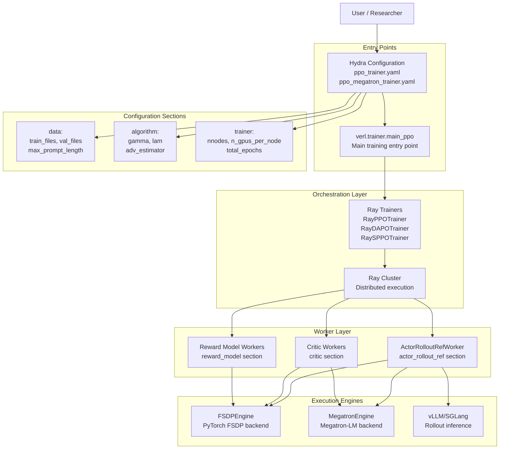
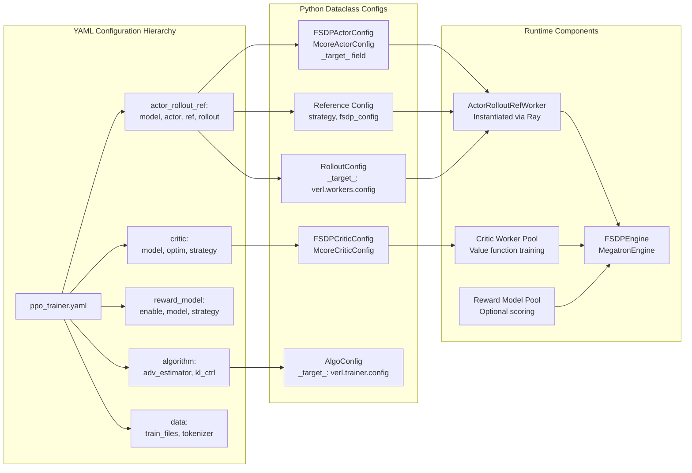
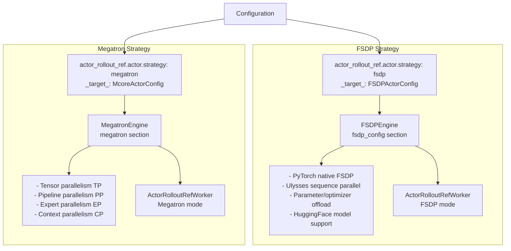
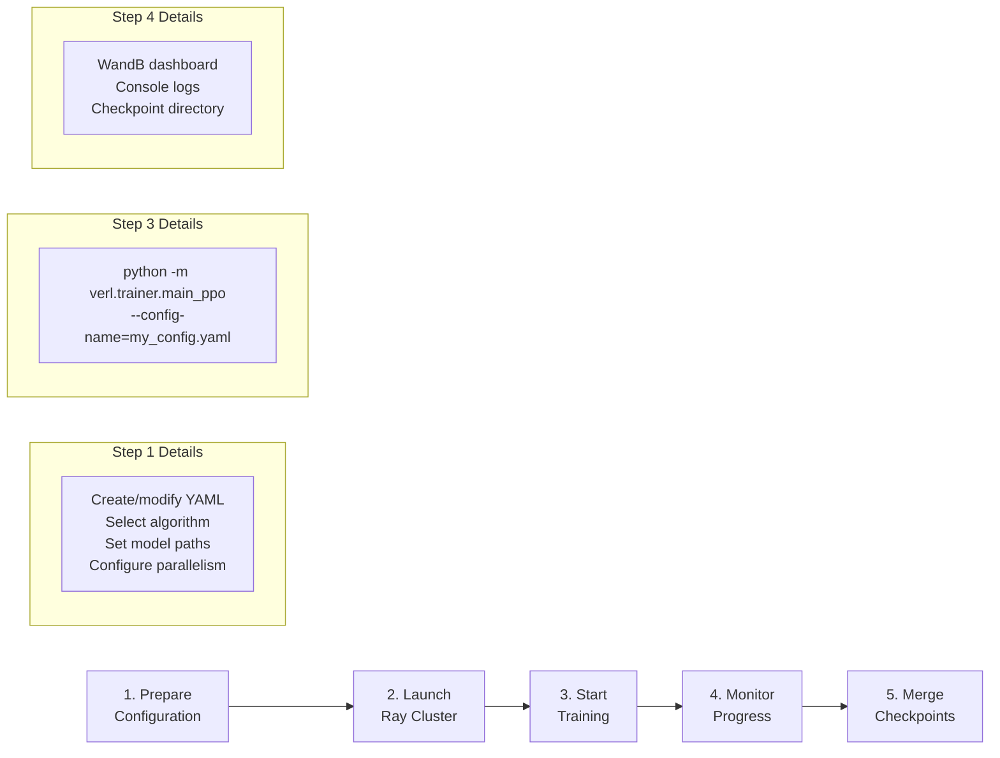
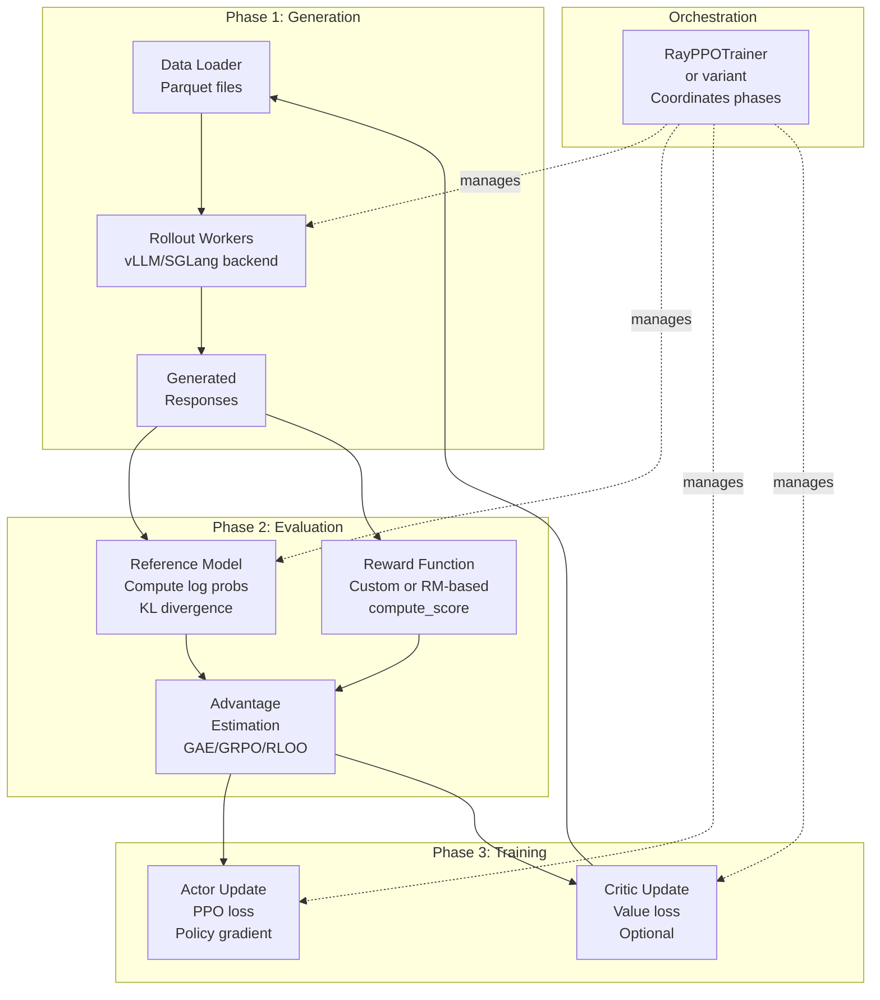
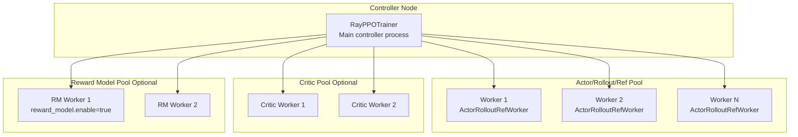

<!-- source: DeepWiki mcp.deepwiki.com · repo allenai/SAGE · page 1 Getting Started · fetched 2026-10-26 -->

# Getting Started

<details>
<summary>Relevant source files</summary>

The following files were used as context for generating this wiki page:

- [rl_train/trainer/config/_generated_ppo_megatron_trainer.yaml](rl_train/trainer/config/_generated_ppo_megatron_trainer.yaml)
- [rl_train/trainer/config/_generated_ppo_trainer.yaml](rl_train/trainer/config/_generated_ppo_trainer.yaml)
- [rl_train/trainer/config/critic/megatron_critic.yaml](rl_train/trainer/config/critic/megatron_critic.yaml)
- [verl/recipe/langgraph_agent/__init__.py](verl/recipe/langgraph_agent/__init__.py)
- [verl/recipe/r1/__init__.py](verl/recipe/r1/__init__.py)
- [verl/scripts/__init__.py](verl/scripts/__init__.py)
- [verl/verl/experimental/dataset/__init__.py](verl/verl/experimental/dataset/__init__.py)
- [verl/verl/model_merger/__init__.py](verl/verl/model_merger/__init__.py)
- [verl/verl/models/__init__.py](verl/verl/models/__init__.py)
- [verl/verl/models/transformers/__init__.py](verl/verl/models/transformers/__init__.py)
- [verl/verl/trainer/__init__.py](verl/verl/trainer/__init__.py)
- [verl/verl/trainer/config/_generated_ppo_megatron_trainer.yaml](verl/verl/trainer/config/_generated_ppo_megatron_trainer.yaml)
- [verl/verl/trainer/config/_generated_ppo_trainer.yaml](verl/verl/trainer/config/_generated_ppo_trainer.yaml)
- [verl/verl/trainer/config/critic/megatron_critic.yaml](verl/verl/trainer/config/critic/megatron_critic.yaml)
- [verl/verl/trainer/ppo/__init__.py](verl/verl/trainer/ppo/__init__.py)
- [verl/verl/workers/__init__.py](verl/verl/workers/__init__.py)

</details>


This document introduces the SAGE repository and the **verl** (Versatile Efficient Reinforcement Learning) framework. It provides an overview of the system's purpose, architecture, and capabilities to help new users understand how the components fit together and begin running RLHF training experiments.

For detailed information about specific subsystems, see:
- Core training concepts: [Core Concepts](#2)
- Algorithm implementations: [Training Algorithms](#3)
- Model support and parallelism: [Model Support](#4)
- Advanced optimizations: [Advanced Topics](#6)

## What is SAGE?

SAGE is a comprehensive framework for **Reinforcement Learning from Human Feedback (RLHF)** training of large language models (LLMs) and vision-language models (VLMs). Built on the verl framework, it provides production-ready implementations of multiple policy optimization algorithms with extensive support for distributed training at scale.

### Core Purpose

The framework enables:
- **Policy optimization** using algorithms like PPO, DAPO, GSPO, SPPO, and PRIME
- **Distributed training** across multiple GPUs/nodes using PyTorch FSDP or Megatron-LM
- **Efficient inference** during rollout generation via vLLM and SGLang integration
- **Flexible hardware support** including NVIDIA GPUs and Ascend NPUs

Sources: [verl/verl/trainer/config/_generated_ppo_trainer.yaml:1-533]()

## Key Capabilities

| Capability | Description | Implementation |
|------------|-------------|----------------|
| **Algorithms** | PPO variants including DAPO, GSPO, SPPO, PRIME | `RayPPOTrainer`, `RayDAPOTrainer`, `RaySPPOTrainer` |
| **Distributed Training** | FSDP or Megatron-LM parallelism strategies | `FSDPEngine`, `MegatronEngine` |
| **Efficient Inference** | High-throughput generation during rollout | vLLM, SGLang backends |
| **Model Support** | LLaMA, Qwen2/3, Molmo2, with MoE variants | `verl.models` module |
| **Hardware** | GPU (CUDA) and NPU (Ascend) support | Fused kernels, NPU patches |
| **Configuration** | Hydra-based YAML configuration system | `verl.trainer.config` |

Sources: [verl/verl/trainer/config/_generated_ppo_trainer.yaml:6-533](), [verl/verl/trainer/config/_generated_ppo_megatron_trainer.yaml:6-549]()

## System Architecture

### High-Level Component Overview



Sources: [verl/verl/trainer/config/_generated_ppo_trainer.yaml:6-533](), [verl/verl/trainer/config/_generated_ppo_megatron_trainer.yaml:6-549]()

### Configuration Structure to Code Mapping

The framework uses a hierarchical YAML configuration that maps directly to Python dataclasses. This diagram shows how configuration sections instantiate specific worker and engine components:



Sources: [verl/verl/trainer/config/_generated_ppo_trainer.yaml:6-270](), [rl_train/trainer/config/critic/megatron_critic.yaml:1-44]()

### Training Strategy Selection

The framework supports two primary distributed training strategies, selected via the `strategy` configuration field:



**FSDP** is recommended for:
- Models from HuggingFace Hub (7B-70B range)
- Rapid prototyping and experimentation
- Long context training (with Ulysses SP)

**Megatron** is recommended for:
- Maximum scale (100B+ parameters)
- MoE models requiring expert parallelism
- Pipeline parallelism across multiple nodes

Sources: [verl/verl/trainer/config/_generated_ppo_trainer.yaml:23-40](), [verl/verl/trainer/config/_generated_ppo_megatron_trainer.yaml:29-56]()

## Configuration Overview

### Main Configuration Sections

The training configuration is organized into seven major sections:

| Section | Purpose | Key Parameters |
|---------|---------|----------------|
| `actor_rollout_ref` | Actor model, rollout, reference policy | `model.path`, `rollout.name`, `actor.strategy` |
| `data` | Training/validation data sources | `train_files`, `val_files`, `max_prompt_length` |
| `critic` | Value function configuration | `enable`, `strategy`, `ppo_mini_batch_size` |
| `reward_model` | External reward model (optional) | `enable`, `model.path`, `strategy` |
| `algorithm` | RL algorithm parameters | `adv_estimator`, `gamma`, `lam`, `kl_ctrl` |
| `trainer` | Training orchestration | `nnodes`, `n_gpus_per_node`, `total_epochs` |
| `global_profiler` | Performance profiling | `tool`, `steps`, `save_path` |

### Example: FSDP Configuration Structure

```yaml
actor_rollout_ref:
  model:
    path: ~/models/qwen2-7b-instruct    # Model path
    
  actor:
    strategy: fsdp                       # Use FSDP
    ppo_mini_batch_size: 256
    fsdp_config:
      ulysses_sequence_parallel_size: 4  # Sequence parallelism
      param_offload: false
      
  rollout:
    name: vllm                           # Use vLLM for inference
    tensor_model_parallel_size: 2
    
data:
  train_files: ~/data/train.parquet
  max_prompt_length: 512
  max_response_length: 512
  
trainer:
  nnodes: 1
  n_gpus_per_node: 8
  total_epochs: 30
```

Sources: [verl/verl/trainer/config/_generated_ppo_trainer.yaml:6-270]()

### Example: Megatron Configuration Structure

```yaml
actor_rollout_ref:
  model:
    path: ~/models/qwen2-30b-instruct
    
  actor:
    strategy: megatron                   # Use Megatron-LM
    megatron:
      tensor_model_parallel_size: 4      # 4-way TP
      pipeline_model_parallel_size: 2    # 2-way PP
      sequence_parallel: true
      use_distributed_optimizer: true
      
  rollout:
    name: vllm
    tensor_model_parallel_size: 4
    
trainer:
  nnodes: 2
  n_gpus_per_node: 8
```

Sources: [verl/verl/trainer/config/_generated_ppo_megatron_trainer.yaml:29-261]()

## Quick Start

### Basic Training Flow



### Typical Execution Command

Training is launched via the `main_ppo` entry point with Hydra configuration:

```bash
# FSDP-based training
python -m verl.trainer.main_ppo \
  --config-name=ppo_trainer \
  actor_rollout_ref.model.path=/path/to/model \
  data.train_files=/path/to/train.parquet \
  trainer.nnodes=1 \
  trainer.n_gpus_per_node=8

# Megatron-based training
python -m verl.trainer.main_ppo \
  --config-name=ppo_megatron_trainer \
  actor_rollout_ref.model.path=/path/to/model \
  data.train_files=/path/to/train.parquet \
  actor_rollout_ref.actor.megatron.tensor_model_parallel_size=4
```

### Configuration Override Syntax

Hydra enables command-line configuration overrides:

```bash
# Override individual parameters
python -m verl.trainer.main_ppo \
  actor_rollout_ref.actor.ppo_mini_batch_size=512 \
  algorithm.adv_estimator=gae \
  trainer.total_epochs=50

# Switch to different algorithm
python -m verl.trainer.main_ppo \
  --config-name=dapo_trainer \
  actor_rollout_ref.rollout.filter_groups.enable=true
```

Sources: [verl/verl/trainer/config/_generated_ppo_trainer.yaml:472-501]()

## Training Pipeline Overview

The core training loop orchestrates three phases: generation, evaluation, and training.



**Key Components:**
- **Data Loader**: Reads prompts from parquet files ([verl/verl/trainer/config/_generated_ppo_trainer.yaml:270-303]())
- **Rollout Workers**: Generate responses using vLLM or SGLang ([verl/verl/trainer/config/_generated_ppo_trainer.yaml:162-246]())
- **Reference Model**: Computes KL penalty ([verl/verl/trainer/config/_generated_ppo_trainer.yaml:108-161]())
- **Reward Function**: Custom Python function or reward model ([verl/verl/trainer/config/_generated_ppo_trainer.yaml:445-447]())
- **Advantage Estimator**: GAE, GRPO, or RLOO ([verl/verl/trainer/config/_generated_ppo_trainer.yaml:448-471]())
- **Actor Update**: Policy optimization via PPO ([verl/verl/trainer/config/_generated_ppo_trainer.yaml:6-107]())
- **Critic Update**: Optional value function training ([verl/verl/trainer/config/_generated_ppo_trainer.yaml:304-402]())

Sources: [verl/verl/trainer/config/_generated_ppo_trainer.yaml:1-533]()

## Supported Models

The framework provides first-class support for multiple model architectures:

| Model Family | Variants | Strategy Support | Features |
|--------------|----------|------------------|----------|
| **LLaMA** | LLaMA 2, LLaMA 3 | FSDP, Megatron | Standard LLM training |
| **Qwen** | Qwen2, Qwen2.5, Qwen3 | FSDP, Megatron | MoE support (Qwen3-MoE) |
| **Molmo2** | Molmo2-7B, Molmo2-72B | FSDP | Vision-language multimodal |

Models are specified via the `actor_rollout_ref.model.path` configuration field and can be loaded from:
- Local filesystem paths
- HuggingFace Hub identifiers
- Custom model implementations via `external_lib` parameter

Sources: [verl/verl/trainer/config/_generated_ppo_trainer.yaml:247-268]()

## Resource Allocation

### Ray Worker Pool Configuration

The framework uses Ray to manage distributed worker pools:



**Resource Pool Sizing:**
- **Actor/Rollout/Ref**: Determined by `trainer.nnodes` × `trainer.n_gpus_per_node`
- **Critic**: Enabled via `critic.enable`, shares or uses separate GPUs
- **Reward Model**: Enabled via `reward_model.enable`, configured with `reward_model.nnodes` and `reward_model.n_gpus_per_node`

Sources: [verl/verl/trainer/config/_generated_ppo_trainer.yaml:484-485](), [verl/verl/trainer/config/_generated_ppo_trainer.yaml:403-444]()

## Next Steps

After understanding the basic architecture and configuration structure, explore these topics:

1. **[Core Concepts](#2)**: Learn about the training pipeline, configuration system, and distributed architecture in detail
2. **[Training Algorithms](#3)**: Choose the right algorithm (DAPO, GSPO, SPPO, PRIME) for your task
3. **[Model Support](#4)**: Understand model-specific configurations and parallelism strategies
4. **[System Components](#5)**: Deep dive into trainers, workers, engines, and checkpoint management
5. **[Advanced Topics](#6)**: Explore hardware optimizations, long context training, and inference integration

### Common Configuration Patterns

| Use Case | Recommended Config | Key Settings |
|----------|-------------------|--------------|
| **Quick experimentation** | FSDP, 7B model | `strategy: fsdp`, `nnodes: 1`, `n_gpus_per_node: 8` |
| **Math reasoning** | DAPO/GSPO | Use `dapo_trainer` or `gspo_trainer` config |
| **Large scale (30B+)** | Megatron | `strategy: megatron`, increase TP/PP sizes |
| **Long context (8K+)** | FSDP with Ulysses | `ulysses_sequence_parallel_size: 4-8` |
| **MoE models** | Megatron with EP | `expert_model_parallel_size: 8` |

### Important Configuration Files

- **FSDP Training**: [verl/trainer/config/ppo_trainer.yaml]() → [verl/verl/trainer/config/_generated_ppo_trainer.yaml]()
- **Megatron Training**: [verl/trainer/config/ppo_megatron_trainer.yaml]() → [verl/verl/trainer/config/_generated_ppo_megatron_trainer.yaml]()
- **FSDP Critic**: [verl/trainer/config/critic/fsdp_critic.yaml]()
- **Megatron Critic**: [verl/trainer/config/critic/megatron_critic.yaml]() → [verl/verl/trainer/config/critic/megatron_critic.yaml:1-44]()

Sources: [verl/verl/trainer/config/_generated_ppo_trainer.yaml:1-533](), [verl/verl/trainer/config/_generated_ppo_megatron_trainer.yaml:1-549](), [verl/verl/trainer/config/critic/megatron_critic.yaml:1-44]()

---

