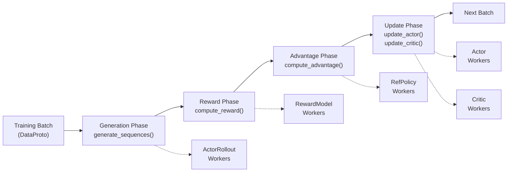
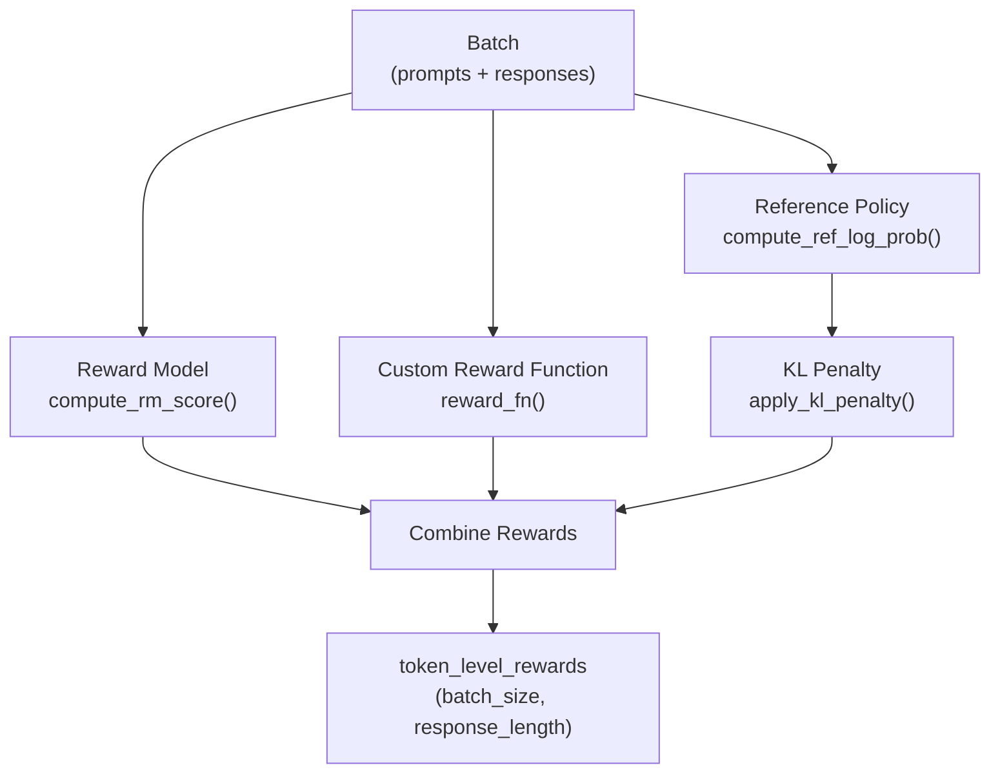
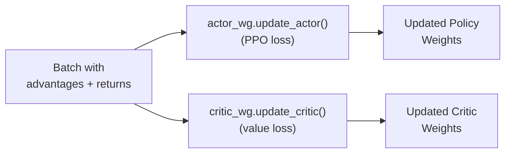
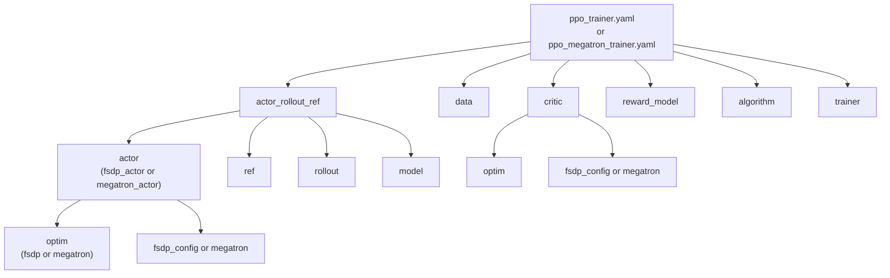
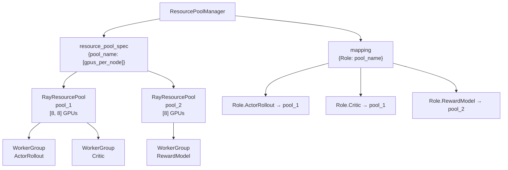
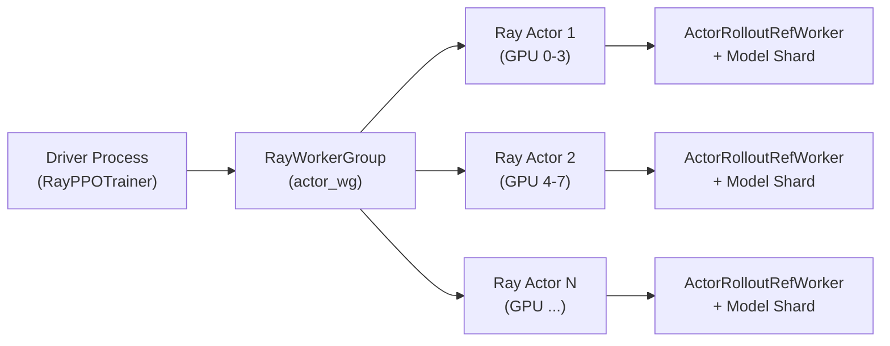
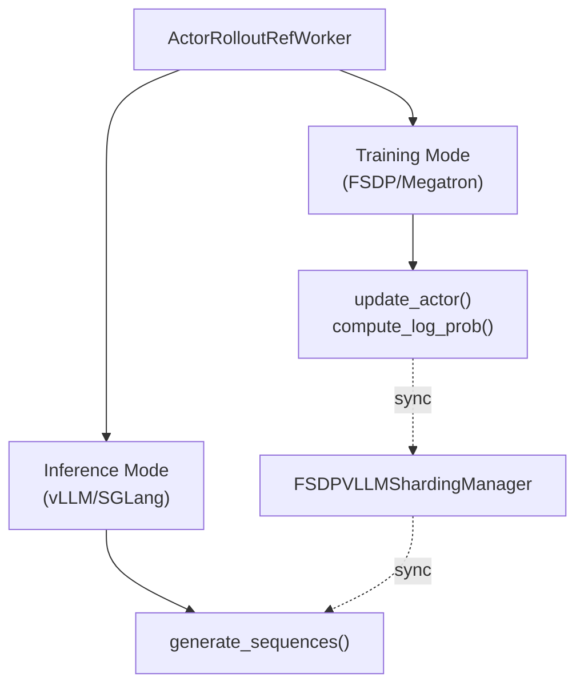

<!-- source: DeepWiki mcp.deepwiki.com · repo allenai/SAGE · page 2 Core Concepts · fetched 2026-10-26 -->

# Core Concepts

<details>
<summary>Relevant source files</summary>

The following files were used as context for generating this wiki page:

- [rl_train/trainer/config/_generated_ppo_megatron_trainer.yaml](rl_train/trainer/config/_generated_ppo_megatron_trainer.yaml)
- [rl_train/trainer/config/_generated_ppo_trainer.yaml](rl_train/trainer/config/_generated_ppo_trainer.yaml)
- [rl_train/trainer/config/critic/megatron_critic.yaml](rl_train/trainer/config/critic/megatron_critic.yaml)
- [rl_train/trainer/ppo/sage_ray_trainer.py](rl_train/trainer/ppo/sage_ray_trainer.py)
- [verl/recipe/collabllm/reward_function.py](verl/recipe/collabllm/reward_function.py)
- [verl/recipe/dapo/dapo_ray_trainer.py](verl/recipe/dapo/dapo_ray_trainer.py)
- [verl/recipe/entropy/entropy_ray_trainer.py](verl/recipe/entropy/entropy_ray_trainer.py)
- [verl/recipe/one_step_off_policy/ray_trainer.py](verl/recipe/one_step_off_policy/ray_trainer.py)
- [verl/recipe/prime/prime_ray_trainer.py](verl/recipe/prime/prime_ray_trainer.py)
- [verl/recipe/sppo/sppo_ray_trainer.py](verl/recipe/sppo/sppo_ray_trainer.py)
- [verl/verl/trainer/config/_generated_ppo_megatron_trainer.yaml](verl/verl/trainer/config/_generated_ppo_megatron_trainer.yaml)
- [verl/verl/trainer/config/_generated_ppo_trainer.yaml](verl/verl/trainer/config/_generated_ppo_trainer.yaml)
- [verl/verl/trainer/config/critic/megatron_critic.yaml](verl/verl/trainer/config/critic/megatron_critic.yaml)
- [verl/verl/trainer/ppo/ray_trainer.py](verl/verl/trainer/ppo/ray_trainer.py)

</details>


This page explains the foundational concepts of the verl framework that powers SAGE's RLHF training system. These concepts apply across all training algorithms (DAPO, GSPO, PRIME, etc.) and model backends (FSDP, Megatron).

For detailed information about specific topics, see:
- Training pipeline phases and data flow: [Training Pipeline](#2.1)
- Configuration file structure and parameters: [Configuration System](#2.2)
- Ray-based distributed execution: [Distributed Architecture](#2.3)
- Specific algorithm implementations: [Training Algorithms](#3)

---

## Overview

The verl framework is organized around three core concepts:

1. **Training Pipeline**: The RLHF training loop that orchestrates generation, reward computation, and policy optimization
2. **Configuration System**: Hydra-based YAML configuration enabling composable, algorithm-specific training setups
3. **Distributed Architecture**: Ray-based resource management and worker coordination across multiple GPUs/nodes

These three concepts work together: configurations define what to train and how, the distributed architecture allocates resources and creates workers, and the training pipeline coordinates execution across those workers.

---

## The Training Pipeline

The training pipeline implements the standard RLHF loop with four main phases executed on each training step:



**Sources**: [verl/verl/trainer/ppo/ray_trainer.py:263-1009]()

### Phase 1: Generation (Rollout)

The generation phase samples responses from the current policy. The driver process calls `generate_sequences()` on the rollout workers, which use optimized inference engines (vLLM or SGLang).

| Component | Role | Code Location |
|-----------|------|---------------|
| `DataProto` | Container for batch data (tensor and non-tensor) | [verl/verl/trainer/ppo/ray_trainer.py:192]() |
| `generate_sequences()` | Remote method invoked on rollout workers | [verl/verl/trainer/ppo/ray_trainer.py:644-656]() |
| `rollout_wg` | RayWorkerGroup for rollout workers | [verl/verl/trainer/ppo/ray_trainer.py:851-858]() |

The output includes `responses`, `attention_mask`, and optionally `old_log_probs` if computed during generation.

### Phase 2: Reward Computation

Rewards are computed by combining multiple sources: reward models (optional), reference policy KL penalty (optional), and custom reward functions.



**Sources**: [verl/verl/trainer/ppo/ray_trainer.py:685-732]()

The `compute_reward()` function merges model-based and rule-based rewards:

- **Reward Model**: Optional learned model that scores responses via `rm_wg.compute_rm_score()` [verl/verl/trainer/ppo/ray_trainer.py:696-698]()
- **Custom Function**: User-defined `reward_fn` for task-specific scoring [verl/verl/trainer/ppo/ray_trainer.py:701-711]()
- **KL Penalty**: Divergence from reference policy, controlled by `apply_kl_penalty()` [verl/verl/trainer/ppo/ray_trainer.py:122-162]()

### Phase 3: Advantage Estimation

Advantages are computed on the driver process using one of several estimators:

| Estimator | Method | Use Case |
|-----------|--------|----------|
| `GAE` | `compute_gae_advantage_return()` | Standard PPO with value function |
| `GRPO` | `compute_grpo_outcome_advantage()` | Group-relative policy optimization |
| `REINFORCE++` | Various estimators | Variance reduction techniques |
| `RLOO` | `compute_rloo_advantage_return()` | Leave-one-out baseline (PRIME) |

**Sources**: [verl/verl/trainer/ppo/ray_trainer.py:182-261](), [verl/verl/trainer/ppo/core_algos.py]()

The `compute_advantage()` function is executed on the driver, operating on the full batch. For value-based methods like GAE, critic values are first computed via `critic_wg.compute_values()` [verl/verl/trainer/ppo/ray_trainer.py:741-744]().

### Phase 4: Policy and Critic Updates

The final phase updates model parameters using computed advantages:



**Sources**: [verl/verl/trainer/ppo/ray_trainer.py:748-761]()

Both updates run distributed across their respective worker groups:
- `actor_wg.update_actor()`: Computes PPO clipped loss and updates policy parameters
- `critic_wg.update_critic()`: Computes value function loss (MSE against returns)

### DataProto: The Core Data Structure

All pipeline phases operate on `DataProto` objects, which encapsulate:

```python
DataProto:
  .batch               # Dict of torch tensors (prompts, responses, advantages, etc.)
  .non_tensor_batch    # Dict of non-tensor data (numpy arrays, lists, metadata)
  .meta_info           # Dict of metadata (timing, metrics, config overrides)
```

Key methods:
- `.union()`: Merge another DataProto into this one
- `.pop()`: Remove and return specific keys
- `.repeat()`: Repeat data for multi-sample rollouts

**Sources**: [verl/verl/trainer/ppo/ray_trainer.py:38]()

---

## The Configuration System

Configurations use Hydra's composition system to build training setups from reusable components. The main configuration file references sub-configs via `defaults:` sections.

### Configuration Hierarchy



**Sources**: [verl/verl/trainer/config/_generated_ppo_trainer.yaml:1-533](), [verl/verl/trainer/config/_generated_ppo_megatron_trainer.yaml:1-549]()

### Major Configuration Sections

| Section | Purpose | Key Parameters |
|---------|---------|----------------|
| `actor_rollout_ref` | Actor and rollout worker configs | `strategy`, `ppo_mini_batch_size`, `clip_ratio` |
| `actor_rollout_ref.rollout` | Generation settings | `temperature`, `top_p`, `response_length`, `name` (vllm/sglang) |
| `critic` | Critic network configuration | `enable`, `ppo_mini_batch_size`, `cliprange_value` |
| `reward_model` | Reward model setup | `enable`, `strategy`, `reward_manager` |
| `algorithm` | RL algorithm parameters | `adv_estimator`, `gamma`, `lam`, `kl_ctrl` |
| `data` | Dataset and dataloader | `train_files`, `train_batch_size`, `max_prompt_length` |
| `trainer` | Training orchestration | `total_epochs`, `save_freq`, `test_freq`, `logger` |

**Sources**: [verl/verl/trainer/config/_generated_ppo_trainer.yaml:6-531]()

### Strategy Selection: FSDP vs Megatron

The `strategy` field determines the parallelism backend:

```yaml
# FSDP Strategy (default)
actor_rollout_ref:
  actor:
    strategy: fsdp
    fsdp_config:
      ulysses_sequence_parallel_size: 1
      param_offload: false
      
# Megatron Strategy (for maximum scale)
actor_rollout_ref:
  actor:
    strategy: megatron
    megatron:
      tensor_model_parallel_size: 2
      pipeline_model_parallel_size: 2
```

**Sources**: [verl/verl/trainer/config/_generated_ppo_trainer.yaml:40-42](), [verl/verl/trainer/config/_generated_ppo_megatron_trainer.yaml:57]()

### Configuration Instantiation

Configurations are loaded and instantiated using:

```python
# Load with Hydra
config = hydra.compose(config_name="ppo_trainer")

# Convert to dataclass
from verl.utils.config import omega_conf_to_dataclass
actor_config = omega_conf_to_dataclass(config.actor_rollout_ref.actor)
```

The `_target_` fields specify which Python class to instantiate, enabling type-safe configuration objects.

**Sources**: [verl/verl/trainer/config/_generated_ppo_trainer.yaml:9-41]()

---

## The Distributed Architecture

The distributed architecture uses Ray to manage GPU resources and coordinate workers across multiple nodes.

### Resource Pool Management

The `ResourcePoolManager` allocates GPUs into named pools that are shared by different worker roles:



**Sources**: [verl/verl/trainer/ppo/ray_trainer.py:65-120]()

Each `RayResourcePool` manages a set of GPUs across nodes specified as `process_on_nodes: [n_gpus_node_0, n_gpus_node_1, ...]`. The `max_colocate_count` parameter controls how many worker groups can share the pool (typically 1 for FSDP, >1 for Megatron).

### Worker Roles and Mapping

Training involves five potential worker roles:

| Role | Enum | Purpose | Required |
|------|------|---------|----------|
| Actor | `Role.ActorRollout` | Policy training and generation | Yes |
| Rollout | `Role.ActorRollout` | Generation only (async mode) | Conditional |
| Critic | `Role.Critic` | Value function for GAE | Conditional |
| Reference | `Role.RefPolicy` | KL divergence computation | Conditional |
| Reward Model | `Role.RewardModel` | Learned reward scoring | Conditional |

**Sources**: [verl/verl/trainer/ppo/utils.py]()

The `role_worker_mapping` dictionary maps each role to its worker class:

```python
role_worker_mapping = {
    Role.ActorRollout: ActorRolloutRefWorker,  # Handles both actor and rollout
    Role.Critic: CriticWorker,
    Role.RewardModel: RewardModelWorker,
}
```

**Sources**: [verl/verl/trainer/ppo/ray_trainer.py:277-278]()

### RayWorkerGroup Abstraction

`RayWorkerGroup` provides a unified interface for distributed method calls:



**Sources**: [verl/verl/trainer/ppo/ray_trainer.py:851-947]()

Key methods on worker groups:
- `.execute_all_sync()`: Execute method on all workers and aggregate results
- `.execute_one_sync()`: Execute on a single worker (rank 0)
- `.spawn()`: Create sub-groups for specific roles

Example usage:
```python
# Initialize worker group
actor_wg = RayWorkerGroup(resource_pool=pool, ray_cls_with_init=actor_cls)

# Remote method call
output = actor_wg.update_actor(batch)  # Calls update_actor() on all workers
```

### Hybrid Engine Mode

When `hybrid_engine: true`, the same worker handles both training and inference:



**Sources**: [verl/verl/trainer/ppo/ray_trainer.py:316-317]()

The `FSDPVLLMShardingManager` synchronizes weights between training and inference engines, enabling efficient rollout without separate worker pools.

---

## Integration Example

The three concepts come together in the trainer initialization:

```python
# 1. Configuration System: Load and compose configs
config = load_config("ppo_trainer.yaml")

# 2. Distributed Architecture: Create resource pools and worker groups
resource_pool_manager = ResourcePoolManager(
    resource_pool_spec={"pool_1": [8, 8]},  # 2 nodes, 8 GPUs each
    mapping={Role.ActorRollout: "pool_1", Role.Critic: "pool_1"}
)

trainer = RayPPOTrainer(
    config=config,
    resource_pool_manager=resource_pool_manager,
    role_worker_mapping=role_worker_mapping,
)

trainer.init_workers()  # Creates RayWorkerGroups

# 3. Training Pipeline: Execute RLHF loop
trainer.fit()  # Runs generation → reward → advantage → update
```

**Sources**: [verl/verl/trainer/ppo/ray_trainer.py:273-406](), [verl/verl/trainer/ppo/ray_trainer.py:618-1009]()

The configuration determines algorithm behavior, the distributed architecture provisions resources and creates workers, and the training pipeline orchestrates execution across those workers to implement RLHF training.

---

