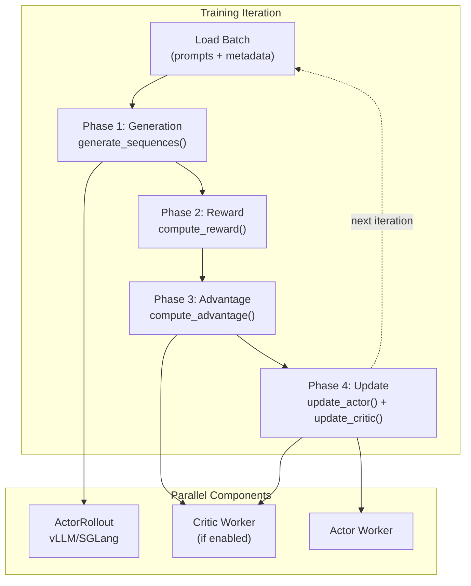
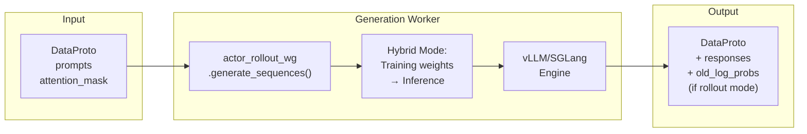
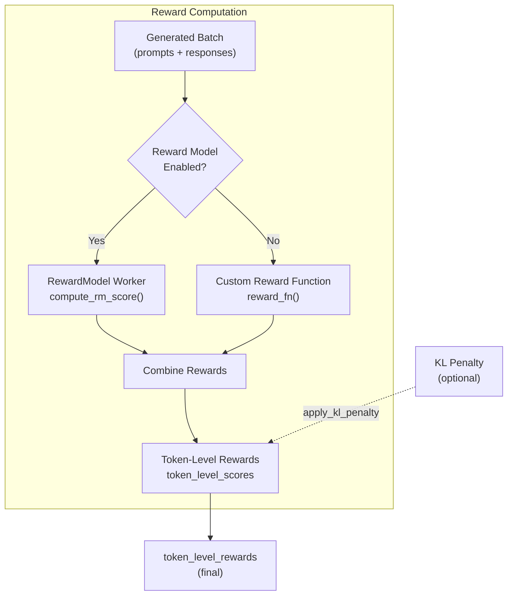
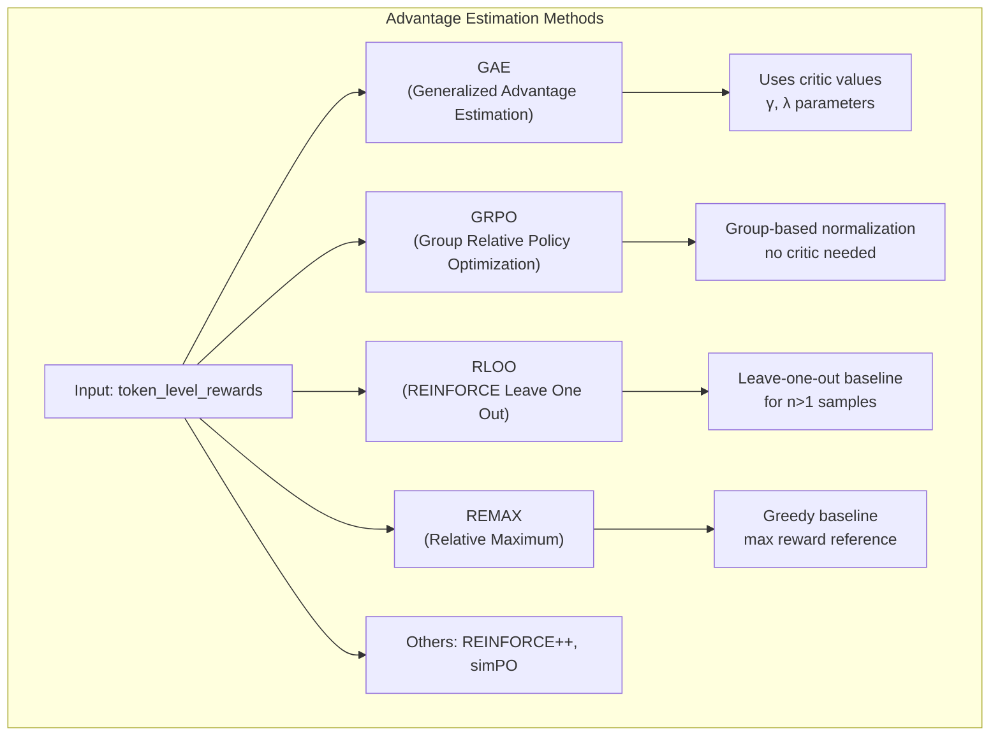
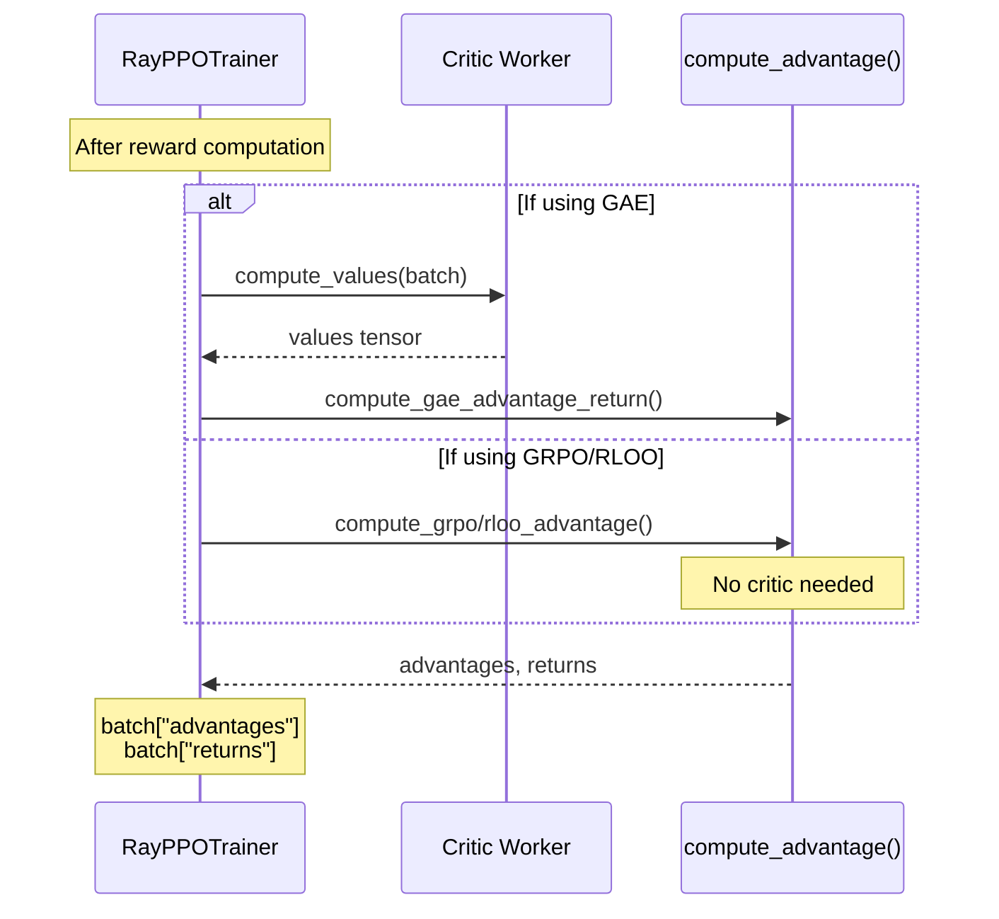
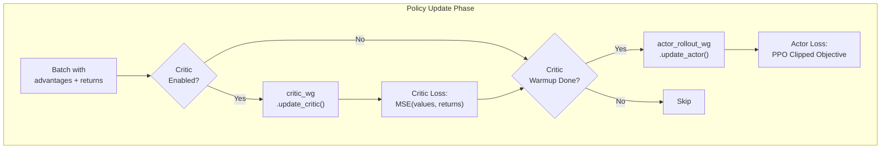
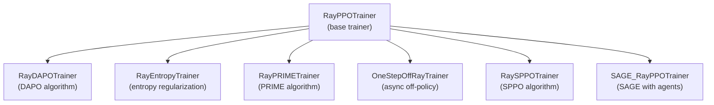
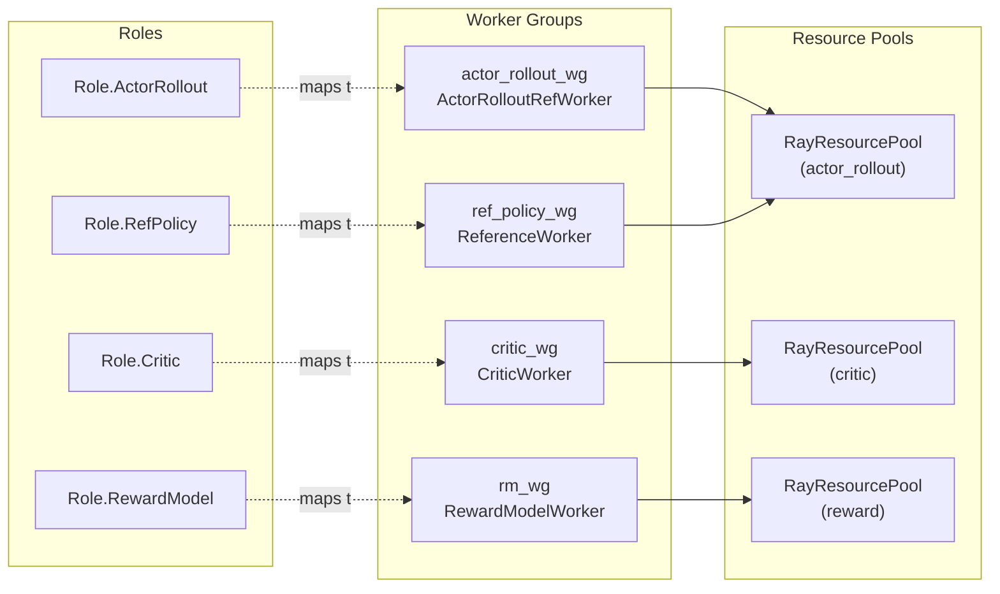

<!-- source: DeepWiki mcp.deepwiki.com · repo allenai/SAGE · page 2.1 Training Pipeline · fetched 2026-10-26 -->

# Training Pipeline

<details>
<summary>Relevant source files</summary>

The following files were used as context for generating this wiki page:

- [rl_train/trainer/config/_generated_ppo_megatron_trainer.yaml](rl_train/trainer/config/_generated_ppo_megatron_trainer.yaml)
- [rl_train/trainer/config/_generated_ppo_trainer.yaml](rl_train/trainer/config/_generated_ppo_trainer.yaml)
- [rl_train/trainer/config/critic/megatron_critic.yaml](rl_train/trainer/config/critic/megatron_critic.yaml)
- [rl_train/trainer/ppo/sage_ray_trainer.py](rl_train/trainer/ppo/sage_ray_trainer.py)
- [verl/recipe/collabllm/reward_function.py](verl/recipe/collabllm/reward_function.py)
- [verl/recipe/dapo/dapo_ray_trainer.py](verl/recipe/dapo/dapo_ray_trainer.py)
- [verl/recipe/entropy/entropy_ray_trainer.py](verl/recipe/entropy/entropy_ray_trainer.py)
- [verl/recipe/one_step_off_policy/ray_trainer.py](verl/recipe/one_step_off_policy/ray_trainer.py)
- [verl/recipe/prime/prime_ray_trainer.py](verl/recipe/prime/prime_ray_trainer.py)
- [verl/recipe/sppo/sppo_ray_trainer.py](verl/recipe/sppo/sppo_ray_trainer.py)
- [verl/verl/trainer/config/_generated_ppo_megatron_trainer.yaml](verl/verl/trainer/config/_generated_ppo_megatron_trainer.yaml)
- [verl/verl/trainer/config/_generated_ppo_trainer.yaml](verl/verl/trainer/config/_generated_ppo_trainer.yaml)
- [verl/verl/trainer/config/critic/megatron_critic.yaml](verl/verl/trainer/config/critic/megatron_critic.yaml)
- [verl/verl/trainer/ppo/ray_trainer.py](verl/verl/trainer/ppo/ray_trainer.py)

</details>


This document describes the RLHF (Reinforcement Learning from Human Feedback) training loop in the SAGE/verl framework. The training pipeline consists of four main phases: generation (rollout), reward computation, advantage estimation, and policy updates. The loop is orchestrated by Ray-based trainers that coordinate distributed workers across multiple GPUs.

For information about the distributed architecture and worker roles, see [Distributed Architecture](#2.3). For details on specific training algorithms like DAPO and GSPO, see [Training Algorithms](#3).

## Overview

The training pipeline implements a standard RLHF loop where a policy model is fine-tuned using reinforcement learning. Each training iteration processes batches of prompts through four sequential phases executed by distributed workers coordinated via Ray.

**Training Loop Architecture**



Sources: [verl/verl/trainer/ppo/ray_trainer.py:263-869]()

## Phase 1: Generation (Rollout)

The generation phase produces response sequences from input prompts using the current policy. This phase uses optimized inference engines (vLLM or SGLang) for high-throughput batch generation.

**Key Components:**
- **Worker Class**: `ActorRolloutRefWorker` 
- **Method**: `generate_sequences()`
- **Engines**: vLLM or SGLang for efficient batched inference
- **Output**: `DataProto` containing prompts, responses, and attention masks

**Generation Flow**



**Code Flow:**

1. **Batch Preparation**: Pop generation-specific keys from batch
   ```
   gen_batch = batch.pop(
       batch_keys=["input_ids", "attention_mask", "position_ids"],
       non_tensor_batch_keys=["raw_prompt_ids"]
   )
   ```

2. **Generation Call**: Invoke worker group method
   ```
   gen_batch_output = self.actor_rollout_wg.generate_sequences(gen_batch)
   ```

3. **Response Collection**: Merge generated outputs with original batch
   ```
   batch = batch.union(gen_batch_output)
   ```

**Generation Modes:**

| Mode | Description | Configuration |
|------|-------------|---------------|
| Sync | Standard synchronous generation | `rollout.mode: sync` |
| Async | Asynchronous generation with weight sync | `rollout.mode: async` |
| Hybrid Engine | Weights synced between training and inference | `hybrid_engine: true` |

**Sampling Parameters:**

The generation phase supports various sampling configurations set in `RolloutConfig`:

- `temperature`: Controls randomness (default: 1.0)
- `top_k`: Top-k sampling (default: -1, disabled)
- `top_p`: Nucleus sampling (default: 1.0)
- `n`: Number of samples per prompt (for GRPO/RLOO)
- `do_sample`: Whether to sample or use greedy decoding

Sources: [verl/verl/trainer/ppo/ray_trainer.py:502-517](), [verl/verl/trainer/config/_generated_ppo_trainer.yaml:162-246](), [verl/recipe/one_step_off_policy/ray_trainer.py:302-360]()

## Phase 2: Reward Computation

The reward computation phase assigns scalar rewards to generated responses. Rewards can come from learned reward models, rule-based functions, or a combination of both.

**Reward Sources**



**Reward Model Path:**

If a reward model is configured (`reward_model.enable: true`), the system first computes model-based scores:

1. **Model Scoring**: 
   ```python
   reward_tensor = self.rm_wg.compute_rm_score(batch)
   batch = batch.union(reward_tensor)
   ```

2. **Function Combination**: The reward function can access model scores via `batch.batch["rm_scores"]` and combine them with rule-based rewards.

**Custom Reward Function:**

Custom reward functions are loaded from Python modules specified in configuration:

```yaml
custom_reward_function:
  path: path/to/reward_module.py
  name: compute_score
```

The function receives a `DataProto` and can return:
- A tensor of token-level rewards
- A dictionary with `reward_tensor` and optional `reward_extra_info`

**Reward Function Interface:**

```python
def compute_score(data: DataProto, return_dict: bool = False):
    # Access prompts, responses, ground truth
    prompts = data.batch["prompts"]
    responses = data.batch["responses"]
    ground_truth = data.non_tensor_batch.get("ground_truth")
    
    # Compute rewards (shape: [batch_size, response_length])
    rewards = ...
    
    if return_dict:
        return {
            "reward_tensor": rewards,
            "reward_extra_info": {"metric_1": [...], ...}
        }
    return rewards
```

**KL Penalty:**

If configured (`algorithm.use_kl_in_reward: true`), a KL divergence penalty is applied between the current policy and reference policy:

```
token_level_rewards = token_level_scores - β * KL(π || π_ref)
```

The KL coefficient β is controlled by `AdaptiveKLController` which can adjust dynamically based on training progress.

Sources: [verl/verl/trainer/ppo/ray_trainer.py:122-162](), [verl/verl/trainer/ppo/reward.py](), [verl/verl/trainer/config/_generated_ppo_trainer.yaml:403-447]()

## Phase 3: Advantage Estimation

The advantage estimation phase computes advantage values that guide policy optimization. SAGE supports multiple advantage estimators tailored for different training scenarios.

**Advantage Estimators**



**Advantage Estimator Selection:**

The estimator is configured via `algorithm.adv_estimator`:

| Estimator | Use Case | Requires Critic | Configuration |
|-----------|----------|----------------|---------------|
| `gae` | Standard PPO with value function | Yes | `gamma`, `lam` |
| `grpo` | Best-of-N sampling | No | `n` rollouts per prompt |
| `rloo` | REINFORCE with leave-one-out | No | `n` rollouts per prompt |
| `remax` | Relative to greedy baseline | No | Generates greedy sample |
| `reinforce++` | Variance reduction | No | Optional baseline |

**GAE (Generalized Advantage Estimation):**

When using GAE, advantages are computed using temporal difference bootstrapping:

```python
advantages, returns = compute_gae_advantage_return(
    token_level_rewards=batch["token_level_rewards"],
    values=batch["values"],
    response_mask=batch["response_mask"],
    gamma=config.algorithm.gamma,  # discount factor
    lam=config.algorithm.lam       # GAE lambda
)
```

The critic value function must be enabled for GAE.

**GRPO (Group Relative Policy Optimization):**

For GRPO, advantages are computed by comparing samples within the same group (prompt):

```python
advantages, returns = compute_grpo_outcome_advantage(
    token_level_rewards=batch["token_level_rewards"],
    response_mask=batch["response_mask"],
    index=batch.non_tensor_batch["uid"],  # group by prompt UID
    norm_adv_by_std_in_grpo=True
)
```

This normalizes advantages relative to other responses for the same prompt, reducing variance without a critic.

**Advantage Computation Flow:**



**Output:**

After advantage estimation, the batch contains:
- `advantages`: Per-token advantage estimates (shape: `[batch_size, response_length]`)
- `returns`: Computed returns for critic training (if applicable)
- `response_mask`: Mask indicating valid response tokens

Sources: [verl/verl/trainer/ppo/ray_trainer.py:182-261](), [verl/verl/trainer/ppo/core_algos.py](), [verl/verl/trainer/config/_generated_ppo_trainer.yaml:448-471]()

## Phase 4: Policy Update

The policy update phase performs gradient-based optimization of the actor (policy model) and optionally the critic (value function). This phase implements PPO-style clipped objectives to ensure stable learning.

**Update Components**



**Actor Update:**

The actor update uses a PPO-style clipped objective to constrain policy changes:

1. **Mini-batch Creation**: The batch is divided into mini-batches based on `ppo_mini_batch_size`

2. **PPO Objective**: For each mini-batch, compute:
   ```
   ratio = exp(log_prob - old_log_prob)
   surr1 = ratio * advantages
   surr2 = clip(ratio, 1-ε, 1+ε) * advantages
   policy_loss = -mean(min(surr1, surr2))
   ```
   where ε is the clip ratio (`clip_ratio`)

3. **Entropy Regularization** (optional):
   ```
   loss = policy_loss - entropy_coeff * entropy
   ```

4. **Gradient Descent**: Backpropagate and update actor parameters

**Clipping Variants:**

Different algorithms use different clipping strategies:

| Algorithm | Clipping | Configuration |
|-----------|----------|---------------|
| Vanilla PPO | Symmetric | `clip_ratio: 0.2` |
| GSPO | Asymmetric | `clip_ratio_low: 0.2`<br/>`clip_ratio_high: 0.2` |
| Entropy-based | Covariance-aware | `policy_loss.clip_cov_ratio` |

**Critic Update:**

If a critic is enabled, it's updated before the actor:

1. **Value Loss**: Mean squared error between predicted values and computed returns
   ```
   value_loss = MSE(values, returns)
   ```

2. **Clipped Value Loss** (optional):
   ```
   values_clipped = old_values + clip(values - old_values, -c, +c)
   value_loss = mean(max(MSE(values, returns), MSE(values_clipped, returns)))
   ```
   where c is `cliprange_value`

3. **Gradient Descent**: Update critic parameters

**Multi-Epoch Training:**

Both actor and critic can be updated multiple times per batch:

- `ppo_epochs`: Number of epochs to train on each batch (default: 1)
- `shuffle`: Whether to shuffle data between epochs

**Training Configuration:**

```yaml
actor:
  ppo_mini_batch_size: 256      # Mini-batch size for updates
  ppo_epochs: 1                  # Training epochs per batch
  clip_ratio: 0.2                # PPO clip parameter
  entropy_coeff: 0.0             # Entropy regularization weight
  loss_agg_mode: token-mean      # Loss aggregation: token-mean or sequence-mean
  
critic:
  cliprange_value: 0.5           # Value clipping range
  ppo_epochs: 1                  # Critic training epochs
```

**Loss Aggregation:**

The `loss_agg_mode` parameter determines how token-level losses are aggregated:

- `token-mean`: Average over all valid tokens
- `sequence-mean`: Average per sequence, then average over sequences

This affects the effective weighting of short vs. long sequences.

Sources: [verl/verl/trainer/ppo/ray_trainer.py:869-1020](), [verl/workers/actor/fsdp_workers.py](), [verl/workers/critic/fsdp_workers.py](), [verl/verl/trainer/config/_generated_ppo_trainer.yaml:6-107](), [verl/verl/trainer/config/_generated_ppo_trainer.yaml:304-402]()

## Training Loop Orchestration

The `RayPPOTrainer` class orchestrates the entire training loop, coordinating distributed workers and managing the training lifecycle.

**Trainer Class Hierarchy**



**Main Training Loop:**

The `fit()` method implements the training loop:

```python
def fit(self):
    # 1. Initialize
    self.global_steps = 0
    self._load_checkpoint()
    
    # 2. Initial validation
    if self.val_reward_fn and config.trainer.val_before_train:
        val_metrics = self._validate()
        logger.log(val_metrics, step=0)
    
    # 3. Training epochs
    for epoch in range(config.trainer.total_epochs):
        for batch_dict in self.train_dataloader:
            # Phase 1: Generation
            gen_batch_output = self.actor_rollout_wg.generate_sequences(gen_batch)
            
            # Phase 2: Reward
            reward_tensor = compute_reward(batch, self.reward_fn)
            
            # Phase 3: Advantage
            batch = compute_advantage(batch, config.algorithm)
            
            # Phase 4: Update
            if self.use_critic:
                self.critic_wg.update_critic(batch)
            self.actor_rollout_wg.update_actor(batch)
            
            # Validation and checkpointing
            if should_validate:
                self._validate()
            if should_save:
                self._save_checkpoint()
            
            self.global_steps += 1
```

**Worker Initialization:**

The trainer initializes Ray workers during `init_workers()`:

1. **Create Resource Pools**: Allocate GPU resources across nodes
2. **Initialize Worker Groups**: Create worker groups for each role
3. **Load Models**: Initialize model weights on each worker
4. **Setup Profilers**: Configure performance profiling if enabled

**Worker Group Mapping:**



**Checkpointing:**

The trainer supports checkpoint saving and resuming:

- **Save**: `_save_checkpoint()` saves actor, critic, and dataloader state
- **Load**: `_load_checkpoint()` resumes from latest checkpoint
- **Resume Modes**: `auto`, `disable`, or explicit path via `resume_from_path`

**Validation:**

The `_validate()` method evaluates the current policy on the validation set:

1. Generate responses for validation prompts
2. Compute rewards using `val_reward_fn`
3. Log metrics and optionally sample generations
4. Return validation metrics dict

Sources: [verl/verl/trainer/ppo/ray_trainer.py:263-417](), [verl/verl/trainer/ppo/ray_trainer.py:519-869](), [verl/verl/trainer/ppo/ray_trainer.py:1020-1150]()

## Data Flow Through Pipeline

Understanding how data flows through the pipeline helps clarify the interactions between components.

**DataProto Structure**

The training pipeline uses `DataProto` objects to pass data between phases. A `DataProto` contains:

- `batch`: Dictionary of tensors (e.g., `prompts`, `responses`, `attention_mask`)
- `non_tensor_batch`: Dictionary of non-tensor data (e.g., `uid`, `data_source`, metadata)
- `meta_info`: Metadata about the batch (e.g., `global_token_num`, timing info)

**Data Transformations Per Phase**

```mermaid
flowchart TB
    subgraph "Phase 0: Data Loading"
        A["train_dataloader"]
        B["batch_dict:<br/>input_ids, attention_mask,<br/>position_ids"]
        C["DataProto.from_single_dict()"]
        D["DataProto:<br/>prompts (input_ids)<br/>attention_mask"]
    end
    
    subgraph "Phase 1: Generation"
        E["Pop generation keys<br/>Extract raw_prompt_ids"]
        F["gen_batch:<br/>raw_prompt_ids only"]
        G["generate_sequences()"]
        H["gen_batch_output:<br/>+ responses<br/>+ old_log_probs"]
        I["Union with original<br/>batch.union(output)"]
    end
    
    subgraph "Phase 2: Reward"
        J["DataProto:<br/>prompts + responses"]
        K["compute_reward()"]
        L["+ token_level_scores<br/>+ reward_extra_info"]
        M["apply_kl_penalty()<br/>(if enabled)"]
        N["+ token_level_rewards"]
    end
    
    subgraph "Phase 3: Advantage"
        O["compute_log_prob()"]
        P["+ old_log_probs<br/>(recomputed)"]
        Q["compute_ref_log_prob()<br/>(if ref policy enabled)"]
        R["+ ref_log_prob"]
        S["compute_values()<br/>(if critic enabled)"]
        T["+ values"]
        U["compute_advantage()"]
        V["+ advantages<br/>+ returns"]
    end
    
    subgraph "Phase 4: Update"
        W["Split into mini-batches"]
        X["update_actor()<br/>update_critic()"]
        Y["Updated model weights"]
    end
    
    A --> B
    B --> C
    C --> D
    D --> E
    E --> F
    F --> G
    G --> H
    H --> I
    I --> J
    J --> K
    K --> L
    L --> M
    M --> N
    N --> O
    O --> P
    P --> Q
    Q --> R
    R --> S
    S --> T
    T --> U
    U --> V
    V --> W
    W --> X
    X --> Y
```



**Key Data Operations:**

1. **Batch Repeat**: For algorithms that sample multiple responses per prompt (GRPO, RLOO):
   ```python
   gen_batch = gen_batch.repeat(repeat_times=config.rollout.n, interleave=True)
   ```

2. **Union**: Merge new tensors into existing DataProto:
   ```python
   batch = batch.union(gen_batch_output)
   ```

3. **Pop**: Remove keys for specific operations:
   ```python
   gen_batch = batch.pop(batch_keys=["input_ids", ...])
   ```

4. **Indexing**: Filter batch by indices:
   ```python
   filtered_batch = batch[kept_indices]
   ```

5. **Concatenation**: Combine multiple batches:
   ```python
   combined = DataProto.concat([batch1, batch2])
   ```

**Batch Balancing:**

To balance GPU utilization, the trainer can redistribute data across workers to equalize the number of valid tokens per rank:

```python
if config.trainer.balance_batch:
    self._balance_batch(batch, metrics=metrics)
```

This uses `get_seqlen_balanced_partitions()` to compute optimal data distribution.

Sources: [verl/verl/trainer/ppo/ray_trainer.py:502-869](), [verl/verl/utils/seqlen_balancing.py](), [verl/verl/protocol.py]()

## Configuration Overview

The training pipeline is highly configurable through Hydra-based YAML configurations. Key configuration sections:

**Actor/Rollout Configuration:**

```yaml
actor_rollout_ref:
  actor:
    strategy: fsdp  # or megatron
    ppo_mini_batch_size: 256
    ppo_epochs: 1
    clip_ratio: 0.2
    entropy_coeff: 0
    optim:
      lr: 1e-6
      weight_decay: 0.01
  
  rollout:
    name: vllm  # or sglang
    mode: sync  # or async
    temperature: 1.0
    n: 1  # samples per prompt
    tensor_model_parallel_size: 2
  
  hybrid_engine: true
```

**Algorithm Configuration:**

```yaml
algorithm:
  adv_estimator: gae  # gae, grpo, rloo, remax, etc.
  gamma: 1.0
  lam: 1.0
  use_kl_in_reward: false
  kl_ctrl:
    type: fixed
    kl_coef: 0.001
```

**Trainer Configuration:**

```yaml
trainer:
  total_epochs: 30
  project_name: verl_examples
  experiment_name: gsm8k
  logger: [console, wandb]
  val_before_train: true
  test_freq: -1
  save_freq: -1
  balance_batch: true
  nnodes: 1
  n_gpus_per_node: 8
```

For more details on configuration, see [Configuration System](#2.2).

Sources: [verl/verl/trainer/config/_generated_ppo_trainer.yaml](), [rl_train/trainer/config/_generated_ppo_trainer.yaml]()

## Asynchronous Training Modes

For advanced use cases, SAGE supports asynchronous training modes where generation and training are decoupled.

**One-Step Off-Policy Training:**

The `OneStepOffRayTrainer` implements asynchronous generation with periodic weight synchronization:

1. **Separate Workers**: Actor and rollout workers are separate
2. **Weight Sync**: Weights synced from actor to rollout via NCCL
3. **Async Generation**: Rollout generates while actor trains on previous batch
4. **Pipeline Parallelism**: Generation and training overlap in time

```mermaid
sequenceDiagram
    participant Trainer
    participant Actor
    participant Rollout
    
    Note over Trainer: Batch N
    Trainer->>Rollout: sync_rollout_weights()
    Trainer->>Rollout: async_generate_sequences()
    
    Note over Rollout: Generating...
    Note over Trainer: Batch N-1
    Trainer->>Actor: update_actor(batch_N-1)
    Note over Actor: Training...
    
    Rollout-->>Trainer: generation complete
    Note over Trainer: Proceed to reward/advantage
```

**Configuration:**

```yaml
actor_rollout_ref:
  rollout:
    mode: async
  hybrid_engine: false  # Must be false for async mode
```

For more details, see [One-Step Off-Policy Training](#3.5).

Sources: [verl/recipe/one_step_off_policy/ray_trainer.py:95-501]()

---

