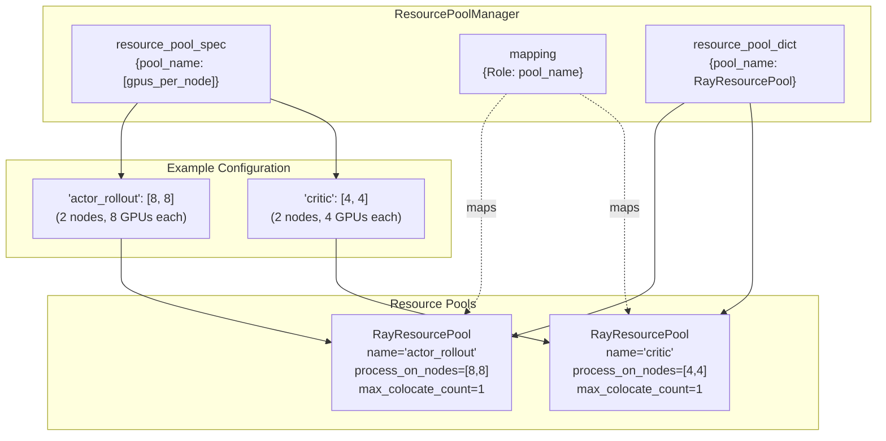
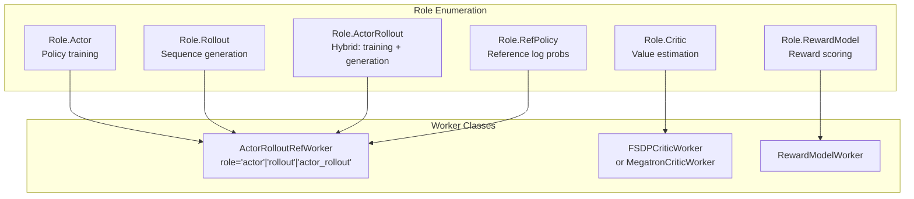
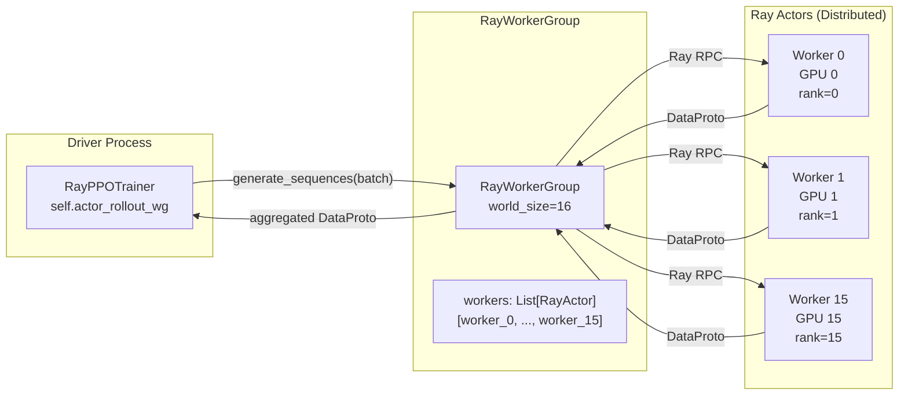
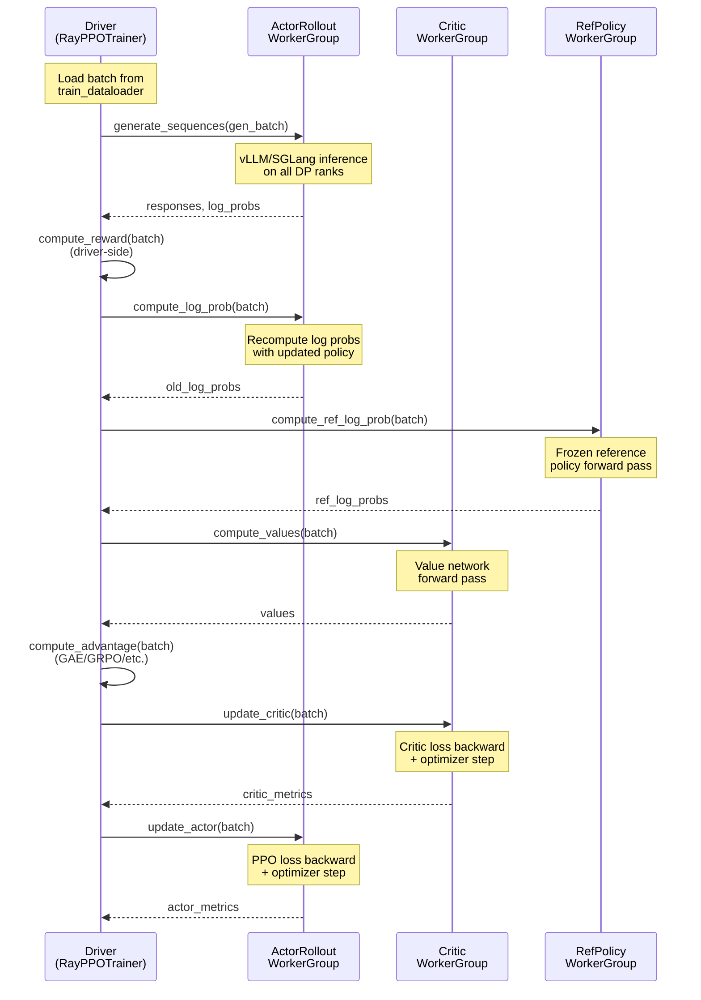
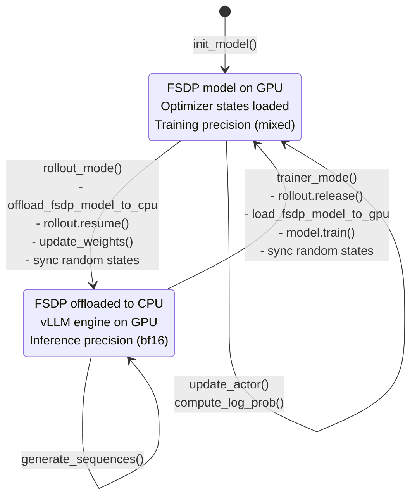
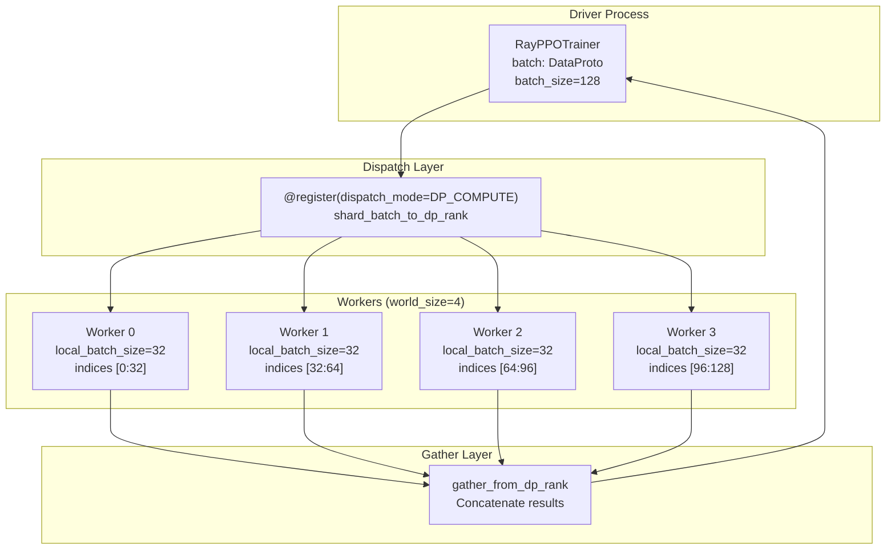
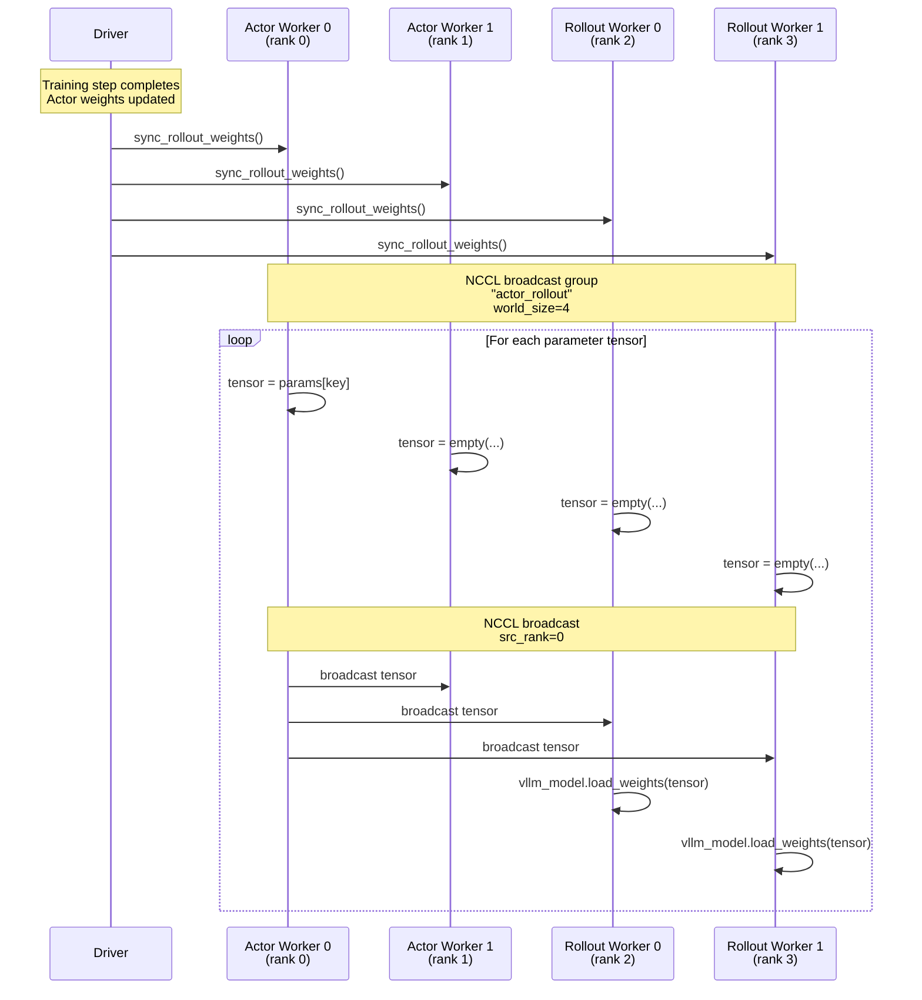
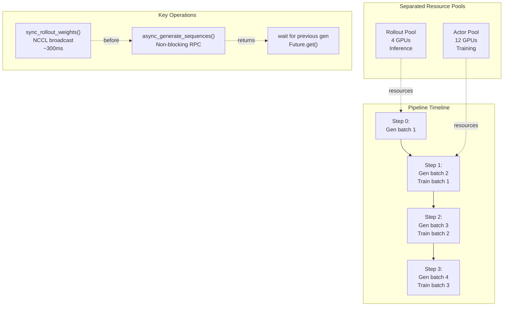

<!-- source: DeepWiki mcp.deepwiki.com · repo allenai/SAGE · page 2.3 Distributed Architecture · fetched 2026-10-26 -->

# Distributed Architecture

<details>
<summary>Relevant source files</summary>

The following files were used as context for generating this wiki page:

- [rl_train/trainer/ppo/sage_ray_trainer.py](rl_train/trainer/ppo/sage_ray_trainer.py)
- [verl/recipe/collabllm/reward_function.py](verl/recipe/collabllm/reward_function.py)
- [verl/recipe/dapo/dapo_ray_trainer.py](verl/recipe/dapo/dapo_ray_trainer.py)
- [verl/recipe/entropy/entropy_ray_trainer.py](verl/recipe/entropy/entropy_ray_trainer.py)
- [verl/recipe/one_step_off_policy/README.md](verl/recipe/one_step_off_policy/README.md)
- [verl/recipe/one_step_off_policy/ray_trainer.py](verl/recipe/one_step_off_policy/ray_trainer.py)
- [verl/recipe/prime/prime_ray_trainer.py](verl/recipe/prime/prime_ray_trainer.py)
- [verl/recipe/sppo/sppo_ray_trainer.py](verl/recipe/sppo/sppo_ray_trainer.py)
- [verl/scripts/legacy_model_merger.py](verl/scripts/legacy_model_merger.py)
- [verl/verl/model_merger/fsdp_model_merger.py](verl/verl/model_merger/fsdp_model_merger.py)
- [verl/verl/model_merger/megatron_model_merger.py](verl/verl/model_merger/megatron_model_merger.py)
- [verl/verl/models/llama/megatron/checkpoint_utils/llama_loader_depracated.py](verl/verl/models/llama/megatron/checkpoint_utils/llama_loader_depracated.py)
- [verl/verl/trainer/ppo/ray_trainer.py](verl/verl/trainer/ppo/ray_trainer.py)
- [verl/verl/workers/fsdp_workers.py](verl/verl/workers/fsdp_workers.py)

</details>


This document describes the distributed training architecture of the verl framework, focusing on Ray-based orchestration, resource management, worker coordination, and communication patterns. For information about the training algorithms themselves (PPO, DAPO, GSPO, etc.), see [Training Algorithms](#3). For details about model parallelism strategies (FSDP, Megatron), see [Model Parallelism Strategies](#4.3).

## Overview

The verl framework employs a **single-controller, multi-worker** architecture built on Ray for distributed reinforcement learning. A central driver process (running the trainer) orchestrates multiple distributed worker groups that handle different aspects of the training pipeline: policy rollouts, model updates, value estimation, and reward computation.

The architecture supports two primary execution modes:
- **Hybrid Engine Mode** (`hybrid_engine=True`): Actor and rollout workers are colocated on the same GPUs, switching between training and inference modes
- **Separated Mode** (`hybrid_engine=False`): Actor and rollout workers run on separate GPU resources, enabling asynchronous one-step off-policy training

**Key Components:**

| Component | Purpose | Primary Classes |
|-----------|---------|----------------|
| Driver Process | Orchestrates training loop, computes advantages | `RayPPOTrainer`, `RayDAPOTrainer`, etc. |
| Resource Pools | Manages GPU allocation across nodes | `RayResourcePool`, `ResourcePoolManager` |
| Worker Groups | Coordinates workers of the same role | `RayWorkerGroup` |
| Workers | Execute model operations (forward, backward, generation) | `ActorRolloutRefWorker`, `FSDPCriticWorker` |

Sources: [verl/trainer/ppo/ray_trainer.py:263-333](), [verl/single_controller/ray/base.py]()

## Resource Pool Architecture

### ResourcePoolManager

The `ResourcePoolManager` class manages GPU resource allocation across the distributed cluster. It defines resource pools and maps worker roles to specific pools.



**Resource Pool Creation Process:**

1. `ResourcePoolManager.create_resource_pool()` iterates through `resource_pool_spec`
2. For each pool, creates a `RayResourcePool` with specified `process_on_nodes`
3. Sets `max_colocate_count=1` for FSDP (merges all worker groups into one process)
4. Validates total GPU requirements against available Ray cluster resources

**Configuration Example:**
```python
resource_pool_spec = {
    'actor_rollout': [8, 8],  # 2 nodes with 8 GPUs each
    'critic': [4, 4]           # 2 nodes with 4 GPUs each
}
mapping = {
    Role.ActorRollout: 'actor_rollout',
    Role.Critic: 'critic'
}
```

Sources: [verl/trainer/ppo/ray_trainer.py:65-119](), [verl/single_controller/ray/base.py]()

### Ray Resource Allocation

Each `RayResourcePool` manages a set of Ray actor processes distributed across nodes:

**Key Parameters:**
- `process_on_nodes`: List specifying number of GPUs per node (e.g., `[8, 8, 8]` = 3 nodes with 8 GPUs each)
- `use_gpu`: Whether to allocate GPU resources (always `True` for training)
- `max_colocate_count`: Maximum number of `RayWorkerGroup` instances per resource pool
  - Set to `1` for FSDP: All worker groups share the same Ray actors
  - Set to `>1` for Megatron: Different models can use separate worker groups

**Resource Validation:**

The system validates that requested resources can be satisfied by the Ray cluster:

```python
def _check_resource_available(self):
    node_available_resources = ray._private.state.available_resources_per_node()
    node_available_gpus = {
        node: node_info.get("GPU", 0) if "GPU" in node_info else node_info.get("NPU", 0)
        for node, node_info in node_available_resources.items()
    }
    total_available_gpus = sum(node_available_gpus.values())
    total_required_gpus = sum([...])
    if total_available_gpus < total_required_gpus:
        raise ValueError(f"Total available GPUs {total_available_gpus} is less than ...")
```

Sources: [verl/trainer/ppo/ray_trainer.py:88-119](), [verl/single_controller/ray/resource_pool.py]()

## Worker Roles and Groups

### Worker Role Taxonomy

The framework defines five primary worker roles, each handling specific aspects of the training pipeline:



**Role Descriptions:**

| Role | Purpose | Key Methods | Typical Resources |
|------|---------|-------------|-------------------|
| `ActorRollout` | Combined training and inference (hybrid mode) | `update_actor()`, `generate_sequences()`, `compute_log_prob()` | All training GPUs |
| `Actor` | Policy training only (separated mode) | `update_actor()`, `compute_log_prob()`, `sync_rollout_weights()` | Majority of GPUs |
| `Rollout` | Sequence generation only (separated mode) | `generate_sequences()` via vLLM/SGLang | Subset of GPUs |
| `Critic` | Value function estimation (for GAE) | `compute_values()`, `update_critic()` | Shared with actor or separate |
| `RefPolicy` | Reference policy for KL divergence | `compute_ref_log_prob()` | Shared with actor (LoRA) or separate |
| `RewardModel` | Model-based reward scoring | `compute_rm_score()` | Separate GPUs |

Sources: [verl/trainer/ppo/utils.py:17-45](), [verl/trainer/ppo/ray_trainer.py:270-333]()

### Worker Group Initialization

Worker groups are initialized through a multi-step process coordinated by `RayPPOTrainer.init_workers()`:

**Step 1: Create Worker Classes with Initialization Arguments**

```python
# Example: Creating actor_rollout worker class
actor_rollout_cls = RayClassWithInitArgs(
    cls=ActorRolloutRefWorker,
    config=self.config.actor_rollout_ref,
    role="actor_rollout"
)
```

**Step 2: Map Worker Classes to Resource Pools**

```python
resource_pool_to_cls = {
    resource_pool_actor: {
        'actor_rollout': actor_rollout_cls
    },
    resource_pool_critic: {
        'critic': critic_cls
    }
}
```

**Step 3: Create Colocated Worker Classes (for FSDP)**

For FSDP with `max_colocate_count=1`, multiple worker classes share the same Ray actors:

```python
worker_dict_cls = create_colocated_worker_cls(class_dict={
    'actor_rollout': actor_rollout_cls,
    'ref': ref_policy_cls
})
```

**Step 4: Spawn Worker Groups**

```python
wg_dict = RayWorkerGroup(
    resource_pool=resource_pool,
    ray_cls_with_init=worker_dict_cls,
    device_name='cuda'
)
spawn_wg = wg_dict.spawn(prefix_set=['actor_rollout', 'ref'])
# Returns: {'actor_rollout': RayWorkerGroup, 'ref': RayWorkerGroup}
```

**Step 5: Initialize Models on Workers**

```python
self.actor_rollout_wg.init_model()
self.critic_wg.init_model()
```

This triggers distributed model initialization across all workers in the group via the `@register` decorated `init_model()` method.

Sources: [verl/trainer/ppo/ray_trainer.py:662-753](), [verl/single_controller/base/decorator.py]()

### RayWorkerGroup Communication

`RayWorkerGroup` provides a high-level interface for coordinating workers of the same role:



**Key Methods:**

- **Communication Methods:**
  - `generate_sequences(data: DataProto) -> DataProto`: Distributed sequence generation
  - `compute_log_prob(data: DataProto) -> DataProto`: Compute action log probabilities
  - `update_actor(data: DataProto) -> DataProto`: Perform gradient updates
  - `compute_values(data: DataProto) -> DataProto`: Critic value estimation

- **Management Methods:**
  - `init_model()`: Initialize models on all workers
  - `save_checkpoint(local_path, remote_path, global_step)`: Distributed checkpoint saving
  - `load_checkpoint(path)`: Distributed checkpoint loading

**Dispatch Modes:**

Workers use the `@register` decorator to specify how methods are dispatched:

| Dispatch Mode | Behavior | Use Case |
|---------------|----------|----------|
| `ONE_TO_ALL` | Driver calls all workers, no data return | `init_model()`, `save_checkpoint()` |
| `DP_COMPUTE` | Data parallel computation with gather | `generate_sequences()`, `update_actor()` |
| `MEGATRON_COMPUTE` | Megatron-style pipeline parallel | Megatron tensor/pipeline parallel models |

Sources: [verl/single_controller/ray/worker_group.py](), [verl/single_controller/base/decorator.py]()

## Distributed Training Flow

### Synchronous Training Pipeline

In hybrid engine mode (`hybrid_engine=True`), the training follows a synchronous pipeline where all operations happen sequentially on the driver:



**Key Characteristics:**

1. **Sequential Execution**: Each phase completes before the next begins
2. **Blocking Operations**: Driver waits for each worker group to finish
3. **GPU Context Switching** (hybrid mode): Workers switch between training and inference modes
4. **Data Parallel Dispatch**: Batches are automatically sharded across DP ranks using `@register(dispatch_mode=Dispatch.DP_COMPUTE)`

**Timing Breakdown** (from DAPO 32B benchmark):
- Generation (`gen`): ~70% of total step time (dominant bottleneck)
- Old log prob (`old_log_prob`): ~10%
- Actor update (`update_actor`): ~15%
- Other operations: ~5%

Sources: [rl_train/trainer/ppo/sage_ray_trainer.py:223-408](), [verl/trainer/ppo/ray_trainer.py:778-1006]()

### Hybrid Engine Mode Switching

In hybrid engine mode, `ActorRolloutRefWorker` alternates between **trainer mode** (for policy updates) and **rollout mode** (for inference):



**Trainer Mode (`trainer_mode()`):**
- FSDP model loaded on GPU with full precision
- Optimizer states active
- Gradient computation enabled
- Used for: `update_actor()`, `compute_log_prob()`

**Rollout Mode (`rollout_mode()`):**
- FSDP model offloaded to CPU (if `param_offload=True`)
- vLLM/SGLang engine on GPU with model weights
- Inference optimizations enabled (PagedAttention, continuous batching)
- Used for: `generate_sequences()`

**Parameter Synchronization:**

When switching to rollout mode, FSDP parameters are synchronized to the inference engine:

```python
async def rollout_mode(self):
    # 1. Load FSDP model to GPU if offloaded
    if self._is_offload_param:
        load_fsdp_model_to_gpu(self.actor_module_fsdp)
    
    # 2. Collect parameters (with LoRA handling)
    if hasattr(peft_model, "peft_config"):  # LoRA
        params = collect_lora_params(...)
    else:
        params = self.actor_module_fsdp.state_dict()
    
    # 3. Resume inference engine
    await self.rollout.resume(tags=["weights"])
    
    # 4. Update inference engine weights
    await self.rollout.update_weights(per_tensor_param)
    
    # 5. Offload FSDP model back to CPU
    if self._is_offload_param:
        offload_fsdp_model_to_cpu(self.actor_module_fsdp)
```

Sources: [verl/workers/fsdp_workers.py:655-755](), [verl/workers/rollout/vllm_rollout.py]()

## Communication and Synchronization

### Data Parallel Communication

The framework uses `DataProto` as the primary data structure for distributed communication. The `@register` decorator handles automatic data sharding and gathering:



**DataProto Sharding:**

When a method with `dispatch_mode=Dispatch.DP_COMPUTE` is called, the dispatcher automatically:

1. **Determines DP Rank**: Identifies which workers should receive data based on device mesh configuration
2. **Shards Batch**: Divides `batch.batch` tensors along dimension 0
3. **Preserves Metadata**: Keeps `batch.meta_info` and `batch.non_tensor_batch` consistent
4. **Dispatches**: Sends sharded batches via Ray RPC to respective workers

**Example: Distributed Generation:**

```python
# Driver side
gen_batch = DataProto(...)  # batch_size=128
gen_batch_output = self.actor_rollout_wg.generate_sequences(gen_batch)

# Worker side (automatically invoked)
@register(dispatch_mode=Dispatch.DP_COMPUTE)
def generate_sequences(self, data: DataProto) -> DataProto:
    # Receives: data with batch_size=32 (128/4)
    # Returns: generated responses with batch_size=32
    ...
```

**Gathering Results:**

After workers complete computation, results are automatically gathered back to the driver in the original order, reconstructing the full batch.

Sources: [verl/single_controller/base/decorator.py](), [verl/protocol/dataproto.py]()

### NCCL-Based Weight Synchronization

For separated actor-rollout mode (one-step off-policy training), the framework uses NCCL collectives for efficient parameter synchronization:



**Weight Synchronization Setup:**

1. **Create Communication Group:**

```python
def create_weight_sync_group(self):
    master_address = ray.get(self.actor_wg.workers[0]._get_node_ip.remote())
    master_port = ray.get(self.actor_wg.workers[0]._get_free_port.remote())
    world_size = len(self.actor_wg.workers + self.rollout_wg.workers)
    
    # Actor workers initialize group with ranks [0, ..., N_actor-1]
    self.actor_wg.create_weight_sync_group(
        master_address, master_port, 0, world_size
    )
    
    # Rollout workers initialize group with ranks [N_actor, ..., world_size-1]
    self.rollout_wg.create_weight_sync_group(
        master_address, master_port, len(self.actor_wg.workers), world_size
    )
```

2. **Synchronize Weights:**

```python
def sync_rollout_weights(self):
    params = self._get_actor_params() if self._is_actor else None
    
    for key, shape, dtype in self._weights_info:
        tensor = torch.empty(shape, dtype=dtype, device=get_torch_device())
        
        if self._is_actor and rank == 0:
            tensor.copy_(params[key].full_tensor())
        
        # NCCL broadcast from actor rank 0 to all ranks
        collective.broadcast(tensor, src_rank=0, group_name="actor_rollout")
        
        if self._is_rollout:
            inference_model.load_weights([(key, tensor)])
```

**Performance Characteristics:**

- **Latency**: Typically <300ms for 7B models, negligible compared to generation time
- **Bandwidth**: Utilizes full NVLINK/Infiniband bandwidth via NCCL
- **Scalability**: Efficient broadcast tree topology scales to large clusters

Sources: [verl/recipe/one_step_off_policy/ray_trainer.py:278-300](), [verl/workers/fsdp_workers.py:1757-1812]()

## Asynchronous One-Step Off-Policy Training

### Architecture Overview

The one-step off-policy training mode decouples generation and training into separate, concurrent pipelines:



**Key Advantages:**

1. **Parallelism**: Generation for batch N+1 overlaps with training on batch N
2. **Resource Optimization**: Fewer GPUs for generation reduces idle time during long-tail samples
3. **One-Step Off-Policy**: Training uses samples from previous policy (one gradient step behind)
4. **GPU Utilization**: Training GPUs remain active during generation long-tail

**Performance Gains** (Qwen2.5-Math-7B DAPO):
- FSDP2: 23% speedup (19h18m → 15h34m)
- Megatron: 40% speedup (18h21m → 13h06m)

Sources: [verl/recipe/one_step_off_policy/README.md:1-83](), [verl/recipe/one_step_off_policy/ray_trainer.py:95-163]()

### Asynchronous Training Loop

The async training loop uses a continuous iterator and future-based batching:

```python
def _create_continuous_iterator(self):
    """Yield batches continuously across epochs"""
    for epoch in range(self.config.trainer.total_epochs):
        iterator = iter(self.train_dataloader)
        for batch_dict in iterator:
            yield epoch, batch_dict

def _async_gen_next_batch(self, continuous_iterator):
    """Initiate async generation for next batch"""
    epoch, batch_dict = next(continuous_iterator)
    batch = DataProto.from_single_dict(batch_dict)
    gen_batch = batch.pop(...)  # Extract generation inputs
    
    # Sync actor weights to rollout workers via NCCL
    self.sync_rollout_weights()
    
    # Non-blocking async generation
    gen_batch_output = self.rollout_wg.async_generate_sequences(gen_batch)
    
    return GenerationBatchFuture(epoch, batch, gen_batch_output)

# Training loop
continuous_iterator = self._create_continuous_iterator()
batch_data_future = self._async_gen_next_batch(continuous_iterator)  # Initial generation

while batch_data_future is not None:
    # Wait for previous generation to complete
    with marked_timer("wait_prev_gen", timing_raw):
        epoch, batch, gen_batch_result = batch_data_future.get()
    
    # Launch next generation immediately (async, non-blocking)
    batch_data_future = self._async_gen_next_batch(continuous_iterator)
    
    # Training proceeds while next batch generates
    batch = batch.union(gen_batch_result)
    batch = compute_rewards(batch)
    batch = compute_advantages(batch)
    actor_output = self.actor_wg.update_actor(batch)
```

**Timing Analysis:**

| Synchronous Mode | Asynchronous Mode |
|------------------|-------------------|
| `step ≈ gen + old_log_prob + update_actor` | `step ≈ wait_prev_gen + old_log_prob + update_actor` |
| Generation blocks training | Generation overlaps with training |
| `gen` is longest phase | `wait_prev_gen` measures non-overlapped time |

**GenerationBatchFuture:**

Encapsulates asynchronous generation results:

```python
class GenerationBatchFuture:
    def __init__(self, epoch, batch, gen_batch_output, future_reward=None):
        self.epoch = epoch
        self.batch = batch
        self.gen_batch_output = gen_batch_output  # Ray ObjectRef
        self.future_reward = future_reward
    
    def get(self):
        """Block until generation completes, return results"""
        gen_batch_result = self.gen_batch_output.get()  # Ray ObjectRef.get()
        return self.epoch, self.batch, gen_batch_result, self.future_reward
```

Sources: [verl/recipe/one_step_off_policy/ray_trainer.py:302-399](), [verl/recipe/one_step_off_policy/ray_trainer.py:58-93]()

### Resource Configuration for Async Mode

Optimal performance requires balancing generation and training resources:

**Configuration Parameters:**

```yaml
# Separated mode (hybrid_engine=False)
actor_rollout_ref:
  hybrid_engine: false

# Training resources (actor)
trainer:
  nnodes: 1
  n_gpus_per_node: 12

# Generation resources (rollout)  
rollout:
  nnodes: 1
  n_gpus_per_node: 4
```

**Resource Allocation Strategies:**

1. **Resource-Constrained (Shared Nodes):**
   - Set `trainer.nnodes = rollout.nnodes`
   - Ensure `trainer.n_gpus_per_node + rollout.n_gpus_per_node ≤ physical_gpus_per_node`
   - Total nodes = `max(trainer.nnodes, rollout.nnodes)`
   - Example: 1 node with 16 GPUs → 12 for training, 4 for rollout

2. **Resource-Abundant (Separate Nodes):**
   - Set `trainer.n_gpus_per_node = rollout.n_gpus_per_node`
   - Scale independently via `trainer.nnodes` and `rollout.nnodes`
   - Total nodes = `trainer.nnodes + rollout.nnodes`
   - Example: 2 training nodes + 1 rollout node, each with 8 GPUs

**Tuning Guidelines:**

- **Ideal State**: `wait_prev_gen` ≈ 0 (generation fully overlaps with training)
- **High `wait_prev_gen` + uniform sequence lengths**: Increase rollout resources
- **High `wait_prev_gen` + long-tail distribution**: Optimize stopping criteria (resource increase won't help)
- **Batch Divisibility**: Ensure `rollout.n * train_batch_size` is divisible by `trainer.total_gpus`

Sources: [verl/recipe/one_step_off_policy/README.md:215-289](), [verl/recipe/one_step_off_policy/ray_trainer.py:170-277]()

---

