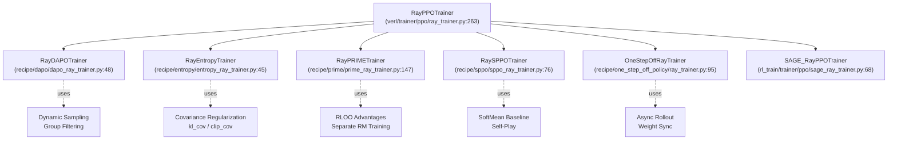
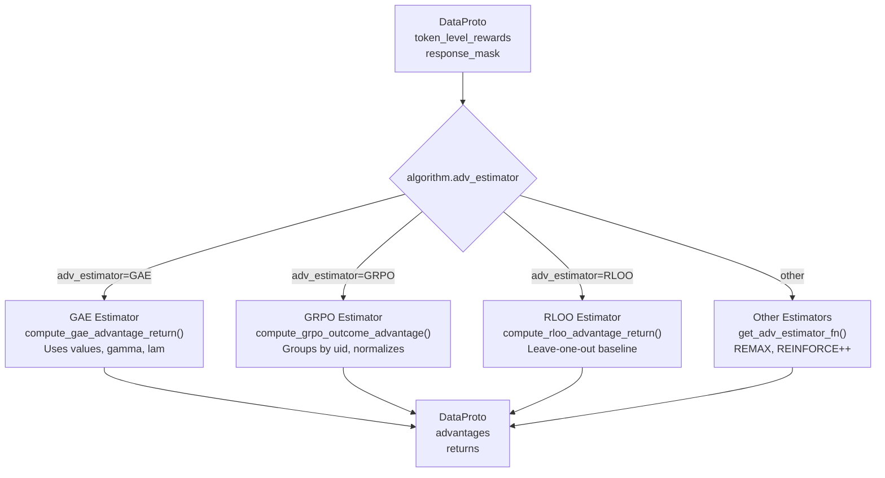
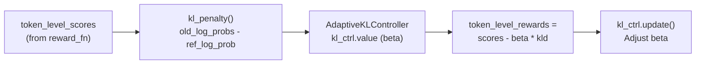
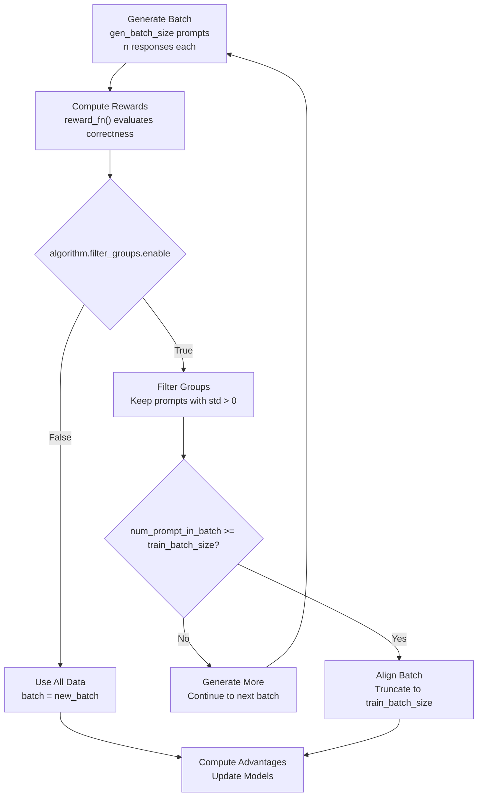
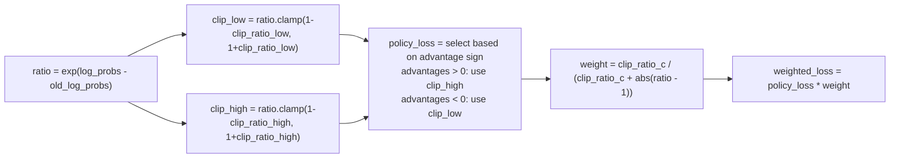
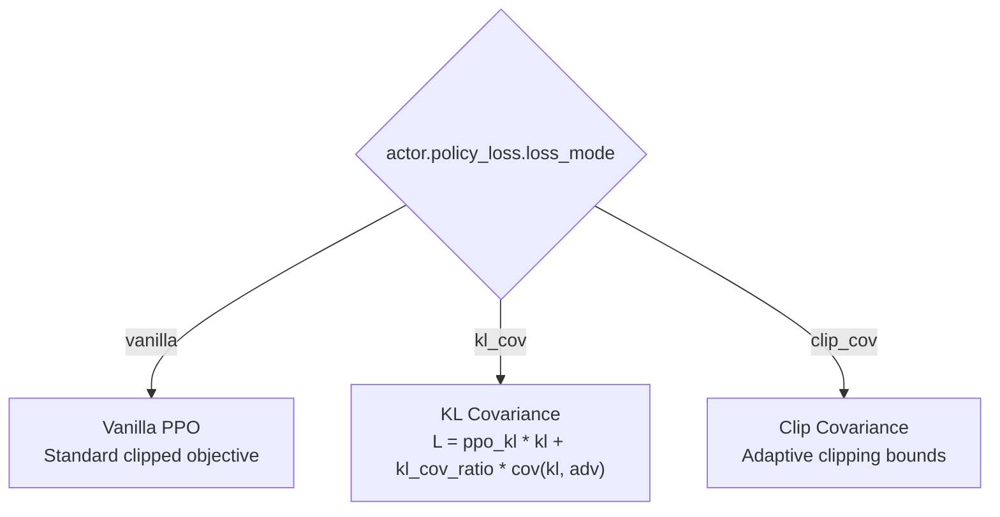
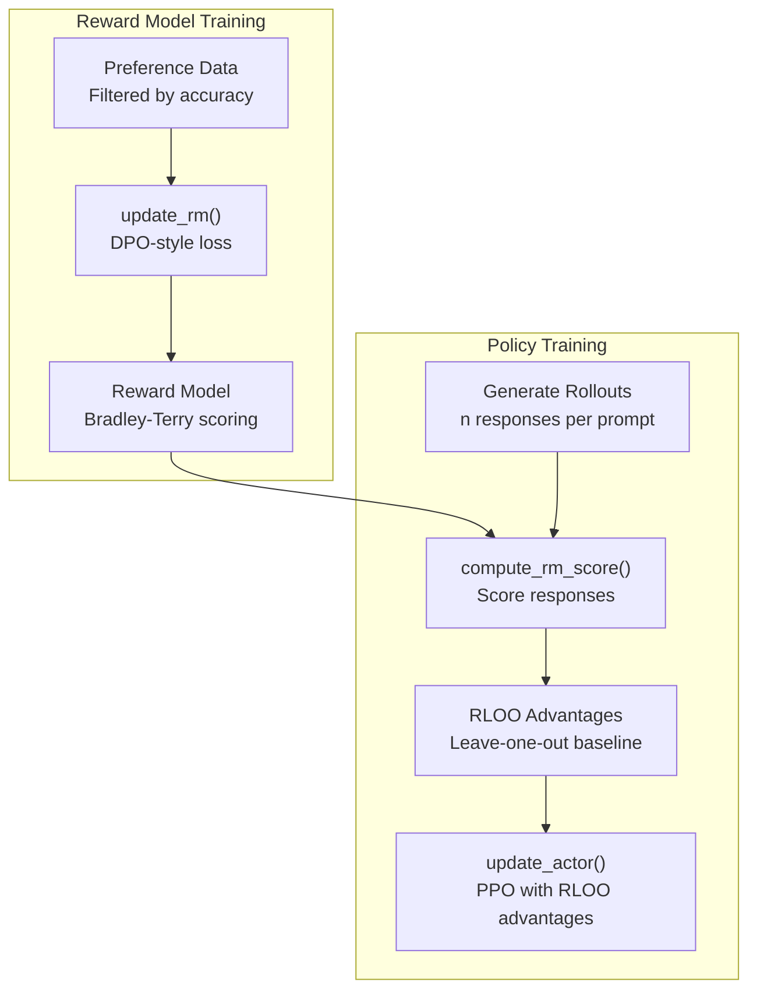
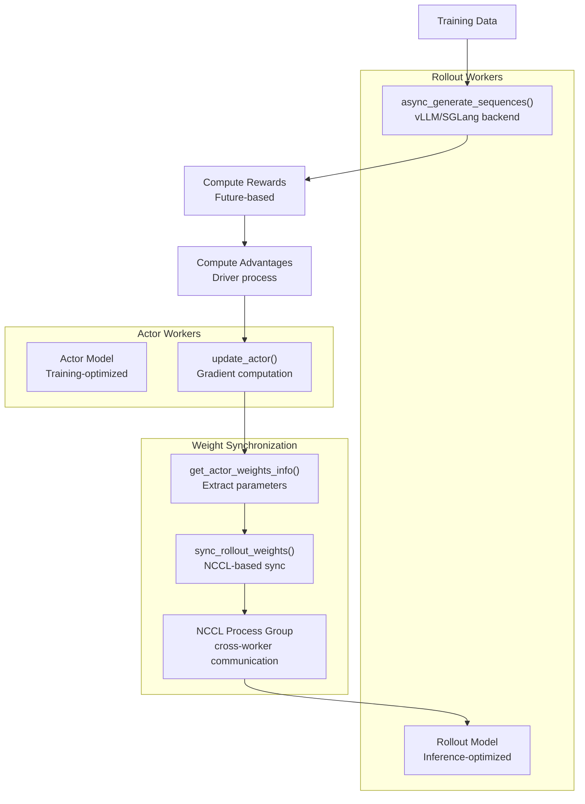

<!-- source: DeepWiki mcp.deepwiki.com · repo allenai/SAGE · page 3 Training Algorithms · fetched 2026-10-26 -->

# Training Algorithms

<details>
<summary>Relevant source files</summary>

The following files were used as context for generating this wiki page:

- [rl_train/trainer/config/rollout/rollout.yaml](rl_train/trainer/config/rollout/rollout.yaml)
- [rl_train/trainer/ppo/sage_ray_trainer.py](rl_train/trainer/ppo/sage_ray_trainer.py)
- [verl/recipe/collabllm/reward_function.py](verl/recipe/collabllm/reward_function.py)
- [verl/recipe/dapo/dapo_ray_trainer.py](verl/recipe/dapo/dapo_ray_trainer.py)
- [verl/recipe/dapo/run_dapo_early_qwen2.5_32b.sh](verl/recipe/dapo/run_dapo_early_qwen2.5_32b.sh)
- [verl/recipe/dapo/run_dapo_qwen2.5_32b.sh](verl/recipe/dapo/run_dapo_qwen2.5_32b.sh)
- [verl/recipe/dapo/run_dapo_qwen2.5_32b_npu.sh](verl/recipe/dapo/run_dapo_qwen2.5_32b_npu.sh)
- [verl/recipe/dapo/run_dapo_qwen2.5_32b_tis.sh](verl/recipe/dapo/run_dapo_qwen2.5_32b_tis.sh)
- [verl/recipe/dapo/run_dapo_qwen2.5_7b_npu.sh](verl/recipe/dapo/run_dapo_qwen2.5_7b_npu.sh)
- [verl/recipe/dapo/run_dapo_qwen3_14b_base_npu.sh](verl/recipe/dapo/run_dapo_qwen3_14b_base_npu.sh)
- [verl/recipe/dapo/run_dapo_qwen3_8b_base_npu.sh](verl/recipe/dapo/run_dapo_qwen3_8b_base_npu.sh)
- [verl/recipe/dapo/run_dapo_qwen3_moe_30b_base_fsdp_npu.sh](verl/recipe/dapo/run_dapo_qwen3_moe_30b_base_fsdp_npu.sh)
- [verl/recipe/dapo/run_dapo_wo_ds_qwen2.5_32b.sh](verl/recipe/dapo/run_dapo_wo_ds_qwen2.5_32b.sh)
- [verl/recipe/dapo/test_dapo_7b.sh](verl/recipe/dapo/test_dapo_7b.sh)
- [verl/recipe/entropy/32b_clip_cov.sh](verl/recipe/entropy/32b_clip_cov.sh)
- [verl/recipe/entropy/32b_kl_cov.sh](verl/recipe/entropy/32b_kl_cov.sh)
- [verl/recipe/entropy/32b_kl_cov_mininbsz.sh](verl/recipe/entropy/32b_kl_cov_mininbsz.sh)
- [verl/recipe/entropy/7b_clip_cov.sh](verl/recipe/entropy/7b_clip_cov.sh)
- [verl/recipe/entropy/7b_kl_cov.sh](verl/recipe/entropy/7b_kl_cov.sh)
- [verl/recipe/entropy/config/entropy_trainer.yaml](verl/recipe/entropy/config/entropy_trainer.yaml)
- [verl/recipe/entropy/entropy_ray_trainer.py](verl/recipe/entropy/entropy_ray_trainer.py)
- [verl/recipe/gspo/test_gspo_qwen30b_a3b_ep.sh](verl/recipe/gspo/test_gspo_qwen30b_a3b_ep.sh)
- [verl/recipe/one_step_off_policy/ray_trainer.py](verl/recipe/one_step_off_policy/ray_trainer.py)
- [verl/recipe/prime/config/prime_trainer.yaml](verl/recipe/prime/config/prime_trainer.yaml)
- [verl/recipe/prime/prime_ray_trainer.py](verl/recipe/prime/prime_ray_trainer.py)
- [verl/recipe/sppo/sppo_ray_trainer.py](verl/recipe/sppo/sppo_ray_trainer.py)
- [verl/verl/trainer/config/rollout/rollout.yaml](verl/verl/trainer/config/rollout/rollout.yaml)
- [verl/verl/trainer/ppo/ray_trainer.py](verl/verl/trainer/ppo/ray_trainer.py)

</details>


This page provides an overview of the reinforcement learning algorithms implemented in SAGE for training language models. These algorithms extend the base PPO (Proximal Policy Optimization) framework with various innovations for improved sample efficiency, exploration control, and training stability.

For information about the distributed training infrastructure that executes these algorithms, see [Ray Trainers](#5.1). For model-specific configurations, see [Model Parallelism Strategies](#4.3).

## Algorithm Architecture

SAGE implements multiple training algorithms, all extending a common base PPO trainer. The architecture follows an inheritance pattern where specialized trainers override specific training loop components while sharing common infrastructure.

**Trainer Class Hierarchy**



Sources: [verl/verl/trainer/ppo/ray_trainer.py:263](), [verl/recipe/dapo/dapo_ray_trainer.py:48](), [verl/recipe/entropy/entropy_ray_trainer.py:45](), [verl/recipe/prime/prime_ray_trainer.py:147](), [verl/recipe/sppo/sppo_ray_trainer.py:76](), [verl/recipe/one_step_off_policy/ray_trainer.py:95](), [rl_train/trainer/ppo/sage_ray_trainer.py:68]()

## Base PPO Framework

The `RayPPOTrainer` class implements the core PPO training loop with the following key phases:

**Training Loop Phases**

```mermaid
graph LR
    subgraph "Rollout Phase"
        Gen["generate_sequences()<br/>Actor+Rollout"]
    end
    
    subgraph "Reward Phase"
        RM["compute_rm_score()<br/>Reward Model"]
        RF["reward_fn()<br/>Rule-based"]
        KL["apply_kl_penalty()<br/>KL Control"]
    end
    
    subgraph "Advantage Phase"
        LogProb["compute_log_prob()<br/>Old Policy"]
        RefProb["compute_ref_log_prob()<br/>Ref Policy"]
        Values["compute_values()<br/>Critic"]
        Adv["compute_advantage()<br/>GAE/GRPO/RLOO"]
    end
    
    subgraph "Update Phase"
        UpdateCritic["update_critic()<br/>Value Function"]
        UpdateActor["update_actor()<br/>Policy Gradient"]
    end
    
    Gen --> RM
    RM --> RF
    RF --> KL
    KL --> LogProb
    LogProb --> RefProb
    RefProb --> Values
    Values --> Adv
    Adv --> UpdateCritic
    UpdateCritic --> UpdateActor
```



Sources: [verl/verl/trainer/ppo/ray_trainer.py:263-1461]()

### Advantage Estimators

The framework supports multiple advantage estimation methods, configured via `algorithm.adv_estimator`:

| Estimator | Description | Implementation | Use Case |
|-----------|-------------|----------------|----------|
| `GAE` | Generalized Advantage Estimation | [core_algos.compute_gae_advantage_return:214-221]() | Critic-based value estimation with bias-variance tradeoff |
| `GRPO` | Group Relative Policy Optimization | [core_algos.compute_grpo_outcome_advantage:230-242]() | Outcome-based advantages normalized within prompt groups |
| `RLOO` | Reward Leave-One-Out | [prime_core_algos.compute_rloo_advantage_return:44-55]() | Removes self-bias by excluding current response from baseline |
| `REMAX` | Reward Maximization | [ray_trainer.py:243-267]() | Uses greedy baseline for comparison |
| `REINFORCE++` | Enhanced REINFORCE | [core_algos.get_adv_estimator_fn:245-259]() | Variance-reduced policy gradient |

**Advantage Computation Flow**



Sources: [verl/verl/trainer/ppo/ray_trainer.py:182-260](), [verl/verl/trainer/ppo/core_algos.py]()

### KL Penalty Application

KL divergence penalties can be applied to rewards to prevent policy drift from the reference policy:



Configuration via `algorithm.use_kl_in_reward=True` and `algorithm.kl_ctrl`:
- `type`: `fixed` or `adaptive`
- `kl_coef`: Initial KL coefficient (beta)
- `kl_target`: Target KL divergence for adaptive control
- `kl_horizon`: Time horizon for adaptation

Sources: [verl/verl/trainer/ppo/ray_trainer.py:122-161](), [verl/verl/trainer/ppo/core_algos.py]()

## DAPO (Diversity-Aware Policy Optimization)

DAPO extends PPO with dynamic sampling and group filtering to improve sample efficiency on math reasoning tasks. The key innovation is filtering prompts where all responses have identical correctness, as these provide no learning signal.

**DAPO Training Flow**



### Dynamic Sampling Configuration

Key DAPO parameters in shell scripts:

| Parameter | Purpose | Typical Value |
|-----------|---------|---------------|
| `enable_filter_groups` | Enable group filtering | `True` |
| `filter_groups_metric` | Metric for filtering | `acc` / `seq_reward` |
| `max_num_gen_batches` | Max generation rounds | `10` (0 = unlimited) |
| `train_prompt_bsz` | Final training batch size | `512` |
| `gen_prompt_bsz` | Generation batch size | `train_prompt_bsz * 3` |
| `n_resp_per_prompt` | Responses per prompt | `16` |

### Overlong Buffer Penalty

DAPO includes an overlong buffer mechanism to penalize excessively long responses:

```
if response_length > max_response_length - overlong_buffer_len:
    penalty = overlong_penalty_factor * (tokens_in_buffer / overlong_buffer_len)
    token_level_rewards -= penalty
```

Configuration:
- `reward_model.overlong_buffer.enable`: Enable penalty (default: `True`)
- `reward_model.overlong_buffer.len`: Buffer size in tokens (typical: `4096`)
- `reward_model.overlong_buffer.penalty_factor`: Penalty multiplier (typical: `1.0`)

Sources: [verl/recipe/dapo/dapo_ray_trainer.py:48-306](), [verl/recipe/dapo/run_dapo_qwen2.5_32b.sh](), [verl/recipe/dapo/run_dapo_early_qwen2.5_32b.sh]()

## GSPO (Generalized Self-Play Optimization)

GSPO uses asymmetric clipping ratios for policy optimization, allowing different upper and lower bounds on the importance sampling ratio. This enables more aggressive policy updates while maintaining stability.

**Policy Loss Computation**



### GSPO Configuration

Typical asymmetric clipping configuration:

```yaml
actor_rollout_ref.actor.clip_ratio_low: 3e-4    # Lower bound for negative advantages
actor_rollout_ref.actor.clip_ratio_high: 4e-4   # Upper bound for positive advantages
actor_rollout_ref.actor.clip_ratio_c: 10.0      # Weighting coefficient
actor_rollout_ref.actor.policy_loss.loss_mode: gspo
```

The asymmetric clipping allows the policy to increase probabilities of good actions more aggressively (`clip_ratio_high`) while being more conservative about decreasing probabilities of bad actions (`clip_ratio_low`).

Sources: [verl/recipe/gspo/test_gspo_qwen30b_a3b_ep.sh]()

## Entropy Regularization

The entropy regularization algorithms add covariance-based regularization terms to the policy loss to control exploration. Two variants are implemented:

### KL Covariance (kl_cov)

Adds a regularization term based on the covariance between KL divergence and advantages:

```
L_kl_cov = ppo_kl_coef * kl_term + kl_cov_ratio * cov(kl, advantages)
```

where `kl_term = kl_divergence(policy || reference)`.

**Configuration**:
```yaml
actor_rollout_ref.actor.policy_loss.loss_mode: kl_cov
actor_rollout_ref.actor.policy_loss.ppo_kl_coef: 1.0       # Weight for KL term
actor_rollout_ref.actor.policy_loss.kl_cov_ratio: 0.0002   # Weight for covariance term
```

### Clip Covariance (clip_cov)

Clips the importance sampling ratio with adaptive bounds based on advantage covariance:

```
ratio_lb = clip_cov_lb + clip_cov_ratio * cov(ratio, advantages)
ratio_ub = clip_cov_ub + clip_cov_ratio * cov(ratio, advantages)
clipped_ratio = ratio.clamp(ratio_lb, ratio_ub)
```

**Configuration**:
```yaml
actor_rollout_ref.actor.policy_loss.loss_mode: clip_cov
actor_rollout_ref.actor.policy_loss.clip_cov_ratio: 0.0002  # Covariance weight
actor_rollout_ref.actor.policy_loss.clip_cov_lb: 1.0        # Lower bound base
actor_rollout_ref.actor.policy_loss.clip_cov_ub: 5.0        # Upper bound base
```

**Entropy Algorithm Selection**



Sources: [verl/recipe/entropy/entropy_ray_trainer.py:45-348](), [verl/recipe/entropy/32b_kl_cov.sh](), [verl/recipe/entropy/32b_clip_cov.sh](), [verl/recipe/entropy/config/entropy_trainer.yaml]()

## PRIME (Preference-based Reward Modeling)

PRIME trains a separate reward model using preference data while simultaneously training the policy. It uses RLOO (Reward Leave-One-Out) for advantage estimation to reduce bias.

**PRIME Training Architecture**



### RLOO Advantage Estimation

RLOO computes advantages by excluding the current response from the baseline:

```python
def compute_rloo_advantage_return(data, response_mask, n, config):
    rewards = data.batch["token_level_rewards"].sum(axis=-1)  # (bs,)
    # Group responses by prompt
    grouped = rewards.reshape(-1, n)  # (num_prompts, n)
    # Leave-one-out mean
    for i in range(n):
        baseline = grouped[:, :i].mean() + grouped[:, i+1:].mean()
        advantages[i] = rewards[i] - baseline
    return advantages, rewards
```

### PRIME Configuration

Key settings for PRIME:

```yaml
algorithm:
  adv_estimator: rloo
  reward_gt_coef: 5          # Weight for ground truth rewards
  reward_dpo_coef: 5         # Weight for DPO rewards

reward_model:
  enable: True
  update: before               # Update RM before policy
  mini_batch_size: 32
  prime_granularity: token    # token or sequence level
  prime_norm: batch_norm      # batch_norm or none
  beta_train: 0.05            # DPO beta parameter

data:
  filter_accuracy: True
  accuracy_lower_bound: 0.2   # Filter too-easy samples
  accuracy_upper_bound: 0.8   # Filter too-hard samples
  oversample_factor: 4.0      # Oversample for filtering
```

Sources: [verl/recipe/prime/prime_ray_trainer.py:147-388](), [verl/recipe/prime/config/prime_trainer.yaml]()

## One-Step Off-Policy Training

One-step off-policy training separates the rollout and actor update workers, allowing asynchronous generation and training. This improves GPU utilization by overlapping rollout and training phases.

**Async Training Architecture**



### Weight Synchronization Flow

The system maintains separate worker groups for rollout and actor, synchronizing weights via NCCL:

1. **Initialization** ([ray_trainer.py:278-295]()):
   - Create NCCL process group spanning both worker types
   - Master address from first actor worker
   - Ranks: actor workers first, then rollout workers

2. **Synchronization** ([ray_trainer.py:297-300]()):
   - After each actor update, extract weight info
   - Broadcast weights from actor to rollout workers
   - Uses `sync_rollout_weights()` on both groups

3. **Async Generation** ([ray_trainer.py:311-359]()):
   - Sync weights to rollout workers
   - Launch async generation (returns future)
   - Optionally launch async reward computation
   - Driver processes next batch while generation continues

### One-Step Configuration

```yaml
actor_rollout_ref:
  hybrid_engine: False          # Must be False for separated workers
  rollout:
    mode: async                 # Enable async mode
```

The system automatically creates separate `Role.Actor` and `Role.Rollout` worker groups when `hybrid_engine=False`.

Sources: [verl/recipe/one_step_off_policy/ray_trainer.py:95-589]()

## Algorithm Comparison Matrix

| Algorithm | Advantage Estimator | Key Innovation | Best For | Typical Config |
|-----------|---------------------|----------------|----------|----------------|
| **DAPO** | GRPO | Dynamic sampling with group filtering | Math reasoning with binary outcomes | `n=16`, filtering enabled |
| **GSPO** | GRPO | Asymmetric clipping ratios | Aggressive policy updates | `clip_ratio_low=3e-4`, `clip_ratio_high=4e-4` |
| **Entropy** | GRPO | Covariance-based exploration control | Maintaining exploration | `kl_cov_ratio=0.0002` |
| **PRIME** | RLOO | Separate reward model training | Preference-based tasks | `n=4`, RM enabled |
| **One-Step** | GAE/GRPO | Async rollout/training separation | Maximum throughput | `mode=async` |

## Common Configuration Patterns

All algorithms share these configuration sections:

**Data Configuration**
```yaml
data:
  train_batch_size: 512              # Final batch size for training
  gen_batch_size: 1536              # Batch size for generation (often 3x train)
  max_prompt_length: 2048           # Max tokens in prompt
  max_response_length: 20480        # Max tokens in response
```

**Actor Configuration**
```yaml
actor_rollout_ref.actor:
  optim.lr: 1e-6                    # Learning rate
  optim.lr_warmup_steps: 10         # Warmup steps
  ppo_mini_batch_size: 32           # Mini-batch size for PPO updates
  loss_agg_mode: token-mean         # How to aggregate loss (token-mean/seq-mean)
  clip_ratio_low: 0.2               # Lower clipping bound
  clip_ratio_high: 0.28             # Upper clipping bound
  entropy_coeff: 0                  # Entropy bonus coefficient
```

**Rollout Configuration**
```yaml
actor_rollout_ref.rollout:
  n: 16                             # Responses per prompt
  temperature: 1.0                  # Sampling temperature
  top_p: 1.0                        # Nucleus sampling parameter
  tensor_model_parallel_size: 4     # Tensor parallelism for inference
```

**Algorithm Configuration**
```yaml
algorithm:
  adv_estimator: grpo               # GAE/GRPO/RLOO
  gamma: 1.0                        # Discount factor
  lam: 1.0                          # GAE lambda
  use_kl_in_reward: False           # Apply KL penalty to rewards
  kl_ctrl:
    type: fixed                     # fixed or adaptive
    kl_coef: 0.0                    # KL coefficient
```

Sources: [verl/verl/trainer/config/](), [verl/recipe/dapo/run_dapo_qwen2.5_32b.sh](), [verl/recipe/gspo/test_gspo_qwen30b_a3b_ep.sh](), [rl_train/trainer/config/rollout/rollout.yaml]()

---

