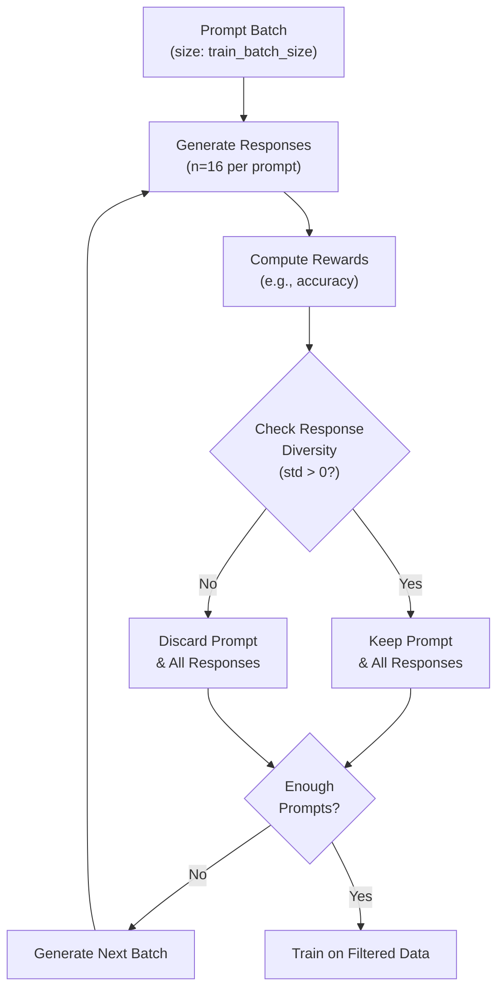
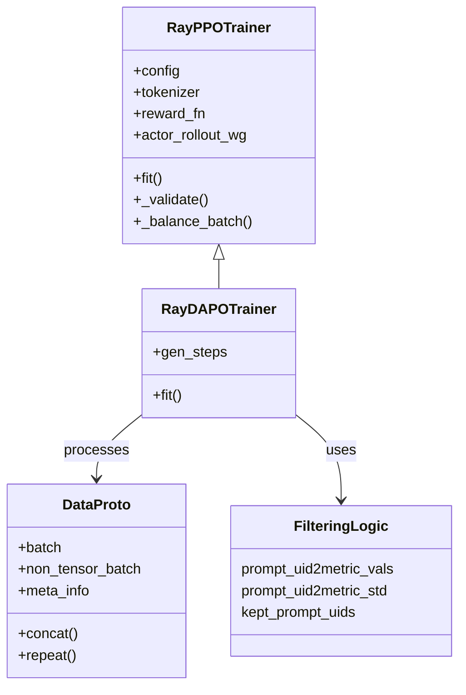
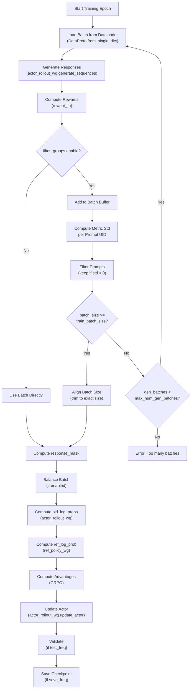
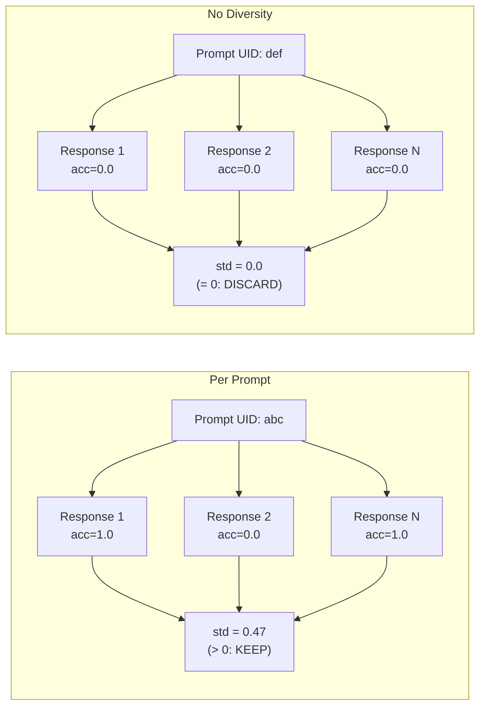
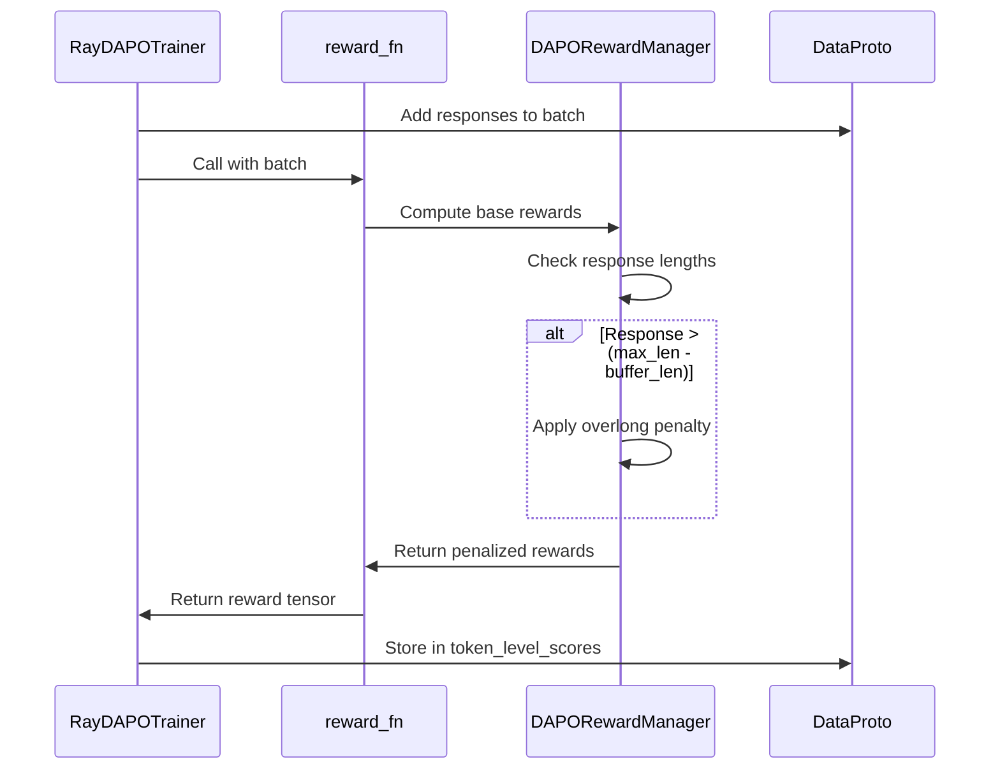

<!-- source: DeepWiki mcp.deepwiki.com · repo allenai/SAGE · page 3.1 DAPO (Diversity-Aware Policy Optimization) · fetched 2026-10-26 -->

# DAPO (Diversity-Aware Policy Optimization)

<details>
<summary>Relevant source files</summary>

The following files were used as context for generating this wiki page:

- [rl_train/trainer/ppo/sage_ray_trainer.py](rl_train/trainer/ppo/sage_ray_trainer.py)
- [verl/recipe/collabllm/reward_function.py](verl/recipe/collabllm/reward_function.py)
- [verl/recipe/dapo/dapo_ray_trainer.py](verl/recipe/dapo/dapo_ray_trainer.py)
- [verl/recipe/dapo/run_dapo_early_qwen2.5_32b.sh](verl/recipe/dapo/run_dapo_early_qwen2.5_32b.sh)
- [verl/recipe/dapo/run_dapo_qwen2.5_32b.sh](verl/recipe/dapo/run_dapo_qwen2.5_32b.sh)
- [verl/recipe/dapo/run_dapo_qwen2.5_32b_npu.sh](verl/recipe/dapo/run_dapo_qwen2.5_32b_npu.sh)
- [verl/recipe/dapo/run_dapo_qwen2.5_32b_tis.sh](verl/recipe/dapo/run_dapo_qwen2.5_32b_tis.sh)
- [verl/recipe/dapo/run_dapo_qwen2.5_7b_npu.sh](verl/recipe/dapo/run_dapo_qwen2.5_7b_npu.sh)
- [verl/recipe/dapo/run_dapo_qwen3_14b_base_npu.sh](verl/recipe/dapo/run_dapo_qwen3_14b_base_npu.sh)
- [verl/recipe/dapo/run_dapo_qwen3_8b_base_npu.sh](verl/recipe/dapo/run_dapo_qwen3_8b_base_npu.sh)
- [verl/recipe/dapo/run_dapo_qwen3_moe_30b_base_fsdp_npu.sh](verl/recipe/dapo/run_dapo_qwen3_moe_30b_base_fsdp_npu.sh)
- [verl/recipe/dapo/run_dapo_wo_ds_qwen2.5_32b.sh](verl/recipe/dapo/run_dapo_wo_ds_qwen2.5_32b.sh)
- [verl/recipe/dapo/test_dapo_7b.sh](verl/recipe/dapo/test_dapo_7b.sh)
- [verl/recipe/entropy/entropy_ray_trainer.py](verl/recipe/entropy/entropy_ray_trainer.py)
- [verl/recipe/one_step_off_policy/ray_trainer.py](verl/recipe/one_step_off_policy/ray_trainer.py)
- [verl/recipe/prime/prime_ray_trainer.py](verl/recipe/prime/prime_ray_trainer.py)
- [verl/recipe/sppo/sppo_ray_trainer.py](verl/recipe/sppo/sppo_ray_trainer.py)
- [verl/verl/trainer/ppo/ray_trainer.py](verl/verl/trainer/ppo/ray_trainer.py)

</details>


## Purpose and Scope

This document describes DAPO (Diversity-Aware Policy Optimization), a reinforcement learning algorithm specialized for math reasoning tasks. DAPO extends the base PPO algorithm with three key innovations: **group filtering** (also called dynamic sampling) to focus training on diverse responses, **overlong buffer** to penalize excessively long generations, and **asymmetric clipping** for refined policy updates.

For general PPO training concepts, see [Training Algorithms](#3). For the base trainer implementation, see [Ray Trainers](#5.1). For other algorithm variants like GSPO and SPPO, see [GSPO](#3.2) and sections 3.3-3.5.

---

## Core Concepts

### Group Filtering (Dynamic Sampling)

Group filtering is DAPO's primary mechanism for improving sample efficiency. Instead of using all generated responses for training, DAPO filters prompts based on whether their responses exhibit sufficient diversity.

**Filtering Logic:**
1. Generate `n` responses per prompt (typically 16)
2. Compute a metric (usually `acc` for accuracy) for each response
3. Calculate the standard deviation of metrics within each prompt's response group
4. **Keep only prompts where std > 0** (responses have diversity)
5. Discard prompts where all responses have identical metrics

**Rationale:** Prompts that produce diverse responses (some correct, some incorrect) provide stronger learning signal than prompts where the model either solves all attempts or fails all attempts.



**Sources:** [verl/recipe/dapo/dapo_ray_trainer.py:207-267](), [verl/recipe/entropy/entropy_ray_trainer.py:187-249]()

### Overlong Buffer

The overlong buffer mechanism penalizes responses that exceed a target length, addressing the common problem of models generating unnecessarily verbose solutions to gain higher rewards.

**Configuration Parameters:**
| Parameter | Description | Typical Value |
|-----------|-------------|---------------|
| `reward_model.overlong_buffer.enable` | Enable overlong penalty | `True` |
| `reward_model.overlong_buffer.len` | Length threshold (in tokens) | 4096 |
| `reward_model.overlong_buffer.penalty_factor` | Penalty multiplier | 1.0 |

**Penalty Formula:**
```
if response_length > (max_response_length - overlong_buffer_len):
    penalty = (response_length - threshold) * penalty_factor
    final_reward = base_reward - penalty
```

**Sources:** [verl/recipe/dapo/run_dapo_qwen2.5_32b.sh:17-21](), [verl/recipe/dapo/run_dapo_qwen3_14b_base_npu.sh:17-21]()

### Asymmetric Clipping

DAPO uses asymmetric clipping ratios for policy updates, unlike standard PPO which uses symmetric clipping. This allows finer control over how much the policy can change in positive vs. negative directions.

**Key Parameters:**
- `clip_ratio_low`: Lower clipping threshold (typically 0.2)
- `clip_ratio_high`: Upper clipping threshold (typically 0.28)
- `clip_ratio_c`: Additional clipping parameter (typically 10.0)

The asymmetric clipping is applied during the actor update phase to constrain policy ratio changes.

**Sources:** [verl/recipe/dapo/run_dapo_qwen2.5_32b.sh:14-15](), [verl/recipe/dapo/run_dapo_qwen3_14b_base_npu.sh:12-13]()

---

## Architecture

### RayDAPOTrainer Class

DAPO is implemented as `RayDAPOTrainer`, which extends `RayPPOTrainer` with the group filtering mechanism.



**Class Location:** [verl/recipe/dapo/dapo_ray_trainer.py:48-51]()

**Key Methods:**
- `fit()`: Main training loop with filtering logic [verl/recipe/dapo/dapo_ray_trainer.py:53-345]()

**Sources:** [verl/recipe/dapo/dapo_ray_trainer.py:48-345]()

### Training Flow with Group Filtering

The DAPO training flow introduces generation batching and filtering between the standard PPO rollout and update phases.



**Key Variables:**
- `num_prompt_in_batch`: Count of prompts kept after filtering [verl/recipe/dapo/dapo_ray_trainer.py:109]()
- `num_gen_batches`: Count of generation batches in current step [verl/recipe/dapo/dapo_ray_trainer.py:110]()
- `prompt_uid2metric_vals`: Maps prompt UID to list of metric values [verl/recipe/dapo/dapo_ray_trainer.py:223]()

**Sources:** [verl/recipe/dapo/dapo_ray_trainer.py:111-345](), [verl/recipe/entropy/entropy_ray_trainer.py:94-348]()

### Filtering Implementation Details

The filtering logic operates at the trajectory level, maintaining the UID (unique identifier) of each prompt to group responses.



**Implementation Code Pattern:**
```python
# Collect metrics per prompt UID
prompt_uid2metric_vals = defaultdict(list)
for uid, metric_val in zip(batch.non_tensor_batch["uid"], 
                            batch.non_tensor_batch[metric_name]):
    prompt_uid2metric_vals[uid].append(metric_val)

# Compute std and filter
prompt_uid2metric_std = {
    uid: np.std(vals) 
    for uid, vals in prompt_uid2metric_vals.items()
}
kept_prompt_uids = [
    uid for uid, std in prompt_uid2metric_std.items()
    if std > 0 or len(prompt_uid2metric_vals[uid]) == 1
]
```

**Sources:** [verl/recipe/dapo/dapo_ray_trainer.py:222-244](), [verl/recipe/entropy/entropy_ray_trainer.py:203-225]()

---

## Configuration

### Key Configuration Parameters

DAPO training is configured through nested configuration objects passed to the trainer. The main configuration sections are:

| Section | Parameter | Description | Typical Value |
|---------|-----------|-------------|---------------|
| `algorithm` | `adv_estimator` | Advantage estimator type | `"grpo"` |
| `algorithm` | `use_kl_in_reward` | Apply KL penalty to rewards | `False` |
| `algorithm.filter_groups` | `enable` | Enable group filtering | `True` |
| `algorithm.filter_groups` | `metric` | Metric for filtering | `"acc"` |
| `algorithm.filter_groups` | `max_num_gen_batches` | Max generation attempts | `10` |
| `actor_rollout_ref.actor` | `clip_ratio_low` | Lower clip threshold | `0.2` |
| `actor_rollout_ref.actor` | `clip_ratio_high` | Upper clip threshold | `0.28` |
| `actor_rollout_ref.actor` | `loss_agg_mode` | Loss aggregation mode | `"token-mean"` |
| `actor_rollout_ref.rollout` | `n` | Responses per prompt | `16` |
| `reward_model` | `reward_manager` | Reward manager type | `"dapo"` |
| `reward_model.overlong_buffer` | `enable` | Enable overlong penalty | `True` |
| `reward_model.overlong_buffer` | `len` | Buffer length threshold | `4096` |
| `reward_model.overlong_buffer` | `penalty_factor` | Penalty multiplier | `1.0` |

**Sources:** [verl/recipe/dapo/run_dapo_qwen2.5_32b.sh:1-131](), [verl/recipe/dapo/run_dapo_qwen3_14b_base_npu.sh:1-140]()

### Configuration Variants

DAPO supports several configuration modes:

**1. Full DAPO (with Dynamic Sampling):**
```yaml
algorithm.filter_groups.enable=True
algorithm.filter_groups.max_num_gen_batches=10
algorithm.filter_groups.metric=acc
data.gen_batch_size=$((train_prompt_bsz * 3))  # 3x for oversampling
```

**2. DAPO without Dynamic Sampling:**
```yaml
algorithm.filter_groups.enable=False
data.gen_batch_size=${train_prompt_bsz}  # No oversampling
```

**3. Early DAPO Version:**
```yaml
actor_rollout_ref.actor.loss_agg_mode="seq-mean-token-mean"  # Different aggregation
algorithm.filter_groups.enable=False
```

**Sources:** [verl/recipe/dapo/run_dapo_qwen2.5_32b.sh:25-29](), [verl/recipe/dapo/run_dapo_wo_ds_qwen2.5_32b.sh:26-29](), [verl/recipe/dapo/run_dapo_early_qwen2.5_32b.sh:24-30]()

### Example Configuration: Qwen2.5-32B

Complete configuration example for training Qwen2.5-32B with DAPO on a 16-node cluster:

```bash
# Model and data
MODEL_PATH="${RAY_DATA_HOME}/models/Qwen2.5-32B"
TRAIN_FILE="${RAY_DATA_HOME}/data/dapo-math-17k.parquet"
TEST_FILE="${RAY_DATA_HOME}/data/aime-2024.parquet"

# Batch sizes
train_prompt_bsz=512
gen_prompt_bsz=$((512 * 3))  # 1536 for oversampling
n_resp_per_prompt=16

# DAPO-specific
enable_filter_groups=True
filter_groups_metric=acc
max_num_gen_batches=10

# Overlong buffer
enable_overlong_buffer=True
overlong_buffer_len=$((1024 * 4))  # 4096 tokens
overlong_penalty_factor=1.0

# Clipping
clip_ratio_low=0.2
clip_ratio_high=0.28

# Performance
sp_size=8  # Ulysses sequence parallel
gen_tp=4   # Tensor parallel for generation
offload=True
```

**Sources:** [verl/recipe/dapo/run_dapo_qwen2.5_32b.sh:1-131]()

---

## DAPO Reward Manager

DAPO uses a specialized reward manager (`reward_model.reward_manager=dapo`) that implements the overlong buffer penalty and integrates with math-specific reward functions.

### Reward Computation Flow



**Key Integration Points:**
1. Base reward computation (typically accuracy for math problems)
2. Length checking against `max_response_length - overlong_buffer_len`
3. Penalty application with `penalty_factor`
4. Return as token-level rewards with penalty applied at final token

**Sources:** [verl/recipe/dapo/run_dapo_qwen2.5_32b.sh:117-120]()

---

## Model Support and Performance

### Supported Models

DAPO has been tested and configured for the following models:

| Model | Size | Backend | Configuration File |
|-------|------|---------|-------------------|
| Qwen2.5-32B | 32B | FSDP+vLLM | `run_dapo_qwen2.5_32b.sh` |
| Qwen2.5-7B-Instruct | 7B | FSDP+vLLM | `run_dapo_qwen2.5_7b_npu.sh` |
| Qwen3-8B-Base | 8B | FSDP+vLLM | `run_dapo_qwen3_8b_base_npu.sh` |
| Qwen3-14B-Base | 14B | FSDP+vLLM | `run_dapo_qwen3_14b_base_npu.sh` |
| Qwen3-MoE-30B | 30B (MoE) | FSDP+vLLM | `run_dapo_qwen3_moe_30b_base_fsdp_npu.sh` |

**Sources:** [verl/recipe/dapo/]()

### Performance Configuration

DAPO uses several optimization techniques for efficient training:

**Sequence Parallelism (Ulysses):**
```bash
sp_size=8  # For 32B models
actor_ppo_max_token_len=$((max_prompt_length + max_response_length))
```

**Dynamic Batching:**
```bash
use_dynamic_bsz=True
actor_rollout_ref.actor.use_dynamic_bsz=${use_dynamic_bsz}
```

**Offloading:**
```bash
offload=True
actor_rollout_ref.actor.fsdp_config.param_offload=${offload}
actor_rollout_ref.actor.fsdp_config.optimizer_offload=${offload}
```

**Tensor Parallelism for Generation:**
```bash
gen_tp=4
actor_rollout_ref.rollout.tensor_model_parallel_size=${gen_tp}
```

**Sources:** [verl/recipe/dapo/run_dapo_qwen2.5_32b.sh:51-57]()

---

## Usage

### Running DAPO Training

**Basic Ray Job Submission:**

```bash
ray job submit --no-wait \
    --runtime-env="${RUNTIME_ENV}" \
    --working-dir "${WORKING_DIR}" \
    -- python3 -m recipe.dapo.main_dapo \
    [configuration parameters...]
```

**Key Entry Point:** `recipe.dapo.main_dapo` module

**Sources:** [verl/recipe/dapo/run_dapo_qwen2.5_32b.sh:59-61]()

### Training Data Format

DAPO expects training data in Parquet format with at least the following fields:

- `prompt`: The input prompt (math problem)
- `ground_truth`: Expected answer or solution
- Additional fields for reward computation (problem-specific)

**Example Dataset:** `dapo-math-17k.parquet` (17K math problems)

**Sources:** [verl/recipe/dapo/run_dapo_qwen2.5_32b.sh:42]()

### Validation and Metrics

DAPO performs validation using the `val_reward_fn` on a separate validation set:

```bash
data.val_files="${TEST_FILE}"
trainer.val_before_train=True
trainer.test_freq=5  # Validate every 5 steps
```

**Common Validation Sets:**
- AIME 2024 problems (`aime-2024.parquet`)
- GSM8K test set

**Validation Metrics:**
- `val-core/{data_source}/acc/mean@{n}`: Mean accuracy
- `val-core/{data_source}/acc/maj@{n}`: Majority voting accuracy
- `val-core/{data_source}/acc/best@{n}`: Best of n accuracy

**Sources:** [verl/recipe/dapo/run_dapo_qwen2.5_32b.sh:43](), [verl/trainer/ppo/ray_trainer.py:636-659]()

---

## Comparison with Base PPO

DAPO differs from base PPO in three key ways:

| Aspect | Base PPO | DAPO |
|--------|----------|------|
| **Sample Selection** | Uses all generated samples | Filters prompts by response diversity |
| **Generation Batching** | Single batch per step | Multiple generation batches until filtered quota met |
| **Response Length** | No explicit control | Overlong buffer penalty |
| **Clipping** | Symmetric (single ratio) | Asymmetric (separate low/high) |
| **Target Domain** | General RL | Math reasoning optimization |

**Sources:** [verl/recipe/dapo/dapo_ray_trainer.py:48-345](), [verl/trainer/ppo/ray_trainer.py:263-1668]()

---

## Advanced Features

### Rollout Importance Sampling

DAPO supports rollout importance sampling to correct distribution mismatch between rollout and training:

```bash
algorithm.rollout_is=True
algorithm.rollout_is_threshold=2.0
algorithm.rollout_is_level=token
algorithm.rollout_is_mode=truncate
actor_rollout_ref.rollout.calculate_log_probs=True
```

**Note:** This feature requires enabling log probability calculation during rollout.

**Sources:** [verl/recipe/dapo/run_dapo_qwen2.5_32b_tis.sh:20-26](), [verl/recipe/dapo/run_dapo_qwen2.5_32b_tis.sh:73-84]()

### Multi-Node Training

DAPO scales across multiple nodes using Ray's distributed execution:

```bash
trainer.n_gpus_per_node=8
trainer.nnodes=16  # Total 128 GPUs
```

**Resource Pool Configuration:**
The trainer creates resource pools mapping roles (actor, rollout, reference) to GPU resources across nodes.

**Sources:** [verl/recipe/dapo/run_dapo_qwen2.5_32b.sh:37](), [verl/trainer/ppo/ray_trainer.py:66-120]()

### Checkpoint Management

DAPO supports automatic checkpoint saving and resumption:

```bash
trainer.save_freq=5  # Save every 5 steps
trainer.resume_mode=auto  # Auto-resume from latest checkpoint
trainer.default_local_dir="${CKPTS_DIR}"
```

**Checkpoint Contents:**
- Actor model weights
- Optimizer states
- Dataloader state (for exact resumption)
- Global step counter

**Sources:** [verl/recipe/dapo/run_dapo_qwen2.5_32b.sh:128-131](), [verl/trainer/ppo/ray_trainer.py:768-825]()

---

