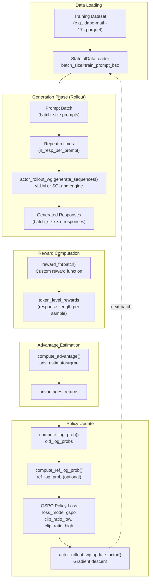
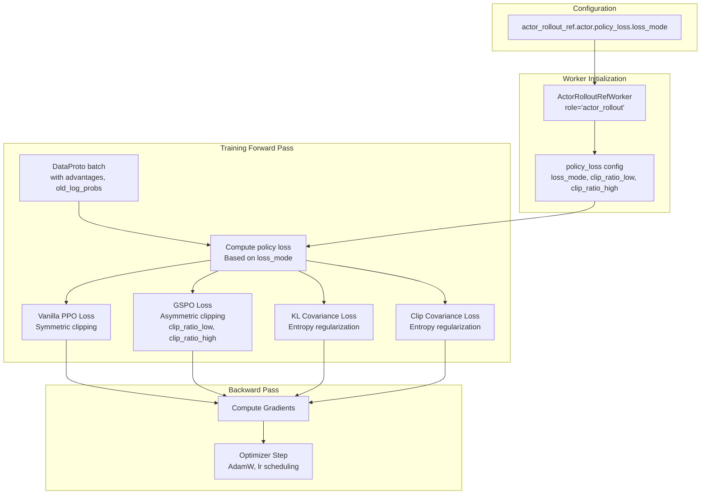
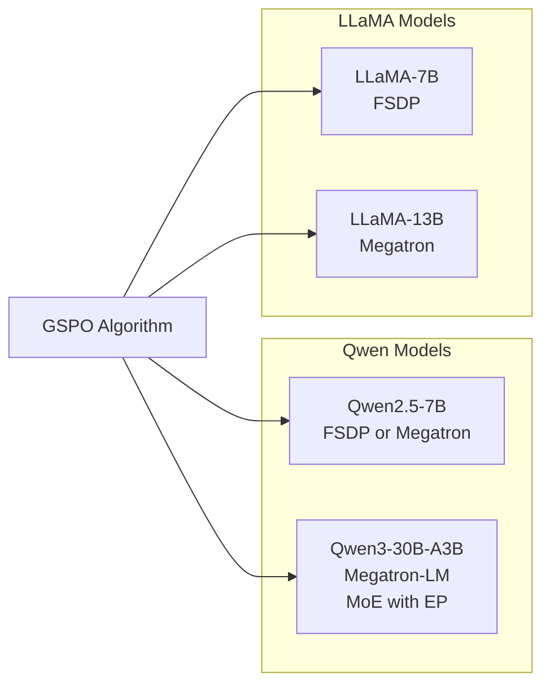
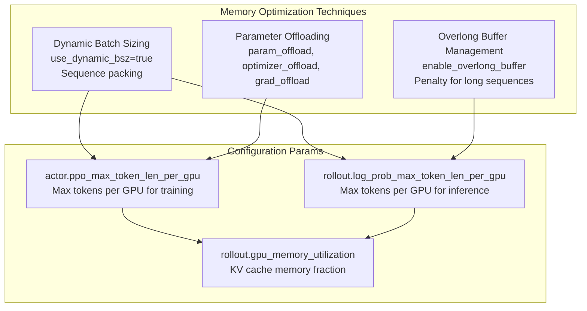
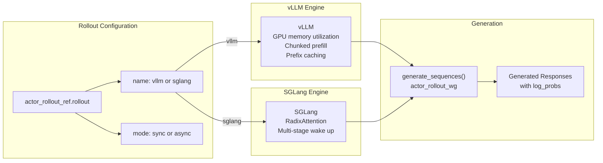
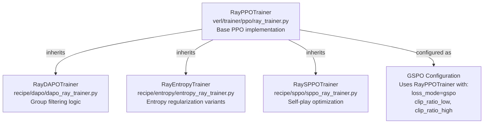

<!-- source: DeepWiki mcp.deepwiki.com · repo allenai/SAGE · page 3.2 GSPO (Generalized Self-Play Optimization) · fetched 2026-10-26 -->

# GSPO (Generalized Self-Play Optimization)

<details>
<summary>Relevant source files</summary>

The following files were used as context for generating this wiki page:

- [rl_train/trainer/config/rollout/rollout.yaml](rl_train/trainer/config/rollout/rollout.yaml)
- [rl_train/trainer/ppo/sage_ray_trainer.py](rl_train/trainer/ppo/sage_ray_trainer.py)
- [verl/recipe/collabllm/reward_function.py](verl/recipe/collabllm/reward_function.py)
- [verl/recipe/dapo/dapo_ray_trainer.py](verl/recipe/dapo/dapo_ray_trainer.py)
- [verl/recipe/entropy/32b_clip_cov.sh](verl/recipe/entropy/32b_clip_cov.sh)
- [verl/recipe/entropy/32b_kl_cov.sh](verl/recipe/entropy/32b_kl_cov.sh)
- [verl/recipe/entropy/32b_kl_cov_mininbsz.sh](verl/recipe/entropy/32b_kl_cov_mininbsz.sh)
- [verl/recipe/entropy/7b_clip_cov.sh](verl/recipe/entropy/7b_clip_cov.sh)
- [verl/recipe/entropy/7b_kl_cov.sh](verl/recipe/entropy/7b_kl_cov.sh)
- [verl/recipe/entropy/config/entropy_trainer.yaml](verl/recipe/entropy/config/entropy_trainer.yaml)
- [verl/recipe/entropy/entropy_ray_trainer.py](verl/recipe/entropy/entropy_ray_trainer.py)
- [verl/recipe/gspo/test_gspo_qwen30b_a3b_ep.sh](verl/recipe/gspo/test_gspo_qwen30b_a3b_ep.sh)
- [verl/recipe/one_step_off_policy/ray_trainer.py](verl/recipe/one_step_off_policy/ray_trainer.py)
- [verl/recipe/prime/config/prime_trainer.yaml](verl/recipe/prime/config/prime_trainer.yaml)
- [verl/recipe/prime/prime_ray_trainer.py](verl/recipe/prime/prime_ray_trainer.py)
- [verl/recipe/sppo/sppo_ray_trainer.py](verl/recipe/sppo/sppo_ray_trainer.py)
- [verl/verl/trainer/config/rollout/rollout.yaml](verl/verl/trainer/config/rollout/rollout.yaml)
- [verl/verl/trainer/ppo/ray_trainer.py](verl/verl/trainer/ppo/ray_trainer.py)

</details>


## Purpose and Scope

This page documents the GSPO (Generalized Self-Play Optimization) algorithm implementation in the SAGE framework. GSPO is a policy optimization algorithm variant that uses **asymmetric clipping ratios** to improve training stability and performance. It is built on top of the base PPO framework and integrates with the distributed Ray-based training infrastructure.

For information about other RL algorithms, see:
- DAPO (Diversity-Aware Policy Optimization): [3.1](#3.1)
- Entropy Regularization variants: [3.3](#3.3)
- Base PPO training pipeline: [2.1](#2.1)

**Sources:** [verl/recipe/gspo/test_gspo_qwen30b_a3b_ep.sh:1-168](), Diagram 4 from high-level architecture overview

---

## Algorithm Overview

GSPO extends the standard PPO algorithm by introducing **asymmetric clipping** in the policy loss computation. Unlike vanilla PPO which uses a symmetric clipping ratio (e.g., `[1-ε, 1+ε]`), GSPO allows different lower and upper bounds for the probability ratio clipping.

### Key Characteristics

| Feature | GSPO | Vanilla PPO |
|---------|------|-------------|
| Clipping Strategy | Asymmetric (`clip_ratio_low`, `clip_ratio_high`) | Symmetric (`clip_ratio`) |
| Advantage Estimator | Typically GRPO | GAE, GRPO, or others |
| Loss Mode | `gspo` | `vanilla` |
| Response Sampling | Multiple responses per prompt (n > 1) | Single or multiple |
| Reference Policy | Optional (KL penalty configurable) | Optional |

The asymmetric clipping allows more fine-grained control over policy updates, enabling:
- Stronger constraints on policy degradation (`clip_ratio_low`)
- More flexibility for policy improvement (`clip_ratio_high`)

**Sources:** [verl/recipe/gspo/test_gspo_qwen30b_a3b_ep.sh:17-27](), [verl/recipe/entropy/config/entropy_trainer.yaml:32-39]()

---

## GSPO Training Flow

The following diagram shows how GSPO fits into the overall training pipeline:



**Sources:** [verl/verl/trainer/ppo/ray_trainer.py:263-1500](), [verl/recipe/gspo/test_gspo_qwen30b_a3b_ep.sh:77-167]()

---

## Key Configuration Parameters

### Asymmetric Clipping Ratios

The core distinguishing feature of GSPO is the use of two separate clipping thresholds:

```yaml
actor_rollout_ref:
  actor:
    clip_ratio_low: 3e-4      # Lower bound for probability ratio clipping
    clip_ratio_high: 4e-4     # Upper bound for probability ratio clipping
    clip_ratio_c: 10.0        # Clipping constant (additional parameter)
    policy_loss:
      loss_mode: gspo         # Activates GSPO loss computation
```

**Typical Values:**
- Small models (7B): `clip_ratio_low=3e-4`, `clip_ratio_high=4e-4`
- Large models (30B+): `clip_ratio_low=3e-4`, `clip_ratio_high=4e-4`

**Sources:** [verl/recipe/gspo/test_gspo_qwen30b_a3b_ep.sh:17-18,95-97]()

### Advantage Estimation

GSPO typically uses GRPO (Group Relative Policy Optimization) for advantage estimation:

```yaml
algorithm:
  adv_estimator: grpo              # Group-based advantage estimation
  use_kl_in_reward: false          # Whether to apply KL penalty in reward
  kl_ctrl:
    kl_coef: 0.0                   # KL coefficient
```

The `adv_estimator` is configured at [verl/verl/trainer/ppo/ray_trainer.py:182-260]() in the `compute_advantage()` function.

**Sources:** [verl/recipe/gspo/test_gspo_qwen30b_a3b_ep.sh:10,90-92](), [verl/verl/trainer/ppo/ray_trainer.py:182-260]()

### Response Sampling

GSPO typically samples multiple responses per prompt to enable comparison-based learning:

```yaml
actor_rollout_ref:
  rollout:
    n: 16                          # Number of responses per prompt
    temperature: 1.0               # Sampling temperature
    top_p: 1.0                     # Nucleus sampling threshold
    top_k: -1                      # Top-k sampling (-1 for vLLM)
```

**Sources:** [verl/recipe/gspo/test_gspo_qwen30b_a3b_ep.sh:30,54-56,88]()

---

## Loss Mode Architecture

The following diagram shows how the loss mode is selected and applied in the training worker:



**Note:** The actual loss computation is implemented in the actor worker's training engine. The `loss_mode` parameter switches between different loss formulations.

**Sources:** [verl/recipe/gspo/test_gspo_qwen30b_a3b_ep.sh:89](), [verl/recipe/entropy/config/entropy_trainer.yaml:33-39](), [verl/verl/trainer/ppo/ray_trainer.py:673-756]()

---

## GSPO vs Other Algorithms

The following table compares GSPO with other algorithm variants in the repository:

| Algorithm | Loss Mode | Clipping | Advantage Estimator | Key Use Case |
|-----------|-----------|----------|---------------------|--------------|
| **GSPO** | `gspo` | Asymmetric | GRPO | Math reasoning, general RL tasks |
| DAPO | `vanilla` | Symmetric | GRPO | Math reasoning with diversity filtering |
| Entropy (KL-cov) | `kl_cov` | Symmetric | GRPO | Exploration control via KL covariance |
| Entropy (Clip-cov) | `clip_cov` | Symmetric | GRPO | Exploration control via clip covariance |
| Vanilla PPO | `vanilla` | Symmetric | GAE | Standard RL tasks |
| SPPO | N/A | N/A | Custom (softmean) | Self-play optimization |

**Sources:** [verl/recipe/gspo/test_gspo_qwen30b_a3b_ep.sh:27,89](), [verl/recipe/entropy/config/entropy_trainer.yaml:34](), [verl/recipe/dapo/dapo_ray_trainer.py:1-348](), [verl/recipe/sppo/sppo_ray_trainer.py:1-349]()

---

## Model and Hardware Support

### Supported Models

GSPO has been tested with the following model architectures:



**Sources:** [verl/recipe/gspo/test_gspo_qwen30b_a3b_ep.sh:8,46](), Section 4.1 reference to LLaMA and Qwen implementations

### Distributed Training Strategies

GSPO supports both FSDP and Megatron backends:

#### FSDP Configuration (for smaller models ~7-13B)

```yaml
actor_rollout_ref:
  actor:
    fsdp_config:
      param_offload: false         # Offload parameters to CPU
      optimizer_offload: false     # Offload optimizer states
  rollout:
    tensor_model_parallel_size: 2  # TP size for rollout
    data_parallel_size: 1          # DP size
```

#### Megatron Configuration (for larger models 30B+)

```yaml
actor_rollout_ref:
  actor:
    megatron:
      pipeline_model_parallel_size: 1    # PP size
      tensor_model_parallel_size: 4      # TP size
      expert_model_parallel_size: 4      # EP size (for MoE)
      expert_tensor_parallel_size: 1     # ETP size
      param_offload: true                # Offload for memory efficiency
      optimizer_offload: true
      grad_offload: true
  rollout:
    tensor_model_parallel_size: 1        # Generation TP
    data_parallel_size: 4                # Generation DP
    expert_parallel_size: 4              # Generation EP
```

**Sources:** [verl/recipe/gspo/test_gspo_qwen30b_a3b_ep.sh:71-148](), Diagram 3 from high-level architecture on distributed training strategies

---

## Memory Optimization Features

GSPO training supports several memory optimization techniques:



**Key Parameters:**

| Parameter | Typical Value | Purpose |
|-----------|---------------|---------|
| `use_dynamic_bsz` | `true` | Enable sequence packing for variable-length inputs |
| `actor_ppo_max_token_len_per_gpu` | 10240-20480 | Maximum tokens per GPU during training |
| `infer_ppo_max_token_len_per_gpu` | 30720 | Maximum tokens per GPU during inference |
| `gpu_memory_utilization` | 0.80-0.85 | Fraction of GPU memory for KV cache |
| `enable_overlong_buffer` | `true` | Penalize responses exceeding max length |

**Sources:** [verl/recipe/gspo/test_gspo_qwen30b_a3b_ep.sh:60-63,98-103,112-114,149-154]()

---

## Example Configuration

### Complete GSPO Training Script Structure

The following shows the typical structure of a GSPO training configuration:

```bash
# Algorithm parameters
adv_estimator=grpo
clip_ratio_low=3e-4
clip_ratio_high=4e-4
loss_mode=gspo

# Data parameters
max_prompt_length=$((1024 * 2))
max_response_length=$((1024 * 8))
train_prompt_bsz=256
n_resp_per_prompt=16

# Distributed training
gen_tp=1                    # Tensor parallelism for generation
gen_dp=4                    # Data parallelism for generation
gen_ep=4                    # Expert parallelism for generation (MoE)
train_tp=4                  # Tensor parallelism for training
train_pp=1                  # Pipeline parallelism
EP=4                        # Expert parallelism for training
ETP=1                       # Expert tensor parallelism

# Launch training
python3 -m verl.trainer.main_ppo \
    --config-path=config \
    --config-name='ppo_megatron_trainer.yaml' \
    actor_rollout_ref.actor.policy_loss.loss_mode=${loss_mode} \
    actor_rollout_ref.actor.clip_ratio_low=${clip_ratio_low} \
    actor_rollout_ref.actor.clip_ratio_high=${clip_ratio_high} \
    algorithm.adv_estimator=${adv_estimator} \
    actor_rollout_ref.rollout.n=${n_resp_per_prompt} \
    # ... additional parameters
```

**Sources:** [verl/recipe/gspo/test_gspo_qwen30b_a3b_ep.sh:1-168]()

---

## Rollout Engine Integration

GSPO supports both vLLM and SGLang for efficient generation during rollout:



**Configuration:**

```yaml
actor_rollout_ref:
  rollout:
    name: vllm                         # or sglang
    mode: sync                         # or async
    gpu_memory_utilization: 0.80       # KV cache memory
    enable_chunked_prefill: true       # Chunked prefill for long contexts
    enable_prefix_caching: true        # Cache prompt prefixes
    max_num_batched_tokens: 8192       # Max tokens per batch
```

**Sources:** [verl/recipe/gspo/test_gspo_qwen30b_a3b_ep.sh:66,119-135](), [verl/verl/trainer/config/rollout/rollout.yaml:1-298](), [rl_train/trainer/config/rollout/rollout.yaml:1-298]()

---

## Trainer Class Hierarchy

The following diagram shows the relationship between GSPO and other trainer classes:



**Key Point:** GSPO does not have a separate trainer class. Instead, it is a **configuration** of the base `RayPPOTrainer` with specific loss mode and clipping parameters.

**Sources:** [verl/verl/trainer/ppo/ray_trainer.py:263-270](), [verl/recipe/dapo/dapo_ray_trainer.py:48](), [verl/recipe/entropy/entropy_ray_trainer.py:45](), [verl/recipe/sppo/sppo_ray_trainer.py:76]()

---

## Training Metrics

GSPO training logs the following key metrics:

| Metric Category | Metric Name | Description |
|-----------------|-------------|-------------|
| **Actor** | `actor/policy_loss` | GSPO policy loss with asymmetric clipping |
| | `actor/entropy` | Policy entropy (exploration measure) |
| | `actor/approx_kl` | Approximate KL divergence from old policy |
| **Rewards** | `actor/reward_kl_penalty` | KL penalty applied to rewards (if enabled) |
| | `critic/returns/mean` | Average returns across batch |
| | `critic/advantages/mean` | Average advantages (from GRPO) |
| **Performance** | `timing_s/gen` | Generation time in seconds |
| | `timing_s/update_actor` | Actor update time in seconds |
| | `response_length/mean` | Average response length |
| | `training/global_step` | Current training step |

**Sources:** [verl/verl/trainer/ppo/ray_trainer.py:122-161](), [verl/trainer/ppo/metric_utils.py]() (referenced in imports)

---

## Best Practices

### When to Use GSPO

✅ **Use GSPO when:**
- Training on math reasoning tasks (GSM8K, AIME, etc.)
- You want more fine-grained control over policy updates than vanilla PPO
- Working with models that benefit from asymmetric clipping (30B+ parameters)
- Using GRPO for advantage estimation with multiple responses per prompt

❌ **Consider alternatives when:**
- You need diversity-aware filtering → Use **DAPO** [3.1](#3.1)
- You need explicit entropy regularization → Use **Entropy variants** [3.3](#3.3)
- Training reward models → Use **PRIME** [3.4](#3.4)

### Hyperparameter Tuning Guidelines

| Parameter | Starting Value | Tuning Range | Notes |
|-----------|----------------|--------------|-------|
| `clip_ratio_low` | 3e-4 | [1e-4, 1e-3] | Lower = more conservative updates |
| `clip_ratio_high` | 4e-4 | [2e-4, 1e-3] | Higher = more aggressive exploration |
| `n_resp_per_prompt` | 8-16 | [4, 32] | More responses = better GRPO estimates |
| `learning_rate` | 1e-6 | [5e-7, 2e-6] | Lower for large models |
| `train_prompt_bsz` | 256 | [128, 512] | Scale with GPU memory |

**Sources:** [verl/recipe/gspo/test_gspo_qwen30b_a3b_ep.sh:17-18,30,105-106](), Practical experience from example configurations

---

## Summary

GSPO (Generalized Self-Play Optimization) is a PPO variant that introduces **asymmetric clipping ratios** (`clip_ratio_low`, `clip_ratio_high`) to provide more nuanced control over policy updates. It is configured through the base `RayPPOTrainer` by setting:
- `actor_rollout_ref.actor.policy_loss.loss_mode=gspo`
- Asymmetric clipping parameters
- Typically used with GRPO advantage estimation

GSPO integrates seamlessly with SAGE's distributed training infrastructure, supporting both FSDP and Megatron backends, vLLM/SGLang rollout engines, and various memory optimization techniques for efficient training at scale.

**Sources:** All sections above, synthesized from [verl/recipe/gspo/test_gspo_qwen30b_a3b_ep.sh](), [verl/verl/trainer/ppo/ray_trainer.py](), and related configuration files

---

