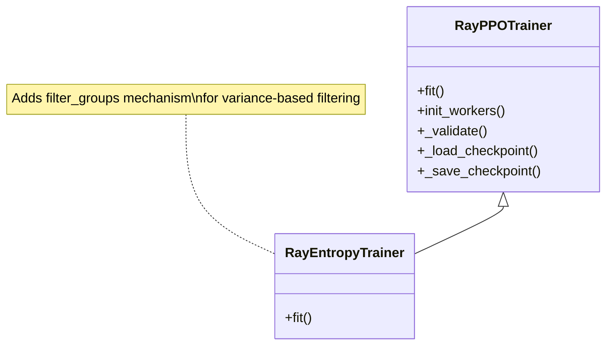
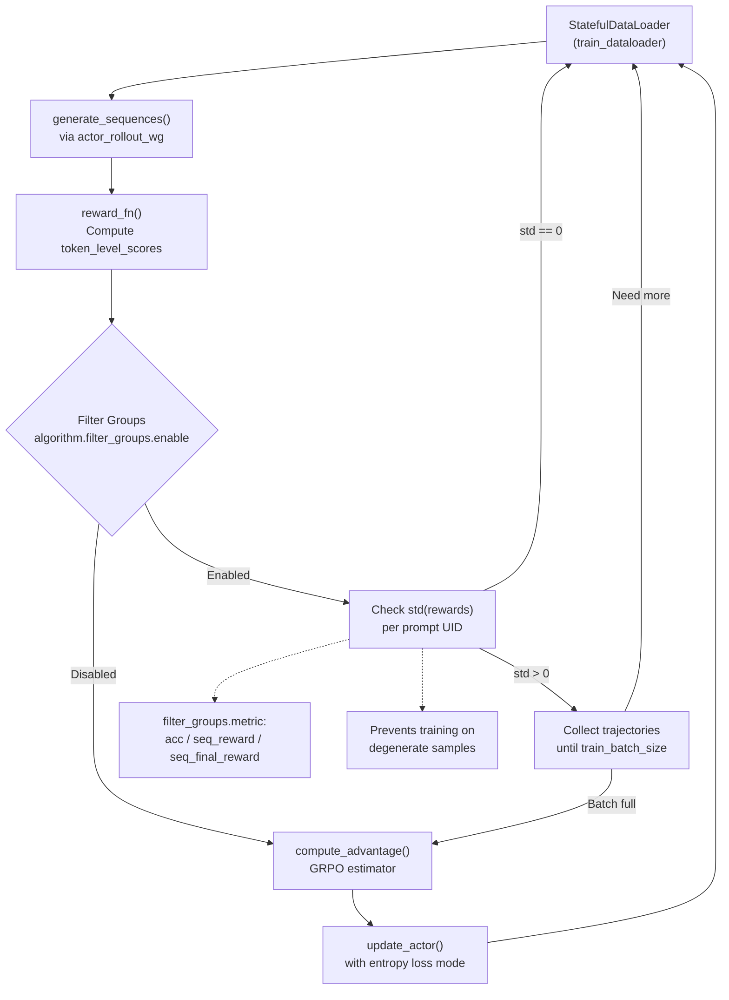
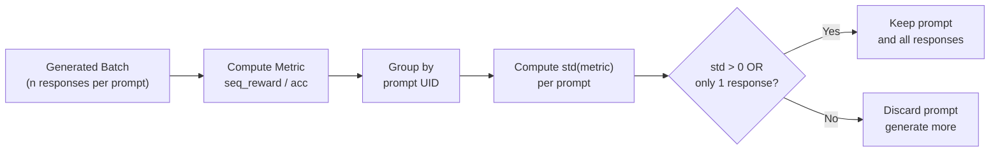

<!-- source: DeepWiki mcp.deepwiki.com · repo allenai/SAGE · page 3.3 Entropy Regularization · fetched 2026-10-26 -->

# Entropy Regularization

<details>
<summary>Relevant source files</summary>

The following files were used as context for generating this wiki page:

- [rl_train/trainer/config/rollout/rollout.yaml](rl_train/trainer/config/rollout/rollout.yaml)
- [rl_train/trainer/ppo/sage_ray_trainer.py](rl_train/trainer/ppo/sage_ray_trainer.py)
- [verl/recipe/collabllm/reward_function.py](verl/recipe/collabllm/reward_function.py)
- [verl/recipe/dapo/dapo_ray_trainer.py](verl/recipe/dapo/dapo_ray_trainer.py)
- [verl/recipe/entropy/32b_clip_cov.sh](verl/recipe/entropy/32b_clip_cov.sh)
- [verl/recipe/entropy/32b_kl_cov.sh](verl/recipe/entropy/32b_kl_cov.sh)
- [verl/recipe/entropy/32b_kl_cov_mininbsz.sh](verl/recipe/entropy/32b_kl_cov_mininbsz.sh)
- [verl/recipe/entropy/7b_clip_cov.sh](verl/recipe/entropy/7b_clip_cov.sh)
- [verl/recipe/entropy/7b_kl_cov.sh](verl/recipe/entropy/7b_kl_cov.sh)
- [verl/recipe/entropy/config/entropy_trainer.yaml](verl/recipe/entropy/config/entropy_trainer.yaml)
- [verl/recipe/entropy/entropy_ray_trainer.py](verl/recipe/entropy/entropy_ray_trainer.py)
- [verl/recipe/gspo/test_gspo_qwen30b_a3b_ep.sh](verl/recipe/gspo/test_gspo_qwen30b_a3b_ep.sh)
- [verl/recipe/one_step_off_policy/ray_trainer.py](verl/recipe/one_step_off_policy/ray_trainer.py)
- [verl/recipe/prime/config/prime_trainer.yaml](verl/recipe/prime/config/prime_trainer.yaml)
- [verl/recipe/prime/prime_ray_trainer.py](verl/recipe/prime/prime_ray_trainer.py)
- [verl/recipe/sppo/sppo_ray_trainer.py](verl/recipe/sppo/sppo_ray_trainer.py)
- [verl/verl/trainer/config/rollout/rollout.yaml](verl/verl/trainer/config/rollout/rollout.yaml)
- [verl/verl/trainer/ppo/ray_trainer.py](verl/verl/trainer/ppo/ray_trainer.py)

</details>


## Purpose and Scope

This document describes the Entropy Regularization training algorithm implementation in SAGE. Entropy regularization is a policy optimization technique that controls exploration by adding covariance-based regularization terms to the PPO loss function. This helps maintain diversity in generated responses during reinforcement learning.

For the base PPO training pipeline, see [Training Pipeline](#2.1). For other training algorithms like DAPO and GSPO, see [DAPO](#3.1) and [GSPO](#3.2).

## Overview

Entropy regularization modifies the standard PPO objective by incorporating regularization based on the covariance of rewards or clipping ratios across multiple sampled responses. The implementation provides two main regularization modes:

| Mode | Description | Key Parameters |
|------|-------------|----------------|
| **kl_cov** | KL-divergence weighted covariance regularization | `kl_cov_ratio`, `ppo_kl_coef` |
| **clip_cov** | Clipping ratio covariance regularization with bounds | `clip_cov_ratio`, `clip_cov_lb`, `clip_cov_ub` |

Both modes work in conjunction with the GRPO (Group Relative Policy Optimization) advantage estimator and include a filter mechanism to exclude prompts that produce responses with zero variance, which would destabilize training.

**Sources:** [verl/recipe/entropy/config/entropy_trainer.yaml:33-39](), [verl/recipe/entropy/32b_kl_cov.sh:27-28](), [verl/recipe/entropy/32b_clip_cov.sh:30]()

## Architecture

### Trainer Class Hierarchy



The `RayEntropyTrainer` class extends `RayPPOTrainer` and overrides the `fit()` method to implement the entropy regularization training loop with response filtering.

**Sources:** [verl/recipe/entropy/entropy_ray_trainer.py:45-48]()

### Training Loop Integration



**Sources:** [verl/recipe/entropy/entropy_ray_trainer.py:94-248](), [verl/recipe/entropy/config/entropy_trainer.yaml:23-26]()

## Loss Modes

The entropy regularization is applied through the `policy_loss.loss_mode` configuration parameter, which determines how the actor loss is computed during the `update_actor()` call.

### KL Covariance Mode (kl_cov)

In KL covariance mode, the loss incorporates regularization based on the covariance of KL divergence between the current policy and reference policy:

**Configuration Parameters:**
- `policy_loss.loss_mode`: `"kl_cov"`
- `policy_loss.kl_cov_ratio`: Coefficient for the covariance regularization term (e.g., 0.0002)
- `policy_loss.ppo_kl_coef`: Coefficient for the KL divergence penalty (e.g., 1.0)

**Example Configuration:**
```yaml
actor_rollout_ref:
  actor:
    policy_loss:
      loss_mode: "kl_cov"
      kl_cov_ratio: 0.0002
      ppo_kl_coef: 1
```

**Sources:** [verl/recipe/entropy/config/entropy_trainer.yaml:33-39](), [verl/recipe/entropy/32b_kl_cov.sh:27](), [verl/recipe/entropy/7b_kl_cov.sh:27]()

### Clip Covariance Mode (clip_cov)

In clip covariance mode, the loss uses regularization based on the covariance of clipping ratios with bounded constraints:

**Configuration Parameters:**
- `policy_loss.loss_mode`: `"clip_cov"`
- `policy_loss.clip_cov_ratio`: Coefficient for the covariance regularization term (e.g., 0.0002)
- `policy_loss.clip_cov_lb`: Lower bound for clipping (e.g., 1.0)
- `policy_loss.clip_cov_ub`: Upper bound for clipping (e.g., 5.0)

**Example Configuration:**
```yaml
actor_rollout_ref:
  actor:
    policy_loss:
      loss_mode: "clip_cov"
      clip_cov_ratio: 0.0002
      clip_cov_lb: 1.0
      clip_cov_ub: 5.0
```

**Sources:** [verl/recipe/entropy/config/entropy_trainer.yaml:33-39](), [verl/recipe/entropy/32b_clip_cov.sh:30](), [verl/recipe/entropy/7b_clip_cov.sh:30]()

## Filter Groups Mechanism

The filter groups mechanism prevents training instability by filtering out prompts whose multiple sampled responses have zero variance in the selected metric. This is critical when using entropy regularization because zero-variance samples can cause numerical issues.

### Filter Process



### Configuration Options

| Parameter | Type | Description |
|-----------|------|-------------|
| `algorithm.filter_groups.enable` | bool | Enable/disable filtering |
| `algorithm.filter_groups.metric` | str | Metric to use for filtering: `acc`, `seq_reward`, `seq_final_reward` |
| `algorithm.filter_groups.max_num_gen_batches` | int | Maximum generation batches before error (0 = unlimited) |

### Implementation Details

The filter implementation in the training loop:

1. **Generate responses:** Sample `n` responses per prompt (configured via `actor_rollout_ref.rollout.n`)
2. **Compute metric:** Calculate the selected metric (e.g., accuracy, sequence reward) for each response
3. **Group by UID:** Group responses by their prompt's unique identifier
4. **Calculate variance:** Compute standard deviation of metric values per prompt
5. **Filter:** Keep only prompts with `std > 0` or single responses
6. **Collect:** Accumulate filtered trajectories until reaching `train_batch_size`

**Sources:** [verl/recipe/entropy/entropy_ray_trainer.py:187-248](), [verl/recipe/entropy/config/entropy_trainer.yaml:23-26]()

## Configuration Structure

### Complete Configuration Template

```yaml
# Algorithm configuration
algorithm:
  adv_estimator: grpo  # Must use GRPO with entropy regularization
  use_kl_in_reward: False
  kl_ctrl:
    kl_coef: 0.0
  filter_groups:
    enable: True  # Enable variance filtering
    metric: acc  # or seq_reward, seq_final_reward
    max_num_gen_batches: 10  # 0 for unlimited

# Actor configuration
actor_rollout_ref:
  rollout:
    n: 8  # Number of responses per prompt
    temperature: 1.0
    top_p: 1.0
  actor:
    policy_loss:
      loss_mode: "kl_cov"  # or "clip_cov"
      # KL Cov parameters
      kl_cov_ratio: 0.0002
      ppo_kl_coef: 1
      # Clip Cov parameters
      clip_cov_ratio: 0.0002
      clip_cov_lb: 1.0
      clip_cov_ub: 5.0
    clip_ratio_low: 0.2  # Standard PPO clipping
    clip_ratio_high: 0.2
    loss_agg_mode: "token-mean"
```

**Sources:** [verl/recipe/entropy/config/entropy_trainer.yaml:1-39](), [verl/recipe/entropy/32b_kl_cov.sh:10-34]()

## Usage Examples

### Running KL Covariance Training (7B Model)

```bash
# Configure parameters
loss_mode="kl_cov"
kl_cov_ratio=0.002
ppo_kl_coef=1
n_resp_per_prompt=8

# Launch training
python -m recipe.entropy.main_entropy \
    actor_rollout_ref.actor.policy_loss.loss_mode=${loss_mode} \
    actor_rollout_ref.actor.policy_loss.kl_cov_ratio=${kl_cov_ratio} \
    actor_rollout_ref.actor.policy_loss.ppo_kl_coef=${ppo_kl_coef} \
    actor_rollout_ref.rollout.n=${n_resp_per_prompt} \
    algorithm.adv_estimator=grpo \
    algorithm.filter_groups.enable=True \
    algorithm.filter_groups.metric=acc
```

**Sources:** [verl/recipe/entropy/7b_kl_cov.sh:62-89]()

### Running Clip Covariance Training (32B Model)

```bash
# Configure parameters
loss_mode="clip_cov"
clip_cov_ratio=0.0002
clip_cov_lb=1.0
clip_cov_ub=5.0
n_resp_per_prompt=8

# Launch training
python -m recipe.entropy.main_entropy \
    actor_rollout_ref.actor.policy_loss.loss_mode=${loss_mode} \
    actor_rollout_ref.actor.policy_loss.clip_cov_ratio=${clip_cov_ratio} \
    actor_rollout_ref.actor.policy_loss.clip_cov_lb=${clip_cov_lb} \
    actor_rollout_ref.actor.policy_loss.clip_cov_ub=${clip_cov_ub} \
    actor_rollout_ref.rollout.n=${n_resp_per_prompt} \
    algorithm.adv_estimator=grpo \
    algorithm.filter_groups.enable=True \
    algorithm.filter_groups.metric=acc
```

**Sources:** [verl/recipe/entropy/32b_clip_cov.sh:65-94]()

## Key Implementation Classes and Functions

### RayEntropyTrainer Class

The main trainer class that orchestrates entropy regularization training:

**Location:** [verl/recipe/entropy/entropy_ray_trainer.py:45]()

**Key Methods:**
- `fit()`: Main training loop with filter groups logic [verl/recipe/entropy/entropy_ray_trainer.py:50-348]()

### Key Differences from Base RayPPOTrainer

1. **Filter Groups Implementation:** Prompts are filtered based on response variance [verl/recipe/entropy/entropy_ray_trainer.py:187-248]()
2. **Batch Collection:** Collects multiple generation batches until sufficient non-degenerate prompts are gathered [verl/recipe/entropy/entropy_ray_trainer.py:226-249]()
3. **Metric Computation:** Computes and tracks the filtering metric (accuracy, sequence reward) [verl/recipe/entropy/entropy_ray_trainer.py:191-220]()

**Sources:** [verl/recipe/entropy/entropy_ray_trainer.py:45-348]()

## Hyperparameter Guidelines

### Model Size Recommendations

| Model Size | `kl_cov_ratio` / `clip_cov_ratio` | `n` (responses) | `train_batch_size` | Notes |
|------------|-----------------------------------|-----------------|-------------------|-------|
| 7B | 0.002 / 0.0002 | 8 | 256 | Higher ratio for smaller models |
| 32B | 0.0002 / 0.0002 | 8 | 256 | Lower ratio for larger models |
| 30B+ (MoE) | 0.0002 / 0.0002 | 16 | 256 | More responses for MoE |

### Critical Settings

- **GRPO Required:** Entropy regularization must be used with `algorithm.adv_estimator=grpo`
- **Filter Groups:** Should enable `algorithm.filter_groups.enable=True` to prevent zero-variance issues
- **Response Count:** Use `n >= 8` responses per prompt to ensure sufficient variance
- **Temperature:** Set `temperature=1.0` for diverse sampling

**Sources:** [verl/recipe/entropy/7b_kl_cov.sh:10-34](), [verl/recipe/entropy/32b_kl_cov.sh:7-38](), [verl/recipe/gspo/test_gspo_qwen30b_a3b_ep.sh:10-34]()

---

