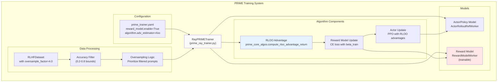
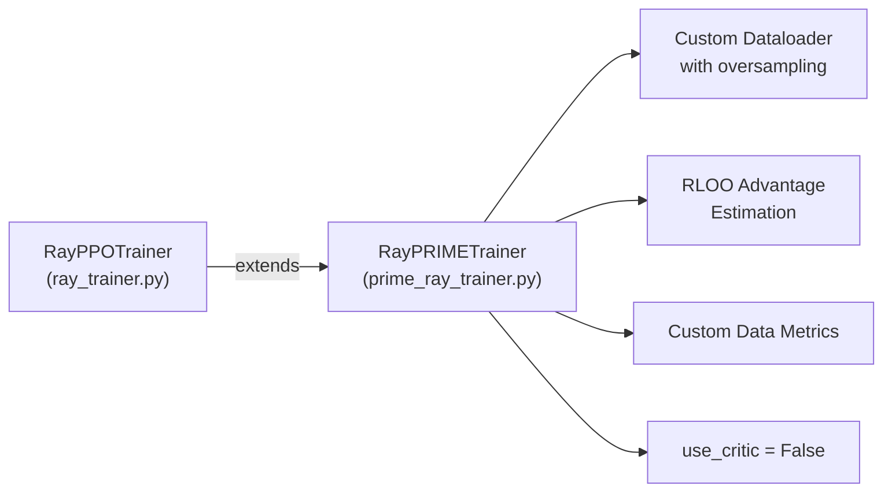
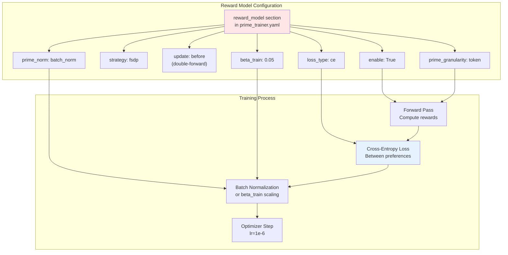
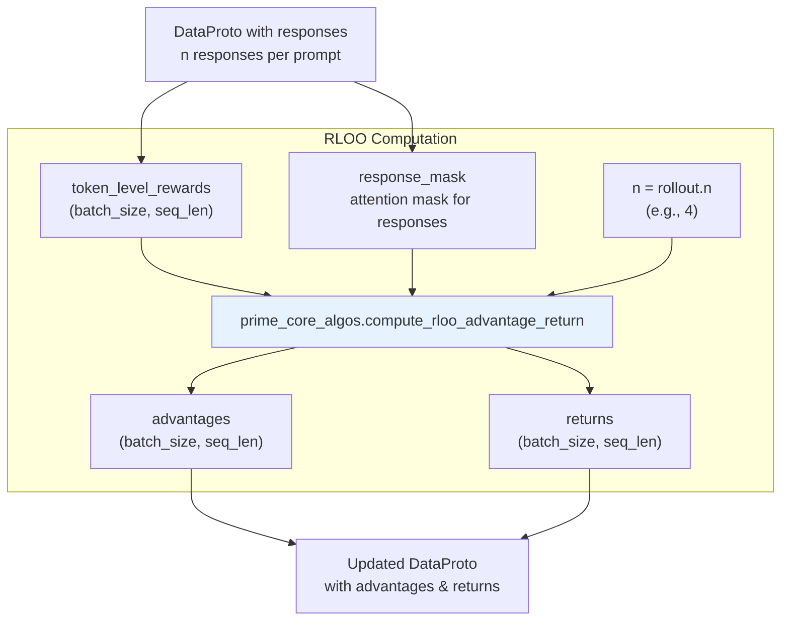
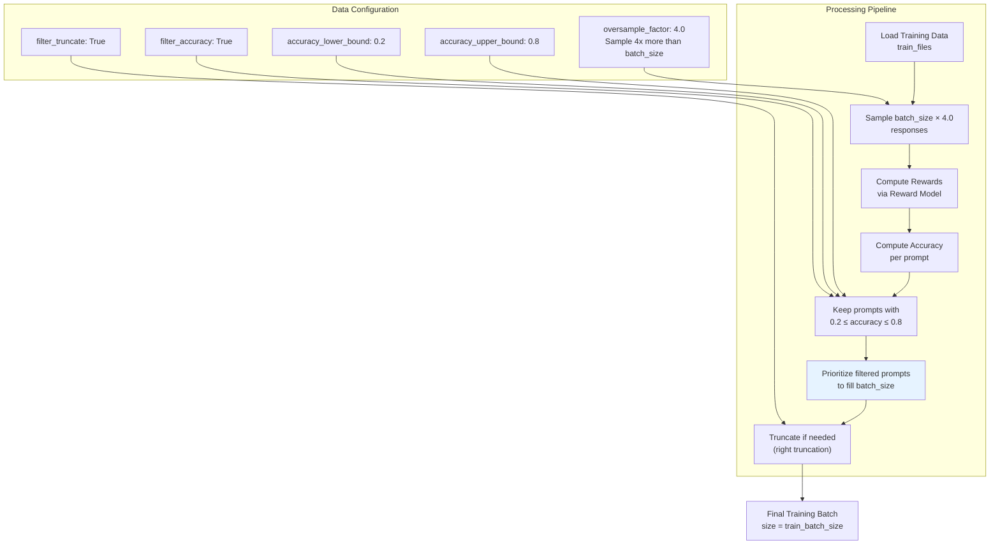
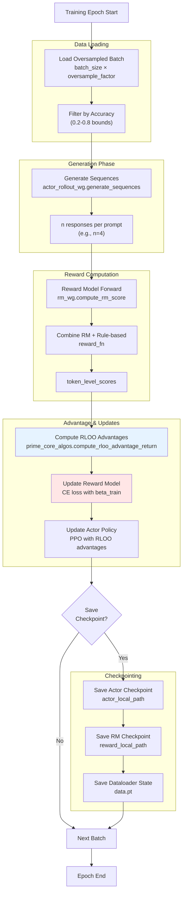
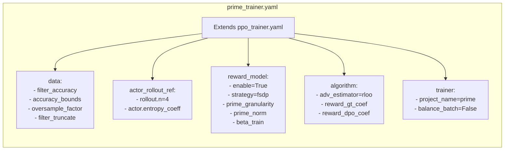
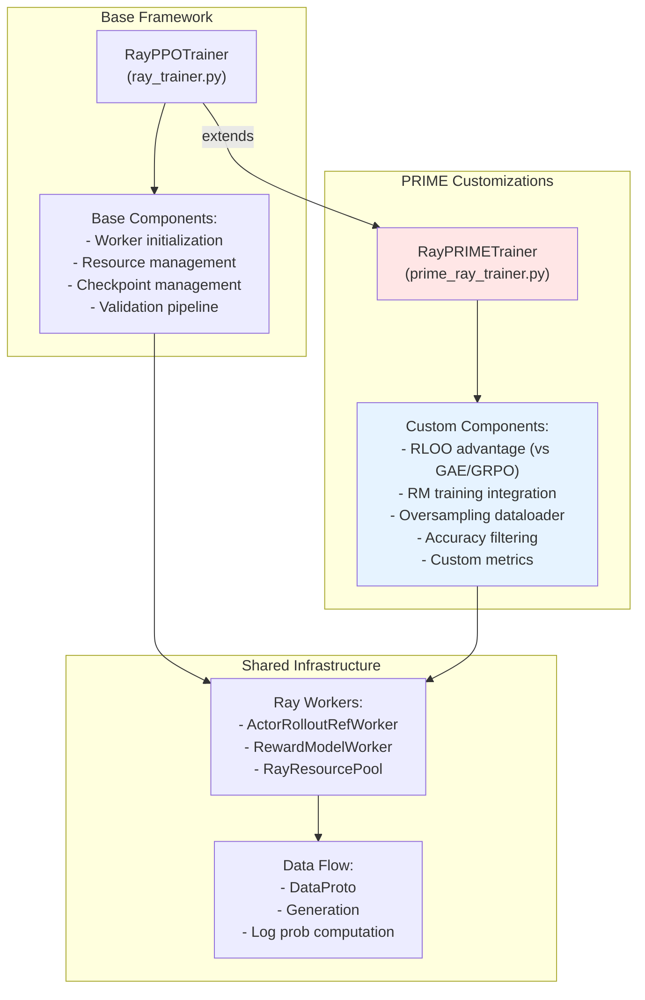
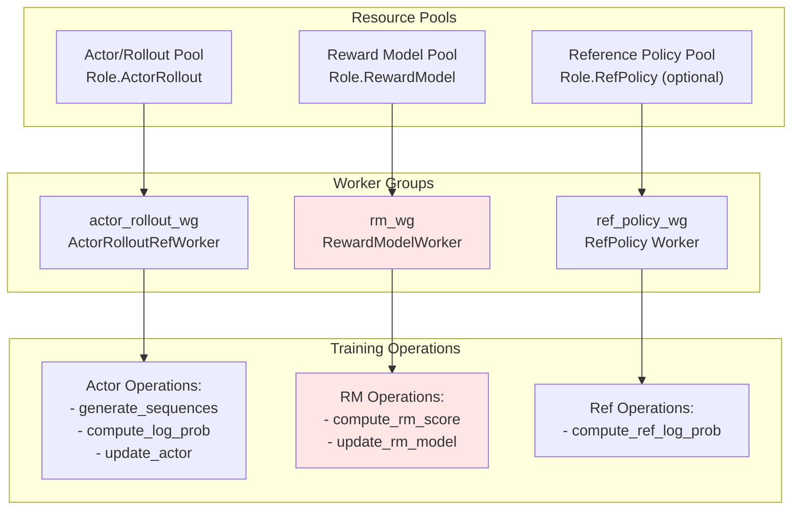

<!-- source: DeepWiki mcp.deepwiki.com · repo allenai/SAGE · page 3.4 PRIME (Preference-based Reward Modeling) · fetched 2026-10-26 -->

# PRIME (Preference-based Reward Modeling)

<details>
<summary>Relevant source files</summary>

The following files were used as context for generating this wiki page:

- [rl_train/trainer/config/rollout/rollout.yaml](rl_train/trainer/config/rollout/rollout.yaml)
- [rl_train/trainer/ppo/sage_ray_trainer.py](rl_train/trainer/ppo/sage_ray_trainer.py)
- [verl/recipe/collabllm/reward_function.py](verl/recipe/collabllm/reward_function.py)
- [verl/recipe/dapo/dapo_ray_trainer.py](verl/recipe/dapo/dapo_ray_trainer.py)
- [verl/recipe/entropy/32b_clip_cov.sh](verl/recipe/entropy/32b_clip_cov.sh)
- [verl/recipe/entropy/32b_kl_cov.sh](verl/recipe/entropy/32b_kl_cov.sh)
- [verl/recipe/entropy/32b_kl_cov_mininbsz.sh](verl/recipe/entropy/32b_kl_cov_mininbsz.sh)
- [verl/recipe/entropy/7b_clip_cov.sh](verl/recipe/entropy/7b_clip_cov.sh)
- [verl/recipe/entropy/7b_kl_cov.sh](verl/recipe/entropy/7b_kl_cov.sh)
- [verl/recipe/entropy/config/entropy_trainer.yaml](verl/recipe/entropy/config/entropy_trainer.yaml)
- [verl/recipe/entropy/entropy_ray_trainer.py](verl/recipe/entropy/entropy_ray_trainer.py)
- [verl/recipe/gspo/test_gspo_qwen30b_a3b_ep.sh](verl/recipe/gspo/test_gspo_qwen30b_a3b_ep.sh)
- [verl/recipe/one_step_off_policy/ray_trainer.py](verl/recipe/one_step_off_policy/ray_trainer.py)
- [verl/recipe/prime/config/prime_trainer.yaml](verl/recipe/prime/config/prime_trainer.yaml)
- [verl/recipe/prime/prime_ray_trainer.py](verl/recipe/prime/prime_ray_trainer.py)
- [verl/recipe/sppo/sppo_ray_trainer.py](verl/recipe/sppo/sppo_ray_trainer.py)
- [verl/verl/trainer/config/rollout/rollout.yaml](verl/verl/trainer/config/rollout/rollout.yaml)
- [verl/verl/trainer/ppo/ray_trainer.py](verl/verl/trainer/ppo/ray_trainer.py)

</details>


## Purpose and Scope

PRIME is a training algorithm within the SAGE framework that jointly trains a policy model and a reward model using preference-based learning. Unlike standard PPO variants (see [DAPO](#3.1), [GSPO](#3.2)), PRIME simultaneously updates both the policy and an explicit reward model, using RLOO (Reward-weighted Leave-One-Out) advantage estimation and preference-based data filtering.

This document covers the PRIME-specific training pipeline, reward model integration, data filtering mechanisms, and configuration. For information about the base PPO training infrastructure, see [Ray Trainers](#5.1). For general training concepts, see [Training Pipeline](#2.1).

**Key Distinguishing Features:**
- Separate trainable reward model alongside the policy
- RLOO advantage estimation instead of GAE or GRPO
- Accuracy-based data filtering with oversampling
- Token-level reward granularity with batch normalization
- No critic network required (`use_critic = False`)

## Architecture Overview



**Sources:** [verl/recipe/prime/prime_ray_trainer.py:1-400](), [verl/recipe/prime/config/prime_trainer.yaml:1-77]()

## Key Components

### RayPRIMETrainer

The `RayPRIMETrainer` class extends `RayPPOTrainer` with PRIME-specific functionality:



**Key Characteristics:**
- **Line 147-176:** Constructor sets `self.use_critic = False`, disabling critic network
- **Line 180-232:** Custom `_create_dataloader()` with `RLHFDataset` and oversample factor
- **Line 43-56:** Custom `compute_advantage()` using RLOO instead of GAE/GRPO
- **Line 59-117:** Custom `compute_data_metrics()` tailored for PRIME's requirements

**Sources:** [verl/recipe/prime/prime_ray_trainer.py:147-232]()

### Reward Model Training

PRIME trains a separate reward model that learns to predict preferences:



**Configuration Parameters:**
| Parameter | Value | Description |
|-----------|-------|-------------|
| `enable` | `True` | Enables trainable reward model |
| `strategy` | `fsdp` | Uses FSDP for distributed training |
| `update` | `before` | Double-forward: update RM before actor |
| `loss_type` | `ce` | Cross-entropy loss for preferences |
| `beta_train` | `0.05` | Temperature parameter for training |
| `prime_granularity` | `token` | Token-level reward computation |
| `prime_norm` | `batch_norm` | Normalize rewards per batch |
| `mini_batch_size` | (from actor) | Batch size for RM updates |
| `optim.lr` | `1e-6` | Learning rate for RM optimizer |

**Sources:** [verl/recipe/prime/config/prime_trainer.yaml:29-62]()

### RLOO Advantage Estimation

RLOO (Reward-weighted Leave-One-Out) is PRIME's core advantage computation method:



**Implementation Details:**
- **Line 43-56:** `compute_advantage()` function in `prime_ray_trainer.py`
- **RLOO Mechanism:** For each response, compute advantage using all other responses as baseline
- **Grouping:** Responses are grouped by prompt UID for correct leave-one-out computation
- **Response Mask:** Ensures computation only on valid response tokens

**Sources:** [verl/recipe/prime/prime_ray_trainer.py:43-56]()

### Data Filtering and Oversampling

PRIME uses aggressive data filtering to focus on informative examples:



**Rationale:**
- **Oversample Factor (4.0):** Generates 4x more responses to have sufficient candidates after filtering
- **Accuracy Bounds (0.2-0.8):** Filters out too-easy (>0.8) and too-hard (<0.2) examples
- **Prioritization:** Ensures batch is filled with informative examples
- **Truncation:** Handles prompts that exceed max length

**Sources:** [verl/recipe/prime/config/prime_trainer.yaml:11-17]()

## Training Pipeline

### Complete Training Loop



**Sources:** [verl/recipe/prime/prime_ray_trainer.py:332-600]()

### Detailed Training Step Breakdown

The main training loop in `fit()` method:

| Phase | Code Location | Description |
|-------|---------------|-------------|
| **Initialization** | [prime_ray_trainer.py:349-361]() | Load checkpoint, validate if needed |
| **Data Loading** | [prime_ray_trainer.py:369-387]() | Load batch from `RLHFDataset` with oversampling |
| **Generation** | [prime_ray_trainer.py:394-418]() | Generate `n` responses per prompt using actor |
| **Reward Computation** | [prime_ray_trainer.py:422-450]() | Compute RM scores and combine with rule-based rewards |
| **Log Prob** | [prime_ray_trainer.py:452-465]() | Compute old log probabilities from actor |
| **Reference Policy** | [prime_ray_trainer.py:467-472]() | Compute reference log probs (if enabled) |
| **RLOO Advantages** | [prime_ray_trainer.py:474-480]() | Compute advantages using RLOO algorithm |
| **RM Update** | [prime_ray_trainer.py:483-490]() | Update reward model parameters |
| **Actor Update** | [prime_ray_trainer.py:493-501]() | Update actor policy with PPO |
| **Validation** | [prime_ray_trainer.py:503-512]() | Periodic validation on `val_dataset` |
| **Checkpointing** | [prime_ray_trainer.py:514-522]() | Save actor, RM, and dataloader states |

**Sources:** [verl/recipe/prime/prime_ray_trainer.py:332-600]()

## Configuration Structure

### Hierarchical Configuration



**Sources:** [verl/recipe/prime/config/prime_trainer.yaml:1-77]()

### Critical Configuration Parameters

**Data Configuration:**
```yaml
data:
  filter_accuracy: True              # Enable accuracy filtering
  accuracy_lower_bound: 0.2          # Minimum accuracy threshold
  accuracy_upper_bound: 0.8          # Maximum accuracy threshold
  oversample_factor: 4.0             # Sample 4x more responses
  filter_truncate: True              # Enable truncation filtering
  truncation: right                  # Truncate from right side
```

**Reward Model Configuration:**
```yaml
reward_model:
  enable: True                        # Enable trainable RM
  strategy: fsdp                      # Distributed strategy
  update: before                      # Update before actor (double-forward)
  prime_granularity: token            # Token-level rewards
  prime_norm: batch_norm              # Batch normalization
  beta_train: 0.05                    # Training temperature
  loss_type: ce                       # Cross-entropy loss
  optim:
    lr: 1e-6                          # RM learning rate
```

**Algorithm Configuration:**
```yaml
algorithm:
  adv_estimator: rloo                 # Use RLOO advantages
  kl_ctrl:
    type: fixed
    kl_coef: 0.000                    # No KL penalty
  reward_gt_coef: 5                   # Weight for ground-truth rewards
  reward_dpo_coef: 5                  # Weight for DPO-style rewards
```

**Rollout Configuration:**
```yaml
actor_rollout_ref:
  rollout:
    n: 4                              # 4 responses per prompt
  actor:
    entropy_coeff: 0.001              # Entropy regularization
```

**Sources:** [verl/recipe/prime/config/prime_trainer.yaml:11-71]()

## Integration with Base Framework

### Inheritance and Customization

PRIME integrates with the SAGE framework by extending `RayPPOTrainer`:



**Overridden Methods:**

| Method | Base Location | PRIME Override | Purpose |
|--------|---------------|----------------|---------|
| `__init__` | [ray_trainer.py:273-342]() | [prime_ray_trainer.py:154-176]() | Set `use_critic=False` |
| `_create_dataloader` | [ray_trainer.py:344-417]() | [prime_ray_trainer.py:180-232]() | Add oversampling logic |
| `compute_advantage` | [ray_trainer.py:182-260]() | [prime_ray_trainer.py:43-56]() | Use RLOO instead of GAE |
| `compute_data_metrics` | [ppo/metric_utils.py]() | [prime_ray_trainer.py:59-117]() | PRIME-specific metrics |
| `_save_checkpoint` | [ray_trainer.py:768-825]() | [prime_ray_trainer.py:234-277]() | Save RM checkpoint |
| `_load_checkpoint` | [ray_trainer.py:826-876]() | [prime_ray_trainer.py:279-331]() | Load RM checkpoint |
| `fit` | [ray_trainer.py:879-1352]() | [prime_ray_trainer.py:332-600]() | PRIME training loop |

**Sources:** [verl/recipe/prime/prime_ray_trainer.py:1-600](), [verl/verl/trainer/ppo/ray_trainer.py:263-1352]()

### Worker Roles and Resource Mapping

PRIME uses the same worker infrastructure but with specific role configurations:



**Sources:** [verl/recipe/prime/prime_ray_trainer.py:154-176](), [verl/verl/trainer/ppo/ray_trainer.py:662-757]()

## Differences from Standard PPO

| Aspect | Standard PPO (RayPPOTrainer) | PRIME (RayPRIMETrainer) |
|--------|------------------------------|-------------------------|
| **Advantage Estimation** | GAE or GRPO | RLOO (Leave-One-Out) |
| **Reward Model** | Optional, frozen | Trainable, updated jointly |
| **Critic Network** | Often used | Disabled (`use_critic=False`) |
| **Data Sampling** | Standard batch | Oversample (4x) + accuracy filter |
| **Reward Computation** | Token-level or sequence-level | Token-level with batch normalization |
| **Update Order** | Actor → Critic | RM → Actor (double-forward) |
| **Checkpoint Format** | Actor + Critic | Actor + RM + Dataloader |
| **Configuration Base** | `ppo_trainer.yaml` | `prime_trainer.yaml` (extends PPO) |

**Sources:** [verl/recipe/prime/prime_ray_trainer.py:43-176](), [verl/verl/trainer/ppo/ray_trainer.py:182-260]()

---

