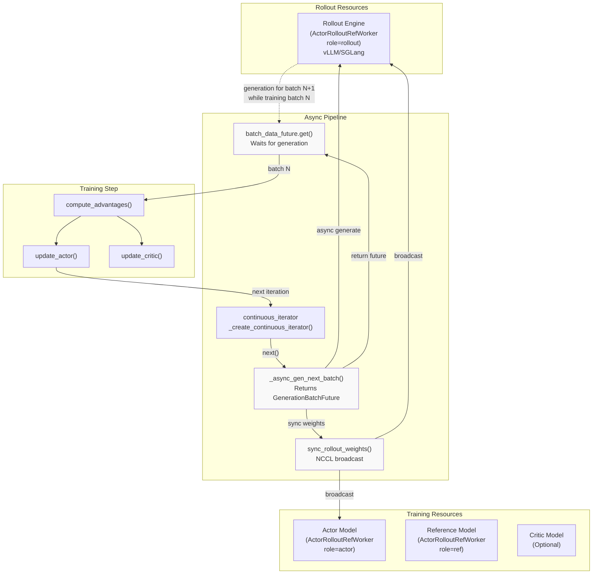
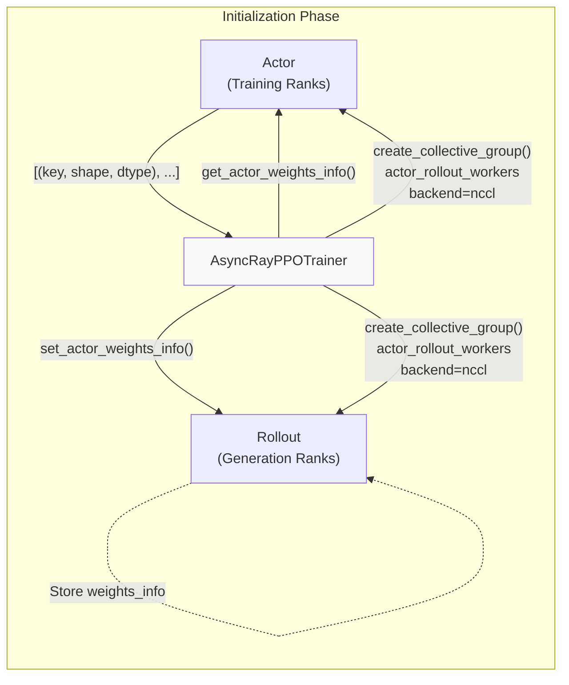
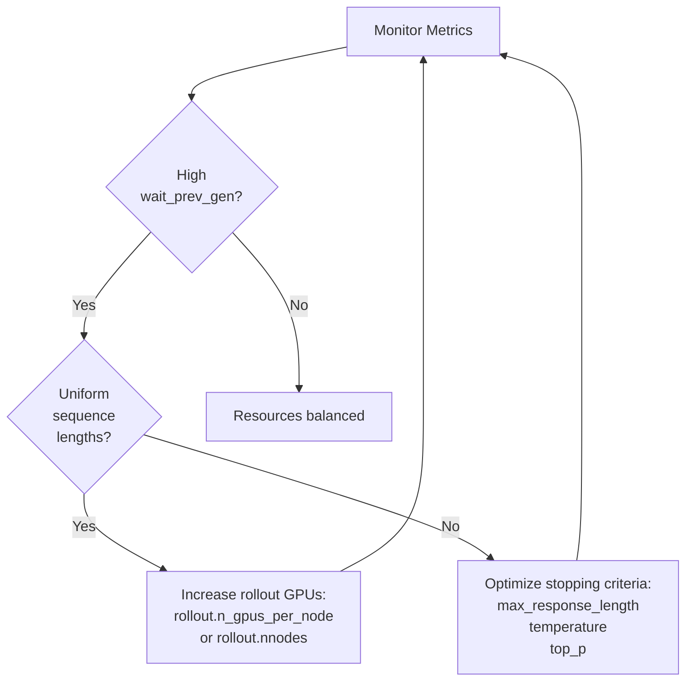

<!-- source: DeepWiki mcp.deepwiki.com · repo allenai/SAGE · page 3.5 One-Step Off-Policy Training · fetched 2026-10-26 -->

# One-Step Off-Policy Training

<details>
<summary>Relevant source files</summary>

The following files were used as context for generating this wiki page:

- [rl_train/trainer/config/rollout/rollout.yaml](rl_train/trainer/config/rollout/rollout.yaml)
- [verl/recipe/entropy/32b_clip_cov.sh](verl/recipe/entropy/32b_clip_cov.sh)
- [verl/recipe/entropy/32b_kl_cov.sh](verl/recipe/entropy/32b_kl_cov.sh)
- [verl/recipe/entropy/32b_kl_cov_mininbsz.sh](verl/recipe/entropy/32b_kl_cov_mininbsz.sh)
- [verl/recipe/entropy/7b_clip_cov.sh](verl/recipe/entropy/7b_clip_cov.sh)
- [verl/recipe/entropy/7b_kl_cov.sh](verl/recipe/entropy/7b_kl_cov.sh)
- [verl/recipe/entropy/config/entropy_trainer.yaml](verl/recipe/entropy/config/entropy_trainer.yaml)
- [verl/recipe/gspo/test_gspo_qwen30b_a3b_ep.sh](verl/recipe/gspo/test_gspo_qwen30b_a3b_ep.sh)
- [verl/recipe/one_step_off_policy/README.md](verl/recipe/one_step_off_policy/README.md)
- [verl/recipe/prime/config/prime_trainer.yaml](verl/recipe/prime/config/prime_trainer.yaml)
- [verl/scripts/legacy_model_merger.py](verl/scripts/legacy_model_merger.py)
- [verl/verl/model_merger/fsdp_model_merger.py](verl/verl/model_merger/fsdp_model_merger.py)
- [verl/verl/model_merger/megatron_model_merger.py](verl/verl/model_merger/megatron_model_merger.py)
- [verl/verl/models/llama/megatron/checkpoint_utils/llama_loader_depracated.py](verl/verl/models/llama/megatron/checkpoint_utils/llama_loader_depracated.py)
- [verl/verl/trainer/config/rollout/rollout.yaml](verl/verl/trainer/config/rollout/rollout.yaml)
- [verl/verl/workers/fsdp_workers.py](verl/verl/workers/fsdp_workers.py)

</details>


## Purpose and Scope

This page describes the **One-Step Off-Policy Async Training** mode in verl, which enables parallel execution of model generation (rollout) and training phases to improve training efficiency. This mode addresses GPU underutilization during synchronous training by overlapping the generation of the next batch with training of the current batch, maintaining a one-step off-policy relationship between generation and training parameters.

For information about synchronous training modes, see the base training pipeline documentation [2.1](#2.1). For algorithm-specific configurations like DAPO and GSPO, see [3.1](#3.1) and [3.2](#3.2).

**Sources:** [verl/recipe/one_step_off_policy/README.md:1-79]()

## Background and Motivation

### The Synchronous Training Bottleneck

Standard synchronous RL training in verl follows this pattern:
1. Generate responses for all prompts in a batch using the current policy
2. Compute rewards and advantages
3. Update the policy model
4. Repeat

This approach has a critical efficiency problem: during generation, the training phase must wait for the longest response to complete. GPUs assigned to training remain idle while generation is ongoing, especially during long-tail samples. In DAPO 32B training on math tasks, the rollout phase accounts for approximately 70% of total training time.

**Sources:** [verl/recipe/one_step_off_policy/README.md:9-19]()

### One-Step Off-Policy Solution

The one-step off-policy approach parallelizes generation and training by:
1. Generating samples for batch `N+1` while training on batch `N`
2. Using dedicated GPU resources for generation and training
3. Synchronizing weights from training to generation via NCCL after each training step

This maintains a one-step lag between generation policy and training policy, which is acceptable in off-policy RL algorithms.

**Performance improvements observed:**
- FSDP2 backend: **+23%** faster (19h18m → 15h34m)
- Megatron backend: **+40%** faster (18h21m → 13h06m)

**Sources:** [verl/recipe/one_step_off_policy/README.md:25-52](), [verl/recipe/one_step_off_policy/README.md:54-76]()

## Architecture Overview



**Async Training Pipeline Flow**

The diagram above shows the async training loop where generation and training overlap. The key insight is that `_async_gen_next_batch()` starts generation for batch N+1 immediately after syncing weights from the training step for batch N, allowing parallel execution.

**Sources:** [verl/recipe/one_step_off_policy/README.md:80-133]()

## Configuration

### Enabling Async Mode

Set `rollout.mode` to `async` in the configuration:

```yaml
actor_rollout_ref:
  hybrid_engine: False  # Must be False for async mode
  rollout:
    mode: async  # Enable async training
    name: vllm  # or sglang
```

Async mode requires separate resource allocation for rollout and training:

```yaml
trainer:
  nnodes: 1
  n_gpus_per_node: 6  # Training GPUs

rollout:
  nnodes: 1
  n_gpus_per_node: 2  # Rollout GPUs
```

**Sources:** [verl/recipe/one_step_off_policy/README.md:215-247](), [rl_train/trainer/config/rollout/rollout.yaml:7-8]()

### Resource Allocation Guidelines

| Configuration Mode | When to Use | Example Setup |
|-------------------|-------------|---------------|
| **Shared Nodes** | Resource-constrained environments | `trainer.nnodes = rollout.nnodes`<br/>`trainer.n_gpus_per_node + rollout.n_gpus_per_node ≤ physical_gpus_per_node` |
| **Separate Nodes** | Resource-abundant environments | `trainer.nnodes ≠ rollout.nnodes`<br/>`trainer.n_gpus_per_node = rollout.n_gpus_per_node` |

**Batch Distribution Constraints:**

Either of these must hold for proper batch distribution:
1. `rollout.n` is an integer divisor of `trainer.n_gpus_per_node * trainer.nnodes`
2. `rollout.n * data.train_batch_size` is evenly divisible by `trainer.n_gpus_per_node * trainer.nnodes`

**Sources:** [verl/recipe/one_step_off_policy/README.md:249-289]()

### Example Configurations

**FSDP2 Configuration:**
```bash
python3 -m recipe.one_step_off_policy.async_main_ppo \
    --config-path=config \
    --config-name='one_step_off_ppo_trainer.yaml' \
    actor_rollout_ref.actor.strategy=fsdp2 \
    actor_rollout_ref.hybrid_engine=False \
    trainer.nnodes=1 \
    trainer.n_gpus_per_node=6 \
    rollout.nnodes=1 \
    rollout.n_gpus_per_node=2
```

**Megatron Configuration:**
```bash
python3 -m recipe.one_step_off_policy.async_main_ppo \
    --config-path=config \
    --config-name='one_step_off_ppo_megatron_trainer.yaml' \
    actor_rollout_ref.actor.strategy=megatron \
    actor_rollout_ref.hybrid_engine=False \
    trainer.nnodes=1 \
    trainer.n_gpus_per_node=6 \
    rollout.nnodes=1 \
    rollout.n_gpus_per_node=2
```

**Sources:** [verl/recipe/one_step_off_policy/README.md:217-247](), [verl/recipe/gspo/test_gspo_qwen30b_a3b_ep.sh:131]()

## Implementation Details

### Continuous Iterator Pattern

The async pipeline uses a continuous iterator to seamlessly handle epoch boundaries without interrupting the generation-training overlap:

```python
def _create_continuous_iterator(self):
    for epoch in range(self.config.trainer.total_epochs):
        iterator = iter(self.train_dataloader)
        for batch_dict in iterator:
            yield epoch, batch_dict
```

This generator eliminates the need for special handling of epoch transitions in the async loop.

**Sources:** [verl/recipe/one_step_off_policy/README.md:90-95]()

### Async Generation Pipeline

```mermaid
sequenceDiagram
    participant Trainer as AsyncRayPPOTrainer
    participant Actor as ActorWorkerGroup
    participant Rollout as RolloutWorkerGroup
    participant Future as GenerationBatchFuture
    
    Note over Trainer: Step N starts
    Trainer->>Trainer: _async_gen_next_batch(iterator)
    Trainer->>Actor: sync_rollout_weights()
    Actor->>Rollout: NCCL broadcast params
    Note over Rollout: Receives updated weights
    Trainer->>Rollout: async_generate_sequences(gen_batch)
    Rollout-->>Trainer: Return ObjectRef (non-blocking)
    Trainer->>Future: Wrap ObjectRef
    
    Note over Trainer: Training batch N-1 continues
    Trainer->>Trainer: compute_advantages(batch N-1)
    Trainer->>Actor: update_actor(batch N-1)
    
    Note over Trainer: Step N+1 starts
    Trainer->>Future: batch_data_future.get()
    Note over Future: Waits if generation not complete
    Future-->>Trainer: Return batch N data
    Trainer->>Trainer: _async_gen_next_batch(iterator)
    Note over Trainer: Launch generation for N+1
```

**Async Generation Sequence**

The core async method `_async_gen_next_batch()` encapsulates:
1. Reading the next batch from the data iterator
2. Syncing weights from actor to rollout via NCCL
3. Launching async generation (returns immediately with a future)
4. Wrapping the result in `GenerationBatchFuture`

**Sources:** [verl/recipe/one_step_off_policy/README.md:98-112]()

### Training Loop Structure

The main training loop in async mode:

```python
continuous_iterator = self._create_continuous_iterator()
# First generation: initialize the pipeline
batch_data_future = self._async_gen_next_batch(continuous_iterator)

while batch_data_future is not None:
    # Wait for previous generation to complete
    batch = batch_data_future.get()
    
    # Immediately launch next generation (non-blocking)
    batch_data_future = self._async_gen_next_batch(continuous_iterator)
    
    # Train on current batch while next generation runs
    batch = critic.compute_values(batch)
    batch = reference.compute_log_prob(batch)
    batch = reward.compute_reward(batch)
    batch = compute_advantages(batch)
    
    critic_metrics = critic.update_critic(batch)
    actor_metrics = actor.update_actor(batch)
```

The key aspect is that generation for batch N+1 starts before training on batch N completes, creating the overlap.

**Sources:** [verl/recipe/one_step_off_policy/README.md:115-133]()

## Parameter Synchronization via NCCL

### Weight Information Exchange

Before training begins, actor and rollout exchange metadata about model parameters:



**Weight Information Setup**

The methods used:
- `ActorRolloutRefWorker.get_actor_weights_info()` - Returns list of (name, shape, dtype) tuples for all parameters [verl/recipe/one_step_off_policy/README.md:145-153]()
- `ActorRolloutRefWorker.set_actor_weights_info()` - Stores parameter metadata on rollout workers [verl/recipe/one_step_off_policy/README.md:155-158]()
- `collective.create_collective_group()` - Creates NCCL communication group spanning actor and rollout workers [verl/recipe/one_step_off_policy/README.md:170-178]()

**Sources:** [verl/recipe/one_step_off_policy/README.md:143-179]()

### NCCL Broadcast Implementation

Parameter synchronization happens via tensor-by-tensor NCCL broadcast:

| Step | Actor Ranks | Rollout Ranks | Communication |
|------|-------------|---------------|---------------|
| 1. Get params | `_get_actor_params()` returns full state dict | Wait for broadcast | - |
| 2. Allocate tensor | Allocate empty tensor on GPU | Allocate empty tensor on GPU | - |
| 3. Copy to buffer | Rank 0: Copy param to tensor | - | - |
| 4. Broadcast | Participate in NCCL broadcast | Participate in NCCL broadcast | `collective.broadcast()` via `actor_rollout` group |
| 5. Load weights | - | `inference_model.load_weights()` | - |

**Key implementation aspects:**
- DTensors are converted to full tensors before broadcast using `full_tensor()` [verl/recipe/one_step_off_policy/README.md:203-205]()
- vLLM MoE models require patching the weight loader [verl/recipe/one_step_off_policy/README.md:194-197]()
- Broadcast uses `src_rank=0` and `group_name="actor_rollout"` [verl/recipe/one_step_off_policy/README.md:210]()
- Synchronization latency is typically under 300ms [verl/recipe/one_step_off_policy/README.md:137-141]()

**Sources:** [verl/recipe/one_step_off_policy/README.md:181-213]()

### Synchronization Trigger Points

Weight synchronization occurs in `_async_gen_next_batch()` before launching generation:

```python
def _async_gen_next_batch(self, continuous_iterator):
    try:
        epoch, batch_dict = next(continuous_iterator)
    except StopIteration:
        return None
    
    batch = DataProto.from_single_dict(batch_dict)
    gen_batch = batch_process(batch)
    
    # Synchronize weights from actor to rollout
    self.sync_rollout_weights()
    
    # Launch async generation with updated weights
    gen_batch_output = self.rollout_wg.async_generate_sequences(gen_batch)
    
    return GenerationBatchFuture(epoch, batch, gen_batch_output)
```

The `sync_rollout_weights()` method coordinates both actor and rollout workers:

```python
def sync_rollout_weights(self):
    self.actor_wg.sync_rollout_weights()
    ray.get(self.rollout_wg.sync_rollout_weights())
```

**Sources:** [verl/recipe/one_step_off_policy/README.md:98-112](), [verl/recipe/one_step_off_policy/README.md:183-186]()

## Performance Tuning

### Monitoring Metrics

Key metrics to monitor for resource allocation tuning:

| Metric | Description | Implication |
|--------|-------------|-------------|
| `wait_prev_gen` | Time waiting for previous generation to complete | High value indicates rollout is bottleneck |
| `generate_sequences` | Total generation time per batch | Compare to training time for balance |
| `old_log_prob` | Reference policy log prob computation time | Part of training overhead |
| `update_actor` | Actor model update time | Main training component |
| `sequence_length` | Distribution of generated sequence lengths | Long tail indicates stopping criteria issues |

**Sources:** [verl/recipe/one_step_off_policy/README.md:260-273]()

### Resource Tuning Strategy



**Resource Tuning Decision Flow**

**Tuning Guidelines:**
1. **Ideal state**: `wait_prev_gen` ≈ 0 and generation time ≈ training time
2. **High wait time + uniform sequences**: Increase rollout resources
3. **High wait time + long-tail sequences**: Optimize generation stopping criteria (increasing resources won't help)
4. **Low wait time**: Consider reducing rollout resources to free GPUs for training

**Sources:** [verl/recipe/one_step_off_policy/README.md:262-289]()

### Supported Configurations

| Component | Supported Options |
|-----------|------------------|
| **Training Engine** | FSDP2, Megatron |
| **Rollout Engine** | vLLM, SGLang |
| **Advantage Estimator** | GRPO, GRPO_PASSK, REINFORCE_PLUS_PLUS, RLOO, OPO, REINFORCE_PLUS_PLUS_BASELINE, GPG |
| **Reward Functions** | All reward managers (DAPO, PRIME, custom) |
| **Parallelism** | TP, PP, DP, EP (for Megatron); FSDP + DP (for FSDP2) |

**Sources:** [verl/recipe/one_step_off_policy/README.md:291-298]()

## Comparison: Sync vs Async Modes

| Aspect | Sync Mode (`mode=sync`) | Async Mode (`mode=async`) |
|--------|------------------------|---------------------------|
| **Resource Allocation** | Hybrid engine: training and rollout share GPUs | Separate: dedicated GPUs for training and rollout |
| **Configuration** | `hybrid_engine=True`<br/>`rollout.mode=sync` | `hybrid_engine=False`<br/>`rollout.mode=async`<br/>Explicit `rollout.nnodes` and `rollout.n_gpus_per_node` |
| **Execution Flow** | Sequential: gen → train → gen → train | Overlapped: gen(N+1) ‖ train(N) |
| **Policy Consistency** | On-policy: generation uses immediately updated weights | One-step off-policy: generation uses weights from previous step |
| **GPU Utilization** | Training GPUs idle during generation | Training GPUs active during generation |
| **Speedup** | Baseline | +23% to +40% observed |
| **Complexity** | Lower (automatic resource sharing) | Higher (manual resource allocation) |
| **Best For** | Stable training, simple setup, on-policy algorithms | High throughput, long generation times, off-policy algorithms |

**Sources:** [verl/recipe/one_step_off_policy/README.md:9-52](), [verl/recipe/gspo/test_gspo_qwen30b_a3b_ep.sh:131](), [rl_train/trainer/config/rollout/rollout.yaml:7-8]()

---

