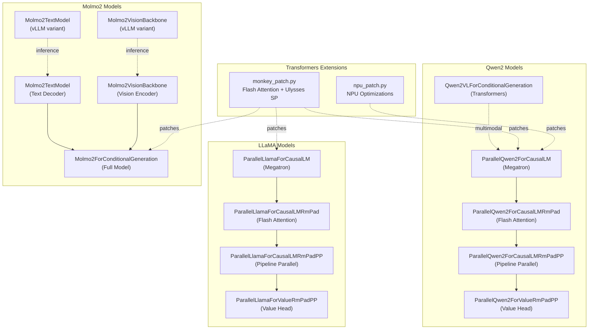
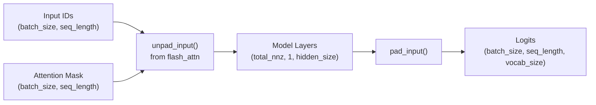
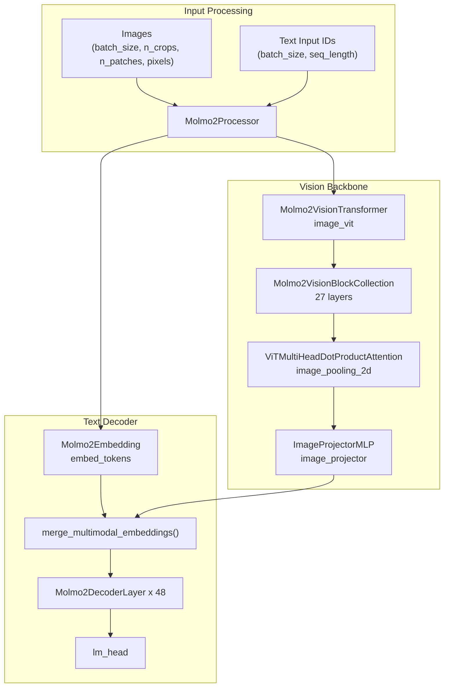
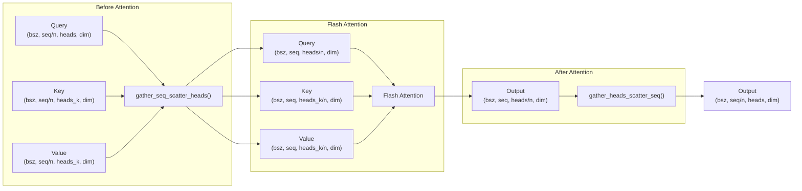
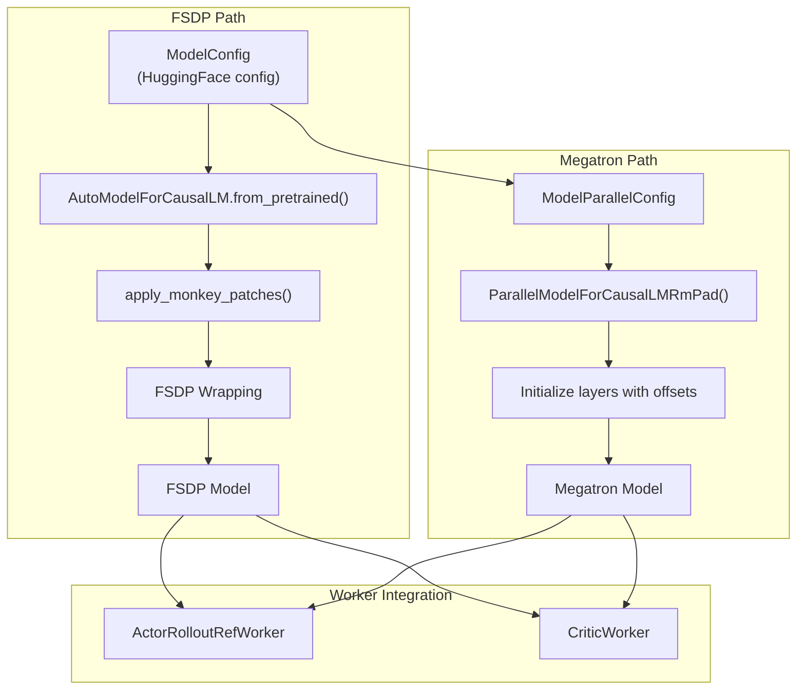

<!-- source: DeepWiki mcp.deepwiki.com · repo allenai/SAGE · page 4 Model Support · fetched 2026-10-26 -->

# Model Support

<details>
<summary>Relevant source files</summary>

The following files were used as context for generating this wiki page:

- [rl_train/utils/dataset/vision_utils.py](rl_train/utils/dataset/vision_utils.py)
- [sage/serve/demo.py](sage/serve/demo.py)
- [sage/src/models/molmo2/image_processing.py](sage/src/models/molmo2/image_processing.py)
- [sage/src/models/molmo2/modeling.py](sage/src/models/molmo2/modeling.py)
- [sage/src/models/molmo2/processing.py](sage/src/models/molmo2/processing.py)
- [sage/src/models/molmo2/video_processing.py](sage/src/models/molmo2/video_processing.py)
- [sage/src/models/molmo2/vllm/modeling.py](sage/src/models/molmo2/vllm/modeling.py)
- [verl/recipe/minicpmo/rl_dataset.py](verl/recipe/minicpmo/rl_dataset.py)
- [verl/verl/models/llama/megatron/modeling_llama_megatron.py](verl/verl/models/llama/megatron/modeling_llama_megatron.py)
- [verl/verl/models/qwen2/megatron/modeling_qwen2_megatron.py](verl/verl/models/qwen2/megatron/modeling_qwen2_megatron.py)
- [verl/verl/models/transformers/apertus.py](verl/verl/models/transformers/apertus.py)
- [verl/verl/models/transformers/llama.py](verl/verl/models/transformers/llama.py)
- [verl/verl/models/transformers/monkey_patch.py](verl/verl/models/transformers/monkey_patch.py)
- [verl/verl/models/transformers/npu_patch.py](verl/verl/models/transformers/npu_patch.py)
- [verl/verl/models/transformers/qwen2.py](verl/verl/models/transformers/qwen2.py)
- [verl/verl/models/transformers/qwen2_vl.py](verl/verl/models/transformers/qwen2_vl.py)
- [verl/verl/utils/megatron/pipeline_parallel.py](verl/verl/utils/megatron/pipeline_parallel.py)

</details>


This page provides an overview of the model architectures supported in SAGE, including their implementation variants, distributed training strategies, and hardware optimizations. The framework supports both text-only and multimodal (vision-language) models with flexible backend options.

For detailed information about specific training algorithms, see [Training Algorithms](#3). For distributed training strategies and parallelism configurations, see [Model Parallelism Strategies](#4.3). For multimodal model specifics, see [Molmo2 (Multimodal Vision-Language)](#4.2).

---

## Supported Model Families

SAGE supports four primary model families with implementations for both FSDP and Megatron-LM backends. Each model family includes multiple variants optimized for different training scenarios.

### Architecture Matrix

| Model Family | Text-Only | Vision-Language | FSDP Support | Megatron Support | MoE Support |
|--------------|-----------|-----------------|--------------|------------------|-------------|
| LLaMA | ✓ | - | ✓ | ✓ | - |
| Qwen2/3 | ✓ | Qwen2-VL | ✓ | ✓ | Qwen3-MoE |
| Molmo2 | - | ✓ | ✓ | - | - |
| Apertus | ✓ | - | ✓ | - | - |

### Model Class Hierarchy



**Sources:**
- [verl/verl/models/llama/megatron/modeling_llama_megatron.py:74-218]()
- [verl/verl/models/llama/megatron/modeling_llama_megatron.py:223-383]()
- [verl/verl/models/qwen2/megatron/modeling_qwen2_megatron.py:75-219]()
- [verl/verl/models/qwen2/megatron/modeling_qwen2_megatron.py:224-412]()
- [sage/src/models/molmo2/modeling.py:145-178]()
- [sage/src/models/molmo2/vllm/modeling.py:1069-1116]()

---

## Model Implementation Variants

Each model family provides multiple implementation variants optimized for different training scenarios. The variants differ in padding removal strategies, pipeline parallelism support, and value function heads for PPO training.

### Base Implementations

The base implementations use standard attention masking without padding removal:

**LLaMA Base:**
- Class: `ParallelLlamaForCausalLM` at [verl/verl/models/llama/megatron/modeling_llama_megatron.py:161-218]()
- Model: `ParallelLlamaModel` with `VocabParallelEmbedding` and `ParallelLlamaDecoderLayer`
- Output: `CausalLMOutputWithPast` with `(batch_size, sequence_length, vocab_size)` logits

**Qwen2 Base:**
- Class: `ParallelQwen2ForCausalLM` at [verl/verl/models/qwen2/megatron/modeling_qwen2_megatron.py:162-218]()
- Model: `ParallelQwen2Model` with similar architecture to LLaMA
- Support for sliding window attention via configuration

### RmPad (Remove Padding) Implementations

RmPad variants use Flash Attention's `unpad_input` to remove padding tokens, significantly improving efficiency for variable-length sequences:



**Key Classes:**
- `ParallelLlamaForCausalLMRmPad` at [verl/verl/models/llama/megatron/modeling_llama_megatron.py:293-382]()
- `ParallelQwen2ForCausalLMRmPad` at [verl/verl/models/qwen2/megatron/modeling_qwen2_megatron.py:294-383]()

**RmPad Pipeline:**
1. **Unpad:** `unpad_input(input_ids.unsqueeze(dim=-1), attention_mask)` at [verl/verl/models/llama/megatron/modeling_llama_megatron.py:341-343]()
2. **Sequence Parallel Padding:** `pad_to_sequence_parallel(input_ids)` if SP enabled at [verl/verl/models/llama/megatron/modeling_llama_megatron.py:347-348]()
3. **Forward Pass:** Through `ParallelLlamaModelRmPad` with `(total_nnz, 1, hidden_size)` shape
4. **Repad:** `pad_input(logits, indices, batch_size, seqlen=sequence_length)` at [verl/verl/models/llama/megatron/modeling_llama_megatron.py:372-374]()

### Pipeline Parallel (PP) Implementations

PP variants support Megatron-LM's pipeline parallelism, dividing model layers across pipeline stages:

**Architecture:**
- `ParallelLlamaModelRmPadPP` at [verl/verl/models/llama/megatron/modeling_llama_megatron.py:418-531]()
- `ParallelQwen2ModelRmPadPP` at [verl/verl/models/qwen2/megatron/modeling_qwen2_megatron.py:419-531]()

**Layer Distribution:**
```python
# From modeling_llama_megatron.py:447-465
pp_rank = mpu.get_pipeline_model_parallel_rank()
pp_size = megatron_config.pipeline_model_parallel_size
self.num_layer_per_pp = config.num_hidden_layers // pp_size
vpp_rank = mpu.get_virtual_pipeline_model_parallel_rank()

if vpp_size is not None:
    self.num_layer_vpp_chunk = self.num_layer_per_pp // vpp_size
    offset = vpp_rank * (config.num_hidden_layers // vpp_size) + (pp_rank * self.num_layer_vpp_chunk)
else:
    offset = pp_rank * self.num_layer_per_pp
```

**Key Features:**
- `pre_process`: Embedding layer on first PP stage
- `post_process`: LM head on last PP stage
- `set_input_tensor()`: Receives hidden states from previous stage at [verl/verl/models/llama/megatron/modeling_llama_megatron.py:472-480]()
- Virtual pipeline parallelism (VPP) support for interleaved schedules

### Value Function Implementations

Value function variants replace the LM head with a scalar value head for PPO critic training:

**Key Differences:**
- `_init_head()`: Creates `nn.Linear(hidden_size, 1)` instead of `ColumnParallelLinear(hidden_size, vocab_size)` at [verl/verl/models/llama/megatron/modeling_llama_megatron.py:386-393]()
- `_forward_head()`: Returns `(total_nnz, 1)` value predictions
- Sequence parallel marking: `mark_parameter_as_sequence_parallel(self.lm_head.weight)` at [verl/verl/models/llama/megatron/modeling_llama_megatron.py:393]()

**Classes:**
- `ParallelLlamaForValueRmPad` at [verl/verl/models/llama/megatron/modeling_llama_megatron.py:385-411]()
- `ParallelLlamaForValueRmPadPP` at [verl/verl/models/llama/megatron/modeling_llama_megatron.py:659-688]()
- `ParallelQwen2ForValueRmPad` at [verl/verl/models/qwen2/megatron/modeling_qwen2_megatron.py:386-411]()
- `ParallelQwen2ForValueRmPadPP` at [verl/verl/models/qwen2/megatron/modeling_qwen2_megatron.py:659-688]()

**Sources:**
- [verl/verl/models/llama/megatron/modeling_llama_megatron.py:161-411]()
- [verl/verl/models/llama/megatron/modeling_llama_megatron.py:418-688]()
- [verl/verl/models/qwen2/megatron/modeling_qwen2_megatron.py:162-411]()
- [verl/verl/models/qwen2/megatron/modeling_qwen2_megatron.py:419-688]()

---

## Multimodal Extensions

SAGE supports vision-language models through dedicated architectures for Molmo2 and Qwen2-VL, enabling RLHF training on multimodal tasks.

### Molmo2 Architecture

Molmo2 combines a vision transformer encoder with a causal language model decoder for multimodal understanding:



**Vision Backbone Components:**
- `Molmo2VisionBackbone` at [sage/src/models/molmo2/modeling.py:460-567]()
  - `Molmo2VisionTransformer`: Patch embedding + positional encoding + transformer blocks at [sage/src/models/molmo2/modeling.py:377-437]()
  - `vit_layers`: Configurable layer selection (e.g., `[-3, -9]`) for feature extraction at [sage/src/models/molmo2/modeling.py:466-471]()
  - `image_pooling_2d`: Attention-based pooling with `pooling_attention_mask` support at [sage/src/models/molmo2/modeling.py:484-494]()
  - `image_projector`: MLP projection to text hidden size at [sage/src/models/molmo2/modeling.py:495-500]()

**Text Decoder Components:**
- `Molmo2TextModel` at [sage/src/models/molmo2/modeling.py:1069-1197]()
  - `embed_tokens`: `VocabParallelEmbedding` with `additional_vocab_size` for special tokens at [sage/src/models/molmo2/modeling.py:1092-1096]()
  - `layers`: `Molmo2DecoderLayer` with optional `norm_after` at [sage/src/models/molmo2/modeling.py:1098-1110]()
  - `norm`: `RMSNorm` post-layer normalization at [sage/src/models/molmo2/modeling.py:1112]()

**Image Token Insertion:**
```python
# From modeling.py:1255-1267
inputs_embeds = self.model.embed_tokens(input_ids)
if pixel_values is not None:
    image_features = self.vision_backbone(
        pixel_values,
        token_pooling=token_pooling,
    )
    # Merge multimodal embeddings at image token positions
    inputs_embeds = merge_multimodal_embeddings(
        input_ids,
        inputs_embeds,
        image_features,
        image_token_mask,
    )
```

**Image Processing Pipeline:**
- `Molmo2ImageProcessor` at [sage/src/models/molmo2/image_processing.py:341-542]()
  - `preprocess()`: Crops, resizes, normalizes images at [sage/src/models/molmo2/image_processing.py:419-508]()
  - `image_to_patches_and_grids()`: Converts to patches with overlapping crops at [sage/src/models/molmo2/image_processing.py:262-331]()
  - `token_pooling`: Index tensor mapping patches to tokens at [sage/src/models/molmo2/image_processing.py:478-496]()

**Video Processing Pipeline:**
- `Molmo2VideoProcessor` at [sage/src/models/molmo2/video_processing.py:166-274]()
  - `preprocess()`: Frame sampling, resizing, normalization at [sage/src/models/molmo2/video_processing.py:203-252]()
  - Temporal sampling modes: `"uniform"`, `"uniform_last_frame"`, `"fps"` at [sage/src/models/molmo2/video_processing.py:142-185]()

### Qwen2-VL Integration

Qwen2-VL uses dynamic resolution vision processing with 3D RoPE (Rotary Position Embeddings):

**Key Features:**
- `get_rope_index()`: Computes 3D position IDs for vision-language inputs at [verl/verl/models/transformers/qwen2_vl.py:64-161]()
- `qwen2_vl_attn_forward()`: Custom attention with multimodal RoPE at [verl/verl/models/transformers/qwen2_vl.py:268-332]()
- `_custom_flash_attention_forward()`: Flash Attention with 3D position support at [verl/verl/models/transformers/qwen2_vl.py:182-265]()

**Position ID Generation:**
```python
# From qwen2_vl.py:86-152
position_ids = torch.ones(3, input_ids.size(0), dtype=input_ids.dtype, device=input_ids.device)
# Compute temporal, height, width position indices for vision tokens
t_index = torch.arange(llm_grid_t) * second_per_grid_t * tokens_per_second
h_index = torch.arange(llm_grid_h).expand(llm_grid_t, -1, llm_grid_w)
w_index = torch.arange(llm_grid_w).expand(llm_grid_t, llm_grid_h, -1)
llm_positions = torch.stack([t_index, h_index, w_index])
```

**Ulysses Sequence Parallelism Integration:**
- Position ID gathering across SP ranks at [verl/verl/models/transformers/qwen2_vl.py:224-226]()
- Varlen Flash Attention for non-contiguous position IDs at [verl/verl/models/transformers/qwen2_vl.py:228-245]()

**Sources:**
- [sage/src/models/molmo2/modeling.py:460-567]()
- [sage/src/models/molmo2/modeling.py:1069-1323]()
- [sage/src/models/molmo2/image_processing.py:262-508]()
- [sage/src/models/molmo2/video_processing.py:142-252]()
- [verl/verl/models/transformers/qwen2_vl.py:64-332]()

---

## Hardware and Optimization Support

SAGE provides extensive optimizations for different hardware backends, including GPU-specific Flash Attention and NPU-specific fused kernels.

### GPU Optimizations

Flash Attention and Ulysses Sequence Parallelism are applied via monkey patches:

**Flash Attention Integration:**
- `llama_flash_attn_forward()` at [verl/verl/models/transformers/llama.py:42-156]()
- `qwen2_flash_attn_forward()` at [verl/verl/models/transformers/qwen2.py:35-156]()
- Uses `_flash_attention_forward()` from transformers with sliding window support

**Ulysses Sequence Parallelism:**


**Ulysses Implementation:**
- `gather_seq_scatter_heads()`: All-to-all gather sequence, scatter heads at [verl/verl/models/transformers/llama.py:85-87]()
- `gather_heads_scatter_seq()`: All-to-all gather heads, scatter sequence at [verl/verl/models/transformers/llama.py:148-149]()
- Validation: `validate_ulysses_config(num_heads, sp_size)` ensures heads divisible by SP size

**Monkey Patch Application:**
- Applied via `_monkey_patch_model()` at [verl/verl/models/transformers/monkey_patch.py:156-305]()
- Patches `Attention.forward` methods in transformers models
- Supports transformers versions 4.45.0 to 4.55.0+

### NPU (Ascend) Optimizations

NPU-specific optimizations use `torch_npu` fused kernels for improved performance:

**Fused Operations:**
- `npu_rms_norm()`: Fused RMS normalization at [verl/verl/models/transformers/npu_patch.py:54-55]()
- `npu_swiglu()`: Fused SwiGLU activation at [verl/verl/models/transformers/npu_patch.py:60-61]()
- `npu_rotary_mul()`: Fused rotary position embedding at [verl/verl/models/transformers/npu_patch.py:64-69]()

**MoE Optimization:**
```python
# From npu_patch.py:99-139
def moe_block_forward(self, hidden_states: torch.Tensor) -> torch.Tensor:
    # Concat expert weights for grouped matmul
    up_weight_list = [e.up_proj.weight.t() for e in self.experts]
    gate_weight_list = [e.gate_proj.weight.t() for e in self.experts]
    down_weight_list = [e.down_proj.weight.t() for e in self.experts]
    w1 = torch.stack(up_weight_list)
    w2 = torch.stack(gate_weight_list)
    w3 = torch.stack(down_weight_list)
    
    # Use npu_grouped_matmul for efficient expert computation
    intermediate = GmmFunction.apply(permuted_tokens, w1, group_list, split_size)
    gate = GmmFunction.apply(permuted_tokens, w2, group_list, split_size)
    output = GmmFunction.apply(torch_npu.npu_swiglu(gate_up), w3, group_list, split_size)
```

**NPU Patch Targets:**
- Qwen2.5-VL: `apply_rotary_pos_emb_flashatt_qwen2_5_vl_npu()` at [verl/verl/models/transformers/npu_patch.py:37-50]()
- Qwen3: `apply_rotary_pos_emb_qwen3_npu()` at [verl/verl/models/transformers/npu_patch.py:64-69]()
- Qwen3-MoE: `moe_block_forward()` for expert parallelism at [verl/verl/models/transformers/npu_patch.py:99-153]()

**Patch Application:**
- `patch_for_npu()`: Applies all NPU patches at [verl/verl/models/transformers/npu_patch.py:157-194]()
- Applied to `Qwen2RMSNorm`, `Qwen2MLP`, `Qwen3MoeMLP` modules

**Sources:**
- [verl/verl/models/transformers/llama.py:42-156]()
- [verl/verl/models/transformers/qwen2.py:35-156]()
- [verl/verl/models/transformers/monkey_patch.py:49-305]()
- [verl/verl/models/transformers/npu_patch.py:37-194]()

---

## Integration with Training Framework

Models integrate with the SAGE training framework through standardized interfaces for both FSDP and Megatron backends.

### Model Loading and Initialization



**FSDP Model Loading:**
- Loads from HuggingFace checkpoint via `AutoModelForCausalLM.from_pretrained()`
- Applies monkey patches via `apply_monkey_patches()` for Flash Attention + Ulysses
- Wraps with `FullyShardedDataParallel` for parameter sharding

**Megatron Model Loading:**
- Creates from scratch: `ParallelLlamaForCausalLMRmPad(config, megatron_config)`
- Initializes layers with PP/TP/SP aware offsets at [verl/verl/models/llama/megatron/modeling_llama_megatron.py:447-465]()
- Loads weights via Megatron checkpoint utilities

### Model Parallel Configuration

**Megatron Parallel Dimensions:**
```python
# Example megatron_config
megatron_config = ModelParallelConfig(
    tensor_model_parallel_size=8,       # TP: split weights across 8 GPUs
    pipeline_model_parallel_size=4,     # PP: 4 pipeline stages
    virtual_pipeline_model_parallel_size=2,  # VPP: interleaved schedule
    sequence_parallel=True,             # SP: sequence dimension parallelism
)
```

**Parallel Dimensions:**
| Dimension | Description | Applied In | Configuration |
|-----------|-------------|------------|---------------|
| Tensor Parallel (TP) | Split weight matrices across GPUs | `ColumnParallelLinear`, `RowParallelLinear` | `tensor_model_parallel_size` |
| Pipeline Parallel (PP) | Distribute layers across stages | `*RmPadPP` models | `pipeline_model_parallel_size` |
| Sequence Parallel (SP) | Split sequence dimension | Embeddings, LayerNorms | `sequence_parallel=True` |
| Data Parallel (DP) | Replicate model across GPUs | FSDP | `world_size / (TP * PP)` |

**Ulysses Sequence Parallel:**
- Independent of Megatron SP, applied via monkey patches
- Configured via `ULYSSES_SEQUENCE_PARALLEL_SIZE` environment variable
- Validated at attention layer: `validate_ulysses_config(num_heads, sp_size)` at [verl/verl/models/transformers/llama.py:82]()

### vLLM Integration for Inference

Molmo2 includes specialized vLLM implementation for efficient batch inference during rollout:

**vLLM Model Structure:**
- `Molmo2ForConditionalGeneration` at [sage/src/models/molmo2/vllm/modeling.py:1210-1393]()
- `Molmo2TextModel`: Text decoder with vLLM attention at [sage/src/models/molmo2/vllm/modeling.py:1069-1197]()
- `Molmo2VisionBackbone`: Vision encoder shared with training at [sage/src/models/molmo2/vllm/modeling.py:611-753]()

**Multimodal Input Processing:**
```python
# From vllm/modeling.py:1262-1280
def forward(self, input_ids, positions, intermediate_tensors, **kwargs):
    if get_pp_group().is_first_rank:
        inputs_embeds = self.get_input_embeddings(input_ids)
        if pixel_values is not None:
            image_features = self.vision_backbone(
                pixel_values, 
                token_pooling=token_pooling,
            )
            # Merge at image token positions
            inputs_embeds = merge_multimodal_embeddings(
                input_ids, inputs_embeds, image_features, 
                self.config.image_token_id,
            )
    return self.language_model(input_ids, positions, inputs_embeds=inputs_embeds)
```

**Sharding Manager:**
- `FSDPVLLMShardingManager`: Synchronizes FSDP training weights to vLLM inference at [verl/verl/workers/sharding_manager/fsdp_vllm_base.py]() (not shown in files but referenced in architecture)
- Converts between FSDP checkpoint format and vLLM weight format
- Handles parameter offloading for memory efficiency

**Sources:**
- [verl/verl/models/llama/megatron/modeling_llama_megatron.py:418-531]()
- [verl/verl/models/qwen2/megatron/modeling_qwen2_megatron.py:419-531]()
- [verl/verl/models/transformers/monkey_patch.py:156-305]()
- [sage/src/models/molmo2/vllm/modeling.py:1069-1393]()
- [verl/verl/utils/megatron/pipeline_parallel.py:22-71]()

---

## Model-Specific Considerations

### LLaMA Models
- Standard decoder-only transformer architecture
- Support for Llama 2 and Llama 3 variants
- Both base and instruction-tuned checkpoints compatible
- Main implementation at [verl/verl/models/llama/megatron/modeling_llama_megatron.py]()

### Qwen2/3 Models
- **Qwen2**: Similar to LLaMA with sliding window attention support
- **Qwen3**: Includes MoE (Mixture of Experts) variants with expert parallelism
- **Qwen2-VL**: Dynamic resolution vision input with 3D RoPE
- MoE implementation optimized for NPU with grouped matmul at [verl/verl/models/transformers/npu_patch.py:99-153]()

### Molmo2 Models
- **Vision Backbone**: SigLIP-based vision transformer with 27 layers
- **Adapter**: Multi-layer feature extraction with attention pooling
- **Text Decoder**: 48-layer transformer with optional `norm_after` configuration
- **Special Tokens**: `<im_patch>`, `<im_start>`, `<im_end>`, `<im_col>` for image insertion
- vLLM variant for efficient inference during RLHF rollout

### Apertus Models
- QK normalization applied after Q/K projections at [verl/verl/models/transformers/apertus.py:67-68]()
- Similar to LLaMA architecture with additional normalization layers
- Ulysses sequence parallelism support at [verl/verl/models/transformers/apertus.py:70-79]()

**Sources:**
- [verl/verl/models/llama/megatron/modeling_llama_megatron.py:74-688]()
- [verl/verl/models/qwen2/megatron/modeling_qwen2_megatron.py:75-688]()
- [verl/verl/models/transformers/qwen2_vl.py:64-449]()
- [sage/src/models/molmo2/modeling.py:145-1323]()
- [verl/verl/models/transformers/apertus.py:41-100]()

---

