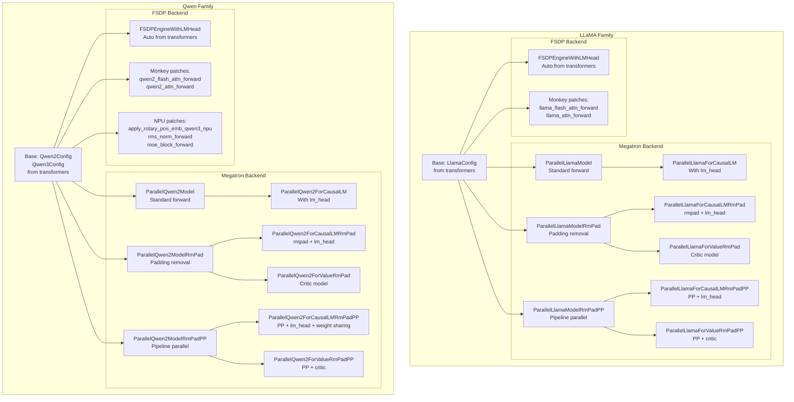
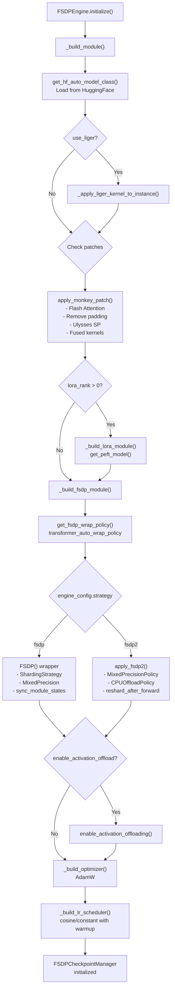
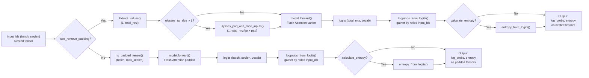
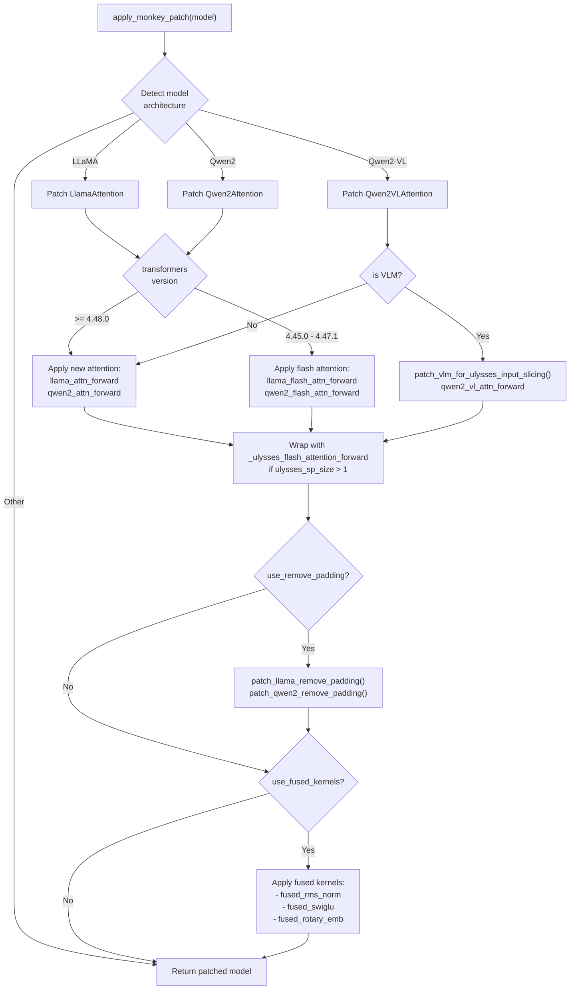
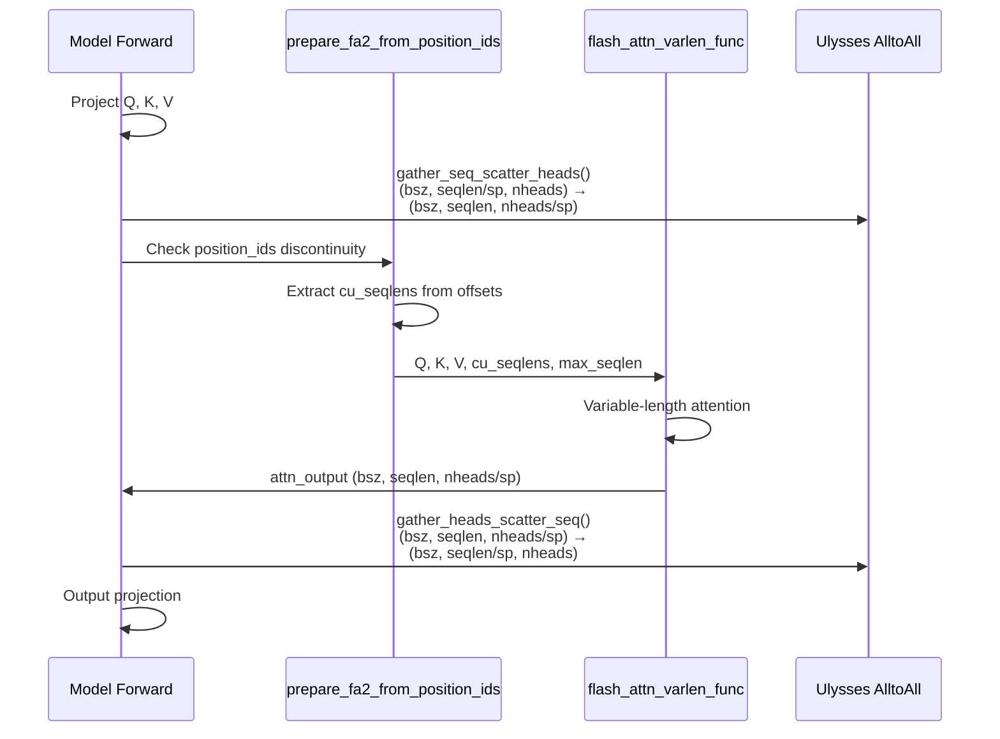
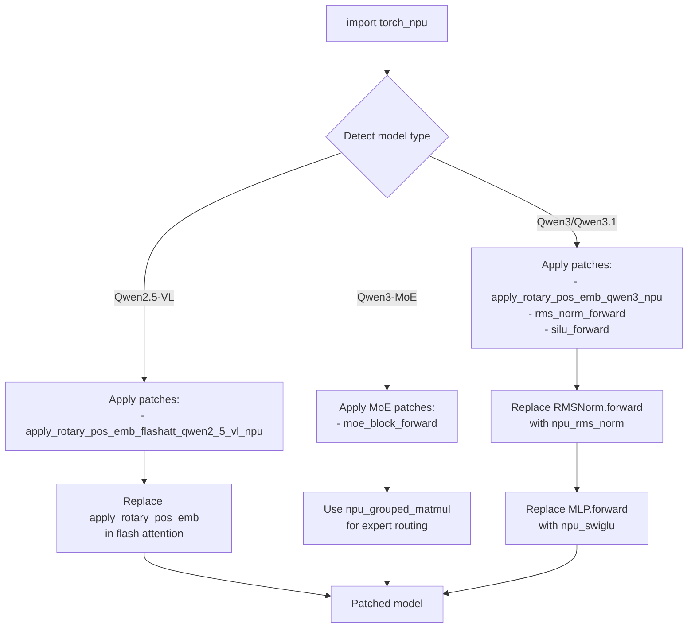
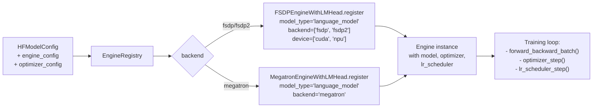
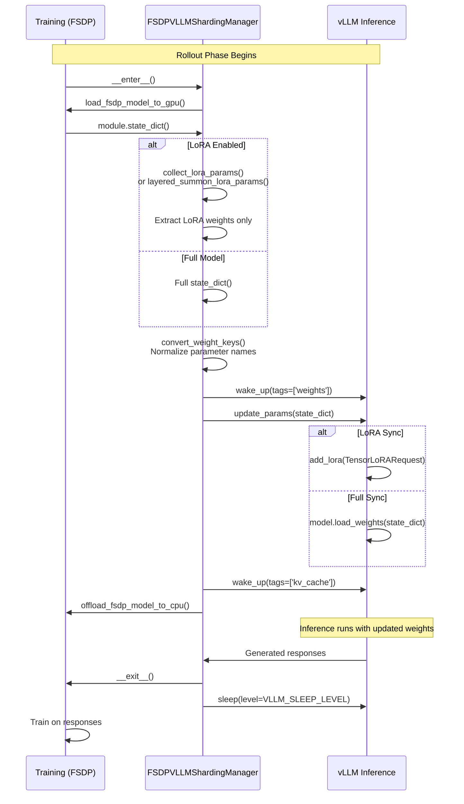

<!-- source: DeepWiki mcp.deepwiki.com · repo allenai/SAGE · page 4.1 LLaMA and Qwen Models · fetched 2026-10-26 -->

# LLaMA and Qwen Models

<details>
<summary>Relevant source files</summary>

The following files were used as context for generating this wiki page:

- [verl/verl/models/llama/megatron/modeling_llama_megatron.py](verl/verl/models/llama/megatron/modeling_llama_megatron.py)
- [verl/verl/models/qwen2/megatron/modeling_qwen2_megatron.py](verl/verl/models/qwen2/megatron/modeling_qwen2_megatron.py)
- [verl/verl/models/transformers/apertus.py](verl/verl/models/transformers/apertus.py)
- [verl/verl/models/transformers/llama.py](verl/verl/models/transformers/llama.py)
- [verl/verl/models/transformers/monkey_patch.py](verl/verl/models/transformers/monkey_patch.py)
- [verl/verl/models/transformers/npu_patch.py](verl/verl/models/transformers/npu_patch.py)
- [verl/verl/models/transformers/qwen2.py](verl/verl/models/transformers/qwen2.py)
- [verl/verl/models/transformers/qwen2_vl.py](verl/verl/models/transformers/qwen2_vl.py)
- [verl/verl/third_party/sglang/parallel_state.py](verl/verl/third_party/sglang/parallel_state.py)
- [verl/verl/utils/fsdp_utils.py](verl/verl/utils/fsdp_utils.py)
- [verl/verl/utils/megatron/pipeline_parallel.py](verl/verl/utils/megatron/pipeline_parallel.py)
- [verl/verl/workers/engine/base.py](verl/verl/workers/engine/base.py)
- [verl/verl/workers/engine/fsdp/transformer_impl.py](verl/verl/workers/engine/fsdp/transformer_impl.py)
- [verl/verl/workers/engine/megatron/transformer_impl.py](verl/verl/workers/engine/megatron/transformer_impl.py)
- [verl/verl/workers/reward_model/megatron/reward_model.py](verl/verl/workers/reward_model/megatron/reward_model.py)
- [verl/verl/workers/sharding_manager/fsdp_vllm.py](verl/verl/workers/sharding_manager/fsdp_vllm.py)

</details>


## Purpose and Scope

This document describes the LLaMA and Qwen2/3 model implementations within SAGE, covering support for both FSDP and Megatron-LM distributed training backends. The implementation includes standard causal language models, value models for critic training, and Mixture-of-Experts (MoE) variants. For multimodal vision-language models like Molmo2, see [Molmo2 (Multimodal Vision-Language)](#4.2). For distributed training strategy details, see [Model Parallelism Strategies](#4.3).

---

## Architecture Overview

SAGE provides dual-backend support for LLaMA and Qwen models, allowing users to choose between PyTorch FSDP for ease of use or Megatron-LM for maximum scale. Both architectures share similar model variant structures but differ in their parallelism implementations.

### Model Family Hierarchy



**Sources:** 
- [verl/verl/models/llama/megatron/modeling_llama_megatron.py:74-411]()
- [verl/verl/models/qwen2/megatron/modeling_qwen2_megatron.py:75-412]()
- [verl/verl/models/transformers/llama.py:42-157]()
- [verl/verl/models/transformers/qwen2.py:35-200]()
- [verl/verl/models/transformers/npu_patch.py:1-159]()

---

## Backend Implementations

### FSDP Backend

The FSDP backend uses PyTorch's native Fully Sharded Data Parallel for model sharding. Models are loaded from HuggingFace Hub and wrapped with FSDP policies.

#### Key Components

| Component | Description | File Reference |
|-----------|-------------|----------------|
| `FSDPEngine` | Base engine for FSDP training | [verl/verl/workers/engine/fsdp/transformer_impl.py:81-646]() |
| `FSDPEngineWithLMHead` | Registered engine for LLaMA/Qwen | [verl/verl/workers/engine/fsdp/transformer_impl.py:701-918]() |
| `_build_module` | Loads HuggingFace model with dtype | [verl/verl/workers/engine/fsdp/transformer_impl.py:185-239]() |
| `_build_fsdp_module` | Wraps with FSDP sharding | [verl/verl/workers/engine/fsdp/transformer_impl.py:255-353]() |
| `apply_monkey_patch` | Applies optimizations | [verl/verl/models/transformers/monkey_patch.py:130-440]() |

#### FSDP Model Initialization Flow



**Sources:**
- [verl/verl/workers/engine/fsdp/transformer_impl.py:142-166]()
- [verl/verl/workers/engine/fsdp/transformer_impl.py:185-239]()
- [verl/verl/workers/engine/fsdp/transformer_impl.py:255-353]()
- [verl/verl/workers/engine/fsdp/transformer_impl.py:397-428]()

#### FSDP Forward Pass with Padding Removal

The FSDP engine supports efficient forward passes with padding removal using Flash Attention's variable-length API:



**Sources:**
- [verl/verl/workers/engine/fsdp/transformer_impl.py:703-816]()
- [verl/verl/workers/engine/fsdp/transformer_impl.py:817-920]()

### Megatron Backend

The Megatron backend implements NVIDIA Megatron-LM style parallelism with tensor, pipeline, and expert parallelism support. It provides custom model implementations optimized for large-scale training.

#### Key Components

| Component | Description | File Reference |
|-----------|-------------|----------------|
| `MegatronEngine` | Base engine for Megatron training | [verl/verl/workers/engine/megatron/transformer_impl.py:53-462]() |
| `MegatronEngineWithLMHead` | Registered engine for LLaMA/Qwen | [verl/verl/workers/engine/megatron/transformer_impl.py:510-681]() |
| `ParallelLlamaForCausalLMRmPad` | LLaMA with padding removal | [verl/verl/models/llama/megatron/modeling_llama_megatron.py:293-383]() |
| `ParallelQwen2ForCausalLMRmPadPP` | Qwen2 with pipeline parallel | [verl/verl/models/qwen2/megatron/modeling_qwen2_megatron.py:533-726]() |
| `hf_to_mcore_config` | Config conversion utility | Referenced in [verl/verl/workers/engine/megatron/transformer_impl.py:98-105]() |

#### Megatron Model Architecture

Megatron models consist of embedding layers, decoder layers with tensor parallelism, and output projection heads:

```mermaid
graph TB
    subgraph "Megatron LLaMA/Qwen Architecture"
        Input["Input: input_ids (1, total_nnz)"] --> Embed
        
        subgraph "Embedding Layer (TP)"
            Embed["VocabParallelEmbedding<br/>vocab_size → hidden_size<br/>Sharded across TP"]
        end
        
        Embed --> CheckSP{"sequence_parallel?"}
        CheckSP -->|Yes| SP["scatter_to_sequence_parallel_region()<br/>(total_nnz, 1, hidden) → (total_nnz/sp, 1, hidden)"]
        CheckSP -->|No| Layers
        SP --> Layers
        
        subgraph "Decoder Layers"
            Layers["ParallelLlamaDecoderLayerRmPad<br/>or ParallelQwen2DecoderLayerRmPad<br/>× num_hidden_layers"]
            
            subgraph "Single Layer"
                Attn["Flash Attention Varlen<br/>- QKV: ColumnParallelLinear (TP)<br/>- O: RowParallelLinear (TP)<br/>- RoPE embeddings"]
                MLP["MLP Block<br/>- Gate/Up: ColumnParallelLinear (TP)<br/>- Down: RowParallelLinear (TP)<br/>- SwiGLU activation"]
            end
            
            Layers --> Attn
            Attn --> MLP
        end
        
        MLP --> Norm["ParallelLlamaRMSNorm<br/>or ParallelQwen2RMSNorm"]
        Norm --> Head
        
        subgraph "Output Head (TP)"
            Head["ColumnParallelLinear<br/>hidden_size → vocab_size/tp<br/>No bias"]
        end
        
        Head --> Gather["gather_from_tensor_model_parallel_region()<br/>vocab_size/tp → vocab_size"]
        Gather --> Output["logits (total_nnz, vocab_size)"]
    end
```



**Sources:**
- [verl/verl/models/llama/megatron/modeling_llama_megatron.py:223-291]()
- [verl/verl/models/llama/megatron/modeling_llama_megatron.py:293-383]()
- [verl/verl/models/qwen2/megatron/modeling_qwen2_megatron.py:224-292]()
- [verl/verl/models/qwen2/megatron/modeling_qwen2_megatron.py:294-384]()

#### Pipeline Parallel Variants

Pipeline parallel models split layers across multiple pipeline stages, with separate pre-process and post-process handling:

```mermaid
graph LR
    subgraph "PP Stage 0 (pre_process=True)"
        PP0Input["input_ids"] --> PP0Embed["embed_tokens<br/>VocabParallelEmbedding"]
        PP0Embed --> PP0SP["scatter_to_sequence_parallel"]
        PP0SP --> PP0Layers["Layers 0 to N/P-1"]
    end
    
    subgraph "PP Stage 1"
        PP1Input["hidden_states<br/>from previous stage"] --> PP1Layers["Layers N/P to 2N/P-1"]
    end
    
    subgraph "PP Stage P-1 (post_process=True)"
        PPLastInput["hidden_states<br/>from previous stage"] --> PPLastLayers["Layers (P-1)N/P to N-1"]
        PPLastLayers --> PPLastNorm["RMSNorm"]
        PPLastNorm --> PPLastHead["lm_head<br/>ColumnParallelLinear"]
        PPLastHead --> PPLastOutput["logits"]
    end
    
    PP0Layers -->|P2P Send| PP1Input
    PP1Layers -->|P2P Send| PPLastInput
    
    WeightShare["Embedding Weight Sharing<br/>all_reduce across PP group"]
    PP0Embed -.shared.-> WeightShare
    PPLastHead -.shared.-> WeightShare
```



**Sources:**
- [verl/verl/models/llama/megatron/modeling_llama_megatron.py:418-531]()
- [verl/verl/models/llama/megatron/modeling_llama_megatron.py:533-657]()
- [verl/verl/models/qwen2/megatron/modeling_qwen2_megatron.py:419-531]()
- [verl/verl/models/qwen2/megatron/modeling_qwen2_megatron.py:533-726]()

The Qwen2 pipeline parallel implementation includes embedding weight sharing via `share_embeddings_and_output_weights` flag and the `setup_embeddings_and_output_layer()` method [verl/verl/models/qwen2/megatron/modeling_qwen2_megatron.py:583-621]().

---

## Model Variants

### Causal Language Models

Causal language models predict the next token given previous context. Both LLaMA and Qwen provide identical interfaces:

**Megatron:**
- `ParallelLlamaForCausalLM` [verl/verl/models/llama/megatron/modeling_llama_megatron.py:161-218]()
- `ParallelQwen2ForCausalLM` [verl/verl/models/qwen2/megatron/modeling_qwen2_megatron.py:162-219]()
- With padding removal: `ParallelLlamaForCausalLMRmPad`, `ParallelQwen2ForCausalLMRmPad`
- With pipeline parallel: `ParallelLlamaForCausalLMRmPadPP`, `ParallelQwen2ForCausalLMRmPadPP`

**FSDP:**
- Loaded via `FSDPEngineWithLMHead` using HuggingFace `AutoModelForCausalLM`
- Automatic model detection from `model_config.architectures[0]`

### Value Models (for Critics)

Value models output a single scalar value per token, used for critic models in PPO:

**Megatron:**
- `ParallelLlamaForValueRmPad` [verl/verl/models/llama/megatron/modeling_llama_megatron.py:385-411]()
- `ParallelQwen2ForValueRmPad` [verl/verl/models/qwen2/megatron/modeling_qwen2_megatron.py:386-412]()
- Pipeline parallel: `ParallelLlamaForValueRmPadPP`, `ParallelQwen2ForValueRmPadPP`

Key differences from causal LM:
1. `lm_head` is a regular `nn.Linear` with `out_features=1` instead of `ColumnParallelLinear`
2. Weight marked with `mark_parameter_as_sequence_parallel` for efficient gathering
3. Output squeeze removes the last dimension: `(batch, seqlen, 1)` → `(batch, seqlen)`

### Padding Removal Variants

Padding removal variants use Flash Attention's variable-length API (`flash_attn_varlen_func`) to skip computation on padded tokens:

**Key Features:**
- Input shape: `(1, total_nnz)` instead of `(batch, max_seqlen)`
- Uses `unpad_input` from `flash_attn.bert_padding` [verl/verl/models/llama/megatron/modeling_llama_megatron.py:341-343]()
- Requires `cu_seqlens` (cumulative sequence lengths) and `max_seqlen_in_batch`
- Outputs are restored to batch format using `pad_input` [verl/verl/models/llama/megatron/modeling_llama_megatron.py:372-375]()

### Pipeline Parallel Variants

Pipeline parallel models split transformer layers across multiple pipeline stages:

**Architecture Components:**
- `pre_process`: First stage includes embedding layer
- `post_process`: Last stage includes normalization and output head
- `set_input_tensor()`: Receives hidden states from previous pipeline stage
- Layer distribution: `num_layer_per_pp = config.num_hidden_layers // pp_size`
- Virtual pipeline parallel (VPP) support with `microbatch_group_size_per_vp_stage`

**Sources:**
- [verl/verl/models/llama/megatron/modeling_llama_megatron.py:418-531]()
- [verl/verl/models/qwen2/megatron/modeling_qwen2_megatron.py:419-531]()

---

## HuggingFace Transformer Patches

SAGE applies runtime patches to HuggingFace transformer models for performance optimizations and distributed training support.

### Monkey Patching System



**Sources:**
- [verl/verl/models/transformers/monkey_patch.py:130-440]()

### Flash Attention Support

Flash Attention implementations provide memory-efficient attention computation with support for long sequences:

| Model | Function | Version Support | Features |
|-------|----------|-----------------|----------|
| LLaMA | `llama_flash_attn_forward` | 4.45.0 - 4.47.1 | Flash Attention 2, Ulysses SP |
| LLaMA | `llama_attn_forward` | >= 4.48.0 | New API, Ulysses SP |
| Qwen2 | `qwen2_flash_attn_forward` | 4.45.0 - 4.47.1 | Sliding window, Ulysses SP |
| Qwen2 | `qwen2_attn_forward` | >= 4.48.0 | New API, Ulysses SP |
| Qwen2-VL | `qwen2_vl_attn_forward` | All | Multimodal RoPE, Ulysses SP |

**Flash Attention Varlen Flow:**



**Sources:**
- [verl/verl/models/transformers/llama.py:42-157]()
- [verl/verl/models/transformers/qwen2.py:35-200]()
- [verl/verl/models/transformers/qwen2_vl.py:268-333]()

### Ulysses Sequence Parallelism

Ulysses SP distributes long sequences across multiple GPUs using all-to-all communication:

**Core Operations:**
1. `gather_seq_scatter_heads()`: Gathers sequence dimension, scatters head dimension
2. `gather_heads_scatter_seq()`: Inverse operation
3. Applied before and after attention computation

**Implementation in `_ulysses_flash_attention_forward`:**
- KV head repetition for compatibility: `repeats = max(ulysses_sp_size // key_states.size(2), 1)`
- All-to-all before attention: sequence sharded → head sharded
- All-to-all after attention: head sharded → sequence sharded
- Position IDs all-gathered for `prepare_fa2_from_position_ids`

**Sources:**
- [verl/verl/models/transformers/monkey_patch.py:49-118]()
- [verl/verl/utils/ulysses.py]() (referenced but not provided)

---

## Hardware Optimizations

### NPU Support for Qwen Models

SAGE provides hardware-specific optimizations for Ascend NPU (Neural Processing Unit):

**Available Optimizations:**

| Optimization | Function | Description |
|--------------|----------|-------------|
| RoPE | `apply_rotary_pos_emb_qwen3_npu` | Uses `torch_npu.npu_rotary_mul` for efficient RoPE |
| RMS Norm | `rms_norm_forward` | Uses `torch_npu.npu_rms_norm` API |
| SwiGLU | `silu_forward` | Fused gate/up projection with `npu_swiglu` |
| Flash Attention | `apply_rotary_pos_emb_flashatt_qwen2_5_vl_npu` | Qwen2.5-VL RoPE for flash attention |

**NPU Patch Application:**



**Sources:**
- [verl/verl/models/transformers/npu_patch.py:34-69]()
- [verl/verl/models/transformers/npu_patch.py:53-61]()
- [verl/verl/models/transformers/npu_patch.py:99-159]()

### MoE (Mixture-of-Experts) Optimizations

Qwen3-MoE models benefit from specialized NPU kernels for expert routing:

**NPU MoE Block Implementation:**
1. Router computes expert selection: `selected_experts = torch.topk(routing_weights, self.top_k)`
2. Expert weights stacked: `w1`, `w2`, `w3` tensors for all experts
3. Tokens permuted and sorted by expert assignment
4. `npu_grouped_matmul` performs batched matrix multiplication across experts
5. `GmmFunction` with custom backward for gradient computation
6. Results unpermuted back to original token order

**Benefits:**
- Efficient batched computation across all experts
- Reduced memory overhead from expert routing
- Optimized gradient computation for MoE training

**Sources:**
- [verl/verl/models/transformers/npu_patch.py:72-159]()

---

## Integration with Training System

### Engine Registration

Models are automatically registered with the training system based on architecture and backend:



**Registry Decorators:**
- `@EngineRegistry.register(model_type="language_model", backend=["fsdp", "fsdp2"], device=["cuda", "npu"])` [verl/verl/workers/engine/fsdp/transformer_impl.py:701]()
- `@EngineRegistry.register(model_type="language_model", backend="megatron")` [verl/verl/workers/engine/megatron/transformer_impl.py:510]()

**Sources:**
- [verl/verl/workers/engine/fsdp/transformer_impl.py:701-918]()
- [verl/verl/workers/engine/megatron/transformer_impl.py:510-681]()
- [verl/verl/workers/engine/base.py:189-236]()

### Weight Synchronization Between Training and Inference

For efficient RLHF training, SAGE synchronizes weights between FSDP training models and vLLM inference engines:



**Key Mechanisms:**
1. **Layered Summoning**: Efficient LoRA parameter collection without full unshard [verl/verl/utils/fsdp_utils.py]() (referenced)
2. **Weight Name Conversion**: `convert_weight_keys()` maps FSDP parameter names to vLLM format
3. **LoRA Requests**: `TensorLoRARequest` enables dynamic LoRA switching in vLLM
4. **Memory Management**: Cache freeing via `free_cache_engine` and `wake_up()/sleep()` cycle

**Sources:**
- [verl/verl/workers/sharding_manager/fsdp_vllm.py:128-262]()
- [verl/verl/workers/sharding_manager/fsdp_vllm.py:283-356]()

---

## Configuration Examples

### FSDP Configuration for Qwen2-7B

```python
# Model config
model_config = HFModelConfig(
    local_path="Qwen/Qwen2-7B",
    architectures=["Qwen2ForCausalLM"],
    hf_config=Qwen2Config.from_pretrained("Qwen/Qwen2-7B"),
    use_remove_padding=True,
    use_fused_kernels=False,
    lora_rank=0,  # Set > 0 for LoRA
)

# FSDP engine config
engine_config = FSDPEngineConfig(
    strategy="fsdp2",  # or "fsdp"
    fsdp_size=8,
    ulysses_sequence_parallel_size=1,
    model_dtype="bf16",
    mixed_precision={
        "param_dtype": "bf16",
        "reduce_dtype": "fp32",
        "buffer_dtype": "fp32",
    },
    wrap_policy={
        "transformer_layer_cls_to_wrap": ["Qwen2DecoderLayer"],
    },
)
```

### Megatron Configuration for LLaMA-70B with Pipeline Parallel

```python
# Megatron engine config
engine_config = McoreEngineConfig(
    tensor_model_parallel_size=8,
    pipeline_model_parallel_size=4,
    virtual_pipeline_model_parallel_size=2,
    context_parallel_size=1,
    expert_model_parallel_size=1,
    sequence_parallel=True,
    use_distributed_optimizer=True,
)

# Model config
model_config = HFModelConfig(
    local_path="/path/to/llama-70b",
    architectures=["LlamaForCausalLM"],
    share_embeddings_and_output_weights=False,
)
```

**Sources:**
- [verl/verl/workers/config.py]() (referenced but not provided)
- [verl/verl/workers/engine/fsdp/transformer_impl.py:88-109]()
- [verl/verl/workers/engine/megatron/transformer_impl.py:54-77]()

---

