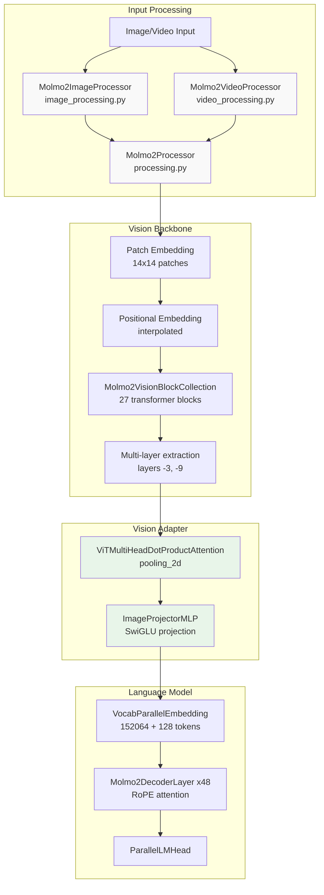
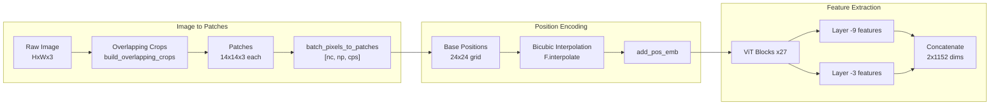
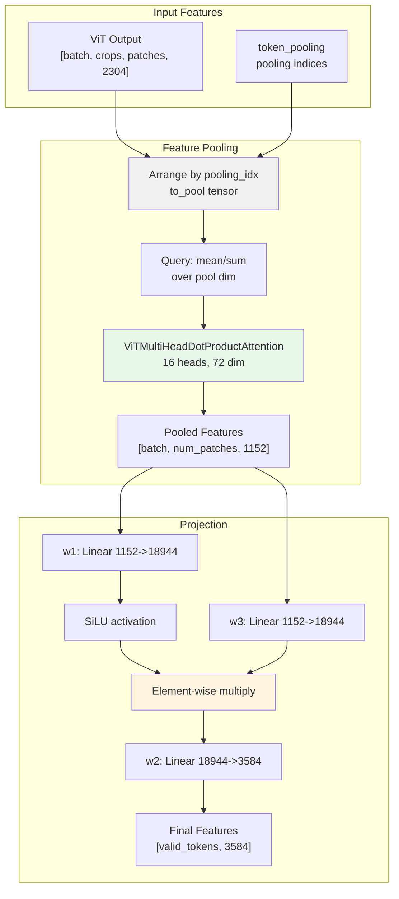
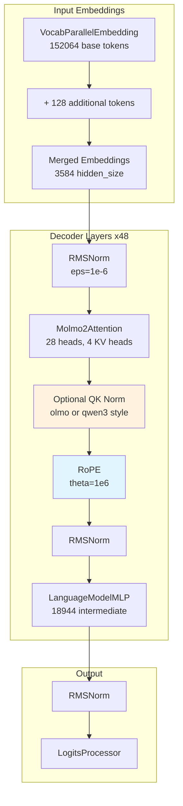
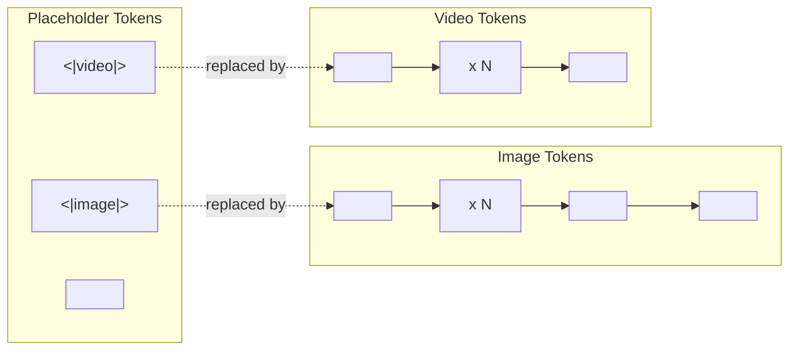
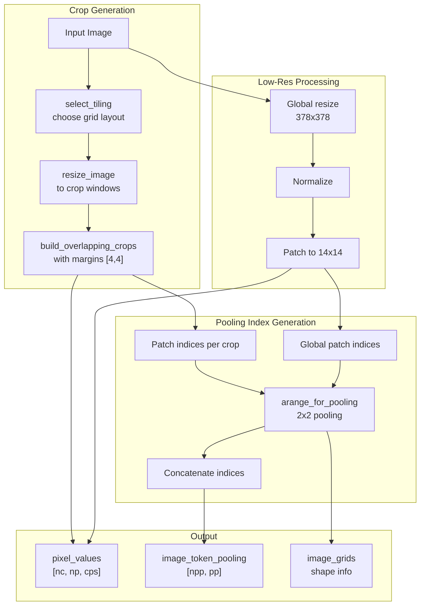
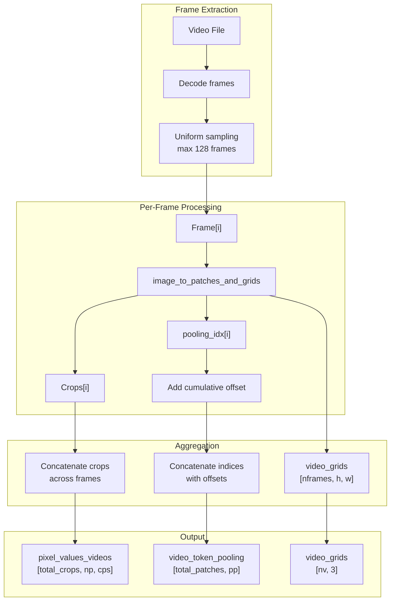
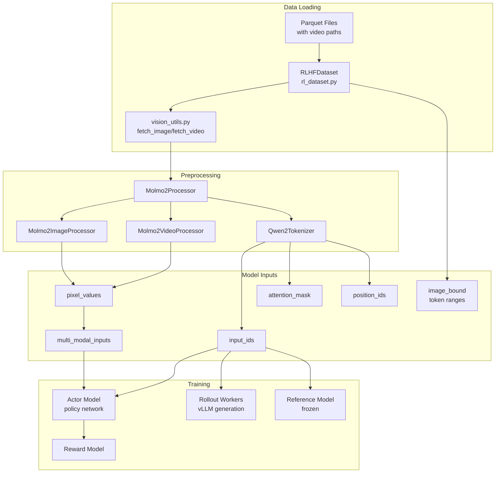
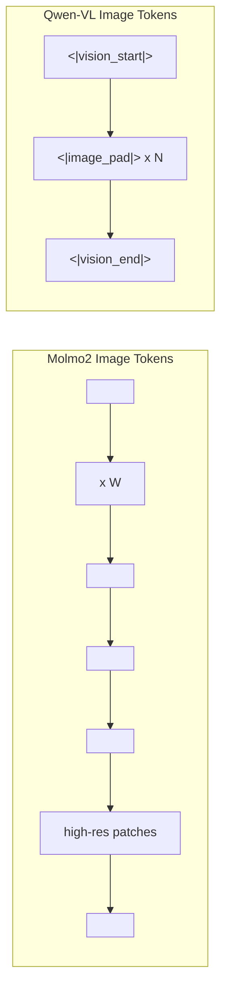
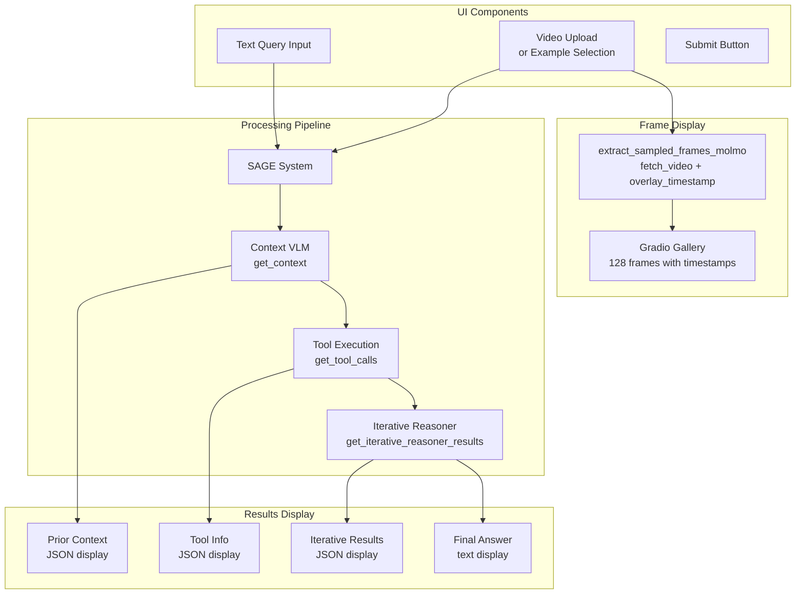

<!-- source: DeepWiki mcp.deepwiki.com · repo allenai/SAGE · page 4.2 Molmo2 (Multimodal Vision-Language) · fetched 2026-10-26 -->

# Molmo2 (Multimodal Vision-Language)

<details>
<summary>Relevant source files</summary>

The following files were used as context for generating this wiki page:

- [rl_train/utils/dataset/vision_utils.py](rl_train/utils/dataset/vision_utils.py)
- [sage/serve/demo.py](sage/serve/demo.py)
- [sage/src/models/molmo2/image_processing.py](sage/src/models/molmo2/image_processing.py)
- [sage/src/models/molmo2/modeling.py](sage/src/models/molmo2/modeling.py)
- [sage/src/models/molmo2/processing.py](sage/src/models/molmo2/processing.py)
- [sage/src/models/molmo2/video_processing.py](sage/src/models/molmo2/video_processing.py)
- [sage/src/models/molmo2/vllm/modeling.py](sage/src/models/molmo2/vllm/modeling.py)
- [verl/recipe/minicpmo/rl_dataset.py](verl/recipe/minicpmo/rl_dataset.py)

</details>


## Purpose and Scope

This page documents the Molmo2 vision-language model architecture and its integration into the SAGE framework. Molmo2 is a multimodal model that processes images and videos alongside text to perform visual question answering and reasoning tasks. The implementation includes both training-time (Transformers) and inference-time (vLLM) backends, along with specialized image and video preprocessing pipelines.

For information about training algorithms that work with Molmo2, see [Training Algorithms](#3). For details on distributed training strategies, see [Model Parallelism Strategies](#4.3).

---

## Architecture Overview

Molmo2 consists of three primary components: a Vision Transformer (ViT) backbone for encoding images/videos, an adapter module that bridges vision features to the language model's embedding space, and a causal language model decoder for text generation.



**Sources:** [sage/src/models/molmo2/modeling.py:1-1500](), [sage/src/models/molmo2/image_processing.py:1-553](), [sage/src/models/molmo2/processing.py:1-628]()

---

## Vision Backbone

The vision backbone is a Vision Transformer that processes image patches and extracts multi-layer features.

### Vision Transformer Components

| Component | Class | Configuration |
|-----------|-------|---------------|
| Patch Embedding | `Molmo2VisionTransformer.patch_embedding` | Linear projection: `(14×14×3) → 1152` |
| Positional Embedding | `Molmo2VisionTransformer.positional_embedding` | Interpolated 2D embeddings, 577 positions |
| Transformer Blocks | `Molmo2VisionBlock` | 27 layers, 16 heads, 72 head_dim |
| Attention | `ViTMultiHeadDotProductAttention` | GQA with 16 KV heads |
| MLP | `ViTMLP` | Hidden size 4304, GELU activation |

**Sources:** [sage/src/models/molmo2/modeling.py:377-437](), [sage/src/models/molmo2/vllm/modeling.py:502-571]()

### Patch Processing Pipeline



The vision backbone extracts features from specific intermediate layers (configured via `vit_layers = [-3, -9]` in `AdapterConfig`) rather than just using the final layer output. This multi-layer extraction provides richer visual representations.

**Sources:** [sage/src/models/molmo2/modeling.py:460-567](), [sage/src/models/molmo2/image_processing.py:262-331]()

---

## Vision Adapter

The adapter bridges vision features to the language model through attention-based pooling and projection.

### Adapter Architecture



The adapter uses a two-stage process:

1. **Attention Pooling**: A cross-attention mechanism (`image_pooling_2d`) pools variable-size patch features into fixed-size tokens. The query is either a simple mean or an attention-masked sum.

2. **MLP Projection**: An `ImageProjectorMLP` with SwiGLU activation projects pooled features from adapter dimension (1152) to language model dimension (3584).

**Sources:** [sage/src/models/molmo2/modeling.py:440-567](), [sage/src/models/molmo2/vllm/modeling.py:611-720]()

### Pooling Configuration

| Parameter | Value | Purpose |
|-----------|-------|---------|
| `vit_layers` | `[-3, -9]` | Which ViT layers to extract from |
| `pooling_attention_mask` | `False` | Use attention masking in pooling |
| `pooling_size` | `[2, 2]` | Spatial pooling dimensions |
| `image_feature_dropout` | `0.0` | Dropout on image features |

**Sources:** [sage/src/models/molmo2/modeling.py:173-185]()

---

## Text Model

The language model component is a decoder-only transformer with RoPE positional embeddings and optional QK normalization.

### Decoder Configuration



### Key Features

- **Grouped Query Attention (GQA)**: 28 query heads with 4 KV heads (7:1 ratio) reduces memory consumption
- **Large Vocabulary**: 152064 base tokens + 128 special tokens for vision-language interaction
- **QK Normalization**: Optional layer normalization on queries and keys for training stability (`use_qk_norm`, `qk_norm_type`)
- **High Rope Theta**: `rope_theta=1000000.0` enables better long-context modeling

**Sources:** [sage/src/models/molmo2/modeling.py:707-902](), [sage/src/models/molmo2/vllm/modeling.py:756-945]()

### Special Token Architecture



The processor replaces high-level placeholders (`<|image|>`, `<|video|>`) with structured token sequences that encode spatial layout (via `<im_col>`) and temporal structure (via `<frame_start>`/`<frame_end>`).

**Sources:** [sage/src/models/molmo2/processing.py:36-46](), [sage/src/models/molmo2/vllm/modeling.py:95-107]()

---

## Image and Video Processing

### Image Processing Pipeline

The `Molmo2ImageProcessor` implements multi-crop processing with overlapping windows to handle high-resolution images.



**Key Parameters:**

| Parameter | Default | Purpose |
|-----------|---------|---------|
| `max_crops` | 8 | Maximum high-res crops per image |
| `overlap_margins` | `[4, 4]` | Overlapping patches at crop boundaries |
| `patch_size` | 14 | ViT patch size in pixels |
| `pooling_size` | `[2, 2]` | Spatial pooling before adapter |
| `size` | `{"height": 378, "width": 378}` | Base resolution for crops |

**Sources:** [sage/src/models/molmo2/image_processing.py:341-551]()

### Video Processing Pipeline

Video processing extends image processing to temporal sequences, maintaining frame-level pooling indices.



The video processor treats each frame independently through the image pipeline, then adjusts pooling indices with cumulative offsets to maintain global indexing across all frame crops.

**Sources:** [sage/src/models/molmo2/video_processing.py:183-337](), [sage/src/models/molmo2/processing.py:174-229]()

---

## Dual Implementation Backends

Molmo2 has two parallel implementations optimized for different use cases:

### Transformers Backend (Training)

Located in `sage/src/models/molmo2/modeling.py`, this implementation integrates with Hugging Face Transformers for training:

- Full gradient checkpointing support
- Flash Attention 2 and SDPA backends
- Cache-aware generation
- Training-specific features like dropout and normalization

**Key Classes:**
- `Molmo2ForConditionalGeneration`: Main model entry point
- `Molmo2TextModel`: Language model decoder
- `Molmo2VisionBackbone`: Vision encoder with adapter

**Sources:** [sage/src/models/molmo2/modeling.py:1-2400]()

### vLLM Backend (Inference)

Located in `sage/src/models/molmo2/vllm/modeling.py`, this implementation optimizes for high-throughput inference:

- PagedAttention for efficient KV cache management
- Tensor parallelism for distributed inference
- Quantization support (INT8, FP8, AWQ)
- Continuous batching

**Key Classes:**
- `Molmo2ForConditionalGeneration` (vLLM variant)
- `Molmo2TextModel` (vLLM variant) 
- Parallel linear layers: `QKVParallelLinear`, `ColumnParallelLinear`, `RowParallelLinear`

**Sources:** [sage/src/models/molmo2/vllm/modeling.py:1-2400]()

### Backend Comparison

| Feature | Transformers | vLLM |
|---------|-------------|------|
| **Use Case** | Training, fine-tuning | High-throughput inference |
| **Attention** | Flash Attention 2, SDPA | PagedAttention |
| **Parallelism** | FSDP, Megatron via verl | Tensor Parallel (native) |
| **Quantization** | Post-training | Runtime INT8/FP8 |
| **Batching** | Static | Continuous batching |
| **Memory** | Per-batch allocation | Shared KV cache pages |

**Sources:** [sage/src/models/molmo2/modeling.py:145-178](), [sage/src/models/molmo2/vllm/modeling.py:74-91]()

---

## Integration with RLHF Training

Molmo2 integrates into the SAGE framework's RLHF training pipeline through specialized dataset loaders and processors.



**Sources:** [verl/recipe/minicpmo/rl_dataset.py:402-572](), [rl_train/utils/dataset/vision_utils.py:1-133]()

### Dataset Processing Flow

The `RLHFDataset` class handles multimodal data loading:

1. **Video/Image Loading**: `fetch_image`/`fetch_video` functions load media from file paths or URLs
2. **Preprocessing**: `process_minicpmo_data` applies model-specific transformations (patch extraction, normalization)
3. **Tokenization**: Chat templates are applied, then text is tokenized with `input_ids`, `attention_mask`, `position_ids`
4. **Image Bounds**: Special tracking of image token positions via `build_image_bound` for efficient processing
5. **Multi-modal Inputs**: Vision features stored separately in `multi_modal_inputs` dict

**Sources:** [verl/recipe/minicpmo/rl_dataset.py:369-400](), [verl/recipe/minicpmo/rl_dataset.py:489-561]()

### Environment-Based Model Selection

The codebase uses an environment variable to switch between Qwen-VL and Molmo2:

```python
IS_MOLMO2 = os.environ.get("IS_MOLMO2", "False")
IS_MOLMO2 = IS_MOLMO2.lower() == "true"

if IS_MOLMO2:
    from sage.src.models.molmo2.vision_process import fetch_image, fetch_video
else:
    from sage.src.models.qwen_vl.vision_process import fetch_image, fetch_video
```

This allows the same training code to work with either model family.

**Sources:** [rl_train/utils/dataset/vision_utils.py:22-28](), [sage/serve/demo.py:372-376]()

---

## Key Differences from Qwen-VL

Molmo2 differs from Qwen-VL (the other VLM supported in SAGE) in several architectural dimensions:

| Aspect | Molmo2 | Qwen-VL |
|--------|--------|---------|
| **Vision Encoder** | ViT with multi-layer extraction | Clip-style ViT |
| **Adapter** | Attention pooling + SwiGLU MLP | Resampler or linear projection |
| **Crops** | Overlapping crops with margins | Non-overlapping tiles |
| **Video Processing** | Per-frame crops with offset tracking | Uniform frame sampling |
| **Special Tokens** | `<im_start>`, `<frame_start>`, column tokens | Different schema |
| **Position Encoding** | Interpolated 2D positional embeddings | Learned or RoPE |
| **Language Model** | Custom Molmo2 decoder | Qwen2 decoder |

### Token Schema Comparison



Molmo2's token schema explicitly encodes spatial structure with column tokens (`<im_col>`) and distinguishes low-resolution global views from high-resolution crops. Qwen-VL uses a simpler padding-based approach.

**Sources:** [sage/src/models/molmo2/processing.py:36-172]()

### Video Frame Sampling

Molmo2 and Qwen-VL also differ in frame sampling strategies:

- **Molmo2**: Uses `frame_sample_mode` ("uniform_last_frame" by default) to ensure the last frame is included
- **Qwen-VL**: Simple uniform sampling with `nframes` parameter

Both models support FPS-based sampling, but Molmo2's implementation provides more control over edge cases.

**Sources:** [sage/src/models/molmo2/vision_process.py:1-400](), [sage/serve/demo.py:138-187]()

---

## Demo Interface Integration

The Gradio demo in `sage/serve/demo.py` provides a visual interface for Molmo2 video understanding:



The demo extracts and displays sampled frames with overlaid timestamps using the same frame sampling logic as the underlying model, ensuring visual parity between what the user sees and what the model processes.

**Sources:** [sage/serve/demo.py:138-187](), [sage/serve/demo.py:327-382](), [sage/serve/demo.py:412-591]()

### Frame Sampling with Timestamps

The `extract_sampled_frames_molmo` function demonstrates Molmo2's frame extraction:

```python
# Uses Molmo2's fetch_video to get frames
video_info = molmo_fetch_video(ele, use_cache=False)
frames_array = video_info.get("frames", None)  # (T, H, W, C) in RGB

# Calculate timestamps based on frame index and video duration
timestamp_seconds = (idx / num_extracted_frames) * video_duration
timestamp_str = seconds_to_timestamp(int(timestamp_seconds), in_hr=video_duration >= 3600)

# Overlay timestamp on frame
frame_img = overlay_timestamp(frame_img, timestamp_str)
```

This provides users visual feedback about temporal sampling density and helps them understand which moments the model analyzed.

**Sources:** [sage/serve/demo.py:138-187](), [sage/src/functions/utils/temporal.py:1-100]()

---

## Summary

Molmo2 provides SAGE with a powerful multimodal architecture for video understanding tasks:

- **Modular Design**: Separate vision backbone, adapter, and language model allow independent optimization
- **Multi-Scale Processing**: Overlapping crops capture high-resolution details while global crops maintain context
- **Dual Backends**: Transformers for training, vLLM for inference, sharing the same model weights
- **Flexible Integration**: Environment-based switching enables the same training/inference code to work with multiple VLM families
- **Temporal Modeling**: Per-frame processing with offset tracking efficiently handles long videos

The implementation balances generality (supporting images and videos, training and inference) with optimization (quantization, parallelism, efficient attention).

**Sources:** [sage/src/models/molmo2/modeling.py:1-2400](), [sage/src/models/molmo2/vllm/modeling.py:1-2400](), [sage/src/models/molmo2/processing.py:1-628]()

---

