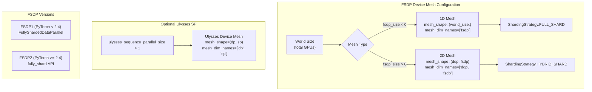
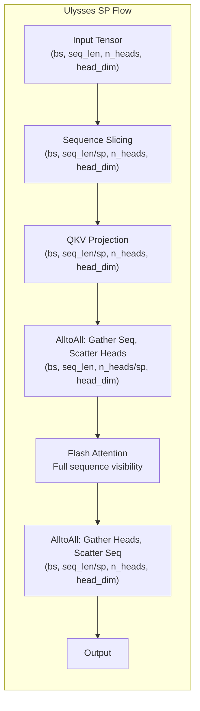
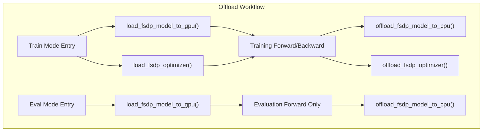
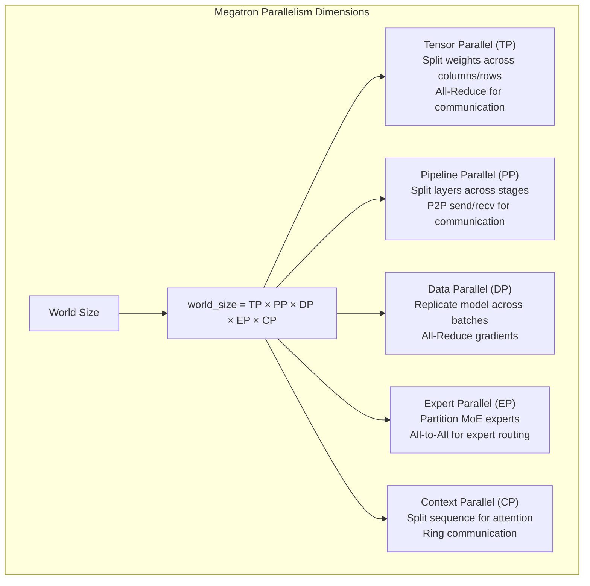
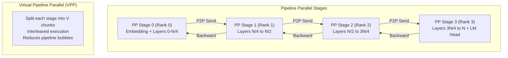
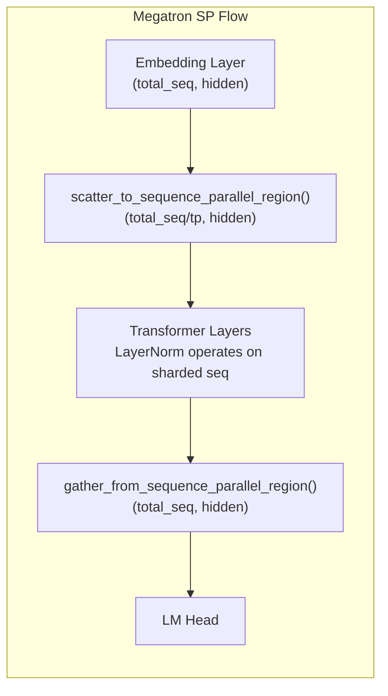
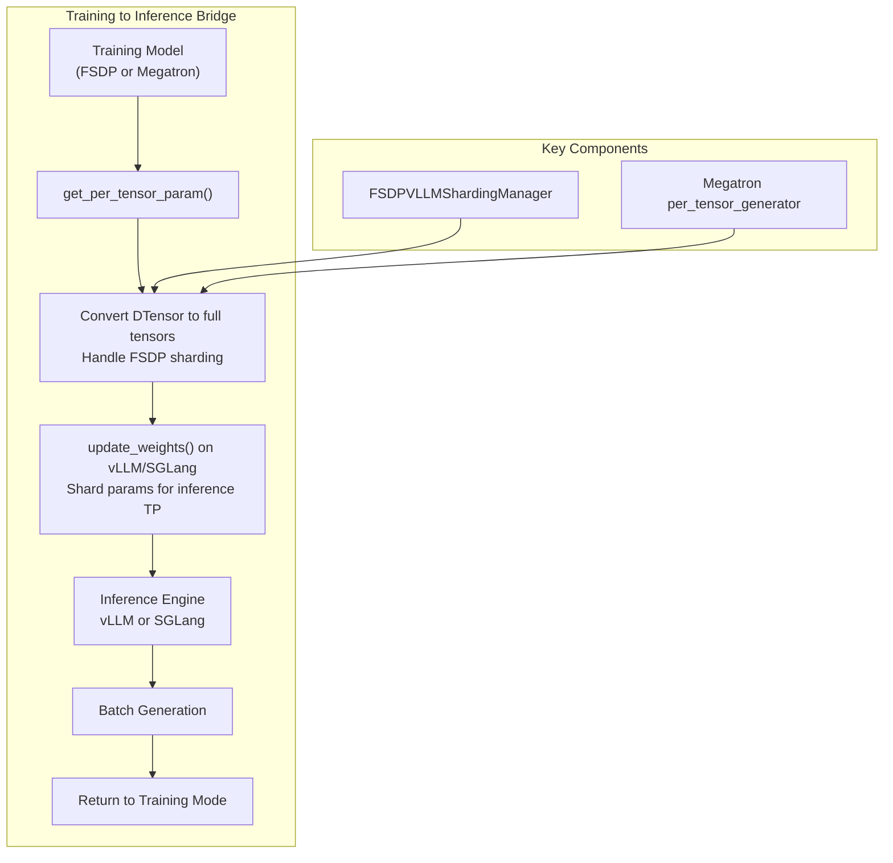
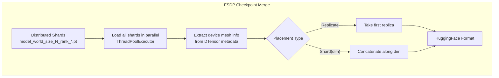
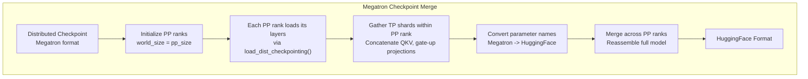

<!-- source: DeepWiki mcp.deepwiki.com · repo allenai/SAGE · page 4.3 Model Parallelism Strategies · fetched 2026-10-26 -->

# Model Parallelism Strategies

<details>
<summary>Relevant source files</summary>

The following files were used as context for generating this wiki page:

- [verl/recipe/one_step_off_policy/README.md](verl/recipe/one_step_off_policy/README.md)
- [verl/scripts/legacy_model_merger.py](verl/scripts/legacy_model_merger.py)
- [verl/verl/model_merger/fsdp_model_merger.py](verl/verl/model_merger/fsdp_model_merger.py)
- [verl/verl/model_merger/megatron_model_merger.py](verl/verl/model_merger/megatron_model_merger.py)
- [verl/verl/models/llama/megatron/checkpoint_utils/llama_loader_depracated.py](verl/verl/models/llama/megatron/checkpoint_utils/llama_loader_depracated.py)
- [verl/verl/models/llama/megatron/modeling_llama_megatron.py](verl/verl/models/llama/megatron/modeling_llama_megatron.py)
- [verl/verl/models/qwen2/megatron/modeling_qwen2_megatron.py](verl/verl/models/qwen2/megatron/modeling_qwen2_megatron.py)
- [verl/verl/models/transformers/apertus.py](verl/verl/models/transformers/apertus.py)
- [verl/verl/models/transformers/llama.py](verl/verl/models/transformers/llama.py)
- [verl/verl/models/transformers/monkey_patch.py](verl/verl/models/transformers/monkey_patch.py)
- [verl/verl/models/transformers/npu_patch.py](verl/verl/models/transformers/npu_patch.py)
- [verl/verl/models/transformers/qwen2.py](verl/verl/models/transformers/qwen2.py)
- [verl/verl/models/transformers/qwen2_vl.py](verl/verl/models/transformers/qwen2_vl.py)
- [verl/verl/third_party/sglang/parallel_state.py](verl/verl/third_party/sglang/parallel_state.py)
- [verl/verl/utils/fsdp_utils.py](verl/verl/utils/fsdp_utils.py)
- [verl/verl/utils/megatron/pipeline_parallel.py](verl/verl/utils/megatron/pipeline_parallel.py)
- [verl/verl/workers/engine/base.py](verl/verl/workers/engine/base.py)
- [verl/verl/workers/engine/fsdp/transformer_impl.py](verl/verl/workers/engine/fsdp/transformer_impl.py)
- [verl/verl/workers/engine/megatron/transformer_impl.py](verl/verl/workers/engine/megatron/transformer_impl.py)
- [verl/verl/workers/fsdp_workers.py](verl/verl/workers/fsdp_workers.py)
- [verl/verl/workers/reward_model/megatron/reward_model.py](verl/verl/workers/reward_model/megatron/reward_model.py)
- [verl/verl/workers/sharding_manager/fsdp_vllm.py](verl/verl/workers/sharding_manager/fsdp_vllm.py)

</details>


This document describes the model parallelism strategies available in SAGE for training large language models. SAGE supports two primary distributed training backends: **FSDP** (Fully Sharded Data Parallel) from PyTorch and **Megatron-LM** from NVIDIA. Each strategy offers different parallelism dimensions and trade-offs between ease of use, scalability, and performance.

For information about the training engines that implement these strategies, see [Training Engines](#5.3). For checkpoint management across different parallelism configurations, see [Checkpoint Management](#5.4).

---

## Strategy Overview

SAGE provides two distinct paths for distributed training, each with different characteristics and use cases:

| Strategy | Parallelism Dimensions | Primary Use Case | Model Support |
|----------|----------------------|------------------|---------------|
| **FSDP** | Data Parallel (DP)<br/>Sequence Parallel (SP) | HuggingFace models<br/>Rapid prototyping<br/>Models up to ~30B | LLaMA, Qwen2/3, Molmo2 |
| **Megatron** | Tensor Parallel (TP)<br/>Pipeline Parallel (PP)<br/>Data Parallel (DP)<br/>Expert Parallel (EP)<br/>Context Parallel (CP) | Maximum scale<br/>Very large models (70B+)<br/>MoE models | LLaMA, Qwen2/3 (Megatron implementations) |

**Sources:** [verl/workers/fsdp_workers.py:1-160](), [verl/workers/engine/megatron/transformer_impl.py:53-96]()

---

## FSDP Strategy

### Architecture and Device Mesh

FSDP uses PyTorch's native Fully Sharded Data Parallel implementation with an optional sequence parallelism dimension via Ulysses for long context support.



The device mesh is created in [verl/workers/fsdp_workers.py:98-105]():

```python
def create_device_mesh(world_size, fsdp_size):
    if fsdp_size < 0 or fsdp_size >= world_size:
        device_mesh = init_device_mesh(device_name, mesh_shape=(world_size,), 
                                      mesh_dim_names=["fsdp"])
    else:
        device_mesh = init_device_mesh(
            device_name, mesh_shape=(world_size // fsdp_size, fsdp_size), 
            mesh_dim_names=["ddp", "fsdp"]
        )
```

**Sources:** [verl/workers/fsdp_workers.py:98-118](), [verl/workers/engine/fsdp/transformer_impl.py:167-183]()

### FSDP Configuration Options

FSDP supports two strategies depending on the PyTorch version:

#### FSDP1 Configuration

For PyTorch versions < 2.4, SAGE uses the `FullyShardedDataParallel` wrapper:

| Parameter | Purpose | Default |
|-----------|---------|---------|
| `cpu_offload` | Offload params to CPU | `None` (actor)<br/>`CPUOffload(True)` (ref) |
| `param_init_fn` | Initialize params on rank 0 | `init_fn` |
| `auto_wrap_policy` | Layer wrapping policy | Transformer-based |
| `sharding_strategy` | FULL_SHARD or HYBRID_SHARD | From device mesh |
| `mixed_precision` | Param/reduce/buffer dtypes | bf16/fp32/fp32 |
| `sync_module_states` | Sync params across ranks | `True` |
| `forward_prefetch` | Prefetch next layer | `False` |
| `use_orig_params` | Preserve original params | `False` |

**Sources:** [verl/workers/engine/fsdp/transformer_impl.py:283-309]()

#### FSDP2 Configuration

For PyTorch versions >= 2.4, SAGE uses the composable `fully_shard` API:

| Parameter | Purpose | Notes |
|-----------|---------|-------|
| `mp_policy` | MixedPrecisionPolicy | cast_forward_inputs=True |
| `offload_policy` | CPUOffloadPolicy | pin_memory=True |
| `reshard_after_forward` | Free shards after forward | Configurable |
| `shard_placement_fn` | Custom shard placement | For FSDP size control |

**Sources:** [verl/workers/engine/fsdp/transformer_impl.py:310-333]()

### Ulysses Sequence Parallelism

Ulysses SP enables efficient long context training by partitioning sequences across multiple GPUs and using AlltoAll collective communication to redistribute data between sequence and head dimensions.



Ulysses SP is applied as a monkey patch to attention layers. Key implementation details:

- **Input padding**: Sequences are padded to be divisible by `sp_size`
- **Communication**: Uses `all_to_all` collective on the `sp` dimension of the device mesh
- **Flash attention**: Operates on full sequence length after gathering
- **Gradient handling**: Backward pass reverses the AlltoAll operations

**Sources:** [verl/workers/fsdp_workers.py:161-179](), [verl/models/transformers/monkey_patch.py:49-131]()

### FSDP Offload Strategies

FSDP supports manual parameter and optimizer offloading to reduce GPU memory usage:



The offload functions handle FSDP's internal `_flat_param` structure and ensure proper device placement for both FSDP1 and FSDP2 versions.

**Sources:** [verl/utils/fsdp_utils.py:390-471](), [verl/workers/engine/fsdp/transformer_impl.py:676-698]()

---

## Megatron Strategy

### Multi-Dimensional Parallelism

Megatron-LM provides 4D+ parallelism for maximum scalability:



The parallelism dimensions are initialized in [verl/workers/engine/megatron/transformer_impl.py:85-95]():

```python
mpu.initialize_model_parallel(
    tensor_model_parallel_size=engine_config.tensor_model_parallel_size,
    pipeline_model_parallel_size=engine_config.pipeline_model_parallel_size,
    virtual_pipeline_model_parallel_size=engine_config.virtual_pipeline_model_parallel_size,
    context_parallel_size=engine_config.context_parallel_size,
    expert_model_parallel_size=engine_config.expert_model_parallel_size,
    expert_tensor_parallel_size=engine_config.expert_tensor_parallel_size,
)
```

**Sources:** [verl/workers/engine/megatron/transformer_impl.py:84-96]()

### Tensor Parallelism (TP)

Tensor parallelism partitions weight matrices across GPUs, with each GPU computing a portion of the output. Two primary patterns are used:

| Layer Type | Parallelism | Communication |
|------------|-------------|---------------|
| `VocabParallelEmbedding` | Vocabulary split | All-Reduce on forward |
| `ColumnParallelLinear` | Column-wise split | Identity on forward<br/>All-Reduce on backward |
| `RowParallelLinear` | Row-wise split | All-Reduce on forward<br/>Identity on backward |

**Example from Megatron LLaMA:**

```python
# Embedding layer with TP
self.embed_tokens = tensor_parallel.VocabParallelEmbedding(
    num_embeddings=config.vocab_size, 
    embedding_dim=config.hidden_size,
    config=megatron_config
)

# LM head with column parallelism
self.lm_head = tensor_parallel.ColumnParallelLinear(
    input_size=config.hidden_size,
    output_size=config.vocab_size,
    bias=False,
    gather_output=False,  # Keep output sharded across TP
    config=megatron_config
)
```

**Sources:** [verl/models/llama/megatron/modeling_llama_megatron.py:86-93](), [verl/models/llama/megatron/modeling_llama_megatron.py:167-180]()

### Pipeline Parallelism (PP)

Pipeline parallelism divides the model layers across multiple GPU stages, processing micro-batches in a pipelined fashion to hide communication latency.



**Key PP implementation details:**

1. **Pre/Post Process Flags**: Each stage has `pre_process` (first stage) and `post_process` (last stage) flags
2. **Input Tensor Passing**: `set_input_tensor()` method receives activations from previous stage
3. **Layer Distribution**: Layers are evenly divided or dynamically assigned based on `get_dynamic_pipeline_shards()`

**Example from Megatron LLaMA with PP:**

```python
class ParallelLlamaModelRmPadPP(nn.Module):
    def __init__(self, config, megatron_config, pre_process, post_process):
        super().__init__()
        # Only instantiate embedding on first stage
        if pre_process:
            self.embed_tokens = tensor_parallel.VocabParallelEmbedding(...)
        
        # Calculate layers for this PP rank
        pp_rank = mpu.get_pipeline_model_parallel_rank()
        pp_size = megatron_config.pipeline_model_parallel_size
        self.num_layer_per_pp = config.num_hidden_layers // pp_size
        
        # Only instantiate norm on last stage
        if post_process:
            self.norm = ParallelLlamaRMSNorm(config, megatron_config)
```

**Sources:** [verl/models/llama/megatron/modeling_llama_megatron.py:418-471](), [verl/model_merger/megatron_model_merger.py:57-98]()

### Sequence Parallelism in Megatron

Megatron's sequence parallelism (SP) splits the sequence dimension across TP ranks to save memory, particularly for activations:



Key differences from Ulysses:
- **Scope**: Megatron SP splits sequence during LayerNorm/Dropout, Ulysses SP splits during attention
- **Communication**: Megatron uses scatter/gather on TP group, Ulysses uses AlltoAll on dedicated SP group
- **Purpose**: Megatron SP reduces activation memory, Ulysses SP enables full sequence attention

**Sources:** [verl/models/llama/megatron/modeling_llama_megatron.py:268-274](), [verl/utils/megatron/sequence_parallel.py:1-50]()

### Expert Parallelism (EP)

For Mixture of Experts (MoE) models, expert parallelism distributes experts across GPUs:

| Dimension | Purpose | Communication |
|-----------|---------|---------------|
| `expert_model_parallel_size` | Number of GPUs across which experts are partitioned | All-to-All for token routing |
| `expert_tensor_parallel_size` | Tensor parallelism within each expert | All-Reduce within expert TP group |

This allows scaling MoE models like Qwen3-MoE beyond single-node memory constraints.

**Sources:** [verl/workers/engine/megatron/transformer_impl.py:92]()

---

## Strategy Selection Guide

### When to Use FSDP

**Advantages:**
- **Ease of use**: Works with standard HuggingFace models with minimal modification
- **Rapid iteration**: Simpler setup and debugging
- **Good for medium scale**: Efficient up to ~30B parameter models
- **LoRA support**: Native PEFT/LoRA integration
- **Flexible sharding**: Can combine with Ulysses SP for long context

**Limitations:**
- Limited scalability for very large models (70B+)
- No pipeline parallelism (bubbles with very deep models)
- Less optimized for extreme scale compared to Megatron

**Typical Configuration:**
```yaml
actor:
  strategy: fsdp2  # or fsdp
  fsdp_config:
    fsdp_size: -1  # Full shard across all GPUs
    mixed_precision:
      param_dtype: bf16
      reduce_dtype: fp32
    param_offload: false
    optimizer_offload: false
  ulysses_sequence_parallel_size: 1  # Set to 4-8 for long context
```

**Sources:** [verl/workers/fsdp_workers.py:488-528](), [verl/workers/engine/fsdp/transformer_impl.py:283-353]()

### When to Use Megatron

**Advantages:**
- **Maximum scale**: Proven for 100B+ parameter models
- **4D+ parallelism**: TP, PP, DP, EP, CP for flexible scaling
- **Highly optimized**: Custom kernels, communication overlap, pipeline schedules
- **MoE support**: Expert parallelism for mixture-of-experts architectures
- **Production ready**: Battle-tested on largest models

**Limitations:**
- More complex setup and debugging
- Requires Megatron-specific model implementations
- Higher learning curve for configuration tuning

**Typical Configuration:**
```yaml
actor:
  megatron:
    tensor_model_parallel_size: 4     # TP across 4 GPUs
    pipeline_model_parallel_size: 2   # PP across 2 stages
    context_parallel_size: 1          # CP for sequence
    expert_model_parallel_size: 1     # EP for MoE
    sequence_parallel: true           # Enable SP within TP
    use_distributed_optimizer: true   # Shard optimizer states
```

**Sources:** [verl/workers/engine/megatron/transformer_impl.py:53-96]()

### Scaling Recommendations

| Model Size | Strategy | Configuration | Notes |
|------------|----------|---------------|-------|
| < 7B | FSDP | FULL_SHARD, no offload | Single node sufficient |
| 7B - 13B | FSDP or Megatron | FSDP: FULL_SHARD<br/>Megatron: TP=2 | FSDP preferred for ease |
| 13B - 30B | FSDP or Megatron | FSDP: HYBRID_SHARD<br/>Megatron: TP=4, PP=1 | Consider Ulysses for long context |
| 30B - 70B | Megatron | TP=4-8, PP=2-4 | Pipeline parallelism recommended |
| 70B+ | Megatron | TP=8, PP=4-8, EP for MoE | Distributed optimizer required |

**Sources:** Analysis from [verl/workers/engine/fsdp/transformer_impl.py](), [verl/workers/engine/megatron/transformer_impl.py]()

---

## Integration with Inference Engines

Both FSDP and Megatron strategies integrate with vLLM and SGLang for efficient rollout generation. The sharding manager handles parameter synchronization between training and inference representations.



**FSDP Integration:**

The `FSDPVLLMShardingManager` handles synchronization:
1. Collects parameters via FSDP state_dict (handles DTensor sharding)
2. Converts weight keys to match HuggingFace naming
3. Offloads training model and loads inference model
4. Syncs parameters to vLLM with appropriate TP sharding

**Megatron Integration:**

The Megatron engine exports parameters via `per_tensor_generator`:
1. Gathers weights from TP/PP ranks to rank 0
2. Converts Megatron naming to HuggingFace format
3. Applies weight transformations (e.g., QKV splitting)
4. Yields tensors that vLLM can consume

**Sources:** [verl/workers/sharding_manager/fsdp_vllm.py:58-127](), [verl/workers/engine/megatron/transformer_impl.py:442-455](), [verl/utils/megatron_utils.py:687-850]()

---

## Checkpoint Format Conversion

SAGE provides model mergers to convert distributed checkpoints to HuggingFace format:

### FSDP Checkpoint Merging



**Key classes:**
- `FSDPModelMerger`: Handles DTensor to regular tensor conversion
- `_merge_by_placement()`: Merges based on Replicate/Shard placement
- Supports both 1D (FSDP only) and 2D (FSDP+DDP) meshes

**Sources:** [verl/model_merger/fsdp_model_merger.py:35-100](), [scripts/legacy_model_merger.py:230-380]()

### Megatron Checkpoint Merging



**Key classes:**
- `MegatronModelMerger`: Orchestrates multi-process merging
- `get_dynamic_pipeline_shards()`: Calculates layer distribution
- `per_tensor_generator()`: Gathers and converts weights

**Sources:** [verl/model_merger/megatron_model_merger.py:101-280](), [scripts/legacy_model_merger.py:26-36]()

---

## Summary

SAGE's dual-strategy approach provides flexibility across the scale spectrum:

- **FSDP** offers simplicity and rapid iteration for most use cases, with optional Ulysses SP for long context
- **Megatron** provides maximum scalability and performance for the largest models and production deployments
- Both strategies integrate seamlessly with vLLM/SGLang for efficient hybrid training-inference workflows
- Model mergers enable checkpoint portability between distributed formats and standard HuggingFace models

The choice of strategy depends on model size, hardware constraints, and development velocity requirements. For most research use cases under 30B parameters, FSDP provides the best balance of usability and performance. For production-scale models beyond 70B parameters, Megatron's multi-dimensional parallelism becomes essential.

**Sources:** [verl/workers/fsdp_workers.py](), [verl/workers/engine/fsdp/transformer_impl.py](), [verl/workers/engine/megatron/transformer_impl.py](), [verl/models/llama/megatron/modeling_llama_megatron.py](), [verl/models/qwen2/megatron/modeling_qwen2_megatron.py]()

---

