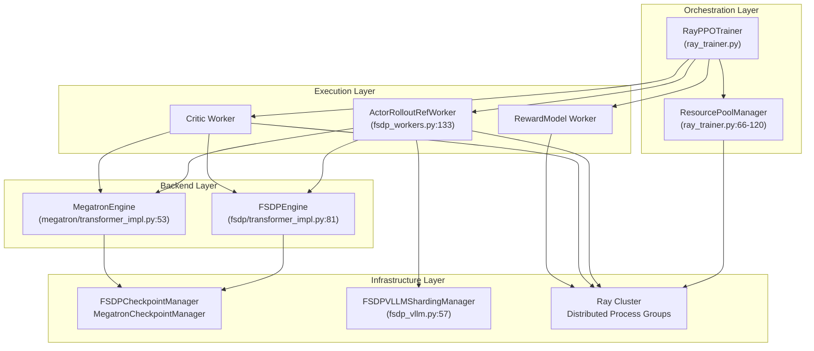
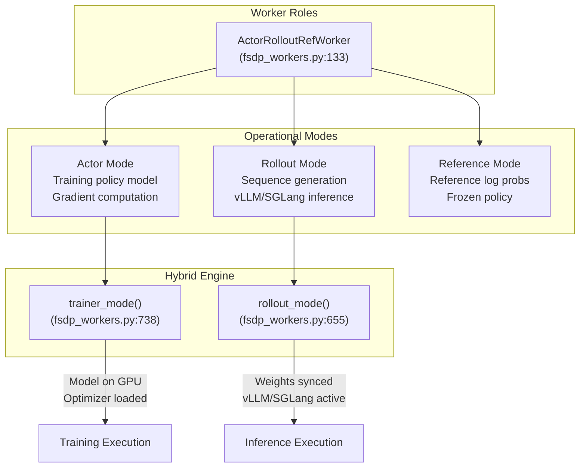
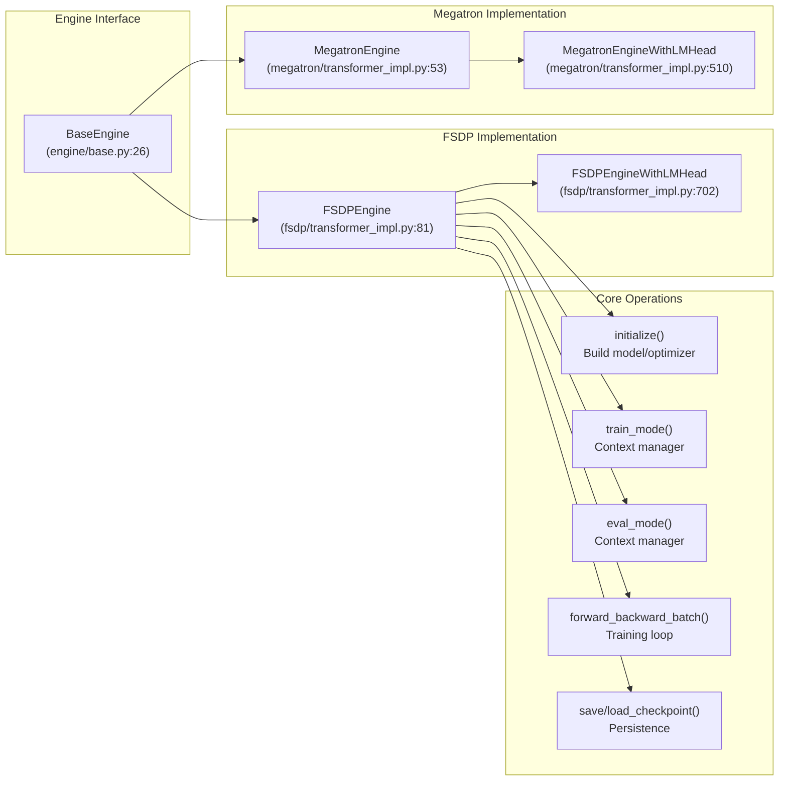
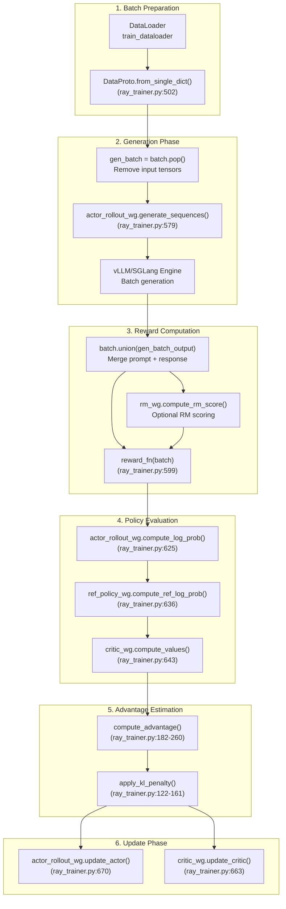
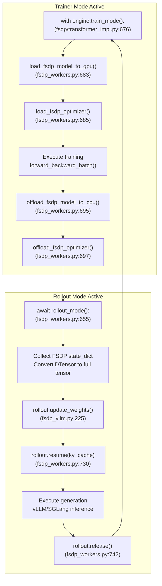
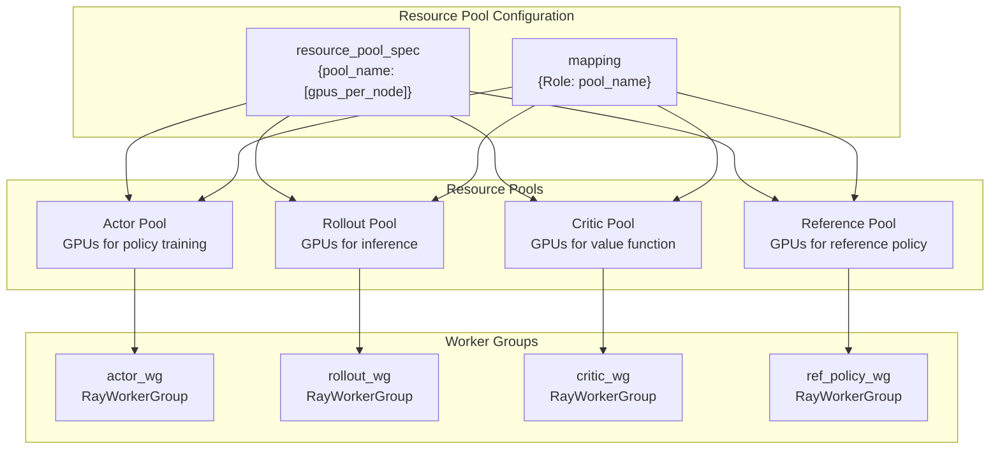
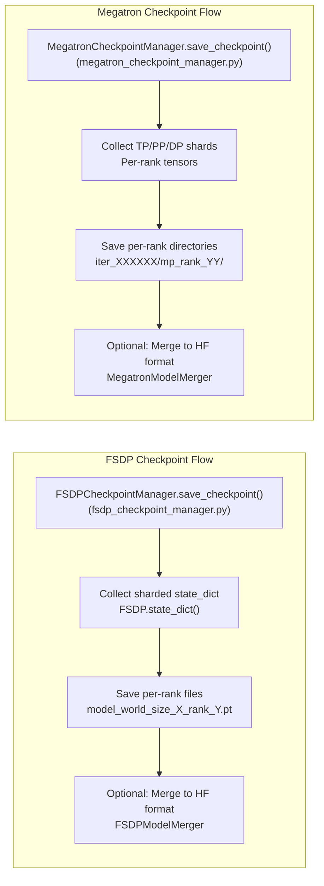

<!-- source: DeepWiki mcp.deepwiki.com · repo allenai/SAGE · page 5 System Components · fetched 2026-10-26 -->

# System Components

Relevant source files

The following files were used as context for generating this wiki page:

- [rl_train/trainer/ppo/sage_ray_trainer.py](rl_train/trainer/ppo/sage_ray_trainer.py)
- [verl/recipe/collabllm/reward_function.py](verl/recipe/collabllm/reward_function.py)
- [verl/recipe/dapo/dapo_ray_trainer.py](verl/recipe/dapo/dapo_ray_trainer.py)
- [verl/recipe/entropy/entropy_ray_trainer.py](verl/recipe/entropy/entropy_ray_trainer.py)
- [verl/recipe/one_step_off_policy/README.md](verl/recipe/one_step_off_policy/README.md)
- [verl/recipe/one_step_off_policy/ray_trainer.py](verl/recipe/one_step_off_policy/ray_trainer.py)
- [verl/recipe/prime/prime_ray_trainer.py](verl/recipe/prime/prime_ray_trainer.py)
- [verl/recipe/sppo/sppo_ray_trainer.py](verl/recipe/sppo/sppo_ray_trainer.py)
- [verl/scripts/legacy_model_merger.py](verl/scripts/legacy_model_merger.py)
- [verl/verl/model_merger/fsdp_model_merger.py](verl/verl/model_merger/fsdp_model_merger.py)
- [verl/verl/model_merger/megatron_model_merger.py](verl/verl/model_merger/megatron_model_merger.py)
- [verl/verl/models/llama/megatron/checkpoint_utils/llama_loader_depracated.py](verl/verl/models/llama/megatron/checkpoint_utils/llama_loader_depracated.py)
- [verl/verl/third_party/sglang/parallel_state.py](verl/verl/third_party/sglang/parallel_state.py)
- [verl/verl/trainer/ppo/ray_trainer.py](verl/verl/trainer/ppo/ray_trainer.py)
- [verl/verl/utils/fsdp_utils.py](verl/verl/utils/fsdp_utils.py)
- [verl/verl/workers/engine/base.py](verl/verl/workers/engine/base.py)
- [verl/verl/workers/engine/fsdp/transformer_impl.py](verl/verl/workers/engine/fsdp/transformer_impl.py)
- [verl/verl/workers/engine/megatron/transformer_impl.py](verl/verl/workers/engine/megatron/transformer_impl.py)
- [verl/verl/workers/fsdp_workers.py](verl/verl/workers/fsdp_workers.py)
- [verl/verl/workers/reward_model/megatron/reward_model.py](verl/verl/workers/reward_model/megatron/reward_model.py)
- [verl/verl/workers/sharding_manager/fsdp_vllm.py](verl/verl/workers/sharding_manager/fsdp_vllm.py)

## Purpose and Scope

This page documents the internal architecture of the verl framework's core components, which form the foundation for distributed reinforcement learning training in SAGE. The system is built on Ray for distributed execution and provides a modular architecture separating concerns into trainers, workers, engines, and resource management.

For information about specific training algorithms implemented on top of this infrastructure, see [Training Algorithms](#3). For model-specific implementations, see [Model Support](#4). For advanced features like hardware optimizations and inference integration, see [Advanced Topics](#6).

## System Architecture Overview

The verl framework implements a layered architecture where each layer has distinct responsibilities:

**Sources:** [verl/trainer/ppo/ray_trainer.py:263-407](), [verl/workers/fsdp_workers.py:133-189]()

## Component Hierarchy

The system is organized into four primary layers, each with specific responsibilities:

### Orchestration Layer

| Component | File | Responsibility |
|-----------|------|----------------|
| `RayPPOTrainer` | [verl/trainer/ppo/ray_trainer.py:263]() | Main training loop coordination, algorithm implementation |
| `ResourcePoolManager` | [verl/trainer/ppo/ray_trainer.py:66]() | Ray resource pool allocation and worker placement |
| Algorithm Variants | [verl/recipe/dapo/](), [verl/recipe/gspo/]() | Specialized trainers for DAPO, GSPO, SPPO, etc. |

### Execution Layer (Workers)

| Component | File | Responsibility |
|-----------|------|----------------|
| `ActorRolloutRefWorker` | [verl/workers/fsdp_workers.py:133]() | Policy model, rollout generation, reference policy |
| Critic Worker | Training code instantiates from base | Value function estimation |
| Reward Model Worker | [verl/workers/reward_model/]() | Computing reward scores |

### Backend Layer (Engines)

| Component | File | Responsibility |
|-----------|------|----------------|
| `FSDPEngine` | [verl/workers/engine/fsdp/transformer_impl.py:81]() | PyTorch FSDP training backend |
| `MegatronEngine` | [verl/workers/engine/megatron/transformer_impl.py:53]() | Megatron-LM training backend with 4D parallelism |
| `EngineRegistry` | [verl/workers/engine/base.py:116]() | Factory for creating appropriate engine instances |

### Infrastructure Layer

| Component | File | Responsibility |
|-----------|------|----------------|
| `FSDPCheckpointManager` | [verl/utils/checkpoint/fsdp_checkpoint_manager.py]() | FSDP checkpoint save/load |
| `MegatronCheckpointManager` | [verl/utils/checkpoint/megatron_checkpoint_manager.py]() | Megatron checkpoint save/load |
| `FSDPVLLMShardingManager` | [verl/workers/sharding_manager/fsdp_vllm.py:57]() | Synchronizing FSDP parameters to vLLM/SGLang |
| Ray Resource Pools | [verl/single_controller/ray/]() | Distributed process management |

**Sources:** [verl/trainer/ppo/ray_trainer.py:263-407](), [verl/workers/fsdp_workers.py:1-800](), [verl/workers/engine/base.py:1-150]()

## Worker Role Architecture

Workers are the fundamental execution units in verl. The `ActorRolloutRefWorker` is particularly important as it can operate in multiple modes:

The worker architecture enables several key features:

1. **Mode Switching**: The `ActorRolloutRefWorker` can switch between trainer and rollout modes, enabling hybrid engine operation where the same GPUs are time-multiplexed for training and inference.

2. **Parameter Offloading**: Workers support CPU offloading of parameters and optimizer states to reduce GPU memory usage when idle ([fsdp_workers.py:223-231]()).

3. **Distributed Initialization**: Workers initialize their own process groups and device meshes ([fsdp_workers.py:146-169]()).

4. **FSDP/Megatron Abstraction**: Workers can use either FSDP or Megatron backends through the engine interface.

**Sources:** [verl/workers/fsdp_workers.py:133-800](), [verl/workers/fsdp_workers.py:655-755]()

## Training Engine Interface

The engine layer provides a unified interface for different distributed training backends:

### Key Engine Methods

The `BaseEngine` interface ([engine/base.py:26-150]()) defines critical methods that all engines must implement:

| Method | Purpose | FSDP Implementation | Megatron Implementation |
|--------|---------|---------------------|-------------------------|
| `initialize()` | Build model, optimizer, scheduler | [fsdp/transformer_impl.py:142-166]() | [megatron/transformer_impl.py:204-238]() |
| `train_mode()` | Enter training mode with grad tracking | [fsdp/transformer_impl.py:676-698]() | [megatron/transformer_impl.py:485-507]() |
| `eval_mode()` | Enter eval mode, no gradients | [fsdp/transformer_impl.py:648-673]() | [megatron/transformer_impl.py:464-482]() |
| `forward_backward_batch()` | Execute forward and backward pass | [fsdp/transformer_impl.py:461-489]() | [megatron/transformer_impl.py:382-440]() |
| `optimizer_step()` | Update parameters, clip gradients | [fsdp/transformer_impl.py:500-527]() | [megatron/transformer_impl.py:270-285]() |
| `save_checkpoint()` | Persist model state | [fsdp/transformer_impl.py:564-584]() | [megatron/transformer_impl.py:335-360]() |
| `load_checkpoint()` | Restore model state | [fsdp/transformer_impl.py:586-606]() | [megatron/transformer_impl.py:361-380]() |

**Sources:** [verl/workers/engine/base.py:26-150](), [verl/workers/engine/fsdp/transformer_impl.py:81-700](), [verl/workers/engine/megatron/transformer_impl.py:53-550]()

## Data Flow Through System

The following diagram illustrates how data flows through the system during a single training step:

**Key Data Structures:**

- **`DataProto`**: Core data container that holds both tensor (`batch`) and non-tensor (`non_tensor_batch`) data, plus metadata (`meta_info`)
- **Batch Keys**: Standard keys include `input_ids`, `attention_mask`, `position_ids`, `responses`, `old_log_probs`, `ref_log_prob`, `values`, `token_level_rewards`, `advantages`, `returns`

**Sources:** [verl/trainer/ppo/ray_trainer.py:518-700](), [verl/verl/__init__.py]() (DataProto definition)

## Hybrid Engine Mode

The hybrid engine is a key optimization that allows the same GPU resources to be used for both training and high-throughput inference:

The hybrid engine mode alternates between two states:

1. **Trainer Mode** ([fsdp_workers.py:738-755]()): Model and optimizer on GPU, FSDP manages sharding, gradients enabled
2. **Rollout Mode** ([fsdp_workers.py:655-737]()): Model parameters synced to vLLM/SGLang, high-throughput inference active

The `FSDPVLLMShardingManager` ([fsdp_vllm.py:57-400]()) handles the parameter synchronization:
- Extracts full tensors from FSDP sharded state
- Converts DTensor to regular tensors
- Updates vLLM/SGLang weights via `update_weights()`
- Supports both full model sync and LoRA adapter sync

**Sources:** [verl/workers/fsdp_workers.py:655-755](), [verl/workers/sharding_manager/fsdp_vllm.py:57-400]()

## Resource Pool Management

The `ResourcePoolManager` ([ray_trainer.py:66-120]()) coordinates Ray resource allocation:

**Key Features:**

1. **Flexible Topology**: Resource pools can be configured to use separate or shared GPU resources
2. **Colocation**: Multiple worker types can share the same resource pool using `create_colocated_worker_cls()` ([ray_trainer.py:450]())
3. **Hybrid Engine**: When `hybrid_engine=True`, actor and rollout share resources via mode switching
4. **Validation**: Checks that requested resources don't exceed available cluster capacity ([ray_trainer.py:103-119]())

**Sources:** [verl/trainer/ppo/ray_trainer.py:66-120](), [verl/trainer/ppo/ray_trainer.py:395-466]()

## Checkpoint Management

Checkpoint managers handle the persistence and restoration of model, optimizer, and scheduler states:

Both checkpoint managers support:
- **Distributed Checkpointing**: Each rank saves its portion of the model
- **Optimizer State**: Saves optimizer states with model parameters
- **LR Scheduler State**: Persists learning rate schedule progress
- **Resume Training**: Can resume from any saved checkpoint
- **Max Checkpoint Retention**: Automatically deletes old checkpoints to save space

**Checkpoint Locations:**
- Local filesystem paths specified by `local_path`
- Optional HDFS paths via `hdfs_path` parameter
- Checkpoints saved at intervals specified by `trainer.save_freq`

**Sources:** [verl/utils/checkpoint/fsdp_checkpoint_manager.py](), [verl/utils/checkpoint/megatron_checkpoint_manager.py](), [verl/scripts/legacy_model_merger.py:230-400]() (FSDP merger), [verl/model_merger/megatron_model_merger.py:101-400]() (Megatron merger)

## Detailed Component Documentation

For detailed information about each component:

- **Ray Trainers**: See [Ray Trainers](#5.1) for `RayPPOTrainer` and algorithm-specific trainer implementations
- **Workers**: See [Workers](#5.2) for `ActorRolloutRefWorker`, initialization flow, and mode switching
- **Training Engines**: See [Training Engines](#5.3) for `FSDPEngine` and `MegatronEngine` interfaces and implementations  
- **Checkpoint Management**: See [Checkpoint Management](#5.4) for detailed checkpoint format specifications and model merging utilities

---

