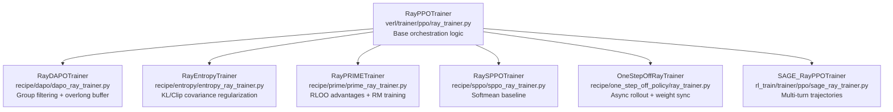
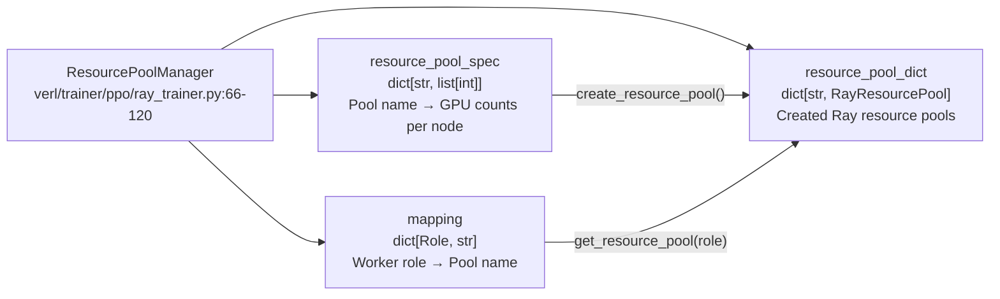
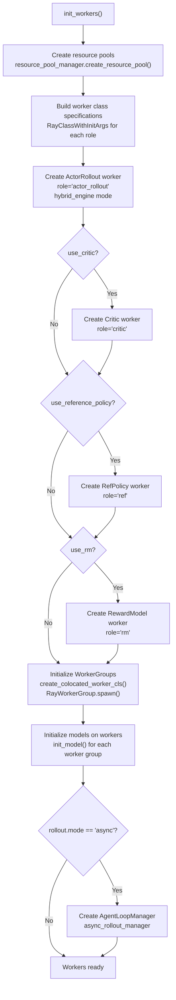
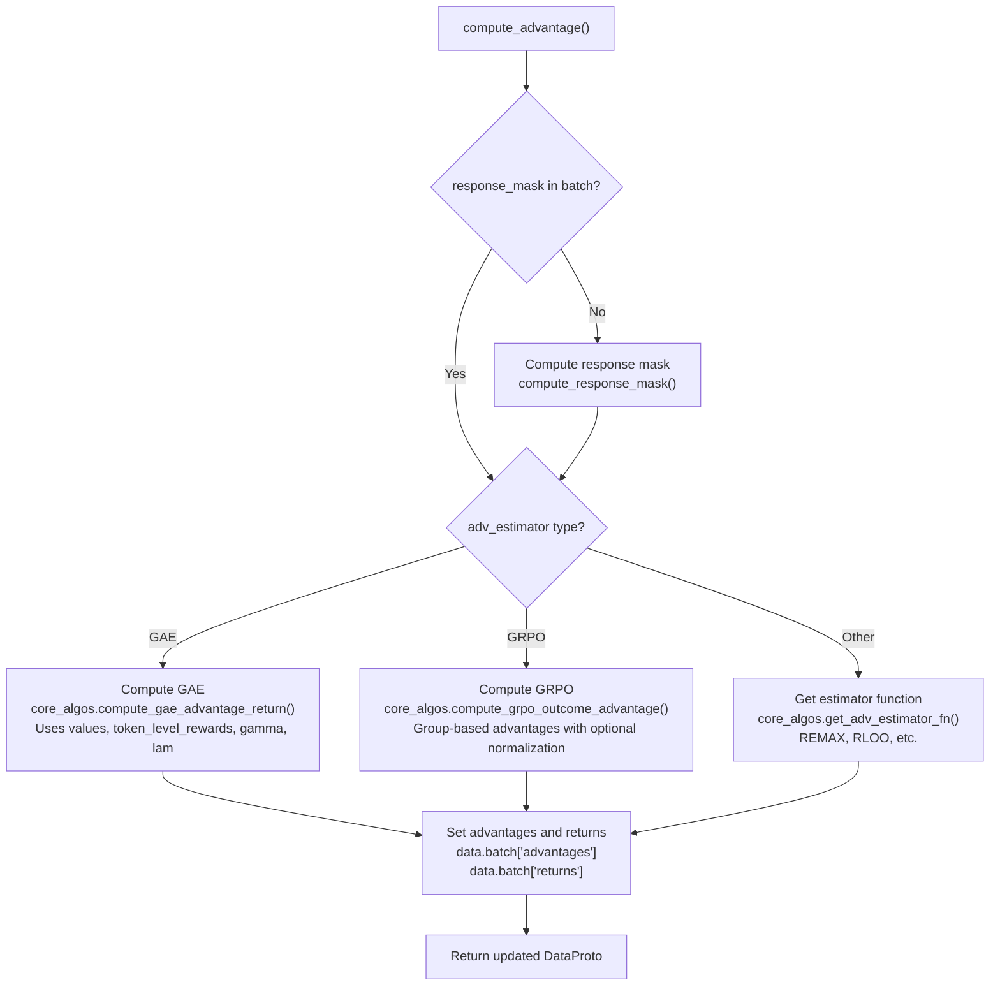
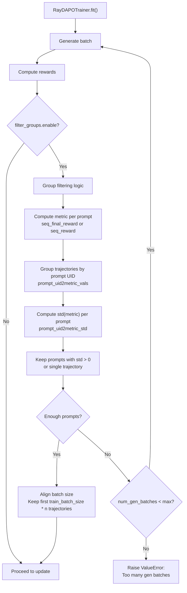
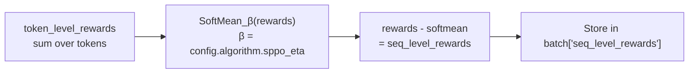
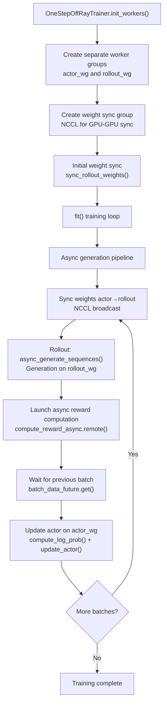
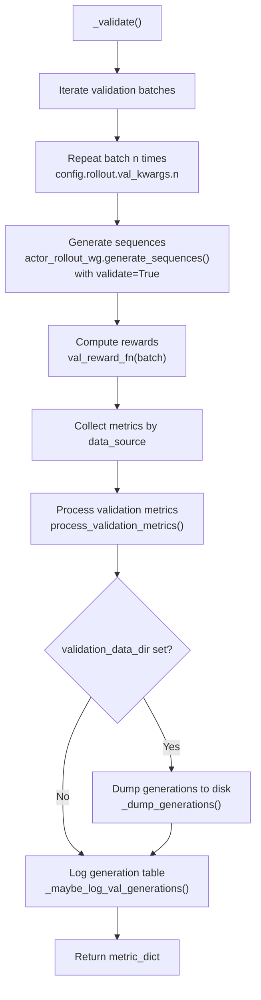

<!-- source: DeepWiki mcp.deepwiki.com · repo allenai/SAGE · page 5.1 Ray Trainers · fetched 2026-10-26 -->

# Ray Trainers

<details>
<summary>Relevant source files</summary>

The following files were used as context for generating this wiki page:

- [rl_train/trainer/ppo/sage_ray_trainer.py](rl_train/trainer/ppo/sage_ray_trainer.py)
- [verl/recipe/collabllm/reward_function.py](verl/recipe/collabllm/reward_function.py)
- [verl/recipe/dapo/dapo_ray_trainer.py](verl/recipe/dapo/dapo_ray_trainer.py)
- [verl/recipe/entropy/entropy_ray_trainer.py](verl/recipe/entropy/entropy_ray_trainer.py)
- [verl/recipe/one_step_off_policy/ray_trainer.py](verl/recipe/one_step_off_policy/ray_trainer.py)
- [verl/recipe/prime/prime_ray_trainer.py](verl/recipe/prime/prime_ray_trainer.py)
- [verl/recipe/sppo/sppo_ray_trainer.py](verl/recipe/sppo/sppo_ray_trainer.py)
- [verl/verl/trainer/ppo/ray_trainer.py](verl/verl/trainer/ppo/ray_trainer.py)

</details>


Ray Trainers are the orchestration layer for distributed reinforcement learning training in the SAGE/verl framework. They coordinate the execution of the PPO training pipeline across distributed Ray workers, managing resource allocation, worker groups, and the complete training loop from generation through policy updates.

For information about the distributed workers managed by trainers, see [Workers](#5.2). For details on the underlying training engines, see [Training Engines](#5.3). For checkpoint persistence, see [Checkpoint Management](#5.4).

## Purpose and Scope

Ray Trainers run on a single driver process (typically on CPU or a single GPU node) and orchestrate distributed training by:
- Managing Ray resource pools and worker groups for different roles (actor, critic, reference policy, reward model)
- Executing the training loop: generation → reward computation → advantage estimation → policy/value updates
- Handling checkpoint saving/loading and validation
- Collecting and logging training metrics
- Supporting multiple RL algorithms through a common interface

## Trainer Class Hierarchy

The framework implements a base trainer with algorithm-specific variants that customize the training logic.

**Trainer Class Hierarchy**



Sources: [verl/verl/trainer/ppo/ray_trainer.py:263-270](), [verl/recipe/dapo/dapo_ray_trainer.py:48](), [verl/recipe/entropy/entropy_ray_trainer.py:45](), [verl/recipe/prime/prime_ray_trainer.py:147](), [verl/recipe/sppo/sppo_ray_trainer.py:76](), [verl/recipe/one_step_off_policy/ray_trainer.py:95](), [rl_train/trainer/ppo/sage_ray_trainer.py:68]()

## Core Components

### ResourcePoolManager

The `ResourcePoolManager` manages Ray resource pools that define GPU allocation across nodes for different worker roles.

**ResourcePoolManager Structure**



The `resource_pool_spec` defines GPU allocation per node. For example:
```python
{
    "actor_rollout": [8, 8],  # 2 nodes, 8 GPUs each
    "critic": [4, 4]          # 2 nodes, 4 GPUs each
}
```

Sources: [verl/verl/trainer/ppo/ray_trainer.py:66-120]()

### RayPPOTrainer Initialization

The base trainer initializes with configuration, tokenizer, worker mappings, and resource management.

**Trainer Initialization Components**

| Component | Type | Purpose |
|-----------|------|---------|
| `config` | OmegaConf | Training configuration (algorithm, data, model, trainer settings) |
| `tokenizer` | PreTrainedTokenizer | Text encoding/decoding |
| `role_worker_mapping` | dict[Role, WorkerType] | Maps roles (Actor, Critic, etc.) to worker class implementations |
| `resource_pool_manager` | ResourcePoolManager | Manages Ray resource pools for distributed execution |
| `ray_worker_group_cls` | type[RayWorkerGroup] | Class for creating worker groups (default: RayWorkerGroup) |
| `reward_fn` | Callable | Function for computing training rewards |
| `val_reward_fn` | Callable | Function for computing validation rewards |
| `train_dataset` / `val_dataset` | Dataset | Training and validation datasets |

The constructor performs:
1. Store configuration and components
2. Create dataloader with StatefulDataLoader for checkpoint resume
3. Initialize KL controller if using KL penalty in rewards
4. Setup validation generations logger

Sources: [verl/verl/trainer/ppo/ray_trainer.py:273-342](), [verl/verl/trainer/ppo/ray_trainer.py:344-417]()

### Worker Initialization

The `init_workers()` method creates Ray resource pools and initializes worker groups for each role.

**Worker Initialization Flow**



Sources: [verl/verl/trainer/ppo/ray_trainer.py:662-767]()

## Training Loop Flow

The training loop orchestrates generation, reward computation, advantage estimation, and policy updates.

**Training Loop Pipeline (RayPPOTrainer.fit)**

```mermaid
graph TD
    Start["fit()"] --> LoadCkpt["Load checkpoint<br/>_load_checkpoint()"]
    LoadCkpt --> ValBefore{"val_before_train?"}
    ValBefore -->|Yes| InitVal["Run validation<br/>_validate()"]
    ValBefore -->|No| LoopStart
    InitVal --> LoopStart
    
    LoopStart["Iterate over epochs and batches"] --> PopKeys["Pop keys for generation<br/>input_ids, attention_mask, position_ids"]
    
    PopKeys --> Repeat["Repeat batch n times<br/>config.rollout.n"]
    
    Repeat --> Generate["Generate sequences<br/>actor_rollout_wg.generate_sequences()<br/>or async_rollout_manager.generate_sequences()"]
    
    Generate --> ComputeReward["Compute rewards<br/>rm_wg.compute_rm_score() + reward_fn()"]
    
    ComputeReward --> Balance{"balance_batch?"}
    Balance -->|Yes| BalanceTokens["Balance tokens across DP ranks<br/>_balance_batch()"]
    Balance -->|No| OldLogProb
    BalanceTokens --> OldLogProb
    
    OldLogProb["Recompute log probs<br/>actor_rollout_wg.compute_log_prob()"]
    
    OldLogProb --> RefLogProb{"use_reference_policy?"}
    RefLogProb -->|Yes| ComputeRef["Compute ref log probs<br/>ref_policy_wg.compute_ref_log_prob()"]
    RefLogProb -->|No| Values
    ComputeRef --> Values
    
    Values{"use_critic?"}
    Values -->|Yes| ComputeVal["Compute values<br/>critic_wg.compute_values()"]
    Values -->|No| Adv
    ComputeVal --> Adv
    
    Adv["Compute advantages<br/>compute_advantage() on driver"]
    
    Adv --> UpdateCritic{"use_critic?"}
    UpdateCritic -->|Yes| CriticUpdate["Update critic<br/>critic_wg.update_critic()"]
    UpdateCritic -->|No| UpdateActor
    CriticUpdate --> UpdateActor
    
    UpdateActor["Update actor<br/>actor_rollout_wg.update_actor()"]
    
    UpdateActor --> Validate{"Time to validate?"}
    Validate -->|Yes| RunVal["Run validation<br/>_validate()"]
    Validate -->|No| Save
    RunVal --> Save
    
    Save{"Time to save?"}
    Save -->|Yes| SaveCkpt["Save checkpoint<br/>_save_checkpoint()"]
    Save -->|No| Log
    SaveCkpt --> Log
    
    Log["Log metrics<br/>Tracking.log()"]
    
    Log --> CheckDone{"Last step?"}
    CheckDone -->|Yes| End["Training complete"]
    CheckDone -->|No| LoopStart
```



Sources: [verl/verl/trainer/ppo/ray_trainer.py:1456-1743]()

### Key Training Loop Functions

| Function | Location | Purpose |
|----------|----------|---------|
| `apply_kl_penalty()` | [verl/verl/trainer/ppo/ray_trainer.py:122-162]() | Apply KL divergence penalty between reference and current policy to token-level rewards |
| `compute_response_mask()` | [verl/verl/trainer/ppo/ray_trainer.py:164-180]() | Extract attention mask for response tokens only |
| `compute_advantage()` | [verl/verl/trainer/ppo/ray_trainer.py:182-261]() | Compute advantage estimates using GAE, GRPO, REINFORCE++, RLOO, etc. |

Sources: [verl/verl/trainer/ppo/ray_trainer.py:122-261]()

## Advantage Estimation Methods

The `compute_advantage()` function supports multiple advantage estimators, configured via `config.algorithm.adv_estimator`.

**Advantage Estimators**

| Estimator | Enum Value | Implementation | Description |
|-----------|------------|----------------|-------------|
| GAE | `AdvantageEstimator.GAE` | `core_algos.compute_gae_advantage_return()` | Generalized Advantage Estimation with value function |
| GRPO | `AdvantageEstimator.GRPO` | `core_algos.compute_grpo_outcome_advantage()` | Group Relative Policy Optimization (group-based advantages) |
| REINFORCE++ | Various | `core_algos.get_adv_estimator_fn()` | REINFORCE variants (REMAX, RLOO, etc.) |

The advantage computation flow:



For GAE, the computation uses:
- `token_level_rewards`: Token-level reward signals (with optional KL penalty applied)
- `values`: Value function predictions from critic
- `response_mask`: Mask indicating valid response tokens
- `gamma`: Discount factor (typically 1.0)
- `lam`: GAE lambda parameter (typically 1.0)

Sources: [verl/verl/trainer/ppo/ray_trainer.py:182-261]()

## Trainer Variants

### RayDAPOTrainer (DAPO)

Implements Diversity-Aware Policy Optimization with group filtering to ensure diverse training data.

**DAPO Specific Features**



Key configuration:
- `algorithm.filter_groups.enable`: Enable group filtering
- `algorithm.filter_groups.metric`: Metric to use (`seq_final_reward` or `seq_reward`)
- `algorithm.filter_groups.max_num_gen_batches`: Max generation batches before error (0 = unlimited)

Sources: [verl/recipe/dapo/dapo_ray_trainer.py:48-409]()

### RayEntropyTrainer (Entropy Regularization)

Similar to base trainer but focuses on KL/Clip covariance regularization methods. The main difference is in the algorithm configuration rather than major code changes to the training loop.

Sources: [verl/recipe/entropy/entropy_ray_trainer.py:45-348]()

### RayPRIMETrainer (PRIME)

Implements PRIME algorithm with RLOO (REINFORCE Leave-One-Out) advantages and integrated reward model training.

**PRIME Specific Components**

| Component | Implementation | Purpose |
|-----------|---------------|---------|
| Advantage estimation | `prime_core_algos.compute_rloo_advantage_return()` | RLOO-based advantage computation |
| Reward model update | `rm_wg.update_rm()` with various modes | Update reward model during training |
| Sample filtering | `filter_and_downsample()` | Filter samples based on accuracy and length |

The reward model update supports multiple modes:
- `none`: Forward pass only
- `after`: Update and return reward directly
- `before`: Update first, then forward pass
- `reverse`: Forward pass first, then update

Sources: [verl/recipe/prime/prime_ray_trainer.py:147-573]()

### RaySPPOTrainer (Self-Play PPO)

Implements Self-Play Policy Optimization with softmean baseline.

**SPPO Advantage Computation**



The softmean function: `SoftMean_β(x) = (1/β) * log((1/n) * Σ exp(β * x_i))`

Sources: [verl/recipe/sppo/sppo_ray_trainer.py:50-74](), [verl/recipe/sppo/sppo_ray_trainer.py:68-73]()

### OneStepOffRayTrainer (Asynchronous Off-Policy)

Implements one-step off-policy training with separated actor and rollout workers, enabling asynchronous generation with weight synchronization.

**One-Step Off-Policy Architecture**



Key methods:
- `_async_gen_next_batch()`: Launch asynchronous generation and optionally async reward computation
- `sync_rollout_weights()`: Synchronize weights from actor to rollout workers via NCCL
- `create_weight_sync_group()`: Setup NCCL communication group

Sources: [verl/recipe/one_step_off_policy/ray_trainer.py:95-665]()

### SAGE_RayPPOTrainer

Extends base trainer to support multi-turn trajectory collection for agent-based training scenarios.

Key addition:
- `traj_collector`: Optional `TrajectoryCollector` for multi-turn interactions
- Modified generation flow to call `traj_collector.multi_turn_loop()` instead of direct generation

Sources: [rl_train/trainer/ppo/sage_ray_trainer.py:68-531]()

## Validation

The `_validate()` method runs validation on the validation dataset using the validation reward function.

**Validation Flow**



Validation metrics are organized by:
- `data_source`: The source of validation data
- Variable: The metric variable (e.g., `acc`, `reward`)
- Metric type: `mean`, `maj` (majority), `best`, etc.

The metrics are categorized into:
- `val-core`: Core metrics (mean/maj/best at max n)
- `val-aux`: Auxiliary metrics

Sources: [verl/verl/trainer/ppo/ray_trainer.py:519-661]()

## Checkpoint Management

The trainer handles checkpoint saving and loading for all components.

**Checkpoint Structure**

```
checkpoint_dir/
├── global_step_{step}/
│   ├── actor/           # Actor model checkpoint
│   ├── critic/          # Critic model checkpoint (if enabled)
│   ├── reward/          # Reward model checkpoint (PRIME only)
│   └── data.pt          # Dataloader state
└── latest_checkpointed_iteration.txt  # Tracks latest step
```

**Checkpoint Save Process**

| Component | Method | Files Created |
|-----------|--------|---------------|
| Actor | `actor_rollout_wg.save_checkpoint()` | Model weights, optimizer state |
| Critic | `critic_wg.save_checkpoint()` | Model weights, optimizer state |
| Reward Model | `rm_wg.save_checkpoint()` | Model weights (PRIME only) |
| Dataloader | `torch.save()` | Sampler state for resume |

Configuration:
- `trainer.default_local_dir`: Local checkpoint directory
- `trainer.default_hdfs_dir`: Remote HDFS directory (optional)
- `trainer.save_freq`: Checkpoint save frequency (steps)
- `trainer.max_actor_ckpt_to_keep`: Max actor checkpoints to retain
- `trainer.max_critic_ckpt_to_keep`: Max critic checkpoints to retain

Sources: [verl/verl/trainer/ppo/ray_trainer.py:768-825](), [verl/verl/trainer/ppo/ray_trainer.py:826-911]()

## Configuration and Usage

The trainer is configured via Hydra/OmegaConf with the following key sections:

**Core Configuration Sections**

| Section | Purpose | Key Parameters |
|---------|---------|----------------|
| `trainer` | Trainer settings | `total_epochs`, `save_freq`, `test_freq`, `logger`, `balance_batch` |
| `data` | Data configuration | `train_files`, `val_files`, `train_batch_size`, `val_batch_size` |
| `algorithm` | Algorithm settings | `adv_estimator`, `gamma`, `lam`, `use_kl_in_reward`, `kl_penalty` |
| `actor_rollout_ref` | Actor/rollout config | `model`, `rollout`, `actor`, `hybrid_engine` |
| `critic` | Critic configuration | `model`, `optim` |
| `reward_model` | Reward model config | `enable`, `model`, `launch_reward_fn_async` |
| `global_profiler` | Profiling settings | `steps`, `tool`, `tool_config` |

**Example Usage Pattern**

```python
# Create role-to-worker mapping
role_worker_mapping = {
    Role.ActorRollout: ActorRolloutRefWorker,
    Role.Critic: CriticWorker,
    Role.RefPolicy: ReferenceWorker,
}

# Create resource pool manager
resource_pool_manager = ResourcePoolManager(
    resource_pool_spec={
        "actor_rollout": [8, 8],  # 2 nodes, 8 GPUs each
        "critic": [4, 4],
    },
    mapping={
        Role.ActorRollout: "actor_rollout",
        Role.Critic: "critic",
        Role.RefPolicy: "actor_rollout",  # Co-locate with actor
    }
)

# Create trainer
trainer = RayPPOTrainer(
    config=config,
    tokenizer=tokenizer,
    role_worker_mapping=role_worker_mapping,
    resource_pool_manager=resource_pool_manager,
    reward_fn=reward_fn,
    val_reward_fn=val_reward_fn,
)

# Initialize workers
trainer.init_workers()

# Run training
trainer.fit()
```

Sources: [verl/verl/trainer/ppo/ray_trainer.py:273-342]()

---

