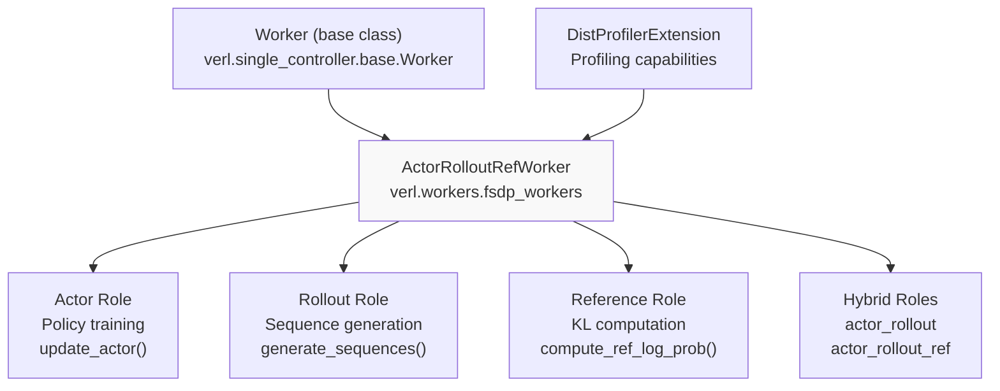
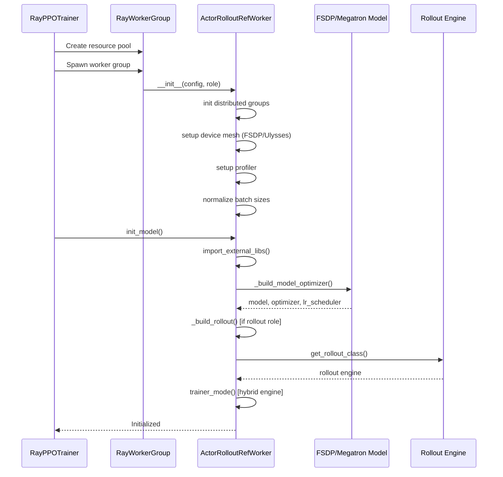
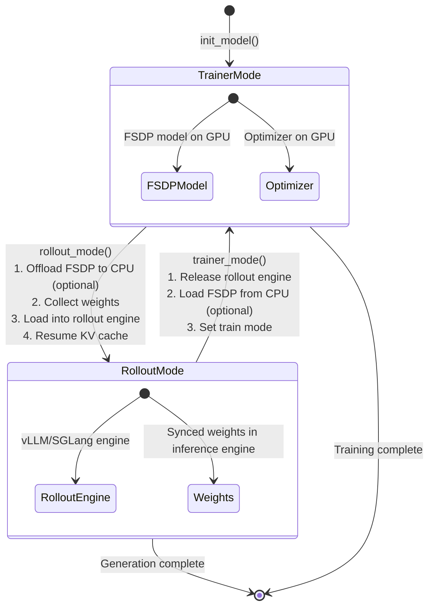
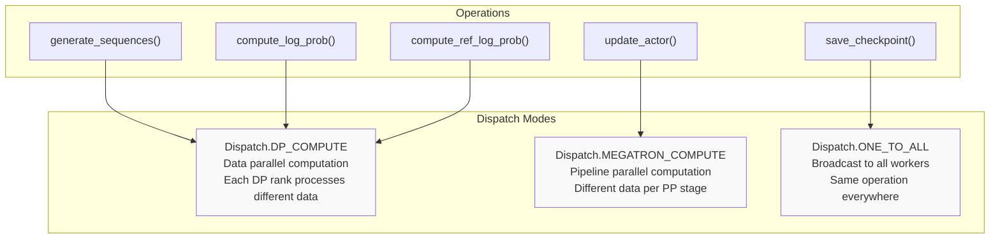

<!-- source: DeepWiki mcp.deepwiki.com · repo allenai/SAGE · page 5.2 Workers · fetched 2026-10-26 -->

# Workers

<details>
<summary>Relevant source files</summary>

The following files were used as context for generating this wiki page:

- [rl_train/trainer/ppo/sage_ray_trainer.py](rl_train/trainer/ppo/sage_ray_trainer.py)
- [verl/recipe/collabllm/reward_function.py](verl/recipe/collabllm/reward_function.py)
- [verl/recipe/dapo/dapo_ray_trainer.py](verl/recipe/dapo/dapo_ray_trainer.py)
- [verl/recipe/entropy/entropy_ray_trainer.py](verl/recipe/entropy/entropy_ray_trainer.py)
- [verl/recipe/one_step_off_policy/README.md](verl/recipe/one_step_off_policy/README.md)
- [verl/recipe/one_step_off_policy/ray_trainer.py](verl/recipe/one_step_off_policy/ray_trainer.py)
- [verl/recipe/prime/prime_ray_trainer.py](verl/recipe/prime/prime_ray_trainer.py)
- [verl/recipe/sppo/sppo_ray_trainer.py](verl/recipe/sppo/sppo_ray_trainer.py)
- [verl/scripts/legacy_model_merger.py](verl/scripts/legacy_model_merger.py)
- [verl/verl/model_merger/fsdp_model_merger.py](verl/verl/model_merger/fsdp_model_merger.py)
- [verl/verl/model_merger/megatron_model_merger.py](verl/verl/model_merger/megatron_model_merger.py)
- [verl/verl/models/llama/megatron/checkpoint_utils/llama_loader_depracated.py](verl/verl/models/llama/megatron/checkpoint_utils/llama_loader_depracated.py)
- [verl/verl/trainer/ppo/ray_trainer.py](verl/verl/trainer/ppo/ray_trainer.py)
- [verl/verl/workers/fsdp_workers.py](verl/verl/workers/fsdp_workers.py)

</details>


Workers are the distributed computing units in verl that execute RLHF training tasks across multiple GPUs and nodes. They encapsulate model instances, handle distributed communication, and perform specific roles such as policy training, sequence generation, and reward computation. For information about how workers are orchestrated by trainers, see [Ray Trainers](#5.1). For details on the underlying training engines, see [Training Engines](#5.3).

## Worker Architecture

Workers in verl are implemented as Ray actors that can be instantiated with different roles. The primary worker class is `ActorRolloutRefWorker`, which provides a unified interface for actor (policy training), rollout (sequence generation), and reference policy computation.

### Worker Class Hierarchy



**Sources:** [verl/verl/workers/fsdp_workers.py:133-184]()

### Worker Roles

Workers can be instantiated with five distinct roles, determined by the `role` parameter passed during initialization:

| Role | Purpose | Key Methods | Used For |
|------|---------|-------------|----------|
| `actor` | Policy model training | `update_actor()`, `compute_log_prob()` | Gradient updates, policy optimization |
| `rollout` | Sequence generation | `generate_sequences()` | Generating responses during inference |
| `ref` | Reference policy | `compute_ref_log_prob()` | Computing KL divergence for regularization |
| `actor_rollout` | Combined actor + rollout | Both actor and rollout methods | Hybrid engine mode |
| `actor_rollout_ref` | All three roles | All methods | Full hybrid engine with reference |

**Sources:** [verl/verl/workers/fsdp_workers.py:183-188]()

## Worker Initialization Flow

The initialization of workers follows a multi-stage process involving configuration, distributed setup, model building, and optional rollout engine setup.



**Sources:** [verl/verl/workers/fsdp_workers.py:139-267](), [verl/verl/workers/fsdp_workers.py:756-805]()

### Stage 1: Configuration and Distributed Setup

During `__init__`, the worker performs critical setup:

```python
# Initialize distributed process group if not already done
if not torch.distributed.is_initialized():
    torch.distributed.init_process_group(
        backend=f"cpu:gloo,{get_device_name()}:{get_nccl_backend()}",
        rank=rank, world_size=world_size
    )

# Build FSDP device mesh
self.device_mesh = create_device_mesh(
    world_size=world_size, 
    fsdp_size=self.config.actor.fsdp_config.fsdp_size
)

# Build Ulysses sequence parallel device mesh if enabled
if self.ulysses_sequence_parallel_size > 1:
    self.ulysses_device_mesh = init_device_mesh(
        device_name, 
        mesh_shape=(dp, self.ulysses_sequence_parallel_size),
        mesh_dim_names=["dp", "sp"]
    )
```

**Sources:** [verl/verl/workers/fsdp_workers.py:145-168]()

### Stage 2: Batch Size Normalization

Workers normalize batch sizes based on distributed parallelism settings:

```python
# For actor role
self.config.actor.ppo_mini_batch_size *= self.config.rollout.n
self.config.actor.ppo_mini_batch_size //= (
    self.device_mesh.size() // self.ulysses_sequence_parallel_size
)

# For rollout role
if self.config.rollout.log_prob_micro_batch_size is not None:
    self.config.rollout.log_prob_micro_batch_size //= (
        self.device_mesh.size() // self.ulysses_sequence_parallel_size
    )
```

This ensures that batch sizes are correctly distributed across data parallel ranks.

**Sources:** [verl/verl/workers/fsdp_workers.py:233-266]()

### Stage 3: Model Building

The `_build_model_optimizer` method handles model instantiation:

```mermaid
graph LR
    Start["_build_model_optimizer()"] --> LoadHF["Load HuggingFace config<br/>AutoConfig.from_pretrained()"]
    LoadHF --> InitMeta["Initialize model with meta tensors<br/>get_init_weight_context_manager()"]
    InitMeta --> CreateModel["Create model instance<br/>AutoModelForCausalLM.from_pretrained()"]
    CreateModel --> ApplyPatches["Apply monkey patches<br/>apply_monkey_patch()"]
    ApplyPatches --> ApplyLoRA["Apply LoRA if enabled<br/>get_peft_model()"]
    ApplyLoRA --> WrapFSDP["Wrap with FSDP/FSDP2<br/>FSDP() or apply_fsdp2()"]
    WrapFSDP --> CreateOptim["Create optimizer and scheduler<br/>AdamW + lr_scheduler"]
    CreateOptim --> Return["Return model, optimizer, scheduler"]
    
    style WrapFSDP fill:#f9f9f9
```



**Sources:** [verl/verl/workers/fsdp_workers.py:268-577]()

Key decisions in model building:

1. **Meta Tensor Initialization**: Models are first created on meta device to avoid memory overhead, then materialized with actual weights
2. **Monkey Patching**: Optimizations like Flash Attention, fused kernels, and Ulysses SP are applied
3. **LoRA**: If `lora_rank > 0`, PEFT wrappers are applied to enable parameter-efficient training
4. **FSDP Wrapping**: Models are wrapped with either FSDP1 or FSDP2 based on strategy configuration
5. **Vision Tower Freezing**: For multimodal models, vision encoders can be frozen while keeping text parameters trainable

**Sources:** [verl/verl/workers/fsdp_workers.py:301-530]()

### Stage 4: Rollout Engine Setup

For workers with rollout capabilities, a rollout engine is created:

```python
self.rollout = get_rollout_class(rollout_config.name, rollout_config.mode)(
    config=rollout_config,
    model_config=model_config,
    device_mesh=rollout_device_mesh
)
```

Supported rollout engines include:
- **HF (Hugging Face)**: Native transformers generation
- **vLLM**: High-throughput inference with PagedAttention
- **SGLang**: Optimized generation with RadixAttention

**Sources:** [verl/verl/workers/fsdp_workers.py:579-653]()

## Worker Operations

Workers expose several key methods that are called by trainers during the RLHF training loop:

### Generation Operations

```python
@register(dispatch_mode=Dispatch.DP_COMPUTE)
def generate_sequences(self, prompts: DataProto) -> DataProto:
    """Generate sequences using the rollout engine.
    
    Returns DataProto with:
    - responses: generated token IDs
    - old_log_probs: log probabilities from rollout model
    - attention_mask: attention mask for full sequence
    """
```

The generation flow involves:
1. Switch to rollout mode (if hybrid engine)
2. Call rollout engine's `generate_sequences()`
3. Return responses with metadata

**Sources:** [verl/verl/workers/fsdp_workers.py:1105-1205]()

### Log Probability Computation

```python
@register(dispatch_mode=Dispatch.DP_COMPUTE)
def compute_log_prob(self, data: DataProto) -> DataProto:
    """Recompute log probabilities and entropy for generated sequences.
    
    Returns DataProto with:
    - old_log_probs: recomputed log probs from current actor
    - entropys: token-level entropy values
    """
```

This is crucial for PPO as it recomputes log probabilities with the current policy after generation.

**Sources:** [verl/verl/workers/fsdp_workers.py:1207-1291]()

### Reference Log Probability Computation

```python
@register(dispatch_mode=Dispatch.DP_COMPUTE)
def compute_ref_log_prob(self, data: DataProto) -> DataProto:
    """Compute log probabilities from frozen reference policy.
    
    Returns DataProto with:
    - ref_log_prob: log probs from reference model
    """
```

For KL penalty computation, workers can compute reference log probabilities either from a separate reference worker or from the base model when using LoRA.

**Sources:** [verl/verl/workers/fsdp_workers.py:1293-1411]()

### Actor Update

```python
@register(dispatch_mode=Dispatch.MEGATRON_COMPUTE)
def update_actor(self, data: DataProto) -> DataProto:
    """Perform policy gradient update on the actor model.
    
    Input DataProto contains:
    - advantages: computed advantage estimates
    - old_log_probs: log probs from generation
    - responses, attention_mask, etc.
    
    Returns DataProto with metrics in meta_info
    """
```

The actor update involves:
1. Multiple PPO epochs over the data
2. Mini-batch gradient accumulation
3. Gradient clipping
4. Optimizer step and learning rate scheduling

**Sources:** [verl/verl/workers/fsdp_workers.py:1413-1677]()

## Hybrid Engine Mode Switching

For hybrid engine configurations (where actor and rollout share resources), workers implement efficient mode switching between training and inference:



**Sources:** [verl/verl/workers/fsdp_workers.py:655-755]()

### Rollout Mode Transition

```python
async def rollout_mode(self):
    """Context switch to rollout mode for generation."""
    # 1. Aggressive cache clearing
    aggressive_empty_cache(force_sync=True)
    
    # 2. Load FSDP model to GPU if offloaded
    if self._is_offload_param:
        load_fsdp_model_to_gpu(self.actor_module_fsdp)
    
    # 3. Collect model weights (handling LoRA separately)
    if hasattr(peft_model, "peft_config"):  # LoRA case
        params = collect_lora_params(
            module=self.actor_module_fsdp,
            layered_summon=self.layered_summon,
            base_sync_done=self.base_sync_done
        )
    else:
        params = self.actor_module_fsdp.state_dict()
    
    # 4. Offload FSDP model to CPU
    if self._is_offload_param:
        offload_fsdp_model_to_cpu(self.actor_module_fsdp)
    
    # 5. Resume rollout engine and update weights
    await self.rollout.resume(tags=["weights"])
    await self.rollout.update_weights(per_tensor_param)
    await self.rollout.resume(tags=["kv_cache"])
    
    # 6. Restore generation random state
    self.torch_random_states = get_torch_device().get_rng_state()
    get_torch_device().set_rng_state(self.gen_random_states)
```

**Sources:** [verl/verl/workers/fsdp_workers.py:655-737]()

### Trainer Mode Transition

```python
async def trainer_mode(self):
    """Context switch to trainer mode for policy updates."""
    # 1. Release rollout engine resources
    if self.config.rollout.free_cache_engine:
        await self.rollout.release()
    
    # 2. Set model to training mode
    self.actor_module_fsdp.train()
    
    # 3. Clear cache
    aggressive_empty_cache(force_sync=True)
    
    # 4. Enable expandable segments for training
    set_expandable_segments(True)
    
    # 5. Restore training random state
    self.gen_random_states = get_torch_device().get_rng_state()
    get_torch_device().set_rng_state(self.torch_random_states)
```

**Sources:** [verl/verl/workers/fsdp_workers.py:738-754]()

## Advanced Worker Features

### Parameter Offloading

Workers support offloading parameters and optimizer states to CPU to reduce GPU memory usage:

```python
# Enable parameter offloading
self._is_offload_param = self.config.actor.fsdp_config.get("param_offload", False)
self._is_offload_optimizer = self.config.actor.fsdp_config.get("optimizer_offload", False)

# During rollout mode
if self._is_offload_param:
    load_fsdp_model_to_gpu(self.actor_module_fsdp)  # Load before generation
    offload_fsdp_model_to_cpu(self.actor_module_fsdp)  # Offload after collection

# During training
if self._is_offload_optimizer:
    load_fsdp_optimizer(self.actor_optimizer)  # Load before training
    offload_fsdp_optimizer(self.actor_optimizer)  # Offload after training
```

This is particularly useful for large models when memory is constrained.

**Sources:** [verl/verl/workers/fsdp_workers.py:223-231](), [verl/verl/workers/fsdp_workers.py:660-700]()

### LoRA Support

Workers handle LoRA (Low-Rank Adaptation) training with special logic:

1. **LoRA Application**: During model building, PEFT wrappers are applied if `lora_rank > 0`
2. **Parameter Collection**: Only LoRA parameters are collected for weight syncing
3. **Base Model Handling**: Base model weights can be synced separately for certain rollout engines
4. **Reference Policy**: When using LoRA, the reference policy is computed from the base model (without LoRA adapters)

```python
if self._is_lora:
    actor_module.enable_input_require_grads()
    lora_config = {
        "task_type": TaskType.CAUSAL_LM,
        "r": self.config.model.lora_rank,
        "lora_alpha": self.config.model.lora_alpha,
        "target_modules": self.config.model.target_modules,
    }
    actor_module = get_peft_model(actor_module, LoraConfig(**lora_config))
```

**Sources:** [verl/verl/workers/fsdp_workers.py:422-434](), [verl/verl/workers/fsdp_workers.py:664-696]()

### Ulysses Sequence Parallelism

Workers support Ulysses sequence parallelism for handling long contexts:

```python
# Setup Ulysses device mesh
if self.ulysses_sequence_parallel_size > 1:
    self.ulysses_device_mesh = init_device_mesh(
        device_name,
        mesh_shape=(dp, self.ulysses_sequence_parallel_size),
        mesh_dim_names=["dp", "sp"]
    )

# Register dispatch with sequence parallel awareness
if self.ulysses_device_mesh is not None:
    is_collect = self.ulysses_device_mesh["sp"].get_local_rank() == 0
    self._register_dispatch_collect_info(
        "actor", 
        dp_rank=self.ulysses_device_mesh["dp"].get_local_rank(),
        is_collect=is_collect
    )
```

Ulysses SP shards the sequence dimension across multiple GPUs, enabling training on very long sequences.

**Sources:** [verl/verl/workers/fsdp_workers.py:162-179]()

### Profiling Integration

Workers integrate with the distributed profiling system:

```python
profiler_config = omega_conf_to_dataclass(omega_profiler_config, ProfilerConfig)
DistProfilerExtension.__init__(
    self, 
    DistProfiler(rank=self.rank, config=profiler_config, tool_config=tool_config)
)

# Use profiler in operations
with self.profiler.profile("generate_sequences"):
    result = self.rollout.generate_sequences(prompts)
```

Supported profiling tools include:
- **NPU profiler**: For Ascend hardware
- **nsys**: NVIDIA Nsight Systems
- **torch profiler**: PyTorch native profiler
- **torch_memory**: PyTorch memory profiler

**Sources:** [verl/verl/workers/fsdp_workers.py:212-221]()

### Checkpoint Management

Workers implement distributed checkpoint saving and loading:

```python
@register(dispatch_mode=Dispatch.ONE_TO_ALL)
def save_checkpoint(self, local_path: str, remote_path: str, global_steps: int):
    """Save distributed checkpoint to local/remote storage."""
    self.ckpt_manager.save_checkpoint(
        self.actor_module_fsdp,
        self.actor_optimizer,
        lr_scheduler=self.actor_lr_scheduler,
        step=global_steps
    )

@register(dispatch_mode=Dispatch.ONE_TO_ALL)
def load_checkpoint(self, load_dir: str):
    """Load distributed checkpoint from storage."""
    self.ckpt_manager.load_checkpoint(
        self.actor_module_fsdp,
        self.actor_optimizer,
        lr_scheduler=self.actor_lr_scheduler
    )
```

Checkpoint managers handle FSDP and Megatron checkpoint formats transparently. For details on checkpoint formats and merging, see [Checkpoint Management](#5.4).

**Sources:** [verl/verl/workers/fsdp_workers.py:1679-1759]()

## Worker Communication Patterns

Workers use different communication patterns based on the operation:



**Sources:** [verl/verl/workers/fsdp_workers.py:1105](), [verl/verl/workers/fsdp_workers.py:1207](), [verl/verl/workers/fsdp_workers.py:1413](), [verl/verl/workers/fsdp_workers.py:1679]()

### Data Parallel Compute Pattern

For operations like `generate_sequences`, `compute_log_prob`, and `compute_ref_log_prob`:
- Each data parallel rank receives a different subset of the batch
- Workers process their subset independently
- Results are automatically collected and concatenated by the dispatcher

### Megatron Compute Pattern

For operations like `update_actor` with pipeline parallelism:
- Different pipeline stages process different micro-batches
- Forward and backward passes are pipelined across stages
- Gradients are synchronized at the end of each mini-batch

### Broadcast Pattern

For operations like `save_checkpoint` and `load_checkpoint`:
- All workers execute the same operation
- No data distribution is performed
- Typically used for control operations

**Sources:** [verl/single_controller/base/decorator.py]() (dispatch implementation)

---

