<!-- source: DeepWiki mcp.deepwiki.com · repo allenai/SAGE · page 5.3 Training Engines · fetched 2026-10-26 -->

# Training Engines

<details>
<summary>Relevant source files</summary>

The following files were used as context for generating this wiki page:

- [verl/recipe/one_step_off_policy/README.md](verl/recipe/one_step_off_policy/README.md)
- [verl/scripts/legacy_model_merger.py](verl/scripts/legacy_model_merger.py)
- [verl/verl/model_merger/fsdp_model_merger.py](verl/verl/model_merger/fsdp_model_merger.py)
- [verl/verl/model_merger/megatron_model_merger.py](verl/verl/model_merger/megatron_model_merger.py)
- [verl/verl/models/llama/megatron/checkpoint_utils/llama_loader_depracated.py](verl/verl/models/llama/megatron/checkpoint_utils/llama_loader_depracated.py)
- [verl/verl/third_party/sglang/parallel_state.py](verl/verl/third_party/sglang/parallel_state.py)
- [verl/verl/utils/fsdp_utils.py](verl/verl/utils/fsdp_utils.py)
- [verl/verl/workers/engine/base.py](verl/verl/workers/engine/base.py)
- [verl/verl/workers/engine/fsdp/transformer_impl.py](verl/verl/workers/engine/fsdp/transformer_impl.py)
- [verl/verl/workers/engine/megatron/transformer_impl.py](verl/verl/workers/engine/megatron/transformer_impl.py)
- [verl/verl/workers/fsdp_workers.py](verl/verl/workers/fsdp_workers.py)
- [verl/verl/workers/reward_model/megatron/reward_model.py](verl/verl/workers/reward_model/megatron/reward_model.py)
- [verl/verl/workers/sharding_manager/fsdp_vllm.py](verl/verl/workers/sharding_manager/fsdp_vllm.py)

</details>


Training engines are the core execution components that encapsulate model training logic, providing a unified interface for forward-backward passes, optimization, and checkpoint management across different distributed training strategies. This document covers the engine abstraction layer, FSDP and Megatron implementations, and their integration with the worker system.

For information about how engines are instantiated and used within workers, see [Workers](#5.2). For checkpoint format details and conversion utilities, see [Checkpoint Management](#5.4).

---

## Engine Architecture Overview

The training engine architecture provides a backend-agnostic interface for model training operations. Engines handle device management, distributed communication, mixed precision, gradient accumulation, and checkpoint persistence.

### BaseEngine Interface

The abstract `BaseEngine` class defines the contract that all engine implementations must fulfill. Key responsibilities include:

| Responsibility | Methods |
|---------------|---------|
| Initialization | `initialize()` |
| Mode Switching | `train_mode()`, `eval_mode()` |
| Training Step | `forward_backward_batch()`, `train_batch()`, `infer_batch()` |
| Optimization | `optimizer_zero_grad()`, `optimizer_step()`, `lr_scheduler_step()` |
| Checkpoint I/O | `save_checkpoint()`, `load_checkpoint()` |
| Device Management | `to()` |
| Data Parallel Info | `get_data_parallel_size()`, `get_data_parallel_rank()`, `get_data_parallel_group()` |

**Engine Lifecycle Diagram**

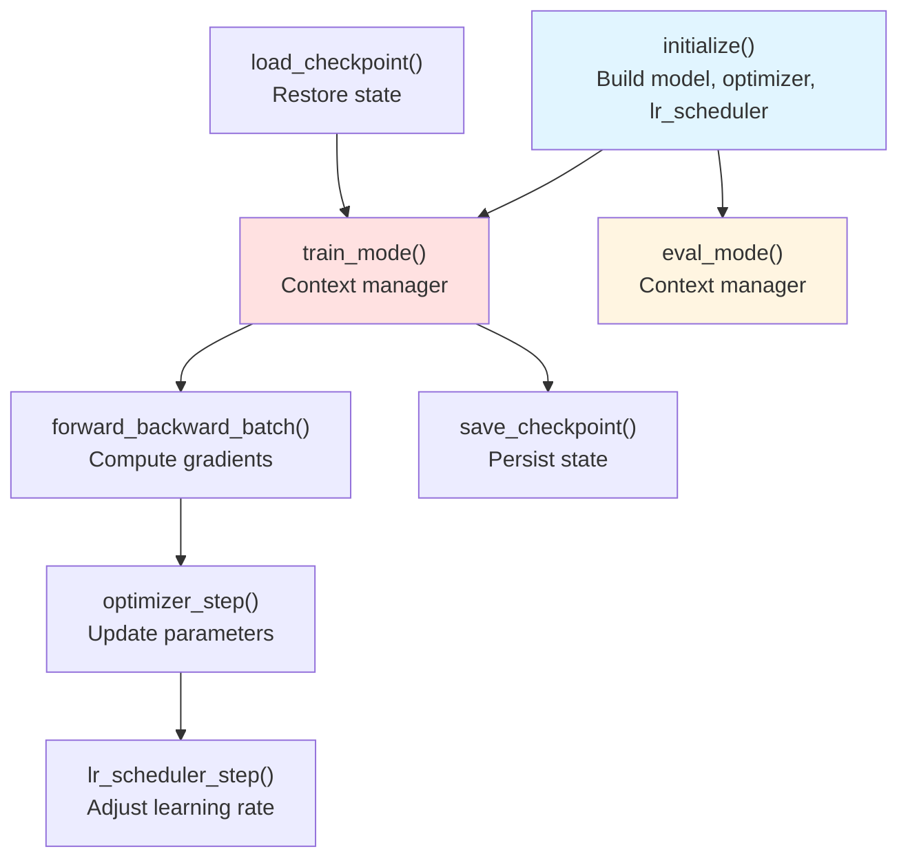

Sources: [verl/verl/workers/engine/base.py:26-191]()

### EngineRegistry System

The `EngineRegistry` provides dynamic engine instantiation based on model type, backend, and device. Engines self-register using the `@EngineRegistry.register()` decorator.

**Registry Structure**

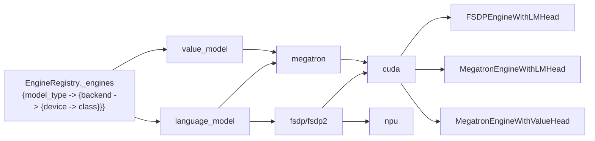

Engine registration example from code:

```python
@EngineRegistry.register(model_type="language_model", backend=["fsdp", "fsdp2"], device=["cuda", "npu"])
class FSDPEngineWithLMHead(FSDPEngine):
    # Implementation
```

Sources: [verl/verl/workers/engine/base.py:193-264](), [verl/verl/workers/engine/fsdp/transformer_impl.py:701-702](), [verl/verl/workers/engine/megatron/transformer_impl.py:510-511]()

---

## FSDP Engine Implementation

The `FSDPEngine` implements training using PyTorch's Fully Sharded Data Parallel (FSDP), supporting both FSDP v1 and FSDP v2 (fully_shard API). It manages device meshes for data parallelism and sequence parallelism (Ulysses).

### Device Mesh Initialization

FSDP engines create device meshes for sharding and sequence parallelism:

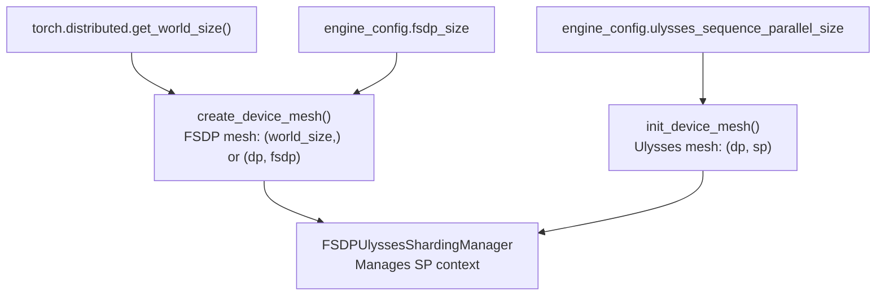

The device mesh determines the sharding strategy:
- 1-D mesh → `ShardingStrategy.FULL_SHARD` (pure FSDP)
- 2-D mesh → `ShardingStrategy.HYBRID_SHARD` (DDP + FSDP)

Sources: [verl/verl/workers/engine/fsdp/transformer_impl.py:167-183](), [verl/verl/workers/engine/fsdp/utils.py:8-25]()

### Model Building Pipeline

The engine builds models through several stages:

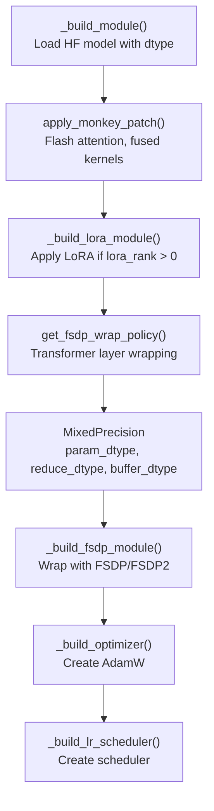

**Key Configuration Points:**

| Component | Configuration | Purpose |
|-----------|--------------|---------|
| `model_dtype` | `torch.float32` (training) or `torch.bfloat16` (inference) | Parameter storage precision |
| `mixed_precision` | `param_dtype`, `reduce_dtype`, `buffer_dtype` | Computation precision |
| `wrap_policy` | Transformer layer classes or size-based | FSDP unit granularity |
| `use_orig_params` | Boolean | Enable LoRA or frozen layers |
| `offload_policy` | `CPUOffloadPolicy` or None | CPU offloading for memory |

Sources: [verl/verl/workers/engine/fsdp/transformer_impl.py:185-428]()

### Forward-Backward Execution

FSDP engines process batches with automatic gradient accumulation:

**FSDP Forward-Backward Flow**

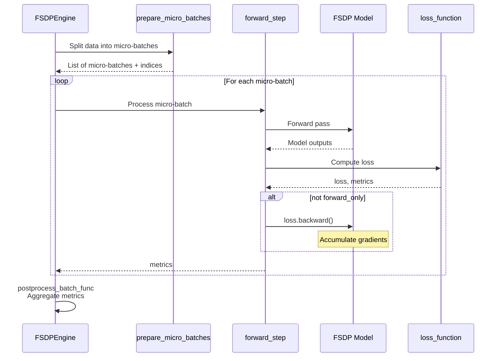

The `forward_backward_batch()` method handles:
1. **Batch preparation**: Split into micro-batches for gradient accumulation
2. **Loss scaling**: Scale by `local_micro_bsz / (global_bsz / dp_size)` to account for accumulation
3. **Gradient computation**: Call `loss.backward()` for each micro-batch
4. **Metric aggregation**: Combine metrics from all micro-batches

Sources: [verl/verl/workers/engine/fsdp/transformer_impl.py:461-489]()

### Optimization Step

The optimization process includes gradient clipping and scheduler updates:

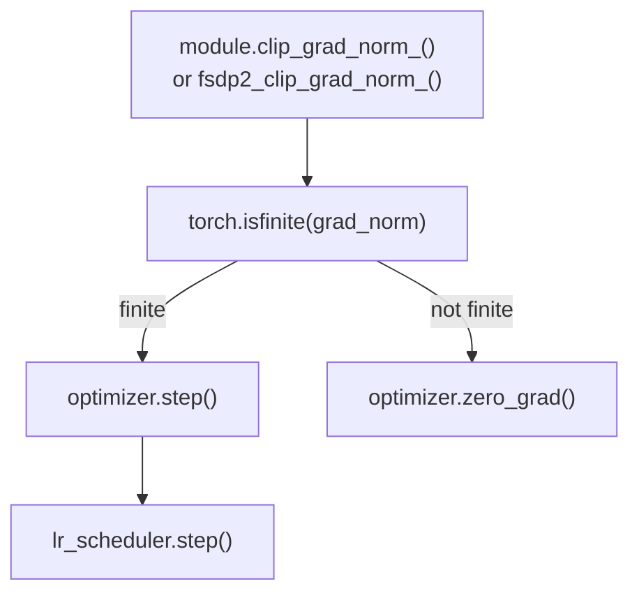

The engine handles both FSDP v1 (`module.clip_grad_norm_()`) and FSDP v2 (`fsdp2_clip_grad_norm_()`) gradient clipping. If gradients are non-finite, the update is skipped.

Sources: [verl/verl/workers/engine/fsdp/transformer_impl.py:494-536]()

### Parameter Offloading

FSDP engines support CPU offloading for memory efficiency:

```python
# Offload model parameters
if self._is_offload_param:
    offload_fsdp_model_to_cpu(self.module)

# Offload optimizer states  
if self._is_offload_optimizer:
    offload_fsdp_optimizer(optimizer=self.optimizer)
```

Context managers automatically handle offloading:

```mermaid
graph LR
    EnterTrain["__enter__()"]
    LoadModel["load_fsdp_model_to_gpu()"]
    LoadOptim["load_fsdp_optimizer()"]
    Train["Training operations"]
    ExitTrain["__exit__()"]
    OffloadModel["offload_fsdp_model_to_cpu()"]
    OffloadOptim["offload_fsdp_optimizer()"]
    
    EnterTrain --> LoadModel
    LoadModel --> LoadOptim
    LoadOptim --> Train
    Train --> ExitTrain
    ExitTrain --> OffloadModel
    OffloadModel --> OffloadOptim
```

Sources: [verl/verl/workers/engine/fsdp/transformer_impl.py:676-698](), [verl/verl/utils/fsdp_utils.py:144-224]()

---

## Megatron Engine Implementation

The `MegatronEngine` implements training using NVIDIA Megatron-LM's 4D parallelism (tensor, pipeline, data, and expert parallelism). It handles complex pipeline schedules and distributed checkpointing.

### Parallel State Initialization

Megatron engines initialize the parallel state with multiple parallelism dimensions:

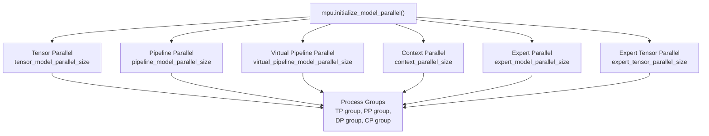

The parallel state determines process group memberships used for collective communication.

Sources: [verl/verl/workers/engine/megatron/transformer_impl.py:84-95]()

### Model Building with Megatron Core

Megatron engines build models using Megatron Core's transformer configuration:

**Megatron Model Building Flow**

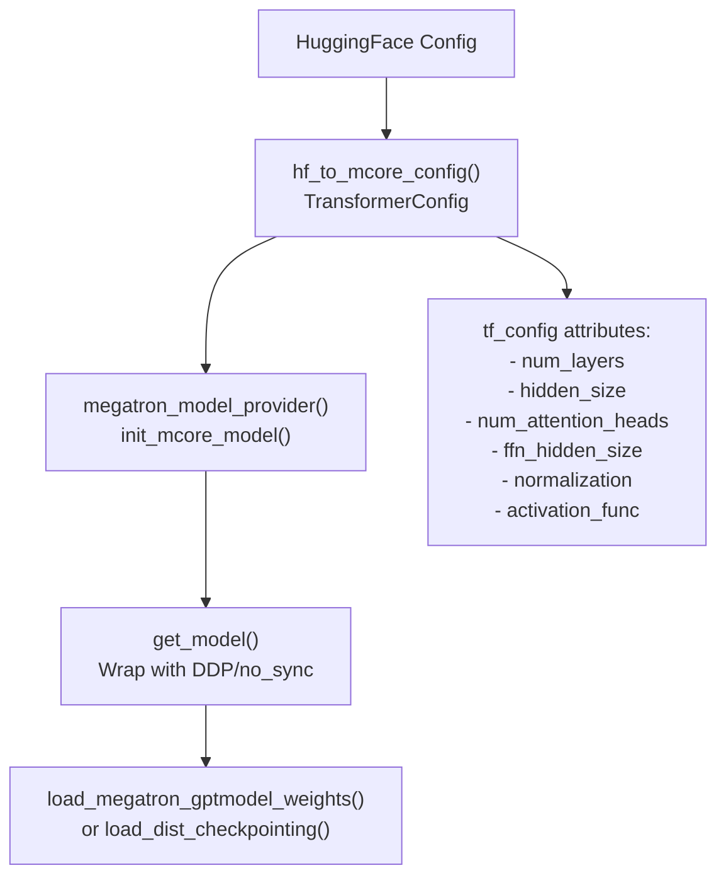

The model provider creates a list of model chunks for virtual pipeline parallelism:

```python
whole_model = get_model(
    model_provider_func=megatron_model_provider,
    model_type=ModelType.encoder_or_decoder,
    wrap_with_ddp=True,  # for training
    transformer_config=tf_config
)
# Returns: List[torch.nn.Module] with length = virtual_pp_size
```

Sources: [verl/verl/workers/engine/megatron/transformer_impl.py:97-195]()

### Pipeline Parallel Forward-Backward

Megatron engines use Megatron Core's pipeline schedule for forward-backward passes:

**Pipeline Schedule Execution**

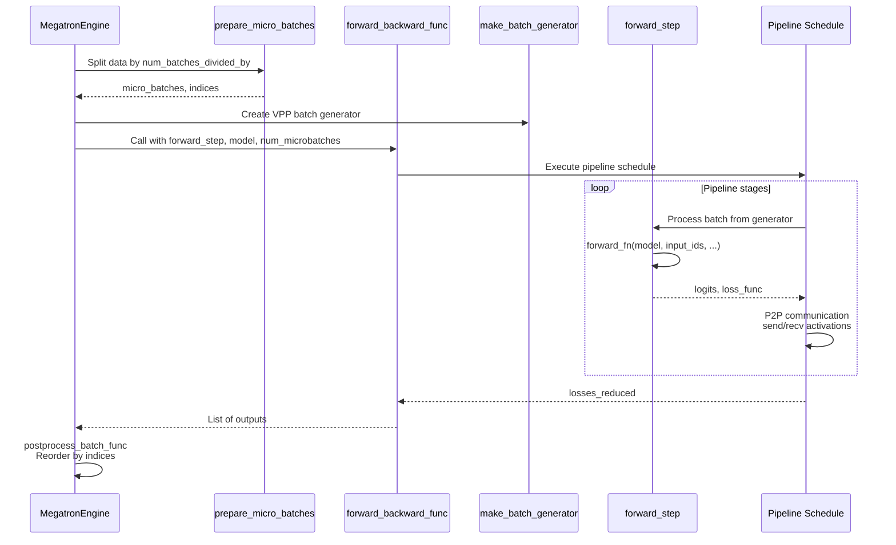

Key pipeline parallel concepts:

| Concept | Description |
|---------|-------------|
| **Micro-batch** | Smallest unit processed in one forward-backward |
| **Pipeline stage** | One or more transformer layers on a PP rank |
| **Virtual pipeline** | Interleaving of micro-batches to hide bubble time |
| **P2P communication** | Point-to-point activation/gradient exchange between stages |

The forward step must return `(output, loss_func_partial)` where the loss function is called only on the last pipeline stage.

Sources: [verl/verl/workers/engine/megatron/transformer_impl.py:382-440](), [verl/verl/workers/engine/megatron/transformer_impl.py:557-645]()

### Megatron Optimization

Megatron's optimizer handles distributed optimizer state and gradient clipping:

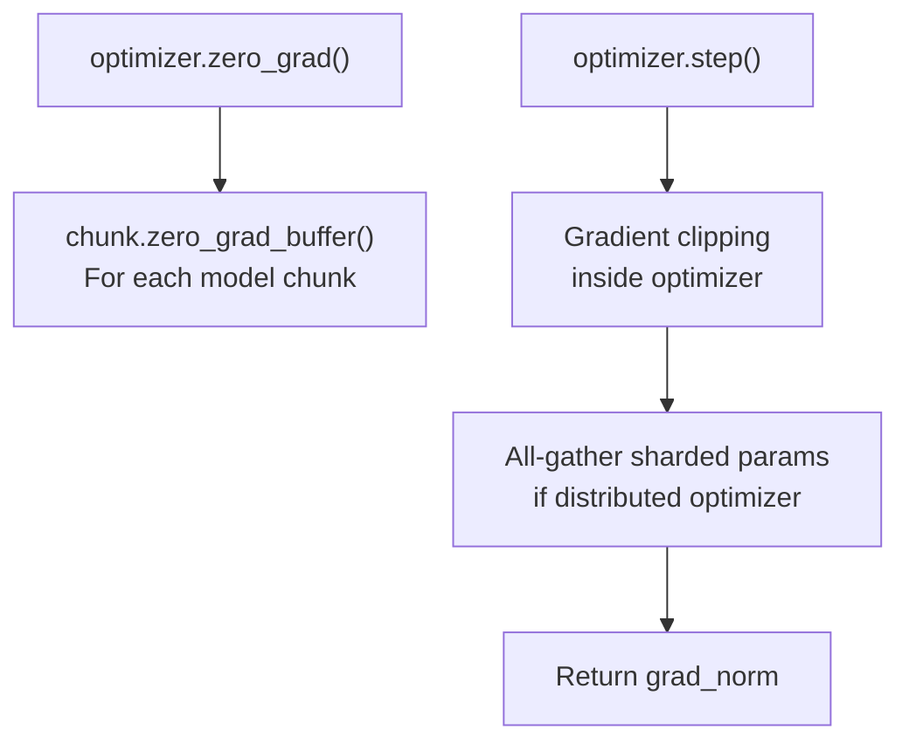

The Megatron optimizer integrates:
- **Distributed optimizer**: Shards optimizer states across data parallel ranks
- **Gradient clipping**: Computed before parameter update
- **Contiguous buffers**: Reduces memory fragmentation

Sources: [verl/verl/workers/engine/megatron/transformer_impl.py:260-297]()

---

## Engine Operations

### Train/Eval Mode Context Managers

Engines provide context managers that handle mode switching and parameter movement:

**FSDP Context Manager Flow**

```mermaid
graph LR
    EnterTrain["EngineTrainModeCtx.__enter__()"]
    LoadParams["Load params to GPU if offloaded"]
    LoadOptim["Load optimizer to GPU if offloaded"]
    EnterSP["ulysses_sharding_manager.__enter__()"]
    SetTrain["module.train()"]
    
    Training["Training operations"]
    
    ExitTrain["__exit__()"]
    ExitSP["ulysses_sharding_manager.__exit__()"]
    Reshard["Reshard FSDP modules"]
    OffloadParams["Offload params if enabled"]
    OffloadOptim["Offload optimizer if enabled"]
    
    EnterTrain --> LoadParams
    LoadParams --> LoadOptim
    LoadOptim --> EnterSP
    EnterSP --> SetTrain
    SetTrain --> Training
    Training --> ExitTrain
    ExitTrain --> ExitSP
    ExitSP --> Reshard
    Reshard --> OffloadParams
    OffloadParams --> OffloadOptim
```

**Megatron Context Manager Flow**

```mermaid
graph LR
    EnterTrain["EngineTrainModeCtx.__enter__()"]
    LoadParams["Load params to GPU if offloaded"]
    LoadOptim["Load optimizer to GPU if offloaded"]
    SetTrain["For each chunk: module.train()"]
    
    Training["Training operations"]
    
    ExitTrain["__exit__()"]
    OffloadParams["Offload params if enabled"]
    OffloadOptim["Offload optimizer if enabled"]
    
    EnterTrain --> LoadParams
    LoadParams --> LoadOptim
    LoadOptim --> SetTrain
    SetTrain --> Training
    Training --> ExitTrain
    ExitTrain --> OffloadParams
    OffloadParams --> OffloadOptim
```

Usage pattern:

```python
with engine.train_mode():
    outputs = engine.train_batch(data, loss_function)

with engine.eval_mode():
    outputs = engine.infer_batch(data, loss_function)
```

Sources: [verl/verl/workers/engine/fsdp/transformer_impl.py:648-698](), [verl/verl/workers/engine/megatron/transformer_impl.py:464-507]()

### Checkpoint Management

Engines delegate checkpoint I/O to specialized checkpoint managers:

**Checkpoint Manager Architecture**

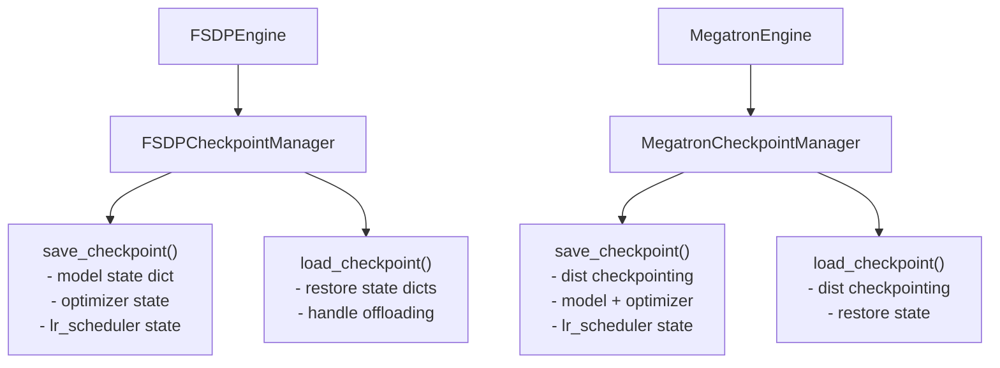

**Checkpoint save flow:**

1. If params offloaded: `load_fsdp_model_to_gpu()` or `load_megatron_model_to_gpu()`
2. Call `checkpoint_manager.save_checkpoint(local_path, hdfs_path, global_step)`
3. `torch.distributed.barrier()` to synchronize
4. If params offloaded: `offload_fsdp_model_to_cpu()` or `offload_megatron_model_to_cpu()`

**Checkpoint load flow:**

1. If params offloaded: Load to GPU first
2. Call `checkpoint_manager.load_checkpoint(local_path, hdfs_path)`
3. `torch.distributed.barrier()` to synchronize
4. If params/optimizer offloaded: Offload back to CPU

Sources: [verl/verl/workers/engine/fsdp/transformer_impl.py:564-607](), [verl/verl/workers/engine/megatron/transformer_impl.py:335-380]()

### Parameter Extraction for Rollout

Engines provide parameter extraction for synchronizing weights to inference engines:

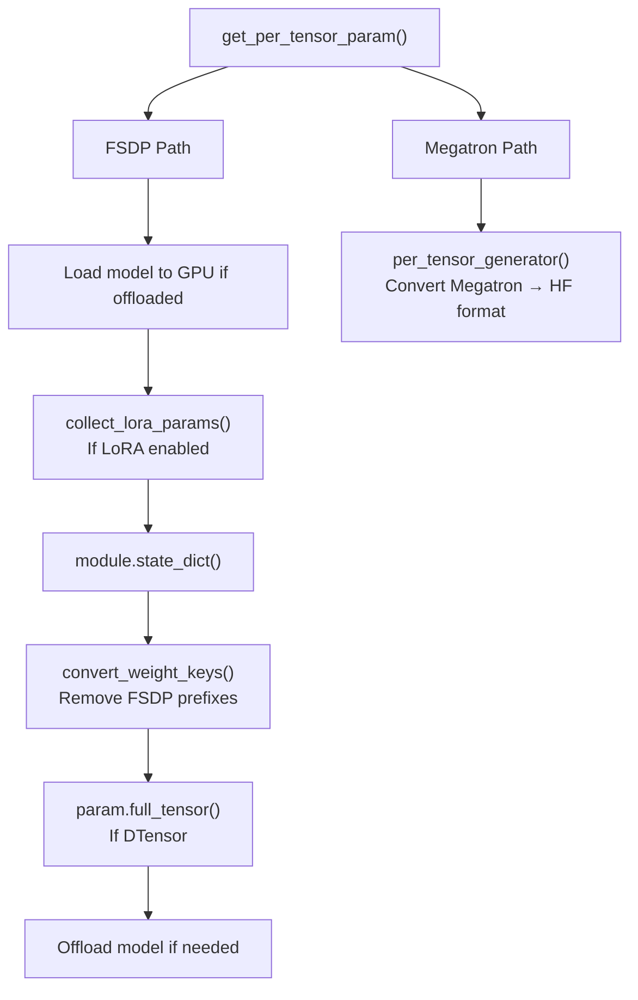

The returned parameter iterator is consumed by sharding managers (e.g., `FSDPVLLMShardingManager`) to update inference engine weights.

Sources: [verl/verl/workers/engine/fsdp/transformer_impl.py:608-646](), [verl/verl/workers/engine/megatron/transformer_impl.py:442-455]()

---

## Integration with Worker System

Engines are instantiated and managed by workers. The worker-engine relationship:

**Worker-Engine Integration**

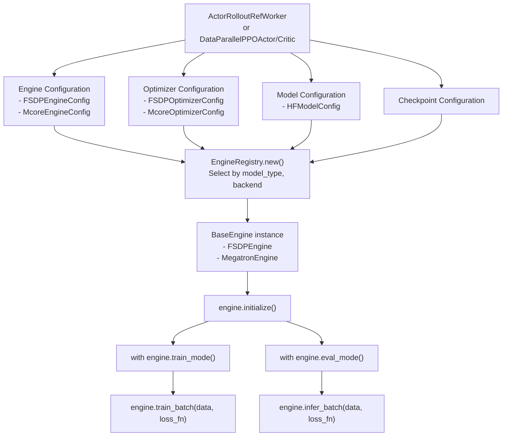

Worker usage pattern:

```python
# In DataParallelPPOActor.__init__()
self.actor_engine = EngineRegistry.new(
    model_type="language_model",
    backend=config.actor.strategy,  # "fsdp", "fsdp2", or "megatron"
    model_config=model_config,
    engine_config=engine_config,
    optimizer_config=optimizer_config,
    checkpoint_config=checkpoint_config,
)
self.actor_engine.initialize()

# Training step
with self.actor_engine.train_mode():
    outputs = self.actor_engine.train_batch(data, loss_function)

# Inference step  
with self.actor_engine.eval_mode():
    outputs = self.actor_engine.infer_batch(data, loss_function)
```

Sources: [verl/verl/workers/engine/base.py:240-263](), [verl/verl/workers/fsdp_workers.py:757-796]()

---

## Summary

Training engines provide the execution layer for VERL's distributed training framework:

| Engine | Parallelism | Best For | Key Features |
|--------|------------|----------|--------------|
| **FSDPEngine** | Data + FSDP + Ulysses SP | Single-host or small-scale, HuggingFace models | Simple setup, auto-wrapping, LoRA support |
| **MegatronEngine** | Tensor + Pipeline + Data + Expert | Large-scale, maximum model size | 4D parallelism, virtual pipeline, MoE support |

Both engines share the same interface, enabling algorithm code to be backend-agnostic. The `EngineRegistry` system allows dynamic engine selection based on configuration, and context managers ensure proper resource management throughout training.

Sources: [verl/verl/workers/engine/base.py](), [verl/verl/workers/engine/fsdp/transformer_impl.py](), [verl/verl/workers/engine/megatron/transformer_impl.py]()

---

