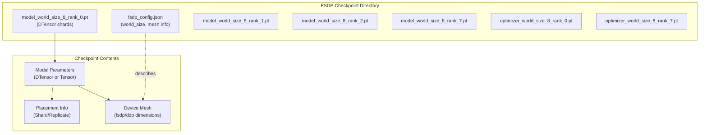
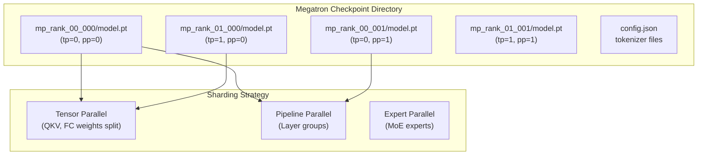
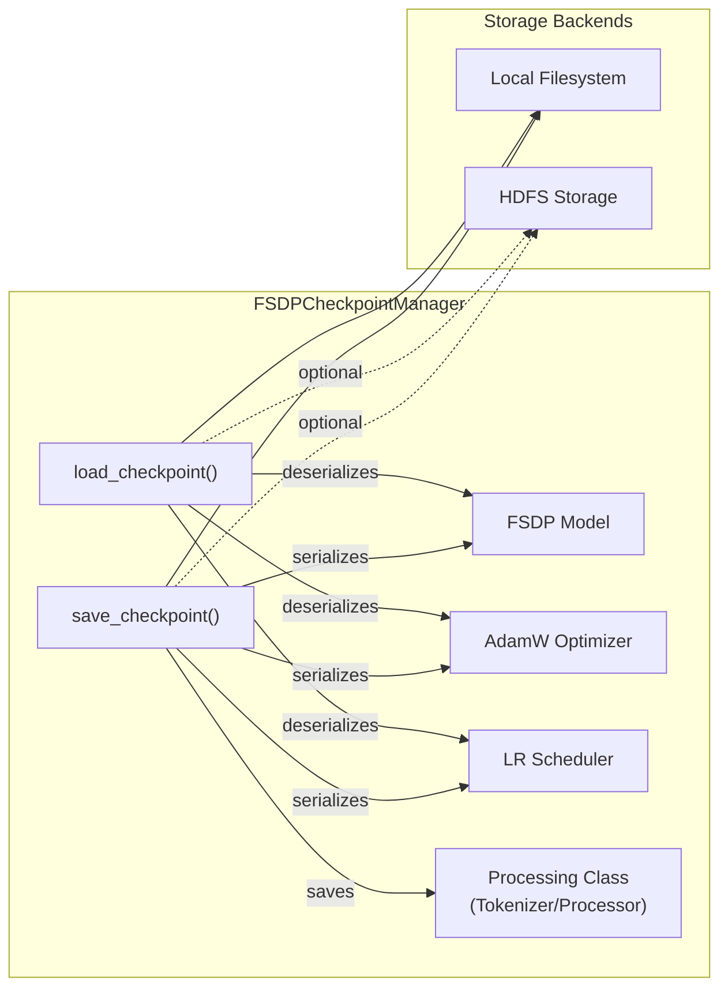
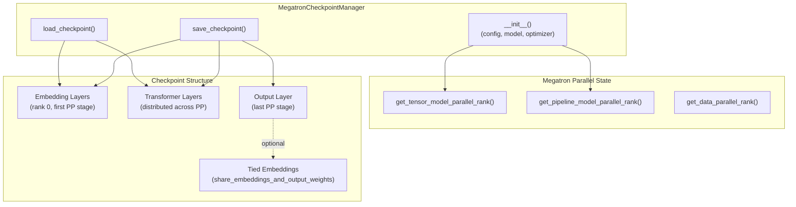
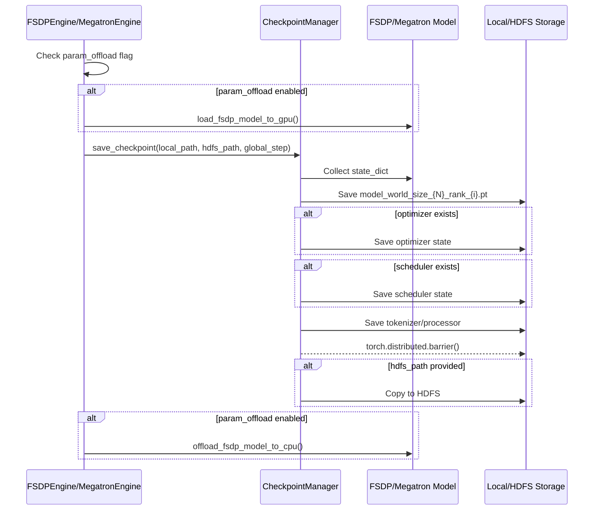
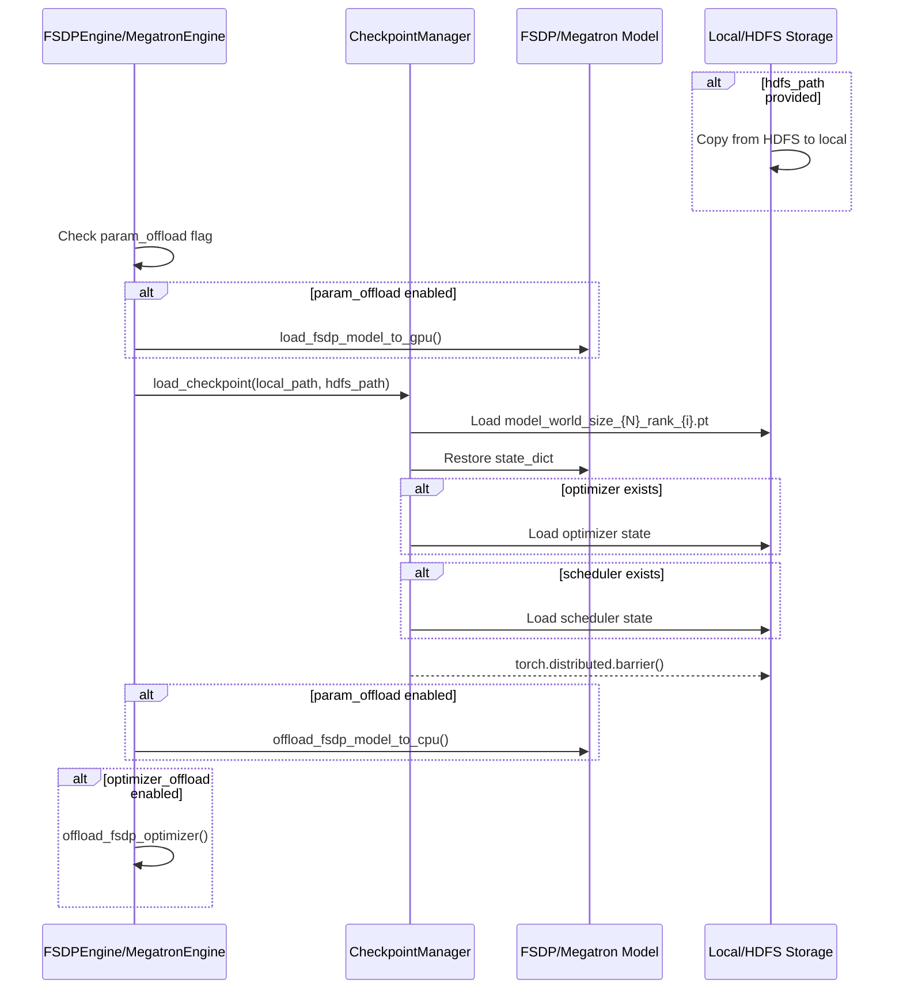
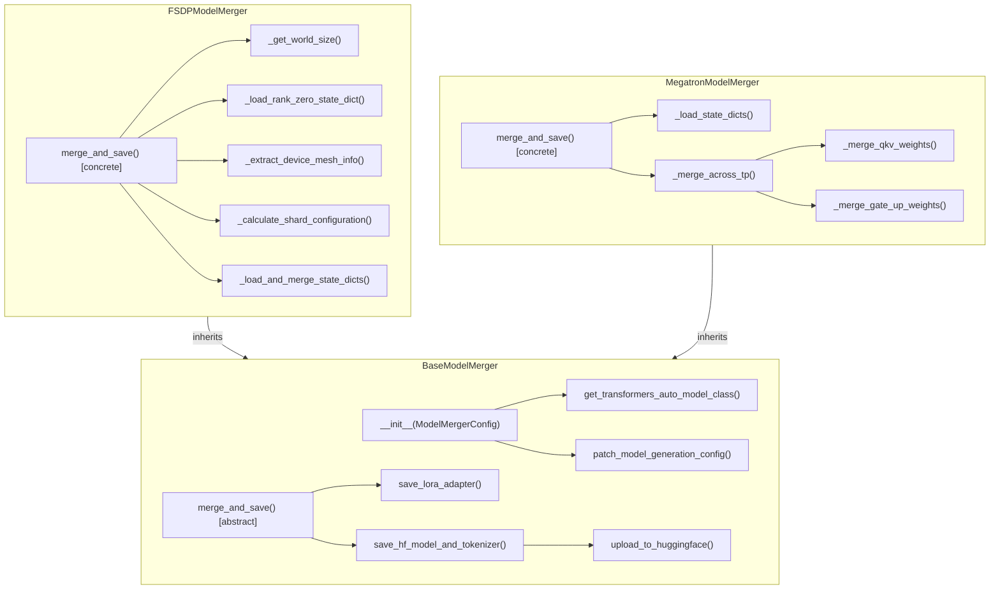
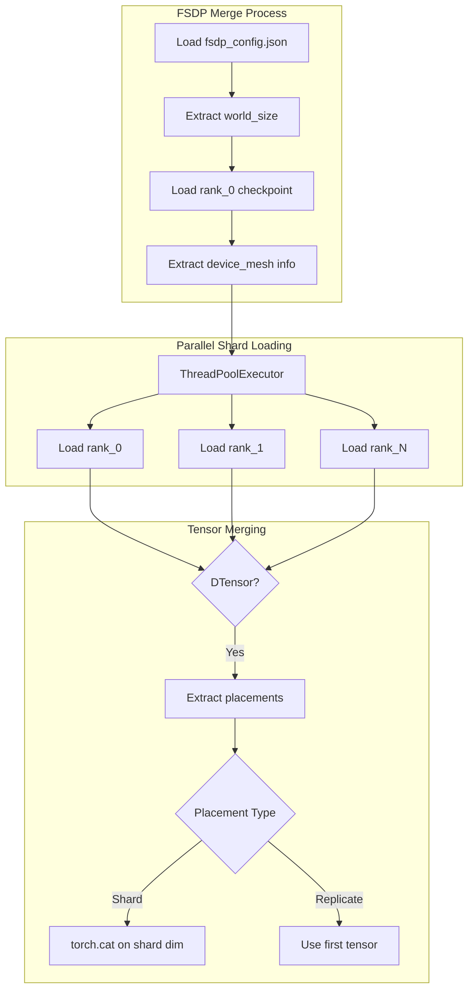
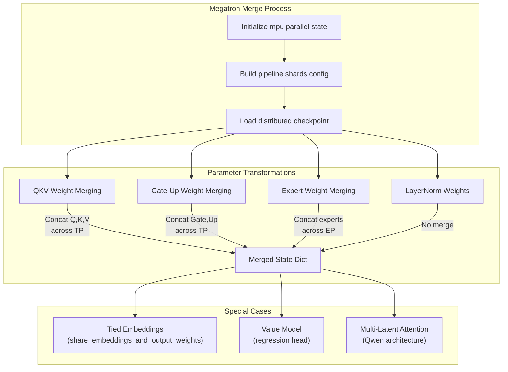
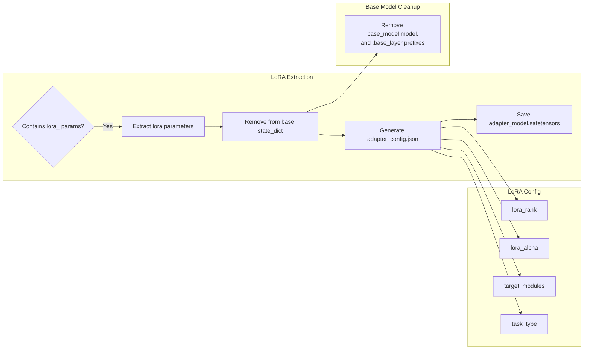

<!-- source: DeepWiki mcp.deepwiki.com · repo allenai/SAGE · page 5.4 Checkpoint Management · fetched 2026-10-26 -->

# Checkpoint Management

<details>
<summary>Relevant source files</summary>

The following files were used as context for generating this wiki page:

- [verl/recipe/one_step_off_policy/README.md](verl/recipe/one_step_off_policy/README.md)
- [verl/scripts/legacy_model_merger.py](verl/scripts/legacy_model_merger.py)
- [verl/verl/experimental/__init__.py](verl/verl/experimental/__init__.py)
- [verl/verl/experimental/dynamic_dataset/__init__.py](verl/verl/experimental/dynamic_dataset/__init__.py)
- [verl/verl/model_merger/fsdp_model_merger.py](verl/verl/model_merger/fsdp_model_merger.py)
- [verl/verl/model_merger/megatron_model_merger.py](verl/verl/model_merger/megatron_model_merger.py)
- [verl/verl/models/llama/megatron/checkpoint_utils/__init__.py](verl/verl/models/llama/megatron/checkpoint_utils/__init__.py)
- [verl/verl/models/llama/megatron/checkpoint_utils/llama_loader_depracated.py](verl/verl/models/llama/megatron/checkpoint_utils/llama_loader_depracated.py)
- [verl/verl/third_party/__init__.py](verl/verl/third_party/__init__.py)
- [verl/verl/third_party/sglang/parallel_state.py](verl/verl/third_party/sglang/parallel_state.py)
- [verl/verl/utils/experimental/__init__.py](verl/verl/utils/experimental/__init__.py)
- [verl/verl/utils/fsdp_utils.py](verl/verl/utils/fsdp_utils.py)
- [verl/verl/workers/engine/base.py](verl/verl/workers/engine/base.py)
- [verl/verl/workers/engine/fsdp/transformer_impl.py](verl/verl/workers/engine/fsdp/transformer_impl.py)
- [verl/verl/workers/engine/megatron/transformer_impl.py](verl/verl/workers/engine/megatron/transformer_impl.py)
- [verl/verl/workers/fsdp_workers.py](verl/verl/workers/fsdp_workers.py)
- [verl/verl/workers/reward_model/megatron/reward_model.py](verl/verl/workers/reward_model/megatron/reward_model.py)
- [verl/verl/workers/roles/utils/__init__.py](verl/verl/workers/roles/utils/__init__.py)
- [verl/verl/workers/sharding_manager/__init__.py](verl/verl/workers/sharding_manager/__init__.py)
- [verl/verl/workers/sharding_manager/fsdp_vllm.py](verl/verl/workers/sharding_manager/fsdp_vllm.py)

</details>


## Purpose and Scope

This document describes the checkpoint management system in SAGE, covering the saving, loading, and conversion of model checkpoints across distributed training backends. The system handles checkpoints in distributed formats (FSDP and Megatron-LM) and provides tools to merge them into unified HuggingFace format for deployment.

For information about the training engines that use these checkpoints, see [Training Engines](#5.3). For worker initialization and model setup, see [Workers](#5.2).

## Checkpoint Formats and Organization

SAGE supports multiple checkpoint formats corresponding to different distributed training strategies:

### FSDP Checkpoint Format

FSDP checkpoints are saved as per-rank `.pt` files with the naming pattern `model_world_size_{N}_rank_{i}.pt`, where `N` is the world size and `i` is the rank index. Each file contains a sharded portion of the model parameters, stored as either regular tensors or `DTensor` objects with sharding metadata.



**Diagram: FSDP Checkpoint Structure**

Sources: [verl/verl/model_merger/fsdp_model_merger.py:68-88](), [verl/verl/utils/fsdp_utils.py:143-167]()

### Megatron Checkpoint Format

Megatron checkpoints are organized in subdirectories corresponding to tensor parallel (TP) and pipeline parallel (PP) ranks. Each subdirectory contains a `model.pt` file with the model shard for that TP/PP combination.



**Diagram: Megatron Checkpoint Structure**

Sources: [verl/verl/model_merger/megatron_model_merger.py:459-486](), [verl/scripts/legacy_model_merger.py:459-486]()

## Checkpoint Managers

### FSDPCheckpointManager

The `FSDPCheckpointManager` handles checkpoint operations for FSDP-wrapped models, coordinating saves and loads across distributed ranks.



**Diagram: FSDPCheckpointManager Architecture**

Key methods:
- `save_checkpoint(local_path, hdfs_path, global_step, max_ckpt_to_keep)` - Saves model, optimizer, scheduler, and processing class
- `load_checkpoint(local_path, hdfs_path, del_local_after_load)` - Loads checkpoint components and restores state

Sources: [verl/verl/workers/engine/fsdp/transformer_impl.py:159-166](), [verl/verl/workers/engine/fsdp/transformer_impl.py:564-607]()

### MegatronCheckpointManager

The `MegatronCheckpointManager` manages checkpoints for Megatron-LM models with tensor and pipeline parallelism.



**Diagram: MegatronCheckpointManager with Parallel State**

The manager coordinates with Megatron's parallel state to determine which model chunks belong to each rank and handles special cases like tied embeddings and value models.

Sources: [verl/verl/workers/engine/megatron/transformer_impl.py:220-238](), [verl/verl/workers/engine/megatron/transformer_impl.py:335-380]()

## Save and Load Operations

### Save Checkpoint Flow

The checkpoint save process handles parameter offloading, distributed coordination, and optional HDFS upload.



**Diagram: Checkpoint Save Sequence**

The save operation includes several key steps:

1. **Parameter Loading**: If `param_offload` is enabled, parameters are temporarily loaded to GPU
2. **State Collection**: Model, optimizer, and scheduler states are collected
3. **Serialization**: States are saved to rank-specific files
4. **Synchronization**: `torch.distributed.barrier()` ensures all ranks complete
5. **Optional HDFS Upload**: Checkpoints can be copied to HDFS for durability
6. **Parameter Offload**: If enabled, parameters are moved back to CPU

Sources: [verl/verl/workers/engine/fsdp/transformer_impl.py:564-585](), [verl/verl/workers/engine/megatron/transformer_impl.py:335-360]()

### Load Checkpoint Flow

Loading mirrors the save process with additional validation and state restoration.



**Diagram: Checkpoint Load Sequence**

Sources: [verl/verl/workers/engine/fsdp/transformer_impl.py:587-607](), [verl/verl/workers/engine/megatron/transformer_impl.py:361-381]()

## Checkpoint Merging and Conversion

### Model Merger Architecture

The model merger system converts distributed checkpoints to HuggingFace format for deployment and sharing.



**Diagram: Model Merger Class Hierarchy**

Sources: [verl/verl/model_merger/base_model_merger.py](), [verl/verl/model_merger/fsdp_model_merger.py:35-66](), [verl/verl/model_merger/megatron_model_merger.py:101-141]()

### FSDP Checkpoint Merging

The `FSDPModelMerger` reconstructs full model parameters from FSDP shards by:

1. **Detecting Sharding Configuration**: Reads `fsdp_config.json` for world size and device mesh info
2. **Loading Shards**: Loads all `model_world_size_{N}_rank_{i}.pt` files in parallel
3. **Extracting Placement Info**: For `DTensor` parameters, extracts sharding placements (Shard/Replicate)
4. **Merging Tensors**: Concatenates sharded dimensions or selects replicated tensors



**Diagram: FSDP Checkpoint Merge Flow**

The merge process handles different device mesh configurations:
- **1D FSDP**: `mesh_dim_names = ("fsdp",)` - Simple concatenation along shard dimension
- **2D FSDP+DDP**: `mesh_dim_names = ("ddp", "fsdp")` - Discards replicated DP dimension

Sources: [verl/verl/model_merger/fsdp_model_merger.py:68-228]()

### Megatron Checkpoint Merging

The `MegatronModelMerger` handles more complex tensor transformations due to Megatron's TP/PP/EP parallelism:



**Diagram: Megatron Checkpoint Merge with Transformations**

Key transformations:
- **QKV Merging**: Splits per-rank QKV tensors into Q, K, V components, then concatenates across TP ranks
- **Gate-Up Merging**: Splits gated FFN weights (gate/up) and interleaves them correctly
- **Expert Merging**: For MoE models, concatenates expert weights across EP ranks
- **Parameter Mapping**: Converts Megatron naming (e.g., `self_attention.linear_qkv`) to HF naming (e.g., `self_attn.qkv_proj`)

| Megatron Parameter | HuggingFace Parameter |
|-------------------|----------------------|
| `embedding.word_embeddings` | `model.embed_tokens` |
| `self_attention.linear_qkv` | `self_attn.qkv_proj` |
| `self_attention.linear_proj` | `self_attn.o_proj` |
| `mlp.linear_fc1` | `mlp.gate_up_proj` |
| `mlp.linear_fc2` | `mlp.down_proj` |
| `final_layernorm` | `norm` |
| `output_layer` | `lm_head` |

**Table: Megatron to HuggingFace Parameter Name Mapping**

Sources: [verl/verl/model_merger/megatron_model_merger.py:174-219](), [verl/verl/model_merger/megatron_model_merger.py:488-540]()

### LoRA Adapter Handling

Both mergers support extracting and saving LoRA adapters separately from base model weights.



**Diagram: LoRA Adapter Extraction Flow**

The LoRA extraction process:
1. Identifies parameters with `lora_` prefix
2. Infers LoRA rank from adapter weight dimensions
3. Extracts target modules from parameter names
4. Saves adapter configuration and weights to separate directory
5. Cleans base model state dict by removing PEFT wrapper keys

Sources: [verl/verl/model_merger/base_model_merger.py:136-192]()

## Parameter Offloading During Checkpointing

To manage memory during checkpoint operations, the system supports offloading parameters between CPU and GPU.

### FSDP Parameter Offloading

FSDP provides manual offload functions that temporarily move parameters for checkpoint I/O:

```mermaid
graph LR
    subgraph "offload_fsdp_model_to_cpu"
        CheckVer{FSDP Version}
        V1Offload[FSDP v1: flat_param_to(cpu)]
        V2Offload[FSDP v2: model.cpu()]
        EmptyCache[get_torch_device().empty_cache()]
        
        CheckVer -->|v1| V1Offload
        CheckVer -->|v2| V2Offload
        V1Offload --> EmptyCache
        V2Offload --> EmptyCache
    end
    
    subgraph "load_fsdp_model_to_gpu"
        CheckVer2{FSDP Version}
        V1Load[FSDP v1: flat_param_to(gpu)]
        V2Load[FSDP v2: model.to(gpu)]
        
        CheckVer2 -->|v1| V1Load
        CheckVer2 -->|v2| V2Load
    end
    
    subgraph "Checkpoint Save with Offload"
        SaveStart[save_checkpoint called]
        LoadGPU[load_fsdp_model_to_gpu]
        DoSave[Perform save operation]
        OffloadCPU[offload_fsdp_model_to_cpu]
        
        SaveStart -->|if param_offload| LoadGPU
        LoadGPU --> DoSave
        DoSave --> OffloadCPU
    end
```

**Diagram: FSDP Parameter Offload Flow**

Key functions:
- `offload_fsdp_model_to_cpu(model, empty_cache)` - Moves FSDP flat parameters to CPU [verl/verl/utils/fsdp_utils.py:143-174]()
- `load_fsdp_model_to_gpu(model)` - Moves FSDP flat parameters back to GPU [verl/verl/utils/fsdp_utils.py:177-201]()
- `offload_fsdp_optimizer(optimizer)` - Offloads optimizer state tensors [verl/verl/utils/fsdp_utils.py:204-214]()
- `load_fsdp_optimizer(optimizer, device)` - Loads optimizer state back to GPU [verl/verl/utils/fsdp_utils.py:217-227]()

The offload pattern wraps checkpoint operations:
```python
if self._is_offload_param:
    load_fsdp_model_to_gpu(self.module)

self.checkpoint_manager.save_checkpoint(...)

if self._is_offload_param:
    offload_fsdp_model_to_cpu(self.module)
```

Sources: [verl/verl/utils/fsdp_utils.py:143-227](), [verl/verl/workers/engine/fsdp/transformer_impl.py:575-585]()

### Megatron Parameter Offloading

Megatron models use similar offload utilities adapted for Megatron's module structure:

```mermaid
graph TB
    subgraph "offload_megatron_model_to_cpu"
        IterChunks[Iterate model chunks]
        IterParams[Iterate parameters]
        MoveCPU[param.data.to('cpu')]
        
        IterChunks --> IterParams
        IterParams --> MoveCPU
    end
    
    subgraph "load_megatron_model_to_gpu"
        IterChunks2[Iterate model chunks]
        IterParams2[Iterate parameters]
        MoveGPU[param.data.to(device_id)]
        LoadGrad{load_grad?}
        MoveGradGPU[grad.to(device_id)]
        
        IterChunks2 --> IterParams2
        IterParams2 --> MoveGPU
        MoveGPU --> LoadGrad
        LoadGrad -->|True| MoveGradGPU
    end
```

**Diagram: Megatron Parameter Offload Operations**

Megatron models are structured as lists of module chunks (for virtual pipeline parallelism), so offload functions iterate through each chunk and move parameters individually.

Sources: [verl/verl/workers/engine/megatron/transformer_impl.py:299-324](), [verl/verl/workers/engine/megatron/transformer_impl.py:352-360]()

## Usage Examples

### Saving Checkpoints During Training

Engines provide a unified `save_checkpoint` interface:

```python
# FSDP Engine
engine.save_checkpoint(
    local_path="/checkpoints/step_1000",
    hdfs_path="hdfs://cluster/checkpoints/step_1000",  # optional
    global_step=1000,
    max_ckpt_to_keep=3  # keep only last 3 checkpoints
)

# Megatron Engine  
engine.save_checkpoint(
    local_path="/checkpoints/step_1000",
    hdfs_path="hdfs://cluster/checkpoints/step_1000",
    global_step=1000,
    max_ckpt_to_keep=3
)
```

Sources: [verl/verl/workers/engine/fsdp/transformer_impl.py:564-585](), [verl/verl/workers/engine/megatron/transformer_impl.py:335-360]()

### Converting FSDP Checkpoints to HuggingFace

Using the model merger script:

```bash
python scripts/model_merger.py \
    --backend fsdp \
    --local-dir checkpoints/global_step_1000/actor \
    --target-dir merged_models/step_1000 \
    --hf-upload-path your-org/model-step-1000
```

Or programmatically:

```python
from verl.model_merger import ModelMergerConfig, FSDPModelMerger

config = ModelMergerConfig(
    operation="merge",
    backend="fsdp",
    local_dir="checkpoints/global_step_1000/actor",
    target_dir="merged_models/step_1000",
    hf_upload_path="your-org/model-step-1000"
)
merger = FSDPModelMerger(config)
merger.merge_and_save()
```

Sources: [verl/scripts/model_merger.py](), [verl/verl/model_merger/fsdp_model_merger.py:206-228]()

### Converting Megatron Checkpoints to HuggingFace

Using the model merger script with Megatron-specific flags:

```bash
python scripts/model_merger.py \
    --backend megatron \
    --tie-word-embedding \
    --local-dir checkpoints/global_step_1000/actor \
    --target-dir merged_models/step_1000
```

The `--tie-word-embedding` flag is important for models where embedding and output layers share weights.

Sources: [verl/scripts/model_merger.py:15-37](), [verl/verl/model_merger/megatron_model_merger.py]()

---

