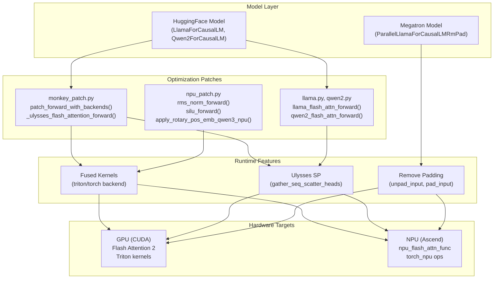
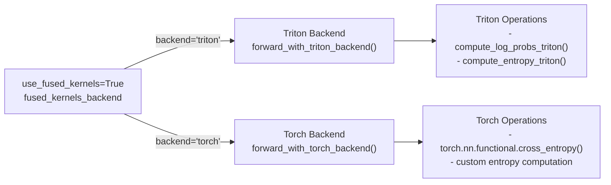
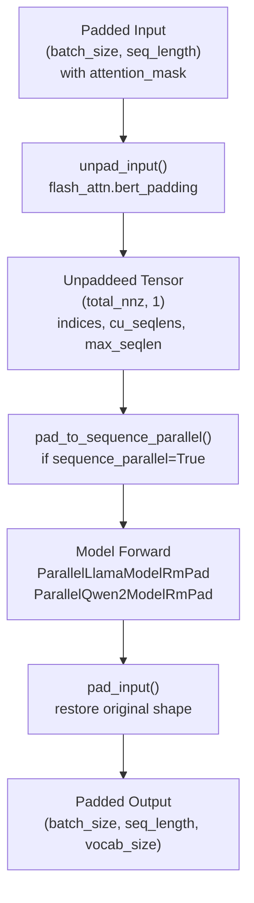
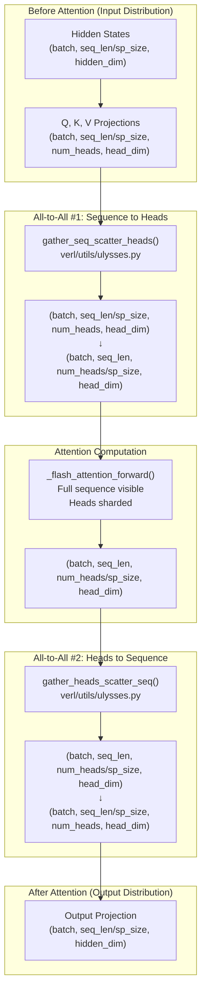
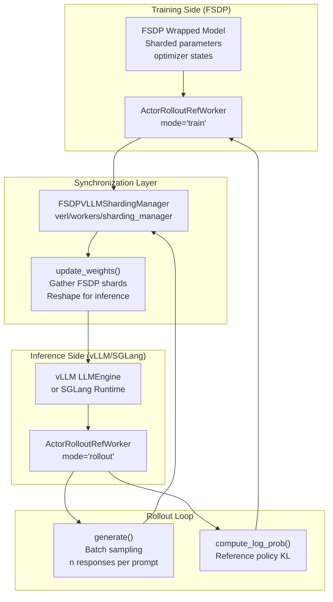

<!-- source: DeepWiki mcp.deepwiki.com · repo allenai/SAGE · page 6 Advanced Topics · fetched 2026-10-26 -->

# Advanced Topics

<details>
<summary>Relevant source files</summary>

The following files were used as context for generating this wiki page:

- [verl/recipe/dapo/run_dapo_early_qwen2.5_32b.sh](verl/recipe/dapo/run_dapo_early_qwen2.5_32b.sh)
- [verl/recipe/dapo/run_dapo_qwen2.5_32b.sh](verl/recipe/dapo/run_dapo_qwen2.5_32b.sh)
- [verl/recipe/dapo/run_dapo_qwen2.5_32b_npu.sh](verl/recipe/dapo/run_dapo_qwen2.5_32b_npu.sh)
- [verl/recipe/dapo/run_dapo_qwen2.5_32b_tis.sh](verl/recipe/dapo/run_dapo_qwen2.5_32b_tis.sh)
- [verl/recipe/dapo/run_dapo_qwen2.5_7b_npu.sh](verl/recipe/dapo/run_dapo_qwen2.5_7b_npu.sh)
- [verl/recipe/dapo/run_dapo_qwen3_14b_base_npu.sh](verl/recipe/dapo/run_dapo_qwen3_14b_base_npu.sh)
- [verl/recipe/dapo/run_dapo_qwen3_8b_base_npu.sh](verl/recipe/dapo/run_dapo_qwen3_8b_base_npu.sh)
- [verl/recipe/dapo/run_dapo_qwen3_moe_30b_base_fsdp_npu.sh](verl/recipe/dapo/run_dapo_qwen3_moe_30b_base_fsdp_npu.sh)
- [verl/recipe/dapo/run_dapo_wo_ds_qwen2.5_32b.sh](verl/recipe/dapo/run_dapo_wo_ds_qwen2.5_32b.sh)
- [verl/recipe/dapo/test_dapo_7b.sh](verl/recipe/dapo/test_dapo_7b.sh)
- [verl/verl/models/llama/megatron/modeling_llama_megatron.py](verl/verl/models/llama/megatron/modeling_llama_megatron.py)
- [verl/verl/models/qwen2/megatron/modeling_qwen2_megatron.py](verl/verl/models/qwen2/megatron/modeling_qwen2_megatron.py)
- [verl/verl/models/transformers/apertus.py](verl/verl/models/transformers/apertus.py)
- [verl/verl/models/transformers/llama.py](verl/verl/models/transformers/llama.py)
- [verl/verl/models/transformers/monkey_patch.py](verl/verl/models/transformers/monkey_patch.py)
- [verl/verl/models/transformers/npu_patch.py](verl/verl/models/transformers/npu_patch.py)
- [verl/verl/models/transformers/qwen2.py](verl/verl/models/transformers/qwen2.py)
- [verl/verl/models/transformers/qwen2_vl.py](verl/verl/models/transformers/qwen2_vl.py)
- [verl/verl/utils/megatron/pipeline_parallel.py](verl/verl/utils/megatron/pipeline_parallel.py)

</details>


This page covers specialized features and optimizations for advanced use cases in the SAGE training framework. These topics include hardware-specific optimizations, techniques for handling long context sequences, and efficient integration between training and inference engines.

**Scope**: This page provides an overview of three advanced optimization areas:
- Hardware-specific optimizations (NPU support, fused kernels)
- Long context training via Ulysses sequence parallelism
- Inference engine integration (vLLM/SGLang)

For details on the core training pipeline and worker architecture, see [Core Concepts](#2). For model-specific implementations, see [Model Support](#4). For distributed training strategies, see [Distributed Architecture](#2.3).

---

## Overview of Advanced Features

The SAGE framework implements a layered optimization architecture that enables efficient training across different hardware platforms, context lengths, and model sizes. These optimizations are applied through three primary mechanisms:

1. **Monkey Patches**: Runtime modifications to transformer model forward passes
2. **Custom Model Implementations**: Hardware-specific model definitions (Megatron, remove-padding variants)
3. **Inference Engine Bridges**: Parameter synchronization between training and inference systems

The following diagram illustrates how these optimization layers integrate:

**Diagram: Optimization Stack Architecture**



Sources: [verl/verl/models/transformers/monkey_patch.py](), [verl/verl/models/transformers/npu_patch.py](), [verl/verl/models/transformers/llama.py](), [verl/verl/models/transformers/qwen2.py]()

---

## Hardware Optimization Strategies

### NPU vs GPU Execution

The framework supports both NVIDIA GPUs (CUDA) and Huawei Ascend NPUs through architecture-specific optimizations. The `npu_patch.py` module applies NPU-specific kernel implementations at import time.

**Key NPU Optimizations**:

| Operation | Standard Implementation | NPU-Optimized Implementation |
|-----------|------------------------|------------------------------|
| RMS Normalization | `torch.nn.LayerNorm` | `torch_npu.npu_rms_norm()` |
| SwiGLU Activation | `F.silu(gate) * up` | `torch_npu.npu_swiglu()` |
| Rotary Position Embedding | Complex number multiplication | `torch_npu.npu_rotary_mul()` |
| Grouped Matrix Multiply (MoE) | Sequential expert computation | `torch_npu.npu_grouped_matmul()` |

**Configuration Example**:
```yaml
trainer:
  device: npu  # or 'cuda' for GPU
  n_gpus_per_node: 16  # NPUs per node

actor_rollout_ref:
  actor:
    use_torch_compile: False  # Disable for NPU
  model:
    override_config:
      attention_dropout: 0.0  # Required for NPU flash attention
```

Sources: [verl/verl/models/transformers/npu_patch.py:54-208](), [verl/recipe/dapo/run_dapo_qwen2.5_32b_npu.sh:138-141]()

### Fused Kernel Backends

The framework supports two backends for fused kernel operations during training:

**Diagram: Fused Kernel Selection**



The `patch_forward_with_backends()` function in [verl/verl/models/transformers/monkey_patch.py:196-279]() selects the appropriate backend based on model type and configuration. For vision-language models (Qwen2-VL, Qwen3-VL, GLM4V), specialized implementations handle multimodal inputs.

Sources: [verl/verl/models/transformers/monkey_patch.py:196-279]()

### Remove Padding Optimization

Megatron model implementations use remove-padding to eliminate computation on padding tokens:

**Diagram: Remove Padding Flow**



This optimization is critical for variable-length sequences and is enabled via:
```yaml
actor_rollout_ref:
  model:
    use_remove_padding: True
```

Sources: [verl/verl/models/llama/megatron/modeling_llama_megatron.py:220-383](), [verl/verl/models/qwen2/megatron/modeling_qwen2_megatron.py:221-383]()

For detailed NPU-specific kernel implementations and performance tuning, see [Hardware Optimizations](#6.1).

---

## Long Context Training with Ulysses Sequence Parallelism

Ulysses sequence parallelism enables training on sequences longer than what fits in a single GPU's memory by distributing the sequence dimension across multiple devices.

### Ulysses SP Architecture

The key insight is to shard the sequence across GPUs while keeping attention heads intact, then perform all-to-all communication to gather sequences and shard heads during attention computation.

**Diagram: Ulysses All-to-All Communication Pattern**



### Implementation in Attention Modules

The framework patches attention forward functions to insert Ulysses all-to-all operations. For example, in LLaMA models:

```python
# From llama_flash_attn_forward() in verl/models/transformers/llama.py
ulysses_sp_size = get_ulysses_sequence_parallel_world_size()

if ulysses_sp_size > 1:
    validate_ulysses_config(self.num_heads, ulysses_sp_size)
    
    # Gather sequence, scatter heads
    query_states = gather_seq_scatter_heads(query_states, seq_dim=2, head_dim=1)
    key_states = gather_seq_scatter_heads(key_states, seq_dim=2, head_dim=1)
    value_states = gather_seq_scatter_heads(value_states, seq_dim=2, head_dim=1)

# Flash attention sees full sequence, sharded heads
attn_output = _flash_attention_forward(...)

if ulysses_sp_size > 1:
    # Gather heads, scatter sequence
    attn_output = gather_heads_scatter_seq(attn_output, seq_dim=1, head_dim=2)
```

**Configuration**:
```yaml
actor_rollout_ref:
  actor:
    ulysses_sequence_parallel_size: 8  # Shard sequence across 8 GPUs
  ref:
    ulysses_sequence_parallel_size: 8
  
  actor:
    ppo_max_token_len_per_gpu: 2816  # (max_prompt + max_response) / sp_size
```

### Multimodal Position Encoding

For vision-language models like Qwen2-VL, position IDs must be gathered across all sequence parallel ranks before computing multimodal rotary position embeddings:

```python
# From qwen2_vl_attn_forward() in verl/models/transformers/qwen2_vl.py
if sp_size > 1:
    position_ids_lst = [torch.empty_like(position_ids) for _ in range(sp_size)]
    position_ids = dist.all_gather(position_ids_lst, position_ids, 
                                   group=get_ulysses_sequence_parallel_group())
    position_ids = torch.cat(position_ids_lst, dim=-1)  # Full sequence
```

Sources: [verl/verl/models/transformers/llama.py:42-167](), [verl/verl/models/transformers/qwen2.py:35-157](), [verl/verl/models/transformers/qwen2_vl.py:164-265](), [verl/verl/models/transformers/monkey_patch.py:49-117]()

For detailed implementation of all-to-all communication primitives and configuration guidelines, see [Long Context Training](#6.2).

---

## Inference Integration Architecture

The training framework integrates with high-throughput inference engines (vLLM, SGLang) for efficient rollout generation. This requires careful parameter synchronization between training and inference representations.

### Training-Inference Bridge

**Diagram: Parameter Synchronization Flow**



### Hybrid Engine Mode

The `ActorRolloutRefWorker` switches between training mode (FSDP) and rollout mode (vLLM/SGLang) within the same Ray actor:

| Mode | Engine | Purpose | Parameters |
|------|--------|---------|------------|
| `train` | FSDPEngine | Policy updates | Sharded across FSDP ranks |
| `rollout` | vLLM/SGLang | Response generation | Gathered, reshaped for TP |
| `offload` | None | Memory optimization | Offloaded to CPU |

**Weight Update Synchronization**:

```python
# Conceptual flow from ActorRolloutRefWorker
def update_model_weights_from_fsdp_to_inference():
    # 1. Gather FSDP shards
    gathered_state_dict = gather_fsdp_state_dict(fsdp_model)
    
    # 2. Reshape for inference engine tensor parallelism
    reshaped_state_dict = reshape_for_vllm_tp(gathered_state_dict, 
                                               tp_size=vllm_tp_size)
    
    # 3. Load into inference engine
    vllm_engine.load_weights(reshaped_state_dict)
```

### Configuration for Inference Integration

```yaml
actor_rollout_ref:
  rollout:
    name: vllm  # or 'sglang'
    tensor_model_parallel_size: 4  # Inference TP
    gpu_memory_utilization: 0.80
    enable_chunked_prefill: True
    max_num_batched_tokens: 22528  # (max_prompt + max_response)
    
  actor:
    ulysses_sequence_parallel_size: 8  # Training SP
    fsdp_config:
      param_offload: True  # Free memory between train/rollout
```

### Inference Engine Selection

- **vLLM**: PagedAttention, prefix caching, continuous batching
- **SGLang**: RadixAttention, better cache hit rates for structured generation

Both engines support:
- Dynamic batching with variable sequence lengths
- Efficient KV cache management
- Tensor parallelism for large models

Sources: [verl/recipe/dapo/run_dapo_qwen2.5_32b.sh:99-113](), [verl/recipe/dapo/run_dapo_qwen2.5_32b_npu.sh:109-121]()

For detailed implementation of `FSDPVLLMShardingManager` and parameter offloading strategies, see [Inference Integration](#6.3).

---

## Pipeline Parallelism Support

For Megatron models with pipeline parallelism, the framework provides utilities to handle micro-batch distribution and input shape computation.

**Key Components**:

- `compute_transformers_input_shapes()`: Pre-computes input shapes for each pipeline stage after remove-padding
- `make_batch_generator()`: Creates batch iterators for virtual pipeline parallelism (VPP)

```python
# From verl/utils/megatron/pipeline_parallel.py
def make_batch_generator(batches, vpp_size):
    if vpp_size > 1:
        # Virtual pipeline: duplicate batch iterator for each VPP chunk
        batch_generator = [batches] * vpp_size
        batch_generator = [iter(b) for b in batch_generator]
    else:
        batch_generator = iter(batches)
    return batch_generator
```

Pipeline parallelism models use `pre_process` and `post_process` flags to determine which pipeline stage contains embeddings and output head:

- First stage (`pre_process=True`): Contains embedding layer
- Last stage (`post_process=True`): Contains LM head
- Middle stages: Only decoder layers

Sources: [verl/verl/utils/megatron/pipeline_parallel.py:1-72](), [verl/verl/models/llama/megatron/modeling_llama_megatron.py:418-689](), [verl/verl/models/qwen2/megatron/modeling_qwen2_megatron.py:419-738]()

---

## Configuration Best Practices

### GPU Training (32B model, 16 nodes)
```yaml
trainer:
  device: cuda
  nnodes: 16
  n_gpus_per_node: 8

actor_rollout_ref:
  actor:
    ulysses_sequence_parallel_size: 8
    fsdp_config:
      param_offload: True
      optimizer_offload: True
  rollout:
    tensor_model_parallel_size: 4
    gpu_memory_utilization: 0.80
```

### NPU Training (32B model, 2 nodes)
```yaml
trainer:
  device: npu
  nnodes: 2
  n_gpus_per_node: 16

actor_rollout_ref:
  actor:
    ulysses_sequence_parallel_size: 8
    use_torch_compile: False
    fsdp_config:
      forward_prefetch: True
  rollout:
    tensor_model_parallel_size: 4
    gpu_memory_utilization: 0.90
```

### 7B Model (single node)
```yaml
actor_rollout_ref:
  actor:
    ulysses_sequence_parallel_size: 1  # No SP needed
    fsdp_config:
      param_offload: False
  rollout:
    tensor_model_parallel_size: 1
    gpu_memory_utilization: 0.85
```

Sources: [verl/recipe/dapo/run_dapo_qwen2.5_32b.sh](), [verl/recipe/dapo/run_dapo_qwen2.5_32b_npu.sh](), [verl/recipe/dapo/test_dapo_7b.sh]()

---

## Summary

The SAGE framework's advanced features enable efficient training across diverse hardware platforms and model scales through:

1. **Hardware Optimizations**: NPU-specific kernels and fused operations reduce computation overhead
2. **Ulysses Sequence Parallelism**: Enables training on sequences up to 22K tokens by sharding across devices
3. **Inference Integration**: Tight coupling with vLLM/SGLang provides high-throughput rollout generation

These optimizations are composable—you can combine Ulysses SP with NPU acceleration, or use remove-padding with inference integration. The configuration system allows fine-tuning each optimization independently based on your hardware and model requirements.

For implementation details:
- [Hardware Optimizations](#6.1): NPU kernels, fused operations, remove-padding
- [Long Context Training](#6.2): Ulysses SP communication primitives, position encoding
- [Inference Integration](#6.3): Sharding managers, weight synchronization, engine configuration

---

