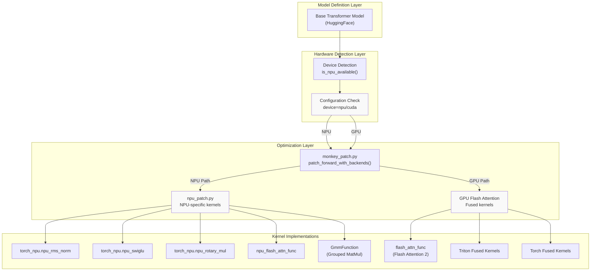
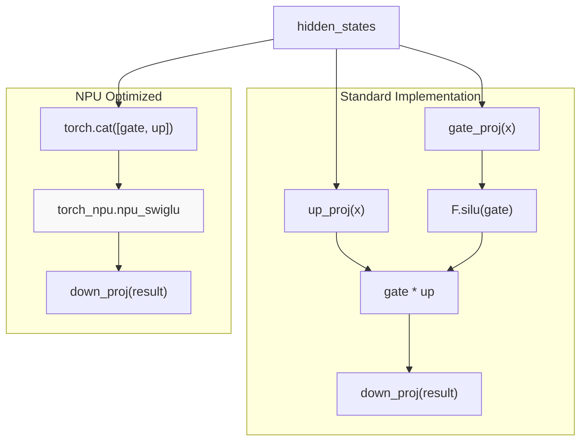
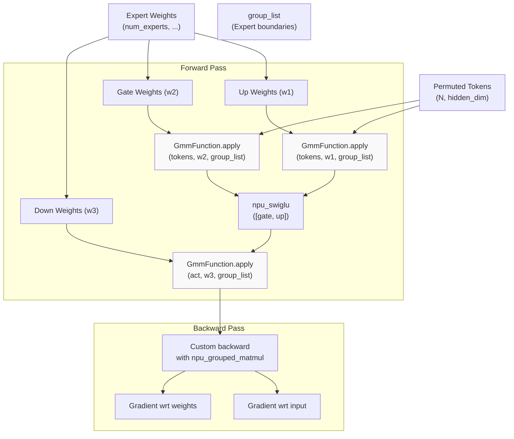
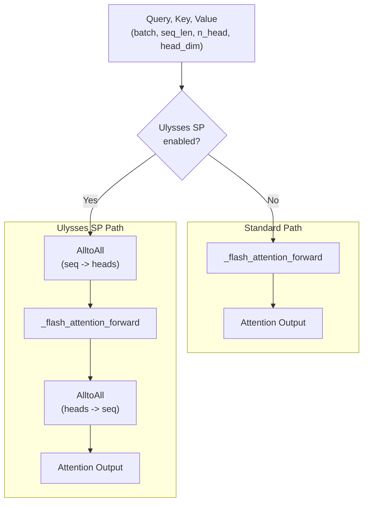
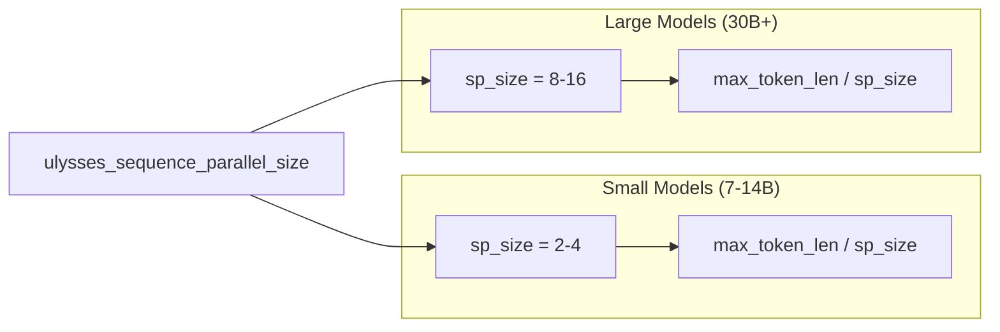
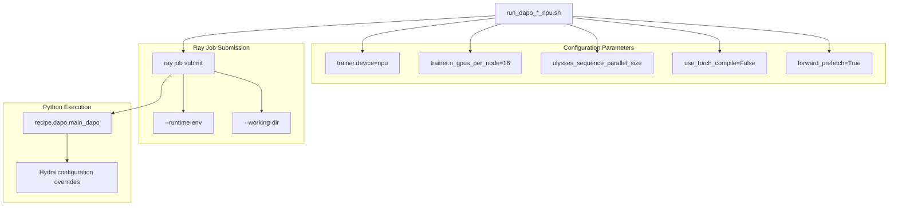

<!-- source: DeepWiki mcp.deepwiki.com · repo allenai/SAGE · page 6.1 Hardware Optimizations · fetched 2026-10-26 -->

# Hardware Optimizations

<details>
<summary>Relevant source files</summary>

The following files were used as context for generating this wiki page:

- [verl/recipe/dapo/run_dapo_early_qwen2.5_32b.sh](verl/recipe/dapo/run_dapo_early_qwen2.5_32b.sh)
- [verl/recipe/dapo/run_dapo_qwen2.5_32b.sh](verl/recipe/dapo/run_dapo_qwen2.5_32b.sh)
- [verl/recipe/dapo/run_dapo_qwen2.5_32b_npu.sh](verl/recipe/dapo/run_dapo_qwen2.5_32b_npu.sh)
- [verl/recipe/dapo/run_dapo_qwen2.5_32b_tis.sh](verl/recipe/dapo/run_dapo_qwen2.5_32b_tis.sh)
- [verl/recipe/dapo/run_dapo_qwen2.5_7b_npu.sh](verl/recipe/dapo/run_dapo_qwen2.5_7b_npu.sh)
- [verl/recipe/dapo/run_dapo_qwen3_14b_base_npu.sh](verl/recipe/dapo/run_dapo_qwen3_14b_base_npu.sh)
- [verl/recipe/dapo/run_dapo_qwen3_8b_base_npu.sh](verl/recipe/dapo/run_dapo_qwen3_8b_base_npu.sh)
- [verl/recipe/dapo/run_dapo_qwen3_moe_30b_base_fsdp_npu.sh](verl/recipe/dapo/run_dapo_qwen3_moe_30b_base_fsdp_npu.sh)
- [verl/recipe/dapo/run_dapo_wo_ds_qwen2.5_32b.sh](verl/recipe/dapo/run_dapo_wo_ds_qwen2.5_32b.sh)
- [verl/recipe/dapo/test_dapo_7b.sh](verl/recipe/dapo/test_dapo_7b.sh)
- [verl/verl/models/llama/megatron/modeling_llama_megatron.py](verl/verl/models/llama/megatron/modeling_llama_megatron.py)
- [verl/verl/models/qwen2/megatron/modeling_qwen2_megatron.py](verl/verl/models/qwen2/megatron/modeling_qwen2_megatron.py)
- [verl/verl/models/transformers/apertus.py](verl/verl/models/transformers/apertus.py)
- [verl/verl/models/transformers/llama.py](verl/verl/models/transformers/llama.py)
- [verl/verl/models/transformers/monkey_patch.py](verl/verl/models/transformers/monkey_patch.py)
- [verl/verl/models/transformers/npu_patch.py](verl/verl/models/transformers/npu_patch.py)
- [verl/verl/models/transformers/qwen2.py](verl/verl/models/transformers/qwen2.py)
- [verl/verl/models/transformers/qwen2_vl.py](verl/verl/models/transformers/qwen2_vl.py)
- [verl/verl/utils/megatron/pipeline_parallel.py](verl/verl/utils/megatron/pipeline_parallel.py)

</details>


## Purpose and Scope

This document describes hardware-specific optimizations implemented in the SAGE/verl framework to improve training performance across different accelerator types. The framework provides two primary hardware backends:

- **GPU (CUDA)**: NVIDIA GPUs with Flash Attention and optional fused kernels
- **NPU (Ascend)**: Huawei Ascend NPUs with custom kernel implementations

For general model architecture information, see [Model Support](#4). For distributed training strategies, see [Distributed Architecture](#2.3). For long context training with Ulysses sequence parallelism, see [Long Context Training](#6.2).

---

## Hardware Backend Architecture

The framework implements a layered optimization approach where hardware-specific kernels are applied through monkey patching to maintain compatibility with standard transformer implementations.



**Sources:** [verl/verl/models/transformers/npu_patch.py:1-208](), [verl/verl/models/transformers/monkey_patch.py:196-244]()

---

## NPU (Ascend) Hardware Optimizations

### Overview

The framework provides comprehensive support for Huawei Ascend NPUs through the `torch_npu` library. Optimizations are automatically applied when the device is set to `npu` in the trainer configuration.

### NPU Kernel Implementations

The following optimized kernels are provided for NPU hardware:

| Kernel | Standard Implementation | NPU Implementation | Purpose |
|--------|------------------------|-------------------|---------|
| RMS Normalization | `torch` operations | `torch_npu.npu_rms_norm` | Layer normalization for transformers |
| SwiGLU Activation | Separate gate/up/down projections | `torch_npu.npu_swiglu` | Fused activation for MLP layers |
| Rotary Position Embedding | Complex number operations | `torch_npu.npu_rotary_mul` | Efficient RoPE computation |
| Flash Attention | `flash_attn_func` | `npu_flash_attn_func` | Optimized attention mechanism |
| Grouped Matrix Multiply | Sequential matmul | `torch_npu.npu_grouped_matmul` | MoE expert routing |

**Sources:** [verl/verl/models/transformers/npu_patch.py:54-165]()

### RMS Normalization Optimization

The NPU-optimized RMS normalization replaces the standard PyTorch implementation:


Applied to model classes:
- `Qwen2RMSNorm` in Qwen2.5-VL models
- `Qwen3MoeRMSNorm` in Qwen3 MoE models  
- `Qwen3RMSNorm` in Qwen3 dense models

**Sources:** [verl/verl/models/transformers/npu_patch.py:54-55](), [verl/verl/models/transformers/npu_patch.py:197-204]()

### SwiGLU Activation Optimization

The SwiGLU activation in MLP layers is fused into a single kernel call:



**Sources:** [verl/verl/models/transformers/npu_patch.py:58-61]()

### Rotary Position Embedding Optimization

NPU provides a specialized kernel for rotary position embeddings that avoids complex number conversions:

**Sources:** [verl/verl/models/transformers/npu_patch.py:64-69](), [verl/verl/models/transformers/npu_patch.py:37-50]()

### Flash Attention on NPU

Flash Attention is supported on NPU through the `transformers.integrations.npu_flash_attention` module. The framework automatically detects Flash Attention availability and enables it when `attn_implementation="flash_attention_2"` is specified.

**Sources:** [verl/verl/models/transformers/npu_patch.py:168-194]()

### MoE Grouped Matrix Multiplication

For Mixture-of-Experts models, the NPU backend provides optimized grouped matrix multiplication through a custom autograd function:



**Sources:** [verl/verl/models/transformers/npu_patch.py:72-96](), [verl/verl/models/transformers/npu_patch.py:99-165]()

---

## GPU Optimizations

### Flash Attention Integration

For GPU training, the framework integrates Flash Attention 2 for efficient attention computation. The implementation supports:

- Standard Flash Attention for causal language modeling
- Ulysses sequence parallelism with AlltoAll communication (see [Long Context Training](#6.2))
- Variable-length sequences with padding removal



**Sources:** [verl/verl/models/transformers/monkey_patch.py:49-117](), [verl/verl/models/transformers/llama.py:42-167]()

### Fused Kernel Backends

The framework supports two fused kernel backends for GPU training:

1. **Triton Backend**: Uses Triton-compiled kernels for custom operations
2. **Torch Backend**: Uses PyTorch native fused operations

Fused kernels are enabled through configuration and applied via monkey patching:

**Sources:** [verl/verl/models/transformers/monkey_patch.py:196-244]()

---

## Configuration for Hardware-Specific Training

### NPU Training Configuration

To enable NPU training, set the `device` parameter in the trainer configuration:

```yaml
trainer:
  device: npu
  n_gpus_per_node: 16  # NPUs per node
```

Additional NPU-specific optimizations are configured through the actor/ref workers:

| Configuration Parameter | Purpose | Typical Value |
|------------------------|---------|---------------|
| `use_torch_compile` | Disable torch.compile (incompatible with NPU) | `False` |
| `entropy_checkpointing` | Enable gradient checkpointing for entropy | `True` |
| `forward_prefetch` | Enable FSDP forward prefetching | `True` |
| `ulysses_sequence_parallel_size` | Sequence parallel size for long contexts | `2-16` |

**Sources:** [verl/recipe/dapo/run_dapo_qwen3_14b_base_npu.sh:132-139](), [verl/recipe/dapo/run_dapo_qwen2.5_32b_npu.sh:84-86]()

### GPU Training Configuration

For GPU training, the default device is `cuda` (can be omitted):

```yaml
trainer:
  device: cuda  # or omit this line
  n_gpus_per_node: 8
```

Enable fused kernels through model configuration:

**Sources:** [verl/recipe/dapo/run_dapo_qwen2.5_32b.sh:1-131]()

---

## Performance Tuning Parameters

### Memory Management

Different memory configurations are used for NPU vs GPU:

| Parameter | NPU Configuration | GPU Configuration |
|-----------|------------------|-------------------|
| `gpu_memory_utilization` (vLLM) | `0.80-0.90` | `0.70-0.85` |
| `param_offload` (FSDP) | `True` (often required) | `True/False` (model-dependent) |
| `optimizer_offload` (FSDP) | `True` (often required) | `True/False` (model-dependent) |

**Sources:** [verl/recipe/dapo/run_dapo_qwen2.5_32b_npu.sh:56-58](), [verl/recipe/dapo/run_dapo_qwen2.5_32b.sh:54-56]()

### Sequence Parallelism Configuration

For long context training on NPU, Ulysses sequence parallelism is critical:



**Sources:** [verl/recipe/dapo/run_dapo_qwen3_14b_base_npu.sh:49-52](), [verl/recipe/dapo/run_dapo_qwen3_moe_30b_base_fsdp_npu.sh:53-56]()

### MoE-Specific Optimizations on NPU

For Mixture-of-Experts models on NPU, additional configuration is required:

| Parameter | Purpose | Typical Value |
|-----------|---------|---------------|
| `sp_size` | Sequence parallel size | `8-16` (higher for load balance) |
| `max_num_seqs` | Maximum sequences in vLLM batch | `128` |
| `enforce_eager` | Disable CUDA graph caching | `False` |
| `free_cache_engine` | Free vLLM cache between iterations | `True` |

**Sources:** [verl/recipe/dapo/run_dapo_qwen3_moe_30b_base_fsdp_npu.sh:53-61](), [verl/recipe/dapo/run_dapo_qwen3_moe_30b_base_fsdp_npu.sh:126-127]()

### Gradient Checkpointing

Gradient checkpointing (activation recomputation) is enabled to reduce memory usage:

```yaml
actor_rollout_ref:
  model:
    enable_gradient_checkpointing: True
  actor:
    entropy_checkpointing: True  # NPU-specific
  ref:
    entropy_checkpointing: True  # NPU-specific
```

**Sources:** [verl/recipe/dapo/run_dapo_qwen3_14b_base_npu.sh:89](), [verl/recipe/dapo/run_dapo_qwen3_14b_base_npu.sh:134-136]()

---

## Hardware-Specific Training Examples

### NPU Training Command Structure



**Sources:** [verl/recipe/dapo/run_dapo_qwen3_14b_base_npu.sh:1-140]()

### Performance Comparison: NPU vs GPU Configuration

Key differences in configuration between NPU and GPU training:

| Aspect | NPU Configuration | GPU Configuration |
|--------|------------------|-------------------|
| Device specification | `trainer.device=npu` | `trainer.device=cuda` (default) |
| Torch compile | `use_torch_compile=False` | `use_torch_compile=True` (optional) |
| Forward prefetch | `forward_prefetch=True` | `forward_prefetch=False` (default) |
| Entropy checkpointing | `entropy_checkpointing=True` | Not typically used |
| Memory utilization | Higher (0.80-0.90) | Lower (0.70-0.85) |
| Chunked prefill | Often disabled | Often enabled |

**Sources:** [verl/recipe/dapo/run_dapo_qwen2.5_32b_npu.sh:84-141](), [verl/recipe/dapo/run_dapo_qwen2.5_32b.sh:1-131]()

---

