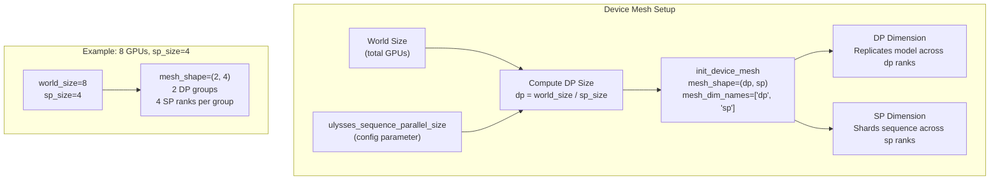
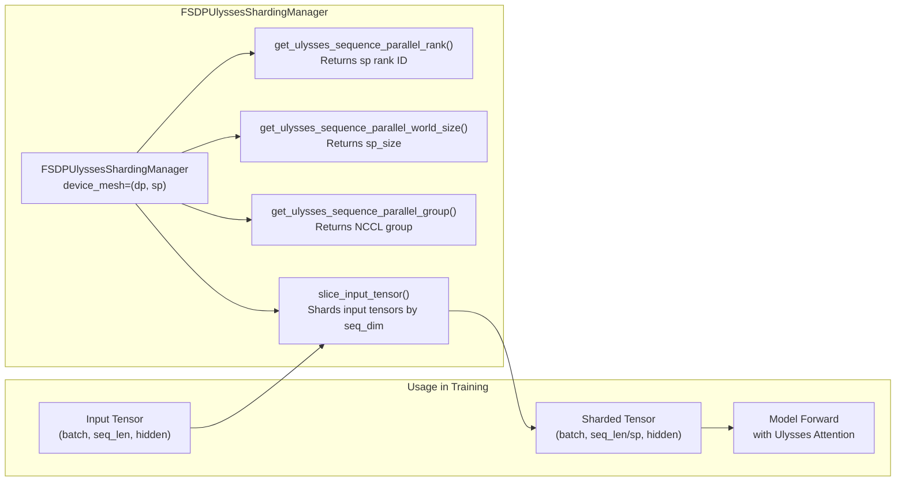
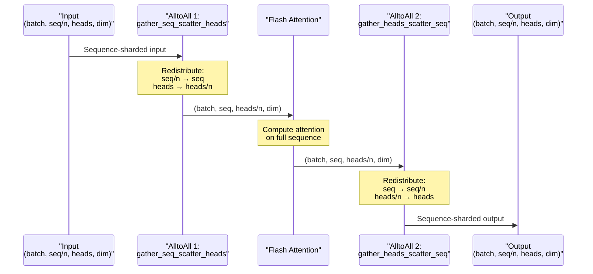
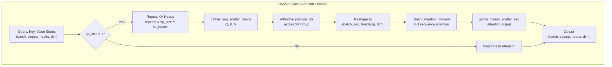
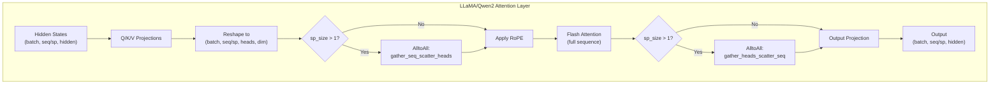
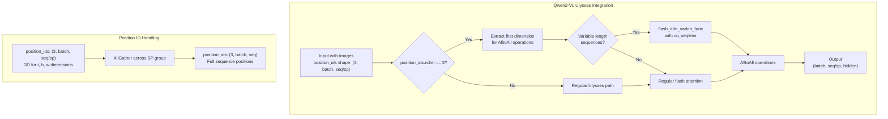
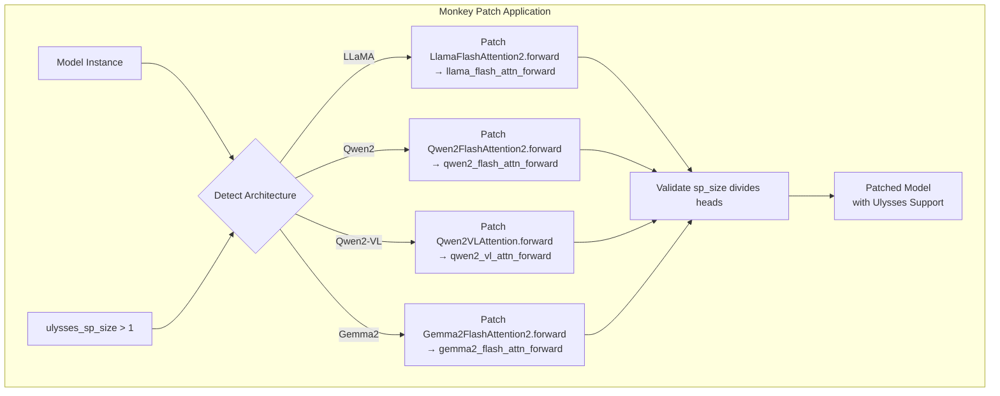
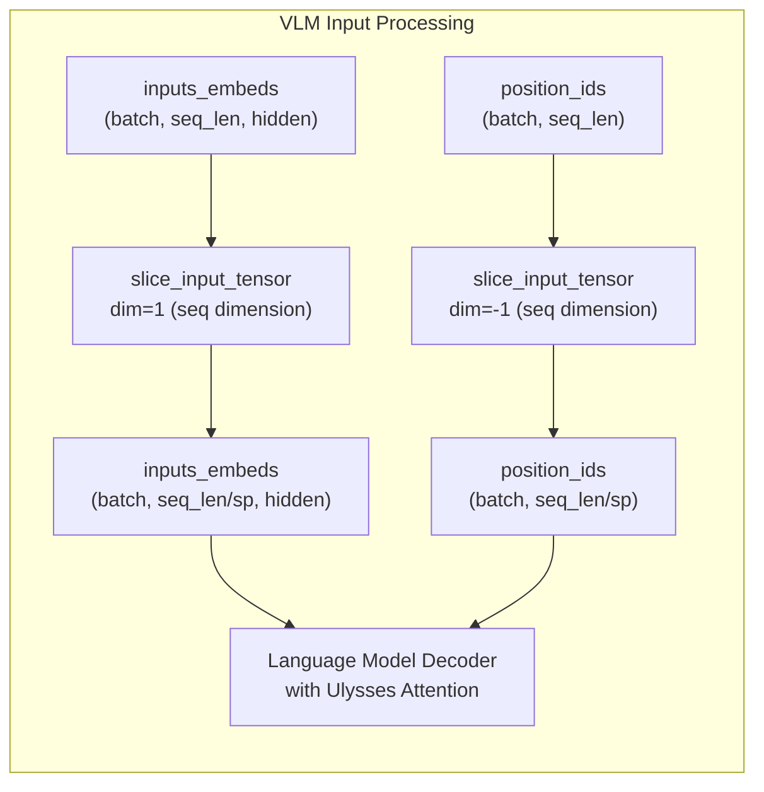
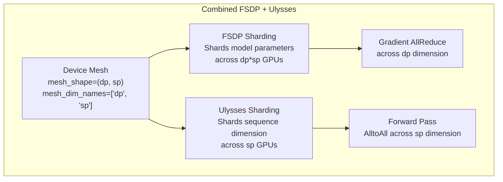
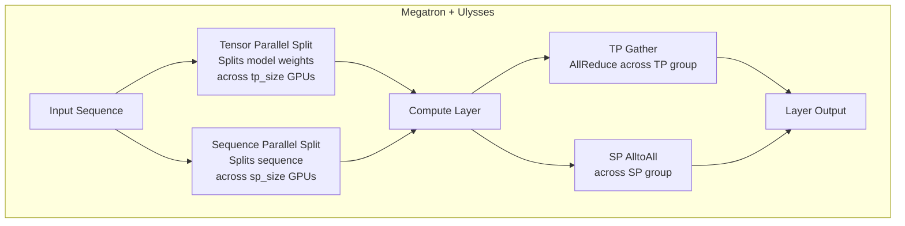

<!-- source: DeepWiki mcp.deepwiki.com · repo allenai/SAGE · page 6.2 Long Context Training · fetched 2026-10-26 -->

# Long Context Training

<details>
<summary>Relevant source files</summary>

The following files were used as context for generating this wiki page:

- [verl/recipe/one_step_off_policy/README.md](verl/recipe/one_step_off_policy/README.md)
- [verl/scripts/legacy_model_merger.py](verl/scripts/legacy_model_merger.py)
- [verl/verl/model_merger/fsdp_model_merger.py](verl/verl/model_merger/fsdp_model_merger.py)
- [verl/verl/model_merger/megatron_model_merger.py](verl/verl/model_merger/megatron_model_merger.py)
- [verl/verl/models/llama/megatron/checkpoint_utils/llama_loader_depracated.py](verl/verl/models/llama/megatron/checkpoint_utils/llama_loader_depracated.py)
- [verl/verl/models/llama/megatron/modeling_llama_megatron.py](verl/verl/models/llama/megatron/modeling_llama_megatron.py)
- [verl/verl/models/qwen2/megatron/modeling_qwen2_megatron.py](verl/verl/models/qwen2/megatron/modeling_qwen2_megatron.py)
- [verl/verl/models/transformers/apertus.py](verl/verl/models/transformers/apertus.py)
- [verl/verl/models/transformers/llama.py](verl/verl/models/transformers/llama.py)
- [verl/verl/models/transformers/monkey_patch.py](verl/verl/models/transformers/monkey_patch.py)
- [verl/verl/models/transformers/npu_patch.py](verl/verl/models/transformers/npu_patch.py)
- [verl/verl/models/transformers/qwen2.py](verl/verl/models/transformers/qwen2.py)
- [verl/verl/models/transformers/qwen2_vl.py](verl/verl/models/transformers/qwen2_vl.py)
- [verl/verl/utils/megatron/pipeline_parallel.py](verl/verl/utils/megatron/pipeline_parallel.py)
- [verl/verl/workers/fsdp_workers.py](verl/verl/workers/fsdp_workers.py)

</details>


## Purpose and Scope

This document covers **Ulysses Sequence Parallelism**, the technique used in SAGE for training models with long context sequences. Ulysses enables efficient long-context training by distributing the sequence dimension across multiple GPUs using AlltoAll communication patterns. This approach is complementary to other parallelism strategies covered in [Model Parallelism Strategies](#4.3).

For inference-specific optimizations, see [Inference Integration](#6.3). For general hardware optimizations, see [Hardware Optimizations](#6.1).

## Overview

Ulysses Sequence Parallelism addresses the memory bottleneck of long-context training by sharding input sequences across GPUs. Unlike data parallelism (which replicates the model) or tensor parallelism (which shards model parameters), sequence parallelism distributes the sequence dimension itself. This is particularly effective for transformer models where attention computation scales quadratically with sequence length.

**Key characteristics:**
- Distributes sequence dimension across `sp_size` GPUs
- Each GPU processes `seq_len / sp_size` tokens
- Uses AlltoAll collectives to exchange data between attention computation phases
- Works seamlessly with FSDP and Megatron backends
- Minimal code changes required to existing model implementations

Sources: [verl/verl/workers/fsdp_workers.py:162-179]()

## Architecture

### Device Mesh Configuration

The system creates separate device meshes for data parallelism and sequence parallelism:



**Device Mesh Initialization**

The device mesh is created during worker initialization:

```python
# From ActorRolloutRefWorker.__init__
self.ulysses_sequence_parallel_size = self.config.actor.get("ulysses_sequence_parallel_size", 1)
dp = world_size // self.ulysses_sequence_parallel_size

if self.ulysses_sequence_parallel_size > 1:
    self.ulysses_device_mesh = init_device_mesh(
        device_name, 
        mesh_shape=(dp, self.ulysses_sequence_parallel_size), 
        mesh_dim_names=["dp", "sp"]
    )
```

Sources: [verl/verl/workers/fsdp_workers.py:162-168]()

### Sharding Manager

The `FSDPUlyssesShardingManager` coordinates parameter and data sharding between FSDP and Ulysses:



**Key Methods:**

| Method | Purpose | Return Type |
|--------|---------|-------------|
| `get_ulysses_sequence_parallel_rank()` | Get current rank in SP group | `int` |
| `get_ulysses_sequence_parallel_world_size()` | Get total SP size | `int` |
| `get_ulysses_sequence_parallel_group()` | Get NCCL process group | `ProcessGroup` |
| `slice_input_tensor(tensor, dim, padding)` | Shard tensor along dimension | `torch.Tensor` |

Sources: [verl/verl/workers/sharding_manager/fsdp_ulysses.py]()

## Communication Pattern

### AlltoAll Mechanism

Ulysses uses AlltoAll collectives to redistribute data between sequence-sharded and head-sharded layouts:



**Transform Operations:**

1. **gather_seq_scatter_heads**: Converts `(batch, seq/n, heads, dim)` → `(batch, seq, heads/n, dim)`
   - Gathers sequence dimension across SP group
   - Scatters head dimension across SP group

2. **gather_heads_scatter_seq**: Converts `(batch, seq, heads/n, dim)` → `(batch, seq/n, heads, dim)`
   - Gathers head dimension across SP group
   - Scatters sequence dimension across SP group

Sources: [verl/verl/utils/ulysses.py](), [verl/verl/models/transformers/monkey_patch.py:49-117]()

### Flash Attention Integration

The `_ulysses_flash_attention_forward` function wraps standard flash attention with AlltoAll operations:



**Key Implementation Details:**

- **KV Head Repetition**: When `kv_heads < sp_size`, key/value heads are repeated to enable proper sharding
- **Position ID Gathering**: Position IDs must be gathered across the SP group for correct attention mask construction
- **Query Length**: The `query_length` parameter is updated after AlltoAll to reflect the full sequence length

Sources: [verl/verl/models/transformers/monkey_patch.py:49-117]()

## Model-Specific Implementations

### Standard Transformer Models (LLaMA, Qwen2)

For standard decoder-only models, Ulysses is applied uniformly across all attention layers:



**Configuration:**

| Parameter | Description | Example |
|-----------|-------------|---------|
| `ulysses_sequence_parallel_size` | Number of GPUs for sequence parallelism | `4` or `8` |
| `num_attention_heads` | Must be divisible by `sp_size` | `32` (sp_size=4) |
| `num_key_value_heads` | Can be less than `sp_size` (uses repetition) | `8` (sp_size=4) |

Sources: [verl/verl/models/transformers/llama.py:42-157](), [verl/verl/models/transformers/qwen2.py:35-157]()

### Vision-Language Models (Qwen2-VL)

Qwen2-VL requires special handling due to multi-dimensional RoPE (mrope) and variable sequence lengths:



**Special Considerations:**

1. **3D Position IDs**: Qwen2-VL uses `(3, batch_size, seq_length)` position IDs for temporal, height, and width dimensions
2. **Variable Length Sequences**: Uses `flash_attn_varlen_func` with `cu_seqlens` for batches with mixed text and image tokens
3. **Vision Tower Exclusion**: Vision attention layers use eager mode (`attn_implementation="eager"`) and don't use Ulysses

Sources: [verl/verl/models/transformers/qwen2_vl.py:164-265](), [verl/verl/workers/fsdp_workers.py:331-335]()

## Configuration

### YAML Configuration

Enable Ulysses by setting `ulysses_sequence_parallel_size` in the actor config:

```yaml
actor:
  ulysses_sequence_parallel_size: 4  # Use 4 GPUs for sequence parallelism
  
  fsdp_config:
    fsdp_size: -1  # Use all remaining GPUs for FSDP
    param_offload: false
    optimizer_offload: false
```

**Configuration Rules:**

- `world_size` must be divisible by `ulysses_sequence_parallel_size`
- `num_attention_heads` should be divisible by `sp_size` for optimal performance
- Data parallel size is automatically computed: `dp_size = world_size / sp_size`

### Batch Size Normalization

When using Ulysses, batch sizes are normalized by the DP group size (not the full world size):

```python
# From ActorRolloutRefWorker.__init__
self.config.actor.ppo_mini_batch_size *= self.config.rollout.n
self.config.actor.ppo_mini_batch_size //= (
    self.device_mesh.size() // self.ulysses_sequence_parallel_size
)
```

**Example:**
- `world_size = 8`, `sp_size = 4`, `rollout.n = 32`, `ppo_mini_batch_size = 64`
- Effective batch size per GPU: `64 * 32 / (8 / 4) = 1024`

Sources: [verl/verl/workers/fsdp_workers.py:233-256]()

## Monkey Patching System

### Automatic Model Patching

The `apply_monkey_patch` function automatically patches models to use Ulysses:



**Supported Models:**

| Model Architecture | Attention Module | Patch Function |
|-------------------|------------------|----------------|
| LLaMA / LLaMA-2 / LLaMA-3 | `LlamaFlashAttention2` | `llama_flash_attn_forward` |
| Qwen2 / Qwen2.5 | `Qwen2FlashAttention2` | `qwen2_flash_attn_forward` |
| Qwen2-VL / Qwen2.5-VL | `Qwen2VLAttention` | `qwen2_vl_attn_forward` |
| Gemma2 | `Gemma2FlashAttention2` | `gemma2_flash_attn_forward` |
| Apertus | `ApertusAttention` | `apertus_attn_forward` |

Sources: [verl/verl/models/transformers/monkey_patch.py:218-365]()

### VLM Input Slicing

For vision-language models, input embeddings are sliced before entering the decoder:



**Implementation:**

The system patches the decoder's forward method to slice inputs when `sp_size > 1`:

```python
# Pseudo-code from monkey patch
if inputs_embeds is not None and sp_size > 1:
    inputs_embeds = slice_input_tensor(inputs_embeds, dim=1, padding=False)
    position_ids = slice_input_tensor(position_ids, dim=-1, padding=False)
```

Sources: [verl/verl/models/transformers/monkey_patch.py:120-163]()

## Performance Considerations

### Memory Efficiency

Ulysses Sequence Parallelism provides linear memory scaling with sequence length:

| Configuration | Memory per GPU | Effective Context |
|---------------|----------------|-------------------|
| No SP (1 GPU) | 1x | 8K tokens |
| SP size = 4 | ~0.3x | 32K tokens |
| SP size = 8 | ~0.15x | 64K tokens |

**Memory Breakdown:**
- **Activation Memory**: Reduced by `1/sp_size` (sequence dimension is sharded)
- **Model Memory**: Unchanged (model parameters are replicated or FSDP-sharded independently)
- **Communication Overhead**: 2 AlltoAll operations per attention layer

### Communication Overhead

**AlltoAll Communication Cost:**

Each attention layer performs 2 AlltoAll operations:
1. Before attention: `gather_seq_scatter_heads`
2. After attention: `gather_heads_scatter_seq`

**Communication Volume per Layer:**
- Data size: `batch_size * seq_len * hidden_size * dtype_size`
- Each rank sends/receives: `batch_size * (seq_len/sp_size) * hidden_size * dtype_size`

**Optimization Tips:**
- Use high-bandwidth interconnects (InfiniBand, NVLink)
- Increase `sp_size` only when necessary (communication overhead grows with `sp_size`)
- Combine with pipeline parallelism to hide communication latency

### Validation Requirements

The system validates configuration constraints:

```python
def validate_ulysses_config(num_heads: int, sp_size: int):
    """Validates that num_heads is divisible by sp_size"""
    assert num_heads % sp_size == 0, (
        f"num_heads ({num_heads}) must be divisible by "
        f"ulysses_sequence_parallel_size ({sp_size})"
    )
```

**Common Issues:**

| Issue | Cause | Solution |
|-------|-------|----------|
| `num_heads not divisible by sp_size` | Configuration mismatch | Choose `sp_size` that divides `num_heads` |
| OOM during training | `sp_size` too small | Increase `sp_size` to shard longer sequences |
| High communication time | `sp_size` too large | Reduce `sp_size` or use faster interconnect |

Sources: [verl/verl/utils/ulysses.py]()

## Integration with FSDP and Megatron

### FSDP Integration

Ulysses works alongside FSDP by using separate mesh dimensions:



**Configuration Example:**
```yaml
# 8 GPUs: 2 DP groups, 4 SP ranks per group
actor:
  ulysses_sequence_parallel_size: 4
  fsdp_config:
    fsdp_size: -1  # Uses all 8 GPUs for FSDP
```

Sources: [verl/verl/workers/fsdp_workers.py:159-179]()

### Megatron Integration

For Megatron models, sequence parallelism can be combined with tensor parallelism:



**Note:** Megatron has its own sequence parallelism implementation (`megatron_config.sequence_parallel`). The Ulysses implementation is specifically for FSDP-based training but follows similar principles.

Sources: [verl/verl/models/llama/megatron/modeling_llama_megatron.py:269-274](), [verl/verl/models/qwen2/megatron/modeling_qwen2_megatron.py:269-274]()

---

