<!-- source: DeepWiki mcp.deepwiki.com · repo allenai/SAGE · page 6.3 Inference Integration · fetched 2026-10-26 -->

# Inference Integration

<details>
<summary>Relevant source files</summary>

The following files were used as context for generating this wiki page:

- [verl/recipe/one_step_off_policy/README.md](verl/recipe/one_step_off_policy/README.md)
- [verl/scripts/legacy_model_merger.py](verl/scripts/legacy_model_merger.py)
- [verl/verl/model_merger/fsdp_model_merger.py](verl/verl/model_merger/fsdp_model_merger.py)
- [verl/verl/model_merger/megatron_model_merger.py](verl/verl/model_merger/megatron_model_merger.py)
- [verl/verl/models/llama/megatron/checkpoint_utils/llama_loader_depracated.py](verl/verl/models/llama/megatron/checkpoint_utils/llama_loader_depracated.py)
- [verl/verl/third_party/sglang/parallel_state.py](verl/verl/third_party/sglang/parallel_state.py)
- [verl/verl/utils/fsdp_utils.py](verl/verl/utils/fsdp_utils.py)
- [verl/verl/workers/engine/base.py](verl/verl/workers/engine/base.py)
- [verl/verl/workers/engine/fsdp/transformer_impl.py](verl/verl/workers/engine/fsdp/transformer_impl.py)
- [verl/verl/workers/engine/megatron/transformer_impl.py](verl/verl/workers/engine/megatron/transformer_impl.py)
- [verl/verl/workers/fsdp_workers.py](verl/verl/workers/fsdp_workers.py)
- [verl/verl/workers/reward_model/megatron/reward_model.py](verl/verl/workers/reward_model/megatron/reward_model.py)
- [verl/verl/workers/sharding_manager/fsdp_vllm.py](verl/verl/workers/sharding_manager/fsdp_vllm.py)

</details>


## Purpose and Scope

This document describes how SAGE integrates high-throughput inference engines (vLLM and SGLang) with distributed training frameworks (FSDP and Megatron) for efficient rollout generation during RLHF training. It covers parameter synchronization mechanisms, hybrid engine mode switching, and memory management strategies that enable seamless transitions between training and inference modes.

For training engine implementations, see [System Components](#5). For rollout generation configuration, see [Training Pipeline](#2.1).

## Overview

SAGE supports two primary modes of inference integration:

1. **Hybrid Engine Mode**: Colocated training and inference on the same workers with dynamic mode switching
2. **Separate Worker Mode**: Dedicated workers for training and inference with explicit parameter synchronization

Both modes require efficient parameter transfer from FSDP/Megatron training models to vLLM/SGLang inference engines while managing GPU memory constraints.

**Supported Inference Engines:**
- vLLM (version 0.5.4+, with 0.7.3+ requiring `VLLMHijack`)
- SGLang (for RadixAttention support)

**Integration Architecture:**

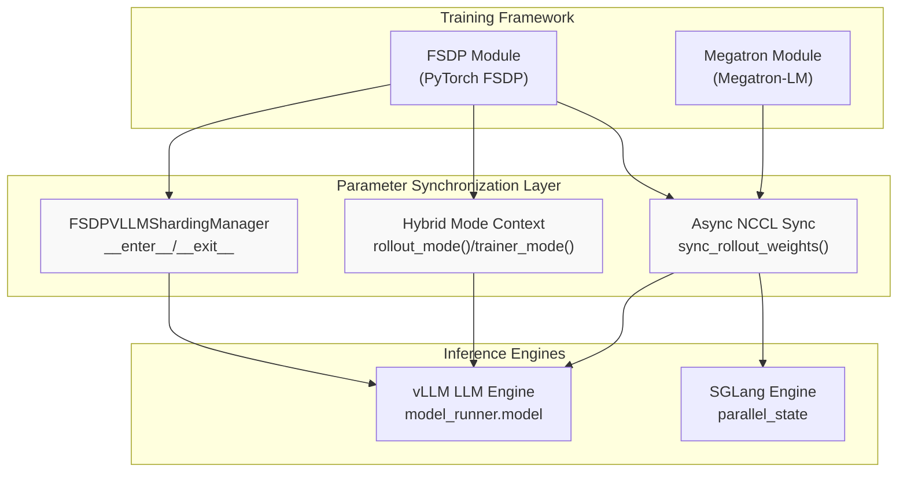

Sources: [verl/verl/workers/fsdp_workers.py:655-754](), [verl/verl/workers/sharding_manager/fsdp_vllm.py:57-127]()

## Hybrid Engine Mode Switching

The `ActorRolloutRefWorker` implements hybrid engine functionality when `rollout.name` is configured as `vllm` or `sglang` and the worker role is `actor_rollout` or `actor_rollout_ref`.

### Mode Transition Methods

| Method | Purpose | Key Operations |
|--------|---------|----------------|
| `rollout_mode()` | Switch to inference mode | Offload training params → Load inference engine → Update weights → Set random state |
| `trainer_mode()` | Switch to training mode | Sleep inference engine → Restore training mode → Empty cache → Restore random state |

**Context Manager Implementation:**

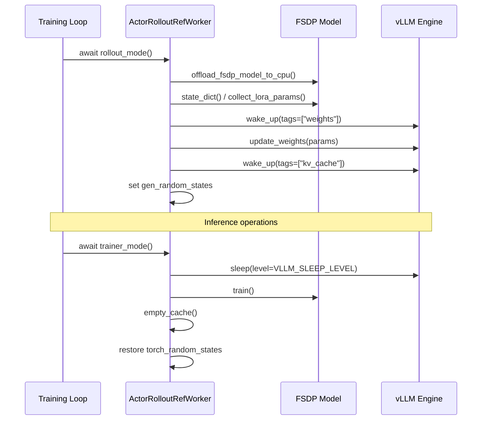

Sources: [verl/verl/workers/fsdp_workers.py:655-754](), [verl/verl/utils/memory_utils.py]()

### Parameter Offloading Strategy

The hybrid engine supports manual parameter offloading controlled by `actor.fsdp_config.param_offload`:

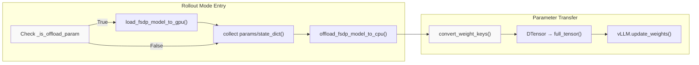

Sources: [verl/verl/workers/fsdp_workers.py:659-700](), [verl/verl/utils/fsdp_utils.py:143-201]()

### LoRA Support in Hybrid Mode

For LoRA-enabled models, the system supports incremental weight updates:

- **First sync** (`base_sync_done=False`): Transfer full base model weights
- **Subsequent syncs** (`base_sync_done=True`): Transfer only LoRA adapter weights using `TensorLoRARequest`

**Layered Summoning** (`layered_summon=True`): Efficiently collect LoRA parameters layer-by-layer to reduce memory overhead.

Sources: [verl/verl/workers/fsdp_workers.py:664-733](), [verl/verl/utils/fsdp_utils.py:621-645]()

## Parameter Synchronization Mechanisms

### State Dict Collection

**FSDP State Dict Modes:**

| FSDP Version | Configuration | Behavior |
|--------------|---------------|----------|
| FSDP v1 (PyTorch <2.4) | `FULL_STATE_DICT` | Rank 0 gathers all parameters |
| FSDP v1 | `SHARDED_STATE_DICT` | Each rank holds parameter shards |
| FSDP v2 (PyTorch ≥2.4) | `DTensor` | Distributed tensors with device mesh |

Sources: [verl/verl/workers/fsdp_workers.py:625-637](), [verl/verl/utils/fsdp_utils.py:99-108]()

### Weight Key Conversion

The `convert_weight_keys()` function transforms FSDP parameter names to vLLM-compatible names:

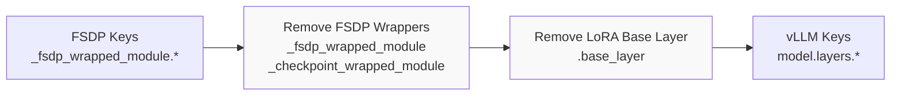

Sources: [verl/verl/utils/model.py:convert_weight_keys](), [verl/verl/workers/fsdp_workers.py:678-680]()

### DTensor Handling

For FSDP2 with `DTensor` parameters:

```python
# Convert DTensor to full tensor on appropriate device
device = get_device_id()  # Target device for vLLM
per_tensor_param = (
    (name, param.to(device, non_blocking=True).full_tensor() 
     if isinstance(param, DTensor) else param)
    for name, param in params.items()
)
```

Sources: [verl/verl/workers/fsdp_workers.py:706-711](), [verl/verl/workers/engine/fsdp/transformer_impl.py:640-644]()

## FSDPVLLMShardingManager

The `FSDPVLLMShardingManager` (deprecated but still functional) provides a context manager for parameter synchronization with additional features like TP (tensor parallel) sharding.

### Initialization Parameters

| Parameter | Type | Purpose |
|-----------|------|---------|
| `module` | `FSDP` | FSDP-wrapped training model |
| `inference_engine` | `LLM` | vLLM inference engine instance |
| `full_params` | `bool` | Use full state dict vs sharded |
| `device_mesh` | `DeviceMesh` | Mesh with `dp`, `infer_tp`, `infer_pp` dimensions |
| `offload_param` | `bool` | Enable manual parameter offloading |
| `load_format` | `str` | `"dummy_hf"` or `"safetensors"` (affects `base_sync_done`) |
| `layered_summon` | `bool` | Enable layer-wise LoRA parameter collection |

Sources: [verl/verl/workers/sharding_manager/fsdp_vllm.py:66-127]()

### Context Manager Workflow

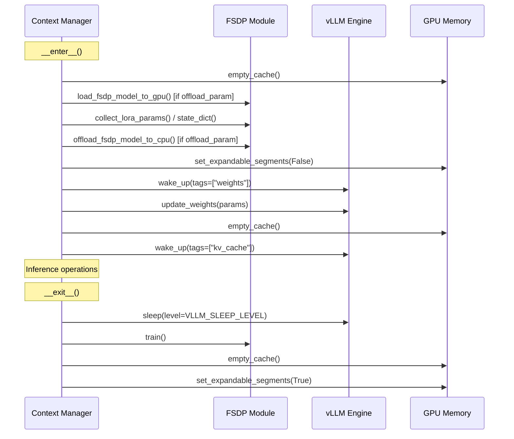

Sources: [verl/verl/workers/sharding_manager/fsdp_vllm.py:129-262]()

### Memory Allocator Management

**PyTorch vs vLLM Memory Management:**

- **PyTorch**: Uses caching memory allocator with `expandable_segments`
- **vLLM**: Uses custom `CuMemAllocator` for KV cache management

The sharding manager toggles `expandable_segments` to prevent conflicts:

```python
set_expandable_segments(False)  # Before vLLM wake_up
# ... vLLM operations ...
set_expandable_segments(True)   # After vLLM sleep
```

Sources: [verl/verl/workers/sharding_manager/fsdp_vllm.py:187-257](), [verl/verl/utils/device.py:set_expandable_segments]()

### TP Group Preprocessing

For multi-TP configurations, the sharding manager performs `all_gather` across TP ranks before inference:

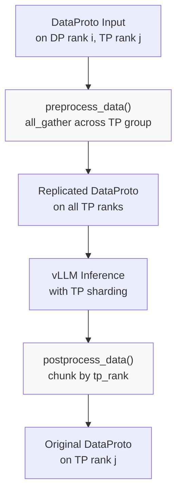

Sources: [verl/verl/workers/sharding_manager/fsdp_vllm.py:264-282]()

## vLLM Weight Loading

### Model Weight Update

The `update_params()` method loads parameters into the vLLM model runner:

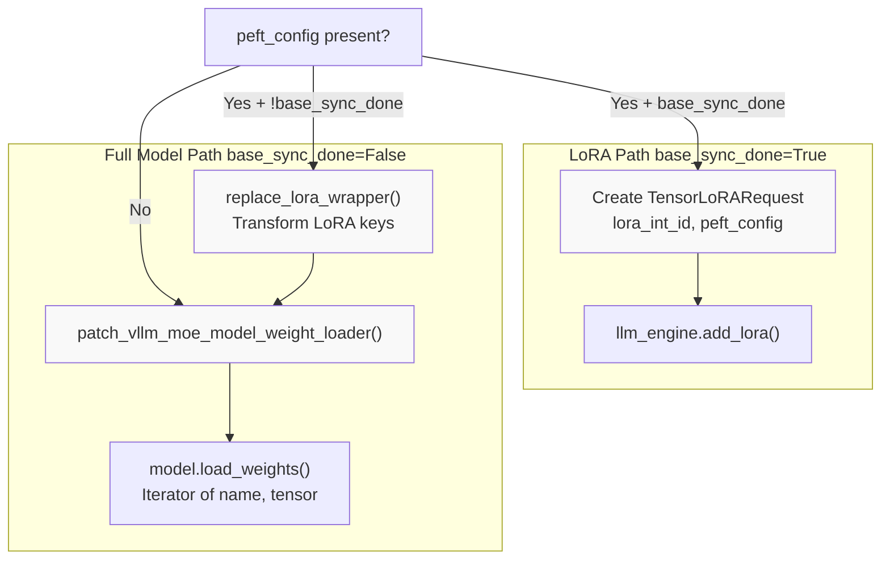

**LoRA Key Transformation Example:**
```
# FSDP LoRA key
model.layers.0.self_attn.q_proj.weight

# vLLM key (when base not synced)
model.layers.0.self_attn.q_proj.base_layer.weight
```

Sources: [verl/verl/workers/sharding_manager/fsdp_vllm.py:283-356]()

### VLLMHijack for Version Compatibility

For vLLM ≥0.7.3, the `VLLMHijack.hijack()` method patches vLLM internals to ensure compatibility with SAGE's weight loading patterns:

```python
if is_version_ge(pkg="vllm", minver="0.7.3"):
    VLLMHijack.hijack()
```

Sources: [verl/verl/workers/sharding_manager/fsdp_vllm.py:125-126](), [verl/verl/utils/vllm.py:VLLMHijack]()

## Async Parameter Synchronization (One-Step Off-Policy)

For asynchronous training modes, SAGE implements NCCL-based parameter synchronization between separate actor and rollout worker groups.

### Architecture Overview

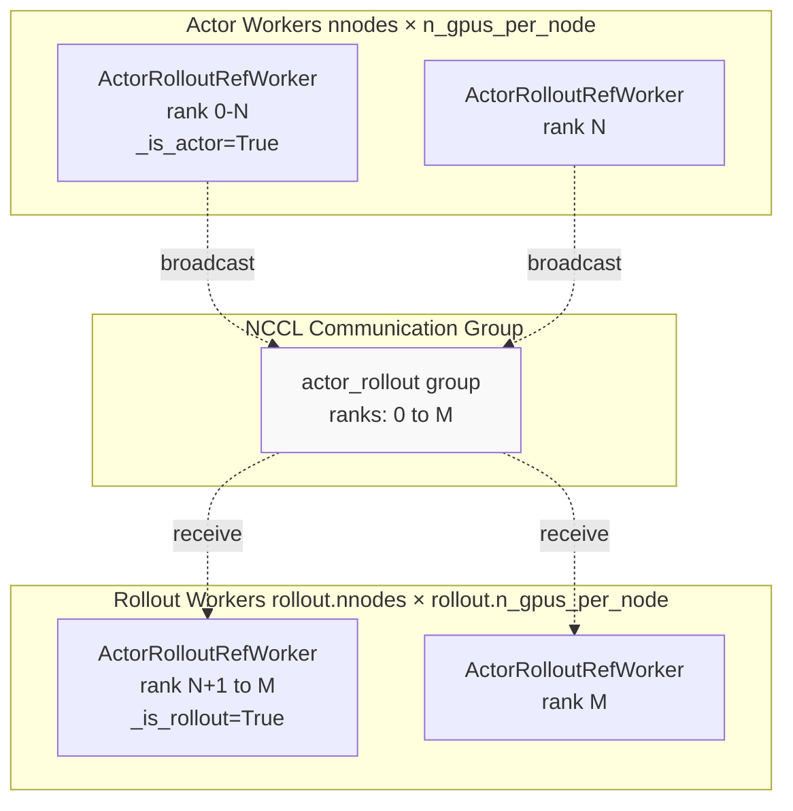

Sources: [verl/recipe/one_step_off_policy/README.md:162-179](), [verl/verl/workers/fsdp_workers.py:sync_rollout_weights]()

### Weight Synchronization Protocol

**Initialization Phase:**

1. Actor workers compute and share parameter metadata via `get_actor_weights_info()`:
   ```python
   [(key, tensor.size(), tensor.dtype), ...]
   ```

2. Rollout workers receive metadata via `set_actor_weights_info()`

3. Create collective group spanning all actor and rollout workers:
   ```python
   collective.create_collective_group(
       actor_rollout_workers,
       len(actor_rollout_workers),
       list(range(0, len(actor_rollout_workers))),
       backend="nccl",
       group_name="actor_rollout"
   )
   ```

Sources: [verl/recipe/one_step_off_policy/README.md:144-179]()

**Synchronization Phase:**

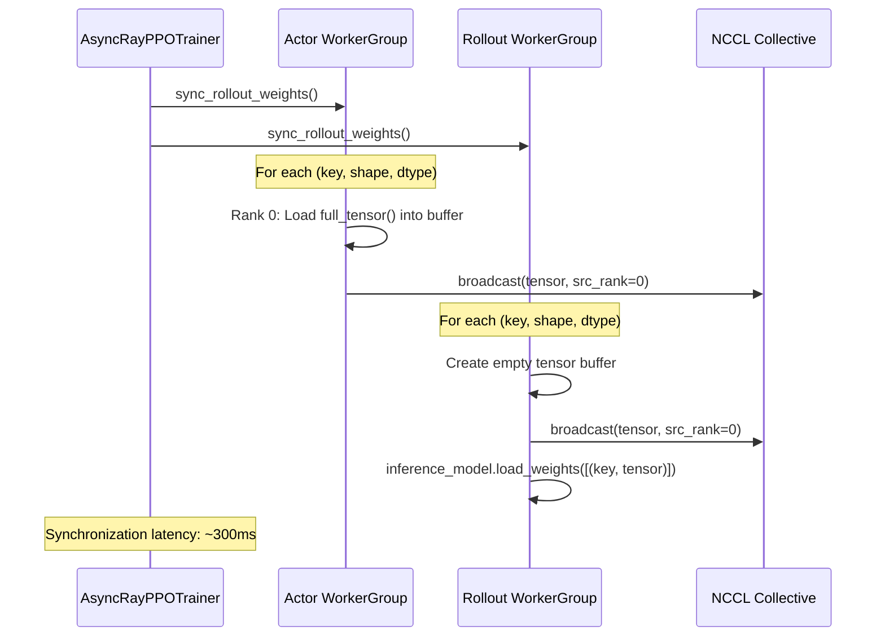

Sources: [verl/recipe/one_step_off_policy/README.md:183-213]()

### DTensor Handling in Async Mode

For FSDP2 models using `DTensor`, the synchronization extracts full tensors:

```python
if self._is_actor:
    assert key in params
    origin_data = params[key]
    if hasattr(origin_data, "full_tensor"):
        origin_data = origin_data.full_tensor()
    if torch.distributed.get_rank() == 0:
        tensor.copy_(origin_data)
```

Sources: [verl/recipe/one_step_off_policy/README.md:199-207]()

### Performance Characteristics

**Typical Latencies:**
- Parameter sync: <300ms (NCCL broadcast)
- Weight loading into vLLM: Depends on model size and LoRA state

**Configuration Requirements:**

| Constraint | Formula | Reason |
|------------|---------|--------|
| Batch divisibility | `rollout.n` divides `trainer.n_gpus_per_node * trainer.nnodes` | Even batch distribution |
| Sample divisibility | `rollout.n * data.train_batch_size` divides `trainer.n_gpus_per_node * trainer.nnodes` | Even sample distribution |

Sources: [verl/recipe/one_step_off_policy/README.md:250-271]()

## Memory Management Strategies

### CPU Offloading

**Manual Offloading** (controlled by `param_offload`):

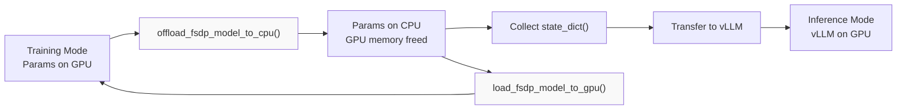

**FSDP Native Offloading** (configured via `CPUOffload` or `CPUOffloadPolicy`):

- FSDP v1: `CPUOffload(offload_params=True)`
- FSDP v2: `CPUOffloadPolicy(pin_memory=True)`

When FSDP native offloading is enabled, manual offloading is disabled (`_is_offload_param=False`).

Sources: [verl/verl/workers/fsdp_workers.py:223-231](), [verl/verl/workers/engine/fsdp/transformer_impl.py:508-522](), [verl/verl/utils/fsdp_utils.py:143-225]()

### Cache Management

**Critical Empty Cache Points:**

1. Before vLLM wake_up (rollout mode entry)
2. After vLLM sleep (trainer mode entry)
3. After parameter transfer completion

```python
aggressive_empty_cache(force_sync=True)
```

**Rationale**: vLLM uses a separate memory allocator (`CuMemAllocator`); clearing PyTorch cache prevents fragmentation.

Sources: [verl/verl/workers/fsdp_workers.py:657, 728, 748](), [verl/verl/utils/memory_utils.py:aggressive_empty_cache]()

### Random State Management

The hybrid engine maintains separate random states for training and generation:

```python
# Store training random state
self.torch_random_states = get_torch_device().get_rng_state()

# Set generation random state (seeded by DP rank)
gen_dp_rank = rollout_device_mesh["dp"].get_local_rank()
get_torch_device().manual_seed(gen_dp_rank + 1000)
self.gen_random_states = get_torch_device().get_rng_state()

# Restore training state
get_torch_device().set_rng_state(self.torch_random_states)
```

This ensures reproducible generation across TP ranks while maintaining independent training randomness.

Sources: [verl/verl/workers/fsdp_workers.py:612-616, 735-737, 753-754](), [verl/verl/workers/sharding_manager/fsdp_vllm.py:114-122, 240-261]()

## Megatron Integration

Megatron models use a different parameter synchronization approach due to their inherent support for pipeline parallelism:

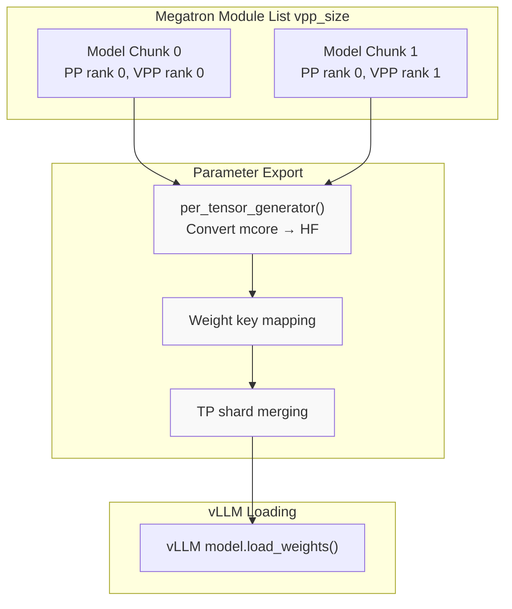

**Key Differences:**
- Uses `get_per_tensor_param()` instead of `state_dict()`
- Weight converter (`get_mcore_weight_converter()`) transforms Megatron Core parameter names
- Supports mbridge for automatic weight conversion

Sources: [verl/verl/workers/engine/megatron/transformer_impl.py:442-455](), [verl/verl/utils/megatron_utils.py:per_tensor_generator]()

---

**Key Files Referenced:**
- [verl/verl/workers/fsdp_workers.py]()
- [verl/verl/workers/sharding_manager/fsdp_vllm.py]()
- [verl/verl/workers/engine/fsdp/transformer_impl.py]()
- [verl/verl/workers/engine/megatron/transformer_impl.py]()
- [verl/verl/utils/fsdp_utils.py]()
- [verl/verl/utils/vllm.py]()
- [verl/recipe/one_step_off_policy/README.md]()