<!-- source: DeepWiki mcp.deepwiki.com · repo allenai/SERA · page 2 SERA Data Generation System · fetched 2026-10-26 -->

# SERA Data Generation System

<details>
<summary>Relevant source files</summary>

The following files were used as context for generating this wiki page:

- [.gitignore](.gitignore)
- [README.md](README.md)

</details>


## Purpose and Scope

The SERA Data Generation System is a multi-stage pipeline for generating software engineering training data from language models. This document covers the pipeline architecture, configuration system, inference server integration, and data generation workflows. For information about installation and environment setup, see [Installation and Setup](#2.1). For details on inference server deployment, see [Inference Servers](#2.2). For pipeline stage internals, see [Pipeline Stages](#2.4). For scaling to multiple servers, see [Multi-Server Scaling](#2.5).

The SERA system transforms GitHub repositories and pull request issues into synthetic training data through a sequence of generation, distillation, evaluation, and postprocessing stages. It supports both open-source models (via inference servers) and closed-source models (via API calls), with built-in capabilities for horizontal scaling and fault tolerance.

---

## System Architecture Overview

The SERA data generation system consists of three primary layers: the configuration layer that defines experiment parameters, the orchestration layer that manages pipeline execution, and the inference layer that provides model endpoints.

### High-Level System Architecture

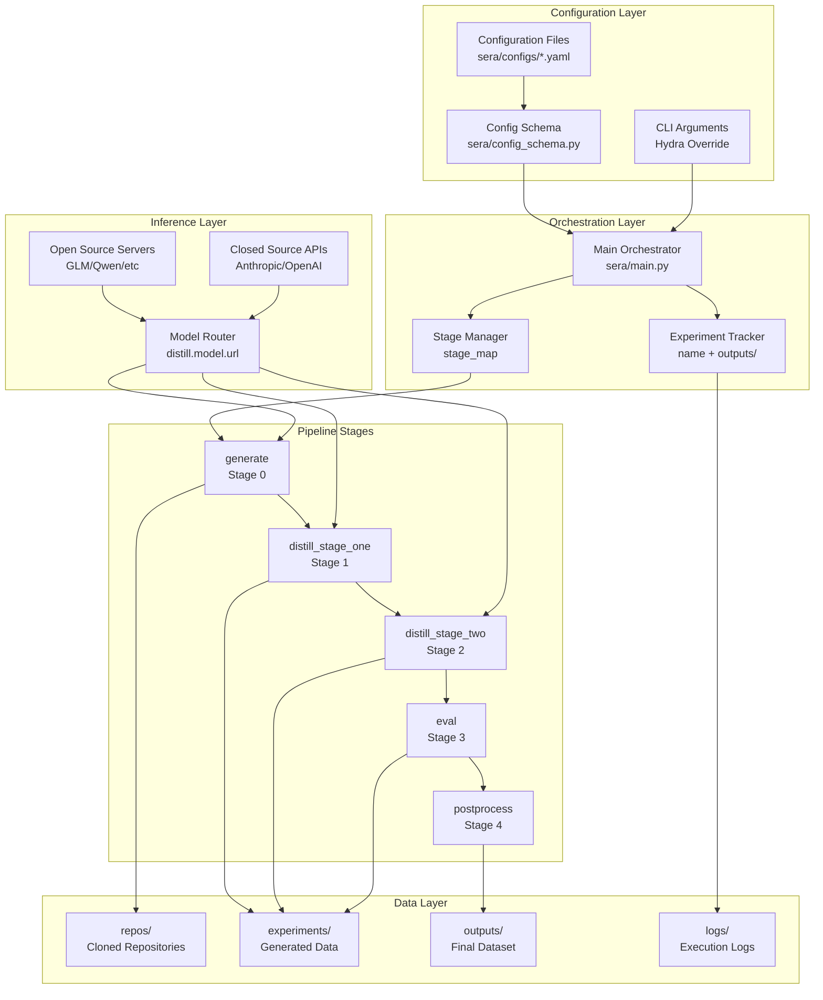

**Sources:** [README.md:1-184](), [.gitignore:1-227]()

---

## Pipeline Orchestration

The SERA pipeline is orchestrated by `sera/main.py`, which manages the sequential execution of five distinct stages. Each stage can be resumed independently, enabling fault tolerance for large-scale data generation runs.

### Stage Management System

The orchestrator uses a stage mapping system to control pipeline execution:

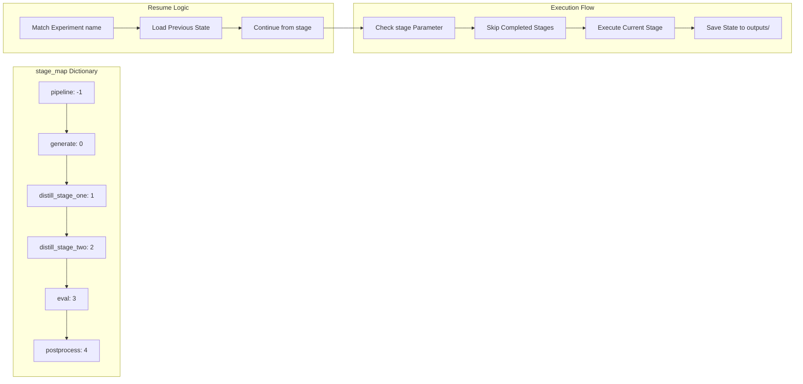

| Stage Name | Stage ID | Purpose | Output Location |
|------------|----------|---------|-----------------|
| `pipeline` | -1 | Complete pipeline execution | Full workflow |
| `generate` | 0 | Initial data generation | `repos/` directory |
| `distill_stage_one` | 1 | First distillation pass | `experiments/` directory |
| `distill_stage_two` | 2 | Second distillation pass | `experiments/` directory |
| `eval` | 3 | Evaluation of generated data | `experiments/` directory |
| `postprocess` | 4 | Final dataset creation | `outputs/` directory |

**Sources:** [README.md:130-156](), [.gitignore:1-7]()

---

## Configuration System

SERA uses Hydra for configuration management, with a base schema defined in `sera/config_schema.py` and multiple YAML configuration files for different specialization scenarios.

### Configuration Architecture

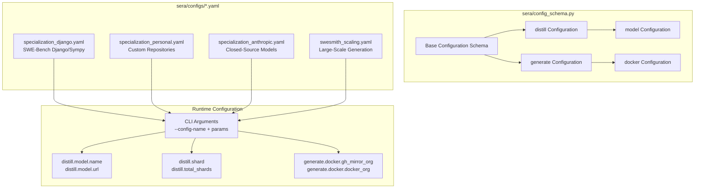

### Key Configuration Parameters

| Parameter Path | Purpose | Example Value |
|----------------|---------|---------------|
| `distill.model.name` | Model identifier for inference | `openai/GLM-4.5-Air` |
| `distill.model.url` | Inference server endpoint | `http://hostname:24444/v1` |
| `distill.shard` | Current shard index for parallel processing | `0` |
| `distill.total_shards` | Total number of shards | `4` |
| `generate.docker.gh_mirror_org` | GitHub organization for repository mirrors | `oca-repos` |
| `generate.docker.docker_org` | Docker organization for image persistence | Custom org name |
| `distill.args.pipeline_repo` | Path to PR issues for demonstration | `pr_issues/generated.json` |
| `stage` | Starting stage for resumed runs | `distill_stage_two` |
| `name` | Experiment identifier | Auto-generated or custom |

**Sources:** [README.md:37-169](), [sera/config_schema.py]()

---

## Specialization Modes

SERA supports three primary specialization modes, each tailored to different data generation scenarios. Each mode is configured through a dedicated YAML file that defines repositories, generation parameters, and model settings.

### Specialization Mode Comparison

| Mode | Config File | Target | Key Features |
|------|------------|---------|--------------|
| Django/Sympy | `specialization_django.yaml` | SWE-Bench repositories | Pre-configured for well-tested codebases |
| Personal Repos | `specialization_personal.yaml` | Custom repositories | Requires manual configuration of install commands |
| Closed-Source | `specialization_anthropic.yaml` | Anthropic/OpenAI models | No inference server required |

### Personal Repository Configuration

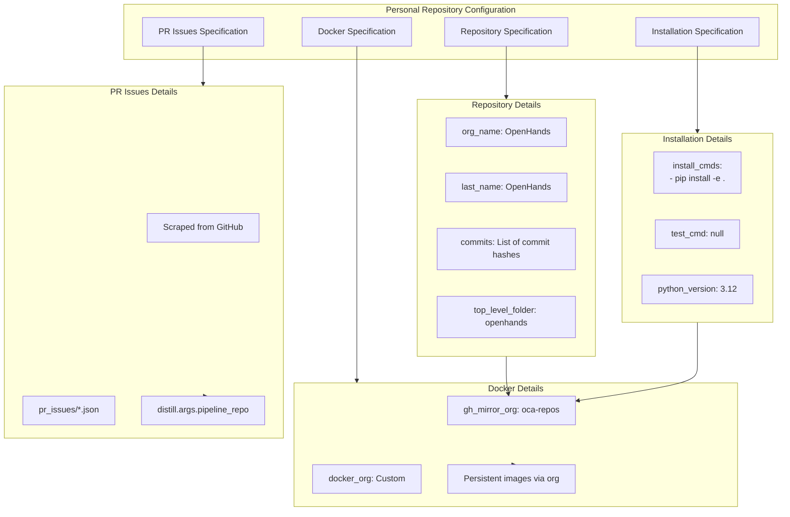

### Example Personal Repository Configuration

For personal repositories, the YAML configuration requires explicit specification of installation commands, main code folders, and Python versions:

```yaml
- org_name: OpenHands
  last_name: OpenHands
  commits:
    - 29b77be807e0e6aab380d953c0d79a166df4f0cc
    - cc8b677f3ec324fb7b9de86229f727b25741a66c
  install_cmds:
    - "pip install -e ."
  test_cmd: null
  python_version: 3.12
  top_level_folder:
    - openhands
```

**Sources:** [README.md:49-84](), [sera/configs/specialization_personal.yaml]()

---

## Data Flow and Output Structure

The SERA pipeline generates multiple types of data artifacts across different stages, each stored in dedicated directories that are excluded from version control.

### Data Flow Diagram

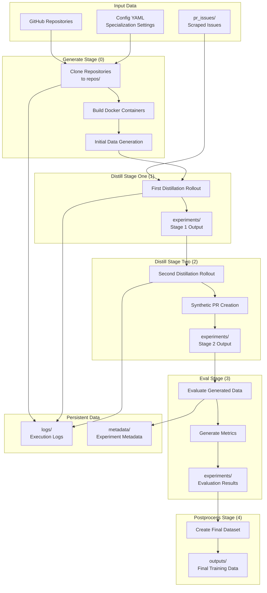

### Output Directory Structure

| Directory | Created By | Purpose | Gitignored |
|-----------|-----------|---------|------------|
| `repos/` | Generate stage | Cloned repository working copies | Yes |
| `experiments/` | Distill/Eval stages | Intermediate generation outputs | Yes |
| `outputs/` | Postprocess stage | Final training datasets | Yes |
| `logs/` | All stages | Execution logs and debugging info | Yes |
| `metadata/` | Pipeline | Experiment tracking metadata | Yes |
| `pr_issues/` | User script | Scraped GitHub issues | Yes |

**Sources:** [.gitignore:1-9](), [README.md:130-169]()

---

## Inference Server Integration

SERA supports multiple inference backends through a unified model routing system. The system can connect to open-source model servers or closed-source API endpoints.

### Inference Server Architecture

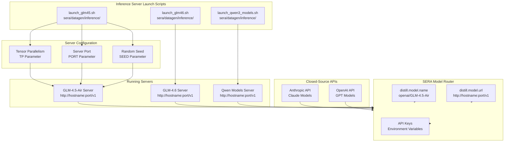

### Inference Server Launch Parameters

Launch scripts accept three parameters: tensor parallelism, port, and seed.

**Example Usage:**
```bash
# Launch GLM-4.5-Air with TP=8, port=24444, seed=42
bash launch_glm45.sh 8 24444 42
```

| Script | Model | Server Format | Example URL |
|--------|-------|--------------|-------------|
| `launch_glm45.sh` | GLM-4.5-Air | OpenAI-compatible | `http://hostname:24444/v1` |
| `launch_glm46.sh` | GLM-4.6 | OpenAI-compatible | `http://hostname:24445/v1` |
| `launch_qwen3_models.sh` | Qwen family | OpenAI-compatible | `http://hostname:24446/v1` |

**Sources:** [README.md:19-31](), [sera/datagen/inference/launch_glm45.sh](), [sera/datagen/inference/launch_glm46.sh](), [sera/datagen/inference/launch_qwen3_models.sh]()

---

## GitHub Integration and Repository Mirroring

SERA requires GitHub organization infrastructure for mirroring repositories when working with personal codebases. This enables Docker container creation and persistent repository access.

### GitHub Mirroring Architecture

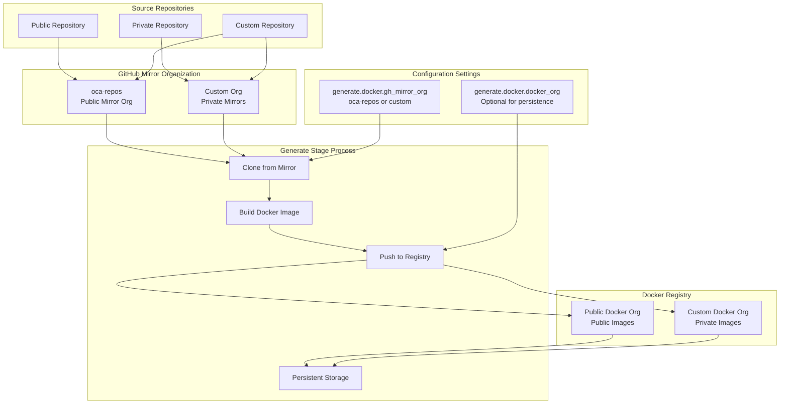

### Repository Mirroring Configuration

| Setting | Purpose | Default | Notes |
|---------|---------|---------|-------|
| `gh_mirror_org` | GitHub org for repository mirrors | `oca-repos` | Public visibility warning |
| `docker_org` | Docker org for image persistence | None | Requires push permissions |

**Important:** The `oca-repos` organization is publicly accessible. Any repositories mirrored there will be publicly viewable. For private codebases, create a custom GitHub organization.

**Sources:** [README.md:80-128](), [README.md:57-58]()

---

## PR Issues Scraping

SERA includes functionality to scrape historical pull request issues from GitHub repositories, which are then used as demonstrations in the distillation stages.

### PR Issues Scraping Workflow

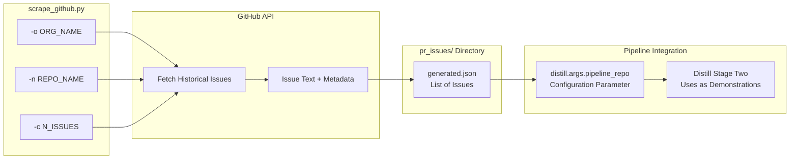

**Script Usage:**
```bash
python scrape_github.py -o ORG_NAME -n REPO_NAME -c N_ISSUES
```

**Pipeline Integration:**
```bash
python sera/main.py \
    --config-name=specialization_personal \
    distill.args.pipeline_repo=pr_issues/generated.json
```

**Sources:** [README.md:157-169](), [.gitignore:7]()

---

## Horizontal Scaling with Sharding

SERA supports horizontal scaling through dataset sharding, enabling parallel data generation across multiple inference servers. This is essential for large-scale data generation runs.

### Sharding Architecture

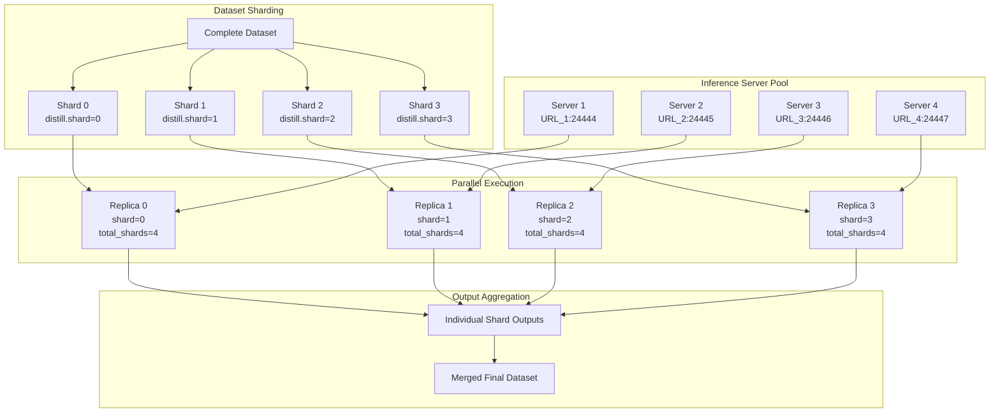

### Sharding Configuration Parameters

| Parameter | Purpose | Value Range | Example |
|-----------|---------|-------------|---------|
| `distill.shard` | Current shard index | 0 to N-1 | `0` |
| `distill.total_shards` | Total number of shards | 1 to N | `4` |
| `distill.model.url` | Server URL for this shard | Valid URL | `http://server1:24444/v1` |

**Example Multi-Server Launch:**

```bash
# Replica 0
python sera/main.py \
    --config-name=swesmith_scaling \
    distill.shard=0 \
    distill.total_shards=4 \
    distill.model.url=URL_1

# Replica 1
python sera/main.py \
    --config-name=swesmith_scaling \
    distill.shard=1 \
    distill.total_shards=4 \
    distill.model.url=URL_2
```

**Use Case:** The SERA team uses this approach to scale SWESmith data generation to create the largest datasets, distributing workload across multiple GPU servers.

**Sources:** [README.md:96-122]()

---

## Fault Tolerance and Stage Resumption

SERA implements comprehensive fault tolerance through stage-based checkpointing and resumption capabilities. This is critical for large-scale runs where occasional model stalls (< 1%) can interrupt pipeline completion.

### Stage Resumption Architecture

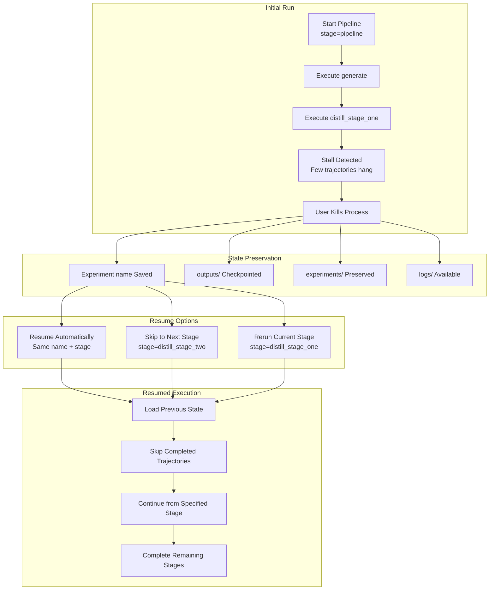

### Stage Map Reference

The `stage_map` dictionary in `sera/main.py` defines the resumption points:

```python
stage_map = {
    "pipeline": -1,           # Full pipeline execution
    "generate": 0,            # Initial generation
    "distill_stage_one": 1,   # First distillation
    "distill_stage_two": 2,   # Second distillation
    "eval": 3,                # Evaluation
    "postprocess": 4          # Final processing
}
```

### Resumption Examples

**Automatic Resume (Same Name):**
```bash
# Original run that stalled
python sera/main.py --config-name=specialization_django

# Rerun with same name - automatically resumes
python sera/main.py --config-name=specialization_django
```

**Skip to Next Stage:**
```bash
# Skip hanging trajectories, proceed to stage 2
python sera/main.py \
    --config-name=specialization_django \
    stage=distill_stage_two
```

**Resume from Specific Stage:**
```bash
# Resume from evaluation stage
python sera/main.py \
    --config-name=specialization_django \
    stage=eval
```

### Resumption Behavior

| Scenario | Behavior | Output |
|----------|----------|--------|
| Same experiment name, no stage parameter | Resume from last incomplete stage | Continue where left off |
| Same experiment name, explicit stage | Skip to specified stage | Use previous successful outputs |
| Different experiment name | Start fresh pipeline | New outputs directory |
| Hanging trajectories | Skip failed attempts | Proceed with successful ones |

**Sources:** [README.md:130-156]()

---

## Single Server Execution Modes

SERA provides pre-configured execution modes for common scenarios, each optimized for specific use cases. These modes can be run with a single inference server.

### Execution Mode Comparison

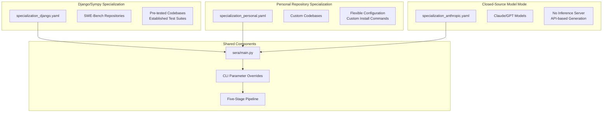

### Django/Sympy Specialization

**Purpose:** Generate data from well-established SWE-Bench repositories with existing test suites.

**Command:**
```bash
python sera/main.py \
    --config-name=specialization_django \
    distill.model.name=openai/GLM-4.5-Air \
    distill.model.url=http://server:24444/v1
```

**Characteristics:**
- Pre-configured repository settings
- Established installation procedures
- Existing test commands
- SWE-Bench compatibility

### Personal Repository Specialization

**Purpose:** Generate data from custom codebases with user-defined configurations.

**Command:**
```bash
python sera/main.py \
    --config-name=specialization_personal \
    distill.model.name=openai/GLM-4.5-Air \
    distill.model.url=http://server:24444/v1 \
    generate.docker.gh_mirror_org=oca-repos
```

**Required Configurations:**
- `org_name`: GitHub organization
- `install_cmds`: Installation commands
- `top_level_folder`: Main code directory
- `python_version`: Python version for Docker
- `commits`: Specific commit hashes

### Closed-Source Model Mode

**Purpose:** Use commercial APIs (Anthropic, OpenAI) without managing inference servers.

**Command:**
```bash
python sera/main.py \
    --config-name=specialization_anthropic \
    generate.docker.gh_mirror_org=oca-repos
```

**Characteristics:**
- No `distill.model.url` required
- API keys via environment variables
- Built-in rate limiting
- Multiple provider support

**Sources:** [README.md:38-94](), [sera/configs/specialization_django.yaml](), [sera/configs/specialization_personal.yaml](), [sera/configs/specialization_anthropic.yaml]()

---

## Output Artifacts and Data Products

The SERA pipeline produces multiple types of artifacts across different stages, each serving specific purposes in the data generation workflow.

### Artifact Generation Flow

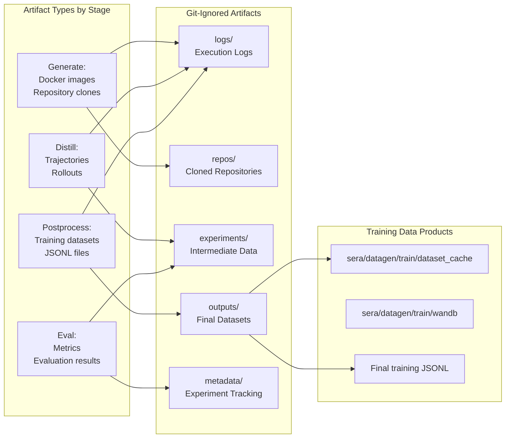

### Directory Structure and Contents

| Directory | Stage | Content Type | Example Files |
|-----------|-------|--------------|---------------|
| `logs/` | All | Execution logs, debugging info | `pipeline.log`, `stage_*.log` |
| `repos/` | Generate | Cloned Git repositories | `django/`, `sympy/` |
| `experiments/` | Distill, Eval | Intermediate generation outputs | `rollout_*.json`, `metrics_*.json` |
| `outputs/` | Postprocess | Final training datasets | `training_data.jsonl` |
| `metadata/` | All | Experiment tracking data | `experiment_*.json` |
| `pr_issues/` | User script | Scraped GitHub issues | `repo_name_issues.json` |

### Training Data Integration

The final outputs are designed for integration with the training pipeline documented in `sera/datagen/train`:

- **Dataset Cache:** Processed datasets ready for training ([sera/datagen/train/dataset_cache]())
- **Weights & Biases:** Experiment tracking logs ([sera/datagen/train/wandb]())
- **JSONL Format:** Standard training data format

**Sources:** [.gitignore:1-13](), [README.md:172-173]()

---

## Summary

The SERA Data Generation System implements a sophisticated multi-stage pipeline for creating software engineering training data from language models. Key capabilities include:

1. **Multi-Stage Pipeline:** Five sequential stages (generate, distill×2, eval, postprocess) with individual resumption points
2. **Flexible Inference:** Support for both open-source model servers and closed-source APIs
3. **Horizontal Scaling:** Sharding support for parallel processing across multiple servers
4. **Fault Tolerance:** Stage-based checkpointing and automatic resumption
5. **Multiple Specializations:** Pre-configured modes for Django/Sympy, personal repositories, and closed-source models
6. **GitHub Integration:** Repository mirroring and Docker image persistence
7. **PR Issues Scraping:** Automated collection of historical issues for demonstrations

The system is designed for large-scale data generation with robust error handling and flexible configuration, supporting both research experimentation and production data pipelines.

For detailed information on specific subsystems, see:
- [Installation and Setup](#2.1)
- [Inference Servers](#2.2)
- [Specialization Configurations](#2.3)
- [Pipeline Stages](#2.4)
- [Multi-Server Scaling](#2.5)

**Sources:** [README.md:1-184](), [.gitignore:1-227](), [sera/config_schema.py]()

---

