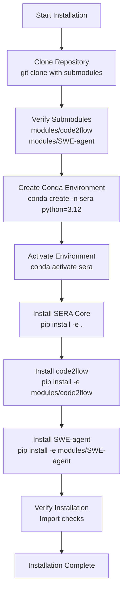
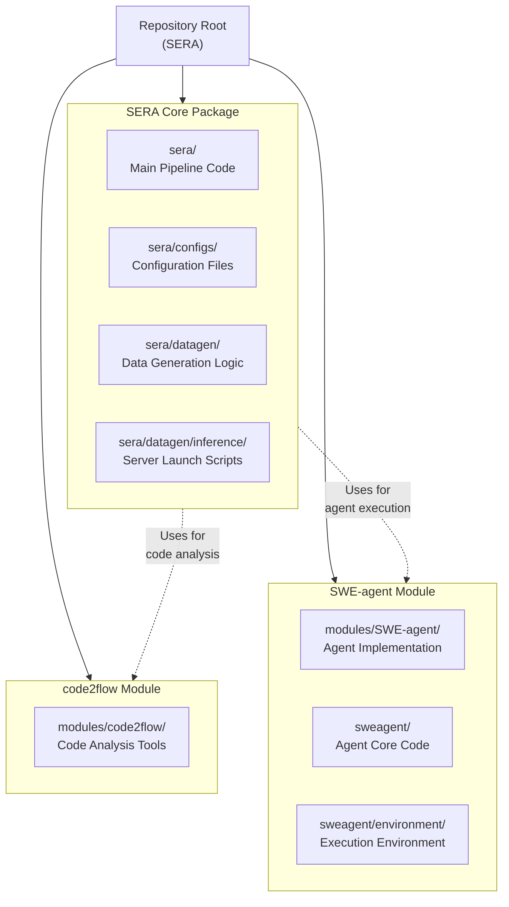
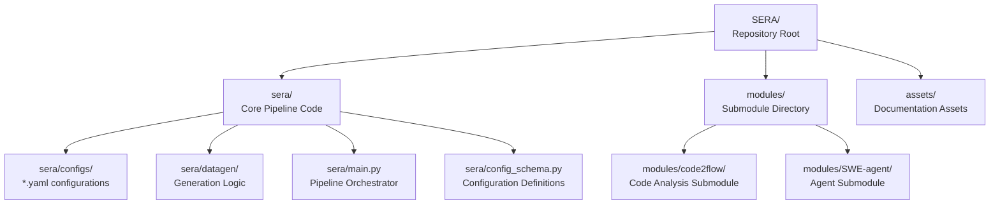

<!-- source: DeepWiki mcp.deepwiki.com · repo allenai/SERA · page 2.1 Installation and Setup · fetched 2026-10-26 -->

# Installation and Setup

<details>
<summary>Relevant source files</summary>

The following files were used as context for generating this wiki page:

- [README.md](README.md)

</details>


## Purpose and Scope

This document provides instructions for installing the SERA system and its dependencies. It covers environment setup, package installation, and verification of the installation. For information about configuring inference servers after installation, see [Inference Servers](#2.2). For specialization configurations, see [Specialization Configurations](#2.3). For development environment setup including dev containers, see [Dev Container Setup](#4.1).

---

## Prerequisites

Before installing SERA, ensure the following requirements are met:

| Requirement | Version | Purpose |
|------------|---------|---------|
| Python | 3.12 | Runtime environment |
| Conda | Any recent version | Environment management |
| Git | Any recent version | Repository cloning including submodules |
| System | Linux/macOS | Primary development platforms |

---

## Installation Overview

The SERA system consists of three main components that must be installed together:

1. **SERA Core** - Main data generation pipeline located at repository root
2. **code2flow Module** - Code analysis utilities in `modules/code2flow/`
3. **SWE-agent Module** - Autonomous software engineering agent in `modules/SWE-agent/`

All three components are installed as editable packages using pip's `-e` flag, enabling development workflows where code changes take effect immediately without reinstallation.

**Installation Workflow**



**Sources:** [README.md:7-15]()

---

## Step-by-Step Installation

### Step 1: Clone Repository

Clone the SERA repository including all submodules:

```bash
git clone --recursive https://github.com/allenai/SERA
cd SERA
```

If you cloned without `--recursive`, initialize submodules separately:

```bash
git submodule update --init --recursive
```

This ensures both `modules/code2flow/` and `modules/SWE-agent/` are properly initialized.

### Step 2: Create Conda Environment

Create a new conda environment with Python 3.12:

```bash
conda create -n sera python=3.12
```

Activate the environment:

```bash
conda activate sera
```

The environment name `sera` can be customized, but must be activated before package installation.

### Step 3: Install Packages

Install all three components as editable packages in a single command:

```bash
pip install -e . -e modules/code2flow -e modules/SWE-agent
```

The `-e` flag installs packages in editable mode, creating links to the source directories rather than copying files. This enables immediate code changes without reinstallation.

**Sources:** [README.md:11-14]()

---

## Package Structure and Dependencies

The following diagram shows the relationship between installed packages and their filesystem locations:

**Package Dependency Structure**



**Installation Command Mapping**

| Command Argument | Package Location | Installed Name |
|-----------------|------------------|----------------|
| `-e .` | Repository root | `sera` |
| `-e modules/code2flow` | `modules/code2flow/` | `code2flow` |
| `-e modules/SWE-agent` | `modules/SWE-agent/` | `sweagent` |

**Sources:** [README.md:14]()

---

## Filesystem Structure After Installation

After successful installation, the following directory structure is present:



**Key Files and Directories**

| Path | Description |
|------|-------------|
| `sera/main.py` | Pipeline orchestrator entry point |
| `sera/config_schema.py` | Full configuration schema definitions |
| `sera/configs/` | Pre-defined experiment configurations |
| `sera/datagen/inference/` | Inference server launch scripts |
| `modules/code2flow/` | Code analysis and parsing utilities |
| `modules/SWE-agent/` | Autonomous agent implementation |

**Sources:** [README.md:7-15](), [README.md:37]()

---

## Installation Verification

After installation, verify that all packages are correctly installed and importable:

### Python Import Verification

```bash
python -c "import sera; print('SERA core imported successfully')"
python -c "import code2flow; print('code2flow imported successfully')"
python -c "import sweagent; print('sweagent imported successfully')"
```

### Pipeline Entry Point Verification

Check that the main pipeline orchestrator is accessible:

```bash
python sera/main.py --help
```

This command should display the available configuration options and command-line arguments. The help output includes references to configuration files in `sera/configs/` and schema definitions in `sera/config_schema.py`.

### Configuration File Verification

Verify that example configurations are present:

```bash
ls sera/configs/*.yaml
```

Expected configurations include:
- `specialization_django.yaml` - Django/Sympy specialization
- `specialization_personal.yaml` - Personal repository specialization  
- `specialization_anthropic.yaml` - Closed-source model configuration
- `swesmith_scaling.yaml` - Multi-server scaling configuration

**Sources:** [README.md:37](), [README.md:43-46](), [README.md:50-57](), [README.md:90-94](), [README.md:103-121]()

---

## Common Installation Issues

### Submodule Not Initialized

**Symptom:** `ModuleNotFoundError` for `code2flow` or `sweagent`

**Solution:** Initialize submodules:
```bash
git submodule update --init --recursive
```

### Wrong Python Version

**Symptom:** Dependency conflicts or import errors

**Solution:** Verify Python version is 3.12:
```bash
python --version  # Should show Python 3.12.x
```

### Editable Install Issues

**Symptom:** Code changes not taking effect

**Solution:** Verify editable installation:
```bash
pip list | grep sera
pip list | grep code2flow  
pip list | grep sweagent
```

Each should show the package location pointing to the repository directory.

---

## Next Steps After Installation

Once installation is complete, proceed with:

1. **Inference Server Setup** - Launch model inference servers for data generation. See [Inference Servers](#2.2) for GLM, Qwen, and closed-source model configurations.

2. **Specialization Configuration** - Configure the pipeline for specific repositories or domains. See [Specialization Configurations](#2.3) for Django, personal repositories, and Anthropic examples.

3. **Pipeline Execution** - Run the five-stage data generation pipeline. See [Pipeline Stages](#2.4) for details on generate, distill, eval, and postprocess stages.

4. **Multi-Server Scaling** - Scale to multiple inference servers for large-scale generation. See [Multi-Server Scaling](#2.5) for sharding configuration.

5. **Development Environment** - Set up the full development environment with dev containers. See [Dev Container Setup](#4.1) for VS Code integration.

6. **API Key Configuration** - Configure credentials for external services. See [API Key Configuration](#4.2) for setting up keys for OpenAI, Anthropic, GitHub, and other services.

**Sources:** [README.md:17-170]()

---

