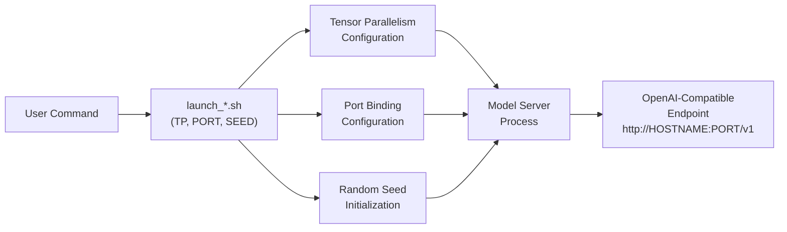
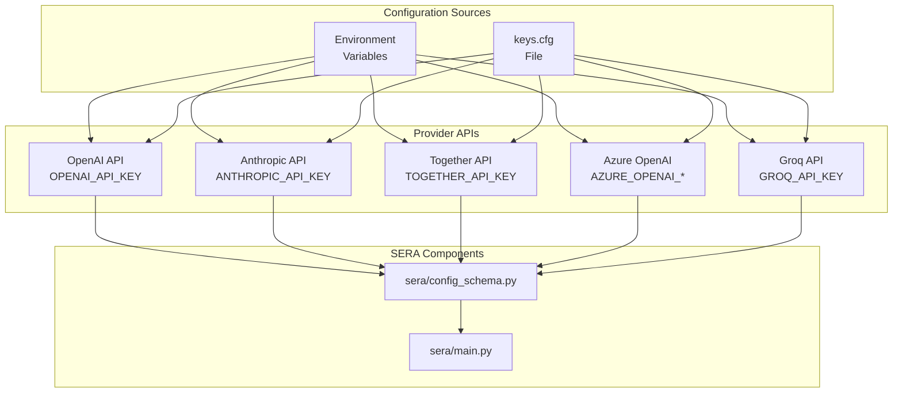
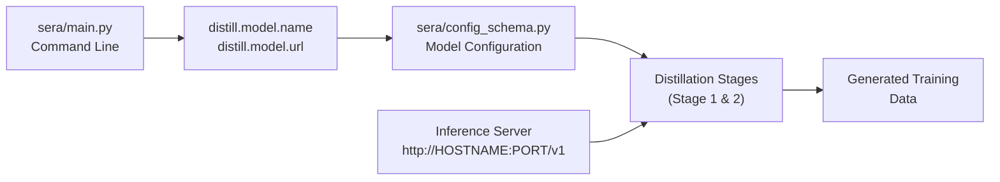
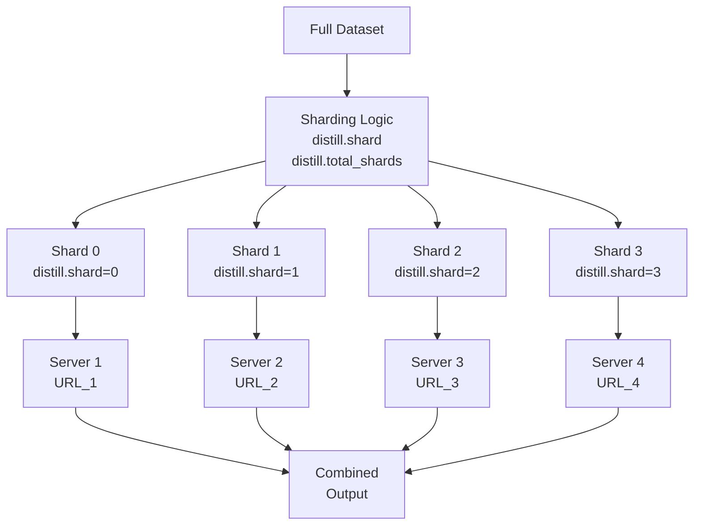
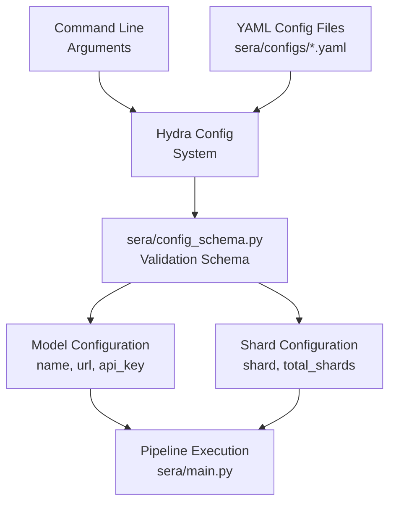

<!-- source: DeepWiki mcp.deepwiki.com · repo allenai/SERA · page 2.2 Inference Servers · fetched 2026-10-26 -->

# Inference Servers

<details>
<summary>Relevant source files</summary>

The following files were used as context for generating this wiki page:

- [README.md](README.md)
- [modules/SWE-agent/.devcontainer/sample_keys.cfg](modules/SWE-agent/.devcontainer/sample_keys.cfg)

</details>


## Purpose and Scope

This document describes the inference server infrastructure used by SERA for language model generation. It covers both open-source models that require local server deployment and closed-source API providers. For information about how these servers integrate into the multi-stage data generation pipeline, see [Pipeline Stages](#2.4). For scaling data generation across multiple servers, see [Multi-Server Scaling](#2.5).

## Inference Architecture Overview

SERA supports two categories of inference backends: self-hosted open-source models and third-party closed-source API providers. Both categories expose OpenAI-compatible APIs to maintain consistency throughout the pipeline.

```mermaid
graph TB
    subgraph OpenSource["Open-Source Models (Self-Hosted)"]
        GLM45["GLM-4.5-Air<br/>launch_glm45.sh"]
        GLM46["GLM-4.6<br/>launch_glm46.sh"]
        Qwen["Qwen Models<br/>launch_qwen3_models.sh"]
    end
    
    subgraph ClosedSource["Closed-Source Providers"]
        OpenAI["OpenAI<br/>OPENAI_API_KEY"]
        Anthropic["Anthropic<br/>ANTHROPIC_API_KEY"]
        Azure["Azure OpenAI<br/>AZURE_OPENAI_*"]
        Together["Together AI<br/>TOGETHER_API_KEY"]
        Groq["Groq<br/>GROQ_API_KEY"]
    end
    
    subgraph Pipeline["SERA Pipeline"]
        MainPy["sera/main.py<br/>Orchestrator"]
        ConfigSchema["sera/config_schema.py<br/>Model Configuration"]
    end
    
    GLM45 --> |"http://HOSTNAME:PORT/v1"| MainPy
    GLM46 --> |"http://HOSTNAME:PORT/v1"| MainPy
    Qwen --> |"http://HOSTNAME:PORT/v1"| MainPy
    
    OpenAI --> |"API Endpoint"| MainPy
    Anthropic --> |"API Endpoint"| MainPy
    Azure --> |"API Endpoint"| MainPy
    Together --> |"API Endpoint"| MainPy
    Groq --> |"API Endpoint"| MainPy
    
    ConfigSchema --> MainPy
```



**Sources:** [README.md:19-32](), [modules/SWE-agent/.devcontainer/sample_keys.cfg:1-11]()

## Open-Source Model Servers

SERA provides launch scripts for deploying open-source models as inference servers. These scripts handle tensor parallelism configuration, port assignment, and random seed initialization.

### GLM Models

Two GLM model variants are supported with dedicated launch scripts:

| Model | Launch Script | Purpose |
|-------|--------------|---------|
| GLM-4.5-Air | `sera/datagen/inference/launch_glm45.sh` | Lightweight GLM variant |
| GLM-4.6 | `sera/datagen/inference/launch_glm46.sh` | Latest GLM version |

**Launch Script Parameters**

All GLM launch scripts accept three positional arguments:

```bash
bash launch_glm45.sh <TENSOR_PARALLELISM> <PORT> <SEED>
```

| Parameter | Position | Description | Example |
|-----------|----------|-------------|---------|
| `TENSOR_PARALLELISM` | 1 | Number of GPUs for model sharding | `8` |
| `PORT` | 2 | Server listening port | `24444` |
| `SEED` | 3 | Random seed for reproducibility | `42` |

**Example Usage:**

```bash
# Launch GLM-4.5-Air with TP=8 on port 24444 with seed 42
bash sera/datagen/inference/launch_glm45.sh 8 24444 42
```

The resulting server endpoint will be: `http://HOSTNAME:24444/v1`

**Sources:** [README.md:23-29]()

### Qwen Models

The Qwen model family is supported through a unified launch script:

```bash
bash sera/datagen/inference/launch_qwen3_models.sh <TENSOR_PARALLELISM> <PORT> <SEED>
```

This script uses the same parameter structure as GLM models, maintaining consistency across open-source deployments.

**Sources:** [README.md:23]()

### Launch Script Architecture



**Sources:** [README.md:23-31]()

## Closed-Source Model Providers

SERA integrates with multiple commercial AI providers through their respective APIs. Unlike open-source models, these do not require local server deployment.

### Supported Providers

The following providers are supported through API key configuration:

| Provider | Configuration Key | Authentication Method |
|----------|------------------|----------------------|
| OpenAI | `OPENAI_API_KEY` | API key |
| Anthropic | `ANTHROPIC_API_KEY` | API key |
| Azure OpenAI | `AZURE_OPENAI_API_KEY`, `AZURE_OPENAI_ENDPOINT`, `AZURE_OPENAI_DEPLOYMENT`, `AZURE_OPENAI_API_VERSION` | Multi-parameter configuration |
| Together AI | `TOGETHER_API_KEY` | API key |
| Groq | `GROQ_API_KEY` | API key |

**Sources:** [modules/SWE-agent/.devcontainer/sample_keys.cfg:3-11]()

### API Key Configuration

API keys are configured through environment variables or the `keys.cfg` configuration file. For detailed information about API key management, see [API Key Configuration](#4.2).



**Sources:** [modules/SWE-agent/.devcontainer/sample_keys.cfg:1-11]()

### Custom and Local Endpoints

For custom inference endpoints or local deployments that implement OpenAI-compatible APIs, the `OPENAI_API_BASE_URL` configuration allows specifying alternative base URLs:

```
OPENAI_API_BASE_URL: 'http://custom-endpoint:8000/v1'
```

**Sources:** [modules/SWE-agent/.devcontainer/sample_keys.cfg:10]()

## Server URL Format and Usage

### OpenAI-Compatible Endpoints

All self-hosted servers expose OpenAI-compatible endpoints following this format:

```
http://HOSTNAME:PORT/v1
```

Where:
- `HOSTNAME`: The machine's hostname or IP address where the server is running
- `PORT`: The port specified during launch (e.g., `24444`)
- `/v1`: Standard OpenAI API version path

**Sources:** [README.md:31]()

### Integration with Main Pipeline

Inference servers are specified in SERA's main pipeline through model configuration parameters:

```bash
python sera/main.py \
    --config-name=specialization_django \
    distill.model.name=openai/GLM-4.5-Air \
    distill.model.url=URL
```

| Parameter | Description | Example |
|-----------|-------------|---------|
| `distill.model.name` | Model identifier | `openai/GLM-4.5-Air` |
| `distill.model.url` | Server endpoint URL | `http://gpu-node-1:24444/v1` |



**Sources:** [README.md:42-46](), [README.md:37]()

## Model Selection Examples

### Using Open-Source Models

For GLM-4.5-Air deployed on a local server:

```bash
# First, launch the server
bash sera/datagen/inference/launch_glm45.sh 8 24444 42

# Then, run the pipeline pointing to the server
python sera/main.py \
    --config-name=specialization_django \
    distill.model.name=openai/GLM-4.5-Air \
    distill.model.url=http://localhost:24444/v1
```

For Qwen models on a remote server:

```bash
# On the server machine
bash sera/datagen/inference/launch_qwen3_models.sh 4 25000 100

# On the client machine
python sera/main.py \
    --config-name=specialization_personal \
    distill.model.name=openai/Qwen-VARIANT \
    distill.model.url=http://gpu-cluster-node:25000/v1 \
    generate.docker.gh_mirror_org=oca-repos
```

**Sources:** [README.md:42-58]()

### Using Closed-Source Models

When using closed-source providers, the server launch step is skipped entirely:

```bash
# No server launch needed - API keys are read from environment
python sera/main.py \
    --config-name=specialization_anthropic \
    generate.docker.gh_mirror_org=oca-repos
```

The system automatically reads the appropriate API keys from the environment or `keys.cfg` file based on the configuration name.

**Sources:** [README.md:86-94]()

## Multi-Server Configuration

SERA supports distributing inference workload across multiple servers through sharding. Each server processes a disjoint subset of the data based on shard indices.



### Sharding Parameters

| Parameter | Description | Example |
|-----------|-------------|---------|
| `distill.shard` | Zero-indexed shard ID for this replica | `0`, `1`, `2`, `3` |
| `distill.total_shards` | Total number of shards across all replicas | `4` |
| `distill.model.url` | Unique server URL for this shard | `URL_1`, `URL_2`, etc. |

**Example Multi-Server Deployment:**

```bash
# Replica 1 (processes shard 0 of 4)
python sera/main.py \
    --config-name=swesmith_scaling \
    distill.shard=0 \
    distill.total_shards=4 \
    distill.model.name=openai/GLM-4.5-Air \
    distill.model.url=http://server-1:24444/v1

# Replica 2 (processes shard 1 of 4)
python sera/main.py \
    --config-name=swesmith_scaling \
    distill.shard=1 \
    distill.total_shards=4 \
    distill.model.name=openai/GLM-4.5-Air \
    distill.model.url=http://server-2:24444/v1

# Replica 3 (processes shard 2 of 4)
python sera/main.py \
    --config-name=swesmith_scaling \
    distill.shard=2 \
    distill.total_shards=4 \
    distill.model.name=openai/GLM-4.5-Air \
    distill.model.url=http://server-3:24444/v1

# Replica 4 (processes shard 3 of 4)
python sera/main.py \
    --config-name=swesmith_scaling \
    distill.shard=3 \
    distill.total_shards=4 \
    distill.model.name=openai/GLM-4.5-Air \
    distill.model.url=http://server-4:24444/v1
```

For more details on scaling strategies and parallel processing, see [Multi-Server Scaling](#2.5).

**Sources:** [README.md:96-121]()

## Configuration Schema Integration

All model and server configurations are validated against the schema defined in `sera/config_schema.py`. This file contains the complete specification of available configuration options for inference servers.



The configuration schema provides type safety and validation for all inference server parameters, ensuring that model names, URLs, and API keys are correctly specified before pipeline execution begins.

**Sources:** [README.md:37]()

---

