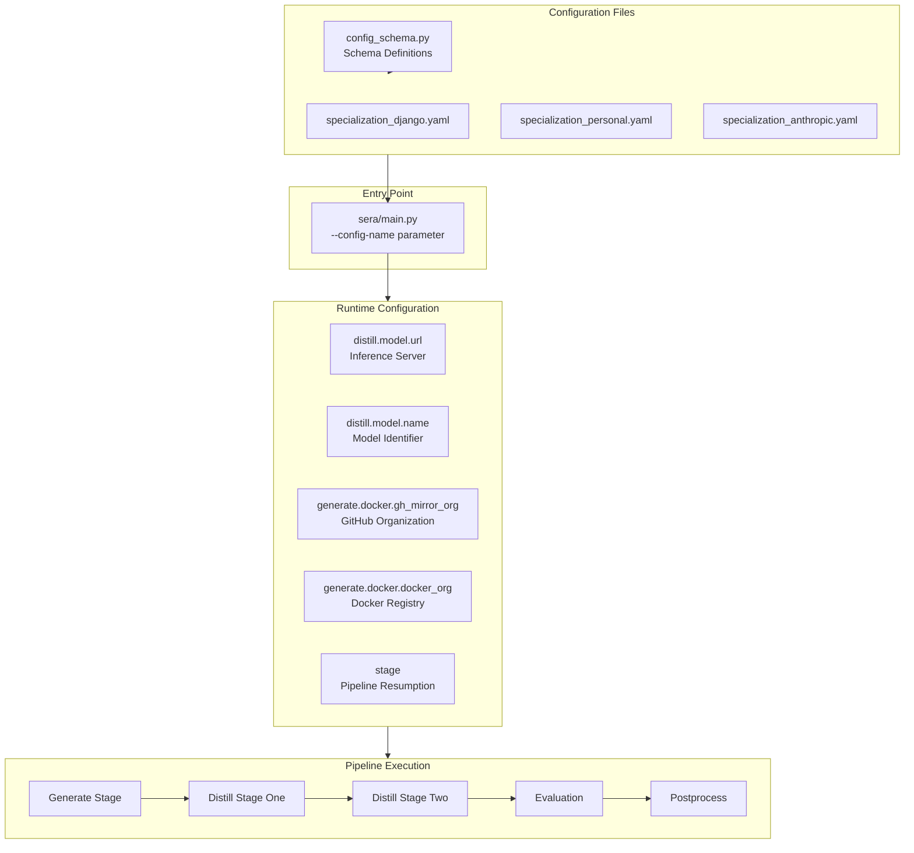
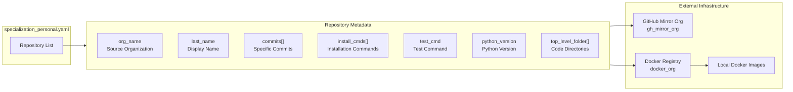
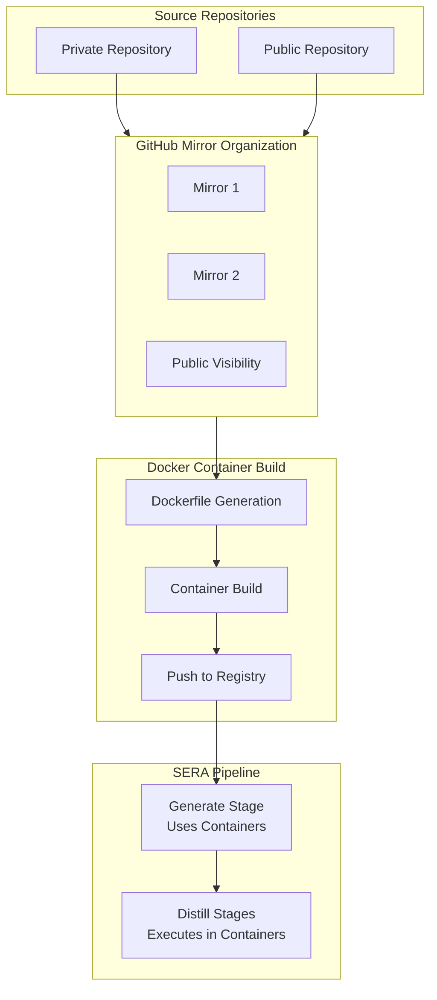
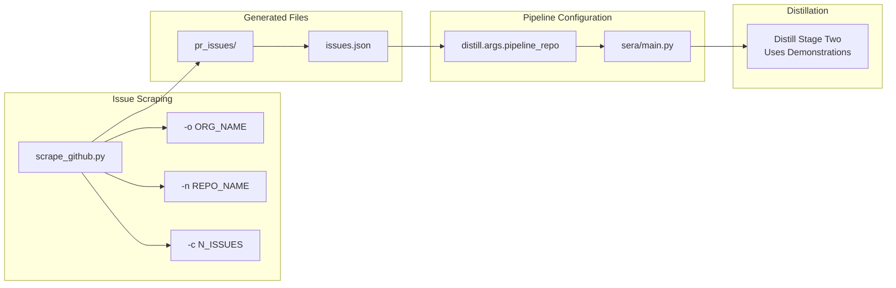
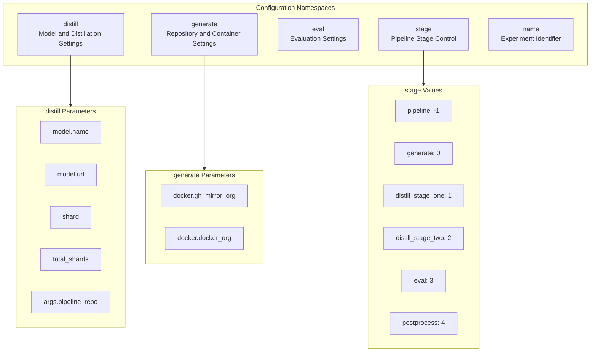
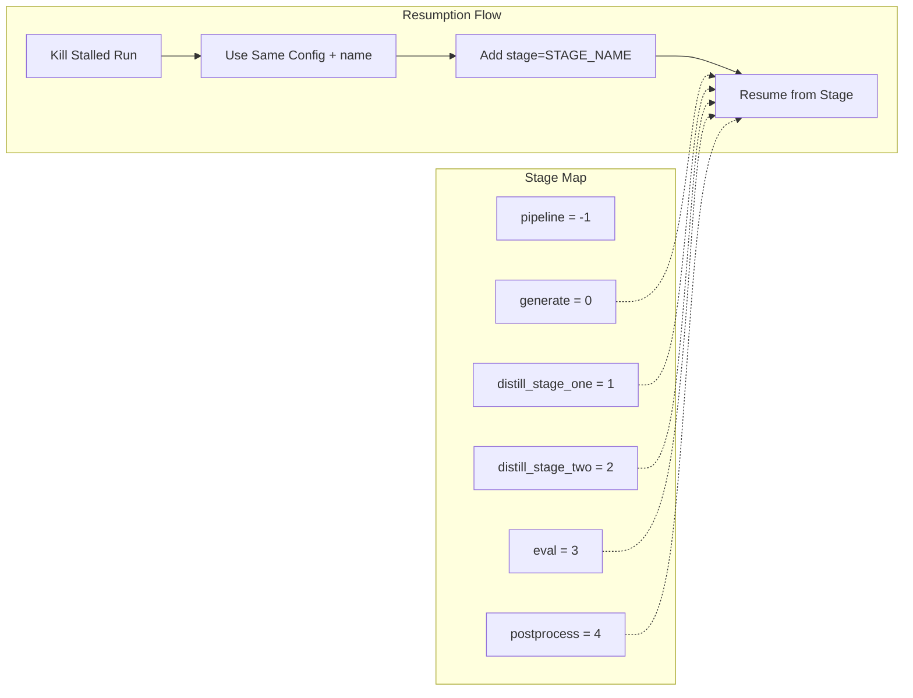

<!-- source: DeepWiki mcp.deepwiki.com · repo allenai/SERA · page 2.3 Specialization Configurations · fetched 2026-10-26 -->

# Specialization Configurations

<details>
<summary>Relevant source files</summary>

The following files were used as context for generating this wiki page:

- [README.md](README.md)

</details>


## Purpose and Scope

This document explains the specialization configuration system in SERA, which allows users to customize the data generation pipeline for different target codebases and language models. Specialization configurations define what repositories to generate data from, how to set up the execution environment, and which models to use for generation.

For information about the multi-stage pipeline that these configurations drive, see [Pipeline Stages](#2.4). For details on setting up inference servers, see [Inference Servers](#2.2).

**Sources:** [README.md:39-94]()

## Overview

SERA supports three primary specialization profiles, each designed for different use cases:

1. **Django/Sympy Specialization** - Generate data for established open-source projects from SWE-Bench
2. **Personal Repository Specialization** - Generate data for custom codebases
3. **Closed-Source Model Specialization** - Use commercial APIs (Anthropic, OpenAI) instead of self-hosted inference servers

Each specialization is defined by a YAML configuration file in `sera/configs/` and can be invoked through `sera/main.py` using the `--config-name` parameter.

**Sources:** [README.md:39-94]()

---

## Configuration Architecture



The configuration system uses Hydra to compose configurations from YAML files with command-line overrides. All configuration options are validated against schemas defined in [sera/config_schema.py]().

**Sources:** [README.md:37-46](), [README.md:50-78]()

---

## Django/Sympy Specialization

### Overview

This specialization targets well-established open-source projects that are part of the SWE-Bench benchmark, such as Django and Sympy. These repositories have standardized structures, comprehensive test suites, and established contribution patterns.

### Configuration File

The configuration is defined in `sera/configs/specialization_django.yaml`.

### Usage

```bash
python sera/main.py \
    --config-name=specialization_django \
    distill.model.name=openai/GLM-4.5-Air \
    distill.model.url=URL
```

### Parameters

| Parameter | Description | Required |
|-----------|-------------|----------|
| `--config-name` | Must be `specialization_django` | Yes |
| `distill.model.name` | Model identifier (e.g., `openai/GLM-4.5-Air`) | Yes |
| `distill.model.url` | URL to inference server (e.g., `http://hostname:24444/v1`) | Yes |

### Characteristics

- Pre-configured for SWE-Bench repositories
- Uses existing test infrastructure from target repositories
- Docker containers built from established repository commits
- No GitHub mirror organization required (uses public repositories)

**Sources:** [README.md:39-46]()

---

## Personal Repository Specialization

### Overview

This specialization allows users to generate data from arbitrary codebases, including private repositories and custom projects. It requires additional configuration to specify repository structure, installation commands, and execution environment.

### Configuration File

The configuration is defined in `sera/configs/specialization_personal.yaml`, which defines the repository metadata that SERA needs to set up execution environments.

### Usage

```bash
python sera/main.py \
    --config-name=specialization_personal \
    distill.model.name=openai/GLM-4.5-Air \
    distill.model.url=URL \
    generate.docker.gh_mirror_org=oca-repos
```

**Sources:** [README.md:48-61]()

---

### Repository Configuration Structure



**Sources:** [README.md:62-78]()

---

### Repository Metadata Fields

Each repository in `specialization_personal.yaml` must define the following fields:

```yaml
- org_name: OpenHands
  last_name: OpenHands
  commits:
    - 29b77be807e0e6aab380d953c0d79a166df4f0cc
    - cc8b677f3ec324fb7b9de86229f727b25741a66c
  install_cmds:
    - "pip install -e ."
  test_cmd: null
  python_version: 3.12
  top_level_folder:
    - openhands
```

| Field | Type | Description |
|-------|------|-------------|
| `org_name` | String | Source GitHub organization or username |
| `last_name` | String | Display name for the repository |
| `commits` | List[String] | Specific commit hashes to build containers from. If not provided, SERA automatically scrapes recent commits |
| `install_cmds` | List[String] | Shell commands to install the repository. Default: `["pip install -e ."]` |
| `test_cmd` | String or null | Command to run tests in the repository |
| `python_version` | Float | Python version for the Docker container (e.g., 3.12) |
| `top_level_folder` | List[String] | Main code directories to parse for function extraction |

**Sources:** [README.md:62-78]()

---

### GitHub Mirror Organization



Personal repository specialization requires a **GitHub mirror organization** to host repository mirrors that Docker can access during container builds. SERA provides a public organization `oca-repos` that anyone can use, but repositories mirrored there will be publicly viewable.

**Creating a Mirror Organization:**

1. Create a GitHub organization: [GitHub Org Creation Guide](https://docs.github.com/en/organizations/collaborating-with-groups-in-organizations/creating-a-new-organization-from-scratch)
2. Configure the organization name in the command: `generate.docker.gh_mirror_org=YOUR_ORG_NAME`

**Important:** For private codebases, create your own mirror organization to maintain privacy.

**Sources:** [README.md:80-81](), [README.md:123-128]()

---

### Docker Organization Configuration

Optionally, users can specify a Docker registry organization to persist built images:

```bash
python sera/main.py \
    --config-name=specialization_personal \
    distill.model.name=openai/GLM-4.5-Air \
    distill.model.url=URL \
    generate.docker.gh_mirror_org=oca-repos \
    generate.docker.docker_org=DOCKER_ORG
```

**Benefits:**
- Built images are pushed to a registry and reused across runs
- Avoids rebuilding containers on pipeline reruns
- Saves several minutes per run

**Requirements:**
- User must have push permissions to the specified Docker organization

**Without Docker Organization:**
- Images are built locally and remain in local Docker cache
- Images may be garbage collected or require rebuilding if cache is cleared

**Sources:** [README.md:82-83]()

---

### Personal PR Issues

By default, the second distillation stage uses SWE-Bench issues as demonstrations. For personal repositories, users can provide their own PR issues to make demonstrations more relevant.



**Scraping Issues:**

```bash
python scrape_github.py -o ORG_NAME -n REPO_NAME -c N_ISSUES
```

This saves a JSON file to the `pr_issues/` directory containing issue texts.

**Using Scraped Issues:**

```bash
python sera/main.py \
    --config-name=specialization_personal \
    distill.args.pipeline_repo=GENERATED_PATH \
    ...
```

The `distill.args.pipeline_repo` parameter points to the generated JSON file, which the pipeline uses as demonstrations in the second distillation rollout.

**Sources:** [README.md:84](), [README.md:157-169]()

---

## Closed-Source Model Specialization

### Overview

This specialization uses commercial API providers (Anthropic, OpenAI, Azure) instead of self-hosted inference servers. It eliminates the need to set up and manage inference servers, trading infrastructure complexity for API costs.

### Configuration File

The configuration is defined in `sera/configs/specialization_anthropic.yaml`.

### Usage

```bash
python sera/main.py \
    --config-name=specialization_anthropic \
    generate.docker.gh_mirror_org=oca-repos
```

**Key Differences:**
- No `distill.model.name` or `distill.model.url` parameters required
- API credentials configured through environment variables or configuration files
- Model selection handled through the configuration YAML
- Still requires GitHub mirror organization for personal repository support

**Sources:** [README.md:86-94]()

---

## Configuration Schema Reference

All configuration options are defined in `sera/config_schema.py`, which provides the full schema for experiment configuration. Key configuration namespaces include:



### Common Configuration Parameters

| Parameter | Description | Example |
|-----------|-------------|---------|
| `--config-name` | Base configuration file to load | `specialization_django` |
| `distill.model.name` | Model identifier | `openai/GLM-4.5-Air` |
| `distill.model.url` | Inference server URL | `http://host:24444/v1` |
| `distill.shard` | Current shard index for parallel processing | `0` |
| `distill.total_shards` | Total number of shards | `4` |
| `distill.args.pipeline_repo` | Path to custom PR issues JSON | `pr_issues/myrepo.json` |
| `generate.docker.gh_mirror_org` | GitHub organization for mirrors | `oca-repos` |
| `generate.docker.docker_org` | Docker registry organization | `myorg` |
| `name` | Experiment name for output directories | `my_experiment` |
| `stage` | Pipeline stage to resume from | `distill_stage_two` |

**Sources:** [README.md:37](), [README.md:106-120](), [README.md:134-152]()

---

## Pipeline Resumption with Configurations

SERA supports resuming interrupted runs from any pipeline stage. This is particularly useful for large-scale generation where occasional stalls may occur (< 1% of generations).

### Stage Mapping



### Resuming from a Specific Stage

To resume from a specific stage, use the `stage` parameter with the experiment name matching the original run:

```bash
python sera/main.py \
    --config-name=specialization_django \
    distill.model.name=openai/GLM-4.5-Air \
    distill.model.url=URL \
    stage=distill_stage_two
```

This skips any hanging trajectories from `distill_stage_one` and proceeds to `distill_stage_two` using only successful rollouts.

### Automatic Resumption

Alternatively, rerun the exact same command with the same experiment name. The pipeline automatically detects completed stages and resumes from where it left off:

```bash
python sera/main.py \
    --config-name=specialization_django \
    distill.model.name=openai/GLM-4.5-Air \
    distill.model.url=URL
```

If the experiment name matches a previous run, SERA continues from the last incomplete stage.

**Sources:** [README.md:130-156]()

---

## Configuration Best Practices

### For Django/Sympy Specialization

1. Use stable inference servers with consistent performance
2. Monitor for stalled generations and use stage resumption if needed
3. No additional infrastructure setup required

### For Personal Repositories

1. **Always specify GitHub mirror organization**: `generate.docker.gh_mirror_org=YOUR_ORG`
2. **Create private mirror org for private repos**: Public visibility in `oca-repos`
3. **Provide specific commits**: Ensures reproducible container builds
4. **Configure installation commands carefully**: Test commands in isolation first
5. **Identify top-level folders accurately**: Critical for function extraction
6. **Optionally set Docker org**: Saves rebuild time on reruns
7. **Scrape custom PR issues**: Makes demonstrations more relevant

### For Closed-Source Models

1. Configure API credentials before running (see [API Key Configuration](#4.2))
2. Monitor API costs during large-scale generation
3. Still requires GitHub mirror org for personal repositories
4. No inference server setup needed

### General Recommendations

1. **Use descriptive experiment names**: `name=django_experiment_v1`
2. **Document custom configurations**: Keep notes on YAML modifications
3. **Test with small datasets first**: Validate configuration before large runs
4. **Enable sharding for scale**: Use multiple servers for large datasets (see [Multi-Server Scaling](#2.5))

**Sources:** [README.md:37-169]()

---

