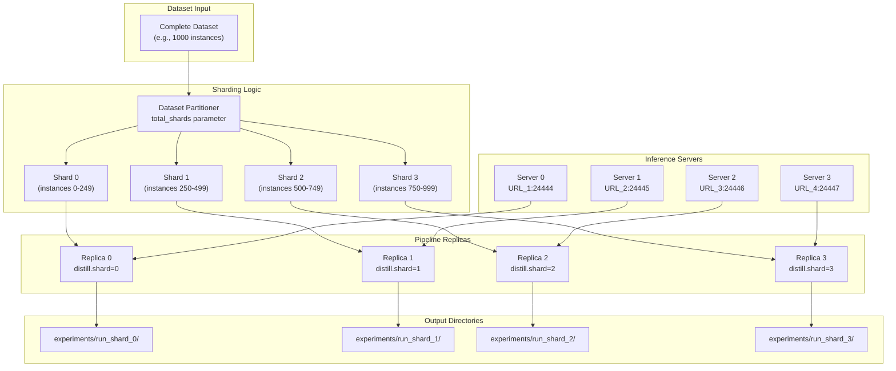
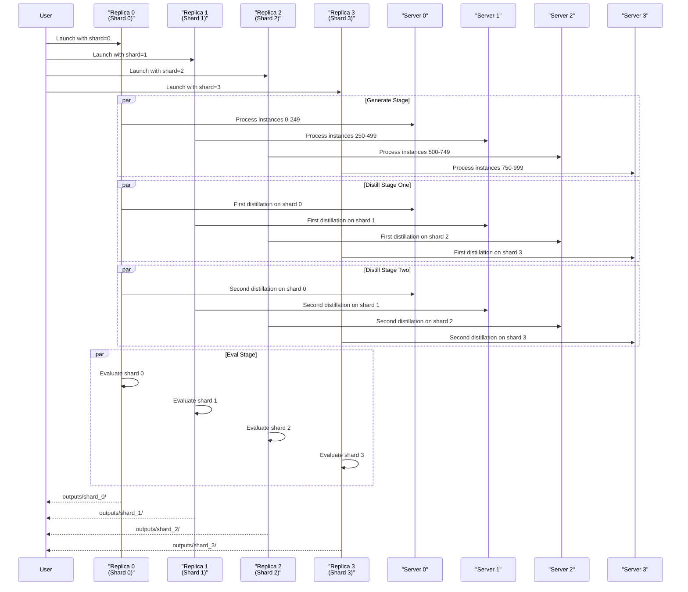
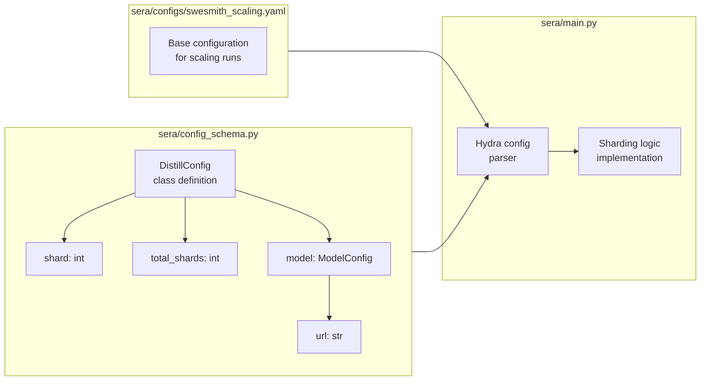

<!-- source: DeepWiki mcp.deepwiki.com · repo allenai/SERA · page 2.5 Multi-Server Scaling · fetched 2026-10-26 -->

# Multi-Server Scaling

<details>
<summary>Relevant source files</summary>

The following files were used as context for generating this wiki page:

- [README.md](README.md)

</details>


## Purpose and Scope

This document explains how SERA supports horizontal scaling through sharding and parallel processing across multiple inference servers for large-scale data generation. This capability enables efficient generation of thousands of training examples by distributing workload across multiple GPU-equipped servers.

For information about launching individual inference servers, see [Inference Servers](#2.2). For details on the pipeline stages that benefit from sharding, see [Pipeline Stages](#2.4).

## Overview

Multi-server scaling in SERA enables parallel execution of data generation runs by distributing the dataset across multiple inference servers. This approach is critical for generating large-scale training datasets efficiently, as a single server would take prohibitively long to process thousands of repository-level tasks.

The system uses a **sharding mechanism** where:
- The total dataset is divided into N equal partitions (shards)
- Each replica processes exactly one shard
- All replicas run the same pipeline configuration
- Results are stored in separate directories and can be merged

This architecture is particularly important for the `swesmith_scaling` configuration used to generate SERA's largest datasets [README.md:100]().

**Sources:** [README.md:96-121]()

## Sharding Architecture



**Sources:** [README.md:96-121]()

## Configuration Parameters

The multi-server scaling system uses three key configuration parameters:

| Parameter | Type | Description | Example |
|-----------|------|-------------|---------|
| `distill.shard` | int | Zero-indexed shard number for this replica | `0`, `1`, `2`, `3` |
| `distill.total_shards` | int | Total number of shards to divide the dataset into | `4` |
| `distill.model.url` | str | Inference server URL for this replica | `http://server1:24444/v1` |

These parameters are specified via command-line arguments when launching each replica. The sharding logic automatically determines which subset of the dataset each replica processes based on `distill.shard` and `distill.total_shards`.

**Sources:** [README.md:102-121]()

## Launching Multiple Replicas

### Setting Up Inference Servers

Before launching replicas, start the required number of inference servers on different machines or ports. Each server should be launched with appropriate tensor parallelism settings and unique ports:

```bash
# Server 1
bash launch_glm45.sh 8 24444 42

# Server 2  
bash launch_glm45.sh 8 24445 42

# Server 3
bash launch_glm45.sh 8 24446 42

# Server 4
bash launch_glm45.sh 8 24447 42
```

**Sources:** [README.md:23-29]()

### Launching Replica Processes

Each replica is launched as a separate Python process with its own shard configuration. All replicas should use the same base configuration (e.g., `swesmith_scaling`) but with different shard numbers and server URLs:

**Replica 0:**
```bash
python sera/main.py \
    --config-name=swesmith_scaling \
    distill.shard=0 \
    distill.total_shards=4 \
    distill.model.name=openai/GLM-4.5-Air \
    distill.model.url=http://server1:24444/v1
```

**Replica 1:**
```bash
python sera/main.py \
    --config-name=swesmith_scaling \
    distill.shard=1 \
    distill.total_shards=4 \
    distill.model.name=openai/GLM-4.5-Air \
    distill.model.url=http://server2:24445/v1
```

**Replica 2:**
```bash
python sera/main.py \
    --config-name=swesmith_scaling \
    distill.shard=2 \
    distill.total_shards=4 \
    distill.model.name=openai/GLM-4.5-Air \
    distill.model.url=http://server3:24446/v1
```

**Replica 3:**
```bash
python sera/main.py \
    --config-name=swesmith_scaling \
    distill.shard=3 \
    distill.total_shards=4 \
    distill.model.name=openai/GLM-4.5-Air \
    distill.model.url=http://server4:24447/v1
```

**Sources:** [README.md:102-121]()

## Pipeline Execution Flow



Each replica independently executes all five pipeline stages (generate, distill_stage_one, distill_stage_two, eval, postprocess) on its assigned shard. The replicas operate completely independently with no inter-process communication required.

**Sources:** [README.md:96-121](), [README.md:133-142]()

## Output Organization

Each replica stores its outputs in a separate directory structure within the `experiments/` folder. The directory naming typically includes the shard number to distinguish between replicas:

```
experiments/
├── swesmith_scaling_shard_0/
│   ├── generate/
│   ├── distill_stage_one/
│   ├── distill_stage_two/
│   ├── eval/
│   └── postprocess/
├── swesmith_scaling_shard_1/
│   ├── generate/
│   ├── distill_stage_one/
│   ├── distill_stage_two/
│   ├── eval/
│   └── postprocess/
├── swesmith_scaling_shard_2/
│   └── ...
└── swesmith_scaling_shard_3/
    └── ...
```

The outputs from all replicas can be combined by merging the final postprocessed results from each shard's output directory.

**Sources:** [README.md:96-121]()

## Resuming Sharded Runs

The stage resumption feature (see [Pipeline Stages](#2.4)) works seamlessly with sharded runs. Each replica can independently resume from any stage if interrupted:

```bash
python sera/main.py \
    --config-name=swesmith_scaling \
    distill.shard=1 \
    distill.total_shards=4 \
    distill.model.name=openai/GLM-4.5-Air \
    distill.model.url=http://server2:24445/v1 \
    stage=distill_stage_two
```

This command will resume replica 1 from `distill_stage_two`, skipping any hanging trajectories from previous stages. The `stage` parameter and experiment name matching work identically for sharded and non-sharded runs.

**Sources:** [README.md:130-156]()

## Configuration Schema Integration



The configuration schema in `sera/config_schema.py` defines the parameters that control sharding behavior. These parameters are referenced in the main orchestrator and override base configurations from YAML files.

**Sources:** [README.md:37](), [README.md:102-121]()

## Best Practices

### Shard Count Selection

Choose the number of shards based on:
- **Available GPU servers**: One shard per available inference server
- **Dataset size**: Larger datasets benefit from more shards
- **Memory constraints**: More shards reduce per-server memory requirements
- **Network bandwidth**: Consider data transfer overhead between servers

Common configurations:
- Small datasets (< 500 instances): 2-4 shards
- Medium datasets (500-2000 instances): 4-8 shards  
- Large datasets (> 2000 instances): 8-16 shards

### Server Configuration Consistency

Ensure all inference servers use:
- **Same model**: All servers should load identical model weights
- **Same seed**: Use the same random seed for reproducibility (though different seeds per shard is also valid)
- **Same tensor parallelism**: Consistent TP settings across servers
- **Sufficient resources**: Equal GPU allocation to prevent bottlenecks

### Monitoring and Synchronization

While replicas run independently:
- Monitor all replicas to detect failures early
- Check that all replicas complete stages at roughly similar times
- If one replica significantly lags, investigate server performance
- Be prepared to restart individual replicas using stage resumption

### Data Collection

After all replicas complete:
1. Verify each shard's output directory is complete
2. Check for any error logs in individual shard directories
3. Merge postprocessed outputs from all shards
4. Validate the combined dataset has the expected total instances

**Sources:** [README.md:96-121](), [README.md:130-156]()

## Scaling Considerations

### Linear Scalability

The sharding architecture provides near-linear scalability:
- 4 servers process 4x the data in the same time as 1 server
- No inter-replica communication overhead
- Each replica fully utilizes its assigned server

### Fault Tolerance

Individual replica failures do not affect other replicas:
- If one replica fails, restart only that replica
- Use stage resumption to continue from the last successful stage
- Other replicas continue processing their shards unaffected

### Resource Utilization

Efficient resource usage through:
- Full GPU utilization on each server (no idle time)
- Distributed I/O load across multiple machines
- Independent Docker container management per replica

**Sources:** [README.md:96-121]()

## Applicability to Specialization Configurations

Multi-server scaling applies to all SERA configurations, though it's most commonly used with `swesmith_scaling`:

| Configuration | Typical Use Case | Recommended Shards |
|---------------|------------------|-------------------|
| `specialization_django` | Smaller dataset from SWE-Bench | 2-4 |
| `specialization_personal` | Personal repositories | 2-4 |
| `specialization_anthropic` | Closed-source models | N/A (not applicable) |
| `swesmith_scaling` | Large-scale dataset generation | 8-16 |

Note that closed-source models (using `specialization_anthropic`) typically don't require multi-server setup as the API provider handles scaling internally.

**Sources:** [README.md:40-95](), [README.md:96-121]()

---

