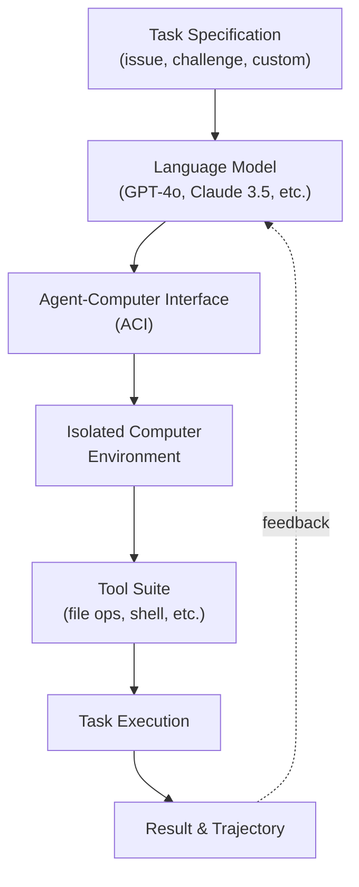
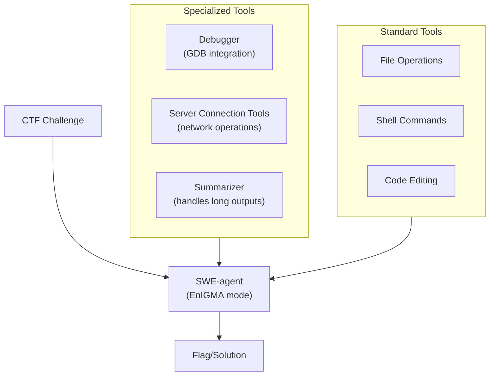
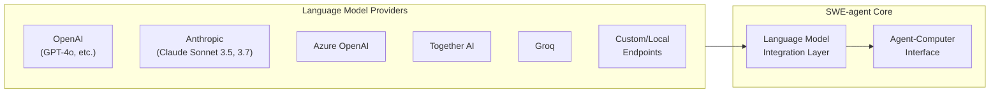
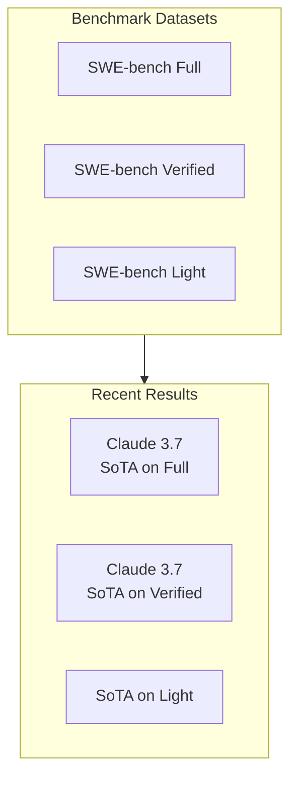

<!-- source: DeepWiki mcp.deepwiki.com · repo allenai/SERA · page 3.1 Agent Capabilities and Usage · fetched 2026-10-26 -->

# Agent Capabilities and Usage

Relevant source files

The following files were used as context for generating this wiki page:

- [modules/SWE-agent/README.md](modules/SWE-agent/README.md)

## Purpose and Scope

This document describes the core capabilities of the SWE-agent system and how to use it for different types of tasks. SWE-agent is an autonomous software engineering agent that enables language models to perform complex software engineering and cybersecurity tasks through configurable agent-computer interfaces (ACIs).

For information about the underlying architecture and how ACIs work, see [Agent Architecture](#3.2). For details about EnIGMA mode and specialized features like the debugger and summarizer, see [EnIGMA Mode and Special Features](#3.3). For configuration of external AI providers and GitHub integration, see [External Service Integration](#3.4).

---

## Core Capabilities Overview

SWE-agent provides four primary task categories, each leveraging language models to autonomously interact with computer environments:

| Capability | Description | Primary Use Case |
|------------|-------------|------------------|
| **GitHub Issue Resolution** | Automatically fix bugs and implement features in real repositories | Software maintenance and development |
| **Web-based Tasks** | Perform operations on web applications | Web automation and testing |
| **Cybersecurity Challenges** | Solve Capture The Flag (CTF) challenges | Offensive security testing |
| **Custom Coding Tasks** | Execute arbitrary programming challenges | General-purpose automation |

All capabilities operate through the same underlying agent-computer interface system, which provides isolated execution environments for safe code execution.

**Sources:** [modules/SWE-agent/README.md:15-20]()

---

## Task Execution Model

SWE-agent executes tasks using a consistent pattern across all capability types:

The agent iteratively:
1. Receives task specifications
2. Plans actions through the language model
3. Executes commands via the ACI
4. Receives feedback from the environment
5. Continues until task completion or timeout

**Sources:** [modules/SWE-agent/README.md:15-22]()

---

## GitHub Issue Resolution

### Overview

The GitHub issue resolution capability allows SWE-agent to autonomously fix bugs and implement features in real GitHub repositories. This is the most mature and widely-used capability, with state-of-the-art performance on the SWE-bench benchmark.

### Capability Details

```mermaid
flowchart LR
    subgraph Input["Input Sources"]
        IssueURL["GitHub Issue URL"]
        IssueText["Issue Description"]
        RepoContext["Repository Context"]
    end
    
    subgraph Processing["Agent Processing"]
        CloneRepo["Clone Repository"]
        AnalyzeIssue["Analyze Issue"]
        LocateCode["Locate Relevant Code"]
        MakeChanges["Make Changes"]
        RunTests["Run Tests"]
    end
    
    subgraph Output["Output"]
        Patch["Code Patch"]
        PR["Pull Request (optional)"]
        Trajectory["Execution Trajectory"]
    end
    
    Input --> Processing
    Processing --> Output
```

### Usage Pattern

The agent follows this workflow:
1. **Repository Access**: Clones the target repository into an isolated environment
2. **Issue Analysis**: Parses the issue description to understand the problem
3. **Code Navigation**: Uses file system tools to locate relevant source files
4. **Implementation**: Makes code changes to address the issue
5. **Verification**: Runs tests or validation steps
6. **Output Generation**: Produces a patch or pull request

### Performance

Recent benchmarks show state-of-the-art performance:
- SWE-agent 1.0 + Claude 3.7 achieves SoTA on SWE-bench verified
- SWE-agent 1.0 + Claude 3.7 achieves SoTA on SWE-bench full

**Sources:** [modules/SWE-agent/README.md:17](), [modules/SWE-agent/README.md:28-30]()

---

## Web-based Tasks

### Overview

SWE-agent can perform automated tasks on web applications, enabling web automation and testing scenarios.

### Capability Characteristics

This capability extends the agent's reach beyond file systems and repositories to web-based environments. The agent can:
- Navigate web applications
- Interact with web interfaces
- Perform automated testing
- Execute web-based workflows

The specific implementation details leverage the same ACI framework but with tools adapted for web interaction.

**Sources:** [modules/SWE-agent/README.md:18]()

---

## Cybersecurity Challenges (CTF)

### Overview

Through the EnIGMA mode, SWE-agent can solve offensive cybersecurity challenges, specifically Capture The Flag (CTF) competitions. This capability achieves state-of-the-art results on multiple cybersecurity benchmarks.

### Enhanced Features for CTF

The cybersecurity mode includes specialized tools:

### CTF-Specific Capabilities

| Feature | Purpose |
|---------|---------|
| **Debugger Integration** | Step through binaries and analyze program behavior |
| **Server Connection Tools** | Interact with remote challenge servers |
| **Output Summarizer** | Handle and process large command outputs |
| **Standard Shell Tools** | Execute exploitation techniques |

### Version Note

The EnIGMA mode and its specialized features are currently available in SWE-agent 0.7. The 1.0 update for EnIGMA is in progress.

**Sources:** [modules/SWE-agent/README.md:19](), [modules/SWE-agent/README.md:46-52]()

---

## Custom Coding Tasks

### Overview

SWE-agent supports arbitrary custom coding tasks, making it a general-purpose autonomous programming agent. This capability is the most flexible, allowing users to define any programming challenge or automation task.

### Custom Task Definition

Custom tasks can be specified through:
- Direct problem descriptions
- Structured task specifications
- Custom evaluation criteria
- Arbitrary programming challenges

### Use Cases

Custom coding tasks enable:
- **Algorithm Implementation**: Solve coding challenges and competitive programming problems
- **Code Generation**: Generate code based on specifications
- **Refactoring**: Improve existing codebases
- **Documentation**: Generate or update code documentation
- **Testing**: Write test suites for existing code
- **Data Processing**: Automate data transformation and analysis

### Flexibility

The custom task capability leverages the full power of the ACI system, providing access to:
- Complete file system operations
- Arbitrary shell command execution
- Code editing and manipulation tools
- Package installation and environment setup
- Test execution and validation

**Sources:** [modules/SWE-agent/README.md:20]()

---

## Language Model Support

### Supported Models

SWE-agent integrates with multiple language model providers:

### Model Selection

Different models exhibit varying performance characteristics:
- **Claude 3.7**: Currently achieves state-of-the-art results on SWE-bench
- **GPT-4o**: Strong general-purpose performance
- **Custom Models**: Can be integrated through local endpoints

The choice of model depends on:
- Task complexity
- Cost constraints
- Latency requirements
- Specific domain performance

**Sources:** [modules/SWE-agent/README.md:15](), [modules/SWE-agent/README.md:28-30]()

---

## Execution Environments

### Isolation and Safety

All SWE-agent tasks execute in isolated computer environments to ensure:
- **Safety**: Prevents accidental or malicious damage to host systems
- **Reproducibility**: Provides consistent execution contexts
- **Cleanliness**: Each task starts with a fresh environment
- **Resource Control**: Limits resource usage and prevents runaway processes

### Environment Characteristics

| Aspect | Implementation |
|--------|----------------|
| **Containerization** | Docker-based isolation |
| **File System** | Isolated file system per task |
| **Network** | Controlled network access |
| **Process** | Separate process space |
| **Cleanup** | Automatic environment disposal after completion |

**Sources:** [modules/SWE-agent/README.md:22]()

---

## Usage Modes

### Command Line Usage

SWE-agent provides command-line interfaces for all capability types. Users can:
- Specify task parameters via CLI arguments
- Configure agent behavior through command-line flags
- Monitor execution progress in real-time
- Review results and trajectories

### Batch Processing

For benchmarking and large-scale evaluation:
- Process multiple tasks sequentially or in parallel
- Generate reproducible results
- Compare performance across model configurations
- Evaluate on standard benchmarks like SWE-bench

### Browser-based Access

SWE-agent can be tried directly in a browser environment:
- GitHub Codespaces integration
- No local installation required
- Pre-configured development environment
- Ideal for quick experimentation

**Sources:** [modules/SWE-agent/README.md:35-42]()

---

## Performance and Benchmarking

### SWE-bench Performance

SWE-agent demonstrates state-of-the-art performance on software engineering benchmarks:

### Cybersecurity Benchmarks

EnIGMA mode achieves state-of-the-art results on multiple cybersecurity benchmarks, as documented on the EnIGMA leaderboard.

### Trajectory Analysis

All task executions generate execution trajectories that capture:
- Commands executed by the agent
- Environment responses
- Decision-making process
- Intermediate states
- Final outcomes

These trajectories enable:
- Performance debugging
- Behavior analysis
- Model comparison
- Research on agent reasoning

**Sources:** [modules/SWE-agent/README.md:28-30](), [modules/SWE-agent/README.md:51]()

---

## Getting Started

### Quick Start Options

| Method | Best For | Documentation Reference |
|--------|----------|------------------------|
| **GitHub Codespaces** | Immediate browser-based trial | [Installation Guide](#4.1) |
| **Local Installation** | Development and customization | [Installation Guide](#4.1) |
| **Docker Container** | Production deployment | [Docker Configuration](#5) |

### Command Line Tutorial

Refer to the SWE-agent documentation for detailed command-line tutorials covering:
- Basic usage patterns
- Configuration options
- Task specification formats
- Result interpretation

### Batch Mode

For running benchmarks or processing multiple tasks, refer to the batch mode documentation for:
- Parallel execution
- Result aggregation
- Performance monitoring

**Sources:** [modules/SWE-agent/README.md:33-42]()

---

## Integration Points

### Input Sources

SWE-agent accepts task specifications from:
- GitHub issues and pull requests
- Direct text specifications
- Structured configuration files
- Custom challenge definitions

### Output Formats

The agent produces:
- **Code patches**: Diff format for version control integration
- **Execution trajectories**: JSON-formatted execution logs
- **Results metadata**: Task outcomes, metrics, and statistics
- **Pull requests**: Direct GitHub integration (optional)

### External Dependencies

Task execution may require:
- GitHub API access for repository operations
- Docker for isolated environments
- Language model API credentials
- Network access for remote resources

For configuration details, see [External Service Integration](#3.4) and [API Key Configuration](#4.2).

**Sources:** [modules/SWE-agent/README.md:15-22]()

---

