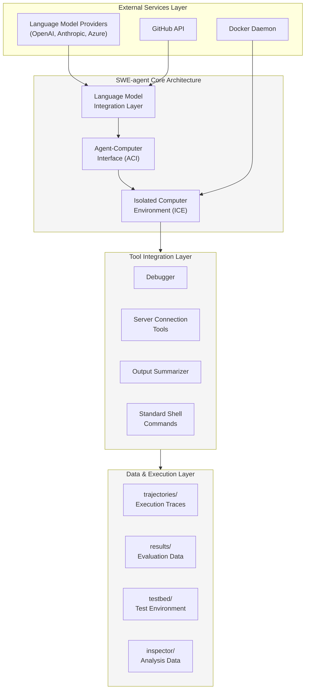
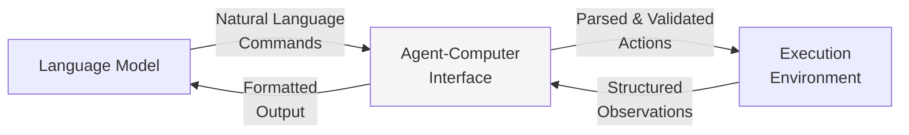
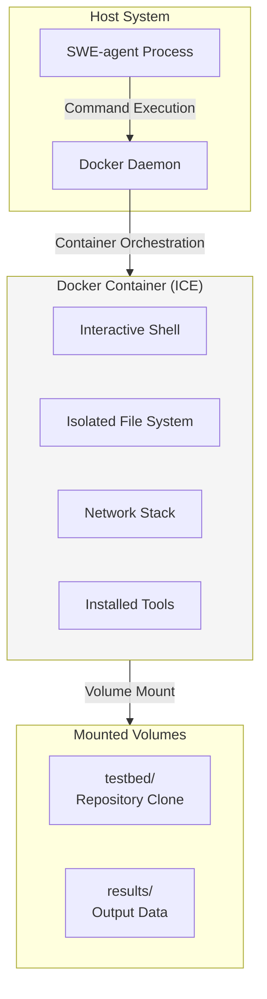
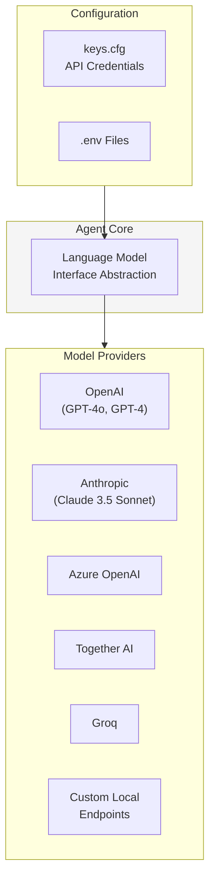
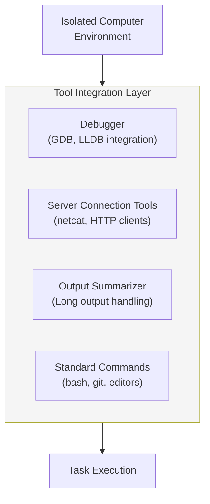
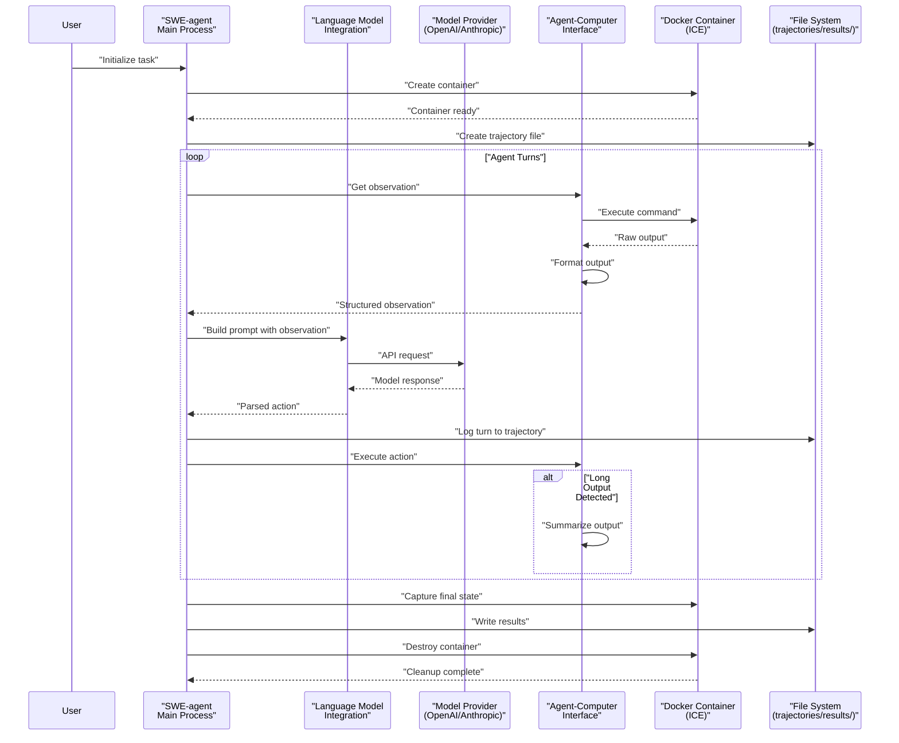
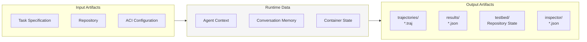

<!-- source: DeepWiki mcp.deepwiki.com · repo allenai/SERA · page 3.2 Agent Architecture · fetched 2026-10-26 -->

# Agent Architecture

Relevant source files

The following files were used as context for generating this wiki page:

- [modules/SWE-agent/.gitignore](modules/SWE-agent/.gitignore)
- [modules/SWE-agent/README.md](modules/SWE-agent/README.md)

## Purpose and Scope

This document describes the technical architecture of the SWE-agent autonomous software engineering system. It covers the core architectural components including the Agent-Computer Interface (ACI), isolated execution environments, language model integration, and the tool integration layer.

For information about specific agent capabilities and usage patterns, see [Agent Capabilities and Usage](#3.1). For details about EnIGMA mode's special features (debugger, server tools, summarizer), see [EnIGMA Mode and Special Features](#3.3). For external service configuration, see [External Service Integration](#3.4).

Sources: [modules/SWE-agent/README.md:1-105]()

---

## Architectural Overview

SWE-agent implements a layered architecture that enables language models to autonomously interact with computer environments through a configurable interface system. The architecture separates concerns between the AI model integration, the interface abstractions, the execution environment, and specialized tooling.

**Diagram: High-Level Component Architecture**

The architecture consists of four primary layers:

| Layer | Components | Responsibility |
|-------|-----------|----------------|
| **External Services** | LLM providers, GitHub API, Docker daemon | External dependencies and infrastructure |
| **Core Architecture** | LM Integration, ACI, ICE | Core agent abstraction and execution isolation |
| **Tool Integration** | Debugger, server tools, summarizer, shell commands | Specialized tooling available to the agent |
| **Data & Execution** | Trajectories, results, testbed, inspector | Execution artifacts and analysis data |

Sources: [modules/SWE-agent/README.md:15-22](), [modules/SWE-agent/README.md:46-52](), [modules/SWE-agent/.gitignore:142-158]()

---

## Agent-Computer Interface (ACI)

The Agent-Computer Interface (ACI) is the core abstraction that defines how language models interact with computer environments. ACIs are configurable, allowing different task types to define their own command sets and interaction patterns.

### ACI Design Principles

**Diagram: ACI Interaction Flow**

The ACI serves as a bidirectional translator:

1. **Command Translation**: Converts natural language instructions from the language model into executable system commands
2. **Output Formatting**: Structures system output into a format suitable for language model consumption
3. **Action Validation**: Ensures commands are within allowed boundaries for the current task
4. **Context Management**: Maintains execution context across multiple interaction turns

### Configurability

ACIs are task-specific and configurable through YAML configuration files. Different task types (GitHub issue fixing, CTF challenges, web tasks, custom coding) can define their own:

- Available commands and tools
- Output formatting rules
- Context window management strategies
- Error handling behaviors

This configurability enables the same core architecture to handle diverse task types, from software engineering to cybersecurity challenges.

Sources: [modules/SWE-agent/README.md:22-22]()

---

## Isolated Computer Environment (ICE)

The Isolated Computer Environment (ICE) provides secure, containerized execution spaces where agent actions are performed. This isolation is critical for both safety and reproducibility.

### ICE Architecture

**Diagram: Isolated Execution Environment Structure**

### Container Lifecycle

Each agent execution operates within a dedicated Docker container that:

1. **Initialization**: Spins up from a base image with required dependencies
2. **Setup**: Clones or mounts the target repository into the container
3. **Execution**: Runs agent commands in isolation
4. **Teardown**: Captures execution artifacts before container destruction

### Isolation Benefits

| Aspect | Benefit |
|--------|---------|
| **Security** | Prevents agent actions from affecting the host system |
| **Reproducibility** | Each execution starts from a known, clean state |
| **Resource Management** | Container limits prevent resource exhaustion |
| **Cleanup** | Easy disposal of execution artifacts |

### Persistent Artifacts

While the container is ephemeral, key artifacts are preserved:

- **Execution Trajectories**: Complete history of commands and outputs stored in `trajectories/`
- **Results**: Task outcomes and evaluation metrics stored in `results/`
- **Test Environment**: Repository state preserved in `testbed/`
- **Analysis Data**: Debugging and inspection data in `inspector/`

Sources: [modules/SWE-agent/.gitignore:142-158]()

---

## Language Model Integration

The language model integration layer abstracts communication with various AI providers, enabling SWE-agent to work with different models through a unified interface.

### Supported Model Providers

**Diagram: Language Model Provider Integration**

### Model Communication Protocol

The integration layer handles:

1. **API Authentication**: Manages credentials for different providers via `keys.cfg`
2. **Request Formatting**: Converts agent context into provider-specific API formats
3. **Response Parsing**: Extracts structured actions from model outputs
4. **Error Handling**: Manages rate limits, timeouts, and provider-specific errors
5. **Token Management**: Tracks usage and optimizes context window utilization

### Model Selection

Different models can be selected based on:

- **Task Complexity**: Simpler models for basic tasks, more capable models for complex reasoning
- **Cost Considerations**: Balancing performance with API costs
- **Latency Requirements**: Local models for faster response, cloud models for better quality
- **Provider Availability**: Fallback options when primary provider is unavailable

Sources: [modules/SWE-agent/README.md:15-15](), [modules/SWE-agent/.gitignore:137-137]()

---

## Tool Integration Layer

The tool integration layer provides specialized capabilities beyond standard shell commands. These tools were primarily introduced through the EnIGMA cybersecurity mode but are available across all agent tasks.

### Available Tools

**Diagram: Tool Integration Architecture**

### Tool Categories

| Tool Type | Purpose | Use Cases |
|-----------|---------|-----------|
| **Debugger** | Interactive debugging of executables | Cybersecurity analysis, bug investigation |
| **Server Connection Tools** | Network interaction and testing | Web service testing, CTF challenges |
| **Output Summarizer** | Condense verbose output | Handling large logs, compiler errors |
| **Standard Commands** | File manipulation, version control | Code editing, repository management |

### Debugger Integration

The debugger tool provides:

- Interactive debugging sessions within the container
- Breakpoint setting and inspection
- Memory and register examination
- Support for multiple debugging backends (GDB, LLDB)

### Server Connection Tools

Enable the agent to:

- Connect to remote services
- Test HTTP endpoints
- Interact with network protocols
- Validate server responses

### Summarizer

The summarizer addresses a key challenge in agent-computer interaction:

**Problem**: Command outputs can exceed language model context windows  
**Solution**: Intelligent summarization of long outputs while preserving critical information

The summarizer:

1. Detects when output exceeds length thresholds
2. Extracts salient information (errors, warnings, key results)
3. Provides condensed version to the language model
4. Retains full output in trajectory logs for debugging

Sources: [modules/SWE-agent/README.md:52-52]()

---

## Execution Flow

Understanding how components interact during agent execution is essential for comprehending the architecture.

### Complete Execution Cycle

**Diagram: Agent Execution Sequence**

### Execution Phases

#### 1. Initialization Phase

- Container creation via Docker
- Repository cloning or mounting
- Environment setup (dependencies, tools)
- Trajectory logging initialization

#### 2. Agent Loop Phase

Each agent turn consists of:

1. **Observation Collection**: ACI executes commands in ICE, formats output
2. **Model Inference**: Language model receives context and generates next action
3. **Action Execution**: ACI validates and executes model's proposed action
4. **State Update**: Trajectory updated with turn information
5. **Termination Check**: Determine if task is complete or max turns reached

#### 3. Finalization Phase

- Final container state capture
- Result metrics computation
- Trajectory file completion
- Container cleanup and resource release

### Data Flow Mapping

**Diagram: Data Flow Through Execution Lifecycle**

Sources: [modules/SWE-agent/.gitignore:142-158]()

---

## Architecture Benefits and Trade-offs

### Benefits

| Benefit | Description |
|---------|-------------|
| **Modularity** | Clear separation between LM integration, ACI, and execution environment |
| **Extensibility** | New task types via ACI configuration without core changes |
| **Safety** | Docker isolation prevents unintended host system modifications |
| **Reproducibility** | Containerized environments ensure consistent execution |
| **Model Flexibility** | Unified interface supports multiple model providers |

### Trade-offs

| Trade-off | Consideration |
|-----------|---------------|
| **Performance Overhead** | Docker containerization adds latency vs. native execution |
| **Resource Usage** | Each execution requires dedicated container resources |
| **Complexity** | Multiple layers of abstraction increase system complexity |
| **Dependencies** | Requires Docker daemon and appropriate permissions |

---

## Summary

The SWE-agent architecture implements a layered design that enables autonomous software engineering through:

1. **Agent-Computer Interface (ACI)**: Configurable abstraction for model-environment interaction
2. **Isolated Computer Environment (ICE)**: Docker-based containerization for safe, reproducible execution
3. **Language Model Integration**: Unified interface supporting multiple AI providers
4. **Tool Integration Layer**: Specialized capabilities including debugger, server tools, and output summarization

This architecture has enabled state-of-the-art performance on software engineering benchmarks while maintaining flexibility for diverse task types including web automation, cybersecurity challenges, and custom coding tasks.

Sources: [modules/SWE-agent/README.md:1-105](), [modules/SWE-agent/.gitignore:142-158]()

---

