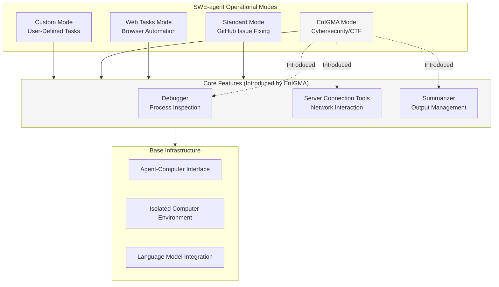
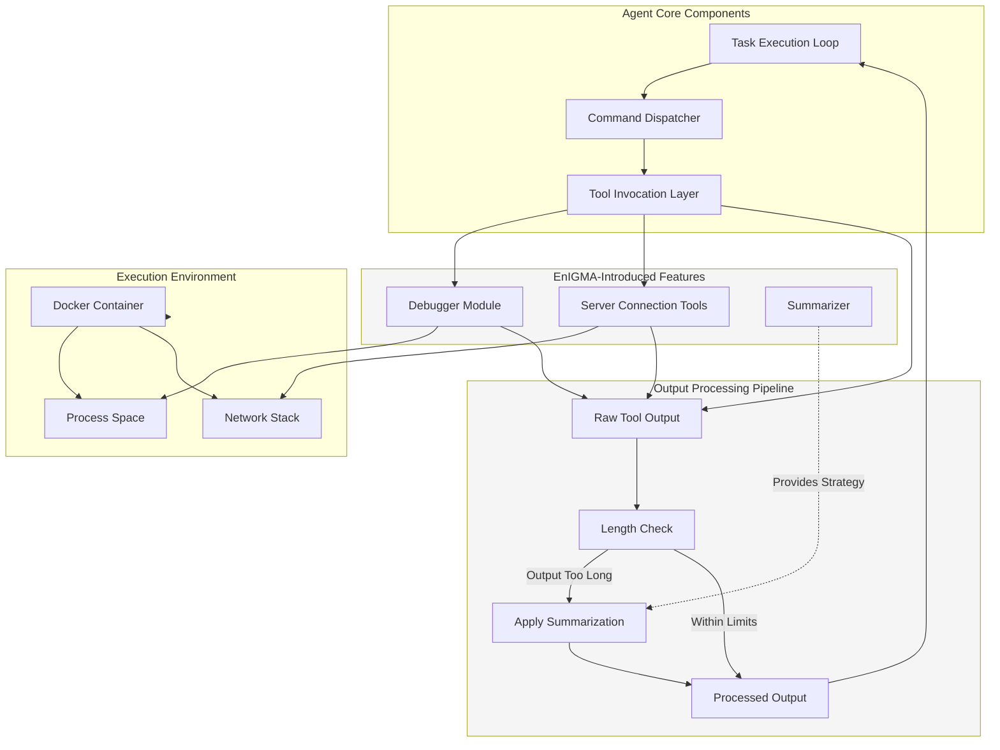
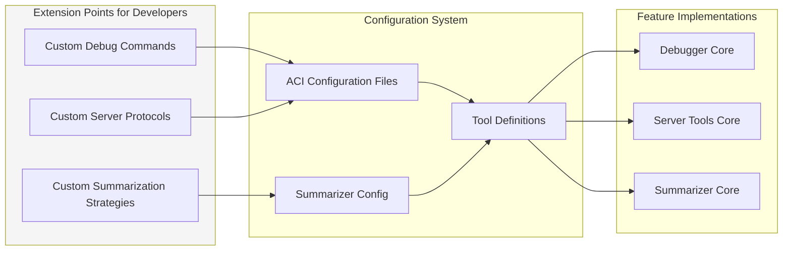

<!-- source: DeepWiki mcp.deepwiki.com · repo allenai/SERA · page 3.3 EnIGMA Mode and Special Features · fetched 2026-10-26 -->

# EnIGMA Mode and Special Features

<details>
<summary>Relevant source files</summary>

The following files were used as context for generating this wiki page:

- [modules/SWE-agent/README.md](modules/SWE-agent/README.md)

</details>


## Purpose and Scope

This document describes the EnIGMA (Enhanced Interactive Generative Model Agent) mode within the SWE-agent system, which is specialized for solving offensive cybersecurity challenges such as Capture The Flag (CTF) competitions. This page focuses on the special features that EnIGMA introduced—the debugger, server connection tools, and summarizer—which have been integrated into the core SWE-agent system and are now available across all operational modes.

For information about general agent capabilities beyond EnIGMA, see [Agent Capabilities and Usage](#3.1). For details on the core agent architecture that these features extend, see [Agent Architecture](#3.2). For information about external service integration, see [External Service Integration](#3.4).

## EnIGMA Mode Overview

EnIGMA is a specialized operational mode within SWE-agent designed for offensive cybersecurity tasks, particularly solving Capture The Flag (CTF) challenges. The mode achieves state-of-the-art performance on multiple cybersecurity benchmarks, demonstrating the effectiveness of its specialized tooling and approach.

Unlike standard software engineering tasks that focus on code modification and bug fixing, cybersecurity challenges require:

- **Interactive debugging** of running processes and services
- **Network service interaction** through remote connections
- **Output management** for long traces and verbose tool outputs

The EnIGMA project addressed these requirements by introducing three major feature categories that have since been integrated into the core SWE-agent system.

**Version Note**: EnIGMA currently operates on SWE-agent version 0.7, with updates planned for version 1.0 compatibility.

**Sources**: [modules/SWE-agent/README.md:46-56]()

### EnIGMA Architecture Position



**Diagram**: EnIGMA's position in the SWE-agent architecture and feature propagation to other modes

**Sources**: [modules/SWE-agent/README.md:46-56]()

## Special Features

### Debugger

The debugger feature provides the agent with capabilities to interactively inspect and control running processes during task execution. This is essential for cybersecurity challenges where understanding program behavior, examining memory state, and manipulating execution flow are critical.

The debugger integrates with the Isolated Computer Environment (ICE) to provide controlled debugging capabilities without compromising system security. It allows the language model to:

- Set breakpoints in running processes
- Examine variable state and memory
- Step through code execution
- Analyze program flow during CTF challenge solving

The debugger is documented in detail at the SWE-agent documentation website under the Interactive Agent Tools section.

**Sources**: [modules/SWE-agent/README.md:52]()

### Server Connection Tools

Server connection tools enable the agent to interact with network services, which is fundamental for many cybersecurity challenges. These tools allow the agent to:

- Establish connections to remote servers
- Send and receive network traffic
- Interact with services over various protocols
- Analyze server responses and behaviors

This capability is particularly important for CTF challenges involving:

- Network exploitation
- Protocol analysis
- Service vulnerability testing
- Remote code execution scenarios

Like the debugger, server connection tools are integrated into the Isolated Computer Environment to ensure safe interaction with potentially malicious or vulnerable services.

**Sources**: [modules/SWE-agent/README.md:52]()

### Summarizer

The summarizer addresses a critical challenge in autonomous agent operations: managing verbose tool outputs that can exceed the language model's context window. In cybersecurity tasks, many tools produce extensive output that would overwhelm the agent if processed in full.

The summarizer component:

- Monitors tool output length
- Applies configurable summarization strategies
- Condenses lengthy outputs while preserving critical information
- Maintains context window efficiency

This feature is configured through the agent's configuration system and can be customized based on task requirements. Different summarization strategies may be appropriate for different types of outputs (e.g., network traces vs. file listings).

**Sources**: [modules/SWE-agent/README.md:52]()

## Feature Integration Architecture



**Diagram**: Integration of EnIGMA features into the agent execution pipeline

**Sources**: [modules/SWE-agent/README.md:46-56]()

## Cross-Mode Availability

A key architectural decision in the EnIGMA project was to make the introduced features available across all SWE-agent operational modes, not just for cybersecurity tasks. This design choice reflects the general utility of these capabilities:

| Feature | Original Use Case (EnIGMA) | General Use Cases |
|---------|---------------------------|-------------------|
| **Debugger** | Analyzing exploits and vulnerabilities | Debugging complex software issues, understanding program behavior |
| **Server Connection Tools** | Interacting with CTF challenge servers | Testing web services, API interaction, distributed system debugging |
| **Summarizer** | Managing verbose security tool output | Handling large log files, condensing extensive test outputs, managing verbose CLI tools |

The features integrate with the core Agent-Computer Interface (ACI) system, making them accessible through configuration without requiring mode-specific implementations.

**Sources**: [modules/SWE-agent/README.md:52]()

## Usage and Documentation

### Feature Documentation References

The EnIGMA features are documented in the SWE-agent documentation website:

- **Debugger and Server Connection Tools**: Documented under Interactive Agent Tools at `swe-agent.com/0.7/background/iat/`
- **Summarizer**: Documented under Summarizers configuration at `swe-agent.com/0.7/config/summarizers/`

These documentation pages provide detailed configuration options, usage examples, and best practices for leveraging these features in agent tasks.

### Version Considerations

The EnIGMA mode and its features are currently available in **SWE-agent version 0.7**. The project team is working on updating EnIGMA for compatibility with SWE-agent version 1.0, which introduces significant architectural improvements and new capabilities.

Users implementing cybersecurity-specific workflows should:

1. Use SWE-agent 0.7 for full EnIGMA support
2. Monitor the project repository for updates on 1.0 compatibility
3. Review the migration documentation when EnIGMA is updated for 1.0

**Sources**: [modules/SWE-agent/README.md:52]()

## Performance and Benchmarks

EnIGMA achieves state-of-the-art results on multiple cybersecurity benchmarks. Performance metrics and leaderboard rankings are available at `enigma-agent.com/#results`, demonstrating the effectiveness of the specialized tooling and agent-computer interface design.

The benchmark results validate the design decisions behind the three core features:

- **Debugger** enables precise program analysis required for exploit development
- **Server Connection Tools** facilitate the network interaction patterns common in CTF challenges
- **Summarizer** ensures the agent can process verbose security tool output without context overflow

**Sources**: [modules/SWE-agent/README.md:51]()

## Citation and Attribution

The EnIGMA project and its features are described in the following academic publication:

```
Abramovich, T., Udeshi, M., Shao, M., Lieret, K., Xi, H., Milner, K., 
Jancheska, S., Yang, J., Jimenez, C. E., Khorrami, F., Krishnamurthy, P., 
Dolan-Gavitt, B., Shafique, M., Narasimhan, K., Karri, R., & Press, O. (2024). 
EnIGMA: Enhanced Interactive Generative Model Agent for CTF Challenges. 
arXiv preprint arXiv:2409.16165.
```

Users of the summarizer, interactive commands, or offensive cybersecurity capabilities in SWE-agent should cite both the core SWE-agent paper and the EnIGMA paper.

**Sources**: [modules/SWE-agent/README.md:80-91]()

## Feature Extension Points



**Diagram**: Extension points for customizing EnIGMA features

The EnIGMA features are designed to be extensible through the SWE-agent configuration system. Users can customize:

- **Debugger behavior**: Define custom debugging commands or workflows specific to their task domain
- **Server protocols**: Add support for additional network protocols or service types
- **Summarization strategies**: Implement task-specific summarization logic for specialized output formats

These extensions are configured through the Agent-Computer Interface configuration files and tool definition system, allowing customization without modifying core agent code.

**Sources**: [modules/SWE-agent/README.md:46-56]()

---

