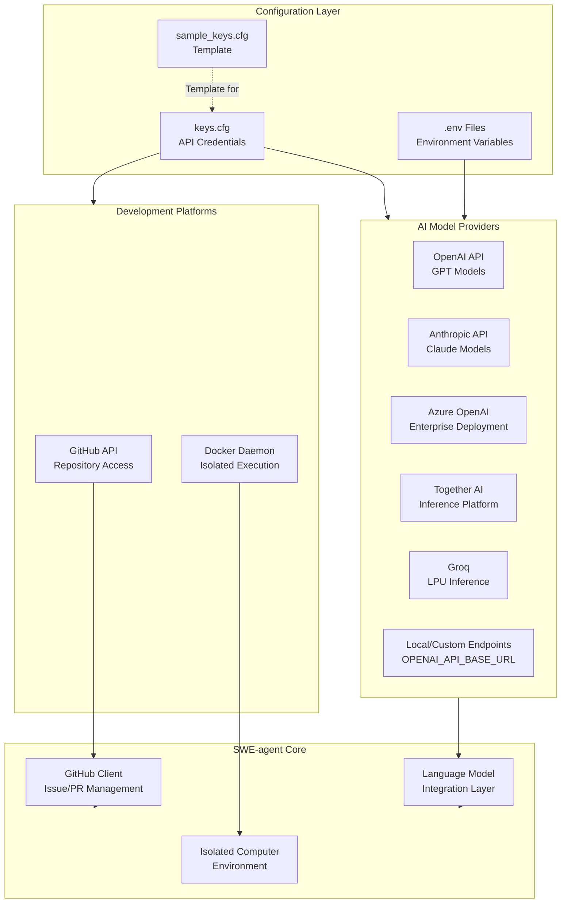
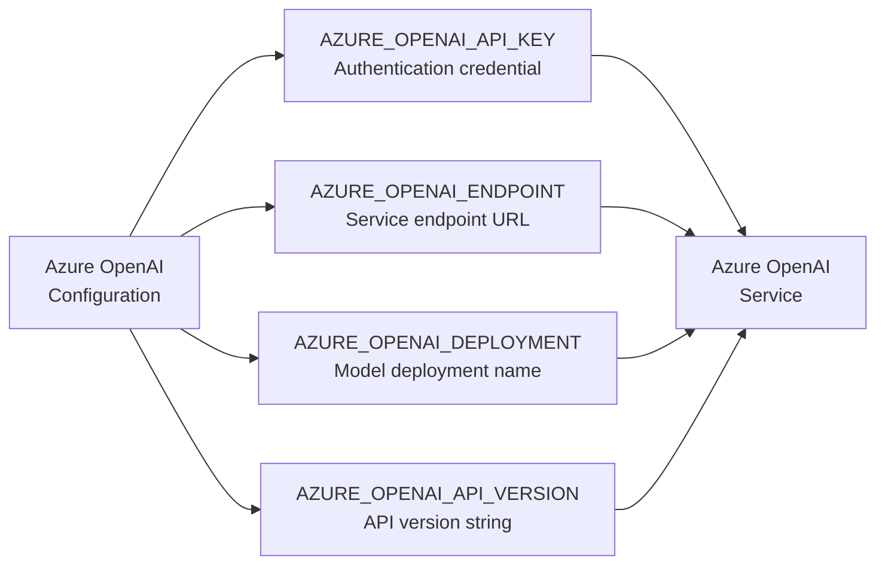
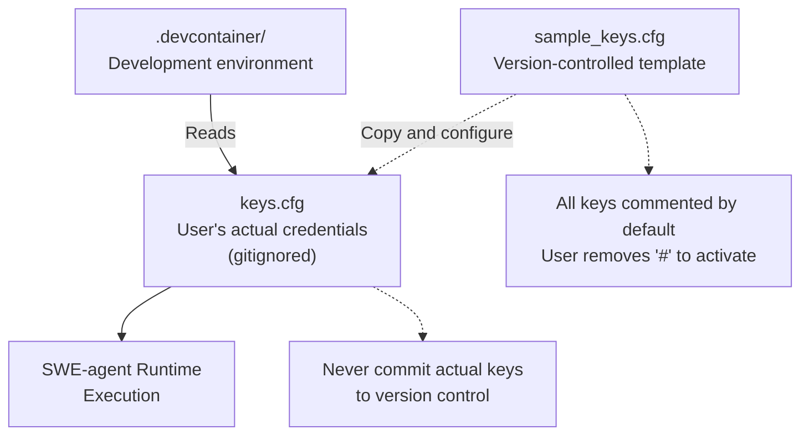
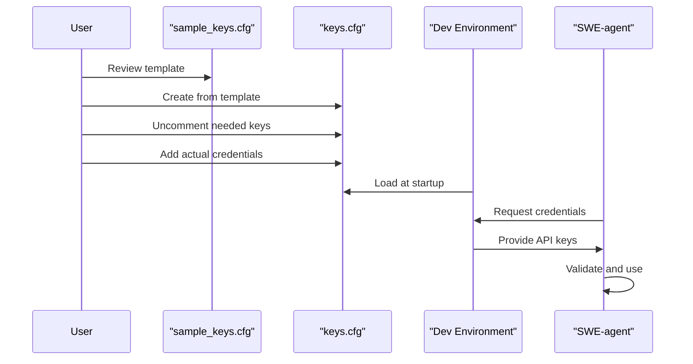
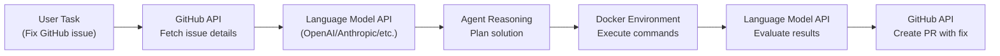

<!-- source: DeepWiki mcp.deepwiki.com · repo allenai/SERA · page 3.4 External Service Integration · fetched 2026-10-26 -->

# External Service Integration

<details>
<summary>Relevant source files</summary>

The following files were used as context for generating this wiki page:

- [modules/SWE-agent/.devcontainer/sample_keys.cfg](modules/SWE-agent/.devcontainer/sample_keys.cfg)
- [modules/SWE-agent/README.md](modules/SWE-agent/README.md)

</details>


## Purpose and Scope

This document describes how the SWE-agent module integrates with external services, including AI model providers and development platforms. It covers the configuration system for API keys and service endpoints, supported service providers, and the integration architecture.

For information about the agent's core architecture and how it uses these services, see [Agent Architecture](#3.2). For API key configuration in the development environment, see [API Key Configuration](#4.2).

---

## Overview

The SWE-agent module integrates with multiple categories of external services to enable autonomous software engineering capabilities. These integrations are managed through a centralized configuration system that securely handles API credentials and endpoint configurations.

### Integration Architecture



**Purpose**: This diagram illustrates the flow of credentials from configuration files to external services and into the agent core components.

**Sources**: [modules/SWE-agent/.devcontainer/sample_keys.cfg:1-11](), [modules/SWE-agent/README.md:15-22]()

---

## AI Model Provider Integration

The SWE-agent module supports multiple AI model providers, allowing flexibility in choosing language models based on performance requirements, cost, and deployment constraints.

### Supported Providers

| Provider | Configuration Keys | Purpose | Model Examples |
|----------|-------------------|---------|----------------|
| **OpenAI** | `OPENAI_API_KEY` | Primary commercial AI provider | GPT-4o, GPT-4, GPT-3.5 |
| **Anthropic** | `ANTHROPIC_API_KEY` | Claude model family | Claude Sonnet 3.5, Claude 3.7 |
| **Azure OpenAI** | `AZURE_OPENAI_API_KEY`<br/>`AZURE_OPENAI_ENDPOINT`<br/>`AZURE_OPENAI_DEPLOYMENT`<br/>`AZURE_OPENAI_API_VERSION` | Enterprise OpenAI deployment | GPT models via Azure |
| **Together AI** | `TOGETHER_API_KEY` | Open-source model hosting | Various open-source LLMs |
| **Groq** | `GROQ_API_KEY` | LPU-accelerated inference | Fast inference for supported models |
| **Local/Custom** | `OPENAI_API_BASE_URL` | Self-hosted or alternative endpoints | Custom model deployments |

**Sources**: [modules/SWE-agent/.devcontainer/sample_keys.cfg:3-11]()

### OpenAI Integration

The OpenAI integration enables access to GPT model families. The system uses the OpenAI API key for authentication.

**Configuration**:
```
OPENAI_API_KEY: 'OpenAI API Key Here if using OpenAI Model'
```

The OpenAI provider is used extensively in SWE-agent capabilities, including fixing GitHub issues and performing autonomous coding tasks as documented in the README.

**Sources**: [modules/SWE-agent/.devcontainer/sample_keys.cfg:3](), [modules/SWE-agent/README.md:15]()

### Anthropic Integration

Anthropic's Claude models are supported as an alternative to OpenAI. Claude Sonnet 3.5 and Claude 3.7 have achieved state-of-the-art results on SWE-bench benchmarks when used with SWE-agent.

**Configuration**:
```
ANTHROPIC_API_KEY: 'Anthropic API Key Here if using Anthropic Model'
```

**Sources**: [modules/SWE-agent/.devcontainer/sample_keys.cfg:4](), [modules/SWE-agent/README.md:15](), [modules/SWE-agent/README.md:28-29]()

### Azure OpenAI Integration

Azure OpenAI provides enterprise-grade deployment of OpenAI models with enhanced security, compliance, and regional availability. This integration requires multiple configuration parameters.

**Configuration Parameters**:



**Required Configuration**:
```
AZURE_OPENAI_API_KEY: 'Azure OpenAI API Key Here if using Azure OpenAI Model'
AZURE_OPENAI_ENDPOINT: 'Azure OpenAI Endpoint Here if using Azure OpenAI Model'
AZURE_OPENAI_DEPLOYMENT: 'Azure OpenAI Deployment Here if using Azure OpenAI Model'
AZURE_OPENAI_API_VERSION: 'Azure OpenAI API Version Here if using Azure OpenAI Model'
```

**Sources**: [modules/SWE-agent/.devcontainer/sample_keys.cfg:6-9]()

### Together AI Integration

Together AI provides access to open-source language models through a managed inference platform.

**Configuration**:
```
TOGETHER_API_KEY: 'Together API Key Here if using Together Model'
```

**Sources**: [modules/SWE-agent/.devcontainer/sample_keys.cfg:5]()

### Groq Integration

Groq offers LPU-accelerated inference for fast model execution.

**Configuration**:
```
GROQ_API_KEY: 'Groq Models API Key'
```

**Sources**: [modules/SWE-agent/.devcontainer/sample_keys.cfg:11]()

### Local and Custom Endpoint Integration

The system supports local or alternative API endpoints through the `OPENAI_API_BASE_URL` configuration. This enables:

- Self-hosted model deployments
- Custom inference servers
- Alternative OpenAI-compatible APIs
- Development and testing with local models

**Configuration**:
```
OPENAI_API_BASE_URL: 'LM base URL here if using Local or alternative api Endpoint'
```

This flexibility allows organizations to use SWE-agent with their own infrastructure or alternative providers that implement OpenAI-compatible APIs.

**Sources**: [modules/SWE-agent/.devcontainer/sample_keys.cfg:10]()

---

## GitHub Integration

GitHub integration enables SWE-agent to interact with repositories, including private repositories, for autonomous issue resolution.

### GitHub API Access

The GitHub token provides authentication for repository operations:

**Configuration**:
```
GITHUB_TOKEN: 'GitHub Token to clone private repos'
```

### Capabilities

The GitHub integration enables SWE-agent to:

1. **Clone Private Repositories**: Access private codebases for issue resolution
2. **Read Issue Descriptions**: Parse GitHub issue content and metadata
3. **Create Pull Requests**: Submit fixes autonomously
4. **Access Repository Contents**: Navigate and modify code files

These capabilities are used when SWE-agent fixes issues in real GitHub repositories, a core feature described in the README.

**Sources**: [modules/SWE-agent/.devcontainer/sample_keys.cfg:2](), [modules/SWE-agent/README.md:17]()

---

## Configuration System Architecture

The configuration system uses a template-based approach to manage API credentials securely across different environments.

### Configuration File Structure



**Purpose**: This diagram shows the relationship between the template configuration file and the user's actual configuration file.

### Template File: sample_keys.cfg

The `sample_keys.cfg` file serves as a template for users to create their own `keys.cfg` file. All keys are commented out by default:

```
# All keys are commented out by default. Make sure to remove the leading '#' of the relevant lines
# GITHUB_TOKEN: 'GitHub Token to clone private repos'
# OPENAI_API_KEY: 'OpenAI API Key Here if using OpenAI Model'
...
```

**Security Design**: 
- The sample file is version-controlled and contains no actual credentials
- Users copy this to create their own `keys.cfg` file
- The `keys.cfg` file is excluded from version control via `.gitignore`
- Users uncomment and populate only the keys they need

**Sources**: [modules/SWE-agent/.devcontainer/sample_keys.cfg:1-11]()

### Configuration Workflow



**Purpose**: This diagram illustrates the step-by-step process for configuring external service credentials.

---

## Service-Specific Configuration Details

### Configuration Format

All configuration entries in `sample_keys.cfg` follow a consistent format:

```
# KEY_NAME: 'Description or placeholder value'
```

When activated, users modify the line to:

```
KEY_NAME: 'actual-credential-value'
```

### Key Activation Guidelines

| Configuration Key | Required For | Activation Steps |
|-------------------|--------------|------------------|
| `GITHUB_TOKEN` | Private repository access, creating PRs | Remove `#`, add GitHub personal access token |
| `OPENAI_API_KEY` | Using OpenAI models (GPT-4o, etc.) | Remove `#`, add OpenAI API key |
| `ANTHROPIC_API_KEY` | Using Claude models | Remove `#`, add Anthropic API key |
| `AZURE_OPENAI_*` | Using Azure OpenAI deployment | Remove `#` from all 4 Azure lines, configure each |
| `TOGETHER_API_KEY` | Using Together AI models | Remove `#`, add Together AI key |
| `GROQ_API_KEY` | Using Groq inference | Remove `#`, add Groq API key |
| `OPENAI_API_BASE_URL` | Local or alternative endpoints | Remove `#`, add base URL |

**Sources**: [modules/SWE-agent/.devcontainer/sample_keys.cfg:1-11]()

---

## Integration with Agent Capabilities

The external service integrations enable the various capabilities documented for SWE-agent:

### Language Model Selection

Different model providers are selected based on:
- **Performance requirements**: Claude 3.7 achieves state-of-the-art results on SWE-bench
- **Cost considerations**: Different providers have varying pricing models
- **Latency needs**: Groq provides fast inference
- **Privacy requirements**: Local endpoints keep data on-premises
- **Enterprise needs**: Azure OpenAI offers compliance and SLAs

**Sources**: [modules/SWE-agent/README.md:15](), [modules/SWE-agent/README.md:28-29]()

### Task Execution Flow



**Purpose**: This diagram shows how external service integrations work together during task execution.

**Sources**: [modules/SWE-agent/README.md:15-22]()

### EnIGMA Mode Integration

The EnIGMA cybersecurity mode leverages the same external service integration system but adds specialized capabilities like server connection tools and debugger integration. These features are available across all SWE-agent modes.

**Sources**: [modules/SWE-agent/README.md:46-52]()

---

## Security Considerations

### Credential Management

1. **Template-Based Configuration**: The `sample_keys.cfg` provides a safe template without actual credentials
2. **Git Exclusion**: Actual `keys.cfg` files must be excluded from version control
3. **Comment-Out Default**: All keys are commented by default, requiring explicit activation
4. **Minimal Permissions**: Users should create tokens with minimum necessary permissions

### API Key Scope

| Service | Recommended Permissions |
|---------|------------------------|
| GitHub | `repo` scope for private repository access, `public_repo` for public only |
| OpenAI | API access only, no organization management |
| Anthropic | API access only |
| Azure OpenAI | Specific deployment access, not subscription-wide |

**Sources**: [modules/SWE-agent/.devcontainer/sample_keys.cfg:1-11]()

---

## Error Handling and Validation

When external service integrations fail, SWE-agent behavior depends on the service:

- **Missing API Keys**: The agent will fail gracefully with an error message indicating which key is required
- **Invalid Credentials**: Authentication errors are reported with service-specific error messages
- **Network Failures**: Requests to external services include retry logic for transient failures
- **Rate Limiting**: The system respects rate limits from AI providers and may queue requests

---

## Summary

The external service integration system in SWE-agent provides:

1. **Multi-Provider Support**: Flexibility to choose from OpenAI, Anthropic, Azure, Together, Groq, or custom endpoints
2. **Secure Configuration**: Template-based credential management with version control safety
3. **GitHub Integration**: Full repository access for autonomous issue resolution
4. **Enterprise Support**: Azure OpenAI integration for organizations with compliance requirements
5. **Local Development**: Support for self-hosted models and custom API endpoints

This integration architecture enables SWE-agent to leverage state-of-the-art language models while maintaining security and flexibility across different deployment scenarios.

**Sources**: [modules/SWE-agent/.devcontainer/sample_keys.cfg:1-11](), [modules/SWE-agent/README.md:1-105]()

---

