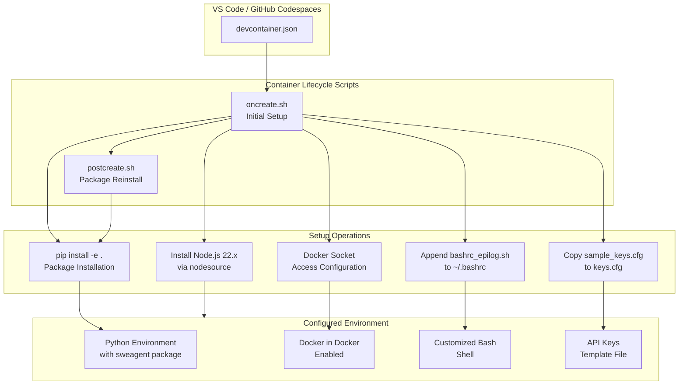
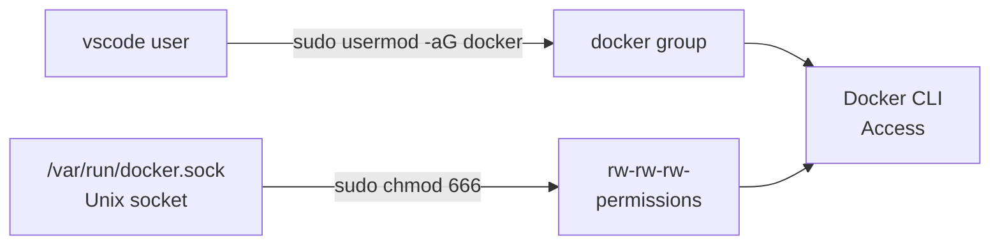
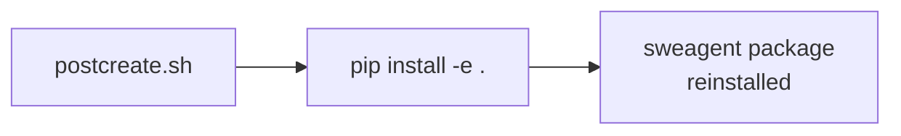

<!-- source: DeepWiki mcp.deepwiki.com · repo allenai/SERA · page 4 Development Environment · fetched 2026-10-26 -->

# Development Environment

<details>
<summary>Relevant source files</summary>

The following files were used as context for generating this wiki page:

- [modules/SWE-agent/.devcontainer/README.md](modules/SWE-agent/.devcontainer/README.md)
- [modules/SWE-agent/.devcontainer/oncreate.sh](modules/SWE-agent/.devcontainer/oncreate.sh)
- [modules/SWE-agent/.devcontainer/postcreate.sh](modules/SWE-agent/.devcontainer/postcreate.sh)

</details>


## Purpose and Scope

This page documents the development environment setup for the SERA/SWE-agent codebase, specifically focusing on the VS Code dev container configuration and local development setup. The development environment is configured through scripts in the `.devcontainer/` directory that automate environment initialization, package installation, and shell customization.

For Docker containerization and production deployment details, see [Docker and Containerization](#5). For CI/CD workflows and automated testing, see [CI/CD and Automation](#6). For API key configuration specifics, see [API Key Configuration](#4.2).

## Development Container Overview

The repository provides a pre-configured development container environment compatible with VS Code Dev Containers and GitHub Codespaces. The dev container setup ensures consistent development environments across different machines and platforms by containerizing all dependencies and configurations.

The development container is based on a Debian/Ubuntu Linux environment and includes:
- Python runtime with package installation
- Docker CLI and socket access for running containers within the dev environment
- Node.js 22.x for JavaScript tooling
- Pre-configured bash shell customizations
- Sample API key configuration template

**Sources:** [modules/SWE-agent/.devcontainer/README.md:1-5]()

## Container Lifecycle Architecture



**Diagram: Development Container Setup Flow**

The container lifecycle follows a two-stage initialization process executed sequentially when the dev container is first created.

**Sources:** [modules/SWE-agent/.devcontainer/oncreate.sh:1-17](), [modules/SWE-agent/.devcontainer/postcreate.sh:1-7]()

## Initial Setup: oncreate.sh

The `oncreate.sh` script executes during the initial container creation and performs critical environment configuration.

### Script Execution Configuration

The script begins with strict error handling and debugging flags:

```bash
set -euo pipefail  # Exit on error, undefined variables, pipe failures
set -x             # Print commands before execution
```

These flags ensure that setup failures are immediately visible and that all operations are logged for debugging.

**Sources:** [modules/SWE-agent/.devcontainer/oncreate.sh:3-4]()

### Docker Socket Access Configuration



**Diagram: Docker Socket Access Configuration**

The script configures Docker-in-Docker functionality by:

1. Adding the `vscode` user to the `docker` group via `sudo usermod -aG docker vscode`
2. Setting socket permissions to `666` (read-write for all) via `sudo chmod 666 /var/run/docker.sock`

This allows the dev container to spawn and manage Docker containers, which is essential for SWE-agent's isolated execution environments.

**Sources:** [modules/SWE-agent/.devcontainer/oncreate.sh:8-9]()

### Python Package Installation

The script installs the SWE-agent package in editable mode:

```bash
pip install -e '.'
```

The `-e` flag installs the package in development/editable mode, allowing code changes to take effect immediately without reinstallation.

**Sources:** [modules/SWE-agent/.devcontainer/oncreate.sh:10]()

### API Key Template Creation

```bash
cp .devcontainer/sample_keys.cfg keys.cfg
```

This creates a `keys.cfg` file from the sample template in [.devcontainer/sample_keys.cfg](). The `keys.cfg` file serves as the configuration file for storing API keys for various services (OpenAI, Anthropic, GitHub, etc.). See [API Key Configuration](#4.2) for detailed information about the key configuration format.

**Sources:** [modules/SWE-agent/.devcontainer/oncreate.sh:11]()

### Bash Shell Customization

```bash
cat .devcontainer/bashrc_epilog.sh >> ~/.bashrc
```

This appends custom bash configuration from `bashrc_epilog.sh` to the user's `.bashrc` file, adding project-specific shell customizations and environment variables. See [Environment Scripts](#4.3) for details about the epilog script contents.

**Sources:** [modules/SWE-agent/.devcontainer/oncreate.sh:12]()

### Node.js Installation

The script installs Node.js version 22.x using the NodeSource repository:

```bash
curl -fsSL https://deb.nodesource.com/setup_22.x | sudo -E bash -
sudo apt-get install -y nodejs
```

Node.js is required for JavaScript-based tooling, documentation build systems (mkdocs with certain plugins), and pre-commit hooks that may depend on JavaScript linters or formatters.

**Sources:** [modules/SWE-agent/.devcontainer/oncreate.sh:14-16]()

## Post-Creation Setup: postcreate.sh

The `postcreate.sh` script executes after container creation completes. It performs a simplified setup operation:



**Diagram: Post-Creation Script Flow**

The script uses the same strict error handling flags and re-runs the package installation:

```bash
pip install -e '.'
```

This reinstallation ensures that any dependencies or configuration changes made during the `oncreate.sh` phase are properly reflected in the installed package.

**Sources:** [modules/SWE-agent/.devcontainer/postcreate.sh:1-7]()

## Setup Script Execution Summary

| Script | Execution Timing | Key Operations | Primary Purpose |
|--------|------------------|----------------|-----------------|
| `oncreate.sh` | Initial container creation | Docker access, package install, keys template, bash config, Node.js | Full environment initialization |
| `postcreate.sh` | After container creation | Package reinstallation | Ensure package consistency |

## Development Environment Components

The configured development environment provides:

### Docker-in-Docker Capability
- User `vscode` has access to Docker socket at `/var/run/docker.sock`
- Enables container spawning for SWE-agent's isolated execution environments
- Configured via [modules/SWE-agent/.devcontainer/oncreate.sh:8-9]()

### Python Development Environment
- Editable package installation of `sweagent`
- Changes to source code immediately reflected without reinstallation
- Configured via [modules/SWE-agent/.devcontainer/oncreate.sh:10]() and [modules/SWE-agent/.devcontainer/postcreate.sh:6]()

### API Key Management
- Template file `keys.cfg` created from sample
- Stores credentials for OpenAI, Anthropic, GitHub, and other services
- Configured via [modules/SWE-agent/.devcontainer/oncreate.sh:11]()

### Shell Customization
- Custom bash configuration appended to `.bashrc`
- Project-specific environment variables and aliases
- Configured via [modules/SWE-agent/.devcontainer/oncreate.sh:12]()

### JavaScript Tooling
- Node.js 22.x runtime installed
- Supports documentation builds and pre-commit hooks
- Configured via [modules/SWE-agent/.devcontainer/oncreate.sh:14-16]()

**Sources:** [modules/SWE-agent/.devcontainer/oncreate.sh:1-17](), [modules/SWE-agent/.devcontainer/postcreate.sh:1-7]()

## Usage

The dev container automatically initializes when:
- Opening the repository in VS Code with Dev Containers extension
- Creating a GitHub Codespace from the repository
- Rebuilding the dev container after configuration changes

No manual execution of the lifecycle scripts is required; the VS Code Dev Container extension orchestrates their execution based on the `devcontainer.json` configuration.

**Sources:** [modules/SWE-agent/.devcontainer/README.md:3-4]()

---

