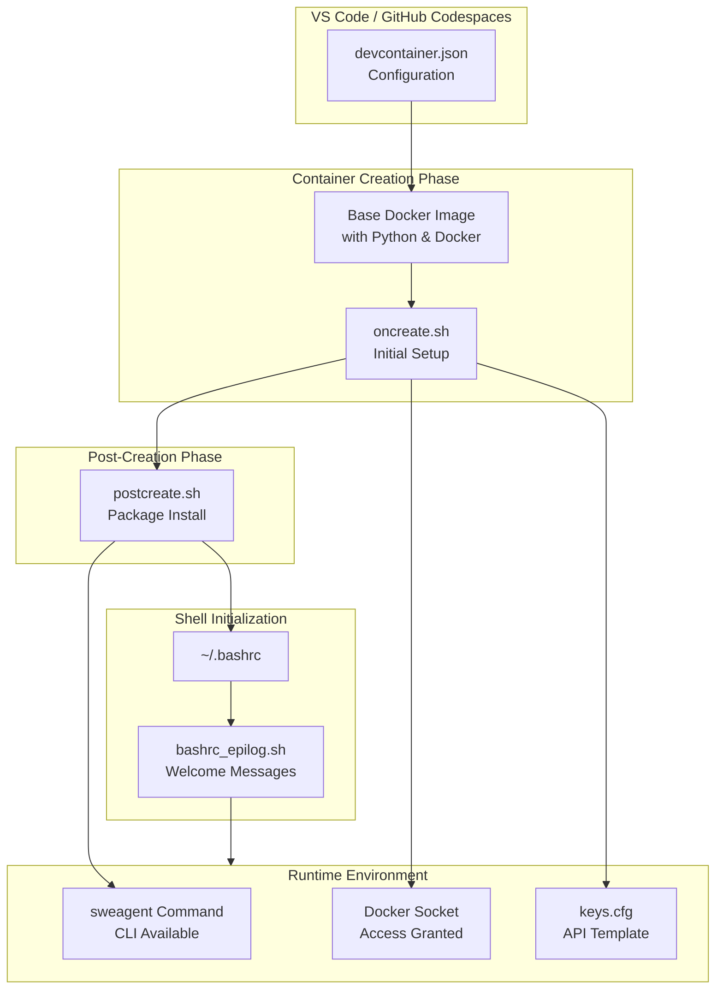
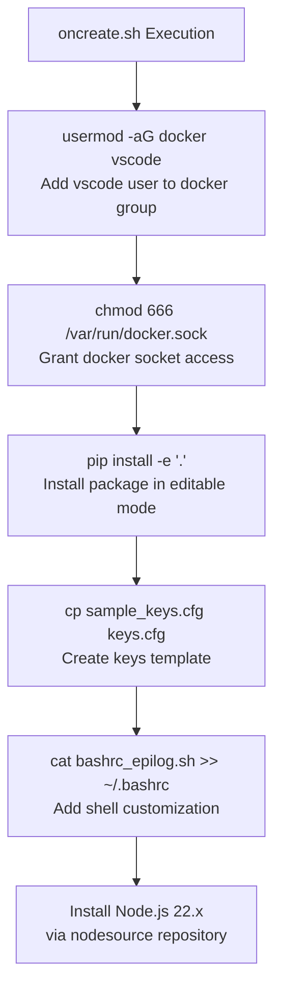
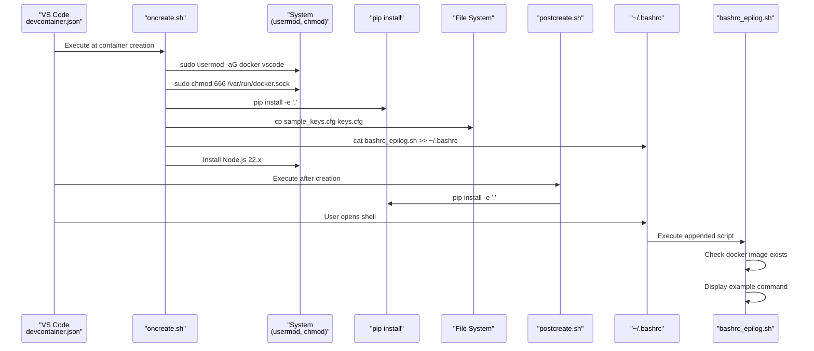
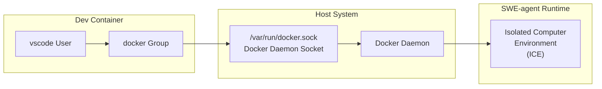

<!-- source: DeepWiki mcp.deepwiki.com · repo allenai/SERA · page 4.1 Dev Container Setup · fetched 2026-10-26 -->

# Dev Container Setup

<details>
<summary>Relevant source files</summary>

The following files were used as context for generating this wiki page:

- [modules/SWE-agent/.devcontainer/README.md](modules/SWE-agent/.devcontainer/README.md)
- [modules/SWE-agent/.devcontainer/bashrc_epilog.sh](modules/SWE-agent/.devcontainer/bashrc_epilog.sh)
- [modules/SWE-agent/.devcontainer/oncreate.sh](modules/SWE-agent/.devcontainer/oncreate.sh)
- [modules/SWE-agent/.devcontainer/postcreate.sh](modules/SWE-agent/.devcontainer/postcreate.sh)

</details>


## Purpose and Scope

This document covers the VS Code dev container configuration for the SWE-agent module. The dev container provides a pre-configured development environment that automates dependency installation, Docker setup, and shell configuration. This enables developers to start contributing without manual environment setup.

For details on the API key configuration used within the dev container, see [API Key Configuration](#4.2). For in-depth documentation of the individual environment scripts, see [Environment Scripts](#4.3).

**Sources:** [modules/SWE-agent/.devcontainer/README.md:1-5]()

## Dev Container Architecture

The dev container configuration follows the VS Code Remote - Containers specification, enabling consistent development environments across GitHub Codespaces and local VS Code instances. The setup consists of three lifecycle scripts that execute at different stages of container initialization.

### Container Lifecycle Diagram



**Sources:** [modules/SWE-agent/.devcontainer/oncreate.sh:1-17](), [modules/SWE-agent/.devcontainer/postcreate.sh:1-7](), [modules/SWE-agent/.devcontainer/bashrc_epilog.sh:1-14]()

## Lifecycle Scripts

The dev container executes three scripts in sequence to configure the environment. Each script has a specific purpose and executes at a different stage of container initialization.

| Script | Execution Stage | Primary Purpose | Key Operations |
|--------|----------------|-----------------|----------------|
| `oncreate.sh` | Container creation | System-level setup and initial configuration | Docker permissions, package install, Node.js install, keys.cfg creation |
| `postcreate.sh` | After container created | Reinstall packages in editable mode | Package installation via pip |
| `bashrc_epilog.sh` | Shell initialization | User experience enhancement | Display example commands and warnings |

**Sources:** [modules/SWE-agent/.devcontainer/oncreate.sh:1-17](), [modules/SWE-agent/.devcontainer/postcreate.sh:1-7](), [modules/SWE-agent/.devcontainer/bashrc_epilog.sh:1-14]()

## oncreate.sh: Initial Setup

The `oncreate.sh` script performs system-level configuration that must happen during container creation. It executes with `set -euo pipefail` to ensure any errors halt execution.

### Key Operations



### Docker Access Configuration

Lines [8-9]() configure Docker access:

```bash
sudo usermod -aG docker vscode
sudo chmod 666 /var/run/docker.sock
```

These commands enable the `vscode` user to execute Docker commands without `sudo`, which is essential for SWE-agent's isolated execution environments.

### Package Installation

Line [10]() installs the SWE-agent package in editable mode:

```bash
pip install -e '.'
```

This allows developers to modify the codebase and immediately see changes without reinstalling.

### API Key Template Creation

Line [11]() creates the API key configuration file:

```bash
cp .devcontainer/sample_keys.cfg keys.cfg
```

This provides a template that developers must populate with their actual API keys. See [API Key Configuration](#4.2) for details on the key file structure.

### Node.js Installation

Lines [14-16]() install Node.js 22.x from the NodeSource repository, which is required for certain SWE-agent features and the web-based task capabilities.

**Sources:** [modules/SWE-agent/.devcontainer/oncreate.sh:1-17]()

## postcreate.sh: Package Reinstallation

The `postcreate.sh` script executes after the container is fully created. It performs a single operation: reinstalling the package in editable mode.

```bash
pip install -e '.'
```

This reinstallation ensures the package is properly linked after all container initialization is complete, addressing any timing issues that might occur during the initial `oncreate.sh` installation.

**Sources:** [modules/SWE-agent/.devcontainer/postcreate.sh:1-7]()

## bashrc_epilog.sh: Shell Customization

The `bashrc_epilog.sh` script is appended to `~/.bashrc` during container creation and executes each time a new shell is initialized. It provides user feedback and example commands.

### Docker Image Verification

Lines [2-4]() check if the `sweagent/swe-agent` Docker image exists:

```bash
if [ -z "$(docker images -q sweagent/swe-agent 2> /dev/null)" ]; then
  echo "⚠️ Please wait for the postCreateCommand to start and finish (a new window will appear shortly) ⚠️"
fi
```

This warning prevents users from attempting to run SWE-agent before the environment is fully ready.

### Example Command Display

Lines [6-13]() display a complete example command when users open a new shell:

```bash
echo "Here's an example SWE-agent command to try out:"

echo "sweagent run \\
  --agent.model.name=claude-3-5-sonnet-20241022 \\
  --agent.model.per_instance_cost_limit=2.00 \\
  --env.repo.github_url=https://github.com/SWE-agent/test-repo \\
  --problem_statement.github_url=https://github.com/SWE-agent/test-repo/issues/1 \\
"
```

This example demonstrates the `sweagent run` command with proper syntax for specifying:
- Language model (`claude-3-5-sonnet-20241022`)
- Cost limit (`2.00` dollars)
- Repository URL
- Problem statement (GitHub issue)

**Sources:** [modules/SWE-agent/.devcontainer/bashrc_epilog.sh:1-14]()

## Script Execution Flow

The following diagram maps the execution sequence to specific code entities in the repository:



**Sources:** [modules/SWE-agent/.devcontainer/oncreate.sh:1-17](), [modules/SWE-agent/.devcontainer/postcreate.sh:1-7](), [modules/SWE-agent/.devcontainer/bashrc_epilog.sh:1-14]()

## File Dependencies

The dev container setup depends on several files in the `.devcontainer` directory:

| File | Purpose | Referenced By |
|------|---------|---------------|
| `devcontainer.json` | VS Code container configuration | VS Code Remote - Containers |
| `oncreate.sh` | Initial setup script | `devcontainer.json` createCommand |
| `postcreate.sh` | Post-creation script | `devcontainer.json` postCreateCommand |
| `bashrc_epilog.sh` | Shell customization | `oncreate.sh` line 12 |
| `sample_keys.cfg` | API key template | `oncreate.sh` line 11 |

**Sources:** [modules/SWE-agent/.devcontainer/oncreate.sh:11-12](), [modules/SWE-agent/.devcontainer/README.md:1-5]()

## Docker Integration

The dev container configuration enables Docker-in-Docker capabilities, allowing SWE-agent to create isolated execution environments for testing and running code.

### Permission Configuration



The `usermod -aG docker vscode` command [oncreate.sh:8]() adds the `vscode` user to the `docker` group, and `chmod 666 /var/run/docker.sock` [oncreate.sh:9]() grants read-write access to the Docker daemon socket. These permissions enable SWE-agent to spawn containers for task execution.

**Sources:** [modules/SWE-agent/.devcontainer/oncreate.sh:8-9]()

## Environment Readiness Verification

The dev container implements a two-stage verification process:

1. **Docker Image Check**: `bashrc_epilog.sh` checks for the `sweagent/swe-agent` Docker image [bashrc_epilog.sh:2]() using:
   ```bash
   docker images -q sweagent/swe-agent 2> /dev/null
   ```

2. **Warning Display**: If the image is missing, users see a warning [bashrc_epilog.sh:3]() to wait for setup completion.

This prevents premature execution attempts that would fail due to missing dependencies.

**Sources:** [modules/SWE-agent/.devcontainer/bashrc_epilog.sh:2-4]()

## Node.js Installation

The dev container installs Node.js 22.x from the NodeSource repository [oncreate.sh:14-16]():

```bash
curl -fsSL https://deb.nodesource.com/setup_22.x | sudo -E bash - &&\
sudo apt-get install -y nodejs
```

This provides:
- Node.js runtime for web-based tasks
- npm package manager for JavaScript dependencies
- Support for SWE-agent features requiring JavaScript execution

**Sources:** [modules/SWE-agent/.devcontainer/oncreate.sh:14-16]()

## Script Error Handling

All lifecycle scripts use strict error handling with `set -euo pipefail` [oncreate.sh:3](), [postcreate.sh:3]():

- `set -e`: Exit immediately if any command fails
- `set -u`: Treat undefined variables as errors
- `set -o pipefail`: Fail if any command in a pipeline fails

Additionally, `set -x` [oncreate.sh:4](), [postcreate.sh:4]() enables command tracing, which logs each command before execution for debugging purposes.

**Sources:** [modules/SWE-agent/.devcontainer/oncreate.sh:3-4](), [modules/SWE-agent/.devcontainer/postcreate.sh:3-4]()

---

