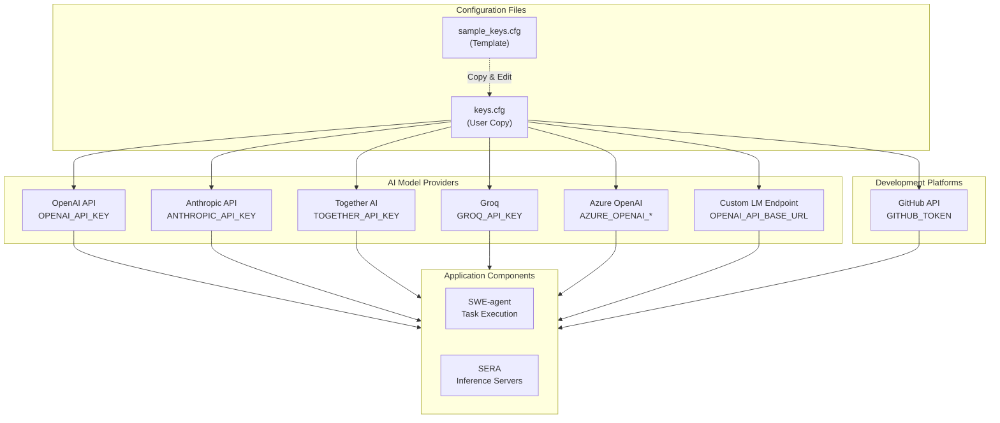
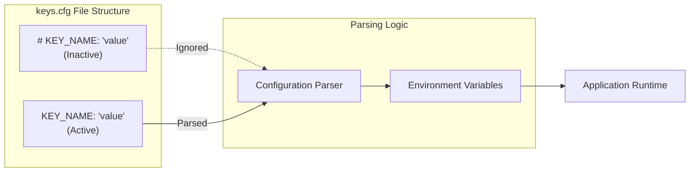
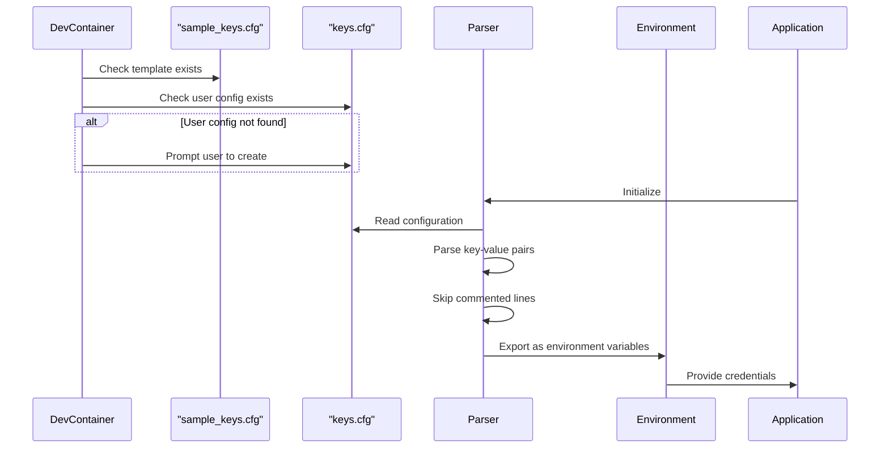
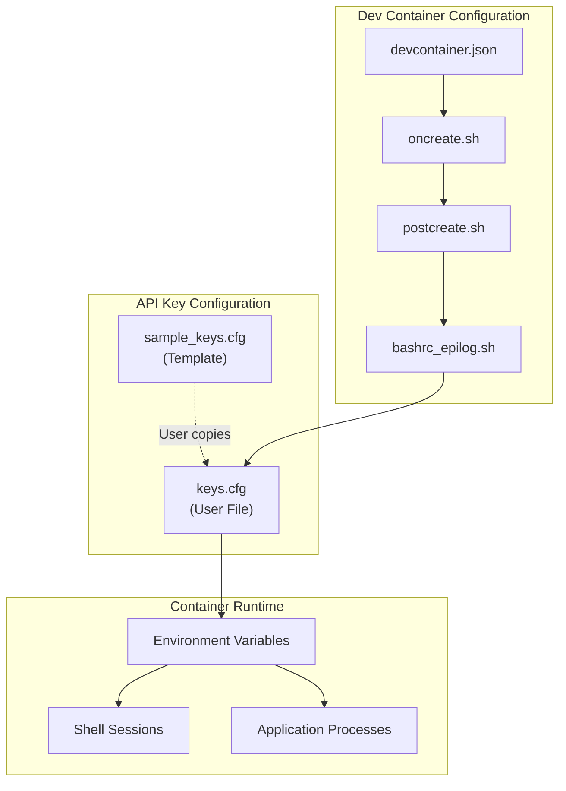

<!-- source: DeepWiki mcp.deepwiki.com · repo allenai/SERA · page 4.2 API Key Configuration · fetched 2026-10-26 -->

# API Key Configuration

<details>
<summary>Relevant source files</summary>

The following files were used as context for generating this wiki page:

- [modules/SWE-agent/.devcontainer/sample_keys.cfg](modules/SWE-agent/.devcontainer/sample_keys.cfg)

</details>


## Purpose and Scope

This document explains how to configure API keys and credentials for external services used by the SERA repository. The configuration system manages authentication for AI model providers, version control platforms, and other third-party services. For information about the broader development environment setup, see [Dev Container Setup](#4.1). For environment initialization scripts that may use these keys, see [Environment Scripts](#4.3).

## Configuration File Location

The API key configuration uses a file named `keys.cfg` located in the development container directory. A template is provided at [modules/SWE-agent/.devcontainer/sample_keys.cfg:1-11]() that demonstrates the expected format and available configuration options.

**Sources:** [modules/SWE-agent/.devcontainer/sample_keys.cfg:1-11]()

## Configuration Architecture



**Diagram:** API Key Configuration Flow from Template to Services

This diagram shows how the `sample_keys.cfg` template is copied to `keys.cfg` by the user, which then provides credentials to various external services consumed by the application components.

**Sources:** [modules/SWE-agent/.devcontainer/sample_keys.cfg:1-11]()

## Supported API Keys

The configuration file supports the following external service credentials:

| Configuration Key | Service | Purpose | Required For |
|------------------|---------|---------|--------------|
| `GITHUB_TOKEN` | GitHub API | Clone private repositories, access GitHub issues | Private repository access, issue fetching |
| `OPENAI_API_KEY` | OpenAI | Access GPT models | Using OpenAI models in SWE-agent |
| `ANTHROPIC_API_KEY` | Anthropic | Access Claude models | Using Anthropic models in SWE-agent |
| `TOGETHER_API_KEY` | Together AI | Access hosted open-source models | Using Together AI models |
| `AZURE_OPENAI_API_KEY` | Azure OpenAI | Access Azure-hosted OpenAI models | Enterprise Azure deployments |
| `AZURE_OPENAI_ENDPOINT` | Azure OpenAI | Azure service endpoint URL | Azure OpenAI configuration |
| `AZURE_OPENAI_DEPLOYMENT` | Azure OpenAI | Specific deployment name | Azure OpenAI configuration |
| `AZURE_OPENAI_API_VERSION` | Azure OpenAI | API version specification | Azure OpenAI configuration |
| `OPENAI_API_BASE_URL` | Custom/Local LM | Alternative API endpoint | Local models or custom inference servers |
| `GROQ_API_KEY` | Groq | Access Groq-hosted models | Using Groq models |

**Sources:** [modules/SWE-agent/.devcontainer/sample_keys.cfg:2-11]()

## Configuration File Format

The `keys.cfg` file uses a simple key-value format with shell variable syntax. Each line follows the pattern:

```
KEY_NAME: 'value'
```

Lines beginning with `#` are treated as comments and ignored. The template file provides all keys in commented form:



**Diagram:** Configuration File Format and Parsing

This diagram illustrates how the configuration parser distinguishes between commented (inactive) and active key-value pairs in the `keys.cfg` file.

**Sources:** [modules/SWE-agent/.devcontainer/sample_keys.cfg:1-11]()

## Setting Up API Keys

### Initial Configuration

1. **Copy the Sample File**
   
   Copy [modules/SWE-agent/.devcontainer/sample_keys.cfg]() to `modules/SWE-agent/.devcontainer/keys.cfg`:
   
   ```bash
   cp modules/SWE-agent/.devcontainer/sample_keys.cfg modules/SWE-agent/.devcontainer/keys.cfg
   ```

2. **Uncomment Required Keys**
   
   Remove the leading `#` character from lines containing keys you need. For example, to activate OpenAI:
   
   ```
   # Before (inactive):
   # OPENAI_API_KEY: 'OpenAI API Key Here if using OpenAI Model'
   
   # After (active):
   OPENAI_API_KEY: 'sk-proj-...'
   ```

3. **Insert Credentials**
   
   Replace the placeholder text with your actual API key or token value.

**Sources:** [modules/SWE-agent/.devcontainer/sample_keys.cfg:1-11]()

### Provider-Specific Configuration

#### OpenAI Configuration

Basic OpenAI setup requires only `OPENAI_API_KEY` [modules/SWE-agent/.devcontainer/sample_keys.cfg:3]():

```
OPENAI_API_KEY: 'sk-proj-...'
```

For custom or local OpenAI-compatible endpoints, also configure `OPENAI_API_BASE_URL` [modules/SWE-agent/.devcontainer/sample_keys.cfg:10]():

```
OPENAI_API_KEY: 'custom-key'
OPENAI_API_BASE_URL: 'http://localhost:8000/v1'
```

#### Azure OpenAI Configuration

Azure OpenAI requires four configuration values [modules/SWE-agent/.devcontainer/sample_keys.cfg:6-9]():

```
AZURE_OPENAI_API_KEY: 'your-azure-key'
AZURE_OPENAI_ENDPOINT: 'https://your-resource.openai.azure.com/'
AZURE_OPENAI_DEPLOYMENT: 'your-deployment-name'
AZURE_OPENAI_API_VERSION: '2024-02-15-preview'
```

All four values must be configured together for Azure OpenAI to function correctly.

#### Anthropic Configuration

Anthropic Claude models require `ANTHROPIC_API_KEY` [modules/SWE-agent/.devcontainer/sample_keys.cfg:4]():

```
ANTHROPIC_API_KEY: 'sk-ant-...'
```

#### Alternative Model Providers

For Together AI [modules/SWE-agent/.devcontainer/sample_keys.cfg:5]():

```
TOGETHER_API_KEY: 'your-together-key'
```

For Groq [modules/SWE-agent/.devcontainer/sample_keys.cfg:11]():

```
GROQ_API_KEY: 'gsk_...'
```

#### GitHub Token Configuration

For accessing private repositories and GitHub issues [modules/SWE-agent/.devcontainer/sample_keys.cfg:2]():

```
GITHUB_TOKEN: 'ghp_...'
```

The token requires appropriate scopes depending on usage:
- `repo` scope for private repository access
- `public_repo` scope for public repository operations

**Sources:** [modules/SWE-agent/.devcontainer/sample_keys.cfg:2-11]()

## Configuration Loading Mechanism



**Diagram:** Configuration Loading Sequence

This diagram shows the sequence of operations when the development container and application load API key configurations.

**Sources:** [modules/SWE-agent/.devcontainer/sample_keys.cfg:1-11]()

## Security Best Practices

### File Protection

1. **Never Commit `keys.cfg`**: The actual `keys.cfg` file containing credentials should never be committed to version control. Only the `sample_keys.cfg` template should be tracked.

2. **Verify `.gitignore` Settings**: Ensure `keys.cfg` is listed in `.gitignore` to prevent accidental commits.

3. **File Permissions**: Restrict file permissions on `keys.cfg` to the current user only:
   ```bash
   chmod 600 modules/SWE-agent/.devcontainer/keys.cfg
   ```

### Key Management

| Practice | Implementation |
|----------|---------------|
| **Key Rotation** | Regularly rotate API keys according to provider recommendations |
| **Minimal Scope** | Configure tokens with minimum required permissions |
| **Separate Keys** | Use different keys for development and production environments |
| **Key Revocation** | Immediately revoke keys if exposed or compromised |
| **Environment Isolation** | Avoid sharing `keys.cfg` between different development environments |

**Sources:** [modules/SWE-agent/.devcontainer/sample_keys.cfg:1-11]()

## Integration with Development Container

The `keys.cfg` file integrates with the development container setup documented in [Dev Container Setup](#4.1). The configuration file is:

1. **Read during container initialization**: Environment scripts load the keys when the container starts
2. **Exposed as environment variables**: Keys become available to all processes within the container
3. **Persisted across container rebuilds**: The file persists in the workspace volume, surviving container recreation

The relationship between configuration files and the development environment:



**Diagram:** API Key Configuration Integration with Dev Container

This diagram shows how the `keys.cfg` file integrates into the development container lifecycle through environment initialization scripts.

**Sources:** [modules/SWE-agent/.devcontainer/sample_keys.cfg:1-11]()

## Troubleshooting

### Common Configuration Issues

| Issue | Symptom | Solution |
|-------|---------|----------|
| **Keys Not Loaded** | Application reports missing API keys | Verify `keys.cfg` exists and has correct format; check leading `#` is removed |
| **Invalid Key Format** | Parse errors on startup | Ensure format is `KEY: 'value'` with quotes around value |
| **Whitespace Issues** | Keys not recognized | Avoid extra spaces around `:` and quotes |
| **Permission Denied** | Cannot read configuration file | Check file permissions: `chmod 600 keys.cfg` |
| **Wrong File Location** | Keys not found | Ensure file is at `modules/SWE-agent/.devcontainer/keys.cfg` |

### Verification

To verify keys are loaded correctly, check environment variables within the container:

```bash
# Check if specific key is set (without revealing value)
env | grep -E "OPENAI_API_KEY|ANTHROPIC_API_KEY" | cut -d= -f1

# Verify Azure OpenAI complete configuration
env | grep AZURE_OPENAI | cut -d= -f1
```

**Sources:** [modules/SWE-agent/.devcontainer/sample_keys.cfg:1-11]()

## Configuration Examples

### Example 1: OpenAI Only

```
OPENAI_API_KEY: 'sk-proj-...'
```

### Example 2: Multiple Providers

```
OPENAI_API_KEY: 'sk-proj-...'
ANTHROPIC_API_KEY: 'sk-ant-...'
GITHUB_TOKEN: 'ghp_...'
```

### Example 3: Azure OpenAI with GitHub

```
GITHUB_TOKEN: 'ghp_...'
AZURE_OPENAI_API_KEY: 'your-azure-key'
AZURE_OPENAI_ENDPOINT: 'https://your-resource.openai.azure.com/'
AZURE_OPENAI_DEPLOYMENT: 'gpt-4'
AZURE_OPENAI_API_VERSION: '2024-02-15-preview'
```

### Example 4: Custom Local Endpoint

```
OPENAI_API_KEY: 'local-key'
OPENAI_API_BASE_URL: 'http://localhost:8000/v1'
```

**Sources:** [modules/SWE-agent/.devcontainer/sample_keys.cfg:1-11]()

---

