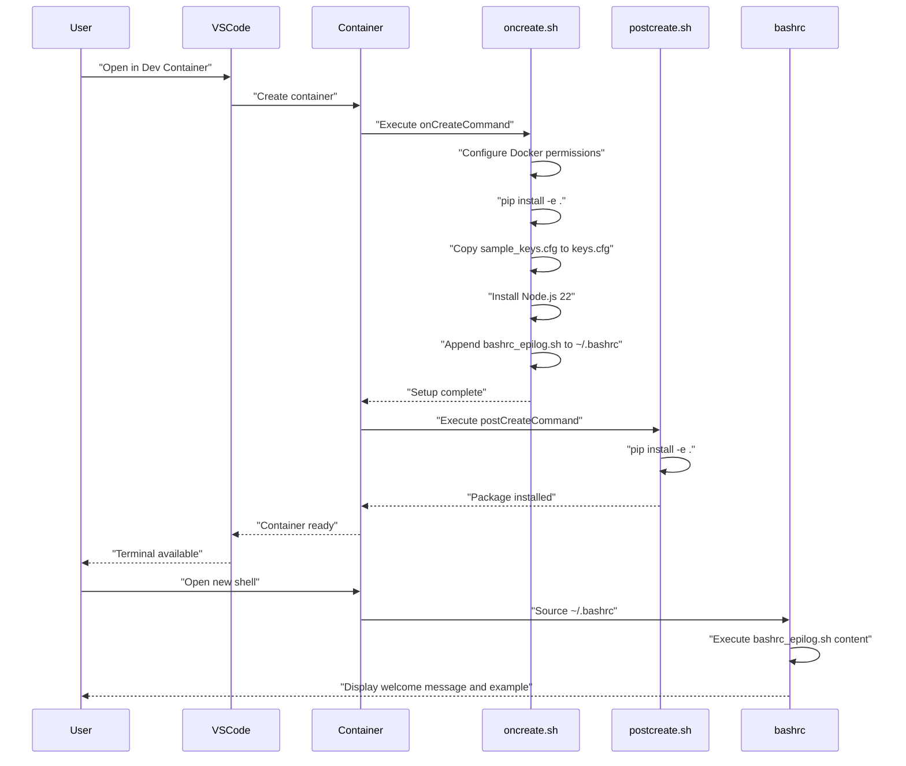
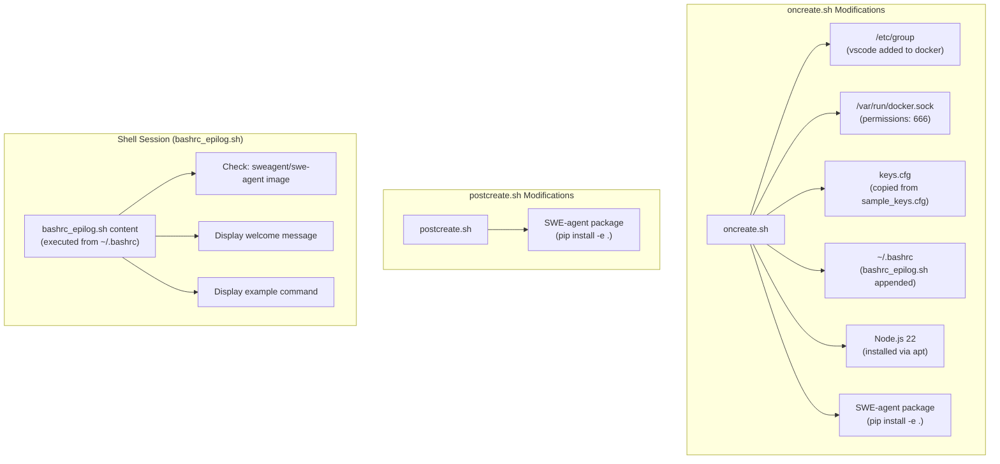
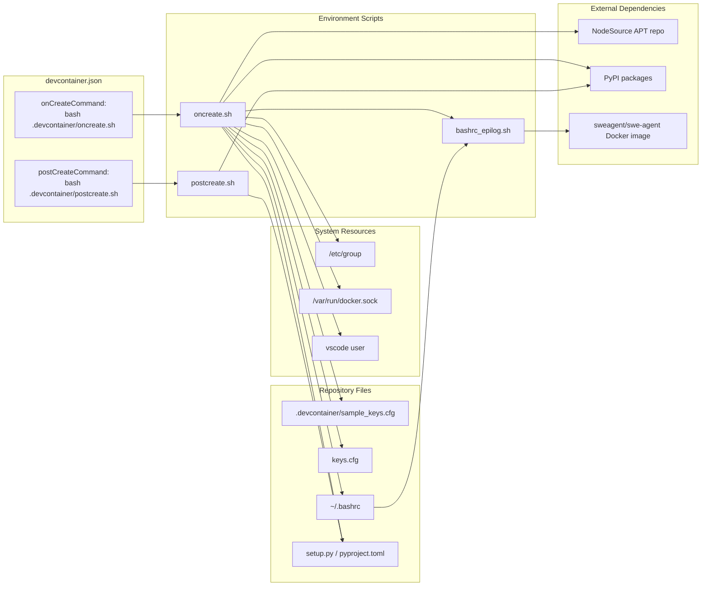

<!-- source: DeepWiki mcp.deepwiki.com · repo allenai/SERA · page 4.3 Environment Scripts · fetched 2026-10-26 -->

# Environment Scripts

Relevant source files

The following files were used as context for generating this wiki page:

- [modules/SWE-agent/.devcontainer/bashrc_epilog.sh](modules/SWE-agent/.devcontainer/bashrc_epilog.sh)
- [modules/SWE-agent/.devcontainer/oncreate.sh](modules/SWE-agent/.devcontainer/oncreate.sh)
- [modules/SWE-agent/.devcontainer/postcreate.sh](modules/SWE-agent/.devcontainer/postcreate.sh)

## Purpose and Scope

This page documents the three environment setup scripts that configure the SWE-agent development container during its lifecycle. These scripts handle Docker permissions, package installation, Node.js setup, API key configuration, and shell customization.

For information about the overall dev container configuration, see [Dev Container Setup](#4.1). For details on API key file structure, see [API Key Configuration](#4.2).

## Script Execution Lifecycle

The dev container executes scripts at specific lifecycle stages defined in `.devcontainer/devcontainer.json`:

| Lifecycle Stage | Script | Execution Timing | Purpose |
|----------------|--------|------------------|---------|
| `onCreateCommand` | `oncreate.sh` | First container creation only | Initial setup: Docker permissions, dependencies, configuration files |
| `postCreateCommand` | `postcreate.sh` | Every container rebuild | Package reinstallation |
| Shell Initialization | `bashrc_epilog.sh` | Every new shell session | User-facing messages and example commands |

The execution flow follows this sequence:

**Sources:** [modules/SWE-agent/.devcontainer/oncreate.sh](), [modules/SWE-agent/.devcontainer/postcreate.sh](), [modules/SWE-agent/.devcontainer/bashrc_epilog.sh]()

## oncreate.sh: Initial Container Setup

The `oncreate.sh` script performs one-time initialization when the container is first created. It executes with Bash strict mode enabled via `set -euo pipefail` and `set -x` for command tracing.

### Docker Permissions Configuration

The script grants the `vscode` user access to the Docker daemon:

[modules/SWE-agent/.devcontainer/oncreate.sh:8-9]()

- Line 8: Adds `vscode` user to the `docker` group
- Line 9: Sets read-write permissions on the Docker socket

These permissions allow the dev container to launch the `sweagent/swe-agent` Docker image for isolated execution environments.

### Package Installation

[modules/SWE-agent/.devcontainer/oncreate.sh:10]()

The script installs the SWE-agent package in editable mode using `pip install -e '.'`, enabling live code changes without reinstallation.

### Configuration File Initialization

[modules/SWE-agent/.devcontainer/oncreate.sh:11]()

Copies `.devcontainer/sample_keys.cfg` to `keys.cfg` at the repository root, creating the API key configuration file template. See [API Key Configuration](#4.2) for details on this file's structure.

### Shell Customization

[modules/SWE-agent/.devcontainer/oncreate.sh:12]()

Appends the contents of `bashrc_epilog.sh` to `~/.bashrc`, ensuring the welcome message displays in every new shell session.

### Node.js Installation

[modules/SWE-agent/.devcontainer/oncreate.sh:14-16]()

Installs Node.js version 22 using the NodeSource package repository. This dependency supports web-based tasks and the SWE-agent inspector interface.

**Sources:** [modules/SWE-agent/.devcontainer/oncreate.sh:1-17]()

## postcreate.sh: Package Reinstallation

The `postcreate.sh` script executes after container creation or rebuild. It consists of a single operation:

[modules/SWE-agent/.devcontainer/postcreate.sh:6]()

The script reinstalls the SWE-agent package in editable mode. This ensures dependencies are up-to-date after container modifications or when rebuilding from a cached layer.

Like `oncreate.sh`, it runs with Bash strict mode (`set -euo pipefail` and `set -x`).

**Sources:** [modules/SWE-agent/.devcontainer/postcreate.sh:1-7]()

## bashrc_epilog.sh: Shell Session Initialization

The `bashrc_epilog.sh` script executes at the start of each new shell session. It provides user feedback and displays example commands.

### Docker Image Check

[modules/SWE-agent/.devcontainer/bashrc_epilog.sh:2-4]()

The script checks whether the `sweagent/swe-agent` Docker image exists locally. If not found, it displays a warning message informing the user that the `postCreateCommand` is still running.

This prevents confusion when opening a terminal before the container setup completes.

### Example Command Display

[modules/SWE-agent/.devcontainer/bashrc_epilog.sh:6-13]()

The script prints an example `sweagent run` command demonstrating:

- Model selection: `claude-3-5-sonnet-20241022`
- Cost limit: `$2.00` per instance
- Repository URL: `https://github.com/SWE-agent/test-repo`
- Problem statement: GitHub issue #1 from the test repository

This provides immediate guidance for new users on how to invoke SWE-agent.

**Sources:** [modules/SWE-agent/.devcontainer/bashrc_epilog.sh:1-14]()

## File System Modifications

The environment scripts modify the container's file system at specific locations:

**Sources:** [modules/SWE-agent/.devcontainer/oncreate.sh](), [modules/SWE-agent/.devcontainer/postcreate.sh](), [modules/SWE-agent/.devcontainer/bashrc_epilog.sh]()

## Script Dependencies and Execution Context

The following diagram maps script dependencies and execution context:

**Sources:** [modules/SWE-agent/.devcontainer/oncreate.sh](), [modules/SWE-agent/.devcontainer/postcreate.sh](), [modules/SWE-agent/.devcontainer/bashrc_epilog.sh]()

## Error Handling and Execution Safety

All three scripts use Bash strict mode for error handling:

| Flag | Purpose | Effect |
|------|---------|--------|
| `set -e` | Exit on error | Terminates script if any command fails |
| `set -u` | Unset variable error | Terminates if undefined variable is referenced |
| `set -o pipefail` | Pipeline error propagation | Fails if any command in a pipeline fails |
| `set -x` | Command tracing | Prints each command before execution (debugging) |

This configuration ensures that setup failures are immediately visible and prevent partial container initialization.

The exception is `bashrc_epilog.sh`, which omits these flags because it runs in interactive shells where strict error handling could disrupt the user experience.

**Sources:** [modules/SWE-agent/.devcontainer/oncreate.sh:3-4](), [modules/SWE-agent/.devcontainer/postcreate.sh:3-4]()

---

