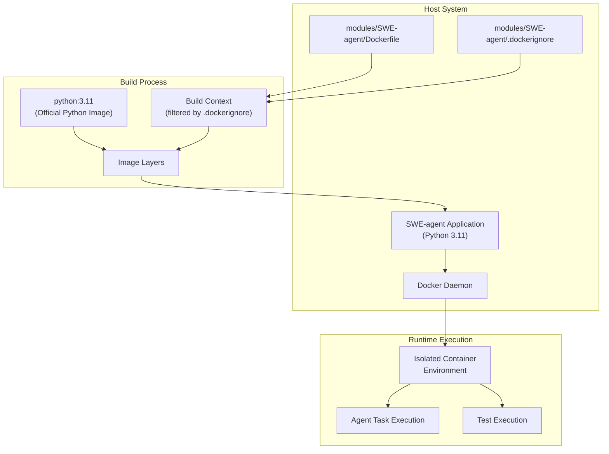
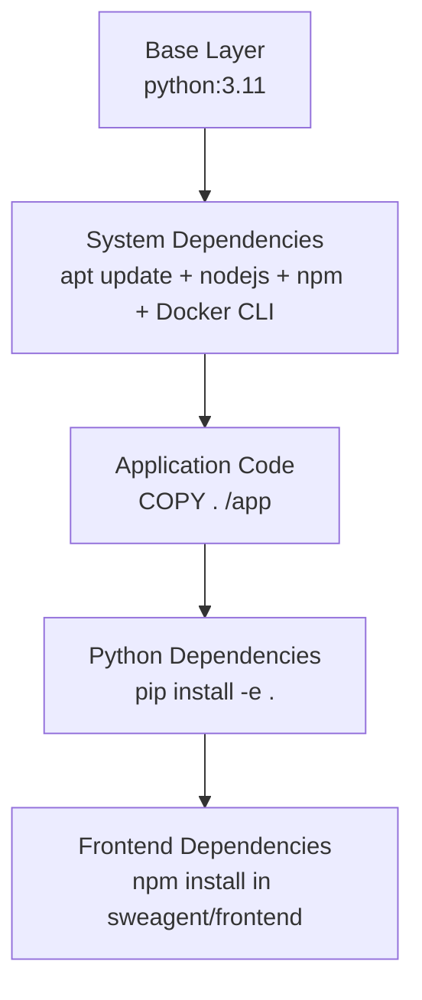
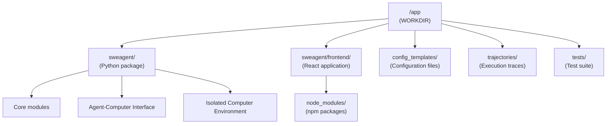
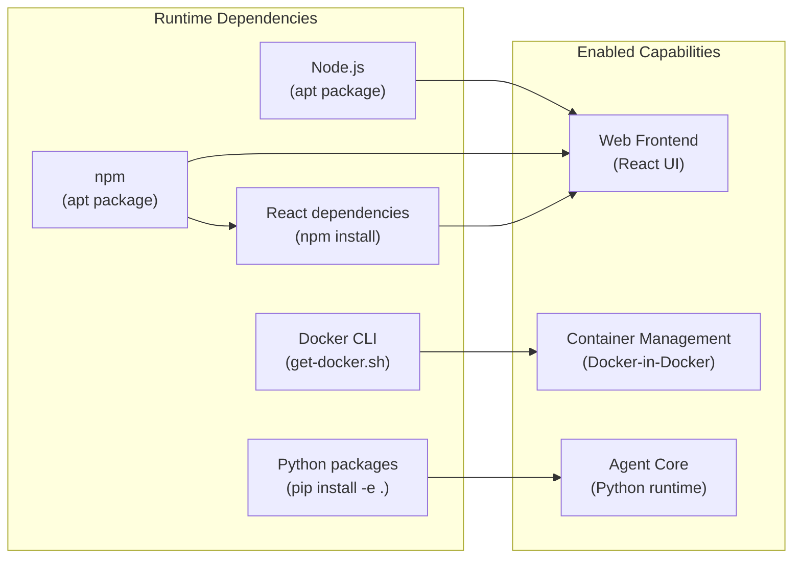
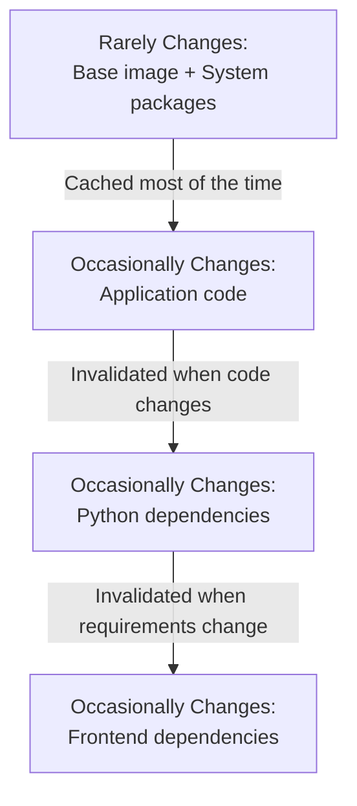

<!-- source: DeepWiki mcp.deepwiki.com · repo allenai/SERA · page 5 Docker and Containerization · fetched 2026-10-26 -->

# Docker and Containerization

<details>
<summary>Relevant source files</summary>

The following files were used as context for generating this wiki page:

- [modules/SWE-agent/.dockerignore](modules/SWE-agent/.dockerignore)
- [modules/SWE-agent/Dockerfile](modules/SWE-agent/Dockerfile)

</details>


This document provides an overview of Docker configuration and containerization strategy within the SERA repository. The containerization approach focuses on the SWE-agent module, which requires an isolated execution environment to safely run autonomous agent operations. This page covers the conceptual architecture and integration of Docker within the system.

For development container setup using VS Code dev containers, see [Development Environment](#4). For detailed Dockerfile configuration and build process, see [Docker Build Configuration](#5.1). For build optimization and exclusion patterns, see [Build Exclusions and Optimization](#5.2).

## Docker's Role in the System

Docker serves two distinct purposes within the SERA repository:

1. **Production Deployment Container**: The `modules/SWE-agent/Dockerfile` defines a production-ready image containing the SWE-agent application with all runtime dependencies.

2. **Agent Isolation Environment**: During runtime, SWE-agent spawns Docker containers to provide isolated execution environments where the agent can safely execute code modifications and tests without affecting the host system.

The following diagram illustrates Docker's integration within the system architecture:



**Sources:** [modules/SWE-agent/Dockerfile:1-25](), [modules/SWE-agent/.dockerignore:1-196]()

## Containerization Architecture

The containerization architecture implements a multi-layer approach where the application itself can run within a Docker container, while also orchestrating additional containers for isolated task execution.

### Container Layers and Dependencies

The production Docker image is built with the following layer structure:



**Sources:** [modules/SWE-agent/Dockerfile:1-25]()

| Layer | Purpose | Commands | Cache Strategy |
|-------|---------|----------|----------------|
| Base | Python runtime | `FROM python:3.11` | Rarely changes |
| System | Node.js, Docker CLI | `apt install`, `curl + sh get-docker.sh` | Rarely changes |
| Application | Source code | `COPY . /app` | Changes frequently |
| Python Deps | Python packages | `pip install -e '.'` | Changes with dependencies |
| Frontend | React dependencies | `npm install` | Changes with package.json |

**Sources:** [modules/SWE-agent/Dockerfile:1-25]()

## Working Directory Structure

The Docker image establishes `/app` as the working directory [modules/SWE-agent/Dockerfile:4](). All application code is copied into this location [modules/SWE-agent/Dockerfile:18](). The directory structure within the container mirrors the repository structure:



**Sources:** [modules/SWE-agent/Dockerfile:4](), [modules/SWE-agent/Dockerfile:18](), [modules/SWE-agent/.dockerignore:163-172]()

## Build Context Filtering

The `.dockerignore` file plays a critical role in optimizing the Docker build process by excluding unnecessary files from the build context. This significantly reduces image size and build time. The exclusion patterns are organized into several categories:

### Primary Exclusion Categories

| Category | Pattern Examples | Purpose |
|----------|------------------|---------|
| Python artifacts | `__pycache__/`, `*.pyc`, `*.egg-info/` | Exclude compiled and cached files |
| Virtual environments | `.venv`, `venv/`, `ENV/` | Exclude local development environments |
| Test artifacts | `.pytest_cache/`, `.coverage`, `htmlcov/` | Exclude test results and coverage reports |
| Build outputs | `build/`, `dist/`, `target/` | Exclude build directories |
| Development files | `.vscode/`, `.idea/`, `.ipynb_checkpoints` | Exclude IDE and notebook artifacts |
| Configuration | `keys.cfg`, `.env*` | Exclude sensitive configuration |
| Evaluation data | `results/`, `testbed/`, `trajectories/**` | Exclude large runtime data |
| Frontend build | `website/frontend/node_modules`, `website/frontend/build` | Exclude frontend build artifacts |

**Sources:** [modules/SWE-agent/.dockerignore:1-196]()

### Notable Inclusion Exceptions

The `.dockerignore` file includes a strategic exception pattern:

```
trajectories/**
!trajectories/demonstrations/**
```

This pattern excludes all trajectory files [modules/SWE-agent/.dockerignore:189]() but preserves demonstration trajectories [modules/SWE-agent/.dockerignore:190](), ensuring that example traces are available in the production image while excluding potentially large runtime-generated trajectory data.

**Sources:** [modules/SWE-agent/.dockerignore:189-190]()

## Runtime Dependencies

The Dockerfile installs several critical runtime dependencies that enable the agent's full functionality:



**Sources:** [modules/SWE-agent/Dockerfile:6-14](), [modules/SWE-agent/Dockerfile:21-24]()

### Node.js and npm

Node.js and npm are installed via `apt` [modules/SWE-agent/Dockerfile:7-8]() to support the React-based web frontend. The installation includes cleanup commands to minimize layer size [modules/SWE-agent/Dockerfile:9-10]().

### Docker CLI (Docker-in-Docker)

The Docker CLI is installed using the official Docker installation script [modules/SWE-agent/Dockerfile:13-14](). This enables the containerized SWE-agent application to orchestrate additional Docker containers for isolated task execution. This is a critical capability that allows the agent to spawn separate containers for each task or test execution.

**Sources:** [modules/SWE-agent/Dockerfile:6-14]()

## Package Installation Strategy

The Dockerfile implements a two-phase package installation strategy:

### Python Package Installation

The Python package is installed in editable mode using `pip install -e '.'` [modules/SWE-agent/Dockerfile:21](). The editable installation mode (`-e` flag) allows the package to reference the source code directly from `/app`, which is useful for development-like workflows within the container.

### Frontend Dependency Pre-installation

React dependencies are pre-installed during the Docker build process [modules/SWE-agent/Dockerfile:24]():

```
RUN cd sweagent/frontend && npm install
```

This approach caches the `node_modules` directory within the image, eliminating the need to run `npm install` at container startup, which significantly reduces startup time for the web interface.

**Sources:** [modules/SWE-agent/Dockerfile:21](), [modules/SWE-agent/Dockerfile:24]()

## Layer Optimization Strategy

The Dockerfile is structured to maximize Docker layer caching efficiency. Layer ordering follows the principle of placing less frequently changing commands before more frequently changing ones:



The application code is copied last among the system-level dependencies [modules/SWE-agent/Dockerfile:18](), which means changes to source code only invalidate layers from that point forward, preserving the cached system dependency layers.

**Sources:** [modules/SWE-agent/Dockerfile:1-25]()

## Integration with Development Workflow

While this page focuses on the production Dockerfile, it's important to note the distinction between production and development containerization:

- **Production Container** (this page): Defined by `modules/SWE-agent/Dockerfile`, used for deployment and distribution
- **Development Container** (see [Dev Container Setup](#4.1)): Defined by `.devcontainer/devcontainer.json`, used for local development with VS Code

Both containerization approaches share the goal of providing consistent, reproducible environments, but they serve different purposes and have different configurations. The development container focuses on developer experience with mounted volumes and development tools, while the production container focuses on runtime efficiency and minimal image size.

**Sources:** [modules/SWE-agent/Dockerfile:1-25]()

## Build and Deployment

For detailed information about:
- Dockerfile configuration, base images, and build commands: see [Docker Build Configuration](#5.1)
- Build context optimization and `.dockerignore` patterns: see [Build Exclusions and Optimization](#5.2)
- CI/CD integration and automated builds: see [CI/CD and Automation](#6)

**Sources:** [modules/SWE-agent/Dockerfile:1-25](), [modules/SWE-agent/.dockerignore:1-196]()

---

