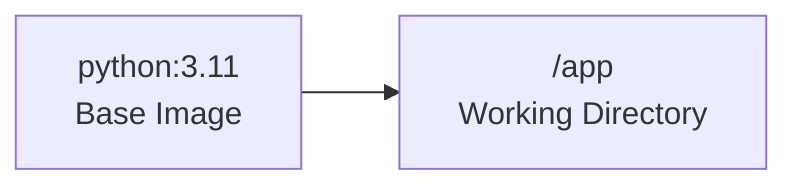
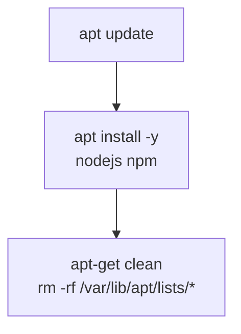
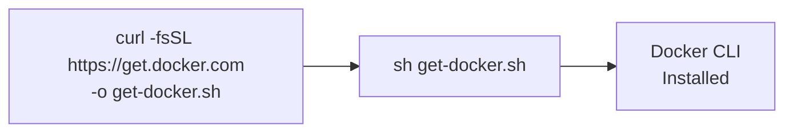
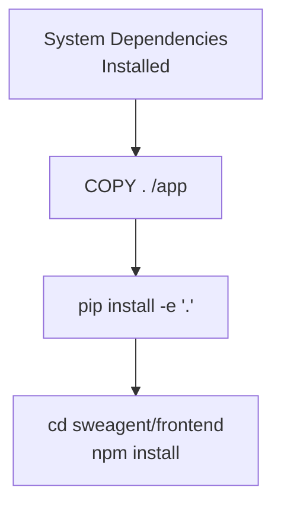
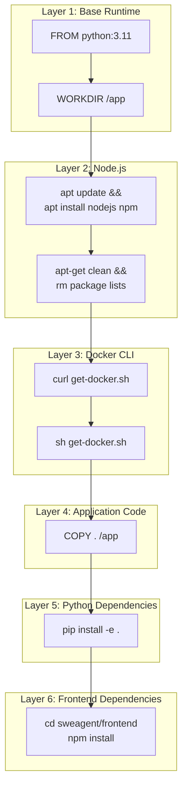
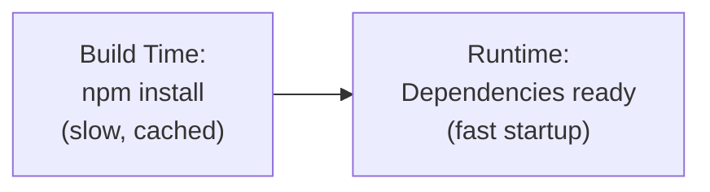

<!-- source: DeepWiki mcp.deepwiki.com · repo allenai/SERA · page 5.1 Docker Build Configuration · fetched 2026-10-26 -->

# Docker Build Configuration

<details>
<summary>Relevant source files</summary>

The following files were used as context for generating this wiki page:

- [modules/SWE-agent/Dockerfile](modules/SWE-agent/Dockerfile)

</details>


## Purpose and Scope

This document explains the Docker build configuration for the SWE-agent module, including base image selection, system dependencies, Docker-in-Docker setup, and build optimization strategies. The Dockerfile defines the production container image used to run the autonomous software engineering agent in isolated environments.

For information about optimizing the build process through file exclusions, see [Build Exclusions and Optimization](#5.2). For development container configuration, see [Dev Container Setup](#4.1).

**Sources:** [modules/SWE-agent/Dockerfile:1-25]()

---

## Base Image and Working Directory

The Docker build uses `python:3.11` as the base image, providing a stable Python runtime environment with the necessary system libraries and package management tools.

The working directory is set to `/app`, which serves as the root location for all application code and installed dependencies.



**Technical Details:**

| Configuration | Value | Location |
|--------------|-------|----------|
| Base Image | `python:3.11` | Line 1 |
| Working Directory | `/app` | Line 4 |

**Sources:** [modules/SWE-agent/Dockerfile:1-4]()

---

## System Dependencies Installation

The build process installs two critical system-level dependencies: Node.js/npm for frontend functionality and the Docker CLI for nested container operations.

### Node.js and npm Installation

Node.js and npm are installed via the Debian package manager to support the React-based frontend interface. The installation includes cleanup operations to minimize layer size.



**Installation Commands:**
- `apt update` - Updates package repository indices
- `apt install -y nodejs npm` - Installs Node.js runtime and npm package manager
- `apt-get clean` - Removes package cache
- `rm -rf /var/lib/apt/lists/*` - Removes package lists to reduce image size

**Sources:** [modules/SWE-agent/Dockerfile:6-10]()

---

## Docker-in-Docker Setup

The Dockerfile installs the Docker CLI using the official Docker installation script, enabling the agent to spawn and manage nested Docker containers for task execution in isolated environments.



**Installation Process:**
1. Downloads the official Docker installation script from `https://get.docker.com`
2. Executes the script to install Docker CLI binaries
3. No Docker daemon is installed - the container relies on bind-mounting the host's Docker socket

**Technical Implementation:**

| Step | Command | Purpose |
|------|---------|---------|
| Download | `curl -fsSL https://get.docker.com -o get-docker.sh` | Fetches official installation script |
| Install | `sh get-docker.sh` | Executes installation script |

**Sources:** [modules/SWE-agent/Dockerfile:12-14]()

---

## Application Code and Dependencies

The application code is copied and installed after all system dependencies are in place. This ordering takes advantage of Docker's layer caching mechanism to minimize rebuild time during development.

### Code Copy Strategy



**Layer Optimization Strategy:**

The `COPY . /app` command is intentionally placed late in the Dockerfile (line 18) to maximize Docker layer cache effectiveness. System dependencies change infrequently, so they are installed first. Application code changes frequently, so it is copied last.

**Sources:** [modules/SWE-agent/Dockerfile:16-18]()

### Python Package Installation

The Python package is installed in editable mode using `pip install -e '.'`, which:
- Installs the package without copying files to site-packages
- Creates a link to the `/app` directory for development workflow
- Installs all dependencies specified in `setup.py` or `pyproject.toml`

**Installation Command:**
```
pip install -e '.'
```

**Sources:** [modules/SWE-agent/Dockerfile:20-21]()

### Frontend Dependencies

React frontend dependencies are pre-installed during the build process to avoid installation delays at container startup.

**Installation Location:** `sweagent/frontend`

**Installation Command:**
```
cd sweagent/frontend && npm install
```

This command:
- Changes to the frontend directory
- Installs all npm packages specified in `package.json`
- Creates `node_modules` directory with frontend dependencies

**Sources:** [modules/SWE-agent/Dockerfile:23-24]()

---

## Build Process Architecture

The complete build process follows a carefully ordered sequence to optimize layer caching and minimize rebuild time.



**Layer Caching Strategy:**

| Layer | Content | Rebuild Frequency | Rationale |
|-------|---------|------------------|-----------|
| 1 | Base image & working directory | Rarely | Python version changes infrequently |
| 2 | Node.js installation | Rarely | System dependency rarely changes |
| 3 | Docker CLI installation | Rarely | Docker CLI version managed by script |
| 4 | Application code | Frequently | Code changes trigger rebuild from here |
| 5 | Python dependencies | Frequently | Dependencies may change with code |
| 6 | Frontend dependencies | Frequently | Frontend packages may change with code |

**Sources:** [modules/SWE-agent/Dockerfile:1-25]()

---

## Build Dependencies Summary

The following table summarizes all dependencies installed during the Docker build process:

| Dependency | Version/Source | Installation Method | Purpose |
|-----------|----------------|---------------------|---------|
| Python | 3.11 | Base image | Runtime environment |
| Node.js | System package | apt | Frontend execution |
| npm | System package | apt | Frontend package management |
| Docker CLI | Latest stable | Official script | Nested container management |
| Python packages | As specified in setup | pip editable install | Application dependencies |
| React dependencies | As specified in package.json | npm install | Frontend interface |

**Sources:** [modules/SWE-agent/Dockerfile:1-25]()

---

## Build Optimization Techniques

The Dockerfile employs several optimization techniques to minimize image size and build time:

### 1. Package Cache Cleanup

After installing Node.js, the build removes apt package caches and lists:
```
apt-get clean && rm -rf /var/lib/apt/lists/*
```

This reduces the image size by removing unnecessary package metadata.

### 2. Single-Layer Dependency Installation

Node.js dependencies are installed in a single RUN command using `&&` operators to chain commands. This creates one layer instead of multiple layers, reducing image size.

### 3. Code Copy at End

Application code is copied after all dependencies are installed. This ensures that code changes (the most frequent change) don't invalidate cached layers for dependency installation.

### 4. Frontend Pre-installation

React dependencies are installed during build time rather than at runtime, reducing container startup time.



**Sources:** [modules/SWE-agent/Dockerfile:6-24]()

---

## Runtime Considerations

The built Docker image expects certain runtime configurations:

### Docker Socket Mounting

For Docker-in-Docker functionality, the container must be run with the host's Docker socket mounted:
```bash
docker run -v /var/run/docker.sock:/var/run/docker.sock ...
```

### Working Directory

All application code resides in `/app`, which is set as the working directory. Commands and scripts execute relative to this path.

### Editable Installation

The Python package is installed in editable mode (`-e` flag), meaning:
- Code changes in mounted volumes are immediately reflected
- No reinstallation required for development iterations
- Package remains linked to `/app` directory

**Sources:** [modules/SWE-agent/Dockerfile:1-25]()

---

