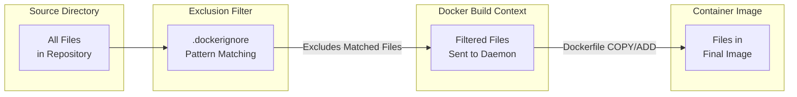
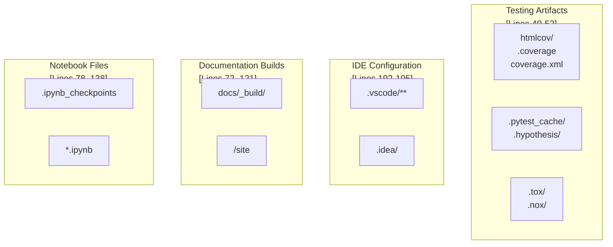
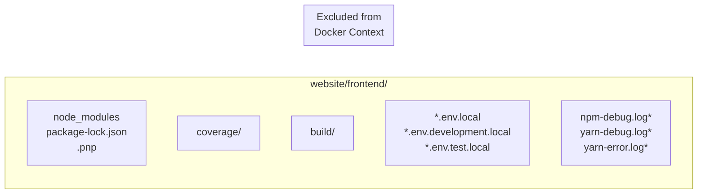
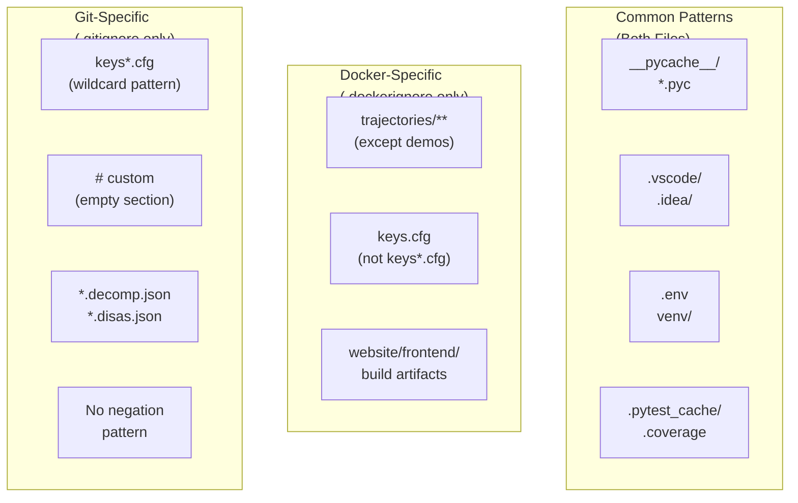

<!-- source: DeepWiki mcp.deepwiki.com · repo allenai/SERA · page 5.2 Build Exclusions and Optimization · fetched 2026-10-26 -->

# Build Exclusions and Optimization

<details>
<summary>Relevant source files</summary>

The following files were used as context for generating this wiki page:

- [modules/SWE-agent/.dockerignore](modules/SWE-agent/.dockerignore)
- [modules/SWE-agent/.gitignore](modules/SWE-agent/.gitignore)

</details>


## Purpose and Scope

This document details the Docker build exclusion patterns defined in `.dockerignore` that optimize container image size and build performance by preventing unnecessary files from being copied into the Docker build context. For information about the actual Dockerfile and build configuration, see [Docker Build Configuration](#5.1).

**Sources:** [modules/SWE-agent/.dockerignore:1-196]()

---

## Docker Build Context Overview

The `.dockerignore` file filters files before they are sent to the Docker daemon during image builds. This mechanism reduces build context size, accelerates build times, and prevents sensitive data from being included in container images.



**Diagram: Docker Build Context Filtering Pipeline**

**Sources:** [modules/SWE-agent/.dockerignore:1-196]()

---

## Exclusion Pattern Categories

The `.dockerignore` file organizes exclusions into distinct categories, each serving specific optimization purposes.

### Python-Specific Exclusions

| Pattern Category | Patterns | Lines | Purpose |
|-----------------|----------|-------|---------|
| Bytecode | `__pycache__/`, `*.py[cod]`, `*$py.class` | 2-4 | Exclude compiled Python files |
| C Extensions | `*.so` | 8 | Exclude compiled native extensions |
| Distribution | `build/`, `dist/`, `*.egg-info/`, `*.egg` | 10-27 | Exclude packaging artifacts |
| Virtual Environments | `.env`, `.venv`, `env/`, `venv/`, `ENV/` | 106-111 | Exclude Python virtual environments |

**Sources:** [modules/SWE-agent/.dockerignore:1-28](), [modules/SWE-agent/.dockerignore:104-113]()

### Development and Testing Artifacts



**Diagram: Development Artifact Exclusion Categories**

**Sources:** [modules/SWE-agent/.dockerignore:40-52](), [modules/SWE-agent/.dockerignore:72-78](), [modules/SWE-agent/.dockerignore:121](), [modules/SWE-agent/.dockerignore:138](), [modules/SWE-agent/.dockerignore:192-195]()

### Project-Specific Exclusions

The `.dockerignore` file includes custom exclusions specific to the SWE-agent project:

| Exclusion Type | Pattern | Line | Rationale |
|----------------|---------|------|-----------|
| API Keys | `keys.cfg` | 135 | Prevent credential leakage |
| Evaluation Data | `results/`, `testbed/`, `temp/` | 141-143 | Exclude runtime/test data |
| Fine-tuning Data | `fine_tune/*.ipynb`, `fine_tune/subtasks/*.jsonl` | 150-151 | Exclude training datasets |
| Inspector Data | `inspector/*.json` | 155 | Exclude analysis artifacts |
| Private Files | `private/` | 158 | Exclude sensitive data |
| Trajectories | `trajectories/**` (except demonstrations) | 189-190 | Exclude execution traces |
| Demo Configs | `*.demo.yaml` | 186 | Exclude development configurations |

**Sources:** [modules/SWE-agent/.dockerignore:135](), [modules/SWE-agent/.dockerignore:141-143](), [modules/SWE-agent/.dockerignore:145-158](), [modules/SWE-agent/.dockerignore:186-190]()

### Web Application Artifacts

The repository includes a web interface with its own exclusion patterns:



**Diagram: Web Application Build Artifact Exclusions**

**Sources:** [modules/SWE-agent/.dockerignore:160-183]()

The web application exclusions span lines 160-183 and include:

- **Dependencies**: `website/frontend/node_modules`, `website/frontend/package-lock.json` [modules/SWE-agent/.dockerignore:163-164]()
- **Test Coverage**: `website/frontend/coverage` [modules/SWE-agent/.dockerignore:169]()
- **Production Builds**: `website/frontend/build` [modules/SWE-agent/.dockerignore:172]()
- **Environment Files**: `*.env.local`, `*.env.development.local`, `*.env.test.local`, `*.env.production.local` [modules/SWE-agent/.dockerignore:175-178]()
- **Log Files**: `*npm-debug.log*`, `*yarn-debug.log*`, `*yarn-error.log*` [modules/SWE-agent/.dockerignore:180-182]()

---

## Data Exclusions

The `.dockerignore` file implements selective exclusions for data directories to prevent large datasets from bloating the image:

```python
# Pattern from line 146-147
data/*/ic-*
data/*/single-issues
```

These patterns exclude intermediate computation files and single-issue data while allowing other data files to be included.

**Sources:** [modules/SWE-agent/.dockerignore:145-147]()

---

## Trajectory Handling

The trajectory exclusion pattern demonstrates advanced `.dockerignore` usage with negation:

```python
# Lines 189-190
trajectories/**
!trajectories/demonstrations/**
```

This pattern:
1. Excludes all files under `trajectories/` directory
2. Re-includes files under `trajectories/demonstrations/` subdirectory

This ensures demonstration trajectories (used for few-shot learning) are preserved while excluding potentially large execution trace files.

**Sources:** [modules/SWE-agent/.dockerignore:189-190]()

---

## Optimization Impact

### Build Context Size Reduction

The exclusion patterns significantly reduce the Docker build context size:

| Category | Estimated Impact | Examples |
|----------|------------------|----------|
| Virtual Environments | 50-200 MB | `.venv/`, `env/`, `venv/` |
| Node Modules | 100-500 MB | `website/frontend/node_modules` |
| Test Coverage | 10-50 MB | `htmlcov/`, `.coverage`, `coverage.xml` |
| Evaluation Data | Variable (10 MB - 10 GB) | `results/`, `testbed/`, `trajectories/**` |
| Python Cache | 5-20 MB | `__pycache__/`, `*.pyc` |

### Build Performance

Excluding files improves build performance through:

1. **Reduced Transfer Time**: Smaller context sent to Docker daemon
2. **Faster Layer Caching**: Fewer files to hash for cache invalidation
3. **Smaller Image Size**: Less unnecessary data in final image

---

## Comparison with `.gitignore`

While `.dockerignore` and `.gitignore` share similar patterns, they serve different purposes and have key differences:



**Diagram: Exclusion Pattern Differences Between .dockerignore and .gitignore**

### Key Differences

| Aspect | `.dockerignore` | `.gitignore` |
|--------|----------------|-------------|
| API Keys Pattern | `keys.cfg` (exact match) | `keys*.cfg` (wildcard) |
| Trajectory Handling | `trajectories/**` with negation for `demonstrations/` | No trajectory exclusion |
| Library Path | `lib/` (relative) | `/lib/` (absolute root) |
| Disassembly Output | Not excluded | `*.decomp.json`, `*.disas.json` excluded |

**Sources:** [modules/SWE-agent/.dockerignore:135](), [modules/SWE-agent/.dockerignore:189-190](), [modules/SWE-agent/.gitignore:137](), [modules/SWE-agent/.gitignore:19](), [modules/SWE-agent/.gitignore:193-195]()

### Rationale for Differences

1. **Keys Pattern**: `.dockerignore` uses exact match (`keys.cfg`) to prevent accidental API key inclusion, while `.gitignore` uses wildcard (`keys*.cfg`) to exclude all key configuration variants from version control.

2. **Trajectory Files**: Docker builds include demonstration trajectories (needed for agent operation) while excluding general execution traces. Git ignores trajectories entirely as they are runtime-generated.

3. **Library Path**: `.gitignore` uses absolute path `/lib/` to exclude a system library directory, while `.dockerignore` uses relative `lib/` to exclude Python package installation directories.

4. **Disassembly Output**: Disassembly files (`.decomp.json`, `.disas.json`) are development artifacts excluded from Git but may be needed in Docker containers for debugging purposes.

**Sources:** [modules/SWE-agent/.dockerignore:17](), [modules/SWE-agent/.gitignore:19](), [modules/SWE-agent/.gitignore:193-195]()

---

## Best Practices Implemented

The `.dockerignore` file demonstrates several best practices:

1. **Category Organization**: Patterns grouped by type with comments
2. **Python Standard Patterns**: Comprehensive coverage of Python artifact types
3. **Framework-Specific Exclusions**: Django, Flask, Scrapy patterns included
4. **Security**: API keys and sensitive data explicitly excluded
5. **Negation Patterns**: Selective inclusion using `!` prefix
6. **Project Context**: Custom patterns for project-specific directories

**Sources:** [modules/SWE-agent/.dockerignore:1-196]()

---

