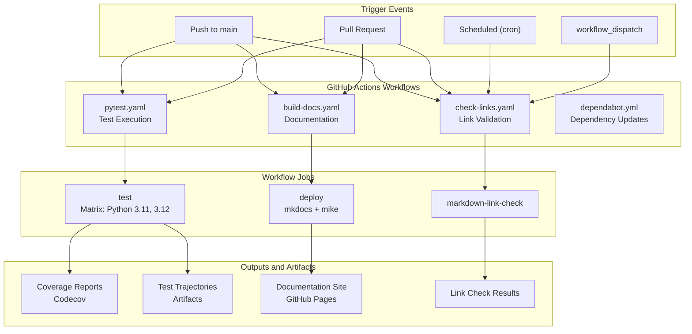
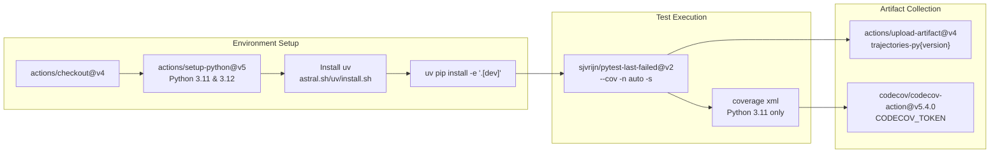
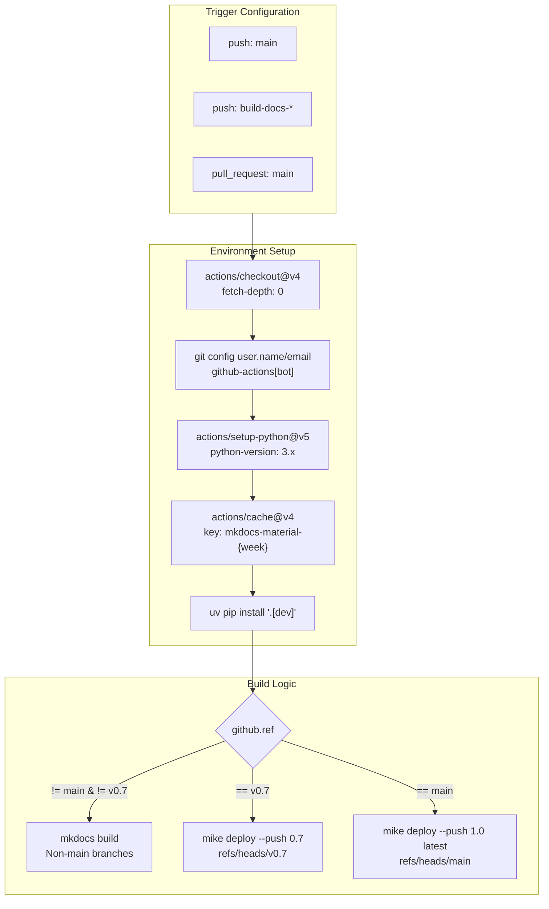
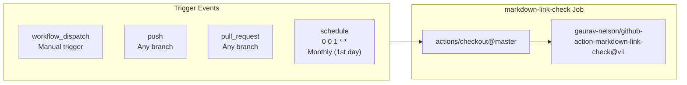
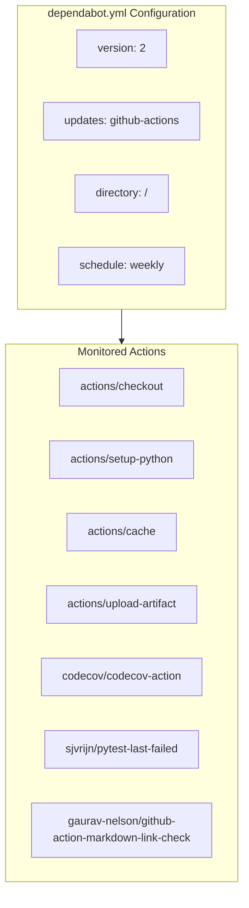

<!-- source: DeepWiki mcp.deepwiki.com · repo allenai/SERA · page 6 CI/CD and Automation · fetched 2026-10-26 -->

# CI/CD and Automation

<details>
<summary>Relevant source files</summary>

The following files were used as context for generating this wiki page:

- [modules/SWE-agent/.github/dependabot.yml](modules/SWE-agent/.github/dependabot.yml)
- [modules/SWE-agent/.github/workflows/build-docs.yaml](modules/SWE-agent/.github/workflows/build-docs.yaml)
- [modules/SWE-agent/.github/workflows/check-links.yaml](modules/SWE-agent/.github/workflows/check-links.yaml)
- [modules/SWE-agent/.github/workflows/pytest.yaml](modules/SWE-agent/.github/workflows/pytest.yaml)

</details>


This document covers the continuous integration, continuous deployment, and automation infrastructure for the SERA repository. It details the GitHub Actions workflows for testing, documentation building, link validation, and dependency management. For details on pre-commit hooks and local code quality enforcement, see [Code Quality Standards](#8.2). For Docker containerization used in CI environments, see [Docker and Containerization](#5).

## Overview

The repository implements automated CI/CD through GitHub Actions workflows located in [modules/SWE-agent/.github/workflows/](). These workflows provide automated testing, documentation deployment, link validation, and dependency updates. The automation runs on multiple triggers including push events, pull requests, scheduled intervals, and manual dispatch.

**Sources:** [modules/SWE-agent/.github/workflows/]()

## Workflow Architecture



**Sources:** [modules/SWE-agent/.github/workflows/pytest.yaml](), [modules/SWE-agent/.github/workflows/build-docs.yaml](), [modules/SWE-agent/.github/workflows/check-links.yaml](), [modules/SWE-agent/.github/dependabot.yml]()

## Testing Workflow

### Pytest Execution Pipeline

The `pytest.yaml` workflow implements comprehensive test automation with coverage reporting and artifact collection.



**Sources:** [modules/SWE-agent/.github/workflows/pytest.yaml:26-70]()

### Workflow Configuration Details

| Configuration | Value | Location |
|--------------|-------|----------|
| Workflow Name | `Pytest` | [pytest.yaml:1]() |
| Trigger Events | `push`, `pull_request` | [pytest.yaml:6-22]() |
| Python Versions | `3.11`, `3.12` | [pytest.yaml:31]() |
| Test Runner | `pytest-last-failed` | [pytest.yaml:51]() |
| Test Arguments | `--cov -n auto -s` | [pytest.yaml:53]() |
| Artifact Name | `trajectories-py${{ matrix.python-version }}` | [pytest.yaml:58]() |
| Coverage Upload | Python 3.11 only | [pytest.yaml:62-69]() |

### Path Exclusions

The workflow ignores changes to documentation files to avoid unnecessary test runs:

```yaml
paths-ignore:
  - 'docs/**'
  - 'README.md'
  - 'mkdocs.yml'
```

**Sources:** [modules/SWE-agent/.github/workflows/pytest.yaml:11-22]()

### Test Artifact Management

The workflow uploads test trajectories as artifacts for debugging:

- **Artifact Name:** `trajectories-py{version}` (e.g., `trajectories-py3.11`)
- **Upload Path:** `trajectories/runner/`
- **Upload Condition:** Always runs, even on failure (`if: always()`)
- **Action:** `actions/upload-artifact@v4`

**Sources:** [modules/SWE-agent/.github/workflows/pytest.yaml:54-60]()

### Coverage Reporting

Coverage reports are generated and uploaded to Codecov for Python 3.11:

1. **Convert to XML:** `coverage xml` command
2. **Upload to Codecov:** Using `codecov/codecov-action@v5.4.0`
3. **Authentication:** `CODECOV_TOKEN` secret
4. **Repository Slug:** `SWE-agent/SWE-agent`

**Sources:** [modules/SWE-agent/.github/workflows/pytest.yaml:61-69]()

## Documentation Build Workflow

### Build and Deployment Pipeline

The `build-docs.yaml` workflow builds and deploys documentation using `mkdocs` and `mike` for versioning.



**Sources:** [modules/SWE-agent/.github/workflows/build-docs.yaml]()

### Branch-Specific Deployment Strategy

| Branch | Action | Command | Versions |
|--------|--------|---------|----------|
| `main` | Deploy with versions | `mike deploy --push 1.0 latest` | Creates `1.0` and `latest` |
| `v0.7` | Deploy version 0.7 | `mike deploy --push 0.7` | Creates `0.7` version |
| `build-docs-*` | Build only (test) | `mkdocs build` | No deployment |
| PR to `main` | Build only (test) | `mkdocs build` | No deployment |

**Sources:** [modules/SWE-agent/.github/workflows/build-docs.yaml:38-46]()

### Caching Strategy

Documentation builds use weekly cache rotation for `mkdocs-material`:

- **Cache Key:** `mkdocs-material-{week_number}`
- **Cache Path:** `.cache`
- **Restore Keys:** `mkdocs-material-` (prefix match)
- **Cache ID Generation:** `$(date --utc '+%V')` (ISO week number)

**Sources:** [modules/SWE-agent/.github/workflows/build-docs.yaml:27-33]()

### Git Configuration

The workflow configures Git credentials for automated commits:

```yaml
git config user.name github-actions[bot]
git config user.email 41898282+github-actions[bot]@users.noreply.github.com
```

This allows `mike` to push documentation updates to the `gh-pages` branch.

**Sources:** [modules/SWE-agent/.github/workflows/build-docs.yaml:20-23]()

## Link Validation Automation

### Check Links Workflow

The `check-links.yaml` workflow validates all Markdown links in the repository using the `github-action-markdown-link-check`.



**Sources:** [modules/SWE-agent/.github/workflows/check-links.yaml]()

### Trigger Configuration

The workflow runs on multiple trigger types:

| Trigger Type | Configuration | Purpose |
|--------------|---------------|---------|
| `workflow_dispatch` | Manual | On-demand link checking |
| `push` | Any branch | Validate on every commit |
| `pull_request` | Any branch | Validate in PRs |
| `schedule` | `0 0 1 * *` | Monthly automated check (1st of month) |

**Sources:** [modules/SWE-agent/.github/workflows/check-links.yaml:3-8]()

## Dependency Management

### Dependabot Configuration

Dependabot is configured to automatically check for updates to GitHub Actions dependencies.



**Sources:** [modules/SWE-agent/.github/dependabot.yml]()

### Dependabot Settings

The configuration in [.github/dependabot.yml:1-8]() specifies:

- **Package Ecosystem:** `github-actions`
- **Directory:** `/` (root directory for workflow files)
- **Update Schedule:** `weekly`
- **Version:** 2 (Dependabot configuration format)

This ensures that all GitHub Actions used in workflows are kept up-to-date with security patches and new features.

**Sources:** [modules/SWE-agent/.github/dependabot.yml]()

## Workflow Permissions and Security

### GitHub Token Permissions

| Workflow | Permissions | Purpose |
|----------|-------------|---------|
| `pytest.yaml` | `GITHUB_TOKEN` (env) | Repository access for tests |
| `build-docs.yaml` | `contents: write` | Push documentation to `gh-pages` |
| `check-links.yaml` | (default) | Read repository content |

**Sources:** [modules/SWE-agent/.github/workflows/pytest.yaml:3-4](), [modules/SWE-agent/.github/workflows/build-docs.yaml:11-12]()

### Secret Management

The workflows use the following secrets:

- **`GITHUB_TOKEN`:** Automatically provided by GitHub Actions for repository operations
- **`CODECOV_TOKEN`:** Manually configured secret for uploading coverage reports to Codecov

**Sources:** [modules/SWE-agent/.github/workflows/pytest.yaml:68]()

## Workflow Job Configuration

### Matrix Strategy for Testing

The pytest workflow uses a matrix strategy to test against multiple Python versions:

```yaml
strategy:
  matrix:
    python-version: ["3.11", "3.12"]
```

This creates two parallel jobs, one for each Python version, ensuring compatibility across supported versions.

**Sources:** [modules/SWE-agent/.github/workflows/pytest.yaml:29-31]()

### Shell Configuration

The pytest workflow specifies bash shell defaults:

```yaml
defaults:
  run:
    shell: bash -l {0}
```

This ensures consistent shell behavior across different operating systems (though the workflow currently only runs on `ubuntu-latest`).

**Sources:** [modules/SWE-agent/.github/workflows/pytest.yaml:32-34]()

## Package Installation Strategy

All workflows use `uv` for fast, reliable Python package installation:

1. **Install uv:** `curl -LsSf https://astral.sh/uv/install.sh | sh`
2. **Install dependencies:** `uv pip install --python ${Python_ROOT_DIR} -e '.[dev]'`

The `-e` flag installs the package in editable mode, and `[dev]` includes development dependencies.

**Sources:** [modules/SWE-agent/.github/workflows/pytest.yaml:41-46](), [modules/SWE-agent/.github/workflows/build-docs.yaml:34-37]()

---

