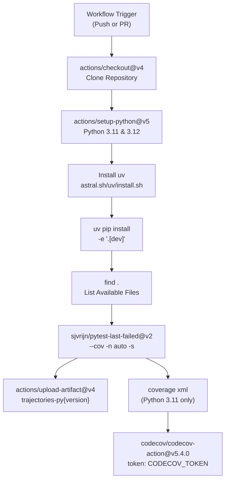
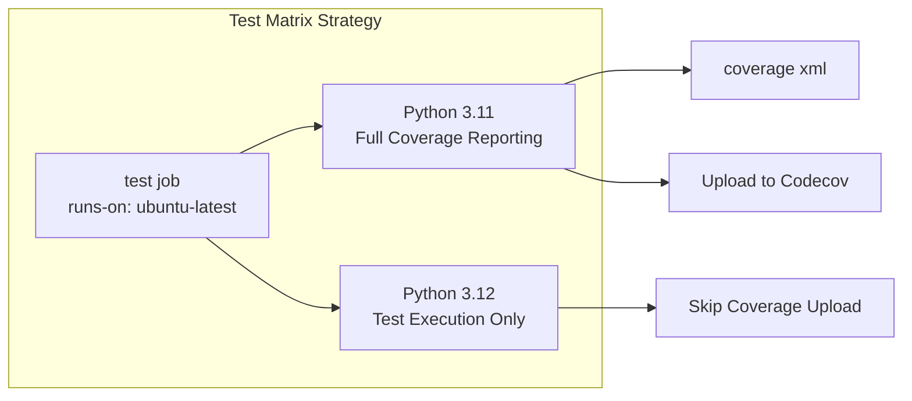
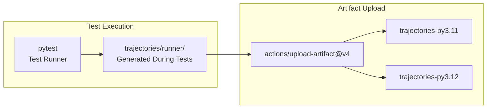
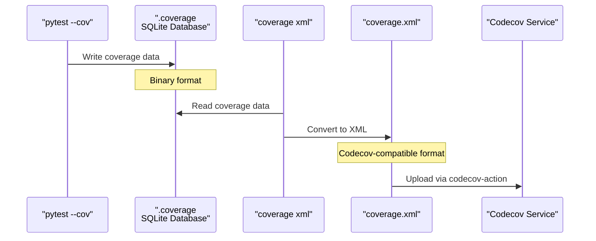

<!-- source: DeepWiki mcp.deepwiki.com · repo allenai/SERA · page 6.1 Testing Workflow · fetched 2026-10-26 -->

# Testing Workflow

<details>
<summary>Relevant source files</summary>

The following files were used as context for generating this wiki page:

- [modules/SWE-agent/.github/workflows/pytest.yaml](modules/SWE-agent/.github/workflows/pytest.yaml)

</details>


## Purpose and Scope

This document describes the automated testing workflow for the SWE-agent module, including test execution, coverage reporting, and artifact management. The testing infrastructure uses pytest with GitHub Actions to validate code changes across multiple Python versions.

For information about code quality automation and pre-commit hooks, see [Code Quality Automation](#6.3). For documentation build processes, see [Documentation Build](#6.2).

---

## Workflow Overview

The testing workflow is defined in [modules/SWE-agent/.github/workflows/pytest.yaml]() and orchestrates the complete testing lifecycle from setup through coverage reporting.

### Workflow Trigger Conditions

The pytest workflow executes automatically under the following conditions:

| Trigger Type | Branch | Excluded Paths |
|-------------|--------|----------------|
| Push | `main`, `prepare-public2` | `docs/**`, `README.md`, `mkdocs.yml` |
| Pull Request | `main`, `prepare-public2` | `docs/**`, `README.md`, `mkdocs.yml` |

**Sources:** [modules/SWE-agent/.github/workflows/pytest.yaml:6-22]()

The path exclusions prevent unnecessary test runs when only documentation is modified, optimizing CI/CD resource usage.

---

## Test Execution Architecture



**Diagram: Pytest Workflow Execution Pipeline**

**Sources:** [modules/SWE-agent/.github/workflows/pytest.yaml:35-69]()

---

## Python Version Matrix Strategy

The workflow tests against multiple Python versions to ensure compatibility:



**Diagram: Python Version Test Matrix**

The workflow runs tests in parallel across Python 3.11 and 3.12, but only uploads coverage reports from Python 3.11 to avoid duplicate data in Codecov.

**Sources:** [modules/SWE-agent/.github/workflows/pytest.yaml:29-31](), [modules/SWE-agent/.github/workflows/pytest.yaml:62-69]()

---

## Dependency Installation with UV

The workflow uses `uv`, a fast Python package installer, instead of traditional `pip`:

```bash
curl -LsSf https://astral.sh/uv/install.sh | sh
uv pip install --python ${Python_ROOT_DIR} -e '.[dev]'
```

**Key characteristics:**
- **Fast installation**: uv provides significantly faster dependency resolution
- **Editable install**: The `-e` flag installs the package in editable mode
- **Dev dependencies**: The `'.[dev]'` specifier includes development dependencies like pytest, coverage, and testing utilities

**Sources:** [modules/SWE-agent/.github/workflows/pytest.yaml:41-46]()

---

## Test Execution Configuration

### Pytest Command Arguments

The workflow uses the `sjvrijn/pytest-last-failed@v2` action with specific pytest arguments:

| Argument | Purpose | Description |
|----------|---------|-------------|
| `--cov` | Coverage Collection | Measures code coverage during test execution |
| `-n auto` | Parallel Execution | Automatically distributes tests across CPU cores |
| `-s` | Show Output | Displays print statements and logging output |

**Sources:** [modules/SWE-agent/.github/workflows/pytest.yaml:50-53]()

### Last-Failed Test Optimization

The `pytest-last-failed` action implements intelligent test execution:
- Prioritizes tests that failed in previous runs
- Reduces feedback time by running problematic tests first
- Stores test results between workflow runs

---

## Test Artifacts and Trajectories



**Diagram: Test Artifact Collection and Upload**

### Trajectory Files

The workflow uploads test trajectories from the `trajectories/runner/` directory. These files contain:
- Execution traces of SWE-agent runs during tests
- Agent interaction logs
- Debugging information for failed tests

**Configuration:**
- **Upload condition**: `if: always()` - artifacts are uploaded even when tests fail
- **Naming scheme**: `trajectories-py{version}` distinguishes artifacts by Python version
- **Path**: `trajectories/runner/`

**Sources:** [modules/SWE-agent/.github/workflows/pytest.yaml:54-61]()

---

## Coverage Reporting

### Coverage Collection Flow



**Diagram: Coverage Data Processing Pipeline**

### Python 3.11 Only Restriction

Coverage reporting is restricted to Python 3.11 to avoid redundant uploads:

**Conditional execution:**
```yaml
if: matrix.python-version == '3.11'
```

This condition applies to both:
1. Coverage XML conversion: [modules/SWE-agent/.github/workflows/pytest.yaml:62-63]()
2. Codecov upload: [modules/SWE-agent/.github/workflows/pytest.yaml:65-69]()

**Rationale:** Coverage data is consistent across Python versions for the same codebase, so uploading from multiple versions would duplicate data without adding value.

**Sources:** [modules/SWE-agent/.github/workflows/pytest.yaml:62-69]()

---

## Codecov Integration

### Upload Configuration

The workflow integrates with Codecov using the official action:

| Configuration | Value | Purpose |
|--------------|-------|---------|
| Action | `codecov/codecov-action@v5.4.0` | Official Codecov upload action |
| Token | `${{ secrets.CODECOV_TOKEN }}` | Authentication for Codecov API |
| Slug | `SWE-agent/SWE-agent` | Repository identifier |

**Authentication:** The `CODECOV_TOKEN` secret must be configured in the repository settings for coverage uploads to succeed.

**Sources:** [modules/SWE-agent/.github/workflows/pytest.yaml:64-69]()

---

## Environment Variables

The workflow defines environment variables at the workflow level:

```yaml
env:
  GITHUB_TOKEN: ${{ secrets.GITHUB_TOKEN }}
```

**Purpose:** The `GITHUB_TOKEN` provides authentication for:
- Accessing private repository data during tests
- GitHub API interactions
- Artifact uploads

**Sources:** [modules/SWE-agent/.github/workflows/pytest.yaml:3-4]()

---

## Shell Configuration

Tests execute in a bash login shell with specific settings:

```yaml
defaults:
  run:
    shell: bash -l {0}
```

**Characteristics:**
- **Login shell (`-l`)**: Sources profile files like `.bash_profile`
- **Consistent environment**: Ensures the same shell behavior across all steps

**Sources:** [modules/SWE-agent/.github/workflows/pytest.yaml:32-34]()

---

## Known Limitations

### Windows Testing

The workflow contains a comment noting Windows testing is not possible:

```yaml
# Not possible to test windows capability:
# https://github.com/orgs/community/discussions/25491
```

**Implication:** The workflow only tests on `ubuntu-latest`, so Windows-specific issues may not be caught by CI.

**Sources:** [modules/SWE-agent/.github/workflows/pytest.yaml:24-25]()

---

## Summary

The testing workflow provides comprehensive automated testing with:

- **Multi-version testing**: Python 3.11 and 3.12 compatibility validation
- **Parallel execution**: Automatic test distribution across CPU cores
- **Smart test ordering**: Failed tests run first for faster feedback
- **Coverage reporting**: Integration with Codecov for coverage tracking
- **Artifact preservation**: Test trajectories uploaded for debugging
- **Optimized triggers**: Runs only when code changes, not documentation

This infrastructure ensures code quality and catches regressions before they reach the main branch.

**Sources:** [modules/SWE-agent/.github/workflows/pytest.yaml:1-70]()

---

