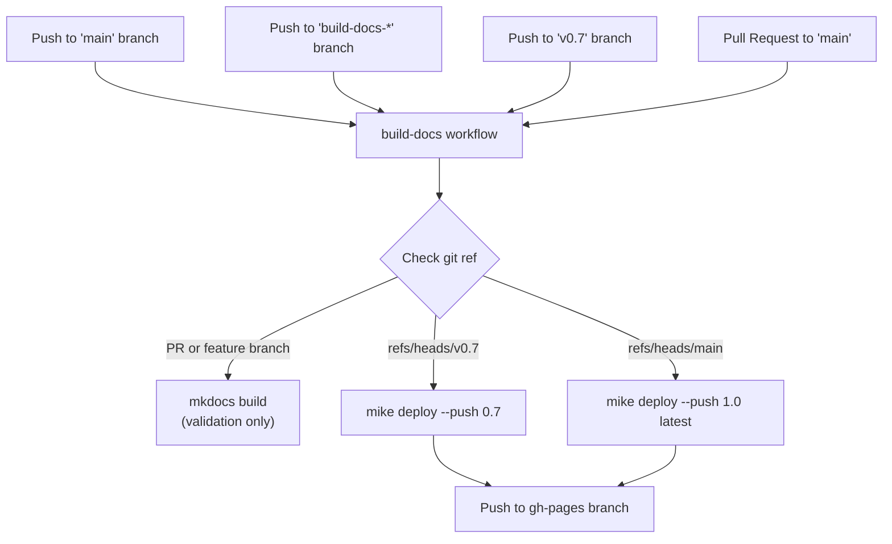
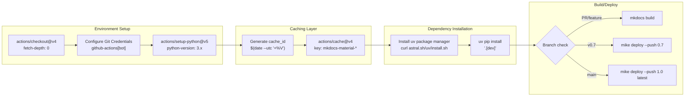
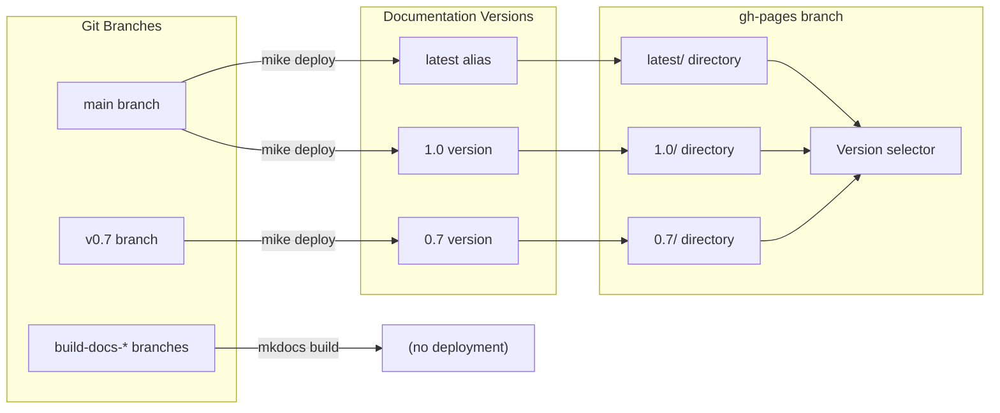
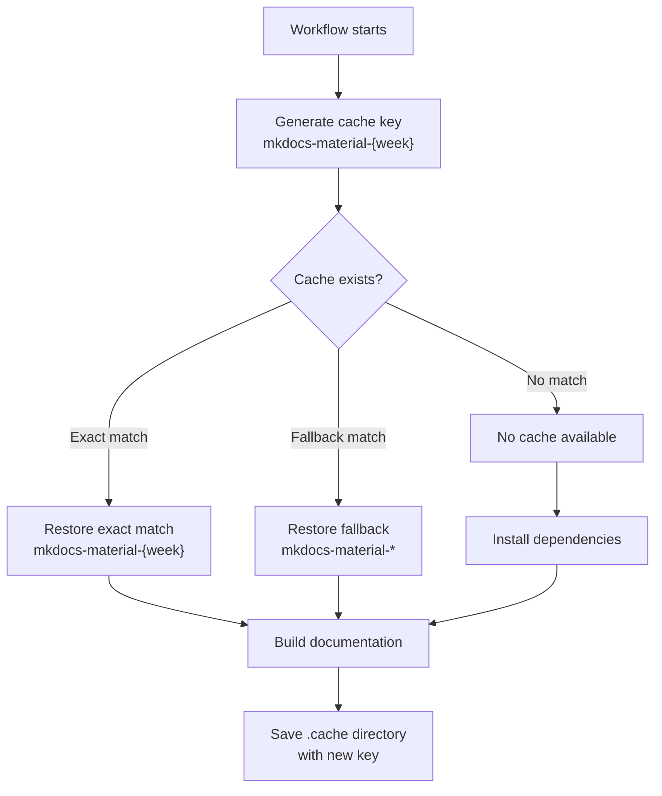

<!-- source: DeepWiki mcp.deepwiki.com · repo allenai/SERA · page 6.2 Documentation Build · fetched 2026-10-26 -->

# Documentation Build

<details>
<summary>Relevant source files</summary>

The following files were used as context for generating this wiki page:

- [modules/SWE-agent/.github/workflows/build-docs.yaml](modules/SWE-agent/.github/workflows/build-docs.yaml)

</details>


## Purpose and Scope

This document explains the automated documentation build and deployment system for the SWE-agent module. The system uses MkDocs for static site generation and Mike for version management, with GitHub Actions automating the build and deployment process.

For information about code quality automation, see [Code Quality Automation](#6.3). For general CI/CD overview, see [CI/CD and Automation](#6).

---

## Documentation System Overview

The SWE-agent module uses a **MkDocs**-based documentation system with **Mike** for multi-version support. Documentation is automatically built and deployed through a GitHub Actions workflow that handles:

- Validation builds on pull requests
- Version-specific deployments on release branches
- Latest documentation updates on the main branch

The system maintains multiple documentation versions simultaneously, allowing users to access documentation for different releases of the software.

**Sources:** [modules/SWE-agent/.github/workflows/build-docs.yaml:1-47]()

---

## Documentation Technology Stack

The documentation build system relies on three primary technologies:

| Technology | Purpose | Configuration |
|------------|---------|---------------|
| **MkDocs** | Static site generator that converts Markdown files to HTML documentation | `mkdocs.yml` configuration file |
| **Mike** | Version management tool for MkDocs that enables multi-version documentation hosting | Integrated with Git branches |
| **MkDocs Material** | Material Design theme providing modern UI and enhanced features | Installed via `[dev]` extras |

The workflow installs these dependencies using the **uv** package installer, a fast alternative to pip, which is invoked with the development extras: `uv pip install --python ${Python_ROOT_DIR} '.[dev]'` [modules/SWE-agent/.github/workflows/build-docs.yaml:37]().

**Sources:** [modules/SWE-agent/.github/workflows/build-docs.yaml:34-37]()

---

## Workflow Triggers and Execution Context



**Workflow Triggers**

The `build-docs` workflow activates on three event types [modules/SWE-agent/.github/workflows/build-docs.yaml:3-10]():

1. **Push to `main`**: Deploys documentation versions `1.0` and `latest`
2. **Push to branches matching `build-docs-*`**: Validation build only
3. **Push to `v0.7`**: Deploys documentation version `0.7`
4. **Pull requests to `main`**: Validation build only

The workflow requires `write` permissions for repository contents to push to the `gh-pages` branch [modules/SWE-agent/.github/workflows/build-docs.yaml:11-12]().

**Sources:** [modules/SWE-agent/.github/workflows/build-docs.yaml:1-12]()

---

## Build Process Pipeline



### Step-by-Step Execution

#### 1. Repository Checkout

The workflow checks out the repository with full git history [modules/SWE-agent/.github/workflows/build-docs.yaml:17-19]():

```yaml
fetch-depth: 0
```

Full history is required for Mike to determine version information from git tags and commit history.

#### 2. Git Configuration

The workflow configures git credentials to enable pushing to the `gh-pages` branch [modules/SWE-agent/.github/workflows/build-docs.yaml:20-23]():

```
user.name: github-actions[bot]
user.email: 41898282+github-actions[bot]@users.noreply.github.com
```

#### 3. Python Environment

Python 3.x is installed using `actions/setup-python@v5` [modules/SWE-agent/.github/workflows/build-docs.yaml:24-26]().

#### 4. Cache Management

The workflow implements weekly cache rotation for MkDocs Material assets [modules/SWE-agent/.github/workflows/build-docs.yaml:27-33]():

- **Cache Key**: `mkdocs-material-{week_number}` - Changes weekly
- **Cache Path**: `.cache` directory
- **Restore Keys**: Falls back to any `mkdocs-material-*` cache if exact match not found

The cache ID is generated using the current ISO week number: `$(date --utc '+%V')` [modules/SWE-agent/.github/workflows/build-docs.yaml:27]().

#### 5. Dependency Installation

The workflow uses **uv**, a high-performance Python package installer [modules/SWE-agent/.github/workflows/build-docs.yaml:34-37]():

```bash
curl -LsSf https://astral.sh/uv/install.sh | sh
uv pip install --python ${Python_ROOT_DIR} '.[dev]'
```

The `[dev]` extras include mkdocs, mike, mkdocs-material, and other documentation dependencies.

#### 6. Build or Deploy

The workflow takes different actions based on the git ref [modules/SWE-agent/.github/workflows/build-docs.yaml:38-46]():

| Condition | Action | Command |
|-----------|--------|---------|
| Pull request or feature branch | Build only (validation) | `mkdocs build` |
| `refs/heads/v0.7` | Deploy version 0.7 | `mike deploy --push 0.7` |
| `refs/heads/main` | Deploy versions 1.0 and latest | `mike deploy --push 1.0 latest` |

**Sources:** [modules/SWE-agent/.github/workflows/build-docs.yaml:14-47]()

---

## Version Management Strategy

Mike enables the repository to maintain multiple documentation versions simultaneously. The versioning strategy is:



### Mike Deployment Behavior

**Mike** manages versions by:

1. Building the documentation with MkDocs
2. Creating a version-specific directory in the `gh-pages` branch
3. Updating the version selector configuration
4. Pushing changes to the `gh-pages` branch (when `--push` flag is used)

**Version Aliases**: The `latest` alias always points to the most recent documentation from the main branch, automatically redirecting users to the current version [modules/SWE-agent/.github/workflows/build-docs.yaml:46]().

**Multiple Versions**: Users can select between versions (0.7, 1.0, latest) using a version selector in the documentation UI.

**Sources:** [modules/SWE-agent/.github/workflows/build-docs.yaml:38-46]()

---

## Build Optimization Through Caching

The workflow optimizes build times using GitHub Actions cache [modules/SWE-agent/.github/workflows/build-docs.yaml:28-33]():

### Cache Strategy



### Cached Content

The `.cache` directory stores:

- Downloaded MkDocs Material theme assets
- Plugin caches (if any plugins use caching)
- Social media card images (if social plugin is enabled)
- Search index data

### Cache Rotation

The weekly cache rotation strategy [modules/SWE-agent/.github/workflows/build-docs.yaml:27]() balances two goals:

1. **Freshness**: Weekly rotation ensures dependencies don't become stale
2. **Efficiency**: Week-long caches minimize redundant downloads within the same week

The restore key pattern `mkdocs-material-` allows the workflow to use any previous week's cache if the current week's cache doesn't exist, providing graceful degradation.

**Sources:** [modules/SWE-agent/.github/workflows/build-docs.yaml:27-33]()

---

## Validation vs. Deployment Modes

The workflow operates in two distinct modes:

### Validation Mode

Triggered by pull requests and feature branches [modules/SWE-agent/.github/workflows/build-docs.yaml:38-40]():

- **Command**: `mkdocs build`
- **Purpose**: Verify documentation builds successfully without errors
- **Output**: Build artifacts in local directory (not pushed)
- **Effect**: Catches broken links, invalid syntax, missing files

### Deployment Mode

Triggered by pushes to `main` or `v0.7` branches [modules/SWE-agent/.github/workflows/build-docs.yaml:41-46]():

- **Command**: `mike deploy --push {version(s)}`
- **Purpose**: Publish documentation to GitHub Pages
- **Output**: Updates to `gh-pages` branch
- **Effect**: Documentation becomes publicly accessible

This separation ensures that:
- All pull requests are validated before merge
- Only approved changes reach the published documentation
- Multiple versions remain available for users

**Sources:** [modules/SWE-agent/.github/workflows/build-docs.yaml:38-46]()

---

## Job Permissions

The workflow requires specific permissions [modules/SWE-agent/.github/workflows/build-docs.yaml:11-12]():

```yaml
permissions:
  contents: write
```

The `contents: write` permission is necessary for:
- Pushing to the `gh-pages` branch (deployment target)
- Creating and updating version tags (Mike version management)
- Committing documentation build artifacts

Without this permission, the `mike deploy --push` command would fail when attempting to push to the repository.

**Sources:** [modules/SWE-agent/.github/workflows/build-docs.yaml:11-12]()

---

