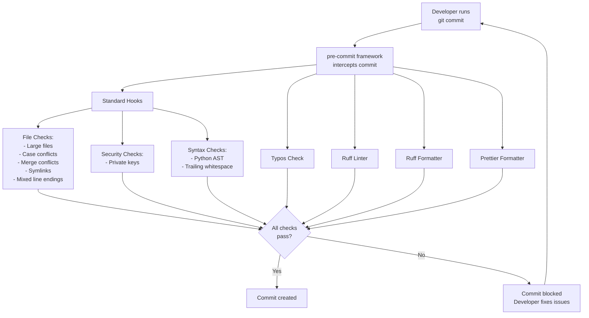
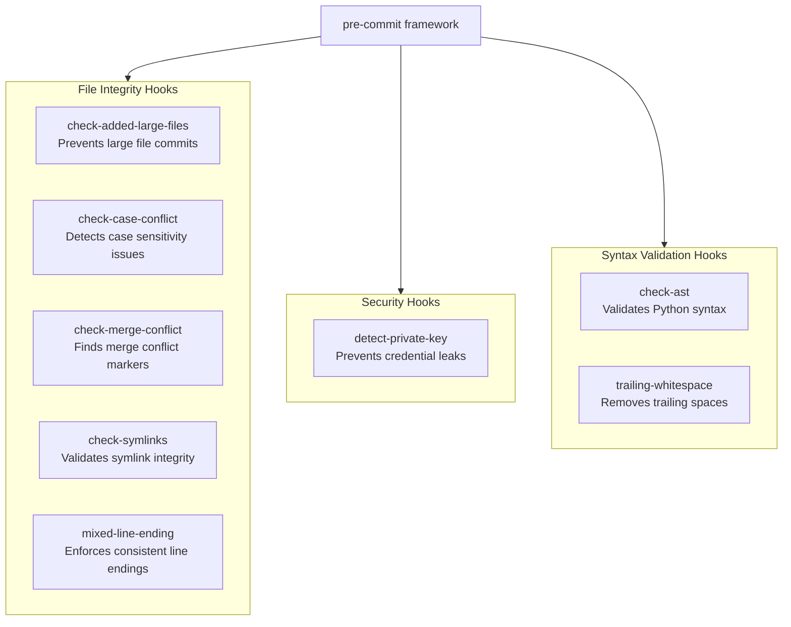
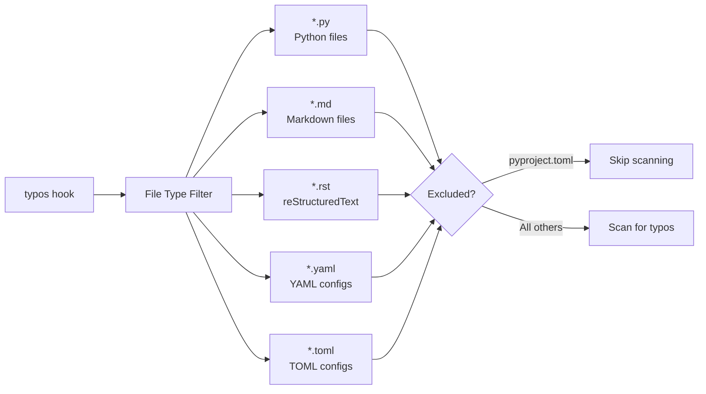
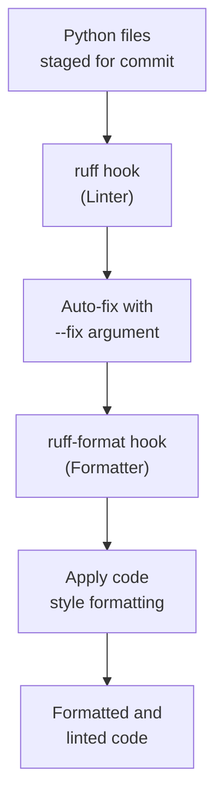
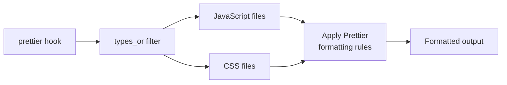
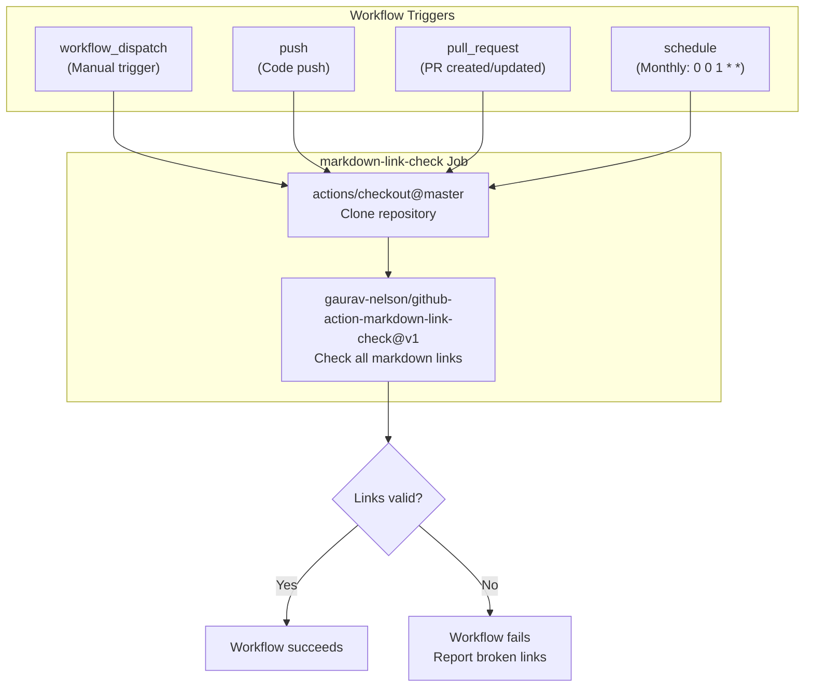
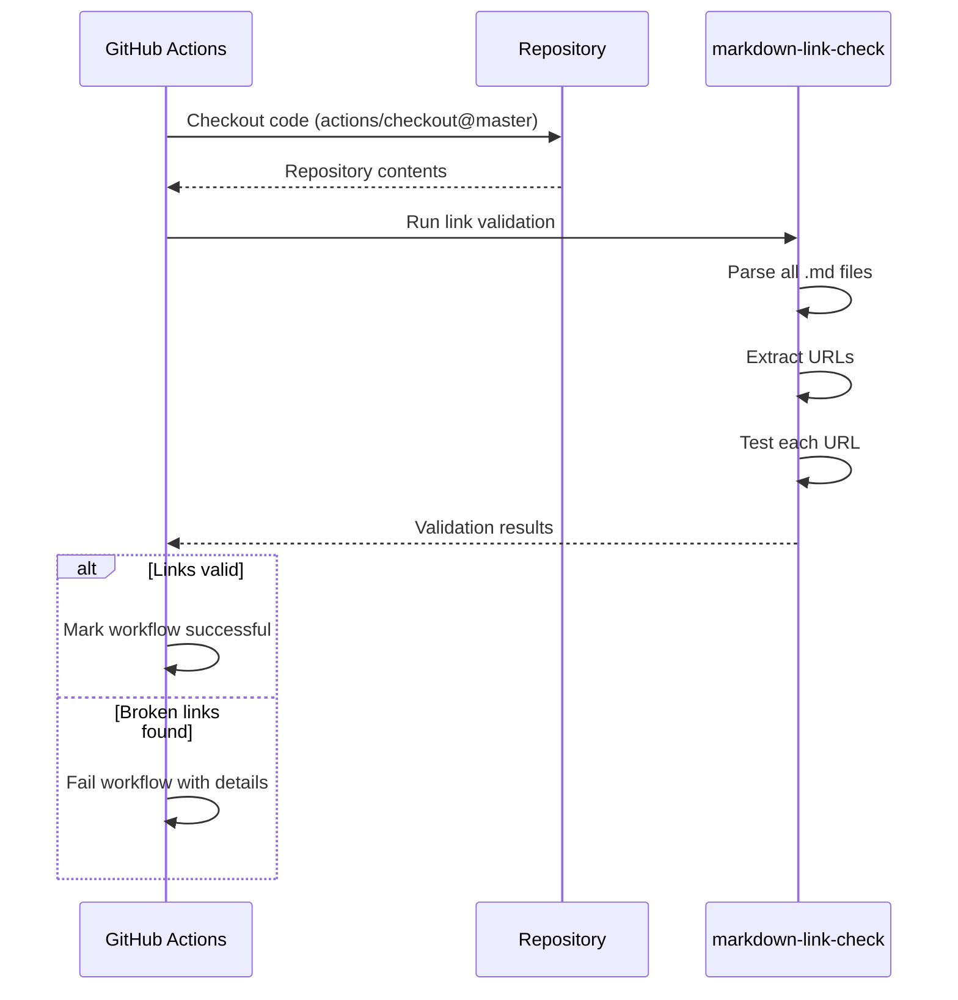
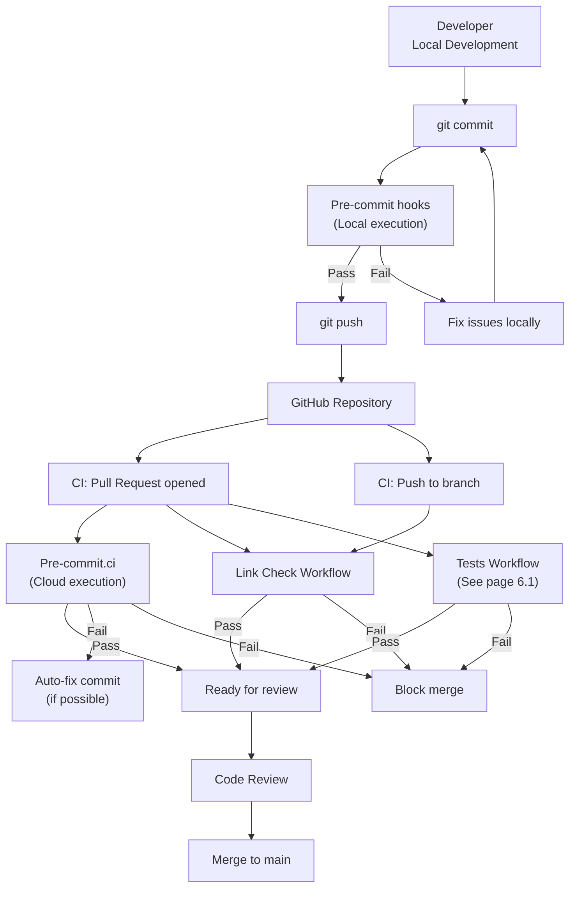
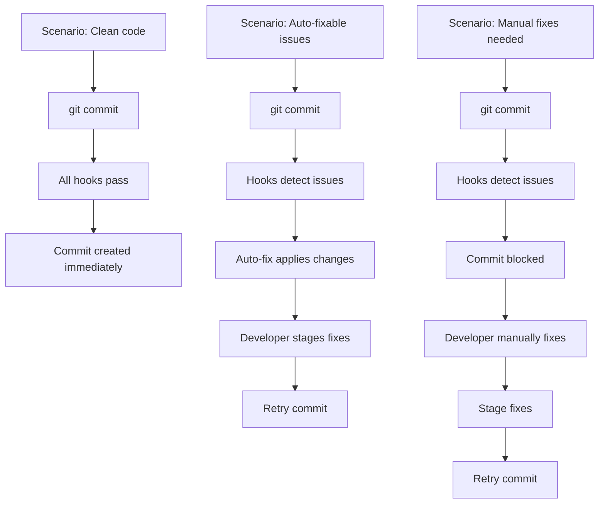

<!-- source: DeepWiki mcp.deepwiki.com · repo allenai/SERA · page 6.3 Code Quality Automation · fetched 2026-10-26 -->

# Code Quality Automation

<details>
<summary>Relevant source files</summary>

The following files were used as context for generating this wiki page:

- [modules/SWE-agent/.github/workflows/check-links.yaml](modules/SWE-agent/.github/workflows/check-links.yaml)
- [modules/SWE-agent/.pre-commit-config.yaml](modules/SWE-agent/.pre-commit-config.yaml)

</details>


## Purpose and Scope

This document covers the automated code quality enforcement mechanisms in the SERA repository, specifically focusing on pre-commit hooks and link validation workflows. These systems ensure code quality standards are maintained before code reaches the repository. For information about automated testing, see [Testing Workflow](#6.1). For documentation quality checks, see [Documentation Build](#6.2). For dependency updates, see [Dependency Management](#6.4).

## Pre-Commit Framework Architecture

The repository uses the `pre-commit` framework to enforce code quality standards before commits are created. The configuration is managed through [modules/SWE-agent/.pre-commit-config.yaml:1-39]().

### Pre-Commit Hook Execution Flow



**Sources:** [modules/SWE-agent/.pre-commit-config.yaml:1-39]()

### CI Auto-Update Configuration

The pre-commit CI service automatically updates hook versions. Configuration is defined in [modules/SWE-agent/.pre-commit-config.yaml:1-2]():

| Configuration Key | Value | Purpose |
|------------------|-------|---------|
| `autoupdate_commit_msg` | `"chore: update pre-commit hooks"` | Standardized commit message for hook version updates |

**Sources:** [modules/SWE-agent/.pre-commit-config.yaml:1-2]()

## Standard File and Security Hooks

The repository uses the `pre-commit-hooks` repository at version `v5.0.0` [modules/SWE-agent/.pre-commit-config.yaml:5-6]().

### Standard Hook Inventory



### Hook Definitions

The following hooks are configured in [modules/SWE-agent/.pre-commit-config.yaml:8-15]():

| Hook ID | Purpose | Detection/Fix |
|---------|---------|---------------|
| `check-added-large-files` | Prevents accidental commits of large binary files | Detection only |
| `check-case-conflict` | Identifies files that would conflict on case-insensitive filesystems | Detection only |
| `check-merge-conflict` | Searches for unresolved merge conflict markers (`<<<<<<<`, `=======`, `>>>>>>>`) | Detection only |
| `check-symlinks` | Ensures symlinks point to valid targets | Detection only |
| `mixed-line-ending` | Detects and normalizes mixed line ending styles (CRLF/LF) | Auto-fix |
| `detect-private-key` | Scans for private key patterns (RSA, SSH, etc.) | Detection only |
| `check-ast` | Parses Python files to ensure valid abstract syntax trees | Detection only |
| `trailing-whitespace` | Removes trailing whitespace from files | Auto-fix |

**Sources:** [modules/SWE-agent/.pre-commit-config.yaml:5-15]()

## Typo Detection

The `typos` tool from `crate-ci/typos` is integrated at version `v1` [modules/SWE-agent/.pre-commit-config.yaml:17-22]().

### Typos Configuration



The typos hook configuration includes:
- **File patterns:** `\.(py|md|rst|yaml|toml)` [modules/SWE-agent/.pre-commit-config.yaml:21]()
- **Exclusion:** `pyproject.toml` [modules/SWE-agent/.pre-commit-config.yaml:22]()

**Sources:** [modules/SWE-agent/.pre-commit-config.yaml:17-22]()

## Python Code Quality: Ruff

The repository uses Ruff, a fast Python linter and formatter, from `astral-sh/ruff-pre-commit` at version `v0.9.10` [modules/SWE-agent/.pre-commit-config.yaml:24-31]().

### Ruff Hook Architecture



### Ruff Hook Configuration

| Hook ID | Purpose | Arguments | Execution Order |
|---------|---------|-----------|-----------------|
| `ruff` | Lints Python code for style and error issues | `["--fix"]` | First |
| `ruff-format` | Formats Python code according to style guide | None | Second |

The `ruff` hook runs with the `--fix` argument [modules/SWE-agent/.pre-commit-config.yaml:29](), automatically correcting fixable issues. The `ruff-format` hook then applies consistent code formatting [modules/SWE-agent/.pre-commit-config.yaml:31]().

**Sources:** [modules/SWE-agent/.pre-commit-config.yaml:24-31]()

## JavaScript and CSS Formatting: Prettier

Prettier is configured for JavaScript and CSS files using `pre-commit/mirrors-prettier` at version `v4.0.0-alpha.8` [modules/SWE-agent/.pre-commit-config.yaml:33-37]().

### Prettier File Type Mapping



The `types_or` configuration targets `["javascript", "css"]` [modules/SWE-agent/.pre-commit-config.yaml:37](), ensuring only relevant files are processed.

**Sources:** [modules/SWE-agent/.pre-commit-config.yaml:33-37]()

## Global Exclusion Patterns

The pre-commit framework excludes specific directories from all hooks using a global exclusion pattern [modules/SWE-agent/.pre-commit-config.yaml:39]():

| Pattern | Purpose |
|---------|---------|
| `^tests/test_data/` | Excludes test fixtures and test data files |
| `^tools/.*/.*.py` | Excludes Python files in tools subdirectories |

**Sources:** [modules/SWE-agent/.pre-commit-config.yaml:39]()

## Link Validation Workflow

The repository includes an automated link checking workflow to ensure documentation links remain valid over time.

### Check Links Workflow Architecture



### Workflow Trigger Configuration

The link checking workflow is defined in [modules/SWE-agent/.github/workflows/check-links.yaml:1-16]() and triggers on:

| Trigger Type | Configuration | Purpose |
|-------------|---------------|---------|
| `workflow_dispatch` | On-demand | Manual execution via GitHub UI |
| `push` | All branches | Validates links on every push |
| `pull_request` | All PRs | Ensures PR doesn't introduce broken links |
| `schedule` | `"0 0 1 * *"` | Monthly check (1st of month at midnight UTC) |

The scheduled run helps detect link rot from external URLs that may have changed since the last code modification.

**Sources:** [modules/SWE-agent/.github/workflows/check-links.yaml:3-8]()

### Link Check Job Steps



The job runs on `ubuntu-latest` [modules/SWE-agent/.github/workflows/check-links.yaml:12]() and consists of two steps:
1. **Checkout:** Uses `actions/checkout@master` [modules/SWE-agent/.github/workflows/check-links.yaml:14]()
2. **Link validation:** Uses `gaurav-nelson/github-action-markdown-link-check@v1` [modules/SWE-agent/.github/workflows/check-links.yaml:15]()

**Sources:** [modules/SWE-agent/.github/workflows/check-links.yaml:10-15]()

## Quality Gate Integration

The code quality automation integrates into the development workflow at multiple enforcement points.

### Enforcement Point Architecture



### Local vs CI Execution

| Aspect | Local Pre-commit | Pre-commit.ci | Link Check Workflow |
|--------|------------------|---------------|---------------------|
| **Execution Point** | Before commit creation | After push to GitHub | On push/PR/schedule |
| **Triggers** | `git commit` | Push to remote | Multiple triggers |
| **Auto-fix** | Modifies local files | Creates auto-fix commit | N/A (detection only) |
| **Enforcement** | Optional (can skip) | Required for merge | Required for merge |
| **Configuration** | `.pre-commit-config.yaml` | `.pre-commit-config.yaml` | `check-links.yaml` |

**Sources:** [modules/SWE-agent/.pre-commit-config.yaml:1-39](), [modules/SWE-agent/.github/workflows/check-links.yaml:1-16]()

## Developer Workflow

### Initial Setup

Developers must install pre-commit hooks locally:

```bash
pip install pre-commit
pre-commit install
```

This configures Git to run the hooks automatically before each commit.

### Hook Execution Scenarios



### Bypassing Hooks

Developers can skip pre-commit hooks using:

```bash
git commit --no-verify
```

However, this is discouraged as the CI system will still enforce the same checks and block merging if issues are found.

**Sources:** [modules/SWE-agent/.pre-commit-config.yaml:1-39]()

---

