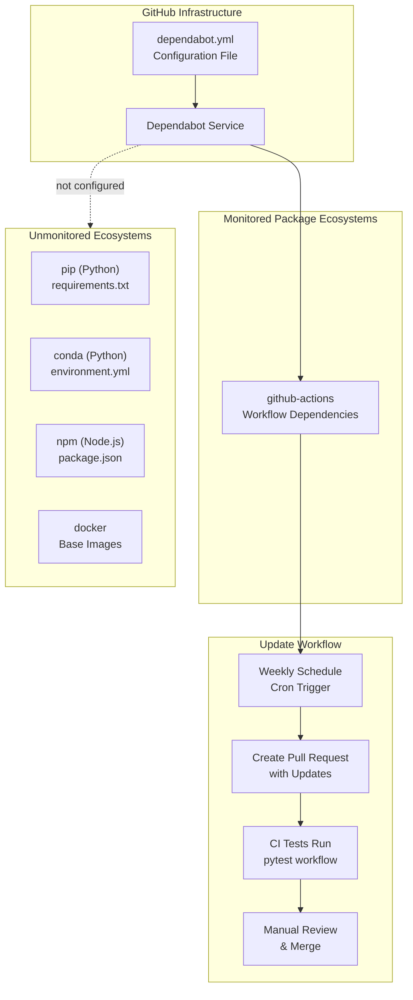
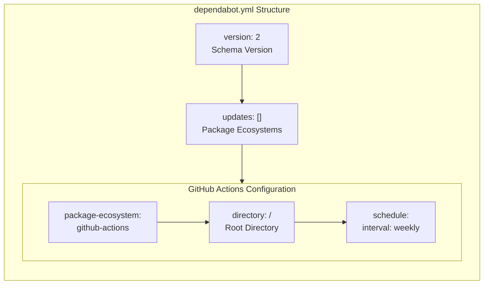
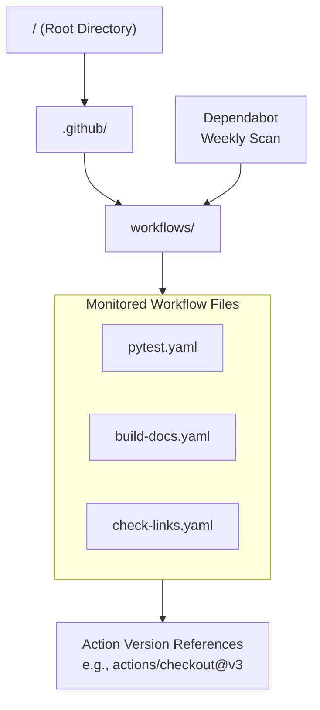
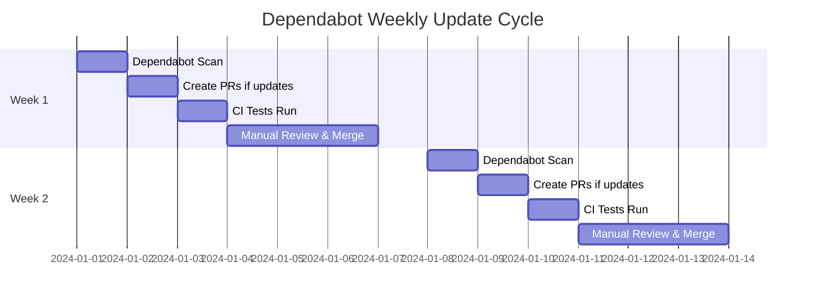
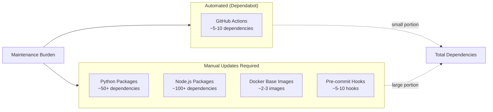
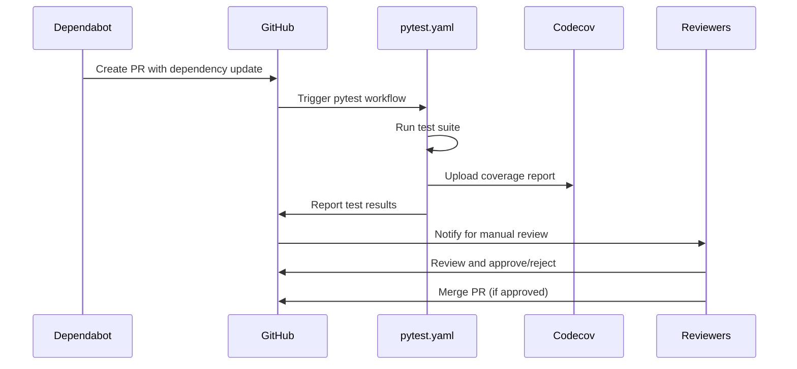

<!-- source: DeepWiki mcp.deepwiki.com · repo allenai/SERA · page 6.4 Dependency Management · fetched 2026-10-26 -->

# Dependency Management

Relevant source files

The following files were used as context for generating this wiki page:

- [modules/SWE-agent/.github/dependabot.yml](modules/SWE-agent/.github/dependabot.yml)

## Purpose and Scope

This document describes the automated dependency management configuration in the SERA repository. It covers the Dependabot setup for keeping dependencies up-to-date through automated pull requests. For information about code quality automation and pre-commit hooks, see [Code Quality Automation](#6.3). For details about the testing workflow that validates dependency updates, see [Testing Workflow](#6.1).

## Overview

The SERA repository uses GitHub's Dependabot service to automate dependency updates. Dependabot monitors configured package ecosystems for new versions and automatically creates pull requests to update dependencies, reducing security vulnerabilities and ensuring compatibility with the latest package versions.

The current configuration provides limited automation, focusing exclusively on GitHub Actions workflow dependencies. Python package dependencies and other ecosystems require manual management.

Sources: [modules/SWE-agent/.github/dependabot.yml:1-8]()

## Dependabot Configuration Architecture

**Dependency Management Automation Architecture**

The system monitors GitHub Actions dependencies on a weekly schedule, creating automated pull requests that must pass CI validation before manual review and merge. Other package ecosystems remain unmonitored and require manual updates.

Sources: [modules/SWE-agent/.github/dependabot.yml:1-8]()

## Configuration File Structure

The Dependabot configuration is defined in the YAML file located at [modules/SWE-agent/.github/dependabot.yml:1-8](). The configuration follows the Dependabot v2 schema.

**Dependabot Configuration File Structure**

Sources: [modules/SWE-agent/.github/dependabot.yml:1-8]()

### Configuration Parameters

| Parameter | Value | Description |
|-----------|-------|-------------|
| `version` | `2` | Dependabot configuration schema version |
| `package-ecosystem` | `"github-actions"` | Package ecosystem to monitor |
| `directory` | `"/"` | Directory to monitor for dependency files |
| `schedule.interval` | `"weekly"` | Frequency of dependency checks |

Sources: [modules/SWE-agent/.github/dependabot.yml:1-8]()

## GitHub Actions Dependency Management

The sole configured package ecosystem is `github-actions`, which monitors GitHub Actions workflow files for outdated action versions.

### Monitored Files

Dependabot scans the following directory structure for GitHub Actions dependencies:

**GitHub Actions Dependency Monitoring Scope**

Dependabot monitors all workflow files in `.github/workflows/` for action version references and creates pull requests when newer versions are available.

Sources: [modules/SWE-agent/.github/dependabot.yml:3-7]()

### Action Version Updates

GitHub Actions in workflow files are referenced using version tags. Dependabot detects when these actions have newer versions and proposes updates. For example:

- `actions/checkout@v3` → `actions/checkout@v4`
- `actions/setup-python@v4` → `actions/setup-python@v5`
- `codecov/codecov-action@v3` → `codecov/codecov-action@v4`

Sources: [modules/SWE-agent/.github/dependabot.yml:1-8]()

## Update Schedule and Frequency

### Weekly Update Cycle

The configuration specifies a `weekly` interval [modules/SWE-agent/.github/dependabot.yml:7](), meaning Dependabot checks for updates once per week. The specific day and time are determined by GitHub and may vary.

**Weekly Dependabot Update Timeline**

Sources: [modules/SWE-agent/.github/dependabot.yml:6-7]()

### Update Pull Request Workflow

When Dependabot detects an outdated dependency:

1. **Pull Request Creation**: Dependabot automatically creates a pull request with the dependency update
2. **CI Validation**: The [pytest workflow](#6.1) automatically runs on the pull request
3. **Manual Review**: Project maintainers review the changes and CI results
4. **Merge Decision**: Maintainers merge or close the pull request based on compatibility

Sources: [modules/SWE-agent/.github/dependabot.yml:1-8]()

## Unmonitored Package Ecosystems

The following package ecosystems are **not** configured in Dependabot and require manual dependency management:

### Python Dependencies

| Dependency File | Ecosystem | Manual Management Required |
|----------------|-----------|---------------------------|
| Various `requirements.txt` | `pip` | ✓ Yes |
| Conda `environment.yml` | `conda` | ✓ Yes |
| `pyproject.toml` | `pip` | ✓ Yes |
| `setup.py` | `pip` | ✓ Yes |

### Node.js Dependencies

Node.js is installed in the Docker image [modules/SWE-agent/Dockerfile]() for documentation builds, but `package.json` dependencies are not monitored by Dependabot.

### Docker Base Images

The Dockerfile uses base images like `ubuntu:22.04` and `python:3.11-slim` that are not monitored for updates. These require manual updates to newer versions.

Sources: [modules/SWE-agent/.github/dependabot.yml:1-8]()

## Limitations and Considerations

### Limited Automation Scope

The current Dependabot configuration provides minimal automation:

**Dependency Management Coverage**

The automated system covers only a small fraction of total repository dependencies, with the majority requiring manual monitoring and updates.

Sources: [modules/SWE-agent/.github/dependabot.yml:1-8]()

### Manual Dependency Management Workflow

For unmonitored dependencies, maintainers must:

1. **Monitor Release Notes**: Track upstream releases for Python packages, Node.js packages, and Docker images
2. **Test Compatibility**: Manually test updates in development environments
3. **Update Dependency Files**: Edit `requirements.txt`, `environment.yml`, or other files
4. **Submit Pull Requests**: Create manual pull requests for dependency updates
5. **Run CI Validation**: Ensure all tests pass with updated dependencies

### Security Implications

The limited Dependabot coverage means:

- **Security Vulnerabilities**: Python and Node.js packages may have security vulnerabilities that are not automatically detected
- **Manual Vigilance Required**: Maintainers must actively monitor security advisories for unmonitored ecosystems
- **GitHub Security Alerts**: GitHub's security alerts for vulnerable dependencies provide some coverage, but updates are not automated

Sources: [modules/SWE-agent/.github/dependabot.yml:1-8]()

## Potential Configuration Enhancements

The Dependabot configuration could be expanded to provide broader automation:

### Recommended Package Ecosystem Additions

| Ecosystem | Directory | Benefit |
|-----------|-----------|---------|
| `pip` | `/` | Automate Python package updates |
| `npm` | `/` or `/docs/` | Automate Node.js package updates |
| `docker` | `/` | Monitor base image updates |
| `pip` | `/modules/SWE-agent/` | Monitor SWE-agent Python dependencies |

### Additional Configuration Options

Dependabot v2 supports additional configuration options not currently used:

- **`open-pull-requests-limit`**: Limit concurrent PRs
- **`reviewers`**: Auto-assign reviewers to dependency PRs
- **`labels`**: Add labels to dependency PRs for filtering
- **`commit-message`**: Customize commit message format
- **`target-branch`**: Specify non-default target branches
- **`versioning-strategy`**: Control version bumping strategy

Sources: [modules/SWE-agent/.github/dependabot.yml:1-8]()

## Integration with CI/CD Pipeline

Dependabot pull requests automatically trigger the CI/CD pipeline defined in [modules/SWE-agent/.github/workflows/]():

**Dependabot Integration with CI/CD Pipeline**

Dependency update pull requests follow the same validation process as regular code contributions, ensuring updates don't break existing functionality.

Sources: [modules/SWE-agent/.github/dependabot.yml:1-8]()

## Summary

The SERA repository implements minimal automated dependency management through Dependabot, covering only GitHub Actions workflow dependencies. This configuration provides:

- **Automated Updates**: Weekly checks for GitHub Actions version updates
- **CI Integration**: Automatic validation of dependency updates through the pytest workflow
- **Manual Review**: Human oversight before merging dependency updates

However, the majority of dependencies (Python packages, Node.js packages, Docker images) require manual management, representing a significant maintenance burden and potential security risk. Expanding the Dependabot configuration to include additional package ecosystems would improve automation and reduce manual overhead.

Sources: [modules/SWE-agent/.github/dependabot.yml:1-8]()

---

