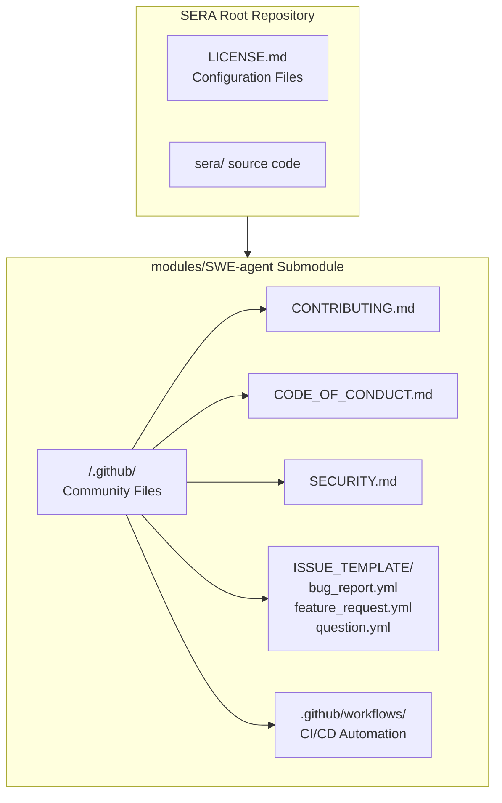
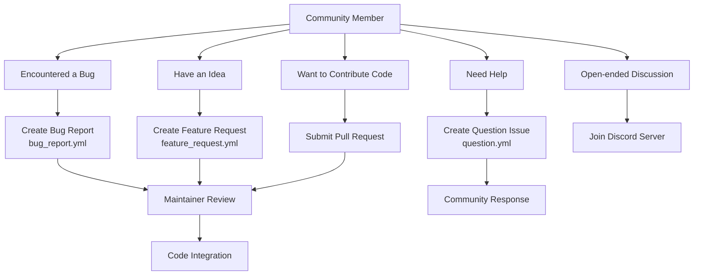
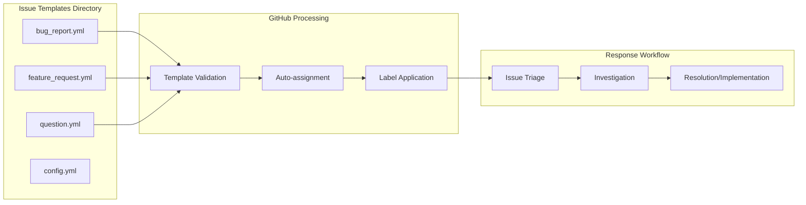
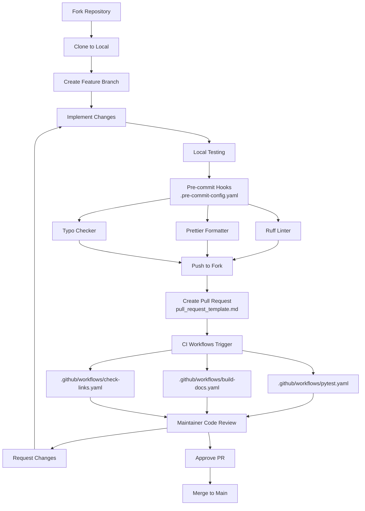
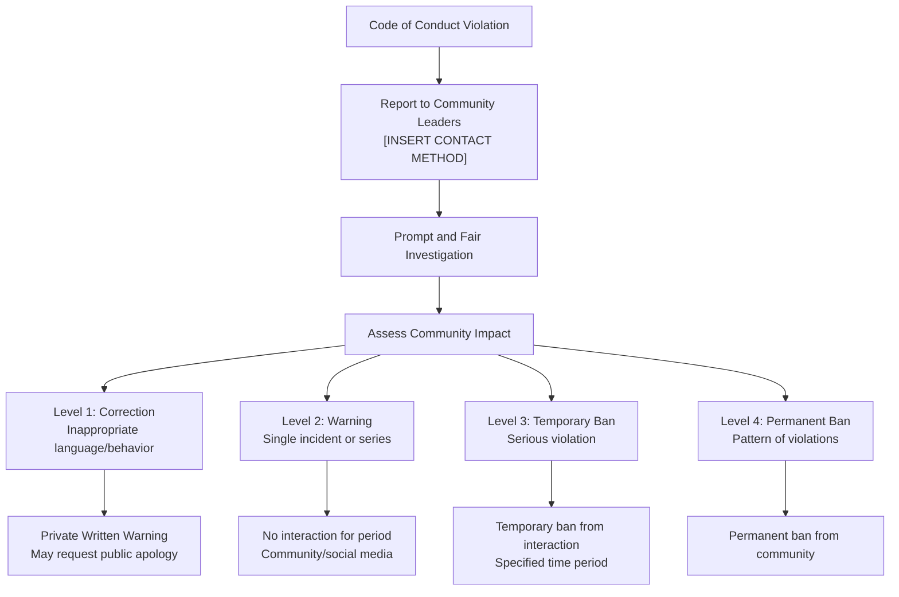

<!-- source: DeepWiki mcp.deepwiki.com · repo allenai/SERA · page 7 Community and Contribution · fetched 2026-10-26 -->

# Community and Contribution

Relevant source files

The following files were used as context for generating this wiki page:

- [modules/SWE-agent/.github/CODE_OF_CONDUCT.md](modules/SWE-agent/.github/CODE_OF_CONDUCT.md)
- [modules/SWE-agent/CONTRIBUTING.md](modules/SWE-agent/CONTRIBUTING.md)

## Purpose and Scope

This page documents the community structure, contribution processes, and governance mechanisms of the SERA repository. It covers how users and contributors can engage with the project, report issues, submit contributions, and participate in community discussions. This page provides an overview of the entire community ecosystem; for detailed information on specific aspects, see:

- Contribution procedures and guidelines: [Contribution Guidelines](#7.1)
- Structured issue reporting: [Issue Templates](#7.2)
- Code submission workflow: [Pull Request Process](#7.3)
- Community behavioral standards: [Code of Conduct](#7.4)
- Vulnerability reporting: [Security Policy](#7.5)

---

## Community Overview

The SERA project maintains an active open-source community with structured processes for different types of engagement. The project is hosted on GitHub and provides multiple channels for interaction, contribution, and support.

### Communication Channels

| Channel | Purpose | Location |
|---------|---------|----------|
| GitHub Issues | Bug reports, feature requests, questions | Repository issue tracker |
| GitHub Pull Requests | Code contributions | Repository PR system |
| Discord Server | Open-ended discussions, real-time chat | `discord.gg/AVEFbBn2rH` |
| Documentation | Technical guidance and tutorials | Project website |

**Sources:** [modules/SWE-agent/CONTRIBUTING.md:1-16]()

### Repository Structure

The SERA repository consists of two primary components with distinct community management:

**Diagram: Community Infrastructure File Organization**

**Sources:** [modules/SWE-agent/.github/CODE_OF_CONDUCT.md:1-135](), [modules/SWE-agent/CONTRIBUTING.md:1-16]()

---

## Contribution Pathways

The project provides structured pathways for different types of contributions, each optimized for specific use cases.

**Diagram: Contribution Workflow Pathways**

### Feedback and Issue Reporting

The primary contribution mechanism is providing feedback through GitHub issues. The project uses structured issue templates to guide users in providing appropriate information.

| Contribution Type | When to Use | Template File |
|-------------------|-------------|---------------|
| Bug Report | Error messages, unexpected behavior | `bug_report.yml` |
| Feature Request | Missing functionality, enhancements | `feature_request.yml` |
| Question | Concrete questions about usage | `question.yml` |
| Blank Issue | Uncategorized topics | Default GitHub issue |

The contribution guidelines explicitly state the decision tree for selecting the right issue type: "If you're running something and you get some error messages, this is the issue type for you" [modules/SWE-agent/CONTRIBUTING.md:9]().

**Sources:** [modules/SWE-agent/CONTRIBUTING.md:6-12]()

### Discussion vs. Issues

The project distinguishes between actionable items (issues) and open-ended discussions:

- **Discord**: Used for real-time chat and exploratory discussions
- **GitHub Issues**: Used for all actionable items, even those originating from Discord

The contributing guidelines note: "all actionable items should be an issue though" [modules/SWE-agent/CONTRIBUTING.md:12](), establishing a clear policy that discussions must be converted to issues for tracking and resolution.

**Sources:** [modules/SWE-agent/CONTRIBUTING.md:12]()

---

## Issue Management System

The project implements a structured issue management system with typed templates that capture necessary information for each contribution type.

### Issue Template Structure

**Diagram: Issue Template Processing Flow**

### Bug Report Template

The bug report template (`bug_report.yml`) structures bug reporting to capture:

- Environment information (operating system, Python version)
- Steps to reproduce the issue
- Expected vs. actual behavior
- Error messages and logs
- Screenshots or recordings

This template ensures maintainers receive sufficient information to reproduce and diagnose issues without requiring multiple rounds of clarification.

**Sources:** [modules/SWE-agent/CONTRIBUTING.md:8-9]()

### Feature Request Template

The feature request template (`feature_request.yml`) guides users to articulate:

- The problem or limitation being addressed
- Proposed solution or enhancement
- Alternative approaches considered
- Impact on existing functionality

This structured approach helps maintainers evaluate feature requests systematically and prioritize development efforts.

**Sources:** [modules/SWE-agent/CONTRIBUTING.md:11]()

### Question Template

The question template (`question.yml`) is optimized for users seeking clarification on usage, configuration, or expected behavior. This template distinguishes questions from bug reports and feature requests, allowing for different response workflows.

**Sources:** [modules/SWE-agent/CONTRIBUTING.md:10]()

---

## Code Contribution Workflow

Code contributions follow a structured workflow with automated quality checks and manual review processes.

**Diagram: Pull Request Submission and Review Pipeline**

### Pre-commit Quality Gates

Contributors are encouraged to install pre-commit hooks that enforce code quality standards before commits reach the repository. The configuration file `.pre-commit-config.yaml` defines multiple quality checks:

- **Ruff**: Python linting and formatting
- **Prettier**: JavaScript and CSS formatting
- **Typos**: Automated typo detection

These automated checks reduce review burden and maintain consistent code quality across contributions.

**Sources:** [modules/SWE-agent/CONTRIBUTING.md:1-16]()

### Continuous Integration Validation

All pull requests trigger automated CI workflows that validate:

1. **Test Suite**: Full pytest execution with coverage reporting
2. **Documentation Build**: Ensures changes don't break documentation generation
3. **Link Validation**: Verifies all documentation links remain valid

The CI system provides fast feedback to contributors, identifying issues before human review begins.

**Sources:** [modules/SWE-agent/CONTRIBUTING.md:1-16]()

### Development Guidelines Reference

The contributing file references detailed development guidelines at `swe-agent.com/latest/dev/contribute/` [modules/SWE-agent/CONTRIBUTING.md:16]() for comprehensive guidance on development practices, testing strategies, and architectural considerations.

**Sources:** [modules/SWE-agent/CONTRIBUTING.md:16]()

---

## Community Standards

The project implements comprehensive community standards through the Code of Conduct, establishing behavioral expectations and enforcement mechanisms.

### Core Principles

The Code of Conduct is based on the Contributor Covenant version 2.1 [modules/SWE-agent/.github/CODE_OF_CONDUCT.md:118-120]() and establishes core principles:

| Principle | Description |
|-----------|-------------|
| **Inclusivity** | Harassment-free experience regardless of personal characteristics |
| **Respect** | Respectful treatment of differing opinions and experiences |
| **Constructive Feedback** | Focus on helpful, actionable feedback |
| **Accountability** | Accepting responsibility for mistakes and learning from them |
| **Community Focus** | Prioritizing overall community benefit over individual interests |

**Sources:** [modules/SWE-agent/.github/CODE_OF_CONDUCT.md:4-14](), [modules/SWE-agent/.github/CODE_OF_CONDUCT.md:16-27]()

### Acceptable Behavior Standards

The Code of Conduct explicitly defines acceptable behaviors:

- Demonstrating empathy and kindness [modules/SWE-agent/.github/CODE_OF_CONDUCT.md:20]()
- Being respectful of differing opinions, viewpoints, and experiences [modules/SWE-agent/.github/CODE_OF_CONDUCT.md:21]()
- Giving and gracefully accepting constructive feedback [modules/SWE-agent/.github/CODE_OF_CONDUCT.md:22]()
- Accepting responsibility and apologizing for mistakes [modules/SWE-agent/.github/CODE_OF_CONDUCT.md:23-25]()
- Focusing on community benefit [modules/SWE-agent/.github/CODE_OF_CONDUCT.md:26-27]()

**Sources:** [modules/SWE-agent/.github/CODE_OF_CONDUCT.md:18-27]()

### Unacceptable Behavior

The Code of Conduct explicitly prohibits:

- Sexualized language, imagery, or unwanted sexual attention [modules/SWE-agent/.github/CODE_OF_CONDUCT.md:31-32]()
- Trolling, insulting comments, or personal/political attacks [modules/SWE-agent/.github/CODE_OF_CONDUCT.md:33]()
- Public or private harassment [modules/SWE-agent/.github/CODE_OF_CONDUCT.md:34]()
- Publishing private information without permission [modules/SWE-agent/.github/CODE_OF_CONDUCT.md:35-36]()
- Other inappropriate conduct in a professional setting [modules/SWE-agent/.github/CODE_OF_CONDUCT.md:37-38]()

**Sources:** [modules/SWE-agent/.github/CODE_OF_CONDUCT.md:29-38]()

---

## Enforcement Framework

The project implements a graduated enforcement framework with clear escalation paths.

### Enforcement Structure

**Diagram: Code of Conduct Enforcement Escalation Path**

### Enforcement Levels

The Community Impact Guidelines establish four enforcement levels [modules/SWE-agent/.github/CODE_OF_CONDUCT.md:70-114]():

#### Level 1: Correction

- **Trigger**: Use of inappropriate language or unprofessional behavior
- **Response**: Private written warning with explanation
- **Possible Action**: Request for public apology

#### Level 2: Warning

- **Trigger**: Single incident or series of actions
- **Response**: Warning with consequences for continued behavior
- **Restriction**: No interaction with involved parties for specified period
- **Escalation**: May lead to temporary or permanent ban if violated

#### Level 3: Temporary Ban

- **Trigger**: Serious violation including sustained inappropriate behavior
- **Response**: Temporary ban from all community interaction
- **Duration**: Specified period
- **Escalation**: May lead to permanent ban if terms violated

#### Level 4: Permanent Ban

- **Trigger**: Pattern of violations, sustained inappropriate behavior, harassment, or aggression toward classes of individuals
- **Response**: Permanent ban from all public interaction within the community

**Sources:** [modules/SWE-agent/.github/CODE_OF_CONDUCT.md:70-114]()

### Enforcement Responsibilities

Community leaders are responsible for:

1. Clarifying and enforcing acceptable behavior standards [modules/SWE-agent/.github/CODE_OF_CONDUCT.md:42-43]()
2. Taking appropriate corrective action [modules/SWE-agent/.github/CODE_OF_CONDUCT.md:43-45]()
3. Removing, editing, or rejecting contributions not aligned with the Code of Conduct [modules/SWE-agent/.github/CODE_OF_CONDUCT.md:47-49]()
4. Communicating moderation decisions when appropriate [modules/SWE-agent/.github/CODE_OF_CONDUCT.md:49-50]()

**Sources:** [modules/SWE-agent/.github/CODE_OF_CONDUCT.md:40-50]()

### Reporting and Privacy

The Code of Conduct establishes reporting procedures:

- Violations should be reported to community leaders [modules/SWE-agent/.github/CODE_OF_CONDUCT.md:62-64]()
- All complaints will be reviewed promptly and fairly [modules/SWE-agent/.github/CODE_OF_CONDUCT.md:65]()
- Community leaders must respect reporter privacy and security [modules/SWE-agent/.github/CODE_OF_CONDUCT.md:67-68]()

**Note**: The contact method field shows `[INSERT CONTACT METHOD]` [modules/SWE-agent/.github/CODE_OF_CONDUCT.md:64](), indicating this requires project-specific configuration.

**Sources:** [modules/SWE-agent/.github/CODE_OF_CONDUCT.md:60-68]()

---

## Scope of Application

The Code of Conduct applies comprehensively across all community spaces and official representation:

| Context | Application |
|---------|-------------|
| **Community Spaces** | All project-related spaces (GitHub, Discord, documentation) |
| **Official Representation** | Using official email addresses or social media accounts |
| **Public Events** | Acting as appointed representative at events |
| **External Channels** | Social media and external platforms when representing the project |

**Sources:** [modules/SWE-agent/.github/CODE_OF_CONDUCT.md:52-58]()

---

## Summary

The SERA project maintains a structured, welcoming community with clear contribution pathways and behavioral standards. Key aspects include:

1. **Multiple Contribution Channels**: Bug reports, feature requests, questions, code contributions, and discussions
2. **Structured Templates**: Typed issue templates that capture appropriate information
3. **Automated Quality Gates**: Pre-commit hooks and CI workflows enforce code quality
4. **Clear Community Standards**: Comprehensive Code of Conduct with graduated enforcement
5. **Transparent Processes**: Documented guidelines and templates make contribution accessible

The community infrastructure balances accessibility for new contributors with quality standards for maintainability, creating a sustainable open-source ecosystem.

**Sources:** [modules/SWE-agent/CONTRIBUTING.md:1-16](), [modules/SWE-agent/.github/CODE_OF_CONDUCT.md:1-135]()

---

