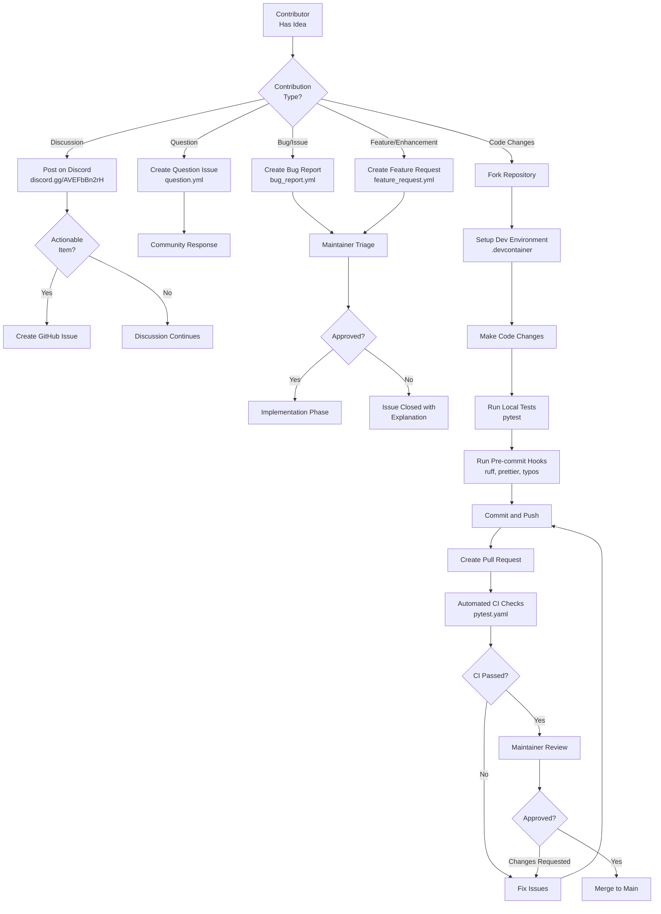
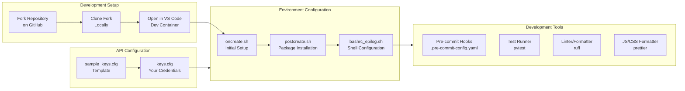
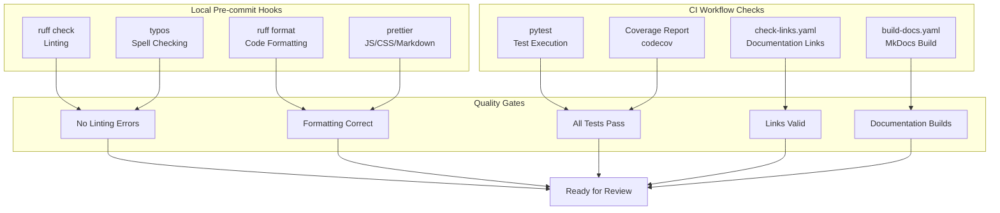
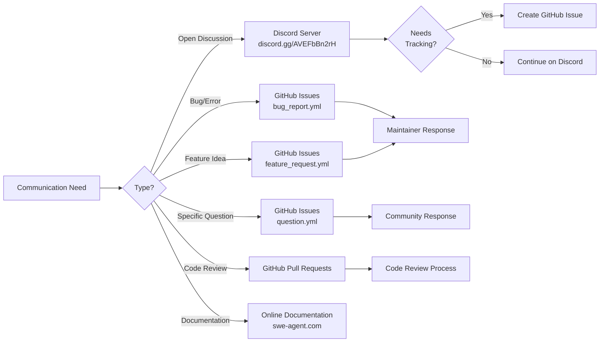

<!-- source: DeepWiki mcp.deepwiki.com · repo allenai/SERA · page 7.1 Contribution Guidelines · fetched 2026-10-26 -->

# Contribution Guidelines

Relevant source files

The following files were used as context for generating this wiki page:

- [modules/SWE-agent/CONTRIBUTING.md](modules/SWE-agent/CONTRIBUTING.md)

## Purpose and Scope

This document explains how to contribute to the SERA repository, including reporting issues, requesting features, and submitting code changes. It covers the contribution workflow, prerequisites, and quality standards that all contributions must meet.

For specific information about issue templates, see [Issue Templates](#7.2). For the pull request process, see [Pull Request Process](#7.3). For community behavioral standards, see [Code of Conduct](#7.4). For reporting security vulnerabilities, see [Security Policy](#7.5).

**Sources:** [modules/SWE-agent/CONTRIBUTING.md:1-16]()

---

## Types of Contributions

The SERA project welcomes two primary types of contributions: feedback-based contributions (issues and discussions) and code-based contributions (pull requests).

### Feedback Contributions

Feedback contributions help improve the project without requiring code changes. These are managed through GitHub Issues and Discord discussions:

| Contribution Type | Use Case | GitHub Template | When to Use |
|------------------|----------|-----------------|-------------|
| **Bug Report** | Report errors, crashes, or unexpected behavior | `bug_report.yml` | When commands produce error messages or incorrect results |
| **Feature Request** | Suggest new capabilities or enhancements | `feature_request.yml` | When you identify missing functionality |
| **Question** | Ask for clarification or help | `question.yml` | When you have specific questions about usage |
| **Discussion** | Open-ended conversations and brainstorming | Discord server | For exploratory topics or community engagement |

**Sources:** [modules/SWE-agent/CONTRIBUTING.md:6-12]()

### Code Contributions

Code contributions involve submitting pull requests to fix bugs, implement features, or improve documentation. All code contributions must pass automated quality checks before being merged.

**Sources:** [modules/SWE-agent/CONTRIBUTING.md:16]()

---

## Contribution Workflow

The following diagram illustrates the complete contribution workflow from initial idea to merged code:

### Contribution Process Flow

**Sources:** [modules/SWE-agent/CONTRIBUTING.md:1-16]()

---

## Issue Reporting Process

When reporting issues, contributors should follow these guidelines:

### Bug Reports

Bug reports should be filed when encountering errors, crashes, or unexpected behavior. The `bug_report.yml` template guides reporters to provide:

- **Environment information**: Operating system, Python version, package versions
- **Reproduction steps**: Minimal commands or code to reproduce the issue
- **Expected vs. actual behavior**: Clear description of the problem
- **Error messages**: Full stack traces or error output
- **Context**: Relevant configuration files or setup details

**Rule of thumb:** If running a command produces error messages, file a bug report.

**Sources:** [modules/SWE-agent/CONTRIBUTING.md:8-9]()

### Feature Requests

Feature requests should describe missing functionality or desired enhancements. The `feature_request.yml` template helps structure proposals with:

- **Problem statement**: What limitation or gap exists
- **Proposed solution**: How the feature should work
- **Alternatives considered**: Other approaches that were evaluated
- **Use cases**: Real-world scenarios where this would be valuable

**Sources:** [modules/SWE-agent/CONTRIBUTING.md:11]()

### Questions

Question issues are for specific clarifications about usage, configuration, or behavior. The `question.yml` template ensures questions include:

- **Context**: What you're trying to accomplish
- **What you've tried**: Previous attempts or research
- **Specific question**: Clear, focused query

**Sources:** [modules/SWE-agent/CONTRIBUTING.md:10]()

---

## Development Contribution Prerequisites

Contributors submitting code changes should set up their development environment properly:

### Development Environment Setup

### Required Setup Steps

1. **Fork and clone** the repository to your GitHub account
2. **Open in dev container** using VS Code's Remote-Containers extension (see [Dev Container Setup](#4.1))
3. **Configure API keys** using `sample_keys.cfg` as template (see [API Key Configuration](#4.2))
4. **Install pre-commit hooks** to run quality checks automatically (see [Code Quality Automation](#6.3))

**Sources:** [modules/SWE-agent/CONTRIBUTING.md:16]()

---

## Code Quality Requirements

All code contributions must pass automated quality checks before being accepted. These checks run both locally through pre-commit hooks and remotely through CI workflows.

### Quality Check Pipeline

### Quality Standards

The following standards are enforced through automated tooling:

| Check Type | Tool | Configuration | Purpose |
|-----------|------|--------------|---------|
| **Python Linting** | `ruff check` | `.pre-commit-config.yaml` | Enforce code quality and catch errors |
| **Python Formatting** | `ruff format` | `.pre-commit-config.yaml` | Maintain consistent code style |
| **JS/CSS/Markdown** | `prettier` | `.pre-commit-config.yaml` | Format non-Python files |
| **Spell Checking** | `typos` | `.pre-commit-config.yaml` | Catch typos in code and docs |
| **Test Execution** | `pytest` | `pytest.yaml` workflow | Verify functionality works |
| **Code Coverage** | `codecov` | `pytest.yaml` workflow | Track test coverage |
| **Link Validation** | Custom script | `check-links.yaml` workflow | Ensure documentation links work |
| **Doc Building** | `mkdocs` + `mike` | `build-docs.yaml` workflow | Verify documentation builds |

For detailed code quality standards, see [Code Quality Standards](#8.2).

**Sources:** [modules/SWE-agent/CONTRIBUTING.md:16]()

---

## Communication Channels

The SERA project uses multiple communication channels for different purposes:

### Channel Selection Guide

### When to Use Each Channel

- **GitHub Issues**: For bug reports, feature requests, and specific questions that require tracking and follow-up
- **Discord**: For brainstorming, open-ended discussions, and community engagement
- **Pull Requests**: For code review and technical discussion about implementation
- **Documentation**: For reference material and usage guides

**Important:** All actionable items from Discord discussions should be converted to GitHub issues for proper tracking.

**Sources:** [modules/SWE-agent/CONTRIBUTING.md:12]()

---

## Development Guidelines Reference

For detailed development guidelines including architecture patterns, testing strategies, and contribution tips, contributors should refer to the external development documentation at `https://swe-agent.com/latest/dev/contribute/`.

The development guidelines cover:

- **Architecture patterns**: How the codebase is structured
- **Testing strategies**: How to write and run tests
- **Code organization**: Where to place different types of code
- **Best practices**: Recommended approaches for common tasks

**Sources:** [modules/SWE-agent/CONTRIBUTING.md:16]()

---

## Summary

Contributing to SERA involves:

1. **Choosing the right contribution type**: Bug reports, feature requests, questions, or code changes
2. **Following the appropriate workflow**: Using issue templates or the PR process
3. **Setting up the development environment**: Dev container, API keys, pre-commit hooks
4. **Meeting quality standards**: Passing linting, formatting, and testing checks
5. **Using the right communication channel**: GitHub Issues for tracking, Discord for discussion

All contributions are valuable, whether providing feedback through issues or submitting code through pull requests. The automated quality checks and structured templates help maintain project quality while making contributions accessible.

**Sources:** [modules/SWE-agent/CONTRIBUTING.md:1-16]()

---

