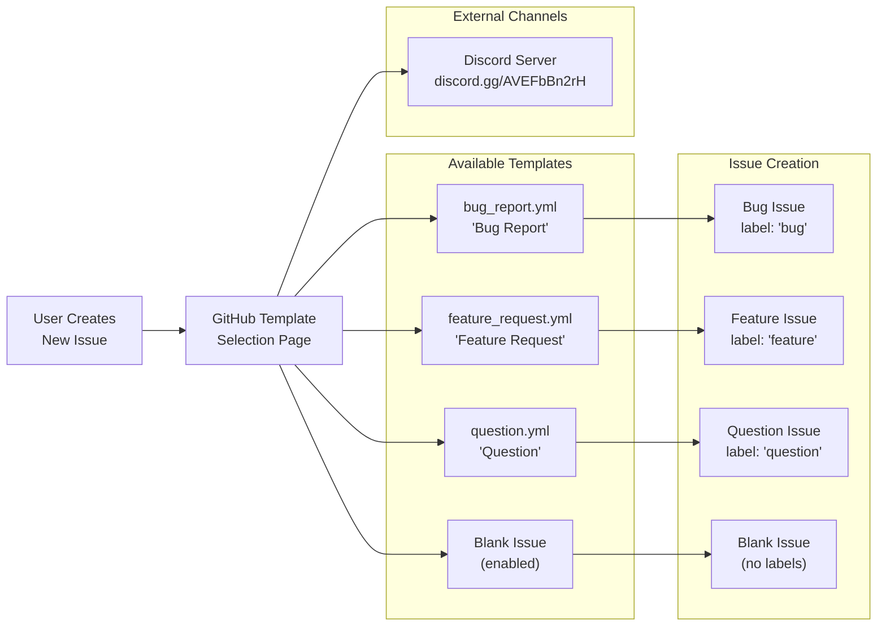
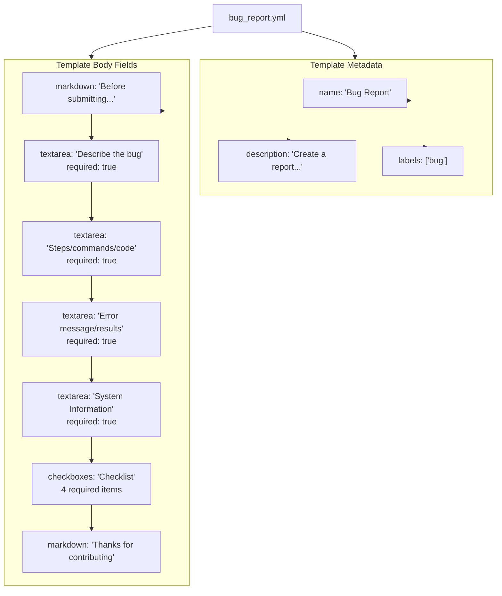
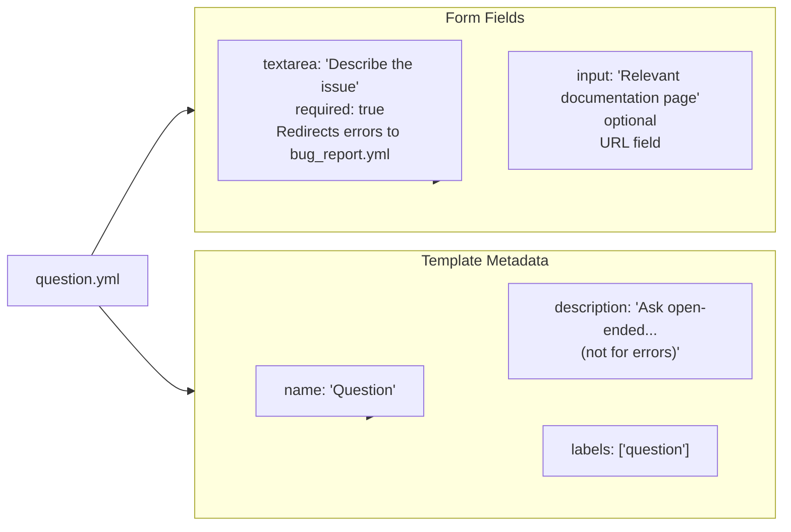
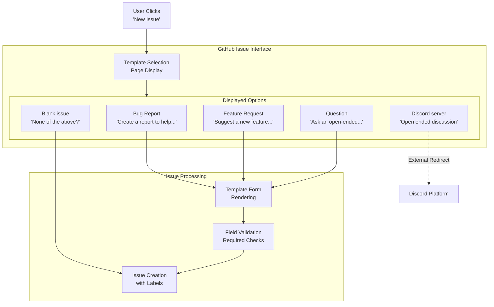

<!-- source: DeepWiki mcp.deepwiki.com · repo allenai/SERA · page 7.2 Issue Templates · fetched 2026-10-26 -->

# Issue Templates

Relevant source files

The following files were used as context for generating this wiki page:

- [modules/SWE-agent/.github/ISSUE_TEMPLATE/bug_report.yml](modules/SWE-agent/.github/ISSUE_TEMPLATE/bug_report.yml)
- [modules/SWE-agent/.github/ISSUE_TEMPLATE/config.yml](modules/SWE-agent/.github/ISSUE_TEMPLATE/config.yml)
- [modules/SWE-agent/.github/ISSUE_TEMPLATE/feature_request.yml](modules/SWE-agent/.github/ISSUE_TEMPLATE/feature_request.yml)
- [modules/SWE-agent/.github/ISSUE_TEMPLATE/question.yml](modules/SWE-agent/.github/ISSUE_TEMPLATE/question.yml)

## Purpose and Scope

This document describes the GitHub issue template system configured for the SWE-agent module. Issue templates guide contributors in submitting well-structured bug reports, feature requests, and questions. These templates enforce required information fields, apply labels automatically, and ensure issues contain sufficient detail for maintainer triage.

For information about the broader contribution process, see [Contribution Guidelines](#7.1). For the pull request workflow, see [Pull Request Process](#7.3).

## Template System Architecture

The SWE-agent module implements a structured issue template system using GitHub's YAML-based template format. The system provides three specialized templates plus configuration for blank issues and external communication channels.

**Sources:** [modules/SWE-agent/.github/ISSUE_TEMPLATE/bug_report.yml:1-73](), [modules/SWE-agent/.github/ISSUE_TEMPLATE/feature_request.yml:1-21](), [modules/SWE-agent/.github/ISSUE_TEMPLATE/question.yml:1-21](), [modules/SWE-agent/.github/ISSUE_TEMPLATE/config.yml:1-9]()

## Template Configuration

The [modules/SWE-agent/.github/ISSUE_TEMPLATE/config.yml:1-9]() file configures the overall template system behavior. The configuration enables blank issues and provides contact links for scenarios not covered by the structured templates.

| Configuration Key | Value | Purpose |
|------------------|--------|---------|
| `blank_issues_enabled` | `true` | Allows users to create issues without using a template |
| Contact Link: Blank Issue | `https://github.com/SWE-agent/SWE-agent/issues/new` | Direct link for creating unstructured issues |
| Contact Link: Discord | `https://discord.gg/AVEFbBn2rH` | Redirects open-ended discussions to Discord |

**Sources:** [modules/SWE-agent/.github/ISSUE_TEMPLATE/config.yml:1-9]()

## Bug Report Template

The bug report template ([modules/SWE-agent/.github/ISSUE_TEMPLATE/bug_report.yml]()) enforces comprehensive bug documentation with mandatory fields for reproduction steps, error messages, and system information. The template automatically applies the `bug` label to all issues created with it.

### Template Structure

**Sources:** [modules/SWE-agent/.github/ISSUE_TEMPLATE/bug_report.yml:1-73]()

### Required Fields

| Field Type | Label | Validation | Purpose |
|-----------|-------|------------|---------|
| `textarea` | Describe the bug | Required | Clear description of unexpected behavior |
| `textarea` | Steps/commands/code to Reproduce | Required | Full command, setup method (docker/conda), code samples in triple backticks |
| `textarea` | Error message/results | Required | Complete log files from trajectory folder (*.log files) |
| `textarea` | System Information | Required | OS, processor architecture, Python version, swebench package version |
| `checkboxes` | Checklist | 4 required | Verification of latest version, full command/code, full log, proper formatting |

The template emphasizes text-based submissions over screenshots through explicit instructions at [modules/SWE-agent/.github/ISSUE_TEMPLATE/bug_report.yml:22-24]() and [modules/SWE-agent/.github/ISSUE_TEMPLATE/bug_report.yml:38-39]().

### Checklist Requirements

The mandatory checklist ([modules/SWE-agent/.github/ISSUE_TEMPLATE/bug_report.yml:55-68]()) ensures issue quality:

1. Running latest docker container or development version (after `git pull`)
2. Full command/code copied as text (not screenshot)
3. Full log file/error message copied as text (not screenshot)
4. Code/logs enclosed in triple backticks with preview verification

**Sources:** [modules/SWE-agent/.github/ISSUE_TEMPLATE/bug_report.yml:1-73]()

## Feature Request Template

The feature request template ([modules/SWE-agent/.github/ISSUE_TEMPLATE/feature_request.yml]()) guides users in proposing new functionality. Unlike the bug template, it focuses on describing desired capabilities and potential implementation approaches. The template automatically applies the `feature` label.

### Field Structure

| Field Type | Label | Validation | Content Guidelines |
|-----------|-------|------------|-------------------|
| `textarea` | Describe the feature | Required | Feature description, current workarounds, expected improvements |
| `textarea` | Potential Solutions | Required | Links to similar features, diagrams, references |

The feature description field explicitly prompts users to explain current workarounds and expected benefits ([modules/SWE-agent/.github/ISSUE_TEMPLATE/feature_request.yml:8-12]()), facilitating impact assessment by maintainers.

The potential solutions field ([modules/SWE-agent/.github/ISSUE_TEMPLATE/feature_request.yml:16-18]()) encourages research by requesting links to similar implementations, diagrams, and references that could inform the design.

**Sources:** [modules/SWE-agent/.github/ISSUE_TEMPLATE/feature_request.yml:1-21]()

## Question Template

The question template ([modules/SWE-agent/.github/ISSUE_TEMPLATE/question.yml]()) handles open-ended inquiries about SWE-agent usage and documentation gaps. The template explicitly redirects users experiencing errors to the bug report template instead.

### Template Fields

**Sources:** [modules/SWE-agent/.github/ISSUE_TEMPLATE/question.yml:1-21]()

### Field Details

The primary field "Describe the issue" ([modules/SWE-agent/.github/ISSUE_TEMPLATE/question.yml:6-15]()) serves dual purposes:
- Documentation confusion or missing information
- General usage questions

The template explicitly redirects error scenarios to the bug report template at [modules/SWE-agent/.github/ISSUE_TEMPLATE/question.yml:12-13](), maintaining clear separation between support types.

The optional "Relevant documentation page" field ([modules/SWE-agent/.github/ISSUE_TEMPLATE/question.yml:16-20]()) helps maintainers identify specific documentation improvements by linking directly to problematic pages.

**Sources:** [modules/SWE-agent/.github/ISSUE_TEMPLATE/question.yml:1-21]()

## Template Field Type Reference

GitHub issue templates support multiple field types with varying validation capabilities. The SWE-agent templates utilize three primary field types:

| Field Type | Usage in Templates | Characteristics |
|-----------|-------------------|-----------------|
| `markdown` | Bug template intro, conclusion | Display-only, provides instructions and guidance |
| `textarea` | All substantive fields in all templates | Multi-line text input with required/optional validation |
| `input` | Question template documentation URL | Single-line text input for short responses |
| `checkboxes` | Bug template verification checklist | Multiple boolean checks with individual required flags |

### Textarea Field Configuration

Textarea fields ([modules/SWE-agent/.github/ISSUE_TEMPLATE/bug_report.yml:11-45]()) support:
- `label`: Field name displayed to users
- `description`: Help text with formatting instructions
- `placeholder`: Example content showing expected format
- `validations.required`: Boolean enforcement flag

### Checkbox Field Configuration

The checkbox field ([modules/SWE-agent/.github/ISSUE_TEMPLATE/bug_report.yml:55-68]()) implements granular validation:
- Array of `options` with individual `label` and `required` properties
- Each checkbox can be independently required
- All four checklist items in the bug template are mandatory

**Sources:** [modules/SWE-agent/.github/ISSUE_TEMPLATE/bug_report.yml:1-73](), [modules/SWE-agent/.github/ISSUE_TEMPLATE/feature_request.yml:1-21](), [modules/SWE-agent/.github/ISSUE_TEMPLATE/question.yml:1-21]()

## Code Formatting Enforcement

All templates emphasize proper code formatting through triple backtick notation. The bug report template provides explicit instructions at multiple points:

- Steps field ([modules/SWE-agent/.github/ISSUE_TEMPLATE/bug_report.yml:24]()): Links to GitHub's code quoting documentation
- Steps placeholder ([modules/SWE-agent/.github/ISSUE_TEMPLATE/bug_report.yml:28-30]()): Shows example with triple backticks
- Error message field ([modules/SWE-agent/.github/ISSUE_TEMPLATE/bug_report.yml:38]()): Repeats triple backtick instructions
- Error placeholder ([modules/SWE-agent/.github/ISSUE_TEMPLATE/bug_report.yml:40-43]()): Demonstrates full log file formatting
- Checklist item 4 ([modules/SWE-agent/.github/ISSUE_TEMPLATE/bug_report.yml:67-68]()): Requires preview verification

This repetition reduces improperly formatted issues containing unreadable code blocks or screenshots instead of text.

**Sources:** [modules/SWE-agent/.github/ISSUE_TEMPLATE/bug_report.yml:22-68]()

## Template Label Assignment

Labels are automatically applied based on the template used:

| Template File | Automatic Label | Purpose |
|--------------|----------------|---------|
| `bug_report.yml` | `bug` | Identifies issues requiring fixes |
| `feature_request.yml` | `feature` | Marks enhancement proposals |
| `question.yml` | `question` | Denotes support inquiries |
| Blank issue | None | User-defined categorization |

Label assignment occurs at [modules/SWE-agent/.github/ISSUE_TEMPLATE/bug_report.yml:3](), [modules/SWE-agent/.github/ISSUE_TEMPLATE/feature_request.yml:3](), and [modules/SWE-agent/.github/ISSUE_TEMPLATE/question.yml:3]() in the template metadata section.

**Sources:** [modules/SWE-agent/.github/ISSUE_TEMPLATE/bug_report.yml:3](), [modules/SWE-agent/.github/ISSUE_TEMPLATE/feature_request.yml:3](), [modules/SWE-agent/.github/ISSUE_TEMPLATE/question.yml:3]()

## Integration with Issue Management

The template system integrates with GitHub's issue management interface:

**Sources:** [modules/SWE-agent/.github/ISSUE_TEMPLATE/config.yml:1-9](), [modules/SWE-agent/.github/ISSUE_TEMPLATE/bug_report.yml:1-3](), [modules/SWE-agent/.github/ISSUE_TEMPLATE/feature_request.yml:1-3](), [modules/SWE-agent/.github/ISSUE_TEMPLATE/question.yml:1-3]()

## Template Maintenance Considerations

The template files follow GitHub's YAML schema requirements:

1. **Top-level metadata**: `name`, `description`, and `labels` fields define template presentation
2. **Body array**: Contains ordered field definitions rendered sequentially
3. **Field validation**: `validations.required` enforces mandatory fields before submission
4. **Markdown elements**: Non-input fields provide contextual instructions

Template modifications should maintain consistency with the existing validation structure to prevent breaking changes to the issue submission workflow. All templates reside in [modules/SWE-agent/.github/ISSUE_TEMPLATE/]() and are automatically detected by GitHub's issue creation interface.

**Sources:** [modules/SWE-agent/.github/ISSUE_TEMPLATE/bug_report.yml:1-73](), [modules/SWE-agent/.github/ISSUE_TEMPLATE/feature_request.yml:1-21](), [modules/SWE-agent/.github/ISSUE_TEMPLATE/question.yml:1-21]()

---

