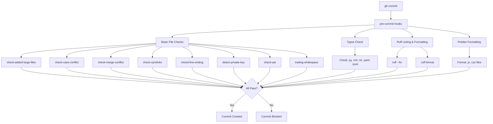
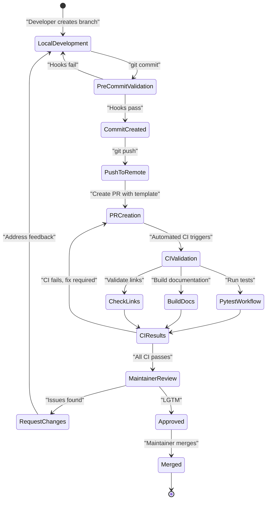

<!-- source: DeepWiki mcp.deepwiki.com · repo allenai/SERA · page 7.3 Pull Request Process · fetched 2026-10-26 -->

# Pull Request Process

<details>
<summary>Relevant source files</summary>

The following files were used as context for generating this wiki page:

- [modules/SWE-agent/.github/PULL_REQUEST_TEMPLATE.md](modules/SWE-agent/.github/PULL_REQUEST_TEMPLATE.md)
- [modules/SWE-agent/.pre-commit-config.yaml](modules/SWE-agent/.pre-commit-config.yaml)

</details>


## Purpose and Scope

This document describes the pull request submission and review process for the SERA repository. It covers the standardized PR template structure, automated quality checks that run before and after submission, and the review workflow. For contribution guidelines and setup instructions, see [Contribution Guidelines](#7.1). For information about issue templates that may be referenced in PRs, see [Issue Templates](#7.2).

## Pull Request Template Structure

All pull requests must follow the standardized template defined in [modules/SWE-agent/.github/PULL_REQUEST_TEMPLATE.md](). The template ensures contributors provide essential information for reviewers.

### Required Sections

| Section | Purpose | Requirements |
|---------|---------|--------------|
| **Reference Issues/PRs** | Link to related issues and PRs | Must use GitHub keywords (`Fixes`, `Closes`, `Resolves`) to auto-close issues |
| **What does this implement/fix?** | Explain changes and their impact | Brief explanation of solution, list of modified files/entities |

The template uses HTML comments to provide inline guidance to contributors, ensuring they understand what information is expected in each section.

**Sources:** [modules/SWE-agent/.github/PULL_REQUEST_TEMPLATE.md:1-19]()

## Pre-Commit Quality Checks

Before code can be committed, automated quality checks run locally via pre-commit hooks. These hooks enforce code standards and prevent common issues from reaching the repository.



**Diagram: Pre-Commit Hook Execution Flow**

### Hook Categories

The pre-commit configuration [modules/SWE-agent/.pre-commit-config.yaml]() defines four primary categories of checks:

#### 1. Basic File Validation

Runs checks from `pre-commit/pre-commit-hooks` repository:

- `check-added-large-files` - Prevents large files from being committed
- `check-case-conflict` - Detects case-insensitive filename conflicts
- `check-merge-conflict` - Identifies unresolved merge conflict markers
- `check-symlinks` - Validates symbolic links
- `mixed-line-ending` - Ensures consistent line endings
- `detect-private-key` - Prevents accidental credential commits
- `check-ast` - Validates Python syntax by parsing AST
- `trailing-whitespace` - Removes trailing whitespace

#### 2. Spelling Validation

The `typos` hook from `crate-ci/typos` checks for spelling errors in:
- Python files (`.py`)
- Markdown files (`.md`)
- reStructuredText files (`.rst`)
- YAML files (`.yaml`)
- TOML files (`.toml`)

Note: `pyproject.toml` is excluded from typo checking [modules/SWE-agent/.pre-commit-config.yaml:22]().

#### 3. Python Code Quality

The Ruff linter and formatter (`astral-sh/ruff-pre-commit`) runs two operations:

- **`ruff` with `--fix` flag**: Automatically fixes linting issues where possible
- **`ruff-format`**: Applies consistent code formatting

#### 4. JavaScript/CSS Formatting

The `prettier` hook formats JavaScript and CSS files to maintain consistent styling conventions.

### Exclusion Patterns

Certain directories are excluded from pre-commit checks:
- `tests/test_data/` - Test fixture data
- `tools/.*/.*.py` - Tool-specific Python files

**Sources:** [modules/SWE-agent/.pre-commit-config.yaml:1-39]()

## Pull Request Lifecycle



**Diagram: Complete Pull Request State Machine**

### Stage 1: Local Development

1. Developer creates a feature branch
2. Makes code changes
3. Attempts to commit using `git commit`
4. Pre-commit hooks execute automatically [modules/SWE-agent/.pre-commit-config.yaml:1-39]()
5. If hooks fail, commit is blocked and developer must fix issues
6. If hooks pass, commit is created

### Stage 2: Pull Request Creation

1. Developer pushes commits to remote repository
2. Opens pull request using GitHub interface
3. PR template auto-populates [modules/SWE-agent/.github/PULL_REQUEST_TEMPLATE.md]()
4. Developer fills in required sections:
   - References related issues using keywords like `Fixes #1234` [modules/SWE-agent/.github/PULL_REQUEST_TEMPLATE.md:5-11]()
   - Explains implementation details [modules/SWE-agent/.github/PULL_REQUEST_TEMPLATE.md:13-18]()

### Stage 3: Automated CI Validation

After PR creation, automated workflows execute (documented in [CI/CD and Automation](#6)):

- **Testing Workflow** - Runs pytest suite with coverage reporting (see [Testing Workflow](#6.1))
- **Documentation Build** - Validates that documentation builds successfully (see [Documentation Build](#6.2))
- **Link Checking** - Ensures all documentation links are valid (see [Code Quality Automation](#6.3))

### Stage 4: Code Review

Maintainers review the pull request, evaluating:

| Review Aspect | Evaluation Criteria |
|---------------|-------------------|
| **Code Quality** | Adherence to project standards, proper formatting |
| **Test Coverage** | Adequate tests for new functionality |
| **Documentation** | Updated docs for API/behavior changes |
| **Issue Resolution** | PR addresses referenced issues completely |
| **Breaking Changes** | Backward compatibility considerations |

### Stage 5: Merge

Once approved and all CI checks pass, a maintainer merges the pull request. The merge action automatically:
- Closes referenced issues (via keywords in PR description)
- Triggers post-merge workflows
- Updates documentation if on main branch

**Sources:** [modules/SWE-agent/.github/PULL_REQUEST_TEMPLATE.md:1-19](), [modules/SWE-agent/.pre-commit-config.yaml:1-39]()

## Pre-Commit Hook Installation

Contributors must install pre-commit hooks to enable automatic validation:

```bash
# Install pre-commit package
pip install pre-commit

# Install hooks from .pre-commit-config.yaml
pre-commit install

# (Optional) Run hooks on all files
pre-commit run --all-files
```

The configuration file [modules/SWE-agent/.pre-commit-config.yaml]() automatically updates hook versions when run on the CI service, with commit messages formatted as `"chore: update pre-commit hooks"` [modules/SWE-agent/.pre-commit-config.yaml:2]().

**Sources:** [modules/SWE-agent/.pre-commit-config.yaml:1-3]()

## Issue Linking Best Practices

The PR template emphasizes proper issue linking using GitHub keywords. This creates automatic associations between PRs and issues.

### Supported Keywords

| Keyword | Effect | Example |
|---------|--------|---------|
| `Fixes` | Closes issue when PR merges | `Fixes #123` |
| `Closes` | Closes issue when PR merges | `Closes #456` |
| `Resolves` | Closes issue when PR merges | `Resolves #789` |
| `See also` | Creates reference without closing | `See also #999` |

Multiple issues can be referenced in a single PR using comma separation or multiple keyword statements.

**Sources:** [modules/SWE-agent/.github/PULL_REQUEST_TEMPLATE.md:5-11]()

## Common Validation Failures

### Pre-Commit Hook Failures

| Hook | Common Failure Reason | Resolution |
|------|----------------------|------------|
| `check-added-large-files` | Binary files or datasets added | Use Git LFS or external storage |
| `detect-private-key` | API keys in code | Move to configuration files (see [API Key Configuration](#4.2)) |
| `ruff` | Python linting errors | Run `ruff --fix` manually or fix reported issues |
| `ruff-format` | Inconsistent formatting | Formatting auto-applied, re-stage files |
| `typos` | Spelling errors in docs | Fix typos or add to typos ignore list |
| `check-ast` | Python syntax errors | Fix syntax before committing |

### CI Workflow Failures

If automated CI workflows fail after PR submission:

1. Check workflow logs in GitHub Actions tab
2. Fix issues locally
3. Push additional commits to the PR branch
4. CI re-runs automatically on new commits

For details on specific CI workflows, see:
- [Testing Workflow](#6.1) for pytest failures
- [Documentation Build](#6.2) for documentation errors
- [Code Quality Automation](#6.3) for link validation issues

**Sources:** [modules/SWE-agent/.pre-commit-config.yaml:5-38]()

## Auto-Update Configuration

The pre-commit configuration includes automatic updates via the `pre-commit.ci` service:

```yaml
ci:
  autoupdate_commit_msg: "chore: update pre-commit hooks"
```

This ensures hook versions stay current without manual intervention. When updates are available, the CI service automatically creates pull requests to update hook versions in [modules/SWE-agent/.pre-commit-config.yaml]().

**Sources:** [modules/SWE-agent/.pre-commit-config.yaml:1-2]()

---

