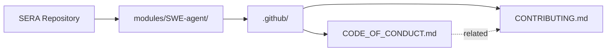
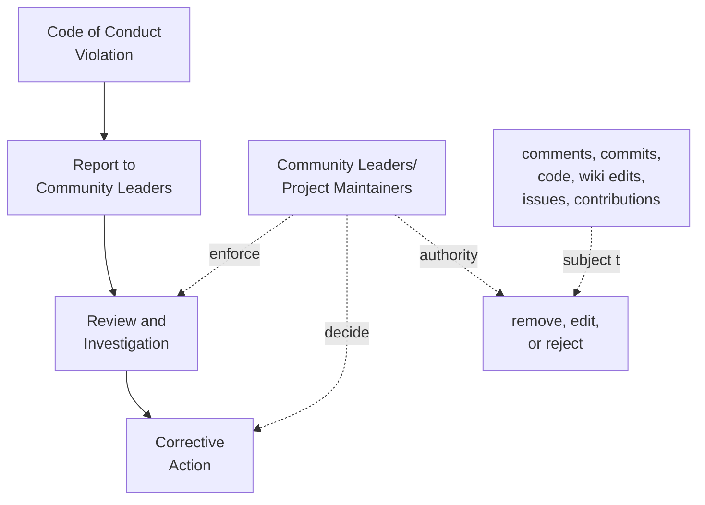
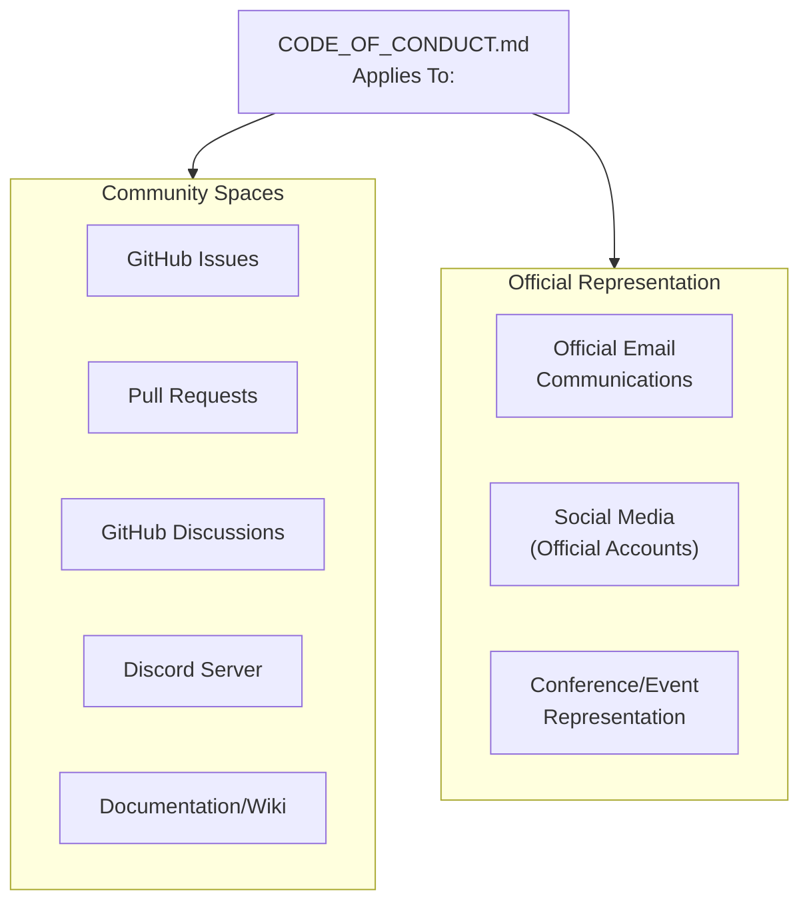
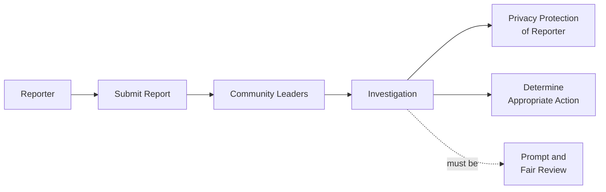
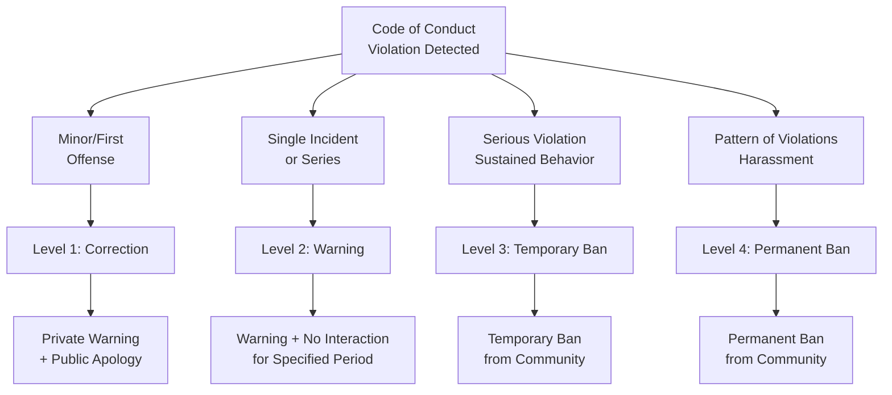
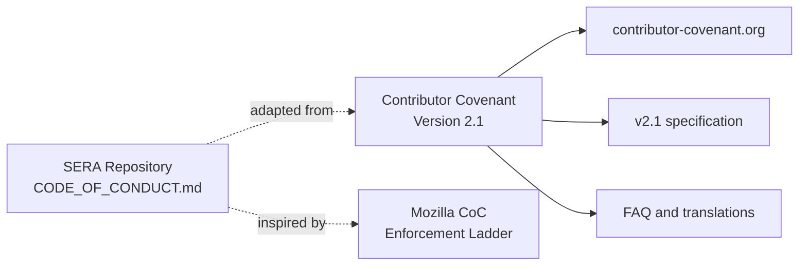
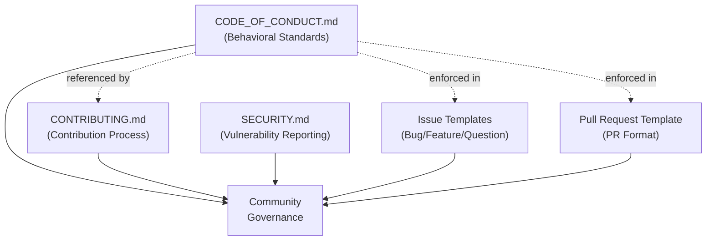

<!-- source: DeepWiki mcp.deepwiki.com · repo allenai/SERA · page 7.4 Code of Conduct · fetched 2026-10-26 -->

# Code of Conduct

Relevant source files

The following files were used as context for generating this wiki page:

- [modules/SWE-agent/.github/CODE_OF_CONDUCT.md](modules/SWE-agent/.github/CODE_OF_CONDUCT.md)

## Purpose and Scope

This document details the community behavioral standards and enforcement procedures defined in the SERA repository's Code of Conduct. The Code of Conduct establishes expectations for all participants in the SERA community, including contributors, users, and maintainers. It is based on the Contributor Covenant version 2.1 and applies to all community spaces and official representation of the project.

For information about technical contribution processes, see [Contribution Guidelines](#7.1). For information about the pull request review process, see [Pull Request Process](#7.3). For security vulnerability reporting procedures, see [Security Policy](#7.5).

**Sources:** [modules/SWE-agent/.github/CODE_OF_CONDUCT.md:1-135]()

---

## Code of Conduct Location

The Code of Conduct is located at [modules/SWE-agent/.github/CODE_OF_CONDUCT.md:1-135]() within the SWE-agent submodule. This placement ensures it is visible in the GitHub repository's community health files section.

**Sources:** [modules/SWE-agent/.github/CODE_OF_CONDUCT.md:1-135]()

---

## Community Pledge

The Code of Conduct establishes a pledge by all community members, contributors, and leaders to make participation a harassment-free experience for everyone, regardless of personal characteristics including but not limited to age, disability, ethnicity, gender identity, experience level, education, socio-economic status, nationality, appearance, race, caste, color, religion, or sexual identity and orientation.

The pledge commits the community to act and interact in ways that contribute to an open, welcoming, diverse, inclusive, and healthy community.

**Sources:** [modules/SWE-agent/.github/CODE_OF_CONDUCT.md:4-14]()

---

## Behavioral Standards

### Positive Behaviors

The Code of Conduct defines examples of behavior that contribute to a positive community environment:

| Positive Behavior | Description |
|-------------------|-------------|
| **Empathy and Kindness** | Demonstrating empathy and kindness toward other people |
| **Respect** | Being respectful of differing opinions, viewpoints, and experiences |
| **Constructive Feedback** | Giving and gracefully accepting constructive feedback |
| **Accountability** | Accepting responsibility and apologizing to those affected by mistakes, and learning from the experience |
| **Community Focus** | Focusing on what is best for the overall community, not just individuals |

**Sources:** [modules/SWE-agent/.github/CODE_OF_CONDUCT.md:16-27]()

### Unacceptable Behaviors

The Code of Conduct explicitly prohibits the following behaviors:

| Unacceptable Behavior | Definition |
|-----------------------|------------|
| **Sexualized Content** | Use of sexualized language or imagery, and sexual attention or advances of any kind |
| **Trolling and Insults** | Trolling, insulting or derogatory comments, and personal or political attacks |
| **Harassment** | Public or private harassment |
| **Privacy Violations** | Publishing others' private information (physical or email address) without explicit permission |
| **Inappropriate Conduct** | Other conduct which could reasonably be considered inappropriate in a professional setting |

**Sources:** [modules/SWE-agent/.github/CODE_OF_CONDUCT.md:29-38]()

---

## Enforcement Structure

### Responsibilities

Community leaders are responsible for clarifying and enforcing standards of acceptable behavior. They have the authority to take appropriate and fair corrective action in response to inappropriate, threatening, offensive, or harmful behavior.

Community leaders have the right and responsibility to:
- Remove, edit, or reject comments, commits, code, wiki edits, issues, and other contributions that are not aligned with the Code of Conduct
- Communicate reasons for moderation decisions when appropriate

**Sources:** [modules/SWE-agent/.github/CODE_OF_CONDUCT.md:40-50]()

### Scope of Application

The Code of Conduct applies in two contexts:

1. **All Community Spaces**: The Code of Conduct applies within all community spaces maintained by the project
2. **Official Representation**: The Code of Conduct also applies when an individual is officially representing the community in public spaces

Examples of representing the community include:
- Using an official project email address
- Posting via an official social media account
- Acting as an appointed representative at an online or offline event

**Sources:** [modules/SWE-agent/.github/CODE_OF_CONDUCT.md:52-58]()

---

## Reporting and Investigation

### Reporting Process

Instances of abusive, harassing, or otherwise unacceptable behavior may be reported to the community leaders responsible for enforcement. The Code of Conduct currently indicates `[INSERT CONTACT METHOD]` at [modules/SWE-agent/.github/CODE_OF_CONDUCT.md:64](), which should be configured with the appropriate contact information for the project maintainers.

All complaints will be reviewed and investigated promptly and fairly. Community leaders are obligated to respect the privacy and security of the reporter of any incident.

**Sources:** [modules/SWE-agent/.github/CODE_OF_CONDUCT.md:60-68]()

### Investigation Flow

**Sources:** [modules/SWE-agent/.github/CODE_OF_CONDUCT.md:60-68]()

---

## Enforcement Guidelines

Community leaders follow a four-level Community Impact Guidelines system to determine consequences for Code of Conduct violations. This graduated enforcement approach is based on the severity and pattern of the violation.

### Enforcement Ladder Overview

**Sources:** [modules/SWE-agent/.github/CODE_OF_CONDUCT.md:70-114]()

### Level 1: Correction

| Aspect | Detail |
|--------|--------|
| **Community Impact** | Use of inappropriate language or other behavior deemed unprofessional or unwelcome in the community |
| **Consequence** | A private, written warning from community leaders, providing clarity around the nature of the violation and an explanation of why the behavior was inappropriate |
| **Potential Additional Action** | A public apology may be requested |

**Sources:** [modules/SWE-agent/.github/CODE_OF_CONDUCT.md:75-82]()

### Level 2: Warning

| Aspect | Detail |
|--------|--------|
| **Community Impact** | A violation through a single incident or series of actions |
| **Consequence** | A warning with consequences for continued behavior. No interaction with the people involved, including unsolicited interaction with those enforcing the Code of Conduct, for a specified period of time |
| **Scope** | Includes avoiding interactions in community spaces as well as external channels like social media |
| **Escalation** | Violating these terms may lead to a temporary or permanent ban |

**Sources:** [modules/SWE-agent/.github/CODE_OF_CONDUCT.md:84-94]()

### Level 3: Temporary Ban

| Aspect | Detail |
|--------|--------|
| **Community Impact** | A serious violation of community standards, including sustained inappropriate behavior |
| **Consequence** | A temporary ban from any sort of interaction or public communication with the community for a specified period of time |
| **Restrictions** | No public or private interaction with the people involved, including unsolicited interaction with those enforcing the Code of Conduct, is allowed during this period |
| **Escalation** | Violating these terms may lead to a permanent ban |

**Sources:** [modules/SWE-agent/.github/CODE_OF_CONDUCT.md:96-105]()

### Level 4: Permanent Ban

| Aspect | Detail |
|--------|--------|
| **Community Impact** | Demonstrating a pattern of violation of community standards, including sustained inappropriate behavior, harassment of an individual, or aggression toward or disparagement of classes of individuals |
| **Consequence** | A permanent ban from any sort of public interaction within the community |
| **Finality** | This is the most severe enforcement action and results in complete removal from all community spaces |

**Sources:** [modules/SWE-agent/.github/CODE_OF_CONDUCT.md:107-114]()

### Enforcement Action Matrix

| Level | Severity | Duration | Interaction Allowed | Appeal/Reversal |
|-------|----------|----------|---------------------|-----------------|
| **Correction** | Minor | N/A | Yes | Resolved after warning |
| **Warning** | Moderate | Specified period | No (with involved parties) | Can escalate if violated |
| **Temporary Ban** | Serious | Specified period | No (community-wide) | Can escalate if violated |
| **Permanent Ban** | Severe/Pattern | Permanent | No (community-wide) | Typically final |

**Sources:** [modules/SWE-agent/.github/CODE_OF_CONDUCT.md:70-114]()

---

## Attribution and Version

The SERA repository's Code of Conduct is adapted from the [Contributor Covenant](https://www.contributor-covenant.org), version 2.1. The Contributor Covenant is a widely-adopted community standard for open source projects.

The Community Impact Guidelines that define the four-level enforcement ladder were inspired by [Mozilla's code of conduct enforcement ladder](https://github.com/mozilla/diversity).

**Sources:** [modules/SWE-agent/.github/CODE_OF_CONDUCT.md:116-133]()

### Reference Links

The Code of Conduct includes the following reference links for additional information:

| Resource | URL |
|----------|-----|
| Contributor Covenant Homepage | https://www.contributor-covenant.org |
| Version 2.1 Specification | https://www.contributor-covenant.org/version/2/1/code_of_conduct.html |
| FAQ | https://www.contributor-covenant.org/faq |
| Translations | https://www.contributor-covenant.org/translations |
| Mozilla CoC | https://github.com/mozilla/diversity |

**Sources:** [modules/SWE-agent/.github/CODE_OF_CONDUCT.md:129-133]()

---

## Integration with Other Community Documents

The Code of Conduct is part of a broader community governance framework that includes related documents:

**Sources:** [modules/SWE-agent/.github/CODE_OF_CONDUCT.md:1-135]()

The Code of Conduct sets the behavioral framework within which all other community processes operate. Contributors should be familiar with both the Code of Conduct and the [Contribution Guidelines](#7.1) to participate effectively in the SERA community.

---

